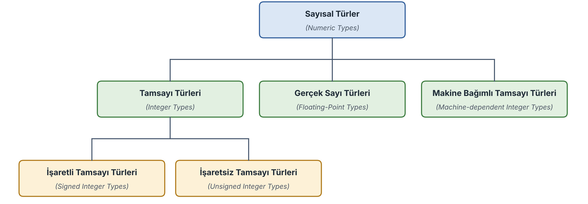

=====================
Rust'ın Temel Türleri
=====================

Bir programlama dili öğrenilirken ilk öğrenilecek şeylerden biri o programlama dilinin temel türleridir. Biz de bu bölümde
Rust'ın temel türlerini açıklayacağız.

Rust'ın Tür Kategorileri
========================

*The Rust Reference* dokümanlarına göre Rust'taki türler şu kategorilerden oluşmaktadır:

* **Primitive types**

  * Boolean
  * Numeric
  * Textual
  * Never

* **Sequence types**

  * Tuple
  * Array
  * Slice

* **User-defined types**

  * Struct
  * Enum
  * Union

* **Function types**

  * Functions
  * Closures

* **Pointer types**

  * References
  * Raw pointers
  * Function pointers

* **Trait types**

  * Trait objects
  * Impl trait

Biz burada önce *temel türleri (primitive type)* sonra ilerleyen bölümlerde de *demet (tuple)*, *dizi (array)* ve *dilim
(slice)* gibi *dizilim türlerini (sequence types)* ve kullanıcı tanımlı türleri göreceğiz.

Tamsayı Türleri
===============

Rust'ta **sayısal türler (numeric types)** kendi aralarında **tamsayı türleri integer types)**, **gerçek sayı türleri (floating-point types)** 
ve **makine bağımlı tamsayı türleri (machine-dependent integer types)** olmak üzere üçe ayrılmaktadır: biçiminde üçe ayrılmaktadır. 
Tamsayı türleri de kendi aralarında **işaretli tamsayı türleri (signed integer types)** ve **işaretsiz tamsayı türleri (unsigned integer types)** 
olmak üzere ikiye ayrılmaktadır:

Rust'ta işaretli tamsayılar ikiye tümleyen aritmetiği ile tutulmaktadır. (Halbuki örneğin C ve C++ standartlarında her 
ne kadar tüm derleyiciler ikiye tümleyen aritmetiğini kullanıyor olsa da işaretli tamsayıların ikiye tümleyen aritmetiği 
ile tutulacağı konusunda bir garanti verilmemiştir.) Rust'ta tamsayı türlerinin isimleri oldukça kısa bir biçimde oluşturulmuştur. 
*N* bit sayısını belirtmek üzere işaretli tamsayı türlerinin isimleri *iN* biçiminde, işaretsiz tamsayı türlerinin isimleri de 
*uN* biçimindedir. Rust'ın tüm tamsayı türlerinin isimleri aşağıda verilmiştir:

**İşaretli Tamsayı Türleri**

- ``i8``
- ``i16``
- ``i32``
- ``i64``
- ``i128``

**İşaretsiz Tamsayı Türleri**

- ``u8``
- ``u16``
- ``u32``
- ``u64``
- ``u128``

**Makine Bağımlı Tamsayı Türleri**

- ``isize``
- ``usize``

Anımsanacağı gibi 2'ye tümleyen aritmetiğinde N bitlik bir işaretli tamsayının sınır değerleri [-2\ :sup:`N-1`, +2\ :sup:`N-1` - 1] 
aralığındadır. Rust'ta 128 bitlik tamsayı türünün de olduğuna dikkat ediniz. Henüz 128 bitlik işlemciler kullanılmıyor olsa da 
bazı durumlarda (özellikle bit işlemlerinde) 128 bitlik tamsayılar daha verimli kod yazımını sağlayabilmektedir. 
Aşağıda tansayı türlerinin sınır değerlerini bir tablo halinde veriyoruz:

.. list-table:: 
   :header-rows: 1

   * - Tür
     - Bit
     - En Küçük Değer
     - En Büyük Değer
   * - ``i8``
     - 8
     - ``-128``
     - ``127``
   * - ``i16`` 
     - 16
     - ``-32768``
     - ``32767``
   * - ``i32``
     - 32
     - ``-2147483648``
     - ``2147483647``
   * - ``i64``
     - 64
     - ``-9223372036854775808``
     - ``9223372036854775807``
   * - ``i128``
     - 128
     - ``-170141183460469231731687303715884105728``
     - ``170141183460469231731687303715884105727``
   * - ``u8``
     - 8
     - ``0``
     - ``255``
   * - ``u16``
     - 16
     - ``0``
     - ``65535``
   * - ``u32``
     - 32
     - ``0``
     - ``4294967295``
   * - ``u64``
     - 64
     - ``0``
     - ``18446744073709551615``
   * - ``u128``
     - 128
     - ``0``
     - ``340282366920938463463374607431768211455``
   * - ``isize``
     - 32/64
     - ``i32`` ya da ``i64`` ile aynı
     - ``i32`` ya da ``i64`` ile aynı
   * - ``usize``
     - 32/64
     - ``0``
     - ``u32`` ya da ``u64`` ile aynı

Rust'ta ayrıca çalışılan sisteme bağlı uzunlukta olan isize ve usize isimli iki tamsayı türü de vardır. Bu tamsayı
türleri çalışılan sistemdeki teorik bellek büyüklüğüne hizalanmış olan bir uzunluğa sahiptir. Dolayısıyla bu türler 32
bit sistemlerde 32 bit (4 byte), 64 bit sistemlerde 64 bit (8 byte) uzunluğundadır. Bugün artık 16 bit işlemcilerin
kullanımı oldukça azalmıştır. Ancak 16 bit işlemcilerin kullanıldığı sistemlerde bu türler 16 bit uzunluğunda olacaktır.
*The Rust Reference* dokümanlarına göre bu tür ilgili sistemdeki göstericilerin bit uzunluğu kadar olmak zorundadır.
usize türünü C'deki size_t türüne benzetebilirsiniz. C'de de size_t türünün ilgili sistemdeki teorik bellek büyüklüğüne
göre typedef edildiğini anımsayınız. Böylece sistem programcısı farklı işlemcilerin kullanıldığı sistemlerde daha
taşınabilir kodlar yazabilmektedir. İki adres bilgisini çıkardığımızda sonuç negatif de olabilir pozitif de olabilir.
İşte isize türü iki adres farkını tutabilen usize türünün işaretli biçimidir. Pek çok işletim sisteminde proseslerin
sanal bellek alanları isize büyüklüğündedir. usize ve isize türleri aynı bit uzunluğuna sahiptir. Ayrıca *The Rust
Reference* dokümanları bir yapı değişkeninin ya da dizinin bellekte kapladığı alanın en fazla isize kadar olabileceğini
söylemektedir. Yukarıda da belirttiğimiz gibi bugün yaygın sistemlerde usize ve isize ya 64 ya da 32 bit uzunluğundadır.
Yukarıda da belirttiğimiz gibi 16 bit işlemciler artık çok seyrek kullanılmaktadır. 128 bit işlemciler ise henüz
kullanıma girmemiştir. Şimdilik 128 bitlik işlemcilere gereksinim duyulmamaktadır.

Gerçek Sayı Türleri
===================

Rust'ta iki gerçek sayı türü vardır. Bunlar f32 ve f64 türleridir. *The Rust Reference* dokümanlarında bu türlerin IEEE
754 formatlarına sahip olduğu belirtilmektedir. Bugün artık matematik işlemciler ve emülasyon araçları hep bu formatı
kullanmaktadır. C Programlama Dilinin standartlarında açıkça bu formatın kullanılacağı söylenmemiştir. Oysa Rust'ta bu
durum garanti edilmektedir. Rust'ın f32 türü C'nin float türüyle, Rust'ın f64 türü C'nin double türüyle örtüşmektedir.
C'de long double isminde bir gerçek sayı türünün daha olduğunu anımsayınız. C'nin long double pek çok derleyicide double
türüyle aynı uzunluktadır. (Tabii aslında C'de float türünün 4 byte double türünün 8 olacağının da bir garantisi de
yoktur. Ancak yaygın derleyicilerin hepsinde durum böyledir.)

bool Türü
=========

Rust'ta pek çok programlama dilinde olduğu gibi true ve false değerlerinin tutulduğu bool isminde bir tür de vardır.
Rust'ta bool türünün 1 byte yer kaplayacağı garanti edilmiştir. (C ve C++'ın böyle bir garanti vermediğini anımsayınız.)
Ayrıca false değerinin bitsel olarak 0 ve true değerinin de bitsel olarak 1 olduğu da *The Rust Reference*
dokümanlarında açıkça belirtilmiştir. C ve C++ standartlarında böyle bir belirlemede bulunulmamıştır.

Yazısal Türler 
==============

Rust'ta iki yazısal tür (textual type) vardır:

* char
* str

char türü bir karakterin Unicode UTF-32 kod numarasını (code point) tutmaktadır. Dolayısıyla char türü 4 byte
uzunluğundadır. Biz char türden bir değişkene tek tırnak içerisine aldığımız bir Unicode karakteri atayabiliriz.
Buradaki *Unicode UTF-32* teriminin anlaşılmasını sağlamak için karakter tablolama sistemleri hakkında bazı temel
bilgiler üzerinde durmak istiyoruz.

Karakterlerin bilgisayardaki temsili için oluşturulan tablolara *karakter tabloları (character sets)* denilmektedir.
Dünyanın bilgisayar alanında kullanılan ilk karakter tablosu ASCII (American Standard Code Information Interchange)
denilen tablodur. Bu tablo 60'ların başlarında tasarlanmaya başlamış ve 1963 yılında ANSI (American National Standard
Institute) tarafından standardize edilmiştir. ASCII tablosunun dışında EBCDIC gibi WISCII gibi başka karakter tabloları
da geliştirilmiştir. Bunlar arasında en yaygın kullanılanı ASCII tablosu olmuştur. ASCII tablosu 7 bitlik bir tabloydu.
Yani 128 karakter içeriyordu. Sonra zamanla 8'inci bit değişik ülkeler tarafından değişik biçimlerde organize edildi ve
*code page* varyasyonları ortaya çıkmaya başladı. Örneğin bugün Türkçe için ilk yarısı standart ASCII tablosunun aynısı
olan ikinci yarısı değişik düzenlenmiş olan üç farklı code page varyasyonu bulunmaktadır: IBM 857 (eski DOS
sistemlerinde kullanılıyordu), Microsoft 1254 (Windows'ta kullanılıyor) ve ISO 8859-9 (ISO standardı, Microsoft 1254'e
çok benziyor). Bu karakter tablolarının hepsi temelde 8 bit tablolardır. Yani en fazla 256 farklı karakteri
barındırabilmektedir. Eskiden belleklerin çok kıt olduğu dönemlerde karakterlerin az bitle ifade edilmesi anlamlıydı.
Ancak bellekler bollaşınca artık bunun önemi de kalmamıştır. 8 bitlik code page'ler dünyanın tüm dillerini ve çeşitli
işaret dillerini temsil edememektedir. Ayrıca farklı dillerdeki yazıların aynı doküman içerisinde tutulduğu durumlarda 8
bitlik code page'ler sorunlara yol açmaktadır. İşte son 30 yıldır her bir karakterin kabaca 1 byte ile değil 2 byte ile
kodlandığı ismine *Unicode* denilen bir tablo oluşturulmuştur. Unicode tablo zamanla programlama dillerini de etkisi
altına almış ve diller de bu tabloyu destekleyecek biçimde evrim geçirmişlerdir. Unicode karakter tablosu ISO tarafından
*ISO/IEC 10646* kod numarasıyla da standardize edilmiştir. Unicode tablodaki karakterlerin kod numaraları (code points)
için ilk zamanlar 2 byte yeterli oluyordu. Ancak zamanla Unicode'un çeşitli versiyonlarında tabloya karakterler eklendi.
Bugün Unicode tabloda yaklaşık 150,000 karakter bulunmaktadır. Yani artık Unicode karakterler için 2 byte da
yetmemektedir.

Karakter tablolarını anlayabilmek için bazı terimlerin anlamlarının bilinmesi gerekir. Bir karakter tablosundaki
karakterlerin görüntülerine İngilizce *glyph* denilmektedir. Karakter tablosundaki her karaktere 0'dan başlanarak bir
artan sırada bir sayı karşılık getirilir. Karakterin bu sıra numaralarına *kod numarası (code point)* denilmektedir.
Örneğin ASCII tablosunda 'a' karakterinin kod numarası 97'dir. Bir karakter tablosundaki kod numaralarının 2'lik
sistemde nasıl ifade edileceğine de *karakter kodlaması (character encoding)* denilmektedir.

Unicode tablonun ilk 128 kod numarasına ilişkin karakterleri standart ASCII karakterleriyle aynıdır. Unicode tablonun
128 ile 255 arasındaki kod numaralarına ilişkin karakterler de ASCII Latin-1 (ISO 8859-1) code page'i ile aynıdır.
Türkçe özel karakterlerin Unicode tablodaki kod numaraları 200'lü ve 300'lü sıralardadır ve bunların sıraları Türk
alfabesindeki sıra ile uyumlu değildir.

Unicode tablonun üç temel encoding'i bulunmaktadır: UTF-8, UTF-16 ve UTF-32. Unicode'un UTF-8 kodlaması multibyte bir
kodlamadır. Bu kodlamada çok kullanılan karakterler az byte ile az kullanılan karakterler çok byte ile kodlanmaktadır.
Örneğin standart ASCII karakterlerine ilişkin kod numaralarının hepsi UTF-8 kodlamasında 1 byte ile, Türkçe karakterler
2 byte ile, Japonca ve Çince'deki kanji karakterleri ise 3 byte ile ve çok az kullanılan karakterler de 4 byte ile
kodlanmaktadır. Bu nedenle Unicode UTF-8 kodlanmış bir yazının byte sayısına bakarak onun kaç karakter içerdiği
anlaşılamaz. Unicode UTF-16 kodlamasında her karakter 2 byte ile kodlanır. Eskiden Unicode tablonun tüm karakterleri
böyle 2 byte ile kodlanabiliyordu. Ancak Unicode tablo büyüyünce artık bazı karakterler UTF-16 encoding'inde iki ayrı
iki byte ile kodlanmaktadır. Zaten tüm dillerin karakterlerinin kod numaraları 65535 içerisindedir. İşte UTF-32 de her
karakterin sabit 4 byte ile kodlandığı encoding'tir. Yukarıda Unicode tablonun ilk 128 karakterinin kod numaraları ile
ASCII tablosundaki karakterlerin kod numaralarının aynı olduğunu belirtmiştik. Bu durumda standart ASCII ile kodlanmış
bir yazı ile Unicode UTF-8 kodlanmış bir yazı arasında bir farkın kalmadığına dikkat ediniz.

Java ve C# dillerindeki char türü Unicode UTF-16 encoding'ini kullanmaktadır. Zaten bu diller Unicode tablonun daha
büyük kod numaralarını doğrudan desteklememektedir. Python'daki CPython yorumlayıcısı da Unicode UTF-16 encoding'ini
kullanmaktadır. C++'a UTF-8, UTF-16 ve UTF-32 desteği C++11 standartları ile, C'ye de C11 standartları ile eklenmiştir.

İşte Rust'ta char türü en genel Unicode encoding'i olan UTF-32 encoding'ini kullanmaktadır. Bu nedenle char türü Rust'ta
4 byte uzunluktadır.

Rust'ta str türü iki tırnak içerisindeki string'leri temsil etmektedir. Bu türe Rust'ta *string dilimi (string slice)*
de denilmektedir. Ancak bu tür genel olarak referanslı bir biçimde yani &str biçiminde kullanılır. &str türüne ise
*string dilimi referansı (string slice reference)* denilmektedir. Biz Rust'ta iki tırnak içerisindeki yazıları str
türünden değişkenlere değil &str türünden değişkenlere atayabiliriz. Referans kavramının ve dilim kavramının Rust'ta ne
anlam ifade ettiği kursumuzun ilerleyen bölümlerinde ayrıntılarıyla ele alınacaktır. Burada şimdiden bir kavramı da
açıklamak istiyoruz. Rust'ta bazı türlere *dinamik uzunluğa sahip türler (dynamically sized types)* ya da kısaca
*uzunluğu bilinmeyen türler (unsized types)* denilmektedir. Dinamik uzunluğa sahip türler türünden değişkenler
bildirilememekte ancak referanslar bildirilebilmektedir.

Rust'ta iki tırnak içerisindeki yazılar Unicode UTF-8 encoding'iyle tutulmaktadır. Yukarıda da belirttiğimiz gibi
Unicode UTF-8 encoding'i ile kodlanmış yazıların karakter uzunlukları yazının kapladığı byte uzunluğuna bakarak
anlaşılamamaktadır.

Rust'ta iki tırnak içerisindeki yazıların sonunda C'de ve C++'ta olduğu gibi bir null karakter (``'\0'`` karakteri)
bulunmamaktadır. Bu nedenle Rust'ta yazının sonu özel bir karakterle değil yazının uzunluğundan hareketle
belirlenmektedir.

never Türü
==========

Rust'ta ! ile temsil edilen ismine *never türü* denilen bir tür de vardır. Bu never türü *akışın o noktadan devam
etmeyeceği* anlamına gelmektedir. Never türü özellikle fonksiyonların geri dönüş değerlerinde kullanılmaktadır.

Rust'ta Değişken Terminolojisi
==============================

Şimdi Rust'ta değişken tanımlamaları üzerinde duracağız. Rust yeni bir programlama dilidir. Bu nedenle dilin
terminolojisi de maalesef tam olarak oturtulamamıştır. Bir değişkenin oluşturulmasına yani faaliyet alanına sokulmasına
bazı dillerinde *bildirim (declaration)* bazı dillerde *tanımlama (definition)* denilmektedir. Ancak genel olarak Rust
bu iki terimi de kullanmamaktadır. Rust programcıları bu terimler yerine *değişkeni bağlamak (variable binding)*
terimini tercih etmektedir. *The Rust Reference* dokümanlarında da diğer dillerdeki bildirim ya da tanımlama işlemi için
şimdilik açık bir terim kullanılmamıştır. Ancak dokümanların değişik yerlerinde *bağlama* teriminin kullanıldığı
görülmektedir. Biz kursumuzda bir değişkenin faaliyet alanına sokulması için *bağlama (binding)* bazen de tanımlama
(definition) terimini kullanacağız.

let Deyimi
==========

Rust'ta bir değişkenin faaliyet alanına sokulması (yani bağlanması) let deyimiyle yapılmaktadır. let deyimi *kalıp
uyuşumu (pattern matching)* özelliği ile çalışır. Bu nedenle let deyiminin genel biçimi biraz ayrıntılıdır. Biz bu
bölümde kalıp uyuşumu özelliğini göz ardı ederek let deyiminin temel kullanımı üzerinde duracağız.

let deyiminin genel biçimi kabaca şöyledir:

.. code-block:: text

   let <kalıp> = ifade [else {...}]

let deyimi kalıp uyuşumu ile çalışmaktadır. Ancak biz kalıp uyuşumlarını ileride başka bölümlerde ele alacağız. Bu
bölümde let deyiminin temel kullanım üzerinde duracağız. let deyiminin yalın kullanımının genel biçimi şöyledir:

.. code-block:: text

   let <değişken_ismi> [: <tür>] [= <ilkdeğer>];

let deyiminin üç temel kullanım biçimi vardır:

.. code-block:: text

   1) let <değişken_ismi>: <tür>;
   2) let <değişken_ismi> = <ilkdeğer>;
   3) let <değişken_ismi>: <tür> = ilkdeğer;

let deyimi ile bir değişken bağlanırken değişken isminden sonra ':' atomu ve sonra değişkenin türü belirtilebilir.
Örneğin:

.. code-block:: rust

   let a: i32;
   let b: f64;
   let c: bool;

Eğer bağlanan değişkene ilkdeğer veriliyorsa tür belirtilmeyebilir. Örneğin:

.. code-block:: rust

   let a = 10;
   let b = 3.14;
   let c = true;

Bu durumda değişkenin türü ona verilen ilkdeğerden hareketle tespit edilmektedir. let deyiminde hem tür belirtilebilir
hem de değişkene ilkdeğer verilebilir. Örneğin:

.. code-block:: rust

   let a: i32 = 10;
   let b: f64 = 3.14;
   let c: bool = true;

Rust'ta değişkene ilkdeğer let deyiminde verilmek zorunda değildir. İlkdeğer verme daha sonra atama deyimiyle de
yapılabilmektedir. Örneğin:

.. code-block:: rust

   let a;          // geçerli çünkü daha sonra ilkdeğer verilmiş

   a = 10;

Bu işlem aşağıdakiyle eşdeğerdir:

.. code-block:: rust

   let a = 10;

Ancak let ile tür belirtmeden bildirim yapıldıktan sonra değişkene ilkdeğer verilmezse bu durum error oluşturmaktadır.

Aslında verilen ilkdeğerden hareketle otomatik tür tespiti pek çok programlama diline sokulmuştur. C'de böyle bir
özellik yoktur ancak C++11 ile birlikte C++'a auto anahtar sözcüğü ile bu özellik eklenmiştir. Örneğin:

.. code-block:: cpp

   auto a = 123;       // 123 int türden olduğu için a da int türden

Java ve C#'ta da aynı özellik var anahtar sözcüğü ile sağlanmaktadır. Örneğin:

.. code-block:: csharp

   var a = 10;

Pek çok programlama dilinde aynı türden birden fazla değişkenin bildirimi tek hamlede yapılabilmektedir. Örneğin C'de
aşağıdaki gibi bir bildirim geçerlidir:

.. code-block:: c

   int a = 10, b, c = 20;

Ancak Rust'taki let deyimi *kalıp uyuşumu (pattern matching)* ile çalışmaktadır. Rust'ta bu biçimde tek hamlede bağlama
yapılamamaktadır. Örneğin:

.. code-block:: rust

   let a = 10, b = 20;         // error!

Rust'ta bu işlem tipik olarak *demet (tuple) kalıbı* ile yapılmaktadır. Örneğin:

.. code-block:: rust

   let (a, b) = (10, 20);      // geçerli

=============================================
Değişkenler, Değiştirilebilirlik ve Gölgeleme
=============================================

Değişken İsimlendirme Kuralları
===============================

Rust *büyük harf küçük harf duyarlılığı olan (case sensitive)* bir programlama dilidir. Yani büyük harfler ve küçük
harfler farklı karakterler olarak ele alınmaktadır. Rust'ta değişken isimlendirmesinde Unicode tablodaki tüm dillerin
alfabetik ve nümerik karakterleri kullanılabilmektedir. Örneğin biz bir değişken ismini Türkçe karakterlerden
oluşturabiliriz:

.. code-block:: rust

   let ağrı_dağının_yüksekliği = 5137;

Her ne kadar böyle bir serbestlik varsa da diğer pek çok dilde olduğu gibi değişken isimlendirmesinde yoğun olarak
İngilizce karakterler tercih edilmektedir. Birden fazla sözcük içeren değişkenlerin harflendirilmesi (capitalization)
için Rust'ta genel olarak C'deki gibi *yılan notasyonu (snake case)* tercih edilmektedir. Ancak yapı, enum, trait
gibi *tür isimleri (items)* genellikle Pascal tarzı, sembolik sabitler ise genellikle Pascal tarzı ya da tüm harfleri
büyük olacak biçimde harflendirilmektedir. Biz de kursumuzda Rust'taki bu geleneğe uyacağız.

Rust'ta bir değişken isminin başında ``'_'`` karakteri varsa bu durum Rust derleyicisi tarafından özel bir anlama
gelmektedir. Rust derleyicisi default durumda bağlanmış (tanımlanmış) ancak kullanılmamış değişkenler için uyarı
vermektedir. Ancak eğer değişkenin başında ``'_'`` varsa bu uyarıyı vermemektedir. Yani programcı ismini ``'_'`` ile
başlattığı değişken için derleyiciye *Ben bu değişkeni kullanmayabilirim. Belki de daha sonra kullanacağım. Bunun için
bana uyarı verme* demek istemektedir. Örneğin:

.. code-block:: rust

   let _number = 123;

Biz burada artık bu number değişkenini kullanmasak bile derleyici bunun için bize uyarı vermeyecektir.

Rust'ta tek bir ``_`` karakterinden oluşan değişkenler bir yer tutucu olarak görev yapmaktadır. Örneğin:

.. code-block:: rust

   let _ = foo();

Burada programcı foo fonksiyonunun geri dönüş değerinden faydalanmak istemediğini derleyiciye söylemektedir. Tabii
aslında Rust derleyicisi bu ``_`` değişkeni için bellekte bir yer ayırmaz. Zaten programcı da bu ``_`` ismini
programının içerisinde bir değişken ismi gibi kullanamaz. Örneğin:

.. code-block:: rust

   let _ = 123;

   println!("{}", _);      // error!

Belli bir versiyondan sonra Rust'ta ``_`` isimli değişken hiç bağlama yapmadan atama işleminde de kullanılabilir hale
gelmiştir. Örneğin:

.. code-block:: rust

   _ = foo();

Burada bizim ``_`` isminde bir değişkeni daha önce tanımlamış olmamız gerekmez. Değişken isimleri yerine ``_`` kullanımı
ile özellikle demet açımlarında sıkça karşılaşılmaktadır. Demetler ileride ele alınacaktır.

Rust'ta değişkenlerin maksimum karakter uzunluğu konusunda *The Rust Reference* dokümanlarında bir belirlemede
bulunulmamıştır. Bu konuda bir belirlemede bulunulmamış olması bu durumun derleyicileri yazanların isteğine bırakıldığı
anlamına gelmektedir.

Değiştirilemez ve Değiştirilebilir Değişkenler
==============================================

Rust'ta bir değişken bağlandığında (tanımlandığında) o değişken default olarak *değiştirilemez (immutable)* durumdadır.
Yani o değişken C'deki const nesne gibidir. Örneğin:

.. code-block:: rust

   let a = 10;

Burada a değişkeni default olarak değiştirilemez (immutable) durumdadır. Ancak değiştirilemez bir değişkene ilkdeğer
verilmesi zorunlu da değildir. Bu değişkene bildirildikten sonra da değer atanabilir. Ancak ne olursa olsun
değiştirilemez değişkenlere toplamda yalnızca bir kez değer atanabilmektedir. Örneğin:

.. code-block:: rust

   let a: i32;

   a = 10;         // geçerli
   a = 20;         // error!

Değişkenlerin default durumda değiştirilemez olması Rust'a özgü bir özellik değildir. Swift gibi Kotlin gibi yeni
programlama dillerinde de Erlang ve Haskell gibi fonksiyonel dillerde de değişkenler default durumda değiştirilemez
biçimdedir. Değişkenin değiştirilebilir (mutable) olmasını sağlamak için değişken isminin soluna mut anahtar sözcüğü
getirilir. Örneğin:

.. code-block:: rust

   let mut a: i32 = 10;

   a = 20;         // geçerli
   //...
   a = 30;         // geçerli

Örneğin:

.. code-block:: rust

   let mut a: i32;

   a = 10;
   println!("{}", a);              // 10
   a = 20;                         // geçerli
   println!("{}", a);              // 20

İlkdeğer Verilmemiş Değişkenlerin Kullanımı
===========================================

Java, C# ve yeni tasarlanmış olan bazı dillerde olduğu gibi Rust'ta da henüz değer atanmamış bir değişkenin kullanılması
(içerisindeki değerin elde edileceği bir ifadede kullanılması) derleme aşamasında error oluşturmaktadır. Örneğin:

.. code-block:: rust

   let a: i32;

   println!("{}", a);       // derleme aşamasında error oluşur!

C'de henüz içerisine değer atanmamış nesnelerin kullanılabildiğini ancak bu durumun *tanımsız davranışa (undefined
behavior)* yol açtığını anımsayınız.

Gölgeleme (Shadowing)
=====================

Rust'ta C, C++, Java, C# gibi dillerde bulunmayan ismine *gölgeleme (shadowing)* denilen bir faaliyet alanı (scope)
özelliği vardır. Rust'ta aynı faaliyet alanında aynı isimli değişkenler bağlanabilir (bildirilebilir). Bu durumda ikinci
bağlamaya kadar ilk değişken faaliyet göstermeye devam eder. İkinci bağlamadan sonra artık ilk değişken kullanılamaz,
ancak ikinci değişken kullanılabilir. Örneğin:

.. code-block:: rust

   let a: i32 = 10;

   println!("{}", a);      // 10

   let a: f64 = 3.14;      // geçerli, gölgeleme (shadowing) deniyor

   println!("{}", a);      // 3.14

Burada aynı fonksiyon içerisinde aynı isimli değişken let deyimi ile birden fazla kez bağlanmıştır. Bu tür bildirimlerin
C, C++, Java ve C# gibi pek çok dilde geçerli olmadığını anımsayınız.

*The Rust Reference* dokümanlarına göre gölgeleme sırasında türler aynı olsa bile farklı bir değişken yaratılır.
Örneğin:

.. code-block:: rust

   let a: i32 = 10;
   //...
   let a: i32 = 20;

Burada iki a'nın adresi alındığında farklı adresler görülecektir. Tabii kodun gözlemlenebilen davranışı değişmedikten
sonra derleyiciler kodu daha hızlı çalışacak ya da daha az yer kaplayacak biçimde yeniden düzenleyebilirler. Buna
derleyicilerin *kod optimizasyonu* denilmektedir. Aşağıdaki kodu inceleyiniz:

.. code-block:: rust

   let a: i32 = 10;

   println!("{}", a);      // 10

   let a: i32 = 20;

   println!("{}", a);      // 20

Bu kodda biz a için ikinci kez farklı bir yer ayrılıp ayrılmadığını anlayamayız. Çünkü kodumuzda bu gözlemi yapabilecek
bir durum oluşmamıştır. Dolayısıyla derleyici burada tek bir a oluşturup kodu optimize etmeye çalışabilir.

Sabitler (Literals)
===================

Statik tür sistemine sahip olan programlama dillerinde yalnızca değişkenlerin değil sabitlerin de (genel olarak tüm
ifadelerin (expression) de) bir türü vardır. Sabitlerin türleri onların yazım biçimlerine göre ve niceliklerine göre
(yani değerlerine göre) değişebilmektedir. Bir programlama dilini öğrenirken ilk öğrenilecek konulardan birisi de o
programlama dilindeki sabitlerin nasıl oluşturulduğu ve türlerinin nasıl belirlendiğidir. Biz de bu bölümde Rust
dilindeki sabitlerin nasıl oluşturulduğunu ve türlerinin nasıl belirlendiğini ele alacağız.

Program içerisinde doğrudan yazılmış olan değerlere *sabit (literal)* denilmektedir. Örneğin:

.. code-block:: rust

   a = b + 10;

Burada a ve b birer değişken 10 ise bir sabittir. Biz burada b'nin içerisindeki değerle doğrudan 10'u topluyoruz.

Katı Tür Kontrolü
=================

Rust katı tür kontrolüne (strict type checking) sahip bir programlama dilidir. Atama sırasında kaynak değerin türüyle
hedef değerin türünün aynı olması gerekir. Örneğin:

.. code-block:: rust

   let a: i8 = 10;
   let b: i32;

   b = a;      // error!

Burada her ne kadar i8 türündeki her değer i32 türüyle temsil edilebiliyorsa da başka bir deyişle atamada bilgi kaybının
oluşması söz konusu değilse de bu atama error ile sonuçlanacaktır. Çünkü kaynak türle hedef tür birbirinden farklıdır.
Yukarıdaki gibi atamaların C, Java ve C# gibi programlama dillerinde tamamen normal ve geçerli olduğunu anımsayınız.

Rust'ta iki operand'lı operatörlerde operand'ların türleri de aynı olmak zorundadır. Örneğin:

.. code-block:: rust

   let a: i8 = 10;
   let b: i32 = 20;
   let c: i32;

   c = a + b;      // error!

============================
Sabitlerin Yazımı ve Türleri
============================

Tamsayı Sabitleri ve Türleri
============================

Rust'ta nokta içermeyen ve sonunda tür eki bulunmayan sabitler onların kullanıldığı bağlama göre gereksinim duyulan
türün sınırları içerisinde kalıyorsa o türden kabul edilmektedir. Örneğin:

.. code-block:: rust

   let a: i8 = 127;        // geçerli

Burada 127 sabitinin sonunda bir tür eki yoktur. i8 türünün sınır değerlerinin [-128, +127] olduğuna dikkat ediniz. İşte
burada 127 değeri bu sınırlar içerisinde olduğu için sanki i8 türündenmiş gibi ele alınmaktadır. Örneğin:

.. code-block:: rust

   let a: u16 = 50000;

Burada 50000 değeri içinde bulunulan bağlamda u16 türüne atanmak amacıyla kullanılmıştır. 50000 değeri u16 sınırları
içerisinde kaldığı için sanki u16 türünden bir sabitmiş gibi ele alınmaktadır. Örneğin:

.. code-block:: rust

   let a: i8 = 10;
   let b: i8;

   b = a + 10;

İki operand'lı operatörlerin operand'larının aynı türden olması gerektiğini belirtmiştik. Buradaki a + 10 işleminde 10
sanki i8 sabit gibi ele alınacaktır. Çünkü 10 sayısı i8 türünün sınırları içerisinde kalmaktadır. Örneğin:

.. code-block:: rust

   let a: u16;

   a = 70000;      // error!

Burada 70000 değeri u16 sınırlarının içerisinde kalmadığı için u16 türünden bir sabit gibi ele alınmayacaktır.

Ancak let ile bağlama yapılırken verilen ilkdeğer tür eki içermeyen bir tamsayı ise bu durumda sabit her zaman i32
türünden kabul edilmektedir. Örneğin:

.. code-block:: rust

   let a = 3000000000;         // error!

Burada 3 milyar değeri i32 türünün sınırları dışındadır. Dolayısıyla error oluşacaktır.

Basamak Ayıracı Olarak '_' Karakteri
====================================

Rust'ta tıpkı Python'da olduğu gibi büyük sayıların daha kolay algılanabilmesi için basamaklar ``'_'`` karakteriyle
ayrıştırılabilmektedir. Örneğin:

.. code-block:: rust

   let a: u64 = 3_000_000_000;     // geçerli

Burada basamakları ayıran ``'_'`` karakterinin sayı üzerinde bir etkisi yoktur. Tabii ``'_'`` karakteri ile üçerli
ayrıştırma yapmak zorunlu değildir. Ayrıştırma herhangi bir basamakta bir ya da birden fazla ``'_'`` karakteri
kullanılarak yapılabilir. Örneğin:

.. code-block:: rust

   a = 3_0_0_0_0_0_0_0_0_0;        // geçerli

Sayının sonunda da ``'_'`` karakteri bulunabilir, ancak başında bulunamaz. Yukarıda da belirttiğimiz gibi birden fazla
``'_'`` karakterinin peşi sıra kullanılmasına da izin verilmiştir. Örneğin:

.. code-block:: rust

   a = 3___0_0_0_0_0_0_0_0_0__;        // geçerli

Tabii bu ``'_'`` karakterlerinin amacı okunabilirliği artırmak olduğu için bunlar 10'luk sistemde tipik olarak binli
basamakları ayrıştırmak için kullanılmaktadır.

Basamak ayıraçları eski dillerin yeni sürümlerine de zamanla eklenmiştir. Örneğin C++'a C++14 ile C'ye de C23 ile bu
özellik eklenmiştir.

Tamsayı Sabitlerinde Tür Sonekleri
==================================

Tamsayı sabitlerinin sonlarına onların türlerini belirten ekler getirilebilmektedir. Bu sonekler tamsayı türlerinin
isimlerinden oluşmaktadır:

.. list-table::
   :widths: 10 10

   * - ``i8``
     - ``u8``
   * - ``i16``
     - ``u16``
   * - ``i32``
     - ``u32``
   * - ``i64``
     - ``u64``
   * - ``i128``
     - ``u128``

Biz tamsayı sabitlerinin sonuna yapışık bir biçimde bu sonekleri getirirsek artık sabitler kesinlikle bu türlerden olur.
Örneğin:

.. code-block:: text

   123i32
   3000000000u32
   10i8
   20u64

Örneğin:

.. code-block:: rust

   let a: u64;

   a = 10u64;

Burada 10 sabitinin açıkça u64 türünden olduğu belirtilmiştir. Örneğin:

.. code-block:: rust

   let a = 10;

Burada a değişkeni i32 türündendir. Fakat örneğin:

.. code-block:: rust

   let a = 10u32;

Burada ise a değişkeni u32 türündendir.

Basamakları ayrıştırmak için kullanılan ``'_'`` karakterlerinin sayının sonunda da bulunabileceğini belirtmiştik. Tür
soneklerinin okunabilirliği bozmasını engellemek amacıyla soneklerden önce ``'_'`` karakteri de kullanılabilir. Örneğin:

.. code-block:: rust

   let a = 10_u32;

Bazı Rust programcıları soneklerden önce ``'_'`` karakterini kullanmaktadır. Bazı programcılar ise yalnızca büyük
sabitlerde kullanmayı tercih etmektedir.

2'lik, 8'lik ve 16'lık Sistemde Tamsayı Sabitleri
=================================================

Tamsayı sabitleri 2'lik (binary) sistemde, 8'lik (octal) sistemde ve 16'lık (hexadecimal) sistemde yazılabilmektedir.
Bunun için sabitin önüne 2'lik sistem için 0b, 8'lik sistem için 0o ve 16'lık sistem için 0x önekleri getirilmektedir.
(Bu öneklerin 0B, 0O ve 0X biçiminde büyük harfli biçimleri yoktur.) Örneğin aşağıdaki sabitler geçerlidir:

.. code-block:: text

   0b1010
   0b_1_0_1_0_
   0b1010_1010
   0o712_564
   0xFC_16_FD_32

C'de 0o biçiminde bir önek bulunmadığını sayının başındaki 0'ın 8'lik sistem anlamına geldiğini anımsayınız. Oysa
Rust'ta sayının başındaki 0 rakamı 8'lik sistem anlamına gelmemektedir. 8'lik sistem için zaten 0o kullanılmaktadır.
C'de 2'lik sistemde sabit belirtilemiyordu. Ancak C'nin en yeni standardı olan C23 sürümünde bu özellik eklenmiştir.

Sabitin kaçlık sistemde yazıldığı ile tür arasında bir ilişki yoktur. Örneğin:

.. code-block:: rust

   let a = 0x1234;

Buradaki 0x1234 değeri i32 türünün sınırları içerisindedir. Bu nedenle a da i32 türündendir. Örneğin:

.. code-block:: rust

   let a = 0x123456789;        // error!

Buradaki sayı i32 türünün sınırları dışındadır. Dolayısıyla bu bağlama error oluşturacaktır. Örneğin:

.. code-block:: rust

   let a: i8 = 100;
   let b: i8;

   b = a + 0x10;           // geçerli

Buradaki 0x10 aslında 10'luk sistemdeki 16 sayısıdır. Dolayısıyla bu bağlamda bu sayı i8 türünün sınırları içerisinde
olduğu için i8 sabit olarak ele alınacaktır.

Tabii biz 2'lik, 8'lik ve 16'lık sistemlerde yazdığımız sabitlerin sonuna da yine tür ekleri getirebiliriz. Örneğin:

.. code-block:: rust

   let a = 0x123456789u64;

Burada artık sabit u64 türündendir. Tabii basamak ayıraçları yine bu sistemlerde yazılan sayılarda da kullanılabilir.
Örneğin 2'lik sistemdeki sayıların dörderli biçimde gruplanması bir gelenektir:

.. code-block:: rust

   let a = 0b_1010_0101;

Burada a i32 türündendir.

Gerçek Sayı Sabitleri
=====================

Rust'ta sayı nokta içeriyorsa ve sabitin sonunda bir tür eki yoksa ve bu biçimde yazılan sabitler onların kullanıldığı
bağlama göre gereksinim duyulan türün sınırları içerisinde kalıyorsa o türden kabul edilmektedir. Örneğin:

.. code-block:: rust

   let f: f32 = 3.14;       // geçerli

Burada 3.14 sabiti f32 türü ile ifade edilebilmektedir. Bu nedenle sanki f32 türünden bir sabitmiş gibi
kullanılabilmiştir. Örneğin:

.. code-block:: rust

   let a: f32 = 12.3;
   let b: f32;

   b = a + 1.2;            // geçerli

Burada 1.2 bağlam içerisinde f32 türünden bir sabit olarak ele alınacaktır. Çünkü 1.2 sayısı f32 türü ile ifade
edilebilmektedir. Ancak bu durum tamsayılar için geçerli değildir. Örneğin:

.. code-block:: rust

   let a: f32 = 10;        // error

Burada her ne kadar 10 sabiti f32 türü ile ifade edilebiliyorsa da tamsayı sabiti olduğu için bağlama geçersizdir.
Noktalı bir sayı eğer f32 türünün basamaksal olarak (duyarlılık olarak değil) sınırları dışında kalırsa bu durum derleme
aşamasında error oluşturmaktadır. Örneğin:

.. code-block:: rust

   let a: f32 = 1e50;      // error!

Burada 1e50 sabiti basamaksal olarak f32 türünün sınırları içerisinde kalmamaktadır. Bu nedenle bu sabit ataması error
ile sonuçlanacaktır. Eğer noktalı sayı basamaksal değil de mantis bakımından f32 türü ile ifade edilemiyorsa bu durum
error oluşturmaz. f32 ile ifade edilebilen ona en yakın değer elde edilir. (Bu durumda f32 türüne dönüştürme kuralı
uygulanmaktadır. Bu dönüştürme kuralını tür dönüştürme operatörünü anlatırken ele alacağız.) Diğer pek çok dilde olduğu
gibi '.' karakterinin sağına bir şey yazılmazsa sabit sanki .0 gibi ele alınmaktadır. Örneğin:

.. code-block:: rust

   let a: f64 = 1.;        // geçerli

Ancak gerçek sayı sabitlerinde noktanın solu boş bırakılamaz. Örneğin:

.. code-block:: rust

   let a: f64 = .10;       // error!

Tabii noktanın solundaki ve sağındaki sayılarda istenildiği kadar ``'_'`` ile ayrıştırma yapılabilir. Örneğin:

.. code-block:: rust

   let a: f64 = 123_456.789_012;       // geçerli

Ancak noktadan hemen sonra ``'_'`` ayrıştırma karakteri kullanılamamaktadır. Örneğin:

.. code-block:: rust

   let a: f64 = 1._234;       // error!

let deyiminde değişkenin türü belirtilmezse ve verilen ilkdeğer sonek içermeyen bir noktalı sayı ise bu durumda sabit
f64 türünden kabul edilir, değişken de o türden olur. Örneğin:

.. code-block:: rust

   let a = 3.14;

Burada a değişkeni f64 türündendir.

Gerçek Sayı Sabitlerinde Tür Sonekleri
======================================

Gerçek sayı sabitlerinin sonuna da onların türünü belirten tür soneki getirilebilmektedir. Bunun için aşağıdaki iki tür
soneki kullanılmaktadır:

* f32
* f64

Örneğin:

.. code-block:: rust

   let a = 3.14f32;

Burada a değişkeni artık f32 türünden olacaktır. Halbuki örneğin:

.. code-block:: rust

   let a = 3.14;

Burada a değişkeni f64 türünden olur. Tabii yine tür sonekinden önce okunabilirliği artırmak için ``'_'`` ile ayrıştırma
tercih edilebilir. Örneğin:

.. code-block:: rust

   let a = 3.14_f32;

Gerçek sayı sabitlerinde tür soneki noktadan hemen sonra başlatılamaz. Örneğin:

.. code-block:: rust

   let a: f64 = 1.f64;         // error!
   let b: f64 = 1._f64;        // error!

Gerçek sayı sabitlerinde açıkça tür belirtmek iyi bir tekniktir. Gerçek sayı sabitine f32 ve f64 soneki getirmiş olsak
bile eğer sabit basamaksal olarak soneke ilişkin türün sınırları dışında kalıyorsa sabit geçersiz olmaktadır. Örneğin:

.. code-block:: rust

   let a: f32 = 1e50;      // error! sabit f32 sınırlarını basamaksal olarak aşıyor

C'de gerçek sayı soneklerini (f ve lf) kullanabilmek için sabitin nokta içermesi gerekmektedir. Rust'ta sabit nokta
içermese de sabitin sonuna f32 ve f64 sonekleri getirilebilmektedir. Örneğin:

.. code-block:: rust

   let f: f64 = 1f64;       // geçerli

Üstel Biçimde Gerçek Sayı Sabitleri
===================================

Pek çok programlama dilinde olduğu gibi Rust'ta da gerçek sayı sabitleri (f32 ve f64 türünden sabitler) üstel biçimde
belirtilebilmektedir. Gerçek sayı sabitleri üstel biçimde belirtilirken e ya da E harfi 10'un kuvveti anlamına
gelmektedir. Örneğin:

.. code-block:: rust

   let f = 1.23e12;

Bu sabit ``1.23 * 10^12`` anlamına gelmektedir. Örneğin:

.. code-block:: rust

   let f = 1.23e-12;

Bu sabit ``1.23 * 10^-12`` anlamına gelmektedir. Gerçek sayı sabitleri üstel biçimde belirtilirken yine basamak ayıracı
olarak ``_`` karakteri kullanılabilmektedir. Aşağıdaki sabitte her ne kadar basamak ayıraçlarının kullanılması
gereksizse de sabit geçerlidir:

.. code-block:: rust

   let f = 1_.2_3E_10;

Diğer pek çok dilde olduğu gibi gerçek sayı sabitleri üstel formatta yazılırken nokta içermese bile gerçek sayı sabiti
olarak ele alınmaktadır. Örneğin:

.. code-block:: rust

   let f: f64 = 1e5;       // geçerli
   let f: i64 = 1e5;       // error!

bool Sabitleri
==============

Rust'ta bool türden iki sabit vardır. Bunlar true ve false anahtar sözcükleridir. Örneğin:

.. code-block:: rust

   let b = true;

Burada b değişkeni bool türdendir.

Karakter Sabitleri
==================

Bir Unicode karakter tek tırnak içerisine alınırsa char türden sabit belirtir. Örneğin:

.. code-block:: rust

   let c = 'x';

Burada c değişkeni char türdendir. Rust'ta da diğer bazı dillerde olduğu gibi tek tırnağın içerisinde ters bölü karakter
sabitleri kullanılabilmektedir. Ancak Rust'ta biz C'deki tüm ters bölü karakterlerini kullanamamaktayız. Rust'ta
kullanabileceğimiz ters bölü karakterleri şunlardır:

.. code-block:: text

   \n
   \r
   \t
   \\
   \'
   \"
   \0

Diğer dillerde olduğu gibi tek tırnak içerisinde Unicode kod numarası belirtilerek de herhangi bir Unicode karakterden
karakter sabiti oluşturulabilmektedir. Bunun için tek tırnak içerisinde önce ``\u`` sonra da küme parantezleri
içerisinde Unicode kod numarası girilmelidir. Örneğin:

.. code-block:: rust

   let c = '\u{6728}';

   println!("{}", c);      // 木
