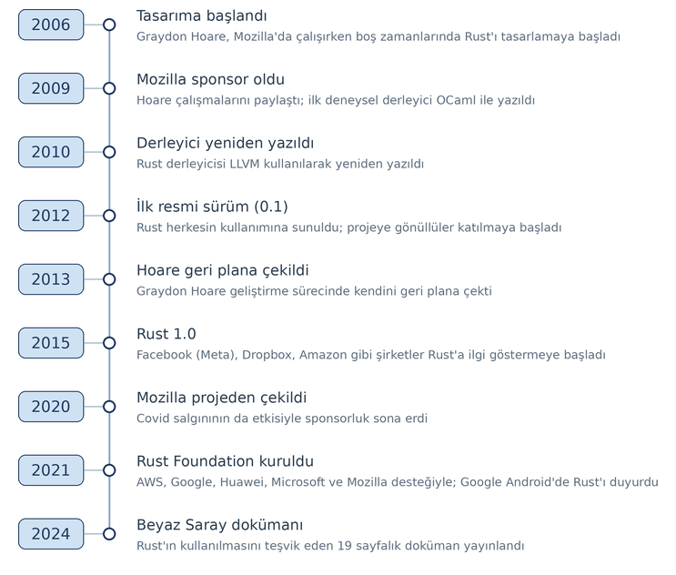

=====
Giriş
=====

Bu bölümde Rust'a bir giriş yapacağız. 

Rust Nasıl Bir Dildir?
======================

Rust genel amaçlı, yapısal, prosedürel ve fonksiyonel programlama modellerini destekleyen çok modelli (multi-paradigm),
statik tür sistemine sahip modern bir programlama dilidir. Tasarımında özellikle eşzamanlı (concurrent) programlama
etkinliklerinin daha güvenli biçimde sağlanması ön planda tutulmuştur. Bunun sağlanabilmesi için de bellek erişim
güvenliğine (memory safety) özel bir önem verilmiştir.

Rust bir sistem programlama dili olarak kullanılabilecek biçimde tasarlanmıştır. Bu nedenle C Programlama Diline ve
kısmen de C++ Programlama Diline yenilikçi bir seçenek oluşturmaktadır. Rust C Programlama Dilinden biraz daha yüksek
seviyeli bir dildir. Birtakım modern özellikler performans kaybına yol açmayacak biçimde dile entegre edilmiştir.

Rust nesne yönelimli ya da nesne tabanlı bir programlama dili değildir. Ancak nesne yönelimli programlama tekniğindeki
bazı prensiplerin uygulanabileceği bir tasarım özelliğine sahiptir.

Rust çeşitli programlama dillerinden ilham alınarak tasarlanmıştır. Rust'ı etkileyen programlama dilleri şunlardır:

- C/C++
- ML / OCaml
- Erlang
- Scheme
- Haskell
- Go
- Swift
- Kotlin
- Python

Rust'ın temel bir kütüphanesi vardır. Ayrıca zamanla kendine özgü bir ekosistem de oluşmuştur. Bu ekosistemde Rust
programcıları kendi çalışmalarını başkalarıyla paylaşmaktadır. Dolayısıyla daha spesifik gereksinimler için *crates.io*
deposu içerisindeki üçüncü parti kütüphanelerden faydalanılmaktadır.

Rust'ın Tarihsel Gelişimi
=========================

Rust nispeten yeni bir programlama dilidir. Dolayısıyla kısa bir tarihi vardır.

Rust'ın tasarımına 2006 yılında Mozilla şirketi çalışanı olan *Graydon Hoare* (*Greydın Ho:r* biçiminde okunuyor)
tarafından başlanmıştır. Hoare bu çalışmaları 2009'a kadar tek başına ve ancak boş zamanlarında yürütmüştür. Hoare 2009
yılından itibaren yaptığı çalışmaları Mozilla'daki çalışma arkadaşlarıyla paylaşmaya başlamıştır. İlk Rust derleyicisi
de deneysel amaçla OCaml Dili kullanılarak yazılmıştır. Mozilla 2009 yılında Rust projesine sponsor olmaya başlamıştır.
Rust derleyicisi 2010 yılında LLVM kullanılarak yeniden yazılmıştır. Rust'ın ilk resmi sürümü (0.1 versiyonu) 2012
yılında herkesin kullanımına sunulmuştur. Bu yıllarda Rust projesine Mozilla dışında pek çok gönüllü de katılmaya
başlamıştır. Mozilla tam zamanlı çalışmak üzere çeşitli geliştiricileri de işe almıştır. Rust 2012 yılından sonra
sürekli iyileştirilmeye çalışılmıştır. Graydon Hoare 2013 yılında Rust'ın geliştirilme sürecinde kendini geri plana
çekmiştir. Dil üzerindeki pek çok değişiklikten sonra 2015 yılında Rust'ın 1.0 versiyonu kullanıma sunulmuştur. Bu
süreçte Rust topluluğu da gitgide büyümüştür.

Rust'ın ilk versiyonu çıktıktan sonra Mozilla dışında Facebook (Meta), Dropbox, Amazon gibi şirketler de Rust'a ilgi
göstermeye başlamıştır. University of Minho, NOVA University Lisbon ve University of Coimbra'nın yaptığı araştırmalara
göre Rust Java'dan iki kat daha az elektrik harcamaktadır. Ancak C ile kıyaslandığında C'den biraz daha fazla elektrik
harcamaktadır.

Mozilla 2020 yılında Covid salgınının da etkisiyle Rust projesinden çekilme kararı almıştır. Böylece sponsorluk
bağlamında işe aldığı kişileri de işten çıkarmıştır. 2021 yılında Amazon Web Services, Google, Huawei, Microsoft,
Mozilla şirketlerinin desteğiyle *Rust Foundation* isimli bir kurum oluşturulmuştur. 2021'de Google Android'de Rust'ın
da kullanılacağını belirtmiştir. 2024'te Beyaz Saray Rust'ın kullanılmasını teşvik eden 19 sayfalık bir doküman
yayınlamıştır. Her ne kadar Beyaz Saray'ın bu konuyla doğrudan bir ilgisi yoksa da bu rapor Rust'ın geleceği konusunda
iyimser bir hava estirmiştir.

Rust'ın geliştirilmesine halen *Rust Foundation* (https://rustfoundation.org) kurumu tarafından devam edilmektedir. 

Rust'ın versiyonlarının tarihsel gelişimi şöyledir:
 
- 2006: Rust'ın geliştirilmesine başlandı.
- 2009: Mozilla, Rust projesini desteklemeye başladı.
- 2010: İlk bootstrap (ön-yükleme) derleyicisi yayımlandı.
- 2012: Rust'ın kendini derleyen (self-hosted) derleyicisinin alfa sürümleri (örneğin, 0.3 alfa) yayımlandı.
- Mayıs 2015: Rust 1.0 stabil sürümü yayımlandı; dil, artık üretim ortamında kullanılmaya hazır hale geldi.
- Temmuz 2016: 1.10 sürümü yayımlandı.
- Ağustos 2017: 1.20 sürümü yayımlandı.
- Ekim 2018: 1.30 sürümü yayımlandı.
- Aralık 2019: 1.40 sürümü yayımlandı.
- Şubat 2021: 1.50 sürümü yayımlandı.
- Nisan 2022: 1.60 sürümü yayımlandı.
- Haziran 2023: 1.70 sürümü yayımlandı.
- Temmuz 2024: 1.80 sürümü yayımlandı.
- Eylül 2025: 1.90 sürümü yayımlandı.
- Ekim 2026: 1.99 sürümü yayımlandı.

Rust'ın Resmi Dokümanları
-------------------------

*Rust Foundation* Rust Programlama Dilinin geliştirilmesinden ve sürdürümünden sorumludur. Resmi sitesine aşağıdaki
bağlantıdan erişebilirsiniz:

https://rustfoundation.org

Rust'ın üç önemli resmi (formal) dokümanı vardır.

1) The Rust Reference (https://doc.rust-lang.org/reference/index.html)
2) The Rust Standard Library (https://doc.rust-lang.org/std/index.html)
3) The Rustonomicon (https://doc.rust-lang.org/nomicon/index.html)

*The Rust Reference* dokümanı programlama dilinin resmi (formal) belirlemelerini içermektedir. Yani bu doküman adeta
Rust Programlama Dilinin standart dokümanı gibi düşünülebilir. Ancak bu tür referans dokümanlarını oluşturmak kolay
değildir. Dolayısıyla kursun yapıldığı tarihlerde bu dokümanda da eksiklikler de vardır. *The Rust Standard Library*
dokümanları Rust'ın standart kütüphanesini açıklamaktadır. *The Rustonomicon* dokümanları ise Rust'ta unsafe
özellikler ve unsafe kodların oluşturulmasına ilişkin bilgileri içermektedir. Ayrıca Rust'ın resmi sitesinde
*tutorial* biçiminde *The Rust Programming Language* isimli bir kitap da bulunmaktadır. Bu kitap aynı zamanda kağıda
basılı biçimde de satılmaktadır.