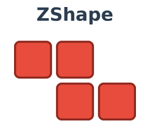
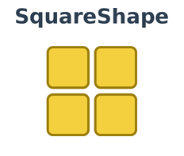
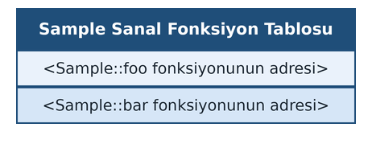
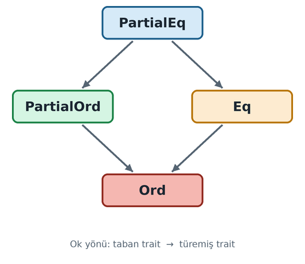

========
Sabitler
========

Statik tür sistemine sahip olan programlama dillerinde yalnızca değişkenlerin değil sabitlerin de -genel olarak tüm
ifadelerin (*expression*) de- bir türü vardır. Bir programlama dilini öğrenirken ilk öğrenilecek konulardan birisi de o
programlama dilindeki sabitlerin nasıl oluşturulduğu ve türlerinin nasıl belirlendiğidir. Sabitlerin türleri onların 
yazım biçimlerine göre ve niceliklerine göre (yani değerlerine göre) belirlenmektedir.Biz de bu bölümde Rust dilindeki 
sabitlerin nasıl oluşturulduğunu ve türlerinin nasıl belirlendiğini ele alacağız.

Program içerisinde doğrudan yazılmış olan değerlere *sabit (literal)* denilmektedir. Örneğin:

.. code-block:: rust

   a = b + 10;

Burada ``a`` ve ``b`` birer değişken ``10`` ise bir sabittir. Biz burada ``b``'nin içerisindeki değerle doğrudan ``10``'u 
topluyoruz.

Tamsayı Sabitleri 
=================

Rust'ta nokta içermeyen ve sonunda tür eki bulunmayan sabitler onların kullanıldığı bağlama göre gereksinim duyulan
türün sınırları içerisinde kalıyorsa o türden kabul edilmektedir. Örneğin:

.. code-block:: rust

   let a: i8 = 127;        // geçerli

Burada 127 sabitinin sonunda bir tür eki yoktur. i8 türünün sınır değerlerinin [-128, +127] olduğuna dikkat ediniz. İşte
burada 127 değeri bu sınırlar içerisinde olduğu için sanki i8 türündenmiş gibi ele alınmaktadır. Örneğin:

.. code-block:: rust

   let a: u16 = 50000;

Burada 50000 değeri içinde bulunulan bağlamda u16 türüne atanmak amacıyla kullanılmıştır. 50000 değeri u16 sınırları
içerisinde kaldığı için sanki u16 türünden bir sabitmiş gibi ele alınmaktadır. Örneğin:

.. code-block:: rust

   let a: i8 = 10;
   let b: i8;

   b = a + 10;

İki operand'lı operatörlerin operand'larının aynı türden olması gerektiğini belirtmiştik. Buradaki a + 10 işleminde 10
sanki i8 sabit gibi ele alınacaktır. Çünkü 10 sayısı i8 türünün sınırları içerisinde kalmaktadır. Örneğin:

.. code-block:: rust

   let a: u16;

   a = 70000;      // error!

Burada 70000 değeri u16 sınırlarının içerisinde kalmadığı için u16 türünden bir sabit gibi ele alınmayacaktır.

Ancak let ile bağlama yapılırken verilen ilkdeğer tür eki içermeyen bir tamsayı ise bu durumda sabit her zaman i32
türünden kabul edilmektedir. Örneğin:

.. code-block:: rust

   let a = 3000000000;         // error!

Burada 3 milyar değeri i32 türünün sınırları dışındadır. Dolayısıyla error oluşacaktır.

Basamak Ayıracı Olarak '_' Karakteri
====================================

Rust'ta tıpkı Python'da olduğu gibi büyük sayıların daha kolay algılanabilmesi için basamaklar ``'_'`` karakteriyle
ayrıştırılabilmektedir. Örneğin:

.. code-block:: rust

   let a: u64 = 3_000_000_000;     // geçerli

Burada basamakları ayıran ``'_'`` karakterinin sayı üzerinde bir etkisi yoktur. Tabii ``'_'`` karakteri ile üçerli
ayrıştırma yapmak zorunlu değildir. Ayrıştırma herhangi bir basamakta bir ya da birden fazla ``'_'`` karakteri
kullanılarak yapılabilir. Örneğin:

.. code-block:: rust

   a = 3_0_0_0_0_0_0_0_0_0;        // geçerli

Sayının sonunda da ``'_'`` karakteri bulunabilir, ancak başında bulunamaz. Yukarıda da belirttiğimiz gibi birden fazla
``'_'`` karakterinin peşi sıra kullanılmasına da izin verilmiştir. Örneğin:

.. code-block:: rust

   a = 3___0_0_0_0_0_0_0_0_0__;        // geçerli

Tabii bu ``'_'`` karakterlerinin amacı okunabilirliği artırmak olduğu için bunlar 10'luk sistemde tipik olarak binli
basamakları ayrıştırmak için kullanılmaktadır.

Basamak ayıraçları eski dillerin yeni sürümlerine de zamanla eklenmiştir. Örneğin C++'a C++14 ile C'ye de C23 ile bu
özellik eklenmiştir.

Tamsayı Sabitlerinde Tür Sonekleri
==================================

Tamsayı sabitlerinin sonlarına onların türlerini belirten ekler getirilebilmektedir. Bu sonekler tamsayı türlerinin
isimlerinden oluşmaktadır:

.. list-table::
   :widths: 10 10

   * - ``i8``
     - ``u8``
   * - ``i16``
     - ``u16``
   * - ``i32``
     - ``u32``
   * - ``i64``
     - ``u64``
   * - ``i128``
     - ``u128``

Biz tamsayı sabitlerinin sonuna yapışık bir biçimde bu sonekleri getirirsek artık sabitler kesinlikle bu türlerden olur.
Örneğin:

.. code-block:: text

   123i32
   3000000000u32
   10i8
   20u64

Örneğin:

.. code-block:: rust

   let a: u64;

   a = 10u64;

Burada 10 sabitinin açıkça u64 türünden olduğu belirtilmiştir. Örneğin:

.. code-block:: rust

   let a = 10;

Burada a değişkeni i32 türündendir. Fakat örneğin:

.. code-block:: rust

   let a = 10u32;

Burada ise a değişkeni ``u32`` türündendir.

Basamakları ayrıştırmak için kullanılan ``'_'`` karakterlerinin sayının sonunda da bulunabileceğini belirtmiştik. Tür
soneklerinin okunabilirliği bozmasını engellemek amacıyla soneklerden önce ``'_'`` karakteri de kullanılabilir. Örneğin:

.. code-block:: rust

   let a = 10_u32;

Bazı Rust programcıları soneklerden önce ``'_'`` karakterini kullanmaktadır. Bazı programcılar ise yalnızca büyük
sabitlerde kullanmayı tercih etmektedir.

2'lik, 8'lik ve 16'lık Sistemde Tamsayı Sabitleri
=================================================

Tamsayı sabitleri 2'lik (binary) sistemde, 8'lik (octal) sistemde ve 16'lık (hexadecimal) sistemde yazılabilmektedir.
Bunun için sabitin önüne 2'lik sistem için 0b, 8'lik sistem için 0o ve 16'lık sistem için 0x önekleri getirilmektedir.
(Bu öneklerin 0B, 0O ve 0X biçiminde büyük harfli biçimleri yoktur.) Örneğin aşağıdaki sabitler geçerlidir:

.. code-block:: text

   0b1010
   0b_1_0_1_0_
   0b1010_1010
   0o712_564
   0xFC_16_FD_32

C'de 0o biçiminde bir önek bulunmadığını sayının başındaki 0'ın 8'lik sistem anlamına geldiğini anımsayınız. Oysa
Rust'ta sayının başındaki 0 rakamı 8'lik sistem anlamına gelmemektedir. 8'lik sistem için zaten 0o kullanılmaktadır.
C'de 2'lik sistemde sabit belirtilemiyordu. Ancak C'nin en yeni standardı olan C23 sürümünde bu özellik eklenmiştir.

Sabitin kaçlık sistemde yazıldığı ile tür arasında bir ilişki yoktur. Örneğin:

.. code-block:: rust

   let a = 0x1234;

Buradaki 0x1234 değeri i32 türünün sınırları içerisindedir. Bu nedenle a da i32 türündendir. Örneğin:

.. code-block:: rust

   let a = 0x123456789;        // error!

Buradaki sayı i32 türünün sınırları dışındadır. Dolayısıyla bu bağlama error oluşturacaktır. Örneğin:

.. code-block:: rust

   let a: i8 = 100;
   let b: i8;

   b = a + 0x10;           // geçerli

Buradaki ``0x10`` aslında 10'luk sistemdeki 16 sayısıdır. Dolayısıyla bu bağlamda bu sayı ``i8`` türünün sınırları
içerisinde olduğu için ``i8`` sabit olarak ele alınacaktır.

Tabii biz 2'lik, 8'lik ve 16'lık sistemlerde yazdığımız sabitlerin sonuna da yine tür ekleri getirebiliriz. Örneğin:

.. code-block:: rust

   let a = 0x123456789u64;

Burada artık sabit u64 türündendir. Tabii basamak ayıraçları yine bu sistemlerde yazılan sayılarda da kullanılabilir.
Örneğin 2'lik sistemdeki sayıların dörderli biçimde gruplanması bir gelenektir:

.. code-block:: rust

   let a = 0b_1010_0101;

Burada ``a`` ``i32`` türündendir.

Gerçek Sayı Sabitleri
=====================

Rust'ta sayı nokta içeriyorsa ve sabitin sonunda bir tür eki yoksa ve bu biçimde yazılan sabitler onların kullanıldığı
bağlama göre gereksinim duyulan türün sınırları içerisinde kalıyorsa o türden kabul edilmektedir. Örneğin:

.. code-block:: rust

   let f: f32 = 3.14;       // geçerli

Burada ``3.14`` sabiti ``f32`` türü ile ifade edilebilmektedir. Bu nedenle sanki ``f32`` türünden bir sabitmiş gibi
kullanılabilmiştir. Örneğin:

.. code-block:: rust

   let a: f32 = 12.3;
   let b: f32;

   b = a + 1.2;            // geçerli

Burada ``1.2`` bağlam içerisinde ``f32`` türünden bir sabit olarak ele alınacaktır. Çünkü ``1.2`` sayısı ``f32`` türü
ile ifade edilebilmektedir. Ancak bu durum tamsayılar için geçerli değildir. Örneğin:

.. code-block:: rust

   let a: f32 = 10;        // error

Burada her ne kadar ``10`` sabiti ``f32`` türü ile ifade edilebiliyorsa da tamsayı sabiti olduğu için bağlama 
geçersizdir. Noktalı bir sayı eğer ``f32`` türünün basamaksal olarak (duyarlılık olarak değil) sınırları dışında 
kalırsa bu durum derleme aşamasında error oluşturmaktadır. Örneğin:

.. code-block:: rust

   let a: f32 = 1e50;      // error!

Burada ``1e50`` sabiti basamaksal olarak ``f32`` türünün sınırları içerisinde kalmamaktadır. Bu nedenle bu sabit ataması
error ile sonuçlanacaktır. Eğer noktalı sayı basamaksal değil de mantis bakımından ``f32`` türü ile ifade edilemiyorsa 
bu durum error oluşturmaz. ``f32`` ile ifade edilebilen ona en yakın değer elde edilir. (Bu durumda ``f32`` türüne 
dönüştürme kuralı uygulanmaktadır. Bu dönüştürme kuralını tür dönüştürme operatörünü anlatırken ele alacağız.) Diğer 
pek çok dilde olduğu gibi ``'.'`` karakterinin sağına bir şey yazılmazsa sabit sanki ``.0`` gibi ele alınmaktadır. 
Örneğin:

.. code-block:: rust

   let a: f64 = 1.;        // geçerli

Ancak gerçek sayı sabitlerinde noktanın solu boş bırakılamaz. Örneğin:

.. code-block:: rust

   let a: f64 = .10;       // error!

Tabii noktanın solundaki ve sağındaki sayılarda istenildiği kadar ``'_'`` ile ayrıştırma yapılabilir. Örneğin:

.. code-block:: rust

   let a: f64 = 123_456.789_012;       // geçerli

Ancak noktadan hemen sonra ``'_'`` ayrıştırma karakteri kullanılamamaktadır. Örneğin:

.. code-block:: rust

   let a: f64 = 1._234;       // error!

let deyiminde değişkenin türü belirtilmezse ve verilen ilkdeğer sonek içermeyen bir noktalı sayı ise bu durumda sabit
f64 türünden kabul edilir, değişken de o türden olur. Örneğin:

.. code-block:: rust

   let a = 3.14;

Burada a değişkeni f64 türündendir.

Gerçek Sayı Sabitlerinde Tür Sonekleri
======================================

Gerçek sayı sabitlerinin sonuna da onların türünü belirten tür soneki getirilebilmektedir. Bunun için aşağıdaki iki tür
soneki kullanılmaktadır:

* f32
* f64

Örneğin:

.. code-block:: rust

   let a = 3.14f32;

Burada a değişkeni artık ``f32`` türünden olacaktır. Halbuki örneğin:

.. code-block:: rust

   let a = 3.14;

Burada a değişkeni f64 türünden olur. Tabii yine tür sonekinden önce okunabilirliği artırmak için ``'_'`` ile ayrıştırma
tercih edilebilir. Örneğin:

.. code-block:: rust

   let a = 3.14_f32;

Gerçek sayı sabitlerinde tür soneki noktadan hemen sonra başlatılamaz. Örneğin:

.. code-block:: rust

   let a: f64 = 1.f64;         // error!
   let b: f64 = 1._f64;        // error!

Gerçek sayı sabitlerinde açıkça tür belirtmek iyi bir tekniktir. Gerçek sayı sabitine ``f32`` ve ``f64`` soneki getirmiş
olsak bile eğer sabit basamaksal olarak soneke ilişkin türün sınırları dışında kalıyorsa sabit geçersiz olmaktadır. 
Örneğin:

.. code-block:: rust

   let a: f32 = 1e50;      // error! sabit f32 sınırlarını basamaksal olarak aşıyor

C'de gerçek sayı soneklerini (f ve lf) kullanabilmek için sabitin nokta içermesi gerekmektedir. Rust'ta sabit nokta
içermese de sabitin sonuna ``f32`` ve ``f64`` sonekleri getirilebilmektedir. Örneğin:

.. code-block:: rust

   let f: f64 = 1f64;       // geçerli

Üstel Biçimde Gerçek Sayı Sabitleri
===================================

Pek çok programlama dilinde olduğu gibi Rust'ta da gerçek sayı sabitleri (``f32`` ve ``f64`` türünden sabitler) üstel 
biçimde belirtilebilmektedir. Gerçek sayı sabitleri üstel biçimde belirtilirken e ya da E harfi 10'un kuvveti anlamına
gelmektedir. Örneğin:

.. code-block:: rust

   let f = 1.23e12;

Bu sabit ``1.23 * 10^12`` anlamına gelmektedir. Örneğin:

.. code-block:: rust

   let f = 1.23e-12;

Bu sabit ``1.23 * 10^-12`` anlamına gelmektedir. Gerçek sayı sabitleri üstel biçimde belirtilirken yine basamak ayıracı
olarak ``_`` karakteri kullanılabilmektedir. Aşağıdaki sabitte her ne kadar basamak ayıraçlarının kullanılması
gereksizse de sabit geçerlidir:

.. code-block:: rust

   let f = 1_.2_3E_10;

Diğer pek çok dilde olduğu gibi gerçek sayı sabitleri üstel formatta yazılırken nokta içermese bile gerçek sayı sabiti
olarak ele alınmaktadır. Örneğin:

.. code-block:: rust

   let f: f64 = 1e5;       // geçerli
   let f: i64 = 1e5;       // error!

bool Sabitleri
==============

Rust'ta bool türden iki sabit vardır. Bunlar true ve false anahtar sözcükleridir. Örneğin:

.. code-block:: rust

   let b = true;

Burada b değişkeni bool türdendir.

Karakter Sabitleri
==================

Bir Unicode karakter tek tırnak içerisine alınırsa char türden sabit belirtir. Örneğin:

.. code-block:: rust

   let c = 'x';

Burada c değişkeni char türdendir. Rust'ta da diğer bazı dillerde olduğu gibi tek tırnağın içerisinde ters bölü karakter
sabitleri kullanılabilmektedir. Ancak Rust'ta biz C'deki tüm ters bölü karakterlerini kullanamamaktayız. Rust'ta
kullanabileceğimiz ters bölü karakterleri şunlardır:

.. code-block:: text

   \n
   \r
   \t
   \\
   \'
   \"
   \0

Diğer dillerde olduğu gibi tek tırnak içerisinde Unicode kod numarası belirtilerek de herhangi bir Unicode karakterden
karakter sabiti oluşturulabilmektedir. Bunun için tek tırnak içerisinde önce ``\u`` sonra da küme parantezleri
içerisinde Unicode kod numarası girilmelidir. Örneğin:

.. code-block:: rust

   let c = '\u{6728}';

   println!("{}", c);      // 木

==================================
Byte Sabitleri ve String Sabitleri
==================================

Byte Sabitleri (Byte Literals)
==============================

Tek tırnak içerisine bir ASCII karakteri yerleştirilip başına da bununla yapışık b karakteri getirilirse bu biçimdeki
sabitlere Rust'ta *byte sabitleri (byte literals)* denilmektedir. Byte sabitleri ``u8`` türündendir. Byte sabitleri tek
tırnak içerisindeki ASCII karakterinin kod numarasına ilişkin bir sayı belirtirler. Örneğin:

.. code-block:: rust

   let b: u8;

   b = b'a';       // geçerli, b'a' u8 türünden

Burada ``b'a'`` sabiti bir byte sabitidir. Byte sabitler ``u8`` türünden kabul edildikleri için biz onları ancak ``u8``
türünden bir değişkene atayabiliriz. Byte sabitlerinde tek tırnak içerisine yalnızca standart ASCII karakterlerinden 
biri yerleştirilebilir. Yani tek tırnak içine yerleştirilecek karakterin Unicode kod numarasının [0, 127] aralığında 
olması gerekir. Örneğin:

.. code-block:: rust

   let b: u8 = b'ş';                // error!

Burada ``'ş'`` karakteri bir ASCII karakter olmadığı için byte sabit geçersiz bir biçimde oluşturulmuştur. Tabii Rust'ın
yukarıda belirtmiş olduğumuz ters bölü karakter sabitleri aynı zamanda ASCII karakterleri olduğu için byte sabit olarak
kullanılabilir. Örneğin:

.. code-block:: rust

   let b: u8 = b'\n';               // geçerli

Byte sabitleri oluştururken tek tırnak içerisine ``\u {...}`` biçiminde Unicode kod numarası belirtilerek karakterler
yerleştirilemez. Örneğin:

.. code-block:: rust

   let b: u8 = b'\u{61}';           // error!

``'a'`` gibi bir sabitin char türden olduğuna ama ``b'a'`` biçiminde bir sabitin ``u8`` türünden olduğuna dikkat ediniz.

Aşağıdaki bağlamaya dikkat ediniz:

.. code-block:: rust

   let b: u8 = b'a';

Burada aslında b'nin içerisinde 97 sayısı vardır. Biz b'yi yazdırırsak 97 görürüz. Örneğin:

.. code-block:: rust

   println!("{}", b);      // 97

Peki o halde yukarıdaki bağlamanın aşağıdakinden ne farkı vardır?

.. code-block:: rust

   let b: u8 = 97;

Aslında bu iki bağlama arasında işlevsel bir farklılık yoktur. Ancak byte sabitler özellikle standart ASCII
karakterlerin kod numaralarının oluşturulması için tercih edilmektedir. Yani bağlamına göre ``b'a'`` gibi bir sabit
amaçlanan şeyi daha iyi ifade edebilecektir.

Byte sabitlerini oluştururken tek tırnak içerisine yalnızca ASCII karakterlerinin yazılabileceğini belirtmiştik. Ancak
eğer istenirse [128, 255] arasındaki kod numaraları ``'\xHH'`` (Burada HH iki hex digit belirtmektedir) biçiminde de
belirtilebilir. Örneğin:

.. code-block:: rust

   let b: u8 = b'\xFC';        // geçerli

Byte sabitleri Python'da uzun süredir bulunmaktadır. Tabii Python'da bir byte'lık başka bir tür olmadığı için oradaki
byte türü ve byte sabitlerinin yeri başka biçimde doldurulamamaktadır. Python'da byte sabitlerin öneki ``'b'`` ya da 
``'B'`` olabilmektedir. Halbuki Rust'ta bu önek yalnızca ``'b'`` biçimindedir.

String Sabitleri (String Literals)
==================================

Rust'ta iki tırnak içerisine yazılmış olan karakterlere iki tırnaklarıyla birlikte *string sabiti (string literal)*
denilmektedir. Daha önceden de belirttiğimiz gibi Rust iki tırnak içerisindeki karakterleri Unicode UTF-8 kodlamasıyla
tutmaktadır. Bu nedenle biz iki tırnak içerisinde tüm Unicode karakterleri, Rust'ın ters bölü karakterlerini ``\u{...}``
biçiminde Unicode kod numarasıyla belirttiğimiz karakterleri kullanabiliriz. Rust'ın stringlerinin sonuna null karakter
yerleştirilmediğini de daha önce belirtmiştik. C'den geçen kişiler özellikle şu iki noktaya dikkat etmelidirler:

1) Rust'taki string'lerin içerisindeki karakterler Unicode UTF-8 kodlamasıyla tutulmaktadır.
2) Rust'ta string'lerin sonunda null karakter yoktur.

C'de string'ler ifade içerisinde kullanıldığında ``char *`` türünden, C++'te ``const char *`` türünden kabul
edilmektedir. Java, C# ve Python gibi dillerde string'ler o dillerin ``String`` sınıfı türünden (Python'da ``str``
sınıfı türünden) değişken referansı belirtmektedir. Örneğin Java ve C#'ta iki tırnak ifadeleri o dillerin ``String``
sınıfı türünden bir değişkene atanabilmektedir.

Rust'ta iki tırnak içerisindeki string'ler ``&str`` türündendir. ``str`` türüne string dilimi (string slice) 
denilmektedir. Ancak bu tür hemen hep referanslı bir biçimde kullanılır. Dolayısıyla Rust'ta biz bir string'i ``&str``
türünden bir değişkene atayabiliriz. ``&str`` türüne *string dilim referansı* denilmektedir. Referanslar ve dilimler
ilerideki bölümlerde ele alınacaktır. Örneğin:

.. code-block:: rust

   let s: &str;

   s = "ağrı dağı";            // geçerli

Unicode UTF-8 kodlamasıyla oluşturulan bir yazının n'inci karakterine tek hamlede (tek makine komutuyla)
erişilememektedir. Çünkü bu kodlamada daha önce belirttiğimiz gibi her karakter farklı byte uzunluklarında
olabilmektedir. Dolayısıyla biz böyle bir string'in n'inci karakterini ancak string'in başından itibaren ilerleyerek
bulabiliriz. Programlama dillerinde ``[]`` operatörü rastgele erişimlerde (O(1) erişim de denilmektedir)
kullanılmaktadır. Bu nedenle Rust'ın string'lerinin karakterlerine bu operatörle erişilemez. Örneğin:

.. code-block:: rust

   let s: &str = "ağrı dağı";
   let c = s[4];               // error!

Rust string'lerinde ``s[4]`` biçiminde bir erişim yoktur.

Rust'ta string'ler tek satıra yazılmak zorunda değildir. Yani biz string'leri birden fazla satıra yazabiliriz. Tabii
istersek \\ karakteri ve hemen ardından ``\n`` karakteri ile (yani editörde \\ karakterine bastıktan sonra ENTER tuşuna
basıp) *aşağı satırdan devam et* diyerek de aynı şeyi yapabiliriz. Örneğin:

.. code-block:: rust

   let s: &str;

   s = "Ankara Türkiye'nin         // geçerli
   başkentidir";

Ancak örneğin:

.. code-block:: rust

   s = "Ankara Türkiye'nin \       // geçerli
   başkentidir";

\\ karakteri ile farklı satırların sanki tek bir satırmış gibi birleştirilmesi özelliği C'de ve diğer bazı dillerde de
bulunmaktadır.

Saf String Sabitleri (Raw String Literals)
==========================================

Rust'ta *saf string sabitleri (raw string literals)* adında string sabitleri de vardır. Aslında Rust'taki bu saf string
sabitleri farklı isimlerle pek çok programlama dilinde de bulunmaktadır. Örneğin C#'ta bu tür string'lere *verbatim
string*, Python'da *regular string* denilmektedir. C++'a da C++11 ile birlikte bu özellik eklenmiştir. Rust gibi
nispeten yeni tasarlanan dillerde de artık doğuştan itibaren bu biçimde string sabitleri bulunmaktadır.

Rust'ta saf string sabitleri (kısaca *saf string'ler* de diyebiliriz) içerisindeki ``'\'`` karakterleri gerçekten
``'\'`` karakteri anlamına gelmektedir. Yani bu string'ler içerisindeki ters bölü karakterleri ters bölü karakter sabiti
oluşturma anlamında ele alınmamaktadır. Örneğin:

.. code-block:: rust

   let s: &str = "ali\nveli";

Buradaki string'te ``\n`` tek bir karakterdir. Bu yazı ekrana yazdırıldığında bu ``\n`` karakteri imlecin aşağı satırın
başına geçirilmesine yol açacaktır. Eğer buradaki string saf string olsaydı bu ``\n`` karakterleri *new line* karakteri
yerine ayrı ayrı ``'\'`` karakteri ve 'n' karakteri anlamına gelecekti.

Rust'ta saf string'ler iki tırnağın başına onunla yapışık r öneki getirilerek oluşturulmaktadır. Örneğin:

.. code-block:: rust

   let s: &str = r"ali\nveli";

   println!("{}", s);          // ali\nveli

Saf string sabitleri ters bölü karakteri içeren yazıların daha kolay ve okunabilir bir biçimde oluşturulmasına olanak
sağlamaktadır. Örneğin:

.. code-block:: rust

   let path: &str = r"c:\temp\test.txt";

Eğer saf string sabitleri olmasaydı biz bu yazıyı şöyle oluşturmak zorunda kalırdık:

.. code-block:: rust

   let path: &str = "c:\\temp\\test.txt";

Peki biz iki tırnak içerisinde iki tırnak karakteri içeren bir yazıyı nasıl oluşturabiliriz? Bu Rust'ta diğer dillerde
olduğu gibi ``\"`` kullanılarak yapılabilmektedir. Örneğin:

.. code-block:: rust

   let s = "\"ankara\"";

   println!("{}",s);       // "ankara"

Tabii iki tırnak içerisinde tek tırnak karakteri kullanmanın, tek tırnak içerisinde de iki tırnak karakteri kullanmanın
bir sakıncası olmadığını biliyorsunuz.

Rust'ta saf string'ler ayrıca r önekinin yanında bir ya da birden fazla ``#`` ile de oluşturulabilmektedir. Ancak bu
durumda kapanış iki tırnak karakterinden sonra açılış iki tırnak karakterinin önündeki sayıda ``#`` karakterinin
bulundurulması gerekmektedir. Örneğin:

.. code-block:: rust

   let s: &str = r#"ankara"#;
   println!("{}", s);          // ankara

Burada r önekinden sonra iki tırnağın başına ve sonuna ``#`` karakterinin getirildiğine dikkat ediniz. ``#``'lerin
sayısı birden fazla olabilir ancak kapanışta da aynı sayıda ``#`` karakterinin bulundurulması gerekir. Örneğin:

.. code-block:: rust

   let s: &str = r###"ankara"###;
   println!("{}", s);      // ankara

Burada açılış iki tırnak karakterinin solunda üç tane ``#`` karakteri olduğu için sağında da üç tane ``#`` karakteri
bulunmak zorundadır. Peki saf string'lerde ``#`` karakterlerini bulundurmanın anlamı nedir? İşte bunun amacı iki tırnak
içerisindeki iki tırnak karakterlerinin kolay yazılmasını sağlamaktır. Örneğin biz JSON formatına benzer bir formatta
anahtar değer çiftlerini bir yazı biçiminde oluşturmak isteyelim. Ancak anahtarların da iki tırnaklı yazılardan
oluştuğunu varsayalım. Bu durumda aşağıdaki gibi bir string geçersiz olacaktır:

.. code-block:: rust

   let s: &str = "{"ali": 123, "veli": 234}";      // error!

Çünkü burada iki tırnak içerisindeki iki tırnak karakteri iki tırnağı kapatmak anlamına gelmektedir. Bu string'in başına
r öneki getirerek de bunu geçerli yapamayız:

.. code-block:: rust

   let s: &str = r"{"ali": 123, "veli": 234}";         // error!

Tabii bu string'i geçerli bir biçimde şöyle belirtebilirdik:

.. code-block:: rust

   let s: &str = "{\"ali\": 123, \"veli\": 234}";      // geçerli

Fakat bu durumda da yazı okunabilir olmaktan çıkmaktadır. İşte ``#``'li saf string'ler bu kolaylığı sağlamaktadır:

.. code-block:: rust

   let s: &str = r#"{"ali": 123, "veli": 234}"#;      // geçerli

Peki neden artık bu string geçerli olmuştur? Çünkü string ``#"`` ile başlatıldığı ve bitimi de ``"#`` biçiminde olacağı
için bunun içerisindeki çift tırnak karakteri artık string'i bitirmek anlamına gelmemektedir. Şimdi de aşağıdaki
string'e dikkat ediniz:

.. code-block:: rust

   let s: &str = r#"ben "#" karakterini çok seviyorum"#;      // error!

Bu string geçersizdir. Çünkü burada yazı içerisinde tesadüfen bulunan ``"#`` karakterleri saf string'i bitiren
karakterler olarak ele alınacaktır. İşte bu tür durumlarda ``#``'lerin sayısını artırabiliriz:

.. code-block:: rust

   let s: &str = r##"ben "#" karakterini çok seviyorum"##;     // geçerli

Burada artık string ``##"`` ile başlatıldığı için bitimi de ``"##`` ile yapılmaktadır.

Saf string'lerin farklı bir tür belirtmediğine yalnızca yazının içeriği konusunda etkili olduğuna dikkat ediniz. Normal
string'ler de saf string'ler de &str türündendir.

Byte String Sabitleri (Byte String Literals)
============================================

Rust'ta diğer bir string sabiti de *byte string sabiti (byte string literals)* denilen sabittir. Bu sabitlere kısaca
*byte string'ler* de denilmektedir. Byte string'ler iki tırnağın önünde ona yapışık bir biçimde b öneki ile
oluşturulmaktadır. byte string'ler ``u8`` türünden bir dizi dilimi (ya da kısaca dilim de diyebiliriz) belirtmektedir.
Dolayısıyla ``&[u8]`` türünden bir değişkene atanabilirler. Örneğin:

.. code-block:: rust

   let bs: &[u8] = b"ankara";

   println!("{:?}",bs);        // [97, 110, 107, 97, 114, 97]

Tabii byte string'lerin içerisindeki karakterlerin de yine byte sabitlerde olduğu gibi yalnızca ASCII karakterlerinden
oluşturulması gerekir. Örneğin:

.. code-block:: rust

   let bs: &[u8] = b"ağrı dağı";       // error!

Burada byte string'in içerisinde Türkçe karakterler bulundurulmuştur. Ancak byte sabitlerinde olduğu gibi byte string
sabitlerinde de [128, 255] arasındaki karakterler ``\xHH`` (Burada HH iki hex digit belirtmektedir) biçiminde ifade
edilebilir. Örneğin:

.. code-block:: rust

   let bs: &[u8] = b"abc\xFF\xFCdef";       // geçerli

Saf Byte String Sabitleri (Raw Byte String Literals)
====================================================

Byte string sabitleri de *saf (raw)* biçimde oluşturulabilmektedir. Bunlara *saf byte string sabitleri (raw byte string
literals)* denilmektedir. Bunun için iki tırnağa yapışık br öneki bulundurulmaktadır. Buradaki semantik saf string
sabitlerinde olduğu gibidir. Yani iki tırnağın içerisindeki ters bölü karakterleri ters bölü karakter sabitleri olarak
değil gerçekten ters bölü karakterleri olarak ele alınmaktadır. Örneğin:

.. code-block:: rust

   let bs: &[u8] = br"a\nb";

Burada ``\n`` *new line* karakterini değil \\ ve n karakterlerini belirtmektedir. Dolayısıyla burada byte string'i 3
uzunlukta değil 4 uzunluktadır.

Yine saf byte string sabitlerinde br önekinden sonra bunlara yapışık bir ya da birden fazla ``#`` karakteri
bulundurulabilir. Saf string sabitlerinde olduğu gibi bu da iki tırnak içerisinde iki tırnak karakterinin daha kolay
kullanılmasını sağlamaktadır. Örneğin:

.. code-block:: rust

   let bs: &[u8] = br#"ankara""#;
   let bs: &[u8] = br##""#"##;

==================================
C String Sabitleri ve Fonksiyonlar
==================================

C String Sabitleri (C String Literals)
======================================

Rust'ı C Programlama Dili ile birlikte kullanabilmek için C tarzı string'ler de bulundurulmuştur. Bunlara *C string
sabitleri (C string literals)* denilmektedir. C string sabitleri iki tırnağın soluna onunla yapışık c harfi getirilerek
oluşturulmaktadır. Örneğin:

.. code-block:: rust

   let cs = c"ankara";

C String sabitleri &CStr türündendir. Yani CStr türünden bir dilim referansı belirtmektedir. Ancak CStr türü ffi isimli
modülün içerisindedir ve otomatik olarak derleyici tarafından tanınmamaktadır. (Bu durum *prelude* denilen bir konu
içerisinde ileride ayrı bir başlık halinde ele alınacaktır.) CStr türü std::ffi modülünün içerisinde tanımlanmıştır. Bu
tür std::ffi::CStr biçiminde niteliklendirme yapılarak kullanılabilir ya da ileride de göreceğimiz gibi
niteliklendirmeyi ortadan kaldırıp kolay bir kullanım oluşturmak için aşağıdaki gibi use bildirimi de yapılabilir:

.. code-block:: rust

   use std::ffi::CStr;

ffi sözcüğü *foreign function interface* sözcüklerinden kısaltılmıştır. Aslında C string sabitlerinin normal string
sabitlerinden en önemli farklılığı C string sabitlerinin sonunda ``'\0'`` (null karakter) bulunmasıdır. Yani bu
sabitlerde Rust derleyicisi yazının sonuna ``'\0'`` karakterini de yerleştirmektedir. Böylece örneğin biz C'de yazılmış
ve parametresi ``char *`` ya da ``const char *`` türünden olan fonksiyonlara C'deki beklentiyi karşılamak için ``'\0'``
ile biten bir C string sabiti gönderebiliriz. C'de yazılmış olan fonksiyonların Rust'tan, Rust'ta yazılmış olan
fonksiyonların C'den kullanılabilmesi kursumuzda ayrı bir başlık altında ele alınacaktır.

Saf C String Sabitleri
======================

C String sabitleri de *saf (raw)* biçimde kullanılabilmektedir. Bunun için iki tırnağa yapışık onun önüne cr öneki
getirilmektedir. Semantik tamamen diğer saf string'lerde olduğu gibidir. Örneğin:

.. code-block:: rust

   let cs: &std::ffi::CStr = cr"a\nb";

Burada ``\n`` karakterleri *new line* karakterini değil ayrı ayrı \\ ve n karakterlerini belirtmektedir. Yine aynı
biçimde C string sabitlerinde de yazının içerisinde iki tırnak karakterinin kolay kullanılması için iki tırnakların
başına ve sonuna aynı sayıda ``#`` karakteri getirilebilmektedir. Örneğin:

.. code-block:: rust

   let cs: &std::ffi::CStr = cr#""ankara""#;       // geçerli
   let cs: &std::ffi::CStr = cr##""#"##;           // geçerli

never Türü
==========

Rust'ta never türünden (! türünden) bir sabit ya da değer yoktur. Yani Rust'ta ! bir değer değil tür belirtmektedir.
Never türünden bir değerin olmamasının nedeni bu türün *akış buradan devam etmeyecek* anlamına gelmesindendir.

Rust Terminolojisi: Nesne, Değişken ve Değer
============================================

Rust terminolojisine yönelik önemli bir noktaya değinmek istiyoruz. C'de çokça kullanılan *nesne (object)* terimi
Rust'ta kullanılmamaktadır. Rust'ta bellekte yer kaplayan ve bir isimle erişilebilen bölgelere *değişken (variable)*,
bellekte yer kaplayan ancak ismi olmayan nesnelere ve sabitlere ise *değer (value)* denilmektedir. Eğer hem değişken hem
de değeri kastetmek istiyorsanız *ifade (expression)* terimini kullanabilirsiniz. Aşağıda C'deki terimlerin Rust
karşılıklarını veriyoruz:

=============== ===============
C               Rust
=============== ===============
Nesne           Değişken
Geçici nesne    Değer
Sabit           Sabit/Değer
İfade           İfade
=============== ===============

Örneğin biz C'de *bir yapı nesnesi* derken Rust'ta *bir yapı değişkeni* deriz. C'de *fonksiyon bir yapı nesnesine geri
döner* derken Rust'ta *fonksiyon bir yapı değerine geri döner* deriz.

Fonksiyonlar
============

Bu bölümde Rust'ta fonksiyon tanımlaması ve fonksiyonların çağrılması üzerinde duracağız. Böylece artık örneklerimizde
fonksiyonları da kullanabileceğiz.

Fonksiyon Tanımlama
-------------------

Rust'ta bir fonksiyon tanımlamanın temel genel biçimi şöyledir:

.. code-block:: text

   fn <fonksiyon_ismi>([parametre_tanımlamaları]) [ -> <geri_dönüş_değerinin_türü>] {
       //...
   }

Bu temel bir genel biçimdir. Fonksiyon tanımlamanın genel biçiminde henüz üzerinde durmayacağımız bazı ayrıntılar da
vardır. Şimdi bu temel genel biçim üzerinde duralım. Bir fonksiyon tanımlarken tanımlamanın başında fn anahtar sözcüğü
bulundurulmaktadır. Bu fn anahtar sözcüğünü fonksiyon ismi izler. Fonksiyon isminden sonra parantezlerin açılıp
kapanması gerekir. Ancak parantezlerin içerisinde fonksiyonun parametre değişkenleri tanımlanabilmektedir. Tabii
fonksiyonlar parametreye sahip olmak zorunda değildir. Bir fonksiyonun onu çağıran fonksiyona ilettiği değere *geri
dönüş değeri (return value)* denildiğini biliyorsunuz. Fonksiyonların geri dönüş değerlerinin türleri Rust'ta
fonksiyonun parametre parantezinden sonra ``->`` atomu ve sonra tür yazılarak belirtilmektedir. Örneğin:

.. code-block:: rust

   fn foo() -> i32 {
       //...
   }

Burada ``foo`` fonksiyonu parametreye sahip değildir ve geri dönüş değeri i32 türündendir. Tabii fonksiyonların geri
dönüş değerleri olmak zorunda değildir. Bu durumda parametre parantezinden sonra geri dönüş değeri belirtilmez. Örneğin:

.. code-block:: rust

   fn bar() {
       //...
   }

Burada fonksiyonun geri dönüş değeri yoktur. C'de fonksiyonun geri dönüş değerinin olmadığını belirtmek için void
anahtar sözcüğünün kullanıldığını anımsayınız. Örneğin:

.. code-block:: c

   void bar(void)
   {
       //...
   }

Birim Türü (unit type)
----------------------

Rust'ta böyle bir void anahtar sözcüğü yoktur. Ancak onun yerine ``()`` ile temsil edilen ve ismine *birim (unit)* ya da
*birim türü (unit type)* denilen bir sentaks kullanılmaktadır. Örneğin:

.. code-block:: rust

   fn bar() -> () {
       //...
   }

Fonksiyonun geri dönüş değerinin türünün belirtilmemesiyle ``-> ()`` biçiminde belirtilmesi tamamen aynı anlama
gelmektedir. Aslında Rust'ta bu birim türü boş bir *demet (tuple)* belirtmektedir. Örneğin:

.. code-block:: rust

   let s: (i32, i32) = (10, 20);

Burada s iki elemanlı bir demettir. s'in türü de (i32, i32) biçiminde ifade edilmektedir. Örneğin:

.. code-block:: rust

   let s: () = ();

Burada s elemanı olmayan (yani sıfır elemanlı) bir demettir. Bunun türü de ``()`` biçiminde ifade edilmektedir. Yani
aslında *birim (unit)* ya da *birim türü (unit type)* sıfır elemanlı bir demet belirtmektedir.

Küme Parantezi Yerleşimi
------------------------

C ve C++ programcılarının büyük çoğunluğu (fakat hepsi değil) fonksiyonların ana bloklarındaki küme parantezlerini
genellikle aşağı satırın başında açarlar. Örneğin:

.. code-block:: c

   void foo(void)
   {
       //...
   }

Fakat Rust'ta ana blok küme parantezinin aynı satırda açılması bir gelenek biçiminde yerleşmiştir. Örneğin:

.. code-block:: rust

   fn foo() {
       //...
   }

Biz Derneğimizde hangi programlama dilinde çalışıyorsa o dilin geleneklerine uygun bir kod yerleşimi kullanıyoruz.

Fonksiyon Çağırma
-----------------

Rust'ta fonksiyonlar diğer pek çok dildeki gibi çağrılmaktadır.

.. code-block:: text

   fonksiyon_ismi([argüman_listesi])

Örneğin:

.. code-block:: rust

   foo();

return Deyimi
-------------

Rust'ta fonksiyonların geri dönüş değerleri diğer pek çok dilde olduğu gibi return deyimiyle oluşturulabilmektedir.
return deyiminin genel biçimi şöyledir:

.. code-block:: text

   return [ifade];

return deyimi hem fonksiyonu sonlandırır hem de geri dönüş değerini oluşturur. Eğer fonksiyonun geri dönüş değeri yoksa
(yani geri dönüş değeri *birim (unit)* türündense) return anahtar sözcüğünün yanına bir ifade yazılmayabilir. Bu durumda
örneğin:

.. code-block:: rust

   return;

kullanımı ile aşağıdaki kullanım tamamen eşdeğerdir:

.. code-block:: rust

   return ();

Rust *katı bir tür kontrolüne sahip (strict type checking)* programlama dili olduğu için bir fonksiyonun geri dönüş
değeri hangi türdense onu aynı türden bir değişkene atamak gerekir. Örneğin:

.. code-block:: rust

   fn main() {
       let result: i32;

       result = foo();
       println!("{}", result);     // 100
   }

   fn foo() -> i32 {
       println!("foo");
       return 100;
   }

Tabii Rust'ta da fonksiyonun geri dönüş değerinin olması onu kullanmayı zorunlu hale getirmemektedir. Örneğin:

.. code-block:: rust

   fn main() {
       foo();          // geçerli, fonksiyonun geri dönüş değerini kullanmak zorunda değiliz
   }

   fn foo() -> i32 {
       println!("foo");
       return 100;
   }

Bazı *statik analiz araçları* bu tür durumlarda uyarı üretebilmektedir. Bundan kaçınmak için ``_`` ile temsil edilen ve
yer tutucu olarak kullanılan isme bağlama yapabilirsiniz. Örneğin:

.. code-block:: rust

   let _ = foo();

Öğeler ve Tanımlama Sırası
--------------------------

Rust'ta fonksiyonlar *Öğe (Item)* denilen bir sentaks grubuna ilişkindir. Genel olarak öğelerde tanımlama sırasının bir
önemi yoktur. Yani biz örneğin bir fonksiyonu aşağıda tanımlayıp onu yukarıda çağırabiliriz. Halbuki C ve C++'ta
derleyici derleme işlemini yukarıdan aşağıya doğru yapmaktadır. Bu dillerde bir değişken görüldüğünde onun daha önce
bildiriminin görülmüş olması gerekmektedir. Bu nedenle C ve C++'ta eğer çağrılan fonksiyon çağıran fonksiyonun daha
altında tanımlanmışsa çağırma noktasının yukarısında bir yerde *prototip bildiriminin* yapılması gerekmektedir. Ancak
modern dillerin hemen hepsinde bu kısıtlama artık kaldırılmıştır.

Örneğin aşağıdaki gibi bir tanımlama ve çağırma C'de ve C++'ta geçerli değildir:

.. code-block:: c

   int main(void)
   {
       foo();          // geçersiz!
   }

   void foo(void)
   {
       //...
   }

Çünkü derleyici yukarıdan aşağıya doğru kodu derlerken ``foo`` çağrısına geldiğinde henüz ``foo`` hakkında bir bilgi
edinememiştir. (C90'da bu kuralda bazı ayrıntıların olduğunu anımsayınız.) Halbuki bunun eşdeğeri Rust'ta geçerlidir:

.. code-block:: rust

   fn main() {
       foo();          // geçerli
   }

   fn foo() {
       //...
   }

Parametre Değişkenleri
----------------------

Rust'ta fonksiyonların parametre değişkenleri parametre parantezinin içerisinde bir argüman listesi biçiminde
tanımlanmaktadır:

.. code-block:: text

   <değişken_ismi>: <tür>, <değişken_ismi>: <tür>, ....

Örneğin:

.. code-block:: rust

   fn add(a: i32, b: i32) -> i32 {
       return a + b;
   }

Burada ``add`` fonksiyonunun iki parametre değişkeni vardır. Fonksiyon da iki parametresinin toplamını geri
döndürmektedir.

Aslında Rust'ta fonksiyonların parametre değişkenleri yalnızca bir değişken biçiminde değil genel olarak *çürütülemez
(irrefutable)* kalıplar biçiminde de oluşturulabilmektedir. Kalıplar (patterns) Rust'ta oldukça ayrıntılı bir konudur.
Bu konu kursumuzda çeşitli bölümlerde ele alınacaktır.

Parametre Değişkenlerinin Değiştirilebilirliği
----------------------------------------------

Rust'ta fonksiyonların parametre değişkenleri yine default durumda *değiştirilemez (immutable)* biçimdedir. Örneğin:

.. code-block:: rust

   fn foo(a: i32) {
       //...
       a = 10;         // error!
       //...
   }

Burada a parametre değişkeni değiştirilemez durumda olduğu için error oluşacaktır. Eğer parametre değişkeninin
değiştirilmesi isteniyorsa mut yapılmalıdır. Örneğin:

.. code-block:: rust

   fn foo(mut a: i32) {
       //...
       a = 10;         // geçerli
       //...
   }

Ancak Rust'ta parametre değişkeninin mut yapılması genel olarak iyi bir teknik kabul edilmemektedir. Bu durum
fonksiyonun imzasını değiştirmekte ve yeni başlayanları tereddüt içerisinde bırakabilmektedir. Rust'ta parametre
değişkenini mut yapma yerine *gölgeleme (shadowing)* ile aynı isimli yeni bir mut yerel değişken oluşturma tercih
edilmektedir. Örneğin:

.. code-block:: rust

   fn foo(a: i32) {
       let mut a = a;          // doğru teknik
       //...

       a = 10;
       //...
   }

İfadesel Diller ve Blok Deyimleri
=================================

İfadesel Diller (Expression Languages)
--------------------------------------

if gibi, switch gibi deyimlerin de birer ifade gibi kullanılabildiği programlama dillerine *ifadesel diller (expression
languages)* denilmektedir. C ve C++, Java ve C# gibi diller bu bağlamda ifadesel diller değildir. İfadesel dillerde
deyimler birer değer de üretmektedir. Dolayısıyla bu dillerde deyimlerin ürettikleri değerler başka ifadelerde
kullanılabilmekte ve değişkenlere atanabilmektedir. Örneğin:

.. code-block:: text

   x = if (koşul) {
       //...
   }
   else {
       //..
   }

Böyle bir kullanım C'de ve C++'ta geçerli değildir ancak ifadesel dillerde geçerlidir. Yeni ve modern dillerin çoğu
ifadesel özelliklere sahip olarak tasarlanmaktadır. Örneğin Swift, Kotlin gibi yeni diller, Ruby, Haskell, Scheme gibi
eski diller bu özelliklere sahiptir. İşte bu bağlamda Rust da ifadesel bir dildir. Dolayısıyla Rust'ta biz deyimlerin
ürettiği değerleri yukarıdaki örnekte olduğu gibi kullanabiliriz.

Blok Deyimleri
--------------

C'de ve C++'ta olduğu gibi Rust'ta da bloklar bir deyim belirtir. Rust'ta bloklara *blok deyimi (block statement)* ya da
*block ifadesi (block expression)* denilmektedir. Rust'ta bir blok deyimi çalıştırılırken bu blok içerisindeki deyimler
sırasıyla tek tek çalıştırılır, blok deyimi de bloğun sonundaki ifadenin (expression) değerini üretir. İfade
(expression) kavramı izleyen bölümlerde ele alınacağı gibi ``';'`` içermemektedir. Örneğin:

.. code-block:: rust

   let x: i32;

   x = {
       println!("one");
       println!("two");
       println!("three");
       100
   };

Burada x'e ``100`` değeri atanacaktır. Blok içerisindeki deyimlerin ``';'`` ile sonlandırıldığına ancak bloğun sonundaki
ifadenin ``';'`` ile sonlandırılmadığına dikkat ediniz. Rust'ta eğer bloğun sonunda bir ifade yoksa o blok *birim
türünü* üretir. Örneğin:

.. code-block:: rust

   let x = {
       println!("one");
       println!("two");
       println!("three");
   };

Burada bloğun sonunda bir ifade yoktur, dolayısıyla x değişkeni ``()`` türündendir. Anımsanacağı gibi Rust'ta birim türü
*olmamayı, boş olmayı* temsil etmektedir.

Biz ifadeler ve deyimleri izleyen bölümlerde zaten ele alacağız. Burada ifadesel dil kavramına bir giriş yapmış olduk.

Fonksiyonun Geri Dönüş Değeri Olarak Blok İfadesi
-------------------------------------------------

Aslında Rust'ta bir fonksiyon bir blok deyiminden oluşmaktadır. Fonksiyonun çağrılması da o blok deyiminin
çalıştırılması anlamına gelmektedir. Bu nedenle Rust'ta (ve diğer pek çok ifadesel dilde) aslında fonksiyonun ana
bloğunun sonundaki ifade aynı zamanda fonksiyonun geri dönüş değerini oluşturmaktadır. Örneğin:

.. code-block:: rust

   fn foo() -> i32 {
       println!("foo");
       100
   }

Burada fonksiyonun geri dönüş değerini oluşturmak için return deyimi yerine doğrudan blok deyiminin ürettiği değer olan
``100`` ifadesi yerleştirilmiştir. Tabii aslında yukarıdaki ile aşağıdaki arasında işlevsel bir farklılık yoktur:

.. code-block:: rust

   fn foo() -> i32 {
       println!("foo");
       return 100;
   }

Şimdi size sanki Rust'ta return deyimi gereksizmiş gibi gelebilir. Ancak fonksiyonun ortasında yani bir bloğun
içerisinde fonksiyonu sonlandırmak istediğimizde mecburen yine return deyimini kullanmak zorunda kalırız.

==========================================================
İç İçe Fonksiyonlar, İfade ve Deyimler, Operatörlere Giriş
==========================================================

İç İçe (Nested) Fonksiyonlar
============================

Rust'ta da bazı programlama dillerinde olduğu gibi *iç içe (nested)* fonksiyonlar tanımlanabilmektedir. İç içe fonksiyon
tanımlamaları C'de ve C++'ta yoktur. Eski dillerden Pascal'da iç içe fonksiyon tanımlamaları vardı. Nispeten yeni
tasarlanan Swift, Kotlin gibi programlama dillerinde de bu özellik bulunmaktadır. C# gibi bazı dillere ise bu özellik
sonradan eklenmiştir. Örneğin:

.. code-block:: rust

   fn foo() {
       //...
       fn bar() {
           //...
       }
       //...
   }

Burada ``bar`` fonksiyonu ``foo`` fonksiyonun içerisinde tanımlanmıştır. Bir fonksiyon başka bir fonksiyonun içerisinde
tanımlanmışsa o fonksiyon ancak tanımlandığı fonksiyonun içerisinden çağrılabilir. Yani dışarıdan iç bir fonksiyon
çağrılamamaktadır. Örneğin:

.. code-block:: rust

   fn main() {
       foo();
       bar();      // error!
   }

   fn foo() {
       println!("foo");

       fn bar() {
           println!("bar");
       }

       bar();      // geçerli
   }

Bu örnekte ``bar`` fonksiyonunun ``main`` fonksiyonu içerisinden çağrılamadığına ``foo`` fonksiyonun içerisinden
çağrılabildiğine dikkat ediniz.

Rust'ta fonksiyonlar için prototip bildiriminin bulunmadığını ve zaten buna gerek de olmadığını belirtmiştik. Genel
olarak Rust'ta aşağıda tanımlanan bir fonksiyon daha yukarıda çağrılabilmektedir. Dolayısıyla iç bir fonksiyonu aşağıda
tanımlayıp daha yukarıda çağırabiliriz. Örneğin:

.. code-block:: rust

   fn foo() {
       println!("foo");
       bar();      // geçerli

       fn bar() {
           println!("bar");
       }
   }

Tabii iç fonksiyonun da geri dönüş değeri söz konusu olabilir. Örneğin:

.. code-block:: rust

   fn foo() {
       let val: i32;

       val = bar(10);
       println!("{}", val);

       fn bar(a: i32) -> i32 {
           a * a
       }
   }

İç içe fonksiyon tanımlamalarının yapıldığı pek çok dilde iç fonksiyonlar dış fonksiyonların yerel değişkenlerini
doğrudan kullanabilmektedir. Ancak Rust'ta bu mümkün değildir. Örneğin:

.. code-block:: rust

   fn foo() {
       let val = 123;

       fn bar() {
           println!("{}", val);        // error!
       }
       //...
   }

Burada ``bar`` içerisinden ``foo`` fonksiyonun yerel değişkenlerini kullanamayız.

Peki iç içe fonksiyon tanımlamalarına neden gereksinim duyulmaktadır? İşte bunun en önemli nedeni iç fonksiyonun
dışarıdan gizlenmek istenmesidir. Bir fonksiyon dışarıda tanımlanmışsa kodu inceleyen kişiler o fonksiyonun daha genel
bir işlem yaptığını düşünürler. Ancak bir fonksiyon başka bir fonksiyonun içerisinde tanımlanmışsa kodu inceleyen
kişiler iç fonksiyonun *genel bir işlem değil yalnızca dış fonksiyon için anlamlı bir işlem yaptığını* düşünürler. Bu
düşünce de kodu inceleyenin algısını güçlendirir ve mantıksal karmaşıklığı azaltır. O halde biz eğer bir fonksiyonu
yalnızca başka bir fonksiyonun yazımını kolaylaştırmak için tanımlayacaksak onu dışarıda değil ilgili fonksiyonun
içerisinde tanımlayabiliriz. Örneğin ``do_something`` isimli bir fonksiyon belli bir işin parçalarını ``foo``, ``bar``
ve ``tar`` fonksiyonlarına yaptırıyor olsun. Bu örnekteki ``foo``, ``bar`` ve ``tar`` fonksiyonlarının dışarıdan
kullanımları anlamlı değildir. Bunlar ``do_something`` fonksiyonun yazımını kolaylaştırmak amacıyla tanımlanmıştır. O
halde bizim bu ``foo``, ``bar`` ve ``tar`` fonksiyonlarını ``do_something`` fonksiyonun içerisinde tanımlamamız daha
uygun olur. Örneğin:

.. code-block:: rust

   fn do_something() {
       fn foo() {
           //...
       }

       fn bar() {
           //...
       }

       fn tar() {
           //...
       }

       //...
       foo();
       //...
       bar();
       //...
       tar();
       //...
   }

Peki okunabilirlik sağlamak için iç fonksiyonu dış fonksiyonun neresinde tanımlamak uygun olur? Genellikle Rust
programcıları iç fonksiyonu dış fonksiyonun hemen başında tanımlarlar. Ancak bazı programcılar bunun tam tersini de
yapmaktadır. Yani iç fonksiyonu dış fonksiyonun sonunda tanımlamaktadır. Bazı programcılar ise iç fonksiyonu
kullanıldığı yerin hemen yukarısında tanımlamayı tercih etmektedir.

İfade (Expression) ve Deyim (Statement) Kavramları
==================================================

Bu bölümde Rust'ta *ifade (expression)* ve *deyim (statement)* kavramları üzerinde duracağız.

İfade (Expression)
------------------

Programlama dillerinde *değişkenlerin, sabitlerin ve operatörlerin her bir bileşimine ifade (expression)* denilmektedir.
Örneğin:

.. code-block:: text

   a
   10
   a + 10
   a[i] + b + 10
   10 + 20

birer ifadedir. Tek başına bir sabitin ifade belirttiğine, tek başına bir değişkenin ifade belirttiğine ancak tek başına
bir operatörün ifade belirtmediğine dikkat ediniz. Bir ifade alt ifadelerden oluşabilir. Yani bir ifade başka ifadelerin
operatörlerle bir araya getirilmesinden oluşabilir. Örneğin ``a * b + c * d`` ifadesi ``a * b`` ifadesi ile ``c * d``
ifadesinin ``+`` operatörü ile birleştirilmesiyle oluşturulmuştur.

Yer Belirten ve Değer Belirten İfadeler
---------------------------------------

Rust'ta ifadeler iki sınıfa ayrılmaktadır:

1) Yer belirten ifadeler (place expression)
2) Değer belirten ifadeler (value expression)

Yer belirten ifadeler C'deki *sol taraf değeri (lvalue)*, yer belirtmeyen ifadeler ise C'deki *sağ taraf değeri
(rvalue)* ile aynı anlamdadır. *The Rust Reference* dokümanları bu konuda şöyle demektedir:

*Note: Historically, place expressions were called lvalues and value expressions were called rvalues.*

Yer belirten ifadeler (place expressions) ismi üzerinde bellekte bir yer belirtmektedir. Dolayısıyla bu ifadelere atama
yapılabilir ve bu ifadelerin adresleri alınabilir. Değer ifadeleri ise bellekte bir yer belirtmeyen ifadelerdir. Bir
operatörün operand'ı kullanıldığı bağlamda ya yer ifadesi ya da değer ifadesi durumundadır. Örneğin:

.. code-block:: rust

   a = b + 10;

Burada a ifadesi bir yer ifadesi, b ve ``10`` birer değer ifadesi belirtmektedir. *The Rust Reference* dokümanlarında
hangi operatörlerin hangi operand'larının yer belirten ifade olarak ele alınacağı belirtilmiştir. Geri kalan durumlarda
operatörlerin operand'ları değer belirten ifade olarak ele alınmaktadır.

Deyim (Statement)
-----------------

Programlama dillerindeki çalıştırma birimlerine *deyim (statement)* denilmektedir. Bir program deyimlerin
çalıştırılmasıyla çalışmaktadır. Örneğin aşağıda C'de yazılmış olan kod parçasına bakınız:

.. code-block:: c

   ...
   max = a[0];
   for (int i = 1; i < size; ++i)
       if (a[i] > max)
           max = a[i];
   printf("%d\n", max);
   ...

Bu kod parçasında üç deyim vardır. Bunları birer satır boşluk vererek belirtmek istiyoruz:

.. code-block:: c

   max = a[0];

   for (int i = 1; i < size; ++i)
       if (a[i] > max)
           max = a[i];

   printf("%d\n", max);

Burada for döngüsünün tamamının tek bir deyim olduğuna dikkat ediniz. Genel olarak programlama dillerinde for gibi, if
gibi programın akışı üzerinde etkili olan deyimlere *kontrol deyimleri (control statements)*, Rust Programlama Dilinde
ise böyle deyimlere *bloklu deyimler (expression with block)* denilmektedir.

Basit Deyimler (Simple Statements)
----------------------------------

C, C++, Java ve C# gibi imperative dillerin büyük çoğunluğunda bir ifade bir sonlandırıcı (tipik olarak ``';'``) ile
sonlandırıldığında bu ifade deyim haline gelmektedir. Bu tür deyimlere pek çok programlama dilinde *basit deyim (simple
statement)* ya da *ifadesel deyim (expression statement)* denilmektedir. Örneğin:

.. code-block:: c

   max = a[0]

biçimindeki atom yığını C'de bir ifade belirtmektedir, deyim belirtmemektedir. Ancak örneğin:

.. code-block:: c

   max = a[0];

artık burada ifadenin sonuna ``';'`` yerleştirildiği için bu atom yığını bir deyim belirtmektedir. Benzer biçimde
örneğin:

.. code-block:: c

   printf("%d\n", max)

biçimindeki atom yığını bir ifade belirtirken bunun sonuna ``';'`` yerleştirirsek artık bu bir deyim belirtir hale
gelmektedir:

.. code-block:: c

   printf("%d\n", max);

Özyineleme (Recursion)
----------------------

Bir öğenin kendisi gibi başka öğeleri içermesi durumuna *özyineleme (recursion)* denilmektedir. Doğada ve bilgisayar
bilimlerinde özyinelemeyle sıkça karşılaşılmaktadır. Örneğin bir dizin (directory) kendisi gibi dizinleri
içerebilmektedir. İşte bir deyim de başka deyimleri içerebilir. Örneğin:

.. code-block:: rust

   if koşul {
       ifade1;
       ifade2;
       loop {
           //...
       }
   }
   else {
       ifade3;
       ifade4;
   }

Burada bloklar da bir deyimdir. Ancak bu bloklar bağımsız birer deyim değil if deyiminin içerisindeki deyimlerdir. Blok
deyimlerinin içerisinde de başka deyimler vardır. Bu durumu bir kutunun içerisinde başka kutuların olduğu duruma
benzetebiliriz. Örneğin bir kutunun içerisinde birtakım nesneler ve başka kutular olsun. O kutuların içerisinde de başka
kutular olsun. Böyle bir kutuya dışarıdan baktığımızda yalnızca bir tane kutu görürüz. Çünkü diğer kutular bu kutunun
içerisindedir. İşte benzer biçimde yukarıdaki kod parçasına dışarıdan bakıldığında tek bir deyim görülecektir. Diğer
deyimler buradaki if deyiminin içerisindedir.

İfadesel Deyimler ve Rust Grameri
---------------------------------

Rust'ın bir *ifadesel dil (expression language)* olduğunu belirtmiştik. Rust'ta for gibi if gibi bloklu yapılar bir
ifade belirtmektedir. *The Rust Reference* dokümanlarında *deyim (statement)* için BNF grameri şöyle verilmiştir:

.. code-block:: text

   Statement :
         ;
       | Item
       | LetStatement
       | ExpressionStatement
       | MacroInvocationSemi

Burada bir deyimin yalnızca bir ``';'`` atomundan (C, Java ve C# gibi dillerdeki boş deyim), bir program öğesinden
(Item), bir ifadeden (ExpressionStatement) ve bir makro çağrımından (MacroInvocationSemi) oluşturulabileceği
belirtilmektedir. Biz bu gramerdeki ExpressionStatement ara sembolüne *ifadesel deyim* diyeceğiz. Gramerdeki
ExpressionStatement ise şöyle açılmaktadır:

.. code-block:: text

   ExpressionStatement :
         ExpressionWithoutBlock ;
       | ExpressionWithBlock ;?

Buradaki *ExpressionWithoutBlock ;* bir ifadenin sonuna ``';'`` getirilerek deyim oluşturulabileceğini belirtmektedir.
ExpressionWithBlock ise küme parantezlerine sahip olan sentaktik yapıları (yani diğer dillerdeki bileşik deyimleri, if
gibi, for gibi deyimleri) belirtir. Gramerdeki ExpressionWithBlock bir ifadenin parçası olmaksızın bu bloklu yapıların
tek başına kullanılması durumunu anlatmaktadır. Ayrıca bu BNF gramerine göre ExpressionWithBlock sembolünden sonra
``';'`` yerleştirilebilir ya da yerleştirilmeyebilir. Bu gramerden çıkan sonuçları birkaç örnekle açıklamak istiyoruz.
Aşağıdaki ifadesel deyime dikkat ediniz:

.. code-block:: rust

   x = if (koşul) {
       //...
   }
   else {
       //...
   };

Burada aslında bir atama işlemi söz konusudur. Dolayısıyla bu kod parçası gramerde *ExpressionWithoutBlock ;* biçiminde
açılmaktadır. Burada ``';'`` atomunun deyim oluşturmak için ifadenin sonuna yerleştirilmesi zorunludur. Aşağıdaki kod
parçasına dikkat ediniz:

.. code-block:: rust

   if (koşul) {
       //...
   }
   else {
       //...
   }

Burada bloklu sentaks yapısı kendi başına kullanılmıştır. Dolayısıyla bu sentaks gramerde *ExpressionWithBlock ;?* ile
açılır. Bu durumda ``';'`` atomunun kullanılıp kullanılmayacağı isteğe bağlıdır. Yani bu gramere göre yukarıdaki if
deyimi şöyle de yazılabilirdi:

.. code-block:: rust

   if (koşul) {
       //...
   }
   else {
       //...
   };

Ancak izleyen paragraflarda ele alınacağı gibi eğer bloklu deyimler değer üretiyorsa (*birim (unit)* dışında bir değer
üretiyorsa) onların ``';'`` ile sonlandırılması zorunludur.

Etkisiz Deyimler
----------------

Rust'ta tıpkı C'de olduğu gibi etkisiz kodlar geçersiz kabul edilmemektedir. Örneğin:

.. code-block:: rust

   a + b;
   10 + 20;
   30;
   a[i];

gibi deyimler programda bir durum değişikliği yaratmadığı halde Rust'ta geçerlidir. Tabii etkisiz deyimlerin geçerli
olduğu programlama dillerinde derleyiciler uyarı mesajı (warning) verebilmektedir. Java ve C# gibi bazı dillerde ise
etkisiz ifadelerden deyim yapılamamaktadır.

Bloklu İfadelerin Sonundaki Noktalı Virgül
------------------------------------------

Rust'ta if gibi, while gibi for gibi deyimlerin sonuna bazen açıkça ``';'`` atomunun getirilmesi gerekebilmektedir. Eğer
bloklu deyimler bir değer üretmiyorsa (yani ``()`` dışında bir değer üretmiyorsa) onların sonuna ``';'`` getirmeye gerek
yoktur. Ancak bunlar bir değer üretiyorsa onların sonuna ``';'`` getirilmesi zorunludur. Örneğin:

.. code-block:: rust

   if koşul {
       println!("doğru");
   }
   else {
       println!("yanlış");
   }

Burada if ifadesi bir değer üretmemektedir. (Yani ``()`` değeri üretmektedir). Bu durumda bu ifadeyi deyim haline
getirmek için ifadenin sonuna ``';'`` getirilmeyebilir. Ancak örneğin:

.. code-block:: rust

   if koşul {
       println!("doğru");
       10
   }
   else {
       println!("yanlış");
       20
   };

Burada if ifadesi bir değer üretmektedir. Artık bunun deyim haline getirilmesi için bunun sonuna ``';'`` getirilmesi
gerekir. Tabii yine de yukarıdaki kodda mantıksal bir sorun vardır. Bu kodda if ifadesi değer ürettiği halde bu değer
kullanılmamıştır. Bu durumda if ifadesinin bir değer üretmesinin anlamı da kalmamıştır. Örneğin:

.. code-block:: rust

   x = if koşul {
       println!("doğru");
       10
   }
   else {
       println!("yanlış");
       20
   };

Burada artık gramere göre bloklu bir ifade söz konusu değildir. Bu bir atama deyimidir. Atama deyimin solundaki ifade
bloklu bir ifadedir. Dolayısıyla buradaki son ``';'`` atama deyiminin sonundaki olması gereken ``';'`` atomudur.

Aşağıdaki gibi bir deyim söz konusu olsun:

.. code-block:: rust

   if koşul {
       //...
   }
   else {
       //...
   } [2];

Burada iki deyim mi vardır yoksa tek deyim mi vardır? İşte Rust derleyicisi burada if ifadesinin bir değer üretip
üretmediğine (yani ``()`` değerini üretip üretmediğine) bakmaktadır. Eğer if ifadesi bir değer üretmiyorsa bu if
ifadesinin sonunda ``';'`` olmak zorunda değildir, dolayısıyla burada iki ayrı deyim vardır. Ancak if ifadesi bir değer
üretiyorsa burada tek bir deyim vardır. Tabii bu durumda if ifadesinden üretilen değere ``[]`` operatörü uygulanamazsa
derleme zamanında error oluşacaktır.

Bloklu Yapılar: Deyim mi, İfade mi?
-----------------------------------

Peki Rust gramerine göre Rust'taki if gibi while gibi bloklu yapılar bir deyim midir yoksa bir ifade midir? İşte Rust
gramerine göre bu bloklu yapılar birer ifadedir. Ancak bunların deyim haline getirilmesi için eğer bu ifadeler bir değer
üretmiyorsa ``';'`` kullanmaya gerek yoktur, ancak değer üretiyorsa ``';'`` kullanılması gerekmektedir.

Metotlar
========

Rust nesne yönelimli bir programlama dili olmasa da Rust'ta metot kavramı da vardır. Bir türe ilişkin fonksiyonlara
metot denilmektedir. Rust'ta Fonksiyon kavramı türle ilişkili olmayan yordamlar için metot ise türle ilişkili olan
yordamlar için kullanılmaktadır. Bir fonksiyon doğrudan modül ve fonksiyon ismi belirtilerek çağrılmaktadır:

.. code-block:: text

   fonksiyon_ismi([argüman_listesi]);

Örneğin:

.. code-block:: rust

   foo(10, 20, 30);

Ancak metotlar ilişkili oldukları tür türünden bir değişken ya da değerle nokta operatörü kullanılarak çağrılmaktadır:

.. code-block:: text

   <değişken_ya_da_değer>.metot_ismi([argüman listesi]);

Örneğin:

.. code-block:: rust

   a.foo(10, 20, 30);

Burada a değişkeni ``foo`` metodunun içinde bulunduğu tür türündendir. Görüldüğü gibi metotlar doğrudan değil metodun
ilişkin olduğu tür türünden değişken ya da değerle çağrılmaktadır.

Metotlar konusunu yapılar (structures) konusu içerisinde ayrıntılı bir biçimde ele alacağız.

Operatörler
===========

Bir programlama dilinde ilk öğrenilmesi gereken konulardan biri de dildeki temel operatörlerdir. Bu bölümde Rust'taki
temel operatörleri ele alacağız.

Operatör Kavramı
----------------

Programlama dillerinde bir işleme yol açan ve işlem sonucunda bir değer üretilmesini sağlayan atomlara *operatör
(operator)* denilmektedir. Örneğin ``+``, ``-``, ``*``, ``/``, ``>``, ``<`` birer operatör atomdur. Tabii dillerdeki
operatörlerin sayısı fazla olduğunda artık klavyedeki özel semboller de yetmediği için anahtar sözcüklerden de
operatörler oluşturulmaktadır. Örneğin C'deki sizeof bir sembol olmadığı halde bir operatör belirtmektedir.

Operatörlerin Sınıflandırılması
-------------------------------

Operatörler konusunun iyi anlaşılması için öncelikle operatörlerin sınıflandırılması üzerinde durmak gerekir.
Operatörler üç biçimde sınıflandırılmaktadır:

1) Operatörün İşlevine Göre
2) Operand Sayılarına Göre
3) Operatör Konumuna Göre

İşlevlerine göre operatörler çeşitli biçimlerde sınıflandırılabilmektedir. Örneğin:

* **Aritmetik Operatörler (Arithmetic Operators):** ``+``, ``-``, ``*``, ``/`` gibi aritmetik işlemler yapan
  operatörlere *aritmetik operatörler* denilmektedir.

* **Karşılaştırma Operatörleri (Comparison Operators/Relational Operators):** ``>``, ``<``, ``>=``, ``<=`` gibi iki
  değeri karşılaştıran operatörlere karşılaştırma operatörleri denilmektedir.

* **Mantıksal Operatörler (Logical Operators):** Programlama dillerinde AND, OR, NOT gibi mantıksal işlemler yapan
  operatörlere mantıksal operatörler denilmektedir.

* **Bit Operatörleri (Bitwise Operators):** Değeri bir bütün olarak değil de bit bit ele alıp bitsel düzeyde işlemleri
  yapan operatörlerdir.

* **Adres Operatörleri (Pointer Operators):** Adres bilgileri üzerinde işlem yapan operatörlerdir.

* **Özel Amaçlı Operatörler (Special Purpose Operators):** Yukarıdaki amaçların dışında kullanılan operatörlerdir.

========================================================
Operatörlerin Sınıflandırılması ve Aritmetik Operatörler
========================================================

Operand Sayılarına Göre Operatörler
===================================

Bir operatörün işleme soktuğu ifadelere *operand* denilmektedir. Örneğin:

.. code-block:: text

   a + b

ifadesinde ``+`` operatörü a ve b bu operatörün operand'larıdır. Örneğin:

.. code-block:: text

   a + b * c

Bu ifadede önce ``*`` operatörü yapılacaktır. ``*`` operatörünün operand'ları b ve c'dir. ``+`` operatörünün
operand'ları ise a ve ``b * c``'dir.

Operand sayılarına göre operatörler üç gruba ayrılmaktadır:

1) İki Operand'lı operatörler (Binary Operators)
2) Tek Operand'lı Operatörler (Unary Operators)
3) Üç operand'lı Operatörler (Ternary Operators)

Operatörlerin büyük bölümü iki operand'lıdır. Örneğin biz ``*`` operatörünü kullanırken onun soluna ve sağına iki
operand yerleştiririz. ``!`` operatörü gibi, işaret ``-`` operatörü gibi operatörlerin ise tek operand'ı vardır. Örneğin
biz iki değeri mantıksal NOT işlemine sokmayız, tek bir değeri mantıksal NOT işlemine sokarız. Nihayet çok seyrek olarak
programlama dillerinde üç operand'lı operatörler de bulunabilmektedir. Örneğin C, Java ve C# gibi dillerdeki ``?:``
operatörü üç operand'lı bir operatördür. Rust'ta üç operand'lı bir operatör yoktur.

Operatörlerin Konumuna Göre Sınıflandırılması
=============================================

Operatörler konumlarına göre de üçe ayrılmaktadır:

1) Araek Operatörler (Infix Operators)
2) Önek Operatörler (Prefix Operators)
3) Sonek Operatörler (Postfix Operators)

Araek operatörler operand'larının arasına getirilerek kullanılır. Örneğin ``/`` operatörü araek bir operatördür. Biz bu
operatörü ``a / b`` biçiminde kullanırız. Operand'ının önüne getirilerek kullanılan operatörlere önek operatörler denir.
Örneğin ``!`` operatörü işaret ``-`` operatörü önek operatörlerdir. Bazı operatörler ise operand'larının sonuna
getirilerek kullanılmaktadır. Bunlara da sonek operatörler denir. Örneğin fonksiyon çağırma operatörü ve ``[]``
operatörü sonek operatörlerdir.

Operatörlerin Açıklanma Biçimi
==============================

Programlama dillerinde operatörler açıklanırken önce operatörün yukarıda belirttiğimiz üç sınıflandırmada da nereye
düştüğü belirtilir. Sonra operatörün ne yaptığı ve diğer özellikleri açıklanır. Örneğin */ operatörü iki operand'lı
araek (binary infix) bir operatördür, soldaki operand'ın sağdaki operand'a bölüm değerini üretir* gibi. Örneğin *işaret
- operatörü tek operand'lı önek (unary prefix) bir operatördür, operand'ının negatif değerini üretir* gibi.

Operatörlerin Öncelik İlişkisi
==============================

Aynı ifade içerisinde birden fazla operatör kullanıldığında bunlar birbirlerine göre belli sırada işleme sokulurlar.
Buna *operatörler arasındaki öncelik ilişkisi (operator precedence)* denilmektedir. Örneğin:

.. code-block:: text

   a = b + c * d

ifadesinde önce ``*`` işlemi sonra toplama işlemi sonra atama işlemi yapılır:

.. code-block:: text

   İ1: c * d
   İ2: b + İ1
   İ3: a = İ2

Aynı öncelikli operatörler kendi aralarında soldan sağa ya da sağdan sola öncelikli yapılmaktadır. Örneğin ``+`` ve
``-`` operatörleri soldan sağa önceliklidir:

.. code-block:: text

   a = b - c + d - e

Burada işlemler şu sırada yapılır:

.. code-block:: text

   İ1: b - c
   İ2: İ1 + d
   İ3: İ2 - e
   İ4: a = İ3

Ancak örneğin işaret ``-`` operatörü sağdan sola önceliklidir:

.. code-block:: text

   a = ---b;

.. code-block:: text

   İ1: -b
   İ2: -İ1
   İ3: -İ2
   İ4: a = İ3

Operatörler arasındaki öncelik ilişkisi *operatörlerin öncelik tablosu* denilen bir tabloyla betimlenmektedir. Bu tablo
satırlardan oluşur. Üst satırdaki operatörler alt satırdaki operatörlerden daha yüksek önceliklidir. Aynı satırdaki
operatörler eşit önceliklidir. Bu satırların sağında *Soldan Sağa (Left to Right)* ya da *Sağdan Sola (Right to Left)*
ibaresi bulunur. Buna İngilizce *Associativity* denilmektedir. Associativity eşit ölçekli operatörlerin hangisinin önce
yapılacağını belirtir. *Soldan Sağa* öncelik *o satırdaki operatör aynı ifadede birlikte bulunuyorsa ifade içerisinde
hangisi daha soldaysa önce o yapılır* anlamına gelmektedir. *Sağdan Sola* öncelik de *ifade içerisinde sağda olan
operatör daha önce yapılır* anlamına gelir.

Bir operatörü diğer operatörden daha önce işleme sokmak istiyorsanız parantezlerle ona öncelik kazandırmalısınız.
Örneğin:

.. code-block:: text

   a = (b + c) * d;

.. code-block:: text

   İ1: b + c
   İ2: İ1 * d
   İ3: a = İ2

Operatörlerin öncelik tablosunun en yalın hali şöyle oluşturulabilir:

============== ==============
Operatörler    Associativity
============== ==============
``()``         Soldan Sağa
``* /``        Soldan Sağa
``+ -``        Soldan Sağa
``=``          Sağdan Sola
============== ==============

Burada en tepedeki ``()`` hem fonksiyon çağırma operatörünü hem de öncelik parantezini temsil etmektedir. Biz bu yalın
tabloyu temel alacağız. Operatörleri gördükçe bu tabloya ekleyeceğiz.

Operatörlerin öncelik tablosu pek çok programlama dilinin standart dokümanlarında ya da referans kitaplarında
verilmemektedir. Çünkü zaten öncelik çoğu durumda BNF gramerinden doğal olarak elde edilmektedir. Yani BNF grameri zaten
öncelik tablosunu da oluşturmaktadır. Ancak *The Rust Reference* dokümanlarında operatörler arasındaki öncelik ilişkisi
ayrı bir başlık altında bir tabloyla açıklanmıştır.

İşlem Öncesi Otomatik Tür Dönüştürmesi Yoktur
=============================================

Rust'ta daha önceden de belirttiğimiz gibi iki operand'lı operatörlerin operand'ları aynı türden olmak zorundadır.
Dolayısıyla Rust'ta *işlem öncesi otomatik tür dönüştürmesi (usual arithmetic conversion)* yoktur. Benzer biçimde
Rust'ta *işlem öncesinde int türüne dönüştürme (integral promotion)* biçiminde de bir kural da yoktur. Örneğin C'de biz
``int`` ile ``long`` değeri aritmetik işleme sokarsak ``long`` türünden bir değer elde ederiz. Ancak Rust'ta ``i64`` 
ile ``i32`` türlerini zaten işleme sokamayız. Rust'ta operand'lar aynı türden olmak zorunda olduğu için işlemin sonucu
da aynı türden olur. Örneğin Rust'ta iki ``i8`` türünden değeri toplarsak sonuç i8 türünden olur. Fakat örneğin C'de
iki char türünden değer toplanırsa *int türüne yükseltme kuralı* gereği sonuç int türden elde edilir.

Operand'ların Ele Alınma Sırası
===============================

C'de ve C++17'ye kadar C++'ta aritmetik operatörlerin operand'larının ele alınış sırası belirsiz (unspecified)
bırakılmıştır. C ve C++ programcılarının önemli bir bölümü operatörlerin öncelik tablosunun etkisi altında kalarak bu
kuralı yanlış bilmektedir. Çünkü operatörlerin öncelik tablosu pratik bir anlatım sağlamak için oluşturulmuştur; durumu
kesin betimlemek için yetersiz kalmaktadır. Örneğin:

.. code-block:: rust

   result = foo() + bar();

Pek çok C programcısı burada önce ``foo`` fonksiyonun çağrılacağını sanmaktadır. Derleyicilerin hemen hepsi böyle yapsa
da aslında C standartlarına göre önce ``bar`` fonksiyonu da çağrılabilir. Çünkü ``+``, ``-``, ``*``, ``/`` gibi
operatörlerin soldaki operand'ının mı önce ele alınacağı yoksa sağdaki operand'ının mı önce ele alınacağı konusunda bir
belirleme yapılmamıştır (unspecified). Tabii öncelik tablosuna bakanlar ``()`` operatörünün yanında *Soldan Sağa*
ibaresini görünce önce ``foo`` fonksiyonun çağrılacağını sanmaktadır. Zaten bu nedenden dolayı C'de aşağıdaki gibi bir
ifade tanımsız davranış oluşturmaktadır:

.. code-block:: c

   result = a + ++a;

Çünkü burada ``+`` operatörünün sol tarafı önce yapılırsa farklı bir sonuç sağ tarafı önce yapılırsa farklı bir sonuç
elde edilir. Tabii kural *önce soldaki operand ele alınır, sonra sağdaki operand ele alınır* biçiminde olsaydı hiçbir
karışıklık oluşmazdı. Bu durumda kesinlikle ilk örnekte önce ``foo`` fonksiyonu sonra ``bar`` fonksiyonu çağrılırdı.
İşte temel sentaksı ve semantiği büyük ölçüde C'den alınmış olan Java ve C# gibi dillerde kesinlikle soldaki operand
önce ele alınmaktadır. Bu nedenle bu dillerde ``a + ++a`` gibi bir ifadeden ne elde edileceği bellidir. Örneğin a'nın
içerisinde ``3`` değeri varsa bu dillerde bu ifade ``3 + 4`` değerini üretir. (İfade ``++a + a`` biçiminde olsaydı ``4 +
4`` değerini üretecekti.) C++17'de radikal bir değişiklik yapılarak operand'ların ele alınma sırası *önce soldaki sonra
sağdaki* biçiminde değiştirilmiştir. Dolayısıyla artık C++'ta da ``a + ++a`` ve ``++a + a`` gibi ifadeler tanımsız
davranış olmaktan çıkmıştır. İşte Rust'ta da aritmetik operatörlerin kesinlikle önce soldaki operand'ı sonra sağdaki
operand'ı ele alınmaktadır.

Aritmetik Operatörler
=====================

Dört İşlem Operatörleri ve Taşma (Overflow)
-------------------------------------------

``*``, ``/``, ``+`` ve ``-`` operatörleri iki operand'lı araek aritmetik operatörlerdir. Klasik dört işlemi yaparlar.
Öncelik tablosunda ``*`` ve ``/`` operatörleri, ``+`` ve ``-`` operatörlerinden daha yüksek öncelikli grupta
bulunmaktadır:

============== ==============
Operatörler    Associativity
============== ==============
``()``         Soldan Sağa
``* /``        Soldan Sağa
``+ -``        Soldan Sağa
``=``          Sağdan Sola
============== ==============

Aritmetik operatörlerde operand'lar aynı türden olmak zorunda olduğuna göre ya sonuç bu türün sınırlarının dışına
çıkarsa ne olacaktır? Bu duruma programlama dillerinde *taşma (overflow)* denilmektedir. C ve C++'ta işaretli tamsayı
türlerinde taşma oluşursa *tanımsız davranış (undefined behavior)* oluşmaktadır. Ancak işaretsiz tamsayı türlerinde
taşma oluşursa yüksek anlamlı bitler atılmakta başka bir deyişle *sarma (wrapping)* yapılmaktadır. C#'ta checked ve
unchecked bağlam kavramı vardır. Rust'ta ise taşma olduğunda default durumda panic oluşmaktadır. (panic bir programın
umulmadık bir durumla karşılaştığında çökmesi anlamına gelmektedir. Bu nesne yönelimli dillerdeki exception'a benzer bir
kavramdır. panic durumu Rust'ta programcı tarafından ``panic`` fonksiyonuyla da oluşturulabilmektedir.) Ayrıca Rust
derleyicisi taşmayı derleme aşamasında belirleyebiliyorsa error de oluşturabilmektedir. Ancak bu durum *The Rust
Reference* dokümanlarında derleyicileri yazanların isteğine bırakılmıştır. *The Rust Reference* dokümanları şöyle
söylemektedir:

*Outside of const contexts, whether overflow is detected at compile time or not is unspecified and may change across
compiler versions.*

Örneğin:

.. code-block:: rust

   fn foo(a: i8, b: i8) {
       let c: i8;

       c = a + b;
       println!("{}", c);
   }

Biz bu fonksiyonu aşağıdaki gibi çağırmış olalım:

.. code-block:: rust

   let a: i8 = 127;
   let b: i8 = 1;

   foo(a, b);

Bu çağrıda panic oluşacaktır. Örneğin:

.. code-block:: rust

   let a:u8 = 255;
   let b: u8 = 1;
   let c: u8;

   c = a + b;      // bu satırda error oluşabilir

Burada ``a + b`` işlemindeki taşmanın derleme aşamasında kontrol edilip edilmeyeceği derleyicileri yazanların isteğine
bırakılmıştır. Kursun yapıldığı zamanda kullanılan Rust derleyicisi bu satırda error oluşturmaktadır.

Rust'ta temel türler sanki bir yapıymış gibi de kullanılmaktadır. Bu nedenle i32, f64 gibi temel türler bazı metotlara
da sahiptir. Eğer taşma durumunda *sarma (wrapping)* yapılması isteniyorsa bu türlerin ``wrapping_ttt`` isimli metotları
kullanılabilir. Burada ``ttt`` işlemin türünü belirtmektedir. Örneğin:

.. code-block:: rust

   fn foo(a: i8, b: i8) {
       let c: i8;

       c = a.wrapping_add(b);
       println!("{}", c);
   }

Şimdi fonksiyonu şöyle çağırmış olalım:

.. code-block:: rust

   let a: i8 = 127;
   let b: i8 = 1;

   foo(a, b);

Artık sarma yapılacağı için ``+127``'den sonraki işaretli sayı ``-128`` olduğu için ``-128`` elde edilecektir. Temel
türlerin taşma için yalnızca ``wrapping_xxx`` metotları yoktur, başka metotları da vardır. Ancak biz bu bağlamda diğer
metotlar üzerinde durmayacağız.

Rust'ta gerçek sayı türlerindeki taşmalarda ``+inf`` ya da ``-inf`` değerleri üretilmektedir. Geçersiz bir değere sahip
işlemlerden de ise ``NaN`` değeri elde edilmektedir. *The Rust Reference* dokümanları bu konuda şöyle demektedir:

*Overflow in floating-point operations does not cause a panic. Instead, the result is ±∞ or NaN, following IEEE 754
rules.*

Kalan Operatörü
---------------

``%`` operatörü iki operand'lı araek aritmetik operatördür. Tıpkı C'deki gibi soldaki operandın sağdaki operand'a
bölümünden elde edilen kalan değerini üretir. Öncelik tablosunda ``*`` ve ``/`` ile aynı öncelik grubunda bulunmaktadır:

============== ==============
Operatörler    Associativity
============== ==============
``()``         Soldan Sağa
``* / %``      Soldan Sağa
``+ -``        Soldan Sağa
``=``          Sağdan Sola
============== ==============

Aslında programlama dillerinde ``a % b`` gibi bir işlemin sonucu şöyle oluşturulmaktadır:

.. code-block:: text

   a - a / b * b

Bu durumda örneğin C, Java, C# ve Rust'ta ``-10 % 4`` işleminin sonucu ``-2``'dir:

.. code-block:: text

   -10 - -10 / 4 * 4 = -2

Ancak bu dillerde ``10 % -4`` işleminin sonucu ``2``'dir:

.. code-block:: text

   10 - 10 / -4 * -4 = 2

Python'da tamsayılı bölmenin ``//`` operatörüyle yapıldığını ve bu operatöre *floordiv* dendiğini anımsayınız. floor
işlemi kendisinden *küçük ilk tamsayı anlamına* gelmektedir. Örneğin ``-2.5`` değerinin floor sonucu ``-3``'tür. Bu
durumda Python'da ``-10 % 4`` işleminin sonucu ``2`` olur:

.. code-block:: text

   -10 - -10 // 4 * 4 = 2

C ve C++ dillerinde ``%`` operatörünün iki operandının da tamsayı türlerine ilişkin olması zorunludur. Ancak Rust'ta
tıpkı C#, Java ve Python'da olduğu gibi bu operatörün operand'ları gerçek sayı türlerine ilişkin de olabilir. Örneğin:

.. code-block:: rust

   let a: f64 = 10.5;
   let result: f64;

   result = a % 2.0;
   println!("{}", result);     // 0.5

=======================================================
Aritmetik, Karşılaştırma, Mantıksal ve Bit Operatörleri
=======================================================

İşaret Operatörü
================

Rust'ta işaret ``-`` operatörü vardır ancak gereksiz olduğu nedeniyle işaret ``+`` operatörü dile sokulmamıştır. İşaret
``-`` operatörü tek operand'lı önek (unary prefix) bir operatördür ve operand'ının negatif değerini (ikiye tümleyen
değerini) üretir. Ancak Rust'ta işaret ``-`` operatörü işaretsiz tamsayı türlerine uygulanamamaktadır. Yani bu
operatörün operand'ı işaretli tamsayı türünden ya da gerçek sayı türünden olmak zorundadır. Halbuki C'de ve C#'ta işaret
``-`` operatörü işaretsiz tamsayı türlerine de uygulanabilmektedir.

İşaret ``-`` operatörü öncelik tablosunda ``*``, ``/`` ve ``%`` operatörlerinin yukarısında sağdan sola grupta
bulunmaktadır:

======================== ==============================
Operatörler              Associativity
======================== ==============================
``()``                   Soldan Sağa
``-``                    Sağdan Sola
``* / %``                Soldan Sağa
``+ -``                  Soldan Sağa
``=``                    Sağdan Sola
======================== ==============================

Örneğin:

.. code-block:: rust

   a = ---3;

Burada işlemler şu sırada yapılacaktır:

.. code-block:: text

   İ1: -3 => -3
   İ2: -İ1 => 3
   İ3: -İ2 => -3
   İ4: a = İ3 => ()

Artırma ve Eksiltme Operatörleri Yoktur
=======================================

C'de, Java'da ve C#'ta bulunan ``++`` ve ``--`` operatörleri Rust'ta yoktur. Aslında fonksiyonel programlama modelini
(functional programming paradigm) destekleyen yeni programlama dillerinin bazılarına da bu operatör sokulmamıştır.
Örneğin bu operatörler Python'da da yoktur. Swift'te eskiden vardı ancak 2.0 versiyonu ile birlikte dilden çıkartıldı.
Bu operatörlerin ifade içerisinde yan etkiye yol açması fonksiyonel programlamaya uygun değildir.

Karşılaştırma Operatörleri
==========================

Rust'ta diğer dillerin çoğunda da var olan altı karşılaştırma operatörü bulunmaktadır. Bu operatörlerin hepsi iki
operand'lı araek (binary infix) operatörlerdir. Karşılaştırma operatörleri Rust'ta bool türden değer üretmektedir.
Halbuki C'de karşılaştırma operatörlerinin int türden değer ürettiğini anımsayınız. C++ gibi, Java, C# ve Python gibi
bool türünün olduğu programlama dillerinde de karşılaştırma operatörleri bool değer üretmektedir. Örneğin:

.. code-block:: rust

   let a:i32 = 10;
   let b:i32 = 20;
   let result: bool;

   result = a < b;
   println!("{}", result);     // true

C'de ve C++'ta karşılaştırma operatörleri de kombine edilerek kullanılabilmektedir. Örneğin:

.. code-block:: c

   result = a == b > c;

Böyle bir ifade C'de geçerlidir. Burada önce ``b > c`` işlemi yapılır. Buradan int türden ``1`` ya da ``0`` değeri elde
edilir. Bu int değer a ile karşılaştırılır. Ancak Rust'ta bu operatörler parantezsiz biçimde birbirleriyle kombine
edilerek kullanılamamaktadır. C'de ``>``, ``<``, ``>=``, ``<=`` operatörlerinin öncelik tablosunda ``==``, ``!=``
operatörlerinden daha yüksek öncelikte bulunduğunu anımsayınız. Rust'ta zaten bunlar parantezsiz biçimde kombine
edilemediği için bunların aralarında da bir öncelik ilişkisi de yoktur. Python gibi bazı dillerde karşılaştırma
operatörlerinin kombine edilmesi ise tamamen başka bir anlama gelmektedir. Örneğin:

.. code-block:: python

   result = a == b > c

Bu ifade Python'da aşağıdaki ile eşdeğerdir:

.. code-block:: python

   result = a == b and b > c

Programlama dillerinin büyük çoğunluğunda karşılaştırma operatörleri aritmetik operatörlerden düşük önceliktedir.
Rust'ta da durum böyledir. Örneğin:

.. code-block:: rust

   result = a + b > c + d;

Burada ``a + b`` ile ``c + d`` karşılaştırılmaktadır.

======================== ==============================
Operatörler              Associativity
======================== ==============================
``()``                   Soldan Sağa
``-``                    Sağdan Sola
``* / %``                Soldan Sağa
``+ -``                  Soldan Sağa
``< > >= <= == !=``      Parantezsiz Kombine Edilemez
``=``                    Sağdan Sola
======================== ==============================

Tüm iki operand'lı aritmetik operatörlerde olduğu gibi karşılaştırma operatörlerinin de operand'larının aynı türden
olması gerekir. Aksi takdirde error oluşur. Örneğin:

.. code-block:: rust

   let a: i32 = 10;
   let b: i16 = 20;
   let result: bool;

   result = a > b;     // error! operand'lar farklı türlerden

Rust'ta karşılaştırma operatörlerinin operand'ları bool türden de olabilmektedir. Karşılaştırma ``true`` değerinin
``false`` değerinden büyük olduğu kabulü ile yapılmaktadır. Örneğin:

.. code-block:: rust

   let mut result: bool;

   result = true > false;
   println!("{}", result);     // true

   result = true == true;
   println!("{}", result);     // true

Karşılaştırma operatörlerinin parantezsiz kombine edilemediğini belirtmiştik. Ancak parantezler kullanılarak bir
karşılaştırma operatörünün ürettiği bool değer diğer bir karşılaştırma operatörüne operand yapılabilmektedir. Örneğin:

.. code-block:: rust

   let result: bool;

   result = (true > false) == true;
   println!("{}", result);     // true

Ancak böylesi kullanımlara çok seyrek gereksinim duyulmaktadır.

Mantıksal Operatörler
=====================

Rust'ta da tıpkı C, Java ve C#'ta olduğu gibi üç mantıksal operatör vardır:

============ ==========================
Operatör     Açıklama
============ ==========================
``!``        Mantıksal NOT operatörü
``&&``       Mantıksal AND operatörü
``||``       Mantıksal OR operatörü
============ ==========================

``&&`` ve ``||`` operatörleri iki operand'lı araek (binary infix), ``!`` operatörü ise tek operand'lı önek (unary
prefix) operatörlerdir. ``&&`` ve ``||`` operatörleri öncelik tablosunda karşılaştırma operatörlerinden daha düşük
öncelikli, ``!`` operatörü ise aritmetik operatörlerden daha yüksek önceliklidir:

======================== ==============================
Operatörler              Associativity
======================== ==============================
``()``                   Soldan Sağa
``- !``                  Sağdan Sola
``* / %``                Soldan Sağa
``+ -``                  Soldan Sağa
``< > >= <= == !=``      Parantezsiz Kombine Edilemez
``&&``                   Soldan Sağa
``||``                   Soldan Sağa
``=``                    Sağdan Sola
======================== ==============================

Bu operatörlerin operand'ları bool türden olmak zorundadır. Bu operatörler bool türden değer üretirler.

Kısa Devre (Short Circuit) Özelliği
-----------------------------------

``&&`` ve ``||`` operatörlerinin diğer dillerde olduğu gibi *kısa devre (short circuit)* özelliği vardır. Bu
operatörlerin önce sol tarafındaki ifade yapılır. Eğer ``&&`` operatörünün sol tarafındaki ifade ``false`` ise, ``||``
operatörünün sağ tarafındaki ifade ``true`` ise bunların sağ tarafındaki ifade hiç yapılmaz, sonuç hemen belirlenir.
Tabii ``&&`` operatörünün solundaki ifade ``true`` ise ``||`` operatörünün sol tarafındaki ifade ``false`` ise gerçekten
bu operatörlerin sağ tarafındaki ifadeler de yapılır. Örneğin:

.. code-block:: rust

   result = foo() || bar();

Burada ``foo`` ve ``bar`` fonksiyonlarının geri dönüş değerlerinin bool türden olması zorunludur. Önce ``foo``
fonksiyonu çağrılır. Eğer bu fonksiyondan ``true`` değeri elde edilirse ``bar`` fonksiyonu hiç çağrılmaz.

``&&`` ve ``||`` operatörleri kombine edildiğinde soldaki operatörün sol tarafı önce yapılmaktadır. Bu durum kişilere
tuhaf gelebilmektedir. Örneğin:

.. code-block:: rust

   result = foo() || bar() && tar();

Her ne kadar ``&&`` operatörü ``||`` operatöründen daha yüksek öncelikliyse de burada önce ``foo`` fonksiyonu çağrılır.
Eğer ``foo`` ``true`` değere geri dönerse diğer fonksiyonlar hiç çağrılmaz. Eğer ``foo`` ``false`` değerine geri dönerse
bu durumda ``bar`` fonksiyonu çağrılır. ``bar`` da ``true`` değerine geri dönerse ``tar`` fonksiyonu çağrılır. Ancak
``bar`` ``false`` değerine geri dönerse ``tar`` fonksiyonu çağrılmaz. Bu durum size ``&&`` operatörünün ``||``
operatörüne göre öncelikli olmasıyla çelişiyormuş gibi gelebilir. Ancak aslında önce ``&&`` operatörünün yapılmasıyla
önce ``||`` operatörünün sol tarafının yapılması arasında elde edilen sonuç bakımından bir farklılık yoktur. Önce
``foo`` fonksiyonun çağrılması bu sonucun daha hızlı elde edilmesine yol açmaktadır. Biz önce ``&&`` sonra ``||``
operatörünün işletildiğini varsayalım:

.. code-block:: text

   İ1: bar() && tar()
   İ2: foo() || İ1
   İ3: result = İ2

``&&`` operatörünün ve ``||`` operatörünün önce sol tarafı yapılmak zorundadır. Bunun da tek yolu aslında önce ``foo``
fonksiyonun çağrılmasıdır. Örneğin:

.. code-block:: rust

   result = foo() && bar() || tar();

Burada da önce ``foo`` fonksiyonu çağrılır. Eğer ``foo`` ``false`` değerine geri dönerse ``bar`` fonksiyonu çağrılmaz
ama ``tar`` fonksiyonu çağrılır. Eğer ``foo`` ``true`` değerine geri dönerse ``bar`` fonksiyonu çağrılır. ``bar`` da
``true`` değerine geri dönerse ``tar`` fonksiyonu çağrılmaz.

Kısa Devre Özelliği Olmayan Mantıksal İşlemler
----------------------------------------------

Rust'ta tıpkı Java ve C#'ta olduğu gibi mantıksal işlemler kısa devre özelliği olmadan da yapılabilmektedir. Bunun için
``&`` ve ``|`` operatörleri kullanılmaktadır. Bu operatörler aslında bit düzeyinde (bitwise) işlem yapmaktadır. Ancak bu
operatörler eğer tamsayı türlerine ilişkin operand almayıp bool operand alırlarsa mantıksal işlem yaparlar. Fakat bu
durumda kısa devre özelliğine sahip olmazlar. Dolayısıyla Rust'ta ``&`` operatörü ``&&`` operatörünün kısa devre
özelliği olmayan biçimi gibi, ``|`` operatörü de ``||`` operatörünün kısa devre özelliği olmayan biçimi gibi
kullanılabilmektedir. Örneğin:

.. code-block:: rust

   result = foo() | bar() & tar();

Burada kısa devre özelliği olmadığı için ``foo``, ``bar`` ve ``tar`` fonksiyonları önce çağrılır. Sonra ``&`` işlemi ve
``|`` işlemi yapılır. Dolayısıyla mantıksal işlemler kısa devre özelliksiz yapılmış olur.

Mantıksal NOT İşlemi
--------------------

Rust'ta ``!`` operatörü mantıksal NOT işleminin yanı sıra bitsel NOT işlemi de yapmaktadır. Eğer ``!`` operatörünün
operand'ı bool türdense operatör ``true`` için ``false``, ``false`` için ``true`` değerini üretir. ``!`` operatörünün
sağdan sola öncelik grubunda olduğuna dikkat ediniz. Örneğin:

.. code-block:: rust

   result = !!!true

.. code-block:: text

   İ1: !true => false
   İ2: !İ1 => true
   İ3: !İ2 => false
   İ4: result = İ3

Aşağıdaki örneği temel alarak yukarıda anlattıklarımız üzerinde denemeler yapabilirsiniz.

.. code-block:: rust

   fn main() {
       let result: bool;

       result = foo() || bar() && tar();
       println!("{}", result);
   }

   fn foo() -> bool {
       println!("foo");
       false
   }

   fn bar() -> bool {
       println!("bar");
       false
   }

   fn tar() -> bool {
       println!("tar");
       false
   }

Bit Operatörleri
================

Rust'ta bit düzeyinde işlem yapan (bitwise) altı operatör vardır:

============ ==========================================
Operatör     Açıklama
============ ==========================================
``!``        Bit NOT operatörü
``<< >>``    Sola öteleme ve sağa öteleme operatörleri
``&``        Bit AND operatörü
``^``        Bit EXOR operatörü
``|``        Bit OR operatörü
============ ==========================================

Bu operatörlerin C'de, Java ve C#'ta da bulunduğuna dikkat ediniz. Ancak yukarıda da belirttiğimiz gibi bit düzeyinde
NOT işlemi için C'deki ``~`` operatörü yerine yine ``!`` operatörü kullanılmıştır. Bit operatörleri sayıları bir bütün
olarak değil bit bit ele alarak işlem yapmaktadır. ``!`` operatörü yukarıda da belirttiğimiz gibi tek operand'lı önek
(unary prefix) bir operatördür. Ancak diğer bit operatörlerinin hepsi iki operand'lı araek (binary infix)
operatörlerdir.

C'de (ve tabii C++'ta) ``&``, ``^`` ve ``|`` operatörleri karşılaştırma operatörlerinden daha düşük önceliklidir. Bu
durum C'de uzun süredir eleştirilmektedir. Aşağıdaki C koduna dikkat ediniz:

.. code-block:: c

   if (val & 1 == 0) {
       //...
   }
   else {
       //...
   }

Burada programcı muhtemelen val değişkeninin en düşük anlamlı bitinin ``0`` olup olmadığını kontrol etmek istemiştir.
Ancak C'de ``==`` operatörü ``&`` operatöründen daha yüksek öncelikli olduğu için burada önce ``1 == 0`` karşılaştırması
yapılıp buradan ``0`` değeri elde edilir. ``val & 0`` işleminden de ``0`` elde edileceği için niyet edilen işlemler
gerçekleşmez. C'de bu karşılaştırmanın paranteze alınarak yapılması gerekmektedir:

.. code-block:: c

   if ((val & 1) == 0) {
       //...
   }
   else {
       //...
   }

Halbuki Rust'ta bu üç operatör karşılaştırma operatörlerinden daha yüksek önceliğe sahiptir. Dolayısıyla Rust'ta bu
biçimde paranteze almaya gerek kalmamaktadır.

Rust'ta yine tıpkı C'de olduğu gibi bit operatörlerinin de operand'larının tamsayı türlerine ilişkin olması gerekir.

=================================================
Bit, Öteleme, Atama ve Bileşik Atama Operatörleri
=================================================

Bit AND, OR ve EXOR Operatörleri
================================

``&`` operatörü iki tamsayının karşılıklı bitlerini AND işlemine, ``|`` operatörü ise tamsayının karşılıklı bitlerini OR
işlemine sokmaktadır. Bu operatörlerin operand'larının yine aynı türden olması gerekir. Örneğin:

.. code-block:: rust

   let a: u8 = 0xC5;       // 1100 0101
   let b: u8 = 0x3C;       // 0011 1100
   let mut result: u8;

   result = a & b;
   println!("{:x}", result);     // 4

   result = a | b;
   println!("{:X}", result);     // FD

Genellikle programcılar bit düzeyinde AND ve OR işlemlerini işaretsiz tamsayı türler üzerinde yaparlar. Ancak işaretli
sayılar üzerinde de bu işlemler uygulanabilmektedir. Burada işaretli bir tamsayı türünden değişkene değer atarken bir
noktaya dikkatinizi çekmek istiyoruz. Aşağıdaki bağlamaya dikkat ediniz:

.. code-block:: rust

   let a: i8 = 0xC3;       // error

Bu bağlama error ile sonuçlanacaktır. Çünkü sayının kaçlık sistemde yazıldığının sayının türü üzerinde bir etkisi
yoktur. Buradaki ``0xC3`` yazmakla ``195`` yazmak arasında hiçbir farklılık yoktur. ``195`` de hedef türün sınırları
içerisinde kalmadığı için error oluşmaktadır.

Bilindiği gibi EXOR işlemi bitler aynıyken ``0`` değerini, bitler farklıyken ``1`` değerini veren bir işlemdir. EXOR
geri dönüşümlü bir işlem olduğu için özellikle kriptoloji alanında yaygın biçimde kullanılmaktadır. ``a ^ b = c`` ise,
``c ^ a = b`` ve ``c ^ b = a``'dır.

Rust'ta ``^`` operatörünün iki operand'ı da bool türdense EXOR işlemi bool düzeyde yapılmaktadır. Örneğin ``true ^
true`` işlemi geçerlidir ve burada ``false`` değeri elde edilir. ``true ^ false`` işlemi geçerlidir buradan ``true``
değeri elde edilir.

Öteleme Operatörleri
====================

Sağa Öteleme
------------

Rust'ta da C'de (Java ve C#'ta da) olduğu gibi ``>>`` (sağa öteleme) ve ``<<`` (sola öteleme) operatörleri
bulunmaktadır. Bu operatörler de iki operand'lı araek operatörlerdir. İşaretsiz bir tamsayı sağa bir kez ötelendiğinde
tüm bitler bir sağa kaydırılır sayı en soldan ``0`` ile beslenir. Bu da aslında sayının 2'ye bölünmesi anlamına
gelmektedir. İşaretli negatif tamsayıların sağa ötelenmesi biraz kafa karıştırabilmektedir. Çünkü bu durumda eğer en
soldan ``0`` ile besleme yapılırsa negatif sayı pozitif haline gelir. Negatif sayının negatifliğinin korunması için en
soldan ``1`` ile beslenmesi gerekir. Negatif tamsayıların en soldan ``1`` ile beslenmesine makine dillerinde *arithmetic
right shift* denilmektedir. C Programlama Dilinde işaretli negatif tamsayıların sağa ötelenmesinde beslemenin en soldan
``0`` ile mi yoksa ``1`` ile mi yapılacağı derleyicileri yazanların isteğine bırakılmıştır (implementation dependent).
Ancak yaygın derleyicilerin hemen hepsi en soldan beslemeyi ``1`` ile yapmaktadır. En soldan besleme ``1`` ile
yapıldığında sayı negatifliği korunarak 2'ye bölünmüş olur. Örneğin bir byte içerisinde (yani i8 olarak) ``-10``
değerini yazalım. Bunu önce ``+10`` yazıp 2'ye tümleyenini alarak yapabiliriz:

================= ========
Bit Düzeni        Değer
================= ========
``0000 1010``     ``+10``
``1111 0110``     ``-10``
================= ========

Şimdi bu ``-10`` değerini işaret bitini koruyarak ``1`` kez sağa öteleyelim:

================= ========
Bit Düzeni        Değer
================= ========
``1111 1011``     ``-5``
================= ========

Bu sayı ``-5``'tir. Sayının ``-5`` olduğunu 2'ye tümleyenini alarak anlayabilirsiniz:

================= ========
Bit Düzeni        Değer
================= ========
``0000 0101``     ``+5``
================= ========

Ancak işaretli negatif tamsayı eğer tek ise kişileri tereddüte sevkeden bir durum oluşmaktadır. ``-5`` sayısının
aritmetik biçimde sağa ötelenmesi sonucunda ``-2`` değil ``-3`` değeri elde edilmektedir. Örneğin:

================= ========
Bit Düzeni        Değer
================= ========
``1111 1011``     ``-5``
================= ========

Bu sayıyı sağa ötelediğimizde şu bitleri elde ederiz:

================= ========
Bit Düzeni        Değer
================= ========
``1111 1101``     ``-3``
================= ========

Bu değerin ``-3`` olduğunu sayının 2'ye tümleyenini alarak anlayabiliriz:

================= ========
Bit Düzeni        Değer
================= ========
``0000 0011``     ``+3``
================= ========

Her ne kadar C'de işaretli negatif tamsayıların sağa ötelenmesi derleyiciye bağlı olarak değişebiliyorsa da Rust'ta
işaretli negatif tamsayılar sağa ötelendiğinde her zaman en soldan besleme işaret biti korunacak biçimde ``1`` ile
yapılmaktadır. Örneğin:

.. code-block:: rust

   let a: i8 = -10;            // 1100 0101
   let mut result: i8;

   result = a >> 1;
   println!("{}", result);     // -5

   result = a >> 2;
   println!("{}", result);     // -3

Sola Öteleme
------------

Bir tamsayı sola bir kez ötelendiğinde tüm bitler bir sola kaydırılır, sayı en sağdan ``0`` ile beslenir. Bu da sayıyı 2
ile çarpmak anlamına gelmektedir. Rust'ta sayı ister işaretli olsun isterse işaretsiz olsun sola öteleme aynı biçimde
yapılmaktadır ve taşma dikkate alınmamaktadır. Oysa C'de işaretli bir tamsayı sola ötelenirken taşma olursa bu durumun
*tanımsız davranışa (undefined behavior)* yol açtığını anımsayınız. C'de de işaretsiz tamsayılarda her zaman bitler bir
sola ötelenmektedir. Örneğin:

.. code-block:: rust

   let a: u8 = 0x78;            // 120
   let result: u8;

   result = a << 1;
   println!("{}", result);     // 240 = F0

Tabii işaretli bir tamsayı sola ötelenirken taşma nedeniyle işaretini de değiştirebilir. Örneğin:

.. code-block:: rust

   let a = 120;                // hex 78
   let result: i8;

   result = a << 1;
   println!("{}", result);     // -16 hex F0

Öteleme Miktarı
---------------

Rust'ta genel olarak iki operand'lı operatörlerin operand'larının aynı türden olması gerektiğini belirtmiştik. Ancak
öteleme operatörleri buna bir istisna oluşturmaktadır. Öteleme operatörlerinde ötelenecek miktar (yani sağ taraftaki
operand) herhangi bir tamsayı türünden olabilir. Ancak öteleme miktarı (yani sağdaki operand'ın değeri) negatifse ya da
ötelenecek türün bit uzunluğunu aşarsa panic oluşmaktadır. Örneğin:

.. code-block:: rust

   fn main() {
       foo(-5);     // panic oluşur!
       foo(10);     // sorun yok
   }

   fn foo(n: i32) {
       let a: u8 = 1;
       let result: u8;

       result = a << n;
       println!("{}", result);
   }

*The Rust Reference* dokümanlarına göre ötelenecek değerde (yani sağ taraftaki operand'da) yukarıda bahsettiğimiz
anomali eğer derleme aşamasında tespit edilebiliyorsa derleyicileri yazanların isteğine bağlı olarak derleyici error de
oluşturabilmektedir.

Bit NOT İşlemi
==============

Mantıksal operatörleri ele aldığımız paragrafta da belirttiğimiz gibi Rust'ta ``!`` operatörü hem mantıksal NOT hem de
bit düzeyinde NOT işlemi yapmaktadır. Yani Rust'ta C'deki bit NOT işlemi için bir ``~`` operatörü bulunmamaktadır.
Örneğin:

.. code-block:: rust

   let a: u8 = 0xC5;               // 1100 0101
   let result: u8;

   result = !a;
   println!("{:X}", result);         // 0011 1010 = 3A

Rust'ta işaretli tamsayılar üzerinde de ``!`` operatörü uygulanabilmektedir. Örneğin:

.. code-block:: rust

   let a: i8 = 0x1A;               // 0001 1010
   let result: i8;

   result = !a;
   println!("{:X}", result);         // 1110 1010 = EA
   println!("{}", result);           // -27

Bit Operatörlerinin Öncelik Tablosu
===================================

``&``, ``|`` ve ``^`` operatörleri kendi aralarında öncelik tablosunda pek çok programlama dilinde şu sırada
bulunmaktadır:

============ ==============
Operatörler  Associativity
============ ==============
``&``        Soldan Sağa
``^``        Soldan Sağa
``|``        Soldan Sağa
============ ==============

``!`` operatörünün tek operand'lı operatörlerin grubunda olduğunu görmüştük. ``<<`` ve ``>>`` operatörleri pek çok
programlama dilinde hemen aritmetik operatörlerden sonraki satırdadır. Rust'ta (tıpkı Java ve C#'ta olduğu gibi) ``&``,
``|`` ve ``^`` operatörleri karşılaştırma operatörlerinden daha yüksek önceliğe konumlandırılmıştır. Konuya girişte de
belirttiğimiz gibi C'de durum böyle değildir. Örneğin:

.. code-block:: rust

   if x & 1 == 0 {
       //...
   }
   else {
       //...
   }

Burada önce ``x & 1`` işlemi yapılıp daha sonra karşılaştırma yapılmaktadır. Halbuki C'de önce ``1 == 0`` işlemi yapılıp
bunun sonucu ``&`` işlemine sokulmaktadır.

Bu operatörleri de yerleştirdiğimizde Rust'ta görmüş olduğumuz operatör için öncelik tablosu şöyle olacaktır:

======================== ==============================
Operatörler              Associativity
======================== ==============================
``()``                   Soldan Sağa
``- !``                  Sağdan Sola
``* / %``                Soldan Sağa
``+ -``                  Soldan Sağa
``<< >>``                Soldan Sağa
``&``                    Soldan Sağa
``^``                    Soldan Sağa
``|``                    Soldan Sağa
``< > >= <= == !=``      Parantezsiz Kombine Edilemez
``&&``                   Soldan Sağa
``||``                   Soldan Sağa
``=``                    Sağdan Sola
======================== ==============================

Atama Operatörü
===============

Atama operatörü iki operand'lı araek bir operatördür. Ancak Rust'ta atama işlemi *taşıma* ya da *sahipliği devretme*
işlemlerini de yapmaktadır. Bu nedenle Rust'taki atama operatörü diğer dillerdeki atama operatöründen daha farklı bir
semantiğe sahiptir. Rust'ta yapı gibi bazı türler hedefe atandığı zaman tuttukları kaynakları taşıyabilecek biçimde bir
semantik uygulanmaktadır. Ancak atamanın yapıldığı hedef değişken üzerinde -eğer hedef değişken Copy türünden değilse-
*bırakma (drop)* işlemi gerçekleşmektedir. Rust'a özgü olan bu konu Rust için oldukça önemlidir. Biz bu konuyu ayrı
başlık halinde ele alacağız. Ancak bu konu C++'taki *taşıma atama operatör fonksiyonuna (move assignment operator
function)* oldukça benzemektedir. C++11 ile eklenen bu özelliğe İngilizce *move semantic* denilmektedir. Şimdiye kadar
gördüğümüz i32, i64, f64 gibi temel türler atama sırasında tıpkı C'de olduğu gibi kopyalanmaktadır. Temel türlerin Copy
trait'ini desteklediği varsayılmaktadır. Örneğin:

.. code-block:: rust

   a = b;

Burada örneğin eğer a ve b birer yapı türünden değişken ise atama işlemi sırasında önce a bırakılır (drop edilir) sonra
b'nin sahipliği a'ya devredilir. Yani b'nin içerisindeki bilgiler a'ya taşınır. Bu konu ileride ayrıntılarıyla zaten ele
alınacaktır.

Rust'ta atama operatörü kombine edilemez. Örneğin aşağıdaki gibi zincirli atama geçerli değildir:

.. code-block:: rust

   let a: i32;
   let b: i32;
   let c: i32 = 10;

   a = b = c;          // error!

Bu durum geçerli olsaydı c'nin sahipliği b'ye, b'nin sahipliği de a'ya aktarılırdı. Bu durumda bu işlemin ``a = c;``
işleminden bir farkı kalmazdı. Dolayısıyla ``a = b = c;`` gibi bir işlem anlamsız olduğu gerekçesiyle yasaklanmıştır.
Aslında teknik olarak Rust'ta atama operatörü birim (unit) değerini (yani ``()`` değerini) üretmektedir. Biz birim
değerini de ancak birim türünden bir değişkene atayabiliriz. Aşağıdaki atama geçerli fakat anlamlı değildir:

.. code-block:: rust

   let a: ();
   let b: i32;
   let c: i32 = 20;

   a = b = c;          // b = c işleminden () elde edilir

   println!("{:?}, {}, {}", a, b, c);          // (), 20, 20

Burada ``b = c`` işleminden birim değeri elde edildiği için a da birim türünden olduğu için ``b = c`` işleminin sonucu
a'ya atanabilmiştir. Ancak işleme bir bütün olarak baktığımızda anlamlı gözükmemektedir.

Atama operatörünün öncelik tablosunun en sonunda (her ne kadar kombine etmek anlamsızsa da) sağdan sola grupta
bulunduğuna dikkat ediniz.

Bileşik Atama Operatörleri
==========================

Rust'ta da tıpkı C, Java ve C#'ta olduğu gibi *bileşik atama operatörleri de (compound assignment operators)*
bulunmaktadır. Bunların listesi şöyledir:

.. code-block:: text

   += -= *= /= %= &= |= ^= <<= >>=

op bir operatör olmak üzere ``a op= b`` tamamen ``a = a op b`` ile eşdeğerdir. Bileşik atama operatörleri öncelik
tablosunda atama operatörüyle sağdan sola aynı gruptadır:

========================================== ==============================
Operatörler                                Associativity
========================================== ==============================
``()``                                     Soldan Sağa
``- !``                                    Sağdan Sola
``* / %``                                  Soldan Sağa
``+ -``                                    Soldan Sağa
``<< >>``                                  Soldan Sağa
``&``                                      Soldan Sağa
``^``                                      Soldan Sağa
``|``                                      Soldan Sağa
``< > >= <= == !=``                        Parantezsiz Kombine Edilemez
``&&``                                     Soldan Sağa
``||``                                     Soldan Sağa
``= += -= *= /= %= &= |= ^= <<= >>=``      Sağdan Sola
========================================== ==============================

Bileşik atama operatörlerinden de yine birim (unit) değeri (yani ``()`` değeri) elde edilmektedir. Yani bu operatörler
de kombine edilememektedir.

==================
Tür Dönüştürmeleri
==================

Tür Dönüştürmelerine Giriş
==========================

Bu bölümde Rust'ta tür dönüştürmelerini göreceğiz. Anımsanacağı gibi Rust'ta bir atama işlemi söz konusu olduğunda
kaynak türle hedef türün aynı olması gerekiyordu. (Bunun referanslar ve göstericiler bağlamında bazı istisnalar vardır.)
Tabii programlama dillerinin büyük çoğunluğunda ilkdeğer verme de, fonksiyon çağırılırken argümanlardan parametre
değişkenlerine aktarım da, fonksiyonun geri dönüş değerinin oluşturulması da bir çeşit atama işlemi gibi ele
alınmaktadır. Yani bu bağlamlarda da atama işlemindeki semantik uygulanmaktadır. Dolayısıyla Rust'ta nasıl atama
operatörünün kaynak ve hedef türleri aynı olmak zorundaysa argümanın türüyle parametre değişkeninin türünün, return
ifadesinin türüyle fonksiyonun geri dönüş değeri türünün de aynı olması gerekmektedir.

as Operatörü
============

Rust'ta farklı türleri birbirine atamak için ya da iki operand'lı operatörlerle işleme sokmak için programcının as
operatörü ile açıkça tür dönüştürmesi yapması gerekmektedir. as operatörü iki operand'lı araek (binary infix) bir
operatördür. Operatörün sol tarafındaki operand dönüştürülecek ifadeyi sağ tarafındaki operand dönüştürülecek türü
belirtmektedir. Örneğin:

.. code-block:: rust

   let a: i32 = 10;
   let b: i16;

   b = a as i16;

Burada a değişkeni açıkça (explicitly) i16 türüne dönüştürülmüştür. Tabii programlama dillerinde genel olarak tür
dönüştürmesi hep geçici nesne yoluyla yapılmaktadır. Yani biz bir ifadeyi bir türe dönüştürürken önce derleyici hedef
tür türünden geçici bir nesne oluşturur, kaynak değeri bu geçici nesneye atar, işlemde bu geçici nesneyi kullanır, 
işlem bitince de geçici nesneyi yok eder. Örneğin:

.. code-block:: rust

   b = a as i16;

Burada a'nın türü i16 olarak değiştirilmemektedir. i16 türünden geçici bir değişken yaratılıp a'nın içerisindeki değer 
o değişkene atanıp işlemde o değişken kullanılmaktadır. Tabii derleyiciler buradaki geçici değişkeni olanak elveriyorsa
CPU'nun yazmaçlarında yaratmaktadır. Yani bu geçici değişkenlerin yaratılması genellikle bir performans kaybına yol
açmaz.

Rust'ta iki operand'lı operatörlerin operand'larının da aynı türden olması gerektiğini anımsayınız. Aşağıdaki toplama
işlemi operand'lar farklı türlerden olduğu için error ile sonuçlanacaktır:

.. code-block:: rust

   let a: i32 = 10;
   let b: i16 = 20;
   let result: i32;

   result = a + b;       // error!

Bu tür durumlarda da bir operand'ın açıkça diğerinin türüne as operatörüyle dönüştürülmesi gerekmektedir. Örneğin:

.. code-block:: rust

   let a: i32 = 10;
   let b: i16 = 20;
   let result: i32;

   result = a + b as i32;          // geçerli
   print!("{} ", result);          // 30

as operatörü öncelik tablosunda aritmetik operatörlerden daha yüksek öncelikli grupta bulunmaktadır.

========================================== ==============================
Operatörler                                Associativity
========================================== ==============================
``()``                                     Soldan Sağa
``- !``                                    Sağdan Sola
``as``                                     Soldan Sağa
``* / %``                                  Soldan Sağa
``+ -``                                    Soldan Sağa
``<< >>``                                  Soldan Sağa
``&``                                      Soldan Sağa
``^``                                      Soldan Sağa
``|``                                      Soldan Sağa
``< > >= <= == !=``                        Parantezsiz Kombine Edilemez
``&&``                                     Soldan Sağa
``||``                                     Soldan Sağa
``= += -= *= /= %= &= |= ^= <<= >>=``      Sağdan Sola
========================================== ==============================

Örneğin:

.. code-block:: rust

   result = a + b as i16;

işleminde operatörler şu sırada işleme sokulacaktır:

.. code-block:: text

   İ1: b as i16
   İ2: a + İ1
   İ3: result = İ2

Eğer bir işlem sonucunu bir türe dönüştürmek istiyorsanız parantez kullanmalısınız:

.. code-block:: rust

   c = (a + b) as i32;

Bilgi Kaybına Yol Açan ve Açmayan Dönüştürmeler
===============================================

Bazı dönüştürmeler bilgi kaybına yol açmazlar. Örneğin i16 türünden bir ifadenin ``i32`` türüne dönüştürülmesi sırasında
bir bilgi kaybı oluşmaz. Genel olarak küçük türden büyük türe yapılan dönüştürmeler bilgi kaybına neden olmamaktadır. 
C gibi bazı programlama dillerinde temel türlerin her biri diğerine otomatik olarak (implicitly) dönüştürülebilmektedir. 
Java ve C# gibi bazı dillerde ise yalnızca bilgi kaybına yol açmayacak dönüştürmeler otomatik yapılabilmektedir. Örneğin
Java ve C#'ta int türünden ``long`` türüne otomatik dönüştürme olduğu için ``int`` türü ``long`` türüne atanabilmektedir.
Ancak ``long`` türünden int türüne otomatik dönüştürme olmadığı için ``long`` türü ``int`` türüne atanamamaktadır. İşte
tür dönüştürmeleri ele alınırken bilgi kaybına yol açabilecek dönüştürmelerin nasıl gerçekleştiği üzerinde durulmalıdır.
Biz de izleyen paragraflarda tek tek bu durumun üzerinde duracağız.

Tamsayı Türleri Arasındaki Dönüştürmeler
========================================

* Küçük işaretli tamsayı türünden büyük işaretli tamsayı türüne, küçük işaretsiz tamsayı türünden büyük işaretsiz
  tamsayı türüne yapılan dönüştürmelerde bilgi kaybı oluşmaz. Kaynak değer aynı biçimde hedef türle ifade edilir.

* Aynı tamsayı türünün işaretli ve işaretsiz biçimler arasında yapılan dönüştürmelerde sayının bitleri değişmez,
  yalnızca işaret bitinin anlamı değişir. Örneğin:

.. code-block:: rust

   let a: i32 = -1;            // 0xFFFFFFFF
   let b: u32;

   b = a as u32;
   println!("{}", b);      // 4294967295

``i32`` içerisindeki ``-1`` değeri tüm bitler ``1`` olan bir değerdir. Tüm bitleri ``1`` olan bir sayı ``u32`` türünden 
bir değişkenin içerisine yerleştirilirse bu değer en büyük pozitif sayı haline gelir. Örneğin:

.. code-block:: rust

   let a: u32 = 4294967294;            // 0xFFFFFFFE
   let b: i32;

   b = a as i32;
   println!("{}", b);                  // -2

* Büyük tamsayı türünden (işaretli ya da işaretsiz) küçük tamsayı türüne (işaretli ya da işaretsiz) dönüştürmelerde
  sayının yüksek anlamlı bitleri atılır, düşük anlamlı bitleri atanır. Ancak eğer kaynak türe ilişkin değer hedef türün
  sınırları içerisinde kalıyorsa bir bilgi kaybı söz konusu olmaz.

Örneğin:

.. code-block:: rust

   let a: i32 = -2;            // 0xFFFFFFFE
   let b: i16;

   b = a as i16;
   println!("{}", b);          // -2

Burada ``i32`` içerisindeki ``-2`` değeri ``0xFFFFFFFE`` bitlerine sahip olacaktır. Biz yüksek anlamlı 2 byte'ı atıp 
düşük anlamlı 2 byte'ı elde edersek ``0xFFFE`` bitleri oluşur. Bu da zaten ``i16`` türü için ``-2``'dir. Görüldüğü gibi 
``i32`` içerisindeki ``-2`` değeri ``i16`` ile temsil edilebildiğinden dolayı bilgi kaybı söz konusu olmamıştır. 
Örneğin:

.. code-block:: rust

   let a: i32 = -2;            // 0xFFFFFFFE
   let b: u8;

   b = a as u8;
   println!("{}", b);          // 254

Burada yine ``i32`` içerisindeki değerin yüksek anlamlı byte'ları atılıp düşük anlamlı byte'ları elde edilmiştir. Bu da
``0xFE`` bitleridir. Tabii bu bitler işaretsiz 1 byte'lık bir değişkenin içerisine yerleştirildiği için ``254`` olarak
ele alınacaktır.

* Küçük işaretli tamsayı türünden büyük işaretli ya da büyük işaretsiz türe dönüştürme yapılırken önce küçük işaretli
  türdeki bitlerin hepsi büyük tamsayı türünün düşük anlamlı bitlerine yerleştirilir. Sonra geri kalan bitler kaynak
  türe ilişkin değer negatif ise ``1``'lerle pozitif ise ``0``'larla doldurulur. Örneğin:

.. code-block:: rust

   let a: i8 = -1;             // 0xFF
   let b: u32;

   b = a as u32;
   println!("{}", b);          // 4294967295 = 0xFFFFFFFF

Burada kaynak türdeki değer işaretli ve negatiftir. 1 byte içerisinde ``-1`` değeri ``0xFF`` bitlerinden oluşmaktadır.
Buradaki sayı negatif olduğu için ``u32``'ye dönüştürme yapılırken geri kalan 3 byte ``1``'lerle doldurulacaktır.
Dolayısıyla sayı çok büyük pozitif bir sayı haline gelmektedir. Burada ``i8`` içerisindeki ``-1`` değerinin ``u32`` 
türüne ``+1`` olarak dönüştürülmediğine dikkat ediniz. Tabii yukarıdaki örnekte küçük türle belirtilen değer pozitif 
olsaydı doldurma ``0`` bitleriyle yapılacak ve aslında yine aynı pozitif sayı elde edilecektir. Örneğin:

.. code-block:: rust

   let a: i8 = 1;              // 0x01
   let b: u32;

   b = a as u32;
   println!("{}", b);          // 0x00000001 = 1

Aslında C'de de aynı durum söz konusudur. Yalnızca C standartlarında anlatım değişik yapılmıştır. C standartlarında
küçük işaretli tamsayı türünden büyük işaretsiz tamsayı türüne dönüştürmenin iki aşamada yapılacağı söylenmiştir: Önce
kaynak değer hedef türün işaretli biçimine sonra hedef türün işaretli biçiminden işaretsiz biçimine dönüştürülmektedir.

Gerçek Sayı Türleri ile Tamsayı Türleri Arasındaki Dönüştürmeler
================================================================

* ``f32`` ya da ``f64`` türünden bir değer tamsayı türlerine dönüştürüldüğünde noktadan sonraki kısım atılır, tam kısım 
  elde edilir. (Noktalı pozitif ya da negatif bir sayının noktadan sonraki kısmının atılmasına İngilizce *truncation 
  toward zero* denilmektedir.) Peki sayının noktadan sonraki kısmı atıldıktan sonra tam kısmı hedef türün sınırları 
  içerisinde kalmıyorsa ne olacaktır? İşte Rust'ta bu durumda eğer gerçek sayı pozitifse hedef türle ifade edilebilen 
  en büyük pozitif tamsayı, gerçek sayı negatif ise hedef türle ifade edilebilen en küçük negatif sayı elde edilmektedir.
  Örneğin:

.. code-block:: rust

   let f: f64 = 1000.12;
   let b: u8;

   b = f as u8;
   println!("{}", b);      // 255

Burada ``1000.12`` sayısının noktadan sonraki kısmı atıldıktan sonra ``1000`` değeri elde edilir. Ancak bu ``1000``
değeri hedef tür olan ``u8``'in sınırları dışında kalmaktadır. ``u8`` ile ifade edilecek en büyük pozitif sayı 
255``'tir. Örneğin:

.. code-block:: rust

   let f: f64 = -1000.12;
   let b: i8;

   b = f as i8;
   println!("{}", b);      // -128

C'de gerçek sayı türlerine ilişkin bir değerin noktadan sonraki kısmı atılıp tam kısmı elde edildiğine bu değer hala
hedef türün sınırları içerisinde kalmıyorsa *tanımsız davranış (undefined behavior)* oluşmaktadır. (Ancak C
derleyicilerinin hemen hepsi bu tür durumlarda noktadan sonraki kısmı atılmış olan sayının yüksek anlamlı byte'larını
atarak dönüştürmeyi yapmaktadır.)

* Tamsayı türlerinden ``f32`` ve ``f64`` türlerine dönüştürme yapılırken bir bilgi kaybı oluşmayabilir ya da bilgi kaybı
  oluşabilir. Bu tür durumlarda basamaksal kayıp değil mantis kaybı oluşuyorsa (yani sayının mertebesi aynı ama sayı tam
  olarak ifade edilemiyorsa) dönüştürülmek istenen tamsayıya en yakın hedef türe ilişkin gerçek sayı elde edilir. Burada
  en yakın demekle dönüştürülmek istenen tamsayıdan büyük ya da küçük olan (yani mutlak değerce) sayı kastedilmektedir.
  Örneğin ``i64`` türünden bir değer tam olarak ``f32`` türü ile ifade edilemeyebilir. Bu durumda ``i64`` değerine en 
  yakın ``f32`` değeri elde edilmektedir. (Bazen dönüştürülecek tamsayı değere en yakın ondan büyük ve ondan küçük iki 
  gerçek sayı birlikte bulunuyor olabilir. Bu durumda çift olan sayı tercih edilmektedir.) Örneğin:

.. code-block:: rust

   let a: i32 = 1234567890;
   let b: f32;

   b = a as f32;
   println!("{}", b);      // 1234568000

Burada ``1234567890`` sayısı ``f32`` türü ile tam olarak ifade edilememiştir. Ancak mantis kaybıyla ona en yakın bir sayı
elde edilmiştir.

Tamsayı türlerinden gerçek sayı türlerine dönüştürme yapılırken aynı basamakta bir sayı elde edilemiyorsa (yani hedef
gerçek sayı türünün basamaksal sınırları aşılıyorsa) bu duruma *basamaksal kayıp* denilmektedir. Programlama dillerinde
genel olarak basamaksal kayıplar tolere edilmemektedir. Rust'ta eğer dönüştürülecek tamsayı türünden değer hedef türün
sınırları içerisinde kalmıyorsa (yani basamaksal bir kayıp oluşuyorsa) bu durumda kaynak tamsayı pozitifse hedef türden
``+inf``, kaynak tamsayı negatifse hedef türden ``-inf`` değeri elde edilmektedir. Fakat böylesi bir durum ancak
``u128``'den ``f32`` yapılan dönüştürmelerde söz konusu olabilir.

*  ``f32`` türünden ``f64`` türüne dönüştürmelerde bilgi kaybı oluşmaz. Dolayısıyla sayı tam olarak hedef türle ifade 
   edilir.

* ``f64`` türünden ``f32`` türüne dönüştürme yapılırken eğer mantis kaybı oluşuyorsa ``f32`` ile temsil edilen 
   dönüştürülecek sayıya en yakın sayı elde edilir. Yine eşit uzaklıkta sayılarda çift olan tercih edilmektedir. Eğer
   basamaksal bir kayıp söz konusu olursa dönüştürülecek sayı pozitifse ``+inf``, negatifse ``-inf`` değeri elde 
   edilmektedir.

======================================================================
char ve bool Dönüştürmeleri, never Türü, Klavyeden Okuma ve if İfadesi
======================================================================

char Türünün Dönüştürülmesi
===========================

``char`` türü ``as`` operatörü ile tamsayı türlerine dönüştürülebilir, ancak ``f32`` ve ``f64`` türlerine 
dönüştürülemez. ``char`` türü tamsayı türlerine dönüştürüldüğünde ilgili karakterin Unicode UTF-32 kod numarasına
(code point) ilişkin sayı elde edilmektedir. Rust'ta ``char`` türü Unicode UTF-32 kod numaralarını tutabilen 4 byte
genişlikte olduğu için ``char`` türünün dönüştürüleceği en uygun tamsayı türü de ``u32`` türüdür. Örneğin:

.. code-block:: rust

   let c: char = 'a';
   let a: u32;

   a = c as u32;
   println!("a: {}", a);           // 97

``char`` türü ``u32`` türünden daha küçük türlere dönüştürüldüğünde yüksek anlamlı byte'lar kırpılmaktadır. Örneğin:

.. code-block:: rust

   let c: char = 'ş';
   let a: i8;

   a = c as i8;            // kırpılma olacak
   println!("a: {}", a);

Rust'ta yalnızca ``u8`` türü ``as`` operatörüyle ``char`` türüne dönüştürülebilmektedir. Diğer türlerden ``char`` 
türüne dönüştürme yoktur. Örneğin:

.. code-block:: rust

   let c: char;
   let a: u8 = 97;

   c = a as char;
   println!("a: {}", c);       // a

bool Türünün Dönüştürülmesi
===========================

``bool`` türü ``as`` operatörüyle tamsayı türlerine dönüştürülebilir. Bu durumda ``true`` için ``1``, ``false`` için 
``0`` elde edilmektedir. Ancak ``bool`` türü gerçek sayı türlerine (``f32`` ve ``f64`` türlerine) dönüştürülemez. 
Tamsayı ya da gerçek sayı türlerinden ``bool`` türüne de ``as`` operatörüyle dönüştürme yapılamamaktadır. Örneğin:

.. code-block:: rust

   let b: bool = true;
   let a: i32;

   a = b as i32 + 10;
   println!("{}", a);      // 11

Temel Türler Arası Dönüştürme Tablosu
=====================================

Şimdi de hangi temel türlerden hangi temel türlere ``as`` operatörüyle dönüştürme yapılacağını özet bir tabloyla 
belirtelim:

======================= ======================= =================
Kaynak Tür              Hedef Tür               Dönüştürme Durumu
======================= ======================= =================
Tamsayı Türleri         Gerçek Sayı Türleri     VAR
Gerçek Sayı Türleri     Tamsayı Türleri         VAR
bool Türü               Tamsayı Türleri         VAR
bool Türü               Gerçek Sayı Türleri     YOK
Herhangi Bir Tür        bool Türü               YOK
char Türü               Tamsayı Türleri         VAR
char Türü               Gerçek Sayı Türleri     YOK
u8 Türü                 char Türü               VAR
u8 Dışındaki Türler     char Türü               YOK
======================= ======================= =================

never Türü ve Geri Dönmeyen Fonksiyonlar
========================================

Temel türleri görürken ``!`` ile temsil edilen *never* isimli bir tür de görmüştük. Bu tür fonksiyonların geri dönüş
değerlerinde kullanıldığında fonksiyonların geri dönmeyeceği anlamına geliyordu. Örneğin:

.. code-block:: rust

   fn foo() -> ! {
       //...
   }

Burada ``foo`` fonksiyonu çağrıldığında akış bu fonksiyondan geri dönmeyecektir. Yani fonksiyonu yazan kişi derleyiciye
fonksiyonun geri dönmeyeceği sözünü vermektedir. Ancak programcı bu sözünde durmazsa derleme aşamasında error oluşur.
Örneğin:

.. code-block:: rust

   fn foo() -> ! {
       println!("foo");
   }

Burada programcı ``foo`` fonksiyonu çağrıldığında fonksiyonun geri dönmeyeceği sözünü vermiştir. Ancak bu sözü yerine
getirmemiştir. Buradaki ``foo`` fonksiyonu çağrıldığında fonksiyon geri dönecektir. Bu nedenle bu fonksiyonda derleme
sırasında error oluşacaktır. Örneğin:

.. code-block:: rust

   fn foo() -> ! {
       loop {
       }
   }

``loop`` deyimi izleyen paragraflarda görecek olduğumuz sonsuz döngü oluşturan bir deyimdir. Dolayısıyla burada ``foo``
fonksiyonu geri dönmeyecektir. Programcı verdiği sözü tutmuştur. Örneğin:

.. code-block:: rust

   fn foo() -> ! {
       println!("foo");
       std::process::exit(0);
   }

Burada ``foo`` içerisinde ``exit`` fonksiyonu ile program sonlandırılmıştır. ``exit`` fonksiyonu da ``!`` geri dönüş
değerine sahiptir. Dolayısıyla derleyici ``exit`` fonksiyonu geri dönmediği için ``foo`` fonksiyonun da geri
dönmeyeceğini anlar. Kod geçerli olarak derlenir.

Bir fonksiyonun geri dönmeyeceği bilgisi derleyicinin o fonksiyon için daha kısa bir kod üretmesini sağlamaktadır. C++'a
bu özellik resmi olarak C++11 ile eklenen ``[[noreturn]]`` özniteliği ile gelmiştir. Örneğin:

.. code-block:: cpp

   [[noreturn]] void foo()
   {
       //...

       exit(0);
   }

C11 ile C'ye ``_Noreturn`` anahtar sözcüğü eklenmiştir. Ancak C23 ile birlikte C'ye de C++'taki gibi öznitelikler
(attributes) eklenince bu işlem artık C'de de C++'ta olduğu gibi ``[[noreturn]]`` ile yapılabilmektedir.

Rust'ta never türü *akış geriye gelmeyecek* anlamına geldiği için never türünden herhangi bir türe otomatik dönüştürme
vardır. Örneğin:

.. code-block:: rust

   fn main() {
       let a: i32;

       a = foo();      // geçerli
       //...
   }

   fn foo() -> ! {
       println!("foo");
       std::process::exit(0);
   }

Burada ``foo`` fonksiyonun geri dönüş değeri never türündendir. Never türü de *fonksiyon geriye dönmeyecek* anlamına
gelir. Akış zaten geriye dönmeyeceğine göre ``foo()`` çağrım ifadesinin herhangi bir türe atanmasında sakınca
görülmemiştir.

Diğer Dönüştürmeler
===================

Biz yukarıda tüm temel türler arasındaki dönüştürmeleri gördük. Ancak bu dönüştürmelerin dışında ``enum`` dönüştürmeleri
ve adres dönüştürmeleri bu konuların anlatıldığı bölümlerde ele alınacaktır.

Klavyeden Okuma
===============

Şimdiye kadar klavyeden (``stdin`` dosyasından) okuma yapmadık. Maalesef Rust'ta klavyeden okuma yapmak ancak birkaç
satırlık kodla sağlanabilmektedir. Bu birkaç satırlık kod içerisinde henüz görmediğimiz birtakım konular da
kullanılmaktadır. Biz de bu bölümde ayrıntılara girmeden klavyeden okumanın kalıp olarak nasıl yapıldığı üzerinde
duracağız.

stdout Dosyasının flush Edilmesi
--------------------------------

Rust'ın ``stdout`` dosyası default olarak *satır tabanlı (line buffered)* tamponlanmaktadır. Dolayısıyla yazılanların
ekranda görünmesi için ya yazının sonuna ``\n`` karakterinin iliştirilmesi ya da ``stdout`` dosyasının flush edilmesi
gerekmektedir. ``stdout`` dosyasının flush edilmesi şöyle yapılmaktadır:

.. code-block:: rust

   use std::io::Write;

   print!("Bir sayı giriniz:");
   std::io::stdout().flush().expect("cannot flush stdout!..");

Burada ``std::io::stdout()`` çağrısı ``stdout`` dosya değişkenine erişmeyi sağlamaktadır. Bu değişkenle yapının 
``flush`` metodu çağrılmıştır. Ancak ``flush`` metodu başarısız da olabilmektedir. Burada ``expect`` çağrısının argümanı 
flush başarısız olursa ``stderr`` dosyasına (default olarak ekrana) basılacak yazıyı belirtmektedir. Bu yazı basıldıktan 
sonra panic oluşacak ve programın çalışması sonlanacaktır. Tabii ``stdout`` dosyasının flush edilmesinde bir sorun ortaya
çıkması normal koşullarda mümkün değildir. Aslında biz ``flush`` metodunun geri dönüş değerini hiç dikkate almayabilirdik:

.. code-block:: rust

   use std::io::Write;

   print!("Bir sayı giriniz:");
   std::io::stdout().flush();

Ancak bu durumda Rust derleyicisi bir uyarı verecektir.

Klavyeden Sayı Okuma
--------------------

Rust'ta klavyeden (``stdin`` dosyasından) ``i32`` gibi bir türden okuma yapmak için önce bir satır String olarak okunur,
sonra bu satır parse edilerek hedef türe (örneğin ``i32`` türüne) dönüştürülür. Bu işlem şöyle yapılmaktadır:

.. code-block:: rust

   let val: i32;
   let mut s: String = String::new();

   std::io::stdin().read_line(&mut s).expect("cannot read line!..");
   val = s.trim().parse().expect("cannot parse!..");

Bu kodu satır satır ele alıp açıklayalım:

.. code-block:: rust

   let mut s: String = String::new();

Burada ``String`` isimli bir yapı değişkeni içi boş olarak yaratılmaktadır. String yapısı Rust'ın standart kütüphanesinde
bulunan string işlemleri yapan bir yapıdır. Bu yapıyı nesne yönelimli programlama dillerindeki string sınıflarına
benzetebilirsiniz. Şimdi aşağıdaki satırı açıklayalım:

.. code-block:: rust

   std::io::stdin().read_line(&mut s).expect("cannot read line!..");

Burada önce ``std::io::stdin()`` çağrısı ile ``stdin`` dosyasına ilişkin bir yapı türünden değer elde edilmiştir. Bu 
yapı türüne ilişkin değerle yapının ``read_line`` metodu çağrılmıştır. Bu metot klavyeden (``stdin`` dosyasından) bir 
satır okuyarak okunanları String değişkeninin içine yerleştirmektedir. ``read_line`` metodunu çağırırken String 
değişkeninin adresi ``&mut`` operatörüyle alınarak metoda verilmiştir. ``read_line`` metodu başarısız olabilmektedir. 
Örneğimizde metodun başarısı ele alınmış ve eğer metot başarısız olursa (gerçi başarısız olması pek de mümkün değildir) 
``stderr`` dosyasına bir mesaj bastırılarak panic oluşturulmuştur. Şimdi de aşağıdaki satırı açıklayalım:

.. code-block:: rust

   val = s.trim().parse().expect("cannot parse!..");

``read_line`` metodu klavyeden (``stdin`` dosyasından) bir satır okuduğunda satırın sonundaki ``'\n'`` karakterini de
String değişkenine yerleştirmektedir. Dolayısıyla bu yazıyı parse etmeden önce bu ``'\n'`` karakterinden kurtulmak 
gerekir. String yapısının ``trim`` metodu yazının başındaki ve sonundaki boşluk karakterlerini (white space) atmaktadır. 
``trim`` metodu string dilimine (``&str`` türüne) geri dönmektedir. Bu string dilimi ile ``str`` yapısının ``parse`` 
metodu çağrılmıştır. İşte yazıyı ``i32`` türüne dönüştüren bu ``parse`` metodudur. Ancak ``parse`` metodu da başarısız 
olabilmektedir. Aynı gerekçelerle metodun başarısı yine yapının ``expect`` metodu ile ele alınmıştır. Eğer ``parse`` 
metodu başarısız olursa ``stderr`` dosyasına bir mesaj basılacak ve panic durumu oluşacaktır. Ancak yukarıdaki kodda 
kişilerin bir nokta kafasını karıştırmaktadır. ``parse`` metodu hangi türe dönüştürme yapacağını nereden bilmektedir? 
İşte bu konu Rust'ın *generic* mekanizmasıyla ilgilidir ve ileride ele alınacaktır. Yukarıdaki kodda derleyici ifade 
``i32`` türüne atandığı için i32'ye dönüştürme yapan ``parse`` metodunu çağırmaktadır. Örneğin biz yukarıdaki kodda 
``f64`` türünden okuma yapmak isteseydik yalnızca val değişkeninin türünü değiştirmemiz yeterli olacaktı:

.. code-block:: rust

   let val: f64;
   let mut s: String = String::new();

   std::io::stdin().read_line(&mut s).expect("cannot read line!..");
   val = s.trim().parse().expect("cannot parse!..");

Yukarıdaki işlemleri bir fonksiyona da yaptırabiliriz. Örneğin:

.. code-block:: rust

   fn getval() -> i32 {
       let mut buf: String = String::new();

       std::io::stdin().read_line(&mut buf).expect("read line failed");
       buf.trim().parse().expect("parse into number")
   }

Burada ``getval`` fonksiyonu klavyeden okunan ``i32`` türünden bir değerle geri dönmektedir. Bu fonksiyonu farklı türü
okuyacak hale getirmek için tek yapılacak şey geri dönüş değerinin türünü değiştirmektir:

.. code-block:: rust

   fn getval() -> f64 {
       let mut buf: String = String::new();

       std::io::stdin().read_line(&mut buf).expect("read line failed");
       buf.trim().parse().expect("parse into number")
   }

Artık fonksiyon ``f64`` türünden (C'deki double türünden) değerle geri dönmektedir.

Genel (Generic) Okuma Fonksiyonu
--------------------------------

Aslında yukarıdaki fonksiyonu *genel (generic)* biçimde de yazabiliriz. Biz *genel fonksiyonlar (generic functions)*
konusunu ileride göreceğiz. Ancak burada açıklama fonksiyonun genelleştirilmiş halini aşağıda veriyoruz.

.. code-block:: rust

   fn getval<T>() -> T
   where
       T: std::str::FromStr,
       <T as std::str::FromStr>::Err: std::fmt::Debug,
   {
       let mut buf = String::new();
       std::io::stdin()
           .read_line(&mut buf)
           .expect("cannot read line!..");
       buf.trim()
           .parse::<T>()
           .expect("cannot parse!..")
   }

.. code-block:: rust

   use std::io::Write;

   fn main() {
       let val: i32;

       print!("Bir sayı giriniz:");
       std::io::stdout().flush().expect("cannot flush stdout!");

       val = getval();
       print!("{}\n", val * val);
   }

   fn getval<T>() -> T
   where
       T: std::str::FromStr,
       <T as std::str::FromStr>::Err: std::fmt::Debug,
   {
       let mut buf = String::new();
       std::io::stdin()
           .read_line(&mut buf)
           .expect("cannot read line!..");
       buf.trim()
           .parse::<T>()
           .expect("cannot parse!..")
   }

Kontrol Deyimleri ve İfadeler
=============================

Bu bölümde Rust'taki ``if`` gibi, ``for`` gibi temel kontrol deyimlerini ele alacağız. Bazı kontrol deyimleri *kalıp 
uyuşumu (pattern matching)* konusu ile ilgili olduğu için ``enum``, ``struct`` gibi temel veri yapıları görüldükten 
sonra ele alınacaktır. Rust'ta deyimlerin de birer ifade gibi kullanılabildiğini dolayısıyla deyimlerin de değer 
ürettiğini belirtmiştik. Bu nedenle Rust dünyasında *if deyimi, while deyimi* gibi terimler yerine *if ifadesi*, *while
ifadesi* gibi terimler tercih edilmektedir.

Deyimlerin BNF Grameri
======================

*The Rust Reference* dokümanlarında *deyimler (statements)* için oluşturulan BNF grameri şöyledir:

.. code-block:: text

   Statement :
     ;
     | Item
     | LetStatement
     | ExpressionStatement
     | MacroInvocationSemi

Burada ExpressionStatement ara sembolü şöyle açılmaktadır:

.. code-block:: text

   ExpressionStatement :
     ExpressionWithoutBlock ;
     | ExpressionWithBlock ;?

Bu *BNF grameri* ifadesel deyimlerin iki biçimde oluşturulabileceği belirtilmektedir:

1) Bir ifadenin sonuna ``';'`` getirilerek o ifade deyim yapılabilir.
2) Blok içeren sentaktik yapılar sonunda ``';'`` olmasa da deyim belirtmektedir.

Biz daha önceki konularda bloklu yapıların sonunda ifade varsa bloklarının sonuna ``';'`` atomunun getirilmesi
gerektiğini görmüştük. Anımsayacağınız gibi blokların sonunda ifade yoksa ya da ``()`` ifadesi varsa bloklardan sonra
``';'`` atomunun getirilmesi zorunlu değildir.

Gramerdeki ``ExpressionWithBlock`` ara sembolü de şöyle açılmıştır:

.. code-block:: text

   ExpressionWithBlock :
     OuterAttribute*†
     (
     BlockExpression
     | ConstBlockExpression
     | UnsafeBlockExpression
     | LoopExpression
     | IfExpression
     | IfLetExpression
     | MatchExpression
     )

Blok İfadeleri
==============

Daha önceden de belirttiğimiz gibi Rust'ta küme parantezi içerisindeki kod parçası da bir deyim dolayısıyla bir ifade
belirtmektedir. Küme parantezleriyle oluşturulan deyimlere blok deyimleri denilmektedir. Blok deyimi de bir değer
üretmektedir. Blok deyiminin ürettiği değer bloğun sonundaki ifadedir. Örneğin:

.. code-block:: rust

   let result: i32;

   result = {
       println!("this is a block");
       100
   };

Burada ``result`` değişkenine blok ifadesinin ürettiği değer atanmıştır. Rust gramerinde blok ifadelerinin
``ExpressionWithBlock`` ara sembolü içerisinde bulunduğuna dikkat ediniz. Daha önceden de belirttiğimiz gibi blok 
ifadeleri eğer birim dışında (yani ``()`` dışında) bir değer üretiyorsa tek başlarına kullanıldığında bloğun sonunda 
bir ``';'`` gerekmektedir. Örneğin:

.. code-block:: rust

   {
       println!("this is a block");
       100
   }               // error!

Burada blok ifadesi birim değerini üretmediği için bloğun sonunda ``';'`` bulunmak zorundadır:

.. code-block:: rust

   {
       println!("this is a block");
       100
   };               // geçerli

Tabii yukarıdaki kod geçerli olsa da mantıksal bakımdan anlamsızdır. Blok ifadesinin değeri kullanılmadıktan sonra ondan
bir değerin elde edilmesinin anlamı yoktur. Örneğin:

.. code-block:: rust

   result = {
       println!("this is a block");
       100
   };

Buradaki ``';'`` her durumda bulundurulmak zorundadır. Çünkü bu ``';'`` artık atama operatörünün sonundaki ``';'``
durumundadır.

if İfadesi
==========

Rust'ta if ifadesinin genel biçimi şöyledir:

.. code-block:: text

   if <ifade> {
       //...
   }
   [
   else {
       //...
   }
   ]

``if`` anahtar sözcüğünü ``bool`` türden bir kontrol ifadesi izlemek zorundadır. Bu kontrol ifadesinin paranteze 
alınmadığına dikkat ediniz. (C, C++, Java ve C# gibi dillerde ``if`` deyimindeki kontrol ifadesinin paranteze 
alınmasının zorunlu olduğunu anımsayınız.) ``if`` ifadesinin doğruysa ve yanlışsa kısmında bir blok ifadesinin bulunması
zorunludur. (Halbuki C, C++, Java ve C# gibi dillerde eğer ``if`` deyiminin doğruysa ve yanlışsa kısmında tek deyim 
varsa bloklama yapmak zorunlu değildir.) Diğer dillerde olduğu gibi ``if`` ifadesinin else kısmı da bulunmayabilir. 
*The Rust Reference* dokümanlarında ``if`` ifadesinin *BNF grameri* ise şöyle verilmiştir:

.. code-block:: text

   IfExpression :
     if Expression BlockExpression
     (else ( BlockExpression | IfExpression | IfLetExpression ) )?

``if`` ifadesi şöyle çalışmaktadır: Derleyici ``if`` anahtar sözcüğünün yanındaki kontrol ifadesinin değerini hesaplar.
Eğer bu değer ``true`` ise yalnızca doğruysa kısmındaki blok deyimini, ``false`` ise yalnızca yanlışsa kısmındaki blok 
deyimini çalıştırır.

``if`` anahtar sözcüğünden sonra neden parantezlerin gerekmediğini (ya da C, C++, Java ve C# gibi dillerde neden
gerektiğini) merak edebilirsiniz. Rust'ta if ifadesinin doğruysa ve yanlışsa kısmında bloklama yapmak zorunlu olduğu
için bu parantezlere gerek kalmamıştır. Halbuki C, C++, Java ve C# gibi dillerde tek deyim için bloklama zorunlu
olmadığından kontrol ifadesiyle ``if`` deyiminin doğruysa kısmındaki ifadenin ayrıştırılabilmesi için parantezler
gerekmektedir. Örneğin:

.. code-block:: c

   if (a > 0) x = 10; else  y = 20;

Burada parantezler olmasaydı kontrol ifadesiyle doğruysa kısmındaki ifade ayrıştırılamazdı. Parantezleri kaldırarak aynı
ifadeyi yeniden veriyoruz:

.. code-block:: text

   if a > 0  x = 10; else y = 20;

Bloklu deyimlerde parantezin bulunmaması Rust'a özgü değildir. Swift, Kotlin, Go, Python gibi dillerde de benzer
nedenlerden dolayı kontrol ifadesinin paranteze alınmasına gerek duyulmamaktadır.

Tabii biz yine de ``if`` ifadesindeki kontrol ifadesini paranteze alabiliriz. Fakat buradaki parantezler artık öncelik
parantezi olur. Zaten biz her ifadeyi paranteze alabiliriz. Tabii parantezleri kullanmak iyi bir teknik değildir. Rust
derleyicisi bu tür gereksiz parantezlere uyarı da vermektedir.

===================================
if İfadesi, loop ve while Döngüleri
===================================

if İfadesinin Kullanımı
=======================

Aşağıdaki örnekte klavyeden (``stdin`` dosyasından) okunan ``i32`` türünden bir değerin pozitif olup olmadığı ekrana 
(``stdout`` dosyasına) yazdırılmıştır. ``if`` ifadesi şöyle kullanılmıştır:

.. code-block:: rust

   if val > 0 {
       println!("pozitif");
   }
   else {
       println!("negatif ya da sıfır");
   }

.. code-block:: rust

   use std::io::Write;

   fn main() {
       let val: i32;

       print!("Bir sayı giriniz:");
       std::io::stdout().flush().expect("cannot flush stdout!");

       val = getval();

       if val > 0 {
           println!("pozitif");
       }
       else {
           println!("negatif ya da sıfır");
       }
   }

   fn getval() -> i32 {
       let mut buf: String = String::new();

       std::io::stdin().read_line(&mut buf).expect("read line failed");
       buf.trim().parse().expect("parse into number")
   }

else-if Merdivenleri
====================

``if`` ifadesinin ``else`` kısmında başka bir ``if`` ifadesi varsa yazım biraz karmaşık hale gelmektedir. Örneğin:

.. code-block:: rust

   if val > 0 {
       println!("pozitif");
   }
   else {
       if val < 0 {
           println!("negatif");
       }
       else {
           println!("sıfır");
       }
   }

İşte bu karmaşıklığı azaltmak için ``if`` gramerine şu özellik eklenmiştir: *Eğer else anahtar sözcüğünden sonra hemen
başka bir ``if`` ifadesi geliyorsa bloklama yapmaya gerek yoktur.* Bu kural sayesinde *else-if merdivenleri* daha kolay
yazılabilmektedir. Örneğin:

.. code-block:: rust

   if val > 0 {
       println!("pozitif");
   }
   else if val < 0 {
       println!("negatif");
   }
   else {
       println!("sıfır");
   }

Tabii if ifadesinin doğruysa kısmına başka bir ``if`` ifadesi yerleştirilecekse içteki ``if`` ifadesini blok açmadan 
yazmanın bir yolu yoktur.

if İfadesinin Değer Üretmesi
============================

``if`` bir ifade olduğu için bir değer de üretmektedir. Biz ``if`` ifadesinden elde edilen değeri doğrudan 
kullanabiliriz. Örneğin onu bir değişkene atayabiliriz:

.. code-block:: rust

   result = if val > 0 {
       //...
       100
   }
   else {
       //...
       200
   };

``if`` ifadesinin doğruysa ve yanlışsa kısmında aynı türden değerlerin oluşturulması zorunludur. Örneğin:

.. code-block:: rust

   result = if val > 0 {
       //...
       10
   }
   else {
       //...
       20.5
   };

Yukarıdaki kod error oluşturacaktır. Çünkü ``if`` ifadesinin kolları aynı türden değer oluşturmamaktadır.

``if`` ifadesinin ``else`` kısmının olmayabileceğini belirtmiştik. Peki bu durumda aşağıdaki gibi bir atama işleminde 
ne olacaktır:

.. code-block:: rust

   result = if val > 0 {
       //...
       100
   };

Burada koşul sağlanıyorsa result değişkenine ``100`` değeri atanır. Peki ya koşul sağlanmıyorsa? İşte *The Rust
Reference* dokümanlarında *eğer if ifadesinin else kısmı yoksa sanki boş bir else kısmı varmış ve oradan birim (unit)
değeri elde ediliyormuş gibi bir işlemin* uygulandığı belirtilmiştir. Dolayısıyla yukarıdaki atama işleminde ``if``
ifadesinin doğruysa ve yanlışsa kısımları farklı türlerden ifade oluşturduğu için error oluşacaktır. Tabii aşağıdaki
gibi bir atama error ile sonuçlanmaz:

.. code-block:: rust

   result = if val > 0 {
       //...
       ()
   };

Burada ``result`` değişkeninin birim türünden olması gerekir. Fakat böyle bir atamanın da mantıksal bir anlamı yoktur. 
O halde Rust'ta else kısmı olmayan ``if`` ifadesinden bir değer oluşturmaya çalışmak anlamlı değildir.

*else-if merdivenlerinde* yine her bloğun oluşturduğu değerin aynı türden olması gerekmektedir. Örneğin:

.. code-block:: rust

   result = if val == 1 {
       //...
       10
   }
   else if val == 2 {
       //...
       20
   }
   else if val == 3 {
       //...
       30
   }
   else {
       0
   };

if let İfadesi
==============

Rust'ta ``if`` ifadesinin yanı sıra ``if let`` biçiminde ``if`` ifadesine benzeyen başka bir ifade daha vardır. Ancak 
``if let`` ifadesi *kalıp uyuşumu (pattern matching)* özelliği ile çalışmaktadır. Biz kalıp uyuşumunu başka bir başlık 
altında ve çeşitli konuların içerisine yaydırarak inceleyeceğiz.

Döngü İfadeleri
===============

Bir program parçasının yinelemeli olarak çalıştırılmasını sağlayan deyimlere *döngü deyimleri (loop statements)*
denilmektedir. Örneğin pek çok programlama dilinde döngü oluşturmak için ``while`` ve ``for`` deyimleri bulunmaktadır. 
Bir süredir programlama dillerine *dolaşılabilir (iterable)* nesneleri dolaşan özel ``for`` döngüleri de sokulmuştur. 
Bu ``for`` döngülerine örneğin C++11'de *aralık tabanlı for döngüleri (range based loop)*, C#'ta ``foreach`` döngüleri 
denilmektedir. Rust'ta deyimler birer ifade gibi olduğu için biz *döngü deyimleri* terimi yerine *döngü ifadeleri (loop
expressions)* terimini kullanacağız.

Döngü İfadelerinin BNF Grameri
==============================

Rust'taki döngü ifadeleri şunlardır:

* loop döngüleri
* while döngüleri
* while let döngüleri
* for döngüleri

*The Rust Reference* dokümanlarında döngü ifadeleri için BNF grameri şöyle verilmiştir:

.. code-block:: text

   LoopExpression :
     LoopLabel? (
       InfiniteLoopExpression
       | PredicateLoopExpression
       | PredicatePatternLoopExpression
       | IteratorLoopExpression
       | LabelBlockExpression
     )

Burada ``InfiniteLoopExpression`` ara sembolü ``loop`` döngülerini, ``PredicateLoopExpression`` ara sembolü ``while``
döngülerini, ``PredicatePatternLoopExpression`` ara sembolü ``while let`` döngülerini, ``IteratorLoopExpression`` ara 
sembolü de ``for`` döngülerini belirtmektedir. ``LabelBlockExpression`` ara sembolü aslında bir döngü belirtmez. Ancak 
gramer olarak buraya yerleştirilmiştir.

loop İfadesi
============

Sonsuz Döngü
------------

Rust'ta ``loop`` ifadesi sonsuz döngü oluşturmak için kullanılmaktadır. Genel biçimi şöyledir:

.. code-block:: rust

   loop {
       //...
   }

``loop`` anahtar sözcüğünden sonra bir blok ifadesi bulunmak zorundadır. Döngü sürekli olarak buradaki deyimleri 
çalıştırır. Örneğin:

.. code-block:: rust

   fn main() {
       let mut i = 0;

       loop {
           println!("{}", i);
           i += 1;
       }
   }

Burada bir sonsuz döngü içerisinde ``i`` değişkeni sürekli artırılıp değeri yazdırılmıştır. Tabii ileride göreceğimiz 
gibi sonsuz döngülerden ``break`` ifadesi ile çıkabiliriz.

loop ve never Türü
------------------

``loop`` ifadesi içerisinde eğer ``break`` ifadesi kullanılmamışsa ``loop`` ifadesi never türünden (``!`` türünden) 
değer üretir. Never türünün herhangi bir türe doğrudan dönüştürülebildiğini anımsayınız. Bu durumda biz ``loop`` ile 
oluşturduğumuz sonsuz döngüyü herhangi bir türe atayabiliriz. Ancak bunun bir anlamı olmaz. Örneğin:

.. code-block:: rust

   let result: f64;

   result = loop {
       //...
   }

Bu kod parçası geçerli olsa da anlamsızdır. Zaten ``loop`` döngüsünden çıkılamadığına göre onun sonucunu değişkene 
atamanın da bir anlamı yoktur. Rust terminolojisinde bir akışın bir biçimde geri dönmemesi durumuna *divergent* ya da 
*diverging* denilmektedir. Eğer ``loop`` döngüsünden break ile çıkılırsa (yani ``loop`` döngüsü *divergent* değilse) bu 
durumda loop ifadesi ``break`` anahtar sözcüğünün yanındaki ifadenin değerini oluşturur. Örneğin:

break ile Değer Üretme
----------------------

.. code-block:: rust

   fn main() {
       let mut i = 0;
       let result: i32;

       result = loop {
           println!("{}", i);
           i += 1;
           if i == 10 {
               break 100;
           }
       };

       println!("{}", result);       // 100
   }

Burada ``loop`` içerisinden ``break`` ifadesi ile çıkılmıştır. Artık ``loop`` never değil ``100`` değerini 
oluşturmaktadır. Eğer ``break`` anahtar sözcüğünün yanında bir ifade kullanılmazsa bu durumda sanki birim (unit) 
ifadesi kullanılmış gibi işlem yapılır. Örneğin:

.. code-block:: rust

   result = loop {
       println!("{}", i);
       i += 1;
       if i == 10 {
           break;
       }
   };

Burada result birim (unit) türünden olmak zorundadır. Tabii bu durumda ``loop`` ifadesinin bir değişkene atanmasının da
anlamı kalmamaktadır. ``loop`` ifadesinde birden fazla ifadeli break kullanılıyorsa bütün ``break`` ifadelerinin de aynı 
türden olması gerekir. Örneğin:

.. code-block:: rust

   result = loop {
       //...
       if ifade1 {
           break 10;
       }
       //...
       if ifade2 {
           break 3.14;
       }
   }

Burada eğer ``result`` değişkeni tamsayı türlerine ilişkinse error ikinci break ifadesinde rapor edilecektir.

``loop`` ifadesinin bir blok ifadesi içerdiğini belirttik. Ancak ``loop`` ifadesindeki bloğun sonuna bir ifade 
yerleştirilemez. (Halbuki genel olarak blok ifadelerinin sonuna bir ifade yerleştirilebilmektedir.) Örneğin:

.. code-block:: rust

   result = loop {
       //...
       100             // anlamsız, error oluşacaktır!
   };

Burada ``loop`` bloğunun sonuna yerleştirilen ifade error oluşturacaktır. Ancak burada ilginç bir durumdan bahsetmek
istiyoruz. Aşağıdaki gibi bir döngüde Rust derleyicisi error oluşturmamaktadır:

.. code-block:: rust

   result = loop {
       //...
       ()
   };

Birim (unit) Türü ve loop İfadesi
---------------------------------

Aslında Rust'ta ``()`` atomları hem bir ifade hem de bir tür belirtmektedir. Zaten bunun için ``()`` atomlarına *birim
(unit)* de denilmektedir, *birim türü (unit type)* da denilmektedir. Örneğin aşağıdaki gibi bir bağlama geçerlidir:

.. code-block:: rust

   let a: () = ();

İşte Rust'ta ``()`` atomlarının bir tür mü yoksa bir değer mi (yani ifade mi) belirttiğine içinde bulunulan bağlama göre
karar verilmektedir. Yukarıdaki ``loop`` ifadesinin sonundaki ``()`` ifade olamayacağı için Rust derleyicisi tarafından 
bir tür tanımlaması olarak ele alınmaktadır. Bu da Rust'ta geçerlidir. Yani aşağıdaki gibi bir ``loop`` deyimi nasıl 
geçerliyse yukarıdaki de aynı biçimde geçerlidir:

.. code-block:: rust

   result = loop {
       //...
       struct Point {
           x: i32,
           y: i32
       }
   };

Dolayısıyla sonu ``()`` ile biten ``loop`` ifadesi divergent biçimdedir ve yine never türüne ilişkindir.

while İfadesi
=============

Rust'ta diğer pek çok programlama dilinde olduğu gibi ``while`` döngüleri de bulunmaktadır. ``while`` döngülerinin 
genel biçimi şöyledir:

.. code-block:: rust

   while <ifade> {
       //...
   }

``while`` anahtar sözcüğünden sonra yine parantez kullanmaya gerek yoktur. Ancak yinelenen deyimler blok içerisinde 
bulunmak zorundadır. ``while`` döngülerinde kontrol ifadesinin ``bool`` türden olması zorunludur.

``while`` döngüsü şöyle çalışmaktadır: Kontrol ifadesinin değeri elde edilir. Eğer bu değer ``true`` ise döngü deyimleri
(yani blok ifadesi) çalıştırılır ve başa dönülür. Kontrol ifadesi ``false`` ise döngüden çıkılır. Yani ``while`` 
döngüleri *koşul doğru olduğu sürece* yinelenmeye yol açmaktadır.

Rust'ta kontrolün sonda yapıldığı ``while`` döngüleri (yani do-while döngüleri) bulunmamaktadır. Eğer bu tarzda bir
algoritmik yapı ile karşılaşırsanız (zaten seyrek karşılaşılmaktadır) bunu kontrolün başta yapıldığı ``while`` döngüsü 
ile sağlamalısınız.

Aşağıda ``while`` döngüsünün örnek bir kullanımını görüyorsunuz:

.. code-block:: rust

   fn main() {
       let mut i = 0;

       while i < 10 {
           println!("{}", i);
           i += 1;
       }
   }

Rust'ta atama operatörü birim değerini (yani ``()`` değerini) ürettiği için C gibi dillerde çokça yaptığımız *önce ata,
sonra atanmış değeri karşılaştır* işlemini yapamamaktayız. Örneğin:

.. code-block:: rust

   while (val = getval()) != 0 {           // Rust'ta error oluşturur!
       //...
   }

Bu durumu sağlamanın bir yolu döngüyü sonsuz döngü biçimine dönüştürmektir:

.. code-block:: rust

   loop {
       val = getval();
       if val == 0 {
           break;
       }
       //...
   }

Ya da aynı şey koşul parantez içerisindeki ifadenin iki kez yazılmasıyla da yapılabilirdi:

.. code-block:: rust

   val = getval();
   while val != 0 {
       //...
       val = getval();
   }

==============================================
while İfadesi, for Döngüleri ve Range Yapıları
==============================================

while İfadesinin Ürettiği Değer
===============================

Rust'ta ``while`` ifadesi her zaman birim değerini (yani ``()`` değerini) üretmektedir. Bu nedenle biz ``while`` 
ifadesinde bloğun sonuna bir ifade yerleştiremeyiz. (Bloğun sonuna ``()`` ifadesi yerleştirilirse bu bir tür 
tanımlaması (item) olarak ele alınmaktadır.) Bu durumda Rust'ta ``while`` ifadesini bir değişkene atamanın da pratik 
bir faydası yoktur. Örneğin:

.. code-block:: rust

   result = while i < 10 {
       println!("{}", i);
       i += 1;
   };
   println!("{:?}", result);           // ()

Örneğin:

.. code-block:: rust

   result = while i < 10 {
       println!("{}", i);
       i += 1;
       100             // error!
   };

``while`` bloğunun sonuna bir ifade yerleştirmenin bir anlamı olmadığı için bu sentaks yasaklanmıştır.

``while`` döngülerinde de ``break`` ifadesi kullanılabilir. Yani ``while`` döngüleri de ``break`` ile sonlandırılabilir.
Örneğin:

.. code-block:: rust

   while true {
       println!("{}", i);
       i += 1;
       if i == 10 {
           break;
       }
   };

Fakat ``while`` içerisinde kullanılan ``break`` ifadesinin yanına bir ifade yerleştirilemez. İfadeli ``break`` yalnızca 
``loop`` döngüsünde kullanılabilmektedir. Örneğin:

.. code-block:: rust

   result = while true {
       println!("{}", i);
       i += 1;
       if i == 10 {
           break 100;      // error!
       }
   };

``while`` ifadesi her zaman birim değerini (yani ``()`` değerini) üretmektedir. Dolayısıyla ``while`` içerisinde ifadeli 
``break`` kullanmak geçerli değildir.

Klavyeden Okunan Değerin Karesini Yazdırma
==========================================

Klavyeden (``stdin`` dosyasından) bir döngü içerisinde ``getval`` isimli bir fonksiyonla bir sayı okuyup o sayının 
karesini yazdırmak isteyelim. Ancak ``0`` girildiğinde döngüyü sonlandırılacak olsun. Yukarıda da belirttiğimiz gibi 
bu işlem C, C++, Java ve C# gibi dillerde pratik bir biçimde aşağıdaki gibi yapılabilmektedir:

.. code-block:: c

   while ((val = getval()) != 0)
       printf("%d\n", val * val);

Ancak Rust'ta atama operatörü birim değerini (yani ``()`` değerini) ürettiği için bu işlem yukarıdaki gibi
yapılamamaktadır. Bu tür durumlarda ``loop`` döngüsünü tercih edebilirsiniz:

.. code-block:: rust

   loop {
       val = getval();
       if val == 0 {
           break;
       }
       println!("{}", val * val);
   };

.. code-block:: rust

   use std::io::Write;

   fn main() {
       let mut val;

       loop {
           print!("Bir sayı giriniz:");
           std::io::stdout().flush();
           val = getval();
           if val == 0 {
               break;
           }
           println!("{}", val * val);
       };
   }

   fn getval() -> i32 {
       let mut buf: String = String::new();

       std::io::stdin().read_line(&mut buf).expect("read line failed");
       buf.trim().parse().expect("parse into number")
   }

while let İfadesi
=================

Rust'ta nasıl ``if`` ifadesinin kalıp uyuşumuyla çalışan ``if let`` isminde bir biçimi varsa ``while`` ifadesinin de 
``while let`` isminde kalıp uyuşumuyla çalışan bir biçimi de vardır. Biz ``while let`` döngüsünü kalıp uyuşumu (pattern 
matching) konusundan sonra ele alacağız.

Dolaşım Mekanizmasıyla Çalışan for Döngüleri
============================================

Rust'ta dolaşım (iteratör) mekanizmasıyla çalışan bir ``for`` döngüsü de bulunmaktadır. Bu ``for`` döngüsü ancak dolaşım
(iterator) türlerine ilişkin değişken ya da değerlerle kullanılabilmektedir. Biz kursumuzda dolaşım (iterator)
yapılarının nasıl oluşturulduğunu sonraki bölümlerde göreceğiz. Ancak burada genel olarak Rust'ın ``for`` döngüsünü ele
alacağız.

Dolaşım mekanizmasıyla çalışan döngüler Rust gibi C# gibi yeni programlama dillerinde doğuştan bulunmaktadır. Eski bazı
dillere ise bu döngüler belli zamandan sonra eklenmiştir. Örneğin C++'a dolaşım yoluyla çalışan döngüler *aralık tabanlı
for döngüleri (range based for loops)* ismi ile C++11 standartlarında eklenmiştir. Java'ya ise bu döngüler 2004 yılında
*Java Language Specification 5* ile eklenmiştir. C#'ta bu döngülere ``foreach`` döngüleri, Java'da ise *genişletilmiş for
döngüleri (enhanced for loops)* denilmektedir.

Rust'ta dolaşım mekanizmasıyla çalışan ``for`` döngülerinin genel biçimi şöyledir:

.. code-block:: rust

   for <kalıp> in <dolaşım_ifadesi> {
       //...
   }

``for`` anahtar sözcüğünden sonra bir kalıp ifadesi gelmektedir. Burada tipik olarak bir değişken ismi (variable pattern)
kullanılabilir. Daha sonra bu kalıbı ``in`` anahtar sözcüğü ve bir dolaşım ifadesi (iterator expression) izler. Dolaşım
ifadesi dolaşım türünden (iterator type) bir değişken ya da değer belirtmektedir.

Dolaşım türünden bir ifade dolaşıldığında dolaşan kişiye değerler verilmektedir. Dolaşım ifadesi her dolaşım sırasında
bir değer verir, en sonunda verecek değeri kalmadığında dolaşım sonlanır. Rust'taki bazı yapılar zaten dolaşım
özelliğine sahiptir. Dolayısıyla onlar türünden değişkenleri ve değerleri ``for`` döngüleriyle dolaşabiliriz.

Rust'ta ``for`` döngüleri kabaca şöyle çalışmaktadır: Dolaşım ifadesi bir değer verir. Bu değer kalıpla belirtilen
değişkenlere atanır. Döngünün bloğu çalıştırılır. Sonra dolaşım ifadesi yeni bir değer verir bu değer de kalıpla
belirtilen değişkenlere atanır ve yine döngünün bloğu çalıştırılır. En sonunda dolaşım ifadesi artık değer vermez duruma
gelir. Çünkü verecek değeri kalmamıştır. Döngü de sonlanır.

Rust'ın ``for`` döngülerinin bazı dillerdeki ``for (i = 0; i < 10; ++i)`` biçimindeki ``for`` döngüleri gibi 
çalışmadığına dikkat ediniz. Rust'ın ``for`` döngülerinin iyi anlaşılabilmesi için iki konusunun bilinmesi gerekmektedir:

1) Kalıp uyuşumu (pattern matching) konusu.
2) Dolaşım ifadelerinin (dolaşım türünden değişkenlerin ve değerlerin) nasıl oluşturulduğu konusu.

Biz bu konuları ilerde ayrı bir bölümde ele alacağız. Ancak burada Rust'ın ``for`` döngülerinin temel kullanımı üzerinde
duracağız.

Dolaşım mekanizmasıyla çalışan ``for`` döngülerinin en önemli avantajı *farklı veri yapılarının aynı biçimde 
dolaşılmasına* olanak sağlamasıdır. Biz bu tür ``for`` döngüleriyle her türden dolaşım (iterator) ifadelerini aynı 
biçimde dolaşabilmekteyiz. Örneğin:

.. code-block:: rust

   fn main() {
       let a: [i32;5] = [1, 2, 3, 4, 5];

       for val in a {
           print!("{} ", val);
       }
       println!("");

       let v: Vec<i32> = vec![1, 2, 3, 4, 5];

       for val in v {
           print!("{} ", val);
       }
       println!("");
   }

Burada bir dizi ve bir ``Vec`` türünden aynı biçimde dolaşılmıştır. Tabii biz henüz dizileri ve vektörleri görmedik.
Yalnızca bu örneği aynı biçimde dolaşıma bir örnek olarak verdik.

Range Yapısı ile for Döngüleri
==============================

Dolaşım mekanizmasıyla çalışan ``for`` döngüleri ile klasik *for (i = 0; i < 10; ++i)* biçimindeki ``for`` döngülerini
oluşturmak için Rust'ın standart kütüphanesinde ``Range``, ``RangeInclusive`` ve ``RangeFrom`` isimli yapılar 
bulundurulmuştur. Dolaşımda kullanılan bu yapılar *genel (generic)* yapılardır. Bir genel yapı kullanılırken tür 
parametreleri için türler açıkça ya da gizlice belirtilmektedir. Genel bir türün belli türler için açılmasına Rust'ta 
*monomorfize edilmesi (monomorphize)* denilmektedir. Genel türler kursumuzda ileride başka bir bölümde ele alınmaktadır.

``Range`` isimli yapı türünden bir ifade ``for`` döngüsü ile dolaşılmak istendiğinde bu ifade dolaşım sırasında start 
değerinden itibaren end değerine kadar (end değeri dahil değil) tamsayı değerleri vermektedir. Böylece klasik ``for`` 
döngüleri bu ``Range`` yapısı yoluyla oluşturulabilmektedir. Örneğin:

.. code-block:: rust

   let r: std::ops::Range<i32> = std::ops::Range {start: 0, end: 10};

   for i in r {
       //...
   }

Burada ``r`` değişkeni ``Range<i32>`` türündendir. Dolaşım sırasında bu değişken ``0``'tan itibaren ``10``'a kadar 
(``10`` dahil değil) i32 tamsayı değerlerini verecektir. Dolayısıyla bu döngü C, C++, Java ve C#'taki aşağıdaki döngüyle 
işlevsel olarak eşdeğer hale gelmektedir:

.. code-block:: c

   for (int i = 0; i < 10; ++i) {
       //...
   }

``Range`` yapısının ``std::ops`` modülünde bulunduğuna dikkat ediniz. Yazımı kolaylaştırmak için ``use`` deyimini 
kullanabilirsiniz:

.. code-block:: rust

   use std::ops::Range;

   let r: Range<i32> = Range {start: 0, end: 10};

   for i in r {
       print!("{} ", i);
   }

Tabii ``let`` deyiminde bağlama yapılırken değişken için tür de belirtilmeyebilir. Örneğin:

.. code-block:: rust

   let r = Range {start: 0, end: 10};

``Range`` değişkeninin yaratılması ``for`` döngüsünün içerisinde de yapılabilmektedir. Ancak bu durumda ifadenin 
paranteze alınması gerekir. Örneğin:

.. code-block:: rust

   for i in (Range {start: 0, end: 10}) {
       print!("{} ", i);
   }

Exclusive Range Operatörü
=========================

Klasik ``for`` döngülerine benzer döngüler çok sık oluşturulduğu için Rust'ta ``Range`` değerlerin ``..`` operatörü ile 
daha kolay bir biçimde oluşturulmasına olanak sağlanmıştır. ``..`` operatörüne İngilizce *exclusive range* operatörü
denilmektedir. Örneğin:

.. code-block:: rust

   for i in 0..10 {
       //...
   }

biçimindeki for döngüsü tamamen aşağıdakiyle eşdeğerdir:

.. code-block:: rust

   for i in (Range {start: 0, end: 10}) {
       //...
   }

``Range`` değişkenlerinde start değerinin aralığa dahil olduğunu ancak end değerinin aralığa dahil olmadığını bir kez 
daha vurgulamak istiyoruz.

``Range`` değişkeni yaratılırken tür parametresi herhangi bir tamsayı türü olarak belirlenebilir. Ancak tür parametresi `
``f32`` ya da ``f64`` olursa Range değişkeni dolaşım ifadesi olmaktan çıkmaktadır. Örneğin:

.. code-block:: rust

   let r: Range<u8> = Range {start: 0, end: 10};

   for i in  r {
       //...
   }

Yukarıdaki işlemi ``..`` operatörüyle aşağıdaki gibi de yapabilirdik:

.. code-block:: rust

   for i in  0u8..10u8 {
       //...
   }

Fakat biz Range yapısını ``f32`` ya da ``f64`` türüyle *monomorfize* edersek artık onu ``for`` döngüsüyle dolaşamayız. 
Çünkü değişken dolaşım ifadesi olmaktan çıkar. Örneğin:

.. code-block:: rust

   let r: Range<f64> = Range {start: 0., end: 10.};

   for i in  r {           // error! Range<f64> dolaşım ifadesi olmaktan çıktı
       //...
   }

Tabii biz ``f64`` türünden Range değerini ``..`` operatörü ile örneğin ``0.0..10.0`` biçiminde ya da ``0f64..10f64``
biçiminde de oluşturabilirdik.

Atlamalı Dolaşım (step_by)
--------------------------

Peki ``Range`` türünden bir ifade ile atlamalı (yani step değeri ile) dolaşım sağlayabilir miyiz? İşte ``Range`` 
yapısının ``step_by`` metodu parametre olarak atlama miktarını (step miktarını) bizden alır, bize başka bir dolaşım 
değeri verir. Bu dolaşım değerini dolaştığımızda artık değerleri atlamalı biçimde elde ederiz. Örneğin:

.. code-block:: rust

   let r: Range<i32> = Range {start: 0, end: 10};

   for i in  r.step_by(2) {
       //...
   }

Burada döngünün her yinelenmesinde sırasıyla ``0, 2, 4, 6, 8`` değerleri elde edilecektir. ``step_by`` metodunun
parametresi ``usize`` türündendir. Dolayısıyla biz ``Range`` sınıfı ile noktalı artırımlar (örneğin her defasında ``0.5``
artırım) yapamayız. Noktalı artırımlara pek çok programlama dilinde *sorunlu olduğu gerekçesiyle* izin verilmemiştir.
(Eğer noktalı artırım yapılabilseydi yuvarlama hataları nedeniyle bazı durumlarda döngünün yinelenme miktarı farklı
olabilirdi.) Artırımlı dolaşım için Rust'ta ``..`` operatörüyle ilgili başka pratik bir sentaks bulunmamaktadır. Bunun
en pratik yolu aşağıdaki gibidir:

.. code-block:: rust

   for i in (0..10).step_by(2) {
       //...
   }

Burada ``..`` operatörünün önceliği nedeniyle paranteze alındığına dikkat ediniz. Öncelik tablosunda ``..`` operatörü
düşük bir önceliktedir:

========================================== ==============================
Operatörler                                Associativity
========================================== ==============================
``()``                                     Soldan Sağa
``- !``                                    Sağdan Sola
``as``                                     Soldan Sağa
``* / %``                                  Soldan Sağa
``+ -``                                    Soldan Sağa
``<< >>``                                  Soldan Sağa
``&``                                      Soldan Sağa
``^``                                      Soldan Sağa
``|``                                      Soldan Sağa
``< > >= <= == !=``                        Parantezsiz Kombine Edilemez
``&&``                                     Soldan Sağa
``||``                                     Soldan Sağa
``.. ..=``                                 Parantezsiz Kombine Edilemez
``= += -= *= /= %= &= |= ^= <<= >>=``      Sağdan Sola
========================================== ==============================

Tersten Dolaşım (rev)
---------------------

Peki elimizde bir dolaşım ifadesi varsa biz onu tersten dolaşabilir miyiz? İşte bir dolaşım ifadesinin tersten
dolaşılabilirliği o dolaşım ifadesine ilişkin yapıyı yazanlar tarafından belirlenmektedir. Başka bir deyişle eğer
dolaşım ifadesine ilişkin yapıyı yazanlar izin vermişse tersten dolaşım mümkün olmaktadır. ``Range`` ifadesini tersten
dolaşabilmek için ``Range`` yapısının ``rev`` metodu kullanılmaktadır. ``rev`` metodu parametresizdir. ``rev`` metodu 
bize tersten dolaşım yapılabilecek yeni bir dolaşım nesnesi vermektedir. Örneğin:

.. code-block:: rust

   let r: Range<i32> = Range {start: 0, end: 10};

   for i in  r.rev() {
       //...
   }

Burada yine start değeri aralığa dahildir ancak end değeri aralığa dahil değildir. Yani burada ``i`` değişkenine 
sırasıyla ``9, 8, 7, 6, 5, 4, 3, 2, 1, 0`` değerleri yerleştirilecektir. Tabii biz ``rev`` metodunun verdiği dolaşım 
türünden değerin üzerinde de yeniden ``step_by`` metodunu çağırabiliriz. Örneğin:

.. code-block:: rust

   let r: Range<i32> = Range {start: 0, end: 10};

   for i in r.rev().step_by(2) {
      //...
   }

Burada ``i`` değişkeni sırasıyla ``9, 7, 5, 3, 1`` değerlerini alacaktır. Tabii biz ``rev`` metodunu ``..`` operatörü
üzerinde de uygulayabilirdik. Örneğin:

.. code-block:: rust

   for i in (0..10).rev() {
       //...
   }

Benzer biçimde ``rev`` metodunun verdiği dolaşım türünden değer üzerinde yine ``step_by`` metodunu uygulayabiliriz:

.. code-block:: rust

   for i in (0..10).rev().step_by(2) {
       //...
   }

Peki burada ``rev`` ve ``step_by`` çağrılarının sırasını değiştirirsek ne olur?

.. code-block:: rust

   for i in  (0..10).step_by(2).rev() {
       //...
   }

Burada önce ``step_by`` ile verilen dolaşım türünden değer dolaşıldığında ``0, 2, 4, 6, 8`` değerleri elde edileceğine
göre bu değerler de tersten dolaşıldığında ``i`` değişkeni sırasıyla ``8, 6, 4, 2, 0`` değerlerini alacaktır.

Inclusive Range Operatörü
=========================

Bazen dolaşıma end değerinin de dahil edilmesini isteyebiliriz. Örneğin aşağıdaki C döngüsünün Rust eşdeğerini yazmak
isteyelim:

.. code-block:: c

   for (int i = 0; i <= 10; ++i) {
       //...
   }

Burada ``i`` değişkeni ``10`` değerini de almaktadır. İşte bunu sağlamak için Rust'ın standart kütüphanesinde 
``std::ops`` modülünde ``RangeInclusive`` isimli bir yapı bulundurulmuştur. Ancak ``RangeInclusive`` yapısının start 
ve end elemanları private durumdadır. Bu nedenle ``RangeInclusive`` türünden bir değerin yaratılması yapının ``new`` 
isimli *ilişkili fonksiyonuyla (associated function)* yapılmaktadır. Tabii ``RangeInclusive`` yapısı da *genel (generic)*
bir yapıdır. Örneğin:

.. code-block:: rust

   use std::ops::RangeInclusive;

   let ri: RangeInclusive<i32> = RangeInclusive::new(0, 10);

   for i in  ri {
       //...
   }

Burada artık dolaşıma ``10`` değeri de dahil edilecektir. RangeInclusive türünden bir değeri kolay oluşturabilmek için
``..=`` operatörü de bulundurulmuştur. ``..=`` operatörüne İngilizce *inclusive range* operatörü denilmektedir. Bu
durumda yukarıdaki işlemin işlevsel eşdeğeri basit bir biçimde aşağıdaki gibi oluşturulabilmektedir. Örneğin:

.. code-block:: rust

   for i in  0..=10 {
       //...
   }

Burada dolaşıma ``10`` da dahil edilmiştir.

=================================================
Range Yapıları, Örnek Programlar ve break İfadesi
=================================================

RangeFrom Yapısı
================

``std::ops`` modülünde ``RangeFrom`` isimli bir dolaşım türü daha vardır. ``RangeFrom`` isimli yapı start değeri olan 
ancak end değeri olmayan dolaşımlar için kullanılmaktadır. Bu türden bir ifade ``for`` döngüsüyle dolaşılmaya çalışılırsa
start değerinden başlanarak artan sırada tamsayılar elde edilir. Ancak end değeri olmadığı için ifade bize sürekli olarak
değer verecektir. Böylece bir sonsuz döngü oluşacaktır. Örneğin:

.. code-block:: rust

   use std::ops::RangeFrom;

   let rf: RangeFrom<i32> = RangeFrom{start: 5};
   for i in rf {
       //...
   }

Burada ``5``'ten başlanarak sürekli artan tamsayılar elde edilecektir.

``RangeFrom`` yapısının da genel (generic) bir yapı olduğuna dikkat ediniz. Bu yapı da ``f32`` ve ``f64`` türleriyle 
*monomorfize (monomorphize)* edilirse artık elde edilen değişken ya da değer dolaşım ifadesi olmaktan çıkmaktadır.

``..`` operatöründe sol taraftaki operand belirtilir ancak sağ taraftaki operand belirtilmezse bu durum ``RangeFrom`` 
yapısı türünden bir değerin yaratılacağı anlamına gelmektedir. Örneğin:

.. code-block:: rust

   for i in 5.. {
       //...
   }

Burada ``5..`` ifadesi RangeFrom türünden bir değerin yaratılıp kullanılması anlamına gelmektedir. Yani yukarıdaki 
``for`` ifadesi aşağıdakiyle eşdeğerdir:

.. code-block:: rust

   for i in (RangeFrom {start: 5}) {
       //...
   }

RangeTo, RangeToInclusive ve RangeFull Yapıları
===============================================

RangeTo
-------

``std::ops`` modülünde dolaşım sağlayamayan ``RangeTo``, ``RangeToInclusive`` ve ``RangeFull`` isimli üç yapı daha 
vardır. ``RangeTo`` yapısı start değeri olmayan ancak end değeri olan bir range değişkeni oluşturmaktadır. Ancak 
``RangeTo`` yapısı yukarıda da belirttiğimiz gibi bir dolaşım türü (iterator type) değildir. Yani biz bir ``RangeTo``
türünden bir ifadeyi ``for`` döngüsünde kullanamayız. Bu nedenle aşağıdaki kod error oluşacaktır. Örneğin:

.. code-block:: rust

   use std::ops::RangeTo;

   let rt: RangeTo<i32> = RangeTo {end: 10};
   for i in rt  {          // error! RangeTo değişkeni bir dolaşım ifadesi değildir
       //...
   }

Yukarıda ``for`` döngüsünde ``RangeTo`` değişkeni bir dolaşım ifadesi olmadığı için error oluşacaktır. ``RangeTo`` yapısı
türünden değerler de ``..`` operatörüyle oluşturulabilmektedir. Bunun için operatörün sol tarafındaki operand'ı boş 
bırakılır, yalnızca sağ tarafındaki operand'ı belirtilir. Örneğin:

.. code-block:: rust

   use std::ops::RangeTo;

   let rt: RangeTo<i32> = ..10;

``RangeTo`` türünden değişkenlerde end değeri aralığa dahil değildir. ``RangeTo`` konusunda iki soru akla gelmektedir: 
Birincisi *start değerinin kaç olduğu* sorusudur. İkincisi de *bu türden bir ifade for döngüsüyle dolaşılmadığına göre 
ne işe yarıyor* sorusudur.

``RangeTo`` yapısında start değerinin ne olduğuna yönelik bir açıklamada bulunulmamıştır. Ancak pek çok bağlamda bu değer
``0`` olarak kabul edilmektedir. ``RangeTo`` yapısı aslında değişik bağlamlarda kullanılabilmektedir. Programcılar da 
kendi yapılarında eğer anlamlıysa ``RangeTo`` kullanımını mümkün hale getirebilmektedir. Yani ``RangeTo`` yapısı dolaşım
amaçlı değil de başka amaçlarla kullanılabilmektedir. Örneğin bir diziyi dilimlerken biz ``RangeTo`` türünden ifade 
kullanabiliriz. ``RangeTo`` türünden ifadelerin bu tür kullanımları ilgili konuların ele alındığı yerde açıklanacaktır.

RangeToInclusive
----------------

RangeTo yapısının semantiğinde end değeri aralığa dahil değildir. Eğer end değerinin de aralığa dahil olması isteniyorsa
``RangeToInclusive`` yapısı kullanılmalıdır. ``RangeToInclusive`` türünden bir değişken benzer biçimde yaratılmaktadır:

.. code-block:: rust

   let rti: RangeToInclusive<i32> = RangeToInclusive { end: 10 };

Tabii ``RangeToInclusive`` yapısı da bir dolaşım türü belirtmemektedir. Yani bu yapı türünden değişken de ``for`` 
döngüsüyle dolaşılamamaktadır. ``RangeToInclusive`` türünden değerler ``..=`` operatörü ile *sol taraftaki operand boş 
bırakılıp sağ taraftaki operand belirtilerek* de yaratılabilmektedir. Örneğin:

.. code-block:: rust

   let rti: RangeToInclusive<i32> = ..=10;

RangeFull
---------

Son range yapısı da RangeFull isimli yapıdır. RangeFull yapısı genel (generic) bir yapı değildir. Bu yapı da semantik
bakımdan start ve end değeri olmayan bir aralık oluşturmak için kullanılmaktadır. Örneğin:

.. code-block:: rust

   let rf: RangeFull = RangeFull {};

RangeFull yapısı da bir dolaşım türü belirtmez. Yani biz bu yapı türünden ifadeleri de for döngüsünde kullanamayız. Bu
yapı çeşitli bağlamlarda *bütünü temsil etmek için* kullanılmaktadır. RangeFull türünden değer ``..`` operatörü ile
*operatörün sol tarafındaki ve sağ tarafındaki operand boş bırakılarak* oluşturulabilmektedir. Örneğin:

.. code-block:: rust

   let rf: RangeFull = ..;

Range Yapılarının Özeti
=======================

Şimdi de yukarıda tek tek gördüğümüz range yapılarını bir tablo biçiminde özetleyelim:

==================== ============================ ================
Yapı İsmi            Range Operatör İle Yaratım   Dolaşılabilirlik
==================== ============================ ================
Range                ``a..b``                     Dolaşılabilir
RangeInclusive       ``a..=b``                    Dolaşılabilir
RangeFrom            ``a..``                      Dolaşılabilir
RangeTo              ``..b``                      Dolaşılamaz
RangeToInclusive     ``..=b``                     Dolaşılamaz
RangeFull            ``..``                       Dolaşılamaz
==================== ============================ ================

Range Sabitlerinde Tür Belirleme
================================

Rust'ta sonek almayan tamsayı sabitlerinin bağlama göre değerlendirildiğini yani ilgili türün sınırları içerisinde
kalıyorsa o türden kabul edildiğini belirtmiştik. Bu durum range operatörlerinde de geçerlidir. Örneğin:

.. code-block:: rust

   let r: Range<i8> =1..10;

Burada ``1..10`` range ifadesindeki ``1`` ve ``10`` zaten ``i8`` türünden kabul edilecektir. Yani türlerin aşağıdaki 
gibi açıkça yazılmasına gerek yoktur:

.. code-block:: rust

   let r: Range<i8> =1i8..10i8;

Tabii bağlam belli değilse sabitlerin ``i32`` türünden olduğu varsayılır. Örneğin:

.. code-block:: rust

   let r = 1..10;

Bu bağlamanın eşdeğeri şöyledir:

.. code-block:: rust

   let r = 1i32..10i32;

Örnek: 1'den n'e Kadar Sayıların Toplamı
========================================

Aşağıda 1'den n'e kadar sayıların toplamını döngü yoluyla hesaplayan bir fonksiyon örneği verilmiştir. (Tabii
aslında 1'den n'e kadar sayıların toplamını döngüyle hesaplamaya gerek yoktur.)

.. code-block:: rust

   fn main() {
       let result: i32;

       result = get_total(100);
       println!("{}", result);
   }

   fn get_total(n: i32) -> i32 {
       let mut total = 0;

       for i in 1..=n {
           total += i;
       }
       total
   }

Örnek: Asal Sayıların Bulunması
===============================

Aşağıda bir sayının asal olup olmadığını belirleyen ``isprime`` isimli bir fonksiyon yazılmıştır. Fonksiyon ``i32`` 
türünden bir parametreye sahiptir. Eğer girilen argüman asalsa fonksiyon ``true`` değerine asal değilse ``false`` 
değerine geri dönmektedir. Fonksiyon şöyle yazılmıştır:

.. code-block:: rust

   fn isprime(val: i32) -> bool {
       let end = (val as f64).sqrt() as i32;

       if val % 2 == 0 {
           return val == 2;
       }
       for i in (3..=end).step_by(2) {
           if val % i == 0 {
               return false;
           }
       }
       true
   }

Öklit teoremine göre asal olmayan her sayının en az iki asal çarpanı vardır. Bu iki asal çarpanın ikisi de sayının
karekökünden büyük olmaz. O halde sayı asal değilse sayının kareköküne kadar (karekökü de dahil) en az bir asal çarpanı
olmak zorundadır. Yani kontrol sayının kareköküne kadar yapılabilir. Bütün çift sayıları kontrol etmeye de gerek yoktur.
En başta sayının çift olup olmadığı yalnızca bir kez kontrol edilebilir. Sonra hep tek sayılarla kontrol yapılabilir.
Rust'ta bir sayının karekökü ``f32`` ve ``f64`` türleri üzerinde ``sqrt`` metodu çağrılarak elde edilebilir. Yukarıdaki
``isprime`` fonksiyonunun parametresi ``i32`` türündendir. Bu nedenle önce bu parametre ``f64`` türüne dönüştürülüp 
``sqrt`` metodu çağrılmıştır. Tabii elde edilen değer yeniden ``i32`` türüne dönüştürülmüştür. Aşağıda ``2``'den 
klavyeden girilen sayıya kadarki tüm asal sayılar yazdırılmıştır.

.. code-block:: rust

   use std::io::{stdin, Write};

   fn main() {
       let val: i32;

       print!("Bir sayı giriniz:");
       std::io::stdout().flush().expect("Can't flush stdout");
       val = getval();

       for i in 2..=val {
           if isprime(i) {
               print!("{} ", i);
           }
       }
   }

   fn isprime(val: i32) -> bool {
       let end = (val as f64).sqrt() as i32;

       if val % 2 == 0 {
           return val == 2
       }
       for i in (3..=end).step_by(2) {
           if val % i == 0 {
               return false;
           }
       }
       true
   }

   fn getval() -> i32 {
       let mut buf: String = String::new();

       stdin().read_line(&mut buf).expect("cannot read line..");
       buf.trim().parse().expect("not a number")
   }

for Döngülerinde mut Döngü Değişkeni
====================================

``for`` döngülerinde döngü değişkeni (aslında kalıp) ``mut`` da olabilir. Örneğin:

.. code-block:: rust

   for i in 0..10 {
       //...
       i += 1;                  // error!
       //...
   }

Burada döngü değişkeni ``mut`` olmadığı için içerisindeki değer döngü içerisinde değiştirilememektedir. Eğer bu değerin
döngü içerisinde değiştirilmesini istiyorsanız. Döngü değişkenini ``mut`` yapabilirsiniz:

.. code-block:: rust

   for mut i in 0..10 {
       //...
       i += 1;                  // geçerli
       //...
   }

break İfadesi
=============

Rust'ta diğer pek çok dilde de olduğu gibi ``break`` ifadesi bulunmaktadır. Biz de zaten ``break`` ifadesini bazı 
örneklerimizde kullanmıştık. ``break`` ifadesinin genel biçimi şöyledir:

.. code-block:: text

   break [etiket] [ifade];

*The Rust Reference* dokümanlarında *break deyimi* yerine *break ifadesi* terimi kullanılmıştır. Tabii ``break`` anahtar
sözcüğünün yanına ``';'`` konulduğunda zaten bu ifade de bir deyim olmaktadır. Biz kursumuzda *break ifadesi* demeyi
tercih edeceğiz.

Etiketsiz break
---------------

``break`` ifadesi döngü deyimini sonlandırmak için kullanılmaktadır. Genel biçimden ``break`` anahtar sözcüğünün yanında 
bir etiket (label) bulunabileceği anlaşılmaktadır. Peki bu etiket ne anlama gelmektedir? İşte eğer ``break`` ifadesi 
etiketsiz kullanılırsa yalnızca içinde bulunduğu döngü deyimini sonlandırmaktadır. Örneğin:

.. code-block:: rust

   for i in 0..10 {
       for k in 0..10 {
           println!("({}, {})", i, k);
           if i == 5 && k == 5 {
               break;
           }
       }
   }

Burada ``i == 5`` ve ``k == 5`` durumunda programın akışı break ifadesini görecektir. Ancak yalnızca içteki döngü
sonlanacaktır. Anımsanacağı gibi C, C++, C# gibi dillerde iç bir döngüde tek hamlede tüm döngülerden çıkmak için ``goto``
deyimi kullanılıyordu. Ancak Java gibi Rust gibi bazı dillerde ``goto`` deyimi bulunmamaktadır. İşte bu dillerde iç 
döngüden tek hamlede çıkışı sağlamak için etiketler kullanılmaktadır. Döngü deyimlerinin BNF gramerini hatırlayalım, 
şöyleydi:

.. code-block:: text

   LoopExpression :
     LoopLabel? (
       InfiniteLoopExpression
       | PredicateLoopExpression
       | PredicatePatternLoopExpression
       | IteratorLoopExpression
       | LabelBlockExpression
     )

Etiketli break
--------------

Bu gramerde tüm döngü deyimlerinin başında isteğe bağlı olarak bir etiketin (label) bulunabileceği anlaşılmaktadır.
Rust'ta etiketler tek tırnak karakterine yapışık bir değişken isminden oluşmaktadır. Döngü etiketlerinde yine etiket
isminden sonra ``':'`` atomu da kullanılmak zorundadır. Örneğin:

.. code-block:: rust

   'lbl: loop {
       //...
   }

Burada ``'lbl`` etiketi belirtmektedir. İşte break işlemi yapılırken break anahtar sözcüğünün yanına *hangi döngünün
kırılacağını belirten* bir etiket getirilebilmektedir. Örneğin:

.. code-block:: rust

   'lbl: loop {
       i += 1;
       if i == 10 {
           break 'lbl;
       }
       println!("{}", i);
   }

Tabii iç içe döngü söz konusu olmadıktan sonra döngüye etiket iliştirmenin ve etiketli ``break`` kullanmanın anlamı 
yoktur. Fakat iç içe döngülerden tek hamlede çıkmak için etiketli ``break`` kullanmak gerekir. Örneğin:

.. code-block:: rust

   'lbl:
   for i in 0..10 {
       for k in 0..10 {
           println!("({}, {})", i, k);
           if i == 5 && k == 5 {
               break 'lbl;
           }
       }
   }

Burada ``break`` ile tek hamlede iki döngüden de çıkılmıştır. Döngü bir etikete sahipse ancak ``break`` ifadesinde etiket
kullanılmamışsa Rust derleyicisi uyarı vermektedir.

İfadeli break
-------------

Biz daha önce break ifadesinin yanında bir ifade de kullanmıştık. Rust'ta ifadeli ``break`` yalnızca ``loop`` döngüsü 
içerisinde kullanılabilmektedir. Bu durumda ``loop`` döngüsü *divergent* olmaktan çıkıp break ifadesindeki değeri 
üretiyordu. Örneğin:

.. code-block:: rust

   let mut i = 0;
   let result: i32;

   result = loop {
       println!("{}", i);
       i += 1;
       if i == 10 {
           break 1000;
       }
   };
   println!("{}", result);

Burada ifadeli ``break`` ifadesi nedeniyle ``loop`` döngüsünden ``i32`` türünden değer elde edilmiştir. Tabii ``loop`` 
döngüsü içerisinde hem etiket hem de ifade birlikte kullanılabilir. Örneğin:

.. code-block:: rust

   let mut i = 0;
   let result: i32;

   result = 'lbl: loop {
       //...
       i += 1;
       if i == 10 {
           break 'lbl 1000;
       }
   };
   println!("{}", result);

Burada ``break`` anahtar sözcüğünde önce etiket sonra ifade bulundurulmuştur. Bunları ters sırada yerleştiremeyiz. Burada
bir kez daha anımsatmak istiyoruz: ifadeli ``break`` ifadesi yalnızca ``loop`` döngüsü içerisinde kullanılabilmektedir. 
``while`` ve ``for`` döngülerinde kullanılamamaktadır. Örneğin:

.. code-block:: rust

   let result = for i in 0..100 {
       //...
       if i == 5 {
           break 1000;         // error
       }
   }

C, C++, Java ve C# gibi dillerde ``break`` ifadesi o dillerin ``switch`` deyimleri içerisinde de kullanılabilmektedir. 
Rust'taki ``switch`` benzeri deyime ``match`` deyimi denilmektedir. ``match`` deyimi içerisinde break kullanımı yoktur.

break İfadesinin Türü
---------------------

``break`` ifadesinin kendi ürettiği değer (yani deyimin yerleştirildiği yerden elde edilen değer) ``!`` türündendir. 
Yani break ifadesi divergent biçimdedir. ``!`` türünün herhangi bir türe otomatik dönüştürüldüğünü anımsayınız. Bu 
durumda örneğin anlamlı olmasa da biz break ifadesini herhangi bir değişkene atayabiliriz:

.. code-block:: rust

   loop {
       //...
       if ifade {
           x = break;      // x hangi türden olursa olsun geçerli!
       }
   }

===============================================
break Üzerine Notlar, continue ve match İfadesi
===============================================

break İfadesi ve Noktalı Virgül
===============================

Burada konuya devam etmeden önce sınıfta sorulan bir sorunun yanıtı hakkında bir açıklamada bulunmak istiyoruz. Soru
şöyle: *Neden aşağıdaki kodda break ifadesinden sonra* ``';'`` *konulmadığında error ortaya çıkmıyor?* Yani aşağıdaki
kodda neden ``';'`` bulunmaması soruna yol açmıyor?

.. code-block:: rust

   fn main() {
       let mut i = 0;
       let result: i32;

       result = loop {
           if i == 10 {
               break 1000
           }
           println!("{}", i);
           i += 1;
       };

       println!("\n{}", result);
   }

Burada break ifadesi ``if`` ifadesinin doğruysa bloğunun son ifadesi durumunda olduğu için, blokların da değer 
üretmesinden dolayı ``';'`` kullanılmasa da ifade geçerli olmaktadır. ``break`` ifadesinin ``!`` türünden değer 
ürettiğini anımsayınız. Bu durumda ``if`` ifadesinin ``else`` kısmı olmadığı için ``else`` kısmından ``()`` değerinin 
elde edildiği kabul edilmektedir. ``!`` türü de her türe otomatik dönüştürülebildiği için bu ``if`` ifadesinden ``()``
değeri elde edilecektir. Tabii burada ``if`` ifadesinin ``else`` kısmı olsaydı ve ``else`` kısmından başka türden bir
değer elde edilseydi kod anlamsız fakat yine geçerli olurdu. Örneğin:

.. code-block:: rust

   fn main() {
       let mut i = 0;
       let result: i32;

       result = loop {
           if i == 10 {
               break 1000
           }
           else {
               //...
               100         // anlamsız ama geçerli
           };
           println!("{}", i);
           i += 1;
       };

       println!("\n{}", result);
   }

Burada ``if`` ifadesinden ``i32`` türünden değer elde edilecektir. Ancak bu değer kullanılmadığı için else kısmının bir 
değer üretmesi anlamsızdır.

Tabii ``if`` ifadesinin hem doğruysa hem de yanlışsa kısmında ``break`` ifadesi varsa bu durumda ``if`` ifadesi de ``!`` 
türünden değer üretir. Örneğin:

.. code-block:: rust

   loop {
       //...
       if koşul {
           //...
           break
       }

       else {
           //...
           break
       }
   }

Burada ``if`` deyimi ``!`` türünden değer vermektedir.

Etiketli Blok İfadeleri
=======================

Rust'ta aslında bir döngü belirtmediği halde gramerde ``LoopExpression`` ara sembolünün altına yerleştirilen ve ismine
*etiketli block ifadesi (labeled block expression)* denilen bir deyim daha vardır. ``LoopExpression`` ara sembolünün
açılımını aşağıda yeniden veriyoruz:

.. code-block:: text

   LoopExpression :
     LoopLabel? (
       InfiniteLoopExpression
       | PredicateLoopExpression
       | PredicatePatternLoopExpression
       | IteratorLoopExpression
       | LabelBlockExpression
     )

Bir blok ifadesi içerisinde ``break`` ifadesi kullanılabilir. Ancak bu durumda ``break`` ifadesinde bir etiketin olması 
ve bloğun başında da bir etiketin bulunması gerekir. Örneğin:

.. code-block:: rust

   val = getval();
   'a: {
       println!("block begins");
       if val > 0 {
           break 'a;
       }
       println!("block ends");
   };

Bu blok ifadesi geçerlidir. İşte bu blok ifadesine *etiketli blok ifadesi* denilmektedir. Yukarıda da belirttiğimiz gibi
bir bloğun içerisinde ``break`` ifadesinin kullanılabilmesi için ``break`` ifadesinin etiketli olması zorunludur. 
Örneğin:

.. code-block:: rust

   val = getval();
   {
       println!("block begins");
       if val > 0 {
           break;          // error!
       }
       println!("block ends");
   };

Bu blok ifadesinde ``break`` etiketsiz kullanıldığı için error oluşacaktır. Etiketli blok ifadelerinde hiç ``break``
kullanılmaması error oluşturmasa da anlamsız olduğu gerekçesiyle uyarı mesajı oluşturmaktadır. Örneğin:

.. code-block:: rust

   'a: {
       println!("block begins");
       //...
       println!("block ends");
   };

Yukarıdaki kod geçerlidir fakat bloğa etiket iliştirilmesi anlamsız olduğu için uyarı oluşturacaktır. Tabii etiketli
blok ifadelerindeki ``break`` ifadesinde ``break`` anahtar sözcüğünün yanında hem etiket hem de ifade bulunabilir. Bu 
durumda önce etiketin sonra ifadenin bulundurulması zorunludur. Örneğin:

.. code-block:: rust

   val = getval();
   result = 'a: {
       println!("block begins");
       if a > 0 {
           break 'a 100;
       }
       println!("block ends");
       200
   };
   println!("{}", result);

continue İfadesi
================

Pek çok programlama dilinde bulunan ``continue`` ifadesi Rust'ta da bulunmaktadır. ``continue`` ifadesinin genel biçimi
şöyledir:

.. code-block:: text

   continue [etiket];

``continue`` anahtar sözcüğü de sonunda ``';'`` olmazsa bir ifade gibi kullanılabildiği için biz *break ifadesi* yerine
*continue ifadesi* demeyi tercih edeceğiz.

``continue`` ifadesi ancak döngü deyimlerinin içerisinde kullanılabilir. Etiketli blok deyimi içerisinde ``continue``
kullanılamaz. Programın akışı ``continue`` ifadesini gördüğünde akış sonraki yinelemeye geçer. Yani ``continue`` ifadesi 
döngü deyimini değil döngü deyimi içerisindeki blok ifadesini sonlandırmaktadır. ``continue`` ifadesinin döngü deyimini
sonlandırdığına ``continue`` deyiminin ise döngünün içerisindeki blok ifadesini sonlandırdığına dikkat ediniz. Döngü
içerisindeki blok ifadesi bittiğinde ne oluyorsa programın akışı ``continue`` ifadesini gördüğünde aynısı olmaktadır.
Örneğin:

.. code-block:: rust

   for i in 0..10 {
       if i % 2 == 0 {
           continue;
       }
       println!("{}", i);
   }

Burada ekrana tek sayılar basılacaktır. Programın akışı ``continue`` ifadesini gördüğünde sanki döngü içerisindeki blok
sonlanmış gibi bir etki oluşacağı için Range iteratörü de yeni bir değer verecektir.

Genel biçimden ``continue`` deyiminin de bir etikete sahip olabileceğini görüyorsunuz. Diğer pek çok dilde iç içe 
döngülerde ``continue`` yalnızca kullanıldığı döngünün deyimini sonlandırmaktadır. Ancak Rust'taki bu etiket sayesinde
iç içe döngülerde dıştaki döngü üzerinde de ``continue`` yapılabilmektedir. Örneğin:

.. code-block:: rust

   'a: for k in 0..10 {
       for i in 0..10 {
           //...
           if ifade {
               continue 'a;
           }
       }
       //...
   }

Burada artık ``continue`` ifadesi içteki döngünün blok ifadesini değil dıştaki döngünün blok ifadesini sonlandırmaktadır.

Biz yukarıdaki ``continue`` ifadesinin çalışmasını açıklayacak örnekler verdik. Bu örneklerde aslında ``continue`` 
kullanılmadan da hedeflenen işlemler yapılabilirdi. Peki ``continue`` ifadesine hangi durumlarda gereksinim 
duyulmaktadır? Bazı algoritmalarda (özellikle ``switch`` içeren kodlarda) ``continue`` ifadesinin kullanılması kodu 
kısaltabilmektedir. Ancak ``continue`` ifadesi çoğu kez döngü içerisinde büyük ``if`` bloklarını elimine etmek için
kullanılmaktadır. Aşağıdaki gibi kod
parçası olsun:

.. code-block:: rust

   loop {
       val = getval();
       if val > 0 {
           //...
       }
   }

Burada döngü içerisindeki ``if`` ifadesinin çok uzun olduğunu varsayalım. Bu ``if`` ifadesinin içerisinde de pek çok
kontrol deyimi kullanılmış olsun. Biz yukarıdaki döngüde bu geniş ``if`` bloğunu ``continue`` sayesinde elimine 
edebiliriz.

.. code-block:: rust

   loop {
       val = getval();
       if val <= 0 {
           continue;
       }
       //...
   }

``continue`` ifadesi de tıpkı break ifadesi gibi ``!`` değerini üretmektedir. Yani continue ifadesi de *divergent* 
durumdadır. ``continue`` ifadesini biz herhangi türden bir değişkene atayabiliriz. Örneğin yukarıdaki ``if`` ifadesinde
``else`` kısım herhangi bir türden olabilirdi:

.. code-block:: rust

   loop {
       val = getval();
       if val <= 0 {
           continue;
       }
       else {
           100         // geçerli ama anlamsız!
       };
       //...
   }

match İfadesi
=============

match İfadesine Giriş
---------------------

Bu bölümde göreceğimiz son kontrol deyimi ``match`` deyimidir. Rust'taki ``match`` deyimi C, C++, Java ve C# gibi 
dillerdeki ``switch`` deyimine benzemektedir. Ancak Rust'taki ``match`` deyimi bu dillerdeki ``switch`` deyiminden 
çok daha fazla olanaklara sahip bir deyimdir. Dolayısıyla ``match`` deyiminin Rust'ta kullanımı bu dillerdeki ``switch``
deyiminin kullanımından çok daha yoğundur.

Rust'ta ``match`` deyimi *kalıp uyuşumu (pattern matching)* kurallarıyla çalışmaktadır. Kalıp uyuşumu konusu ise oldukça
ayrıntılıdır. Bu konunun henüz görmediğimiz dizilerle, demetlerle, ``enum`` türleriyle, yapılarla bağlantısı vardır. Bu
nedenle biz bu bölümde ``match`` deyimini henüz geldiğimiz noktaya kadarki konular eşliğinde ele alacağız. Sonra bu
konuların anlatıldığı yerde çeşitli eklemeler yapacağız. En sonunda da kalıp uyuşumu konusunu bütünsel olarak yeniden
gözden geçireceğiz.

Aslında kalıp uyuşumuyla çalışan ``switch`` ya da ``match`` deyimleri Rust'a özgü değildir. Ruby gibi, Swift gibi, Kotlin
gibi, hatta Python gibi dillerde de kalıp uyuşumuyla çalışan ``match`` benzeri deyimler bulunmaktadır.

match İfadesinin Genel Biçimi
-----------------------------

Rust'ta ``match`` ifadesinin genel biçimi şöyledir:

.. code-block:: text

   match <ifade> {
       <kalıp1> => ifade1,
       <kalıp2> => ifade2,
       <kalıp3> => ifade3,
       ....
   }

``match`` anahtar sözcüğünü bir ifade izlemek zorundadır. Buradaki ifade herhangi bir türe ilişkin olabilir. ``match``
ifadesinin aslında çalışması oldukça basittir. Derleyici ``match`` anahtar sözcüğünün yanındaki ifadeyi inceler. Sonra
match kalıplarını yukarıdan aşağıya doğru ele alır. Kalıbın uyuştuğu ilk ifadeyi çalıştırır. ``match`` ifadesinden bu
çalıştırılan ifadenin değeri elde edilir. ``match`` ifadesinde diğer bazı dillerdeki ``case`` anahtar sözcüğünün
bulunmadığına dikkat ediniz. ``match`` ifadesinde ``break`` ifadesi kullanılırsa bu ``break`` ifadesinin ``match``
ifadesi ile bir ilgisi yoktur. ``match`` ifadesinin içinde bulunduğu döngü ile ilgisi vardır. ``match`` deyiminde C 
gibi, Java gibi dillerdeki *aşağıya düşme (fall through)* mekanizması da yoktur. Dolayısıyla Rust'taki ``match`` 
deyiminde yalnızca uyuşan ilk kalıbın ifadesi işletilmektedir.

*The Rust Reference* dokümanlarında ``match`` deyimindeki ``=>`` içeren her kısma *match kolu (match arm)* denilmektedir.
``match`` deyiminde akışın hangi kola aktarılacağını anlayabilmek için kalıp uyuşumu konusunun bilinmesi gerekmektedir. 
Biz burada geldiğimiz noktaya kadarki kalıp uyuşumları üzerinde duracağız. Rust'ta ``match`` deyiminde mutlaka bir match
kolunun kalıp uyuşumunu sağlaması gerekir. Aksi takdirde derleme sırasında error oluşmaktadır. Bu duruma Rust'ta 
``match`` deyiminin *exhaustive* olması denilmektedir.

Kalıpların BNF Grameri
----------------------

*The Rust Reference* dokümanlarında kalıpların (patterns) BNF grameri şöyle verilmiştir:

.. code-block:: text

   Pattern :
     |? PatternNoTopAlt ( | PatternNoTopAlt )*

   PatternNoTopAlt :
       PatternWithoutRange
     | RangePattern

   PatternWithoutRange :
       LiteralPattern
     | IdentifierPattern
     | WildcardPattern
     | RestPattern
     | ReferencePattern
     | StructPattern
     | TupleStructPattern
     | TuplePattern
     | GroupedPattern
     | SlicePattern
     | PathPattern
     | MacroInvocation

Görüldüğü gibi her kalıp bir isimle belirtilmektedir.

Rust'ta kalıp uyuşumu ile ilgili olan tek deyim ``match`` deyimi değildir. Aşağıdaki deyimlerde de kalıp uyuşumu etkili
olmaktadır:

* let deyimi
* if let deyimi
* while let deyimi
* for deyimi

Ayrıca fonksiyonların parametrelerinde de genel olarak kalıplar kullanılabilmektedir.

Sabit Kalıbı (Literal Pattern)
------------------------------

En basit kalıp *sabit kalıbı (literal pattern)* denilen kalıptır. İsmi üzerinde sabit kalıbında kalıp ifadesi
sabitlerden oluşturulmaktadır. Bu durumda ``match`` deyimi C'deki ``switch`` deyimine benzer hale gelmektedir. ``match``
anahtar sözcüğünün yanındaki ifadeyle ilk eşleşen sabit kalıbının ifadesi çalıştırılacaktır. ``match`` deyiminin 
*exhaustive* olmasını sağlamak için ``_`` kalıbı kullanılır. Bu kalıba *wildcard kalıbı (wildcard pattern)* da 
denilmektedir. Wildcard kalıbı her ifadeyle uyuşum sağlamaktadır. Bu nedenle wildcard kalıbı genellikle ``match``
ifadesini *exhaustive* hale getirmek için ``match`` ifadesinin son kolunda bulundurulur. Örneğin:

.. code-block:: rust

   match val {
       1 => println!("bir"),
       2 => println!("iki"),
       3 => println!("üç"),
       _ => println!("hiçbiri"),
   }

Burada ``val`` ifadesinin çeşitli değerleri için farklı ifadeler yapılmaktadır. Tabii bu örnekte ``println!`` makrosu
birim değeri ürettiği için match ifadesi de birim değerini üretmektedir.

``match`` ifadesinin son kolunun ``','`` atomu ile bitirilmesi zorunlu değildir. Ancak Rust programcılarının çoğu son
kola da ``','`` atomunu yerleştirmektedir. Örneğin yukarıdaki ``match`` ifadesi aşağıdaki gibi de olabilirdi:

.. code-block:: rust

   match val {
       1 => println!("bir"),
       2 => println!("iki"),
       3 => println!("üç"),
       _ => println!("hiçbiri")
   }

.. code-block:: rust

   use std::io::Write;

   fn main() {
       let val: i32;

       print!("Bir sayı giriniz:");
       std::io::stdout().flush().expect("cannot flush stdout!..");
       val = getval();
       match val {
           1 => println!("bir"),
           2 => println!("iki"),
           3 => println!("üç"),
           _ => println!("hiçbiri"),
       }
   }

   fn getval() -> i32 {
       let mut buf: String = String::new();

       std::io::stdin().read_line(&mut buf).expect("read line failed");
       buf.trim().parse().expect("parse into number")
   }

Farklı Türlerde Sabit Kalıpları
-------------------------------

Sabit kalıbında (literal pattern) kullanılacak sabit herhangi bir türe ilişkin olabilir. Örneğin:

.. code-block:: rust

   match val {
       'a' => println!("a"),
       'b' => println!("b"),
       'c' => println!("c"),
       _ => println!("hiçbiri"),
   }

C, C++, Java ve C# gibi dillerde ``switch`` anahtar sözcüğünün yanındaki kontrol ifadesinin tamsayı türlerine ilişkin
olması gerekmektedir. Ancak Rust'ta böyle bir zorunluluk yoktur. Ancak ne olursa olsun yuvarlama hatalarından dolayı
sabit kalıplarında gerçek sayı sabitlerini kullanmak kötü bir tekniktir. Örneğin:

.. code-block:: rust

   match val {
       1.0 => println!("bir"),
       2.0 => println!("iki"),
       3.0 => println!("üç"),
       _ => println!("hiçbiri"),
   }

Sabit kalıbında sabitlerin match anahtar sözcüğünün yanındaki kontrol kalıbındaki tür türünden olması gerekmektedir.

Sabit kalıbında eğer ``match`` anahtar sözcüğünün yanındaki ifade ``&str`` türündense sabitler string de olabilmektedir.
Örneğin:

.. code-block:: rust

   let city: &str = "eskişehir";
   //...

   match city {
       "ankara" => println!("6"),
       "izmir" => println!("35"),
       "adana" => println!("1"),
       "eskişehir" => println!("26"),
       _ => println!("hiçbiri"),
   }

Burada da görüldüğü gibi eğer ``match`` kollarında sabit kalıbı olarak string sabiti kullanılacaksa ``match`` anahtar 
sözcüğünün yanındaki ifadenin de ``&str`` türünden olması gerekir.

================================================================
match İfadesi (Devam): Kollar, Veya, Range ve Değişken Kalıpları
================================================================

Komut Satırı Örneği
===================

Aşağıda basit bir komut satırı örneği verilmiştir. Bu örnekte bir döngü içerisinde ``stdin`` dosyasından komutlar alınmış
ve ``match`` ifadesi ile bu komutlar işlenmiştir. Programdaki ``match`` deyiminin nasıl oluşturulduğuna dikkat ediniz:

.. code-block:: rust

   match getstr().as_str() {
       "" => continue,
       "dir" => println!("dir command"),
       "copy" => println!("copy command"),
       "rename" => println!("rename command"),
       "quit" => break,
       _ => println!("unknown command"),
   }

Tabii burada komutların işlenmesi için fonksiyonlar oluşturulup her ``match`` kolunda da ilgili fonksiyon çağrılabilirdi.
Örneğin:

.. code-block:: rust

   match getstr().as_str() {
       "" => continue,
       "dir" => dir_proc(),
       "copy" => copy_proc(),
       "rename" => rename_proc(),
       "quit" => break,
       _ => println!("unknown command"),
   }

.. code-block:: rust

   use std::io::{self, Write};

   fn main() {
      loop {
         print!("CSD>");
         io::stdout().flush().expect("cannot flush stdout!");

         match getstr().as_str() {
            "" => continue,
            "dir" => println!("dir command"),
            "copy" => println!("copy command"),
            "rename" => println!("rename command"),
            "quit" => break,
            _ => println!("unknown command"),
         }
      }
   }

   fn getstr() -> String {
      let mut buf: String = String::new();

      std::io::stdin().read_line(&mut buf).expect("read line failed");
      buf.trim().to_string()
   }

Birden Fazla Deyim İçeren match Kolları
=======================================

Bir ``match`` kolunda birden fazla deyim bulundurulmak isteniyorsa blok ifadesi oluşturulmalıdır. Örneğin:

.. code-block:: rust

   match val {
       1 => {
           //...
       },
       2 => {
           //...
       },
       3 => {
           //...
       },
       _ => ()
   }

match İfadesinin Değer Üretmesi
===============================

Tabii ``match`` ifadesi de diğer deyimlerde olduğu gibi bir değer de üretmektedir. ``match`` ifadesinden elde edilen 
değer çalıştırılan ``match`` kolundaki ifadenin değeridir. Tabii bu durumda ``match`` ifadesinin bütün kollarından 
elde edilen değerlerin aynı türden olması gerekir. Örneğin:

.. code-block:: rust

   loop {
       print!("CSD>");
       io::stdout().flush().expect("cannot flush stdout!");
       let result: i32;

       result = match getstr().as_str() {
           "" => continue,
           "quit" => break,
           "dir" => {
               println!("dir command");
               1
           },
           "copy" => {
               println!("copy command");
               2
           },
           "rename" => {
               println!("rename command");
               3
           },
           _ => {
               println ! ("unknown command");
               0
           }
       };
       println!("result: {}", result);
   }

Burada ``match`` ifadesinin her kolu ``i32`` türünden değer üretmektedir. ``break`` ve ``continue`` ifadelerinin never 
türünden (! türünden) değer ürettiğini anımsayınız. Never türü diğer her türe otomatik dönüştürülebildiği için diğer her
türle bu bağlamda bir arada bulunabilmektedir.

Peki aşağıdaki gibi bir ``match`` ifadesindeki ``result`` değişkeninin ``match`` kolundaki kullanımı geçerli midir?

.. code-block:: rust

   let result: i32;

   result = match val {
       1 => {
           println!("{}", result);         // error!
           10
       }
       //...
       _ => 0
   };

Bu örnekte ``result`` değişkeni match ifadesi bittiğinde değer alacaktır. Dolayısıyla bu kullanım *içerisinde henüz değer
atanmamış değişkenin içerisindeki değerin* kullanılması nedeniyle error oluşturacaktır. Tabii biz baştan ``result``
değişkenine değer atamış olsaydık bu durum soruna yol açmayacaktı:

.. code-block:: rust

   let mut result: i32 = 0;

   result = match val {
       1 => {
           println!("{}", result);         // geçerli
           10
       }
       //...
       _ => 0
   };

wildcard Kolu ve Uyuşan Kollar
==============================

Peki ``match`` ifadesinin son koluna wildcard kalıbı getirildiğinde bu wildcard kalıbındaki ifade ne olmalıdır? ``match``
ifadesinin wildcard kolu diğer kollarla aynı değeri üretmelidir. Eğer diğer kollar unit değeri üretiyorsa bu durumda
wildcard ifadesinde de bir şey yapmak istemiyorsanız oradaki ``()`` biçiminde ya da eşdeğer olarak ``{}`` biçiminde
oluşturabilirsiniz. Örneğin:

.. code-block:: rust

   match val {
       1 => println!("bir"),
       2 => println!("iki"),
       3 => println!("üç"),
       _ => (),
   }

Daha önceden de belirttiğimiz gibi ``match`` ifadesinde ``match`` kollarına yukarıdan aşağıya doğru sırasıyla 
bakılmaktadır. Rust'ta birden fazla ``match`` kolunda kalıp uyuşumu sağlanabilir. Bu durum error oluşturmamaktadır. 
Bu durumda yukarıdan aşağıya doğru ilk uyuşan kalıbın ``match`` ifadesi işletilmektedir. Tabii bazen derleyici sabit
kalıplarında ya da diğer bazı kalıplarda bir durum tespiti yapıp uyarı mesajı verebilmektedir. Örneğin:

.. code-block:: rust

   match val {
       1 => println!("bir"),
       1 => println!("yine bir"),
       _ => (),
   }

Burada val değeri ``1`` ise ilk koldaki ifade çalıştırılacaktır. Bu durumda açıkça diğer ikinci kol *erişilemeyen
(unreachable)* durumda olur. Rust derleyicisi bunu tespit edip bir uyarı mesajı oluşturacaktır.

Veya Kalıbı (Or Pattern)
========================

Bazen farklı değerler için aynı şeylerin yapılması istenebilir. Bunun için ``match`` ifadesinde *veya kalıbı (or 
pattern)* kullanılmaktadır. Veya kalıbı ``|`` atomuyla oluşturulmaktadır. Örneğin:

.. code-block:: rust

   match val {
      1 | 2 | 3 => println!("bir ya da iki ya da üç"),
      4 => println!("dört"),
      5 => println!("beş"),
      _ => println!("diğer bir sayı")
   }

Burada birinci match kolu aşağıdaki gibidir:

.. code-block:: rust

   1 | 2 | 3 => println!("bir ya da iki ya da üç"),

Bu kalıp ``1`` ya da ``2`` ya da ``3`` anlamına gelmektedir. Örneğin daha önce yazmış olduğumuz komut satırı
uygulamasında biz döngüden *quit* ya da *exit* komutu girildiğinde çıkmak isteyebiliriz:

.. code-block:: rust

   loop {
       //...
       match getstr().as_str() {
           "" => continue,
           "dir" => println!("dir command"),
           "copy" => println!("copy command"),
           "rename" => println!("rename command"),
           "quit" | "exit" => break,
           _ => println!("unknown command"),
       }
   }

Tabii veya kalıbındaki kalıplar sabit kalıplarıysa bunların aynı türden olması gerekir.

Range Kalıbı
============

``match`` ifadelerinde çok kullanılan diğer bir kalıp da range kalıbıdır. range kalıbı bir değerin bir aralık içerisinde
olup olmadığını belirlemekte kullanılmaktadır. Range kalıbını oluşturabilmek için yine daha önce görmüş olduğumuz ``..``
ve ``..=`` operatörleri kullanılmaktadır. Range kalıbında kullanılabilecek range ifadeleri şunlardır:

.. code-block:: text

   a..b
   a..=b
   ..b
   ..=b
   a..

Bu range ifadelerinin ne anlama geldiğini daha önce görmüştük. Bir kalıp olarak kullanıldığında bu range kalıpları şu
anlamlara gelmektedir (``a`` ve ``b``'nin aynı tamsayı türlerine ilişkin değerler olduğunu varsayıyoruz):

* ``a..b``: ``a``'dan ``b``'ye ``b`` dahil olmamak üzere (exclusive range) tamsayıların herhangi biri

* ``a..=b``: ``a``'dan ``b``'ye ``b`` dahil olmak üzere (inclusive range) tamsayıların herhangi biri

* ``..b``: ``b``'ye kadar olan fakat ``b`` dahil değil (range to) tamsayıların herhangi biri (negatif değerler de dahil)

* ``..=b``: ``b``'ye kadar olan fakat ``b`` de dahil (range to inclusive) tamsayıların herhangi biri (negatif değerler de
  dahil)

* ``a..``: a'dan başlayan tamsayıların herhangi biri (range from)

Örneğin:

.. code-block:: rust

   let val = getval();

   match val {
       0 => break,
       1 => println!("1"),
       2..5 => println!("2..5"),
       5 => println!("5"),
       6..=8 => println!("6..=8"),
       ..10 => println!("..10"),
       ..=20 => println!("..=20"),
       21.. => println!("21.."),
   }

Burada çeşitli kalıplar birlikte kullanılmıştır. Bu örnekte ilginç olan bir durum hiç wildcard kalıbının kullanılmamış
olmasıdır. Çünkü bu örnekte zaten ``match`` *exhaustive* durumdadır. Yani ``i32`` türünün her değeri için çalıştırılacak
bir ``match`` kolu bulunmaktadır.

.. code-block:: rust

   use std::io::{self, Write};

   fn main() {
      loop {
         let val: i32;

         print!("Bir değer giriniz:");
         io::stdout().flush().expect("cannot flush stdout!");

         val = getval();
         match val {
            0 => break,
            1 => println!("1"),
            2..5 => println!("2..5"),
            5 => println!("5"),
            6..=8 => println!("6..=8"),
            ..10 => println!("..10"),
            ..=20 => println!("..=20"),
            21.. => println!("21.."),
         }
      }
   }

   fn getval() -> i32 {
      let mut buf: String = String::new();

      std::io::stdin().read_line(&mut buf).expect("read line failed");
      buf.trim().parse().expect("parse into number failed")
   }

Range Kalıbında Türler
----------------------

Range kalıplarında ``match`` anahtar sözcüğünün yanındaki ifadenin türü ile range ifadesindeki türlerin aynı olması
gerekmektedir. Örneğin:

.. code-block:: rust

   let val: i8;

   val = getval();
   match val {
       1..10 => println!("1..10"),
       _ => (),
   }

Burada ``val`` ifadesi ``i8`` türündendir. ``1..10`` range kalıbı bağlama göre ``1i8..10i8`` gibi ele alınmaktadır.
Dolayısıyla buradaki range kalıbı geçerlidir. Örneğin:

.. code-block:: rust

   let val: i32;

   val = getval();
   match val {
       1i8..10i8 => println!("1i8..10i8"),            // error!
       _ => (),
   }

Bu örnekte ``val`` değişkeni ``i32`` türündendir. Ancak range kalıbı ``i8`` türüne ilişkindir. Bu nedenle error 
oluşacaktır.

Tabii range kalıbında çok seyrek olsa da ``f32`` ve ``f64`` türleri kullanılabilmektedir. Örneğin:

.. code-block:: rust

   let val: f64;

   val = getval();
   match val {
       1.0..3.0 => println!("1.0..3.0"),
       _ => ()
   }

Burada val ``f64`` türündendir. Range kalıbı da ``f64`` türüne ilişkindir. Yani örneğimizde val değeri ``1`` ile ``3``
arasında herhangi bir gerçek sayı değeri ise uyuşum sağlanacaktır.

Range Kalıbı ve Range Değişkeni
-------------------------------

Range kalıbında kalıp range operatörleriyle oluşturulmalıdır. Eğer biz bir match koluna Range türünden bir değişken
yerleştirirsek bu bir range kalıbı olmaz. Sonraki paragrafta göreceğimiz gibi bir değişken kalıbı olur. Örneğin:

.. code-block:: rust

   let a = 10;
   let r = 1..100;

   match a {
       r => println!("{}", r),     // dikkat! bu bir range kalıbı değil
       //...
   }

``match`` kolundaki ``r`` yeni bir değişkendir ve bu değişken izleyen paragrafta da görüleceği üzere ``a``'nın türünden, 
yani örneğimizde ``i32`` türünden olacaktır.

Değişken Kalıbı (Identifier Pattern)
====================================

Diğer ilginç bir kalıba da *değişken kalıbı (identifier pattern)* denilmektedir. Değişken kalıbında kalıp bir değişken
olur. Bu durumda uyuşum her zaman sağlanır. Değişken kalıbında kalıpla uyuşan değer kalıpta belirtilen değişkene
yerleştirilir. Örneğin:

.. code-block:: rust

   val = getval();
   match val {
       a => println!("a = {}", a),
   }

Burada bu değişken kalıbı tüm val değerleriyle uyuşum sağlayacaktır. Uyuşum sağlandığında ``val`` değişkeninin 
içerisindeki değer ``a`` değişkenine atanacaktır. ``a`` değişkeninin yukarıda ``let`` ile bağlanmış olması gerekmez.
Çünkü zaten ``match`` kolunda yeni bir değişken bağlaması yapılmaktadır. Bu kalıpta değişkene bir tür bilgisi 
iliştirilmez. Değişkenin türünün ``match`` anahtar sözcüğünün yanındaki ifadenin türüyle aynı olduğu kabul edilir.
Örneğin yukarıdaki ``match`` ifadesinde ``a`` değişkeninin türü ``val`` değişkeninin türü ile aynıdır. Yani ``a``
değişkeni de ``i32`` türündedir. Burada ayrıca ``match`` ifadesinin *exhaustive* olduğuna dikkat ediniz. Dolayısıyla
wildcard kalıbı gerekmemektedir. Kalıpta belirtilen değişken yalnızca o match kolunda kullanılabilmektedir.

====================================================
Kalıp Uyuşumu (Devam), if let / while let ve Diziler
====================================================

Kalıp Uyuşumu (Pattern Matching)
================================

Değişken Kalıbı
---------------

``match`` kollarına yukarıdan aşağıya doğru bakıldığını anımsayınız. Bu durumda biz değişken kalıbını örneğin sabit
kalıplarından sonraya yerleştirebiliriz:

.. code-block:: rust

    val = getval();
    match val {
        10 => println!("this is literal pattern 10"),
        x => println!("{}", x),
    }

Burada eğer ``val`` ``10`` ise birinci kol, ``val`` ``10`` değilse ikinci kol işletilecektir.

Değişken kalıbı size biraz anlamsız gelebilir. Ne de olsa match edilen değer zaten ``match`` anahtar sözcüğünün
yanındaki değerdir. Yani örneğin yukarıdaki örnek işlevsel olarak aşağıdakiyle eşdeğerdir:

.. code-block:: rust

    val = getval();
    match val {
        10 => println!("this is literal pattern 10"),
        _ => println!("{}", val),
    }

Peki o zaman gerçekten değişken kalıbı gereksiz midir? Yanıt hayır. Biz henüz pek çok kalıbı görmedik. Başka kalıplarda
uyuşum sağlayan değerlerin değişkenlere atanmasının önemi ortaya çıkmaktadır.

Değişken kalıbında ayrıca değişkenin önüne ``mut`` anahtar sözcüğü de getirilebilir. Bu durumda değişken *mutable*
olur. Örneğin:

.. code-block:: rust

    val = getval();
    match val {
        mut x => {
            println!("{}", x);
            x = 20;
            println!("{}", x);
        }
    }

Eğer burada ``x``'i ``mut`` yapmasaydık blok içerisinde ``x``'in değerini değiştiremezdik.

Match Koruması (Match Guard)
----------------------------

``if`` anahtar sözcüğü ile kalıplara bir koşul da eklenebilir. Bu durumda kalıp şu hale gelmektedir:

.. code-block:: text

    <kalıp> if <koşul>

Burada uyuşum ancak ilgili koşul sağlandığında sağlanmaktadır. Örneğin:

.. code-block:: rust

    val = getval();
    match val {
        x if x > 0 => println!("positive: {}", x),
        _ => println!("zero or negative"),
    }

Buradaki ``if`` anahtar sözcüğünün ``else`` kısmı yoktur. ``if`` anahtar sözcüğünü bir koşul izlemek zorundadır. Tabii
yukarıdaki örnekte böyle bir koşul eklendiğinde artık ``match`` ifadesi *exhaustive* olmaktan çıkmaktadır. Değişken
kalıbına ``if`` kullanma durumuna *match koruması (match guard)* denilmektedir. Yukarıda da belirttiğimiz gibi tipik
olarak match guard değişken kalıplarında kullanılıyor olsa da istenirse diğer kalıplarda da kullanılabilmektedir.

Bağlama (At Kalıpları)
----------------------

``match`` kollarındaki kalıplarda *bağlama (binding)* da oluşturulabilmektedir. Bağlama ``@`` atomu ile yapılır. Bu
atomun soluna bir değişken sağına ise bir kalıp getirilir. Bağlama yapılmış kalıplara *at kalıpları (at patterns)* da
denilmektedir. Eğer ``@`` atomunun sağındaki kalıp uyuşum sağlarsa uyuşan değer soldaki değişkene yerleştirilmektedir.
Örneğin:

.. code-block:: rust

    val = getval();
    match val {
        x @ 1..20 => println!("{}", x),
        _ => println!("zero or negative"),
    }

Burada at kalıbının kullanıldığı kola dikkat ediniz:

.. code-block:: rust

    x @ 1..20 => println!("{}", x),

Eğer ``match`` anahtar sözcüğünün yanındaki ifadenin değeri ``1..20`` aralığındaysa uyuşum sağlanacak ve bu değer
``x``'e atanacaktır. Bağlama işleminde ``@`` atomunun sağındaki kalıbın uyuşumu dikkate alınmaktadır. Uyuşum
sağlanırsa ilgili değer ``x`` değişkenine bağlanmaktadır. Tabii yukarıdaki örnekte siz yine *bu durumda x'e bağlamaya
ne gerek var, zaten ilgili değer val değişkeni içerisinde bulunuyor* diye düşünebilirsiniz. Ancak ileride göreceğimiz
başka kalıplarda bu *at kalıbının* daha anlamlı kullanımlarıyla karşılaşacağız. Burada önemli olan nokta bu at
kalıbında ``match`` yanındaki değerin değil uyuşan değerin değişkene yerleştirilmesidir. Bu konu hakkında ileride
açıklamalar yapılacaktır.

Henüz Ele Alınmayan Kalıplar
----------------------------

Biz bu bölümde ``match`` kalıplarının şimdilik bu kadarını gördük. Başka konular işlendikçe o konulara ilişkin
kalıplar ayrıca ele alınacaktır. Henüz ele almadığımız tipik kalıplar şunlardır:

- ``enum`` kalıpları
- Yapı kalıpları
- Demet kalıpları
- Dizi kalıpları
- ``ref`` ve ``ref mut`` kalıpları

İç İçe match İfadeleri
----------------------

``match`` deyimi aynı zamanda bir ifade belirttiğine göre bir ``match`` kolunda başka bir ``match`` ifadesi
bulunabilir. Örneğin:

.. code-block:: rust

    match val1 {
        1..20 => match val2 {
            //...
        },
        _ => (),
    }

let Deyiminde Kalıp Uyuşumu
---------------------------

Aslında Rust'ta ``let`` deyimi de ``match`` gibi kalıp uyuşumu ile bağlama yapmaktadır. Yani ``match``
ifadesindeki kalıpların hepsi olmasa da birçoğu aslında ``let`` deyiminde de kullanılabilmektedir. Örneğin:

.. code-block:: rust

    let a = 10;

Bu ``let`` deyimini biz ``match`` ifadesinde gördüğümüz *değişken kalıbı (identifier pattern)* biçiminde ele
alabiliriz. Örneğin:

.. code-block:: rust

    let (a, b) = (10, 20);

Burada aslında kaynak değer bir demettir. ``let`` deyiminde de *demet kalıbı (tuple pattern)* kullanılmıştır.
Örneğin:

.. code-block:: rust

    let a = [10, 20, 30];
    let [x, y, z] = a;

Burada biz aslında ``x``, ``y`` ve ``z`` değişkenlerini oluşturmuş olmaktayız. ``x``'in içerisine ``10``,
``y``'nin içerisine ``20`` ve ``z``'nin içerisine ``30`` yerleştirilecektir. Bu kalıba *dilim kalıbı (slice pattern)*
denilmektedir. Bu kalıpları ileride ilgili konuların içerisinde göreceğiz.

if let ve while let İfadeleri
-----------------------------

if let İfadesi
~~~~~~~~~~~~~~

Biz deyimler kısmında Rust'ta ``if let`` ve ``while let`` isimli iki deyimin daha bulunduğunu belirtmiştik. Ancak bu
deyimler hakkında bir şey söylememiştik. Şimdi bu deyimlerin çalışma biçimini açıklayacağız. Aslında bu deyimler
özellikle ``enum`` denilen türlerle (yani ``enum`` kalıplarıyla) kullanılmaktadır. ``enum`` türlerini ileride ayrı bir
başlık altında inceleyeceğiz. Biz kontrol deyimlerinde olduğu gibi ``if let`` ve ``while let`` deyimleri için
``if let`` ifadesi ve ``while let`` ifadesi terimlerini kullanacağız.

``if let`` ifadesi *kalıp uyuşuyorsa doğruysa kısmın, kalıp uyuşmuyorsa yanlışsa kısmın çalıştırıldığı* ilginç bir
``if`` deyimidir. ``if let`` ifadesinin genel biçimi şöyledir:

.. code-block:: text

    if let <kalıp> = <ifade> {
        //...
    }
    [ else {
        //...
    }
    ]

``if let`` anahtar sözcüklerinin yanında bir kalıp bulunur, bu kalıbı ``=`` atomu ile bir ifade izler. Eğer kalıp
uyuşumu sağlanırsa ``if let`` ifadesinin doğruysa kısmındaki blok deyimi, kalıp uyuşumu sağlanmazsa yanlışsa
kısmındaki blok deyimi çalıştırılır. ``if let`` ifadesi de ``if`` ifadesi gibi bir değer üretmektedir. Örneğin:

.. code-block:: rust

    val = getval();
    if let 1..10 = val {
        //...
    }
    else {
        //...
    }

Bu örnekte kalıp ``1..10`` biçiminde belirtilmiş olan ``range`` kalıbıdır. Eğer ``val`` değeri bu aralıktaysa bu
kalıp uyuşumu sağlanacak dolayısıyla ``if`` deyiminin doğruysa kısmı çalıştırılacaktır. Eğer ``val`` bu aralıkta
değilse ``if`` deyiminin yanlışsa kısmı çalıştırılacaktır. Tabii biz ``match`` deyiminde gördüğümüz ve henüz
görmediğimiz kalıpları ``if let`` ifadesinde de kullanabiliriz. Örneğin:

.. code-block:: rust

    val = getval();
    if let x @ 1..10 = val {
        println!("matched 1..10, x = {}", x);
    }
    else {
        println!("pattern cannot match!");
    }

Burada at kalıbı (``@`` kalıbı) uygulanmıştır. Bağlanan ``x`` değeri yalnızca ``if`` ifadesinin doğruysa kısmında
kullanılabilmektedir.

.. code-block:: rust

    use std::io::Write;

    fn main() {
        let val: i32;
        print!("Bir değer giriniz:");
        std::io::stdout().flush().expect("Can't flush stdout");

        val = getval();
        if let Some(x) = val {
            println!("matched 1..10, x = {}", x);
        }
        else {
            println!("pattern cannot match!");
        }
    }

    fn getval() -> i32 {
        let mut buf: String = String::new();

        std::io::stdin().read_line(&mut buf).expect("read line failed");
        buf.trim().parse().expect("parse")
    }

``if let`` ifadesinde de ``else if`` kısmı ya da ``else if let`` kısmı kullanılabilir. Benzer biçimde ``if``
ifadesinde de ``else if`` kısmının yanı sıra ``else if let`` kısmı da bulundurulabilmektedir. Örneğin:

.. code-block:: rust

    val = getval();
    if let 0..10 = val {
        println!("matched");
    }
    else if val % 2 == 0 {
        println!("val is even");
    }
    else {
        println!("other...");
    }

if let İfadesinin match Eşdeğeri
~~~~~~~~~~~~~~~~~~~~~~~~~~~~~~~~

Aslında ``if let`` ifadesi tamamen iki kollu ``match`` ifadesi ile karşılanabilir. Örneğin:

.. code-block:: rust

    if let pattern = expression {
        //...
    }
    else {
        //...
    }

ifadesinin ``match`` eşdeğeri şöyledir.

.. code-block:: rust

    match expression {
        pattern => {
            //...
        }
        _ => {
            //...
        }
    }

Tabii bu tür durumlarda ``if let`` ifadesini okunabilirlik bakımından tercih edebilirsiniz. ``match`` ifadesi çok kollu
durumlar için tercih edilmelidir.

while let İfadesi
~~~~~~~~~~~~~~~~~

``while let`` döngüsü de *kalıp uyuştuğu sürece yinelenen* bir döngüdür. ``while let`` ifadesinin genel biçimi
şöyledir:

.. code-block:: text

    while let <pattern> = <ifade> {
        //...
    }

Burada da ``match`` deyiminde görmüş olduğumuz ve henüz görmemiş olduğumuz kalıplar kullanılabilmektedir. Döngü kalıp
uyuştuğu sürece yinelenmektedir. Örneğin:

.. code-block:: rust

    i = 0;
    while let 0..10 = i {
        print!("{} ", i);
        i += 1;
    }

Burada bir ``range`` kalıbı kullanılmıştır. Bu kalıp uyuşumu ``i``'nin ``0`` ile ``9`` arasındaki değerleri için
sağlanacaktır. Ancak ``i = 10`` olduğu zaman kalıp uyuşumu artık sağlanmayacak ve döngüden çıkılacaktır. Örneğin:

.. code-block:: rust

    while let x @ 1..=10 = getval() {
        //...
    }

Burada klavyeden (``stdin`` dosyasından) girilen değer ``1`` ile ``10`` arasında olduğu sürece ``x``'e yerleştirilip
blok deyimi çalıştırılacaktır. Eğer girilen değer bu aralıkta değilse kalıp uyuşmayacağı için döngü sonlanacaktır.

``if let`` ve ``while let`` ifadelerinin daha uygun kullanımları ile kursumuzun ilerleyen aşamalarında karşılaşacağız.
Burada biz bu deyimlerin kalıp uyuşumu ile nasıl çalıştığını açıkladık.

Diziler
=======

Dizilere Giriş
--------------

Diziler elemanları aynı türden olan ve bellekte ardışıl bir biçimde bulunan veri yapılarıdır. Genellikle programlama
dilleri tarafından *built-in* biçimde desteklenmektedir. Biz de bu bölümde Rust'ta diziler üzerinde duracağız.

Yukarıda belirttiğimiz gibi diziler aynı türden elemanlara sahiptir ve dizi elemanları bellekte fiziksel bakımdan
ardışıl bir biçimde tutulmaktadır. Dizi elemanlarının ardışıl biçimde tutulması iki bakımdan önemlidir:

1) Bu sayede dizinin bir elemanına çok hızlı (buna *rastgele erişim (random access)* ya da *O(1) karmaşıklıkta erişim*
   de denilmektedir) bir biçimde erişilir. İşlemciler bir adresten belli bir uzaklıktaki nesnelere tek bir makine
   komutuyla erişebilmektedir.

2) Dizi elemanlarının ardışıl olması nedeniyle diziler fonksiyonlara başlangıç adresleriyle aktarılabilmektedir.

Dizi Türleri ve İlkdeğer Verme
------------------------------

Rust'ta dizi türleri ``[tür; uzunluk]`` biçiminde ifade edilmektedir. Örneğin:

.. code-block:: rust

    let a: [i32; 5];

Yazım biçimi olarak noktalı virgülden sonra boşluk bırakmak daha yaygındır. Ancak boşluk bırakmayan Rust programcıları
da vardır. Biz kursumuzda buradaki noktalı virgülden sonra boşluk bırakacağız. Dizi bildirirken uzunluğun sabit ifadesi
biçiminde belirtilmesi zorunludur. Örneğin:

.. code-block:: rust

    let n = 5;
    let a: [i32; n];        // error! uzunluk sabit ifadesi biçiminde belirtilmemiş

Yukarıdaki dizi bildirimi error oluşturacaktır. Çünkü dizi uzunluğu sabit ifadesi ile belirtilmemiştir.

Rust'ta bir dizi oluşturulurken tipik olarak dizi elemanlarına ilkdeğerleri verilmektedir. Bu işlem köşeli
parantezlerle yapılmaktadır. (Dizi elemanlarına C'de küme parantezleri içerisinde ilkdeğer verildiğini anımsayınız.)
Örneğin:

.. code-block:: rust

    let a: [i32; 5] = [10, 20, 30, 40, 50];

Tabii verilen her ilkdeğerin dizi türünden olması gerekir. Örneğin:

.. code-block:: rust

    let a: [i32; 5] = [10, 20, 30, 40, 50.5];       // error!

Rust'ta dizi elemanlarına ilkdeğer verilirken verilen ilkdeğerlerin tam olarak dizi uzunluğu kadar olması zorunludur.
Örneğin:

.. code-block:: rust

    let a: [i32; 5] = [10, 20, 30, 40];      // error!

Burada ``a`` dizisi ``5`` elemanlı olduğu halde biz bu diziye ``4`` tane ilkdeğer verdik. Bu durum error
oluşturacaktır. Halbuki örneğin C ve C++'ta dizinin az sayıda elemanına ilkdeğer verilebilmektedir. Bu durumda diğer
elemanlara ``0`` yerleştirilmektedir. Rust'ta böyle bir durum söz konusu değildir. Rust'ta da dizi elemanlarına verilen
ilkdeğerlerin sabit ifadesi olması zorunlu değildir. Örneğin:

.. code-block:: rust

    let (x, y, z) = (10, 20, 30);
    let a: [i32; 3] = [x, y, z];      // geçerli

Rust'ta dizi elemanlarına ilkdeğer verirken köşeli parantez içerisindeki değerlerin hepsinin aynı türden olması gerekir.

Tür Çıkarımı
------------

Dizilere ilkdeğer verilirken ``let`` deyiminde tür belirtilmezse derleyici tür çıkarımını aşağıda belirtildiği gibi
yapmaktadır:

- Dizi uzunluğu köşeli parantez içerisindeki eleman sayısı kadardır.
- Dizinin türü verilen ilkdeğerlerin türünden olur.
- Verilen ilkdeğerler sonek içermeyen tamsayı sabitlerinden oluşuyorsa dizi ``i32`` türünden kabul edilir.
- Verilen ilkdeğerler sonek içermeyen gerçek sayı sabitlerinden oluşuyorsa dizi ``f64`` türünden kabul edilir.
- Verilen ilkdeğerlerin sonek içermeyen sabitlerden oluşması durumunda ya bu sabitlerin hepsinin tamsayı sabiti olması
  ya da gerçek sayı sabiti olması gerekir.
- Verilen ilkdeğerlerden en az biri sonek içeren bir sabit ise diğerlerinin de ya bu soneki içermesi ya da bu sonekin
  ilişkin olduğu türün sınırları içerisinde olması gerekir.

Örneğin:

.. code-block:: rust

    let a = [10i16, 20i16, 30i16];

Bu ilkdeğer verme geçerlidir. Dizi ``[i16; 3]`` türündendir. Örneğin:

.. code-block:: rust

    let a = [10i16, 20, 30, 40, 50];

Bu ilkdeğer verme de geçerlidir. Sonek almayan tamsayı sabitleri ``i16`` türünün sınırları içerisinde kaldığı için
``i16`` türünden kabul edilir. Örneğin:

.. code-block:: rust

    let a = [10, 20.2, 30];          // error!

Bu ilkdeğer verme error ile sonuçlanır. Çünkü verilen ilkdeğerlerden bir kısmı tamsayı sabitlerinden bir kısmı gerçek
sayı sabitlerinden oluşmaktadır. Örneğin:

.. code-block:: rust

    let a = [10, 20.2f64, 30];       // error

Bu ilkdeğer verme de aynı gerekçelerle error oluşturacaktır. Örneğin:

.. code-block:: rust

    let a = [10.2, 20.3, 30.4];

Bu ilkdeğer verme geçerlidir. Dizi ``[f64; 3]`` türündendir. Örneğin:

.. code-block:: rust

    let a = [10.2, 20.3f32, 30.4];

Bu ilkdeğer verme de geçerlidir. Çünkü ``10.2`` ve ``30.4`` ``f32`` türüyle temsil edilebilmektedir.

Dizi bağlanırken tür belirtildiğinde tüm ilkdeğerlerin aynı türden olması gerekir. Örneğin:

.. code-block:: rust

    let a: [i8; 3] = [10i8, 20, 30];

Bu bağlama geçerlidir. Çünkü tüm sonek almayan ilkdeğerler ``i8`` türü ile temsil edilebilmektedir. Örneğin:

.. code-block:: rust

    let a: [f64; 3] = [3.14, 10, 20];       // error!

Burada ilkdeğer olarak verilen sabitlerin tamsayı sabiti bir kısmı da gerçek sayı sabitidir. Dolayısıyla bu ilkdeğer
verme geçersizdir. Ancak aşağıdaki ilkdeğer verme geçerlidir:

.. code-block:: rust

    let a: [f64; 3] = [3.14, 10f64, 20f64];

Dizi Yaratma Sentaksı
---------------------

Aslında Rust'ta köşeli parantezler içerisinde ifade listesi yazıldığında bu sentaks *dizi yarat* anlamına gelmektedir.
Bu biçimde yaratılan dizilerin türünün tespiti *tür belirtilmeyen let deyimindeki dizi türünün belirlenmesi*
kurallarıyla yapılmaktadır. Yani örneğin ``[10, 20, 30]`` biçiminde yaratılan dizinin türü daha önce görmüş olduğumuz
*let deyimiyle tür belirtilmeden yapılan bağlamadaki tür tespiti* kurallarına göre yapılmaktadır. Örneğin:

.. code-block:: rust

    let a = [10, 20, 30]

Biz daha önce bu dizinin türünün ``[i32; 3]`` biçiminde belirlendiğini görmüştük. İşte ``[10, 20, 30]`` ifadesi de
``[i32; 3]`` biçiminde bir dizinin yaratılmasına yol açmaktadır. Rust'ta tamsayı ve gerçek sayı sabitlerinin
türlerinin bağlama göre değerlendirildiğini de anımsayınız. Örneğin:

.. code-block:: rust

    let a: [i8; 3];

    a = [10, 20, 30];       // geçerli

Burada artık ``[10, 20, 30]`` dizisi hedef tür dikkate alınacağı için ``[i8; 3]`` türündenmiş gibi ele alınacaktır.

Mademki Rust'ta etkisiz kodlar error oluşmasına yol açmamaktadır o halde aşağıdaki gibi anlamsız bir kod parçası da
geçerlidir:

.. code-block:: rust

    [10, 20, 30];

Burada ``[i32; 3]`` türünden bir dizi oluşturulmuş ancak hiçbir değişkene atanmamıştır. Tabii Rust derleyicisi bu
durumda bir uyarı verecek ve optimizasyon sürecinde tamamen koddan atılacaktır.

Yukarıdaki örnekten de gördüğünüz gibi Rust'ta bir dizi türünden değişkene istenildiği zaman aynı dizi türünden bir
başka değişken atanabilir. Bu bakımdan Rust C'ye benzememektedir. Örneğin:

.. code-block:: rust

    let mut a: [i32; 5] = [10, 20, 30, 40, 50];
    //...
    a = [100, 200, 300, 400, 500];      // geçerli

Halbuki bunun C karşılığı C'de geçersizdir:

.. code-block:: c

    int a[5] = {10, 20, 30, 40, 50};
    //...
    a = {100, 200, 300, 400, 500};      // geçersiz!

C'de dizi isimleri ifade içerisinde kullanıldığında dizinin başlangıç adresine dönüştürülmektedir. Zaten küme
parantezleri C'de yalnızca ilkdeğer vermede ve C99'da bileşik sabit oluşturmakta kullanılmaktadır.

Rust'ta bu durumun nasıl geçerli olduğunu merak edebilirsiniz. C'de aynı türden iki yapı nesnesinin atanabildiğini, bu
durumda yapının karşılıklı elemanlarının atandığını anımsayınız. Örneğin:

.. code-block:: c

    struct SAMPLE {
        int a[5];
    };

    struct SAMPLE s = {{1, 2, 3, 4, 5}};
    struct SAMPLE k;

    k = s;            // geçerli!

Rust'ta bir dizi türünden değişkene daha sonra aynı dizi türünden değişken atandığında yine C'deki yapılarda olduğu
gibi dizinin karşılıklı elemanları birbirine atanmaktadır. Ancak Rust'ta bir diziye aynı türden bir dizi atanırken
aslında Rust'a özgü başka bir süreç daha devreye girmektedir. ``a`` ve ``b``'nin dizi türünden olduğunu varsayalım:

.. code-block:: rust

    a = b;

Rust'ta burada eğer bu dizilerin eleman türleri ``Copy`` ise (yani ``Copy`` trait'ini destekliyorsa, temel türler
``Copy`` trait'ini desteklemektedir) atama işleminde bir sahiplik devredilmesi ve gerçek anlamda bir ``drop`` işlemi
söz konusu olmaz. Ancak dizinin eleman türleri ``Copy`` trait'ini desteklemiyorsa (yani ``Copy`` türünden değilse) bu
durumda atama işleminde soldaki dizi ``drop`` edilir, sağdaki dizinin sahipliği de devredilir. Tabii biz henüz bu
konuları görmedik. Sahiplik ve ödünç alma konuları ayrı bir bölümde ele alınacaktır.

[değer; uzunluk] Sentaksı
-------------------------

Bir dizinin bütün elemanlarına ilkdeğer atamadan dizi kullanılamamaktadır. Ancak bazen diziler çok büyük olabilir ve
dizi elemanlarına ilkdeğer atamak çok zahmetli hale gelebilir. İşte Rust'ta elemanları belli bir değerden oluşan bir
dizi yaratmak için pratik bir sentaks bulundurulmuştur. Rust'ta ``[değer; uzunluk]`` biçiminde bir sentaks *bu
uzunlukta dizi yarat ve dizinin her elemanına buradaki değeri yerleştir* anlamına gelmektedir. Örneğin:

.. code-block:: rust

    let a: [i32; 100] = [0; 100];

Burada ``100`` elemanlı bir dizi oluşturulmuş ve dizinin her elemanına ``0`` yerleştirilmiştir. (Bu sentakta ``;``
atomunun solundaki ve sağındaki öğeleri yanlış yerleştirebilirsiniz. Doğru biçimin ne olduğunu hatırlamanın basit bir
yolu şudur: *Dizi türlerinde uzunluk her zaman ';' atomunun sağında belirtilmektedir. O halde bu sentaksta ';'
atomunun solunda doldurulacak değer olmalıdır.*) Tabii önceki paragrafta da belirttiğimiz gibi bir diziye bildirildikten
sonra da aynı türden bir diziyi atabiliriz:

.. code-block:: rust

    let a: [i32; 100];

    a = [0; 100];

Peki ``[değer; uzunluk]`` sentaksıyla yaratılan dizinin türü ne olacaktır? Burada dizinin uzunluğunu zaten biz vermek
zorundayız. Doldurulacak değerin türü de dizinin türünü belirtmektedir. Örneğin ``[0; 100]`` dizisi ``[i32; 100]``
türündendir. Örneğin ``[1u8; 10]`` dizisi ``[u8; 10]`` türündedir. Aşağıdaki atama işlemi türler farklı olduğu için
geçersizdir:

.. code-block:: rust

    let a: [i32; 100] = [3.14; 100];     // error!

Burada ``3.14`` sabiti ``f64`` türünden olduğu için burada yaratılan dizinin türü de ``[f64; 100]`` biçiminde
olacaktır.

``[değer; uzunluk]`` sentaksında yine uzunluğun sabit ifadesi biçiminde belirtilmesi zorunludur. Ancak değer sabit
ifadesi olmak zorunda değildir. Örneğin:

.. code-block:: rust

    let val: u8 = 1;
    let a: [u8; 1000]= [val; 1000];     // geçerli

Fakat *The Rust Reference* dokümanlarına göre ``[değer; uzunluk]`` sentaksındaki değerin bir ``Copy`` türünden olması
(yani ``Copy`` trait'ini destekliyor olması) ya da sabit olması zorunludur. Örneğin Rust'ın standart kütüphanesindeki
``String`` yapısı ``Copy`` türünden olmadığı için bu sentaksla kullanılamaz. Örneğin:

.. code-block:: rust

    let x = ["ankara".to_string(); 5];      // error!

Dizi Elemanlarına Erişim ve Sınır Kontrolü
------------------------------------------

Rust'ta dizi elemanlarına erişmek için yine ``[]`` operatörü kullanılmaktadır. Köşeli parantezlerin içerisinde
``usize`` türünden indeks belirten bir ifade bulunmak zorundadır. Örneğin:

.. code-block:: rust

    let a: [i32; 5] = [10, 20, 30, 40, 50];
    let i: i32 = 2;
    let val: i32;

    val = a[i];             // error!
    println!("{}", val);

Burada ``i`` değişkeni ``i32`` türünden olduğu için error oluşacaktır. Örneğin:

.. code-block:: rust

    val = a[2];     // geçerli

``2`` sabiti ``usize`` türünün sınırları içerisinde kaldığı için ``usize`` olarak da ele alınmaktadır. Bu nedenle
``a[2]`` gibi bir indekslemeyle geçerlidir. Örneğin:

.. code-block:: rust

    let a: [i32; 5] = [10, 20, 30, 40, 50];

    for i in 0..5 {
        println!("a[{}] = {}", i, a[i]);
    }

Burada her ne kadar ``0..5`` ifadesi ``Range<i32>`` türündense de döngü içerisinde ``i`` değişkeni dizi indeksi olarak
kullanıldığı için derleyici tarafından ``usize`` olarak ele alınmaktadır. Bu Rust'ın tür çıkarımı (type inference)
konusunun ayrıntılarıyla ilgilidir. Bu konunun ayrıntıları ileride ayrı bir başlık halinde ele alınacaktır.

Rust'ta dizi elemanlarına erişimde her zaman *sınır kontrolü (bounds check)* uygulanmaktadır. Eğer erişim geçerli bir
indekse yapılmıyorsa ``panic`` durumu oluşturulmaktadır. (Halbuki C'de ve C++'ta böyle bir kontrolün yapılmadığını
anımsayınız. Java, C# ve Python gibi dillerde de sınır kontrolü programın çalışma zamanı sırasında uygulanmaktadır.)

Rust'taki bu sınır kontrolü Rust programlarını eşdeğer C programlarına göre yavaşlatabilir mi? Evet bu kontrol Rust
programlarını eşdeğer C programlarına göre yavaşlatabilmektedir. Ancak modern derleyiciler çok gelişmiş kod
optimizasyonlarına sahiptir. Rust derleyicileri kod optimizasyonu sırasında eğer bir sınır ihlali tehlikesi yoksa sınır
kontrolünü aslında hiç yapmamaktadır. Örneğin:

.. code-block:: rust

    let a: [i32; 5] = [10, 20, 30, 40, 50];

    for i in 0..5 {
        println!("a[{}] = {}", i, a[i]);
    }

Buradaki kodda dizinin sınırları dışına erişim mümkün değildir. O halde Rust derleyicisi burada aslında herhangi bir
sınır kontrolü yapmayabilir. Başka bir deyişle Rust derleyicisi yalnızca aslında potansiyel bir tehlike varsa sınır
kontrolü uygulamaktadır. Bu da performans kaybını azaltmaktadır.

Rust'ta ayrıca dizilerin sınır kontrolü yapmadan erişimi sağlayan ``get_unchecked`` ve ``get_unchecked_mut`` isimli
metotları da bulunmaktadır. Ancak bu metotlar yalnızca ``unsafe`` bloklar içerisinde kullanılabilmektedir.
``get_unchecked`` metodu bize değiştirilemez (immutable) bir referans, ``get_unchecked_mut`` metodu ise
değiştirilebilir (mutable) bir referans vermektedir. Biz henüz Rust'ta referanslar ve göstericiler konusunu görmedik.
Ancak yine de aşağıdaki örneği vermek istiyoruz:

.. code-block:: rust

    let a: [i32; 5] = [10, 20, 30, 40, 50];
    let mut val: &i32;

    for i in 0..5 {
        unsafe {
            val = a.get_unchecked(i);
            println!("a[{}] = {}", i, *val);
        }
    }

Dizi elemanları üzerinde değişiklik yapmak istersek bu durumda ``get_unchecked_mut`` metodunu kullanmalıyız:

.. code-block:: rust

    let mut a: [i32; 5] = [10, 20, 30, 40, 50];
    let mut val: &i32;

    for i in 0..5 {
        unsafe {
            val = a.get_unchecked_mut(i);
            println!("a[{}] = {}", i, *val);
        }
    }

*The Rust Reference* dokümanlarında dizi erişimlerinde sınır ihlali eğer derleme zamanında tespit edilebiliyorsa
derleyicilerin error mesajını derleme zamanında verebileceği (optional özellik) belirtilmiştir. Örneğin:

.. code-block:: rust

    let mut a: [i32; 5] = [10, 20, 30, 40, 50];

    a[100] = 100;           // error!

Burada sınır ihlali açık bir biçimde yapılmıştır. Derleyici bu erişimi derleme zamanında tespit edebildiği için
derleme zamanında error oluşturabilmektedir.

Dizilerin Değiştirilebilirliği
------------------------------

Diziler de normal diğer türden değişkenler gibi default olarak değiştirilemez (immutable) durumdadır. Dizi elemanları
üzerinde değişiklik yapılmak isteniyorsa dizinin ``mut`` olması gerekir. Örneğin:

.. code-block:: rust

    let mut a: [i32; 5] = [10, 20, 30, 40, 50];

    for i in 0..5 {
        a[i] = a[i] * a[i];
    }
    println!("a = {:?}", a);

İlkdeğer Verilmemiş Diziler
---------------------------

Rust'ta bir dizinin tüm elemanlarına ilkdeğer vermeden dizinin herhangi bir elemanına atama amaçlı bile olsa
erişemeyiz. Örneğin:

.. code-block:: rust

    let mut a: [i32; 100];

    for i in 0..100 {
        a[i] = i as i32;            // error!
    }

Burada dizi elemanlarına henüz ilkdeğer verilmeden ``[]`` operatörü ile elemanlara değer atanmak istenmiştir. Bu durum
error oluşturacaktır. Bu biçimdeki işlemler ileride göreceğimiz ``std::mem`` modülündeki ``MaybeUninit`` türü
kullanılarak yapılabilmektedir.

Dizi Uzunluğu: len Metodu
-------------------------

Bir dizinin uzunluğu ``len`` isimli metotla elde edilebilmektedir. (Tabii dizi yaratılırken dizi uzunluğu sabit ifadesi
biçiminde verildiğine göre dizi uzunluğunu zaten programcı bilmektedir.) ``len`` metodu bize dizi uzunluğunu ``usize``
türünden vermektedir. ``usize`` türünün çalışılan sisteme göre o sistemin teorik bellek büyüklüğü ile ilgili olduğunu
anımsayınız. Örneğin:

.. code-block:: rust

    let a: [i32; 5] = [10, 20, 30, 40, 50];

    for i in 0..a.len() {
        print!("{} ",a[i]);
    }
    println!("");

``len`` metodu aslında dizilerin değil dilimlerin (slices) metodudur. Rust'ta dizi üzerinde bir metot çağrıldığında
eğer metot diziye ilişkin değilse dizi referansı otomatik olarak dilim referansına dönüştürülüp dilimin metodu
çağrılmaktadır. Bu konu ileride ele alınacaktır.

Örnekler
--------

Aşağıdaki örnekte bir dizinin en büyük elemanı bulunmuştur.

.. code-block:: rust

    fn main() {
        let a: [i32; 10] = [5, 67, 23, 45, 11, 9, 56, 34, 22, 27];
        let mut max: i32;

        max = a[0];
        for i in 1..a.len() {
            if a[i] > max {
                max = a[i];
            }
        }
        println!("{}", max);
    }

Aşağıdaki örnekte *kabarcık sıralaması (bubble sort)* algoritması ile bir dizi sıraya dizilmiştir.

.. code-block:: rust

    fn main() {
        let mut a: [i32; 10] = [5, 67, 23, 45, 11, 9, 56, 34, 22, 27];
        let mut temp: i32;

        for i in 0..a.len() - 1 {
            for k in 0..a.len() - 1 - i {
                if a[k] > a[k + 1] {
                    temp = a[k];
                    a[k] = a[k + 1];
                    a[k + 1] = temp;
                }
            }
        }
        for i in 0..a.len() {
            print!("{} ", a[i]);
        }
        println!("");
    }

Dizilerin Dolaşılması
---------------------

into_iter ile Dolaşım
~~~~~~~~~~~~~~~~~~~~~

Bir dizi ``for`` döngüsüyle dolaşılabilir. Rust'ta dolaşım işlemi için dizilerin iteratör veren metotları
kullanılmaktadır. Diziyi dolaşmak için bize iteratör veren metotlardan biri ``into_iter`` isimli metottur. Örneğin:

.. code-block:: rust

    let a: [i32; 10] = [5, 67, 23, 45, 11, 9, 56, 34, 22, 27];

    for x in a.into_iter() {
        //...
    }

Bu döngü her yinelendikçe dizinin bir elemanı ``x``'e yerleştirilmektedir. Dizi elemanları bitince döngü de
sonlanmaktadır. Aslında Rust'ta dizilerin kendisi doğrudan iterator değildir. Ancak diziler ``IntoIterator``
trait'ini desteklediği için bu doğrudan ``for`` döngülerinde de kullanılabilmektedir. Yukarıdaki dolaşım tamamen
eşdeğer biçimde aşağıdaki gibi de yapılabilir:

.. code-block:: rust

    for x in a {
        //...
    }

Dizileri bu biçimde dolaşırken dizi elemanları döngü değişkenine atandığı için eğer dizi türü ``Copy`` değilse dizinin
sahipliği de kaybedilmektedir. (Buna İngilizce *dizinin consume edilmesi* de denilmektedir.) Örneğin:

.. code-block:: rust

    let names: [String; 3] = ["ali".to_string(), "veli".to_string(), "selami".to_string()];

    for name in names {
        println!("{}", name);
    }
    println!("{:?}", names);        // error!

Bu örnekte dizi elemanları ``Copy`` türünden olmayan ``String`` değerlerinden oluşmaktadır. İşte biz bu diziyi bu
biçimde ``for`` döngüsüyle döndüğümüzde artık dizi elemanları taşınmış olur ve asıl dizi (örneğimizdeki ``names``)
sahipliğini kaybeder. Dolayısıyla bu ``for`` döngüsünden sonra biz bu diziyi artık kullanamayız. Tabii eğer dizi
``i32`` gibi bir ``Copy`` türünden olsaydı böyle bir error oluşmayacaktı. Örneğin:

.. code-block:: rust

    let a: [i32; 3] = [10, 20, 30];

    for x in a {
        println!("{}", x);
    }
    println!("{:?}", a);            // geçerli

``i32`` türü taşınmamakta kopyalanmaktadır. Halbuki ``String`` türü taşınmaktadır. Bu konu ileride ayrı bir bölümde
ele alınacaktır.

iter ile Dolaşım
~~~~~~~~~~~~~~~~

Dizileri ``for`` döngüsüyle dolaşmanın diğer bir yolu ``iter`` metodunu kullanmaktır. (``iter`` metodu aslında dizi
türünün değil dilim türünün bir metodudur.) ``iter`` metodu bize bir iteratör verir. Ancak biz bu iteratörle
dolaştıkça dizi elemanlarının kendisini değil referanslarını (yani adreslerini) elde ederiz. Rust'ta bir referansın
gösterdiği yerdeki değere erişmek için tek operand'lı önek (unary prefix) ``*`` operatörü kullanılmaktadır. Bu
biçimde diziyi dolaştığımızda dizi elemanları *ödünç alındığı (borrow)* için dolaşım sonrasında dizi tüketilmemiş
(consume edilmemiş) olur. Dolayısıyla dizi eleman türü ``Copy`` trait'ini desteklemiyor olsa bile biz diziyi
dolaşımdan sonra da kullanabiliriz. Örneğin:

.. code-block:: rust

    let names: [String; 3] = ["ali".to_string(), "veli".to_string(), "selami".to_string()];

    for name in names.iter() {
        println!("{}", *name);
    }
    println!("{:?}", names);            // geçerli

Buradaki ``for`` döngüsünde ``name`` değişkeni ``String`` türünden değil ``&String`` türündendir. Dolayısıyla döngü
her yinelendiğinde ``String`` değerlerinin kendisi değil adresleri ``name`` değişkenine atanmaktadır. Döngü bittikten
sonra biz ``names`` dizisini kullanabiliriz. Yukarıda da belirttiğimiz gibi eğer dizi ``Copy`` Trait'ini
destekliyorsa zaten dizinin tüketilmesi gibi bir durum söz konusu olmamaktadır. Tabii ``Copy`` trait'ini destekleyen
türlere ilişkin dizileri de biz yine ``iter`` metodu ile dolaşabiliriz. Örneğin:

.. code-block:: rust

    let a: [i32; 5] = [10, 20, 30, 40, 50];

    for x in a.iter() {
        println!("{}", *x);
    }
    println!("{:?}", a);            // geçerli

Burada ``x`` değişkeni ``i32`` türünden değil ``&i32`` türündedir. Yani içerisinde ``i32`` türünden değer bulunan dizi
elemanının adresini tutmaktadır. Biz de örneğimizde ilgili dizi elemanına ``*`` operatörü ile eriştik.

Adres Yoluyla Dolaşım
~~~~~~~~~~~~~~~~~~~~~

``for`` döngüsünde bir diziyi ``iter`` metodu ile dolaşmakla dizinin adresini alarak dolaşmak işlevsel olarak
eşdeğerdir. Aşağıdaki iki dolaşım biçimi eşdeğerdir:

.. code-block:: rust

    for x in a.iter() {
        //...
    }

    for x in &a {
        //...
    }

Her iki dolaşımda da dizinin türü ``T`` olmak üzere ``x`` değişkeni ``&T`` türündendir. Yani ``for`` döngüsünde eğer
bir diziyi adres yoluyla dolaşmak istiyorsak ``iter`` metodunu çağırmak yerine dizi nesnesinin adresini de alabiliriz.
Tabii dizi adres yoluyla dolaşıldığı için bu durumda dizinin sahipliği devredilmez. Dolayısıyla ``for`` döngüsü
bittiğinde de biz diziyi kullanabiliriz. Örneğin:

.. code-block:: rust

    let names: [String; 5] = [
        String::from("Ali"),
        String::from("Veli"),
        String::from("Selami"),
        String::from("Ayşe"),
        String::from("Fatma")
    ];

    for name in &names {
        println!("{}", *name);
    }
    println!("{:?}", names);            // geçerli

Burada belki şu anda anlamayacak olsanız da geleceğe yönelik bir ayrıntıyı açıklamak istiyoruz. Rust'ta bir dizinin
``&`` operatörüyle adresi alındığında elde edilen ürün ``&[T; N]`` türünden olur. ``&[T; N]`` türünden ``&[T]``
türüne (``&[T]`` türüne *T türünden dilim referansı* da denilmektedir) otomatik dönüştürme vardır. Rust'ta bir türün
hiç ``as`` kullanılmadan başka bir türe otomatik dönüştürülmesine İngilizce *type coercion* denilmektedir. İşte
Rust'ta aşağıdaki dönüştürme otomatik olarak yapılabilmektedir:

.. code-block:: rust

    let rnames: &[String; 5] = &names;          // geçerli burada "coercion" yok, türler aynı
    let srnames: &[String] = rnames;   // geçerli &[String; 5] türü otomatik olarak &[String] türüne dönüştürülebilir

İşte dilim referansları ``for`` döngüsünde kullanıldığında sanki dilim referansıyla ``iter`` metodu çağrılmış gibi
olmaktadır. Yani aslında:

.. code-block:: rust

    for name in &names {
        //...
    }

Bu işlemin eşdeğeri şöyledir:

.. code-block:: rust

    let temp: &[String] = &names;
    for name in temp.iter() {
        //...
    }

Buradaki ``iter`` metodu diziye ilişkin ``iter`` metodu değil, dilime ilişkin ``iter`` metodudur.

Burada yaptığımız açıklamaları anlamamış olabilirsiniz. Referanslar ve göstericiler konusu ileride ayrı bir başlık
halinde ele alınacaktır. Şu anda bilinmesi gereken özet durum bir diziyi tüketmeden (consume etmeden) adres yoluyla
dolaşımın ``iter`` metoduyla ya da dizinin adresinin alınmasıyla da yapılabileceğidir.

iter_mut ile Dolaşım
~~~~~~~~~~~~~~~~~~~~

Bir diziyi iteratör yoluyla dolaşmanın diğer bir yolu da ``iter_mut`` metodunu kullanmaktır. ``iter_mut`` metodu ile
dolaşımda yine dizi elemanlarının adresleri elde edilir. Ancak bu adresler ``mut`` adreslerdir. Dolayısıyla artık
döngü değişkeni kullanılarak dizi elemanları üzerinde değişiklikler yapılabilir. Tabii ``iter_mut`` metodunun
kullanılabilmesi için dizinin de ``mut`` olması gerekir. Örneğin:

.. code-block:: rust

    let a: [i32; 5] = [10, 20, 30, 40, 50];

    for x in a.iter_mut() {             // error!
        //...
    }

Burada dizi ``mut`` olmadığı için biz dizi ile ``iter_mut`` metodunu çağıramayız. Şimdi diziyi ``mut`` yapalım:

.. code-block:: rust

    let mut a: [i32; 5] = [10, 20, 30, 40, 50];

    for x in a.iter_mut() {             // geçerli
        //...
    }

Burada artık ``x`` ``&i32`` türünden değil ``&mut i32`` türünden olacaktır. Dolayısıyla artık biz döngü değişkenini
``*`` operatörüyle kullanarak atama yaparsak dizinin ilgili elemanına atama yapmış oluruz. Örneğin:

.. code-block:: rust

    let mut a: [i32; 5] = [10, 20, 30, 40, 50];

    for x in a.iter_mut() {
        *x = *x * *x;
    }

Burada ``x`` ``&mut i32`` türündendir. Biz aslında dizinin her elemanını onun karesiyle değiştirmiş olduk.

Burada henüz tam olarak anlamlandıracak olmasanız da yine bir ayrıntıdan bahsetmek istiyoruz. Aslında Rust'ta
``iter_mut`` metodu dizinin bir metodu değildir. Dilimin (dizi diliminin) bir metodudur. Biz bir dizi ile ``iter_mut``
metodunu çağırdığımızda aslında dizi otomatik olarak dilime dönüştürülüp dilime ilişkin ``iter_mut`` metodu
çağrılmaktadır.

Diziyi ``iter_mut`` yoluyla dolaşmanın da kısa yolu vardır. Eğer dizi ``mut`` ise biz dizinin adresini değiştirilebilir
bir biçimde ``&mut`` operatörüyle elde edebiliriz. Bu adres de Rust'ta otomatik olarak ``mut`` bir dilim referansına
dönüştürülebilmektedir. Yani ``a`` dizisi ``mut`` ve ``[T; N]`` türünden olmak üzere ``&mut a`` aslında
``&mut [T; N]`` türünden bir dizi referansının elde edilmesine yol açmaktadır. Bu dizi referansı da otomatik olarak
``&mut [T]`` türüne dönüştürülmektedir. İşte bu türün de ``iter_mut`` metodu devreye girmektedir. Dolayısıyla ``T``
dizinin türünü belirtmek üzere aşağıdaki üç döngü işlevsel olarak tamamen eşdeğerdir:

.. code-block:: rust

    for x in a.iter_mut() {
        //...
    }

    for x &mut a {
        //...
    }

    let temp: &[T] = &a;
    for x &mut temp {
        //...
    }

Yazım bakımından hangisinin tercih edileceği programcıya kalmıştır. Tabii daha az tuşa basmak isteniyorsa ikinci
biçim tercih edilebilir. Ancak bazen ileride göreceğimiz gibi zincirli çağrımlar yapılması gerekebilir. Bu durumda
birinci biçimi kullanmak daha uygun olabilir. Örneğin:

.. code-block:: rust

    let mut a: [i32;5] = [10, 20, 30, 40, 50];

    for x in &mut a {
        *x = *x * *x;
    }

    for x in a {
        print!("{} ",x);
    }

.. code-block:: rust

    fn main() {
        let mut a: [i32;5] = [10, 20, 30, 40, 50];

        for x in &mut a {
            *x = *x * *x;
        }

        for x in a {
            print!("{} ",x);
        }
        println!("");
    }

Dolaşım Yöntemlerinin Özeti
~~~~~~~~~~~~~~~~~~~~~~~~~~~

Bir diziyi iteratör yoluyla dolaşmanın üç yöntemini aşağıda özetliyoruz. ``a`` dizisinin ``T`` türünden olduğunu
varsayıyoruz:

1) Tüketici dolaşım:

.. code-block:: rust

    for x in a.into_iter() {
        //...
    }

Eşdeğeri:

.. code-block:: rust

    for x in a {
        //...
    }

Burada ``x`` ``T`` türündendir. ``into_iter`` metodu dizi türünün bir metodudur.

2) Adres yoluyla dolaşım:

.. code-block:: rust

    for x in a.iter() {
        //...
    }

Eşdeğeri:

.. code-block:: rust

    for x in &a {
        //...
    }

Burada ``x`` ``&T`` türündendir. ``iter`` metodu dilim türünün bir metodudur.

3) mut adres yoluyla dolaşım:

.. code-block:: rust

    for x in a.iter_mut() {
        //...
    }

Eşdeğeri:

.. code-block:: rust

    for x in &mut a {
        //...
    }

Burada ``x`` ``&mut T`` türündendir. ``iter_mut`` metodu dilim türünün bir metodudur.

Dizilerin Dilimlenmesi (Array Slicing)
--------------------------------------

Bir dizinin belli bir kısmının elde edilmesi işlemine *dizinin dilimlenmesi (array slicing)* denilmektedir. Dizi
dilimleme yalnızca Rust'a özgü bir özellik değildir. Örneğin Python'da, Ruby'de, Go'da, Swift'te ve Kotlin'de de dizi
dilimlemesi vardır. Rust'ta dizileri dilimleyebilmek için ``[]`` operatörünün içerisine ``range`` ifadelerinin
yerleştirilmesi gerekir. ``Range`` ifadelerinin pratik oluşturulma biçimlerini aşağıdaki özet tabloyla yeniden
anımsatmak istiyoruz:

====================  ==========================
Yapı İsmi             Range Operatör İle Yaratım
====================  ==========================
``Range``             ``a..b``
``RangeInclusive``    ``a..=b``
``RangeFrom``         ``a..``
``RangeTo``           ``..b``
``RangeToInclusive``  ``..=b``
``RangeFull``         ``..``
====================  ==========================

Biz bu ``range`` ifadelerinin hepsini ``for`` döngülerinde kullanamıyorduk. Ancak bu ``range`` ifadelerinin hepsi
dilimlemede kullanılabilmektedir. Bir dizi ``range`` ifadeleriyle dilimlendiğinde elde edilen ürüne *dizi dilimi
(array slice)* ya da kısaca *dilim (slice)* denilmektedir. Dizi dilimleri *dinamik uzunluğa sahip türler* türündendir.
Bu nedenle Rust'ta dilimler türünden değişkenler bildirilememekte ancak referanslar bildirilebilmektedir. Rust'ta
dilimler metot çağırma dışında doğrudan ifadelerde kullanılamamaktadır. Dilimlerin ifade içerisinde kullanılabilmesi
için onların ``&`` operatörüyle adreslerinin alınması gerekir. Bir dilimin adresi alındığında elde edilen ürüne *dilim
referansı (slice reference)* denilmektedir. Rust'ta yukarıda da belirttiğimiz gibi program içerisinde dilimlerin
kendileri değil referansları kullanılmaktadır. Örneğin ``a`` bir dizi belirtsin, biz de bu ``a`` dizisini ``a[3..6]``
biçiminde dilimlemiş olalım. İşte biz bu ``a[3..6]`` ifadesini ancak dilim metotlarını çağırmakta kullanabiliriz. Bu
ifadeyi bir değişkene atayamayız. Ancak bu ifadenin ``&a[3..6]`` biçiminde adresini alırsak elde ettiğimiz dizi dilim
referansını aynı türden bir dizi dilim referansına atayarak çeşitli ifadelerde kullanabiliriz.

``a`` ``T`` türünden bir dizi belirtiyor olsun. Biz de ``a`` dizisini ``a[x..y]`` biçiminde dilimlemiş olalım.
Yukarıda bu dilim ifadesinin metot çağırma dışında tek başlarına kullanılamayacağını belirtmiştik. İşte Rust'ta bu
dilim ifadesi ``[T]`` türünden kabul edilmektedir. ``[T]`` türü de *dinamik uzunluğa sahip bir türdür*. Eğer biz bu
dilim ifadesinin adresini alırsak (yani ifadeyi ``&a[x..y]`` biçimine getirirsek) artık bu ifadenin türü ``&[T]``
olmaktadır. ``[T]`` türü *T türünden bir dilim* anlamına gelir. Ancak bu türde bir uzunluk bilgisi olmadığı için bu
ifade yalnızca metot çağrılarında doğrudan kullanılabilmektedir. Fakat ``&[T]`` türü *T türünden dilim referansı*
anlamına gelir. Dilim referansları Rust'ta ifadeler içerisinde kullanılabilmektedir.

Yukarıda da belirttiğimiz gibi biz bir dilimi ``[T]`` türünden bir değişkene atayamayız. Örneğin ``a`` dizisi ``i32``
türünden olsun:

.. code-block:: rust

    let s:[i32] = a[..];           // error

Burada ``a[..]`` ifadesi bir dilim belirtmektedir ve ``[i32]`` türündendir. Ancak biz bu dilimi ``[i32]`` türünden bir
değişkene atayamayız. Ancak dilimler doğrudan dilim metotlarının çağrılmasında kullanılabilmektedir. Örneğin Rust'ta
``a[..].len()`` ifadesi geçerlidir. Bu tür durumlarda Rust derleyicisi dilimin adresini otomatik olarak kendisi
almaktadır. Metot çağırma sırasında uygulanan bu dönüştürmeleri başka bir bölümde ele alacağız.

Terminoloji
~~~~~~~~~~~

Burada terminolojiye ilişkin bir açıklama yapmak istiyoruz. Dilim referansları *bellekte ardışıl biçimde bulunan
değerlerin başlangıç adreslerini ve uzunluklarını belirten* genel bir terimdir. Diziler bellekte ardışıl olarak
tutulduğu için dilimler de diziler gibi ardışıl değerlerin belli bir kısmını belirtmektedir. Bu nedenle *dilim
referansı (slice reference)* yerine *dizi dilimi referansı (array slice reference)* da denilebilmektedir. Ancak
Rust'ın resmi dokümanlarında *dizi dilimi* yerine yalnızca *dilim*, *dizi dilim referansı* yerine de yalnızca *dilim
referansı* terimi kullanılmaktadır. Biz de kursumuzda genellikle *dilim* ve *dilim referansı* terimlerini
kullanacağız.

Dilim Referansının Yapısı
~~~~~~~~~~~~~~~~~~~~~~~~~

Yukarıdaki anlatımlar ışığında ``&a[x..y]`` ifadesini biz ancak ``&[T]`` türünden bir değişkene atayabiliriz.
Örneğin:

.. code-block:: rust

    let a:[i32; 10] = [10, 20, 30, 40, 50, 60, 70, 80, 90, 100];
    let sr: &[i32];

    sr = &a[3..6];      // geçerli!

Peki böylesi bir atamada ``sr`` referansının içerisine ne yerleştirilmektedir? İşte dilim referansları aslında iki
elemanlı bir yapı gibi bellekte yer kaplamaktadır. Yani buradaki ``sr`` değişkeni aslında iki parçadan oluşmaktadır.
Birinci parça dilimlenen yerin başlangıç adresini, ikinci parça da dilimlenen yerin eleman uzunluğunu tutmaktadır.
Rust'ta bu biçimde hem adres hem de uzunluk tutan referanslara (referanslar da bir çeşit göstericidir) *şişman
göstericiler (fat pointers)* da denilmektedir. Bir dilim referansını şekilsel olarak şöyle gösterebiliriz:

.. code-block:: text

    Dilim Referansı
    ┌─────────────┐
    │  gösterici  │
    ├─────────────┤
    │   uzunluk   │
    └─────────────┘

Peki bu biçimdeki bir dizi dilim referansı bellekte kaç byte yer kaplayacaktır? İşte anımsanacağı gibi adres bilgileri
çalışılan sistemin kaç bitlik olduğuna bağlı olarak değişebilmekteydi. Dizi dilim referansının uzunluk tutan kısmı
``usize`` türündendir. Referansın bu kısmı da sistemin kaç bitlik olduğuna göre değişebilmektedir. O halde ``32`` bit
sistemlerde bu referans toplam ``4 + 4 = 8`` byte, ``64`` bit sistemlerde ``8 + 8 = 16`` byte yer kaplayacaktır.

=======================================================================
Dilimler, Çok Boyutlu Diziler, Dilim Kalıpları ve Demetler (Tuples)
=======================================================================

Dizi Dilimleri ve Fonksiyonlar
==============================

Dilimleme Biçimleri
-------------------

Dizileri dilimlerken daha önce görmüş olduğumuz tüm ``range`` ifadeleri kullanılabilmektedir. Örneğin ``a`` bir dizi
olsun. Aşağıdaki dilimlemelerin hepsi geçerlidir:

==================  ====================================================================================
Dilimleme Biçimi    Anlamı
==================  ====================================================================================
``a[x..y]``         x'inci indeksten y'inci indekse kadar dizi elemanları, y'inci indeks dahil değil
``a[x..=y]``        x'inci indeksten y'inci indekse kadar dizi elemanları, y'inci indeks dahil
``a[..y]``          Baştan itibaren y'inci indekse kadar dizi elemanları, y'inci indeks dahil değil
``a[..=y]``         Baştan itibaren y'inci indekse kadar dizi elemanları, y'inci indeks dahil
``a[..]``           Dizinin tüm elemanları
==================  ====================================================================================

Daha önceden de belirttiğimiz gibi (bu konunun ayrıntıları ileride ayrı bir başlık halinde ele alınacaktır) bir dizinin
adresi otomatik olarak dizi dilim referansına dönüştürülebilmektedir. Bu durumda bir dizinin tamamından dilim elde
etmenin iki yolu vardır (dizinin ``T`` türünden olduğunu varsayıyoruz):

1) ``let sr: &[T] = &a[..];``
2) ``let sr: &[T] = &a;``

Dizilerin Fonksiyonlara Aktarılması
-----------------------------------

Rust'ta diziler fonksiyonlara iki yöntemle aktarılmaktadır:

1) Dizinin tamamının kopyalanarak fonksiyona aktarılması yöntemi: Rust'ta dizinin tüm elemanlarını fonksiyona
   kopyalayarak bu biçimde aktarabiliriz. Böyle bir aktarım yöntemi C'de yoktur. Bu yöntemde fonksiyonun parametre
   değişkeni dizi ile aynı türden bir dizi olur. Fonksiyon da aynı türden bir dizi ile çağrılır. Örneğin:

   .. code-block:: rust

       fn main() {
           let a:[i32; 10] = [10, 20, 30, 40, 50, 60, 70, 80, 90, 100];

           foo(a);
       }

       fn foo(a: [i32; 10]) {
           //...
       }

   Zaten biz Rust'ta bir diziyi aynı türden bir diziye atayabiliyorduk. Fonksiyon çağrıldığında argümanlardan parametre
   değişkenlerine atama yapıldığını anımsayınız. Bu biçimde aktarımda eğer dizi türü ``Copy`` değilse (yani taşınabilen
   bir türse) bu durumda aktarımdan sonra dizinin sahipliği kaybedilir. Dizi çağıran fonksiyonda artık kullanılamaz.
   Örneğin:

   .. code-block:: rust

       fn main() {
           let names:[String; 5] = [
               "ali".to_string(),
               "veli".to_string(),
               "selami".to_string(),
               "ayşe".to_string(),
               "fatma".to_string()
           ];

           foo(names);

           for name in &names {                // error!
               println!("{}", *name);
           }
       }

       fn foo(names: [String; 5]) {
           for name in &names {
               println!("{}", *name);
           }
       }

   Bu örnekte standart kütüphanedeki ``String`` türü bir ``Copy`` türü olmadığı için sahiplik devredilmiştir. Tabii
   dizilerin bu biçimde fonksiyonlara aktarılması özel bir durum söz konusu değilse genellikle tercih edilmez.
   Dolayısıyla kötü bir tekniktir. (Bu durumu C'deki yapı nesnelerinin fonksiyona adres yoluyla değil de kopyalama
   yoluyla aktarılmasına benzetebilirsiniz.)

2) Dizinin dilimlenerek fonksiyona aktarılması yöntemi: Bu yöntemde fonksiyonun parametre değişkeni bir dilim
   referansı olur. Fonksiyon da dizi elemanlarına ilişkin dilim referansıyla çağrılır. Örneğin:

   .. code-block:: rust

       fn main() {
           let a:[i32; 10] = [10, 20, 30, 40, 50, 60, 70, 80, 90, 100];

           foo(&a);        // foo(&a[..]);
       }

       fn foo(a: &[i32]) {
       //...
       }

   Bu yöntemde dizi ne kadar büyük olursa olsun aslında fonksiyona yalnızca dizinin başlangıç adresi ve uzunluğu
   aktarılmaktadır.

Dilim Referansı ile Dizi Elemanlarına Erişim
--------------------------------------------

Peki elimizde bir dilim referansı varsa biz bu referansla dizi elemanlarına nasıl erişebiliriz? İşte Rust'ta dilim
referansı ile yine ``[]`` operatörünü kullanarak dizinin elemanlarına (referansın gösterdiği yerdeki dizinin
elemanlarına) erişebiliriz. Başka bir deyişle dilim referansları sanki diziymiş gibi kullanılabilmektedir. Örneğin:

.. code-block:: rust

    fn main() {
        let a:[i32; 10] = [10, 20, 30, 40, 50, 60, 70, 80, 90, 100];

        foo(&a);        // foo(&a[..]);
    }

    fn foo(sr: &[i32]) {
        for i in 0..sr.len() {
            print!("{} ", sr[i]);
        }
        println!("");
    }

Tabii yine erişimde sınır kontrolü (bounds check) yapılmaktadır. ``foo`` fonksiyonunun yazımına dikkat ediniz:

.. code-block:: rust

    fn foo(sr: &[i32]) {
        for i in 0..sr.len() {
            print!("{} ", sr[i]);
        }
        println!("");
    }

Burada dilimin ``len`` metodu kullanılmıştır. (Aslında dizilerin ``len`` metodu yoktur. Zaten dizilerle ``len``
metodunu çağırdığımızda dilimin ``len`` metodunu çağırmış oluruz.) Dilim referansının içerisinde zaten uzunluk
bilgisinin bulunduğunu anımsayınız. ``len`` metodu doğrudan referansın içerisindeki bu uzunluk bilgisini bize
vermektedir.

Daha önceden de belirttiğimiz gibi aslında biz bir diziyle ``iter`` metodunu kullandığımızda dizinin ``iter`` metodu
değil diliminin ``iter`` metodu çağrılmaktadır. Aynı durum ``iter_mut`` metodu için de geçerlidir. Yani aslında
dizilerin ``iter`` ve ``iter_mut`` metotları yoktur. Biz dizilerle bu metotları çağırdığımızda zaten dilimlerinin
``iter`` ve ``iter_mut`` metotları çağrılmaktadır. O halde elimizde bir dilim referansı varsa biz doğrudan bu referans
ile ``iter`` ve ``iter_mut`` metotlarını çağırabiliriz.

Dilim referanslarıyla ``iter`` metodu çağrıldığında yine referansın gösterdiği diziye ilişkin dizi elemanlarının
adreslerini veren bir iteratör elde edilmektedir. Örneğin:

.. code-block:: rust

    fn foo(sr: &[i32]) {
        for val in sr.iter() {
            print!("{} ", *val);
        }
        println!("");
    }

Burada ``val`` değişkeni ``i32`` türünden değildir, ``&i32`` türündendir. Yani dizi elemanlarının adresini tutan bir
gösterici gibidir. Biz de ``*val`` ifadesi ile dizi elemanına erişmiş olduk. Rust'ta zaten dilimler bir iteratör
belirtmektedir. Dolayısıyla yukarıdaki döngünün eşdeğeri hiç ``iter`` metodunu çağırmadan dilim referansının kendisi
kullanılarak da oluşturulabilmektedir. Örneğin:

.. code-block:: rust

    fn foo(sr: &[i32]) {
        for val in sr {
            print!("{} ", *val);
        }
        println!("");
    }

Her iki biçim de tamamen eşdeğer etkiye yol açmaktadır. ``iter`` metodunu çağırmak yerine dilim referansının
kendisinin kullanılabilmesinin nedeni dizi dilimlerinin ``IntoIterator`` trait'ini desteklemelerinden
kaynaklanmaktadır. Bu konu ileride başka bir bölümde ele alınacaktır.

Yukarıdaki gibi dilim referansıyla dizi elemanlarına erişirken ``val`` referansı değiştirilemez (immutable) bir
referanstır. (Yani C'deki gösterdiği yer ``const`` olan gösterici gibidir.) Eğer dolaşımın ``mut`` bir referansla
yapılması isteniyorsa ``iter_mut`` metodu kullanılmalıdır. Bu metodun verdiği iteratör diziler konusunda da gördüğümüz
gibi ``mut`` referanslar vermektedir. Tabii bu durumda dilim referansının da ``mut`` olması gerekir. ``mut`` bir dilim
referansına atama yapabilmek için dizi de ``mut`` olmalıdır. Örneğin:

.. code-block:: rust

    fn main() {
        let mut a:[i32; 10] = [10, 20, 30, 40, 50, 60, 70, 80, 90, 100];

        foo(&mut a);        // foo(&mut a[..]);

        for val in a {
            print!("{} ", val);
        }
        println!("");
    }

    fn foo(sr: &mut [i32]) {
        for val in sr.iter_mut() {
            *val = *val * 2;
        }
        println!("");
    }

Burada fonksiyonun parametresi olan dilim referansının ``mut`` bir referans olduğuna ve asıl dizinin de ``mut`` bir
dizi olduğuna dikkat ediniz. Aslında bir dilim referansı ``mut`` ise zaten bu referansı ``for`` döngüsünde
kullandığımızda ``iter_mut`` metodunun çağrılmasıyla aynı etki oluşmaktadır. Yani yukarıdaki ``foo`` fonksiyonunu şöyle
de yazabilirdik:

.. code-block:: rust

    fn foo(sr: &mut [i32]) {
        for val in sr {
            *val = *val * 2;
        }
        println!("");
    }

Biz dizilerle ``into_iter`` metodunu çağırdığımızda dizi elemanlarının adreslerini değil kopyalarını elde ediyorduk.
İşte dilimlerin de aslında ``into_iter`` metotları vardır. Çünkü dilimler de ``IntoIterator`` isimli trait'i
desteklemektedir. ``into_iter`` metodu da bu trait'ten gelmektedir. Ancak biz dilim referanslarıyla ``into_iter``
metodunu çağırdığımızda dizi elemanlarının kendisini elde etmeyiz. Yine referans ``mut`` değilse ``mut`` olmayan bir
referans, referans ``mut`` ise ``mut`` bir referans elde ederiz. Özetle aşağıdaki üç dolaşım biçimi de işlevsel olarak
eşdeğerdir:

.. code-block:: rust

    fn foo(sr: &[i32]) {
        for val in sr.iter() {
            //...
        }
    }

    fn foo(sr: &[i32]) {
        for val in sr.into_iter() {
            //...
        }
    }

    fn foo(sr: &[i32]) {
        for val in sr {
            //...
        }
    }

Burada üç dolaşım biçiminde de ``val`` değişkeni ``&i32`` türündendir. Şimdi de referansın ``mut`` olduğunu
varsayalım. Yine aşağıdaki üç dolaşım biçimi işlevsel olarak aynıdır:

.. code-block:: rust

    fn foo(sr: &mut [i32]) {
        for val in sr.iter_mut() {
            //...
        }
    }

    fn foo(sr: &mut [i32]) {
        for val in sr.into_iter() {
            //...
        }
    }

    fn foo(sr: &mut [i32]) {
        for val in sr {
            //...
        }
    }

Burada üç dolaşım biçiminde de ``val`` değişkeni ``&mut i32`` türündendir.

Aşağıda bir dizinin en büyük elemanına geri dönen bir fonksiyon örneği verilmiştir. Örneğimizde biz bu fonksiyonu
dizinin tamamına ilişkin bir dilim referansıyla çağırdık:

.. code-block:: rust

    maxval = getmax(&a);

Tabii aslında dizinin belli bir kısmının en büyük elemanını da elde edebilirdik. Örneğin:

.. code-block:: rust

    maxval = getmax(&a[..5]);

Burada dizinin ilk beş elemanının en büyüğü elde edilmiştir.

.. code-block:: rust

    fn main() {
        let a:[i32; 10] = [45, 23, 12, 45, 34, 26, 87, 42, 8, 53];
        let maxval: i32;

        maxval = getmax(&a);
        println!("Max: {}", maxval);
    }

    fn getmax(sr: &[i32]) -> i32 {
        let mut maxval: i32;

        maxval = sr[0];
        for i in 0..sr.len() {
            if sr[i] > maxval {
                maxval = sr[i];
            }
        }
        maxval
    }

mut Referanstan mut Olmayan Referansa Dönüştürme
------------------------------------------------

Nasıl C'de ``const`` olmayan bir nesnenin adresi ``const`` bir göstericiye atanabiliyorsa aynı gerekçelerle Rust'ta
``mut`` bir dizi referansı ``mut`` olmayan bir dilim referansına atanabilmektedir. Başka bir deyişle ``mut`` bir
referanstan ``mut`` olmayan referansa Rust'ta otomatik dönüştürme (type coercion) vardır. Örneğin:

.. code-block:: rust

    let rs1: &mut [i32];
    let rs2: &[i32];
    //...

    rs2 = rs1;      // geçerli

Bu durumda örneğin bir fonksiyonun parametre değişkeni ``mut`` olmayan bir dilim referansı ise biz bu fonksiyonu
``mut`` bir dizi diliminin adresiyle çağırırsak bir sorun oluşmaz.

Dizi ve Dilim Metotları
-----------------------

Bir dizi ile bir metot çağrılırken dizi adresi dilim referansına otomatik dönüştürülebildiği için aslında bir dizi ile
yalnızca dizinin metotları değil dilimin metotları da çağrılabilmektedir. İşte daha önceden de belirttiğimiz gibi
aslında dizilerle kullandığımız ``len``, ``iter`` ve ``iter_mut`` metotları dizilere ilişkin değil dilimlere ilişkin
metotlardır. Bir metodun dizinin metodu mu yoksa diliminin metodu mu olduğunu anlamanın pratik bir yolu yoktur. Bunun
için *The Rust Standard Library* dokümanlarına başvurmanız gerekir. Bu dokümanlara ilişkin bağlantıyı yeniden vermek
istiyoruz:

https://doc.rust-lang.org/std/

Bu dokümanlarda *Primitive Types* başlığı altındaki *array* ve *slice* kısımlarını gözden geçirebilirsiniz.

Rust'ta dizilerin ve dilimlerinin aslında pek çok metodu vardır. Bu metotların bazılarını kullanabilmek için bazı
konuları bilmemiz gerekir. Ancak bazı metotları kursumuzun bu noktasında gözden geçirebiliriz. Yalnızca dizilerde olan
ancak dilimlerde olmayan metotların önemli olanları şunlardır:

- ``map``
- ``try_map``
- ``into_iter`` (dilimlerde de var ama işlevi aynı değil)
- ``Default`` (izleyen paragraflarda açıklayacağız)

Dizilerde olmayan fakat dilimlerde olan metotların önemli olanları da şunlardır:

- ``contains(&item)``
- ``starts_with(slice)``
- ``ends_with(slice)``
- ``binary_search(&item)``
- ``binary_search_by(|probe| ...)``
- ``windows(n)``
- ``chunks(n)``
- ``rchunks(n)``
- ``chunks_exact(n)``
- ``split(|x| condition)``
- ``splitn(n, |x| condition)``
- ``rsplit(...)`` / ``.rsplitn(...)``
- ``as_ptr()``
- ``as_mut_ptr()``
- ``as_ref()`` / ``as_mut()``
- ``get(index)`` / ``get_mut(index)``
- ``get_unchecked(index)`` (unsafe)
- ``first()`` / ``.last()``
- ``split_at(mid)``
- ``split_at_mut(mid)``
- ``as_chunks()`` (1.63+)
- ``sort()``
- ``sort_by(...)``
- ``sort_by_key(...)``
- ``reverse()``
- ``rotate_left(n)`` / ``rotate_right(n)``
- ``fill(value)`` (1.50+)
- ``copy_from_slice(slice)``
- ``iter()``
- ``iter_mut()``
- ``windows(n).map(...)``
- ``chunks(n).map(...)``
- ``iter().enumerate()``

Şimdi bu metotların bazılarını gözden geçirelim. Bir dizi ile hem dizinin hem de dilimin metotlarını
kullanabildiğimize bir kez daha dikkatinizi çekmek istiyoruz.

contains
~~~~~~~~

``contains`` metodu belli bir elemanın dizinin içerisinde olup olmadığına ilişkin ``bool`` bir değer geri
döndürmektedir. Ancak bu metot bizden parametre olarak bir referans istemektedir. Biz de ``&`` operatörünü kullanarak
argümanı oluşturmalıyız. Örneğin:

.. code-block:: rust

    fn main() {
        let a:[i32; 10] = [45, 23, 12, 45, 34, 26, 87, 42, 8, 53];
        let result: bool;

        result = a.contains(&42);
        println!("{}", result);     // true
    }

Burada sabit bir değerin adresinin alınması size biraz tuhaf gelebilir. Çünkü C'de böyle bir şey mümkün değildir.
Ancak Rust'ta bir sabitin adresi alındığında derleyici önce sabiti statik ömürlü bir değişkene yerleştirir onun adresini
alır.

starts_with ve ends_with
~~~~~~~~~~~~~~~~~~~~~~~~

``starts_with`` ve ``ends_with`` metotları dizinin ilk kısmının ve son kısmının argüman olarak verilenle aynı olup
olmadığına bakar. Bu metot bizden bir dilim referansı istemektedir. Örneğin:

.. code-block:: rust

    fn main() {
        let a:[i32; 10] = [45, 23, 12, 45, 34, 26, 87, 42, 8, 53];
        let result: bool;

        result = a.ends_with(&[42, 8, 53]);
        println!("{}", result);     // true
    }

windows
~~~~~~~

``windows`` metodu bizden argüman olarak bir ``usize`` türünden bir tamsayı değeri alır. Bu değerin ``n`` olduğunu
varsayalım. Söz konusu diziyi n'erli biçimde dilimleyerek bize dilim referanslarını veren bir iteratör verir. Örneğin:

.. code-block:: rust

    fn main() {
        let a:[i32; 10] = [45, 23, 12, 45, 34, 26, 87, 42, 8, 53];

        for sr in a.windows(3) {
            println!("{:?}", sr);
        }
    }

Buradaki ``sr`` ``&[i32]`` türündedir. Bu programdan aşağıdaki çıktı elde edilecektir:

.. code-block:: text

    [45, 23, 12]
    [23, 12, 45]
    [12, 45, 34]
    [45, 34, 26]
    [34, 26, 87]
    [26, 87, 42]
    [87, 42, 8]
    [42, 8, 53]

chunks
~~~~~~

``chunks`` metodu da ``windows`` metoduna benzemektedir. Ancak örtüşmeyen dilimlerin referanslarını verir. Örneğin:

.. code-block:: rust

    fn main() {
        let a:[i32; 10] = [45, 23, 12, 45, 34, 26, 87, 42, 8, 53];

        for sr in a.chunks(3) {
            println!("{:?}", sr);
        }
    }

Buradan şu çıktı elde edilecektir:

.. code-block:: text

    [45, 23, 12]
    [45, 34, 26]
    [87, 42, 8]
    [53]

sort
~~~~

``sort`` metodu eğer dizinin eleman türü ``Ord`` trait'ini destekliyorsa diziyi sıraya dizmektedir. Tabii dizinin
``mut`` olması gerekir. Örneğin:

.. code-block:: rust

    fn main() {
        let mut a:[i32; 10] = [45, 23, 12, 45, 34, 26, 87, 42, 8, 53];

        a.sort();

        for val in a {
            print!("{} ", val);
        }
        println!("");
    }

reverse
~~~~~~~

``reverse`` metodu diziyi ters yüz etmektedir. Örneğin:

.. code-block:: rust

    fn main() {
        let mut a:[i32; 10] = [45, 23, 12, 45, 34, 26, 87, 42, 8, 53];

        a.reverse();

        for val in a {
            print!("{} ", val);
        }
        println!("");
    }

fill
~~~~

``fill`` metodu diziyi belli bir değerle doldurmaktadır. Örneğin:

.. code-block:: rust

    fn main() {
        let mut a:[i32; 10] = [45, 23, 12, 45, 34, 26, 87, 42, 8, 53];

        a.fill(0);

        for val in a {
            print!("{} ", val);
        }
        println!("");
    }

Burada artık dizinin bütün elemanları ``0`` olacaktır.

copy_from_slice
~~~~~~~~~~~~~~~

``copy_from_slice`` metodu bir diziyi başka bir dizinin elemanlarıyla kopyalamak için kullanılmaktadır. Örneğin:

.. code-block:: rust

    fn main() {
        let mut a:[i32; 3] = [45, 23, 12];

        a.copy_from_slice(&[10, 20, 30]);
        println!("{:?}", a);        // [10, 20, 30]
    }

Bu metotta kaynak ve hedef dilimler aynı uzunlukta olmalıdır. Tabii bazen dizinin belli bir kısmına kopyalama yapmak
isteyebiliriz. Bunun için hedef diziyi de dilimlemek gerekir. Örneğin:

.. code-block:: rust

    fn main() {
        let mut a:[i32; 10] = [45, 23, 12, 5, 8, 9, 6, 2, 10, 34];

        a[3..6].copy_from_slice(&[10, 20, 30]);
        println!("{:?}", a);        // [45, 23, 12, 10, 20, 30, 6, 2, 10, 34]
    }

as_ptr, as_mut_ptr ve as_ref
~~~~~~~~~~~~~~~~~~~~~~~~~~~~

Dilim referansının içerisindeki uzunluk bilgisinin ``len`` metoduyla elde edildiğini görmüştük. Peki dilim
referansının içerisindeki adres bilgisi nasıl elde edilebilir? İşte bunun için ``as_ptr`` isimli bir metot
kullanılmaktadır. Tabii bu metot bize bir referansa değil C'deki gibi bir gösterici vermektedir. Rust'ta C'deki gibi
göstericilere *ham göstericiler (raw pointers)* denilmektedir. Ham göstericiler de Rust'ta ancak ``unsafe`` bloklarda
kullanılabilmektedir. Bu konunun ayrıntılarını zaten ileride ayrı bir başlık halinde ele alacağız. Örneğin:

.. code-block:: rust

    let a:[i32; 5] = [10, 20, 30, 40, 50];
    let sr: &[i32] = &a[2..4];

    let pt: *const i32 = sr.as_ptr();
    unsafe {
        println!("{}", *pt);        // 30
    }

Eğer dizi ``mut`` ise ``as_mut_ptr`` metodu ile *mut bir ham gösterici* elde edilebilmektedir. Örneğin:

.. code-block:: rust

    let mut a:[i32; 5] = [10, 20, 30, 40, 50];
    let sr: &mut [i32] = &mut a[2..4];

    let pt: *mut i32 = sr.as_mut_ptr();
    unsafe {
        *pt = 100;
    }
    println!("{:?}", a);        // [10, 20, 100, 40, 50]

Ayrıca dilimlerin ``as_ref`` isimli bir metodu da vardır. Bu metot önemli bir şey yapmamaktadır. Doğrudan dilim
referansının kendisini vermektedir.

Dilimlerle Doğrudan Metot Çağırma
---------------------------------

Aslında yukarıdaki örnekten de görüldüğü gibi bir diziyi dilimler dilimlemez o dilim ile doğrudan dilimin metotlarını
çağırabiliriz. Yani onun adresini alarak metot çağırmamıza gerek yoktur. Örneğin:

.. code-block:: rust

    let a:[i32; 10] = [45, 23, 12, 5, 8, 9, 6, 2, 10, 34];
    let result: bool;

    result = a[2..6].contains(&8);
    println!("{}", result);

Buradaki ``contains`` metodunun nasıl çağrıldığına dikkat ediniz:

.. code-block:: rust

    result = a[2..6].contains(&8);

Biz ``a[2..6]`` gibi bir ifadenin bir dilim belirttiğini ve dilimlerin de doğrudan bazı durumlar dışında
kullanılamadığını belirtmiştik. Tabii eğer dizi ``mut`` ise dilim de ``mut`` kabul edilmektedir. Örneğin:

.. code-block:: rust

    let mut a:[i32; 10] = [45, 23, 12, 5, 8, 9, 6, 2, 10, 34];

    a[..5].sort();
    println!("{:?}", a);        // [5, 8, 12, 23, 45, 9, 6, 2, 10, 34]

``sort`` metodunun ``mut`` bir dilim referansı istediğini anımsayınız. ``a[..5]`` ifadesi ``a`` ``mut`` olduğu için
otomatik olarak ``mut`` bir referansa dönüştürülmektedir. Dolayısıyla yukarıdaki örnekte dizinin ilk ``5`` elemanı
sıraya dizilmiştir.

Sıfır Elemanlı Diziler
----------------------

Rust'ta herhangi türden sıfır elemanlı bir dizi oluşturulabilir. Örneğin:

.. code-block:: rust

    let a:[i32; 0];

Tabii ``0`` elemanlı bir diziye içi boş köşeli parantezlerle değer verilebilir. Örneğin:

.. code-block:: rust

    let a:[i32; 0] = [];

Bu dizinin uzunluğunu ``len`` metoduyla almak istediğimizde ``0`` değerini elde ederiz.

Çok Boyutlu Diziler
-------------------

Rust'ta çok boyutlu diziler *dizi dizileri gibi* oluşturulmaktadır. Örneğin biz ``i32`` türünden ``3`` satırlı ``2``
sütunlu bir matris oluşturmak isteyelim. Bunu Rust'ta her biri ``2`` elemandan oluşan ``3`` elemanlı bir dizi gibi
oluştururuz:

.. code-block:: rust

    let a: [[i32; 2]; 3];

Tabii bu biçimdeki dizilere iç içe köşeli parantezlerle ilkdeğer verilebilir. Örneğin:

.. code-block:: rust

    let a: [[i32; 2]; 3] = [[10, 20], [30, 40], [50, 60]];

Bu dizide elemana erişim de iki köşeli parantezle yapılmaktadır. Örneğin:

.. code-block:: rust

    let a: [[i32; 2]; 3] = [[10, 20], [30, 40], [50, 60]];

    println!("{}", a[2][1]);        // 60

Tabii diğer dillerde olduğu gibi iki boyutlu bir diziyi iç içe iki döngüyle dolaşabiliriz:

.. code-block:: rust

    let a: [[i32; 2]; 3] = [[10, 20], [30, 40], [50, 60]];

    for i in 0..a.len() {
       for j in 0..a[i].len() {
           print!("{} ", a[i][j]);
       }
       println!("");
    }

Bu koddan aşağıdaki gibi bir çıktı elde edilecektir:

.. code-block:: text

    10 20
    30 40
    50 60

Tabii biz aslında bu iki boyutlu diziyi iteratör yoluyla da dolaşabiliriz. Örneğin:

.. code-block:: rust

    let a: [[i32; 2]; 3] = [[10, 20], [30, 40], [50, 60]];

    for x in a.iter() {
        for y in x.iter() {
            print!("{} ", *y);
        }
        println!("");
    }

``iter`` metodu ile verilen iteratörün dolaşım sırasında dizi elemanlarının adreslerini verdiğini anımsayınız. O halde
yukarıdaki örnekte ``x`` değişkeni ``&[i32; 2]`` türünden olur. ``x.iter()`` çağrısı da aslında bu iç diziler
üzerinde iteratör elde etmektedir. (Burada çağrının ``x.iter`` yerine ``(*x).iter()`` biçiminde yapılması gerektiğini
düşünebilirsiniz. Ancak Rust'ta bu işlem de otomatik yapılmaktadır.) Bu durumda ``y`` değişkeninin türü de ``&i32``
olacaktır. Tabii yukarıdaki döngülerdeki ifadeler daha önce belirttiğimiz gibi şöyle de kısaltılabilirdi:

.. code-block:: rust

    let a: [[i32; 2]; 3] = [[10, 20], [30, 40], [50, 60]];

    for x in &a {
        for y in x {
            print!("{} ", *y);
        }
        println!("");
    }

Programlamada üçten fazla boyuta sahip dizilere çok seyrek biçimde gereksinim duyulmaktadır. Ancak üç boyutlu dizilerle
çokça karşılaşılabilmektedir. Rust'ta ikiden fazla boyutlu diziler benzer biçimde oluşturulmaktadır. Örneğin
``2x2x2``'lik bir diziyi şöyle oluşturabiliriz:

.. code-block:: rust

    let a: [[[i32; 2]; 2]; 2] = [[[10, 20], [30, 40]], [[50, 60], [70, 80]]];

Anımsanacağı gibi elemanlarının hepsi belli bir değerden oluşan diziler Rust'ta ``[değer; uzunluk]`` sentaksıyla
yaratılabiliyordu. İşte aynı sentaksı biz çok boyutlu dizilerde de kullanabiliriz. Örneğin:

.. code-block:: rust

    let a: [[i32; 2]; 3];

    a = [[0; 2]; 3];

Buradaki ``[[0; 2]; 3]`` ifadesine dikkat ediniz. Burada aslında ``[0; 2]`` dizisinden ``3`` tane
oluşturulmaktadır. Öte yandan ``[0; 2]`` dizisi de elemanları ``0`` olan iki elemanlı dizi oluşturmaktadır. O halde bu
ifade her elemanında ``0`` olan ``3x2``'lik bir dizi belirtmektedir.

Dizi Açımı (Destructuring) ve Dilim Kalıpları
=============================================

Dizi Açımı
----------

Bir dizinin elemanları pratik bir biçimde değişkenlere atanabilir. Buna Rust'ta dizinin *açılması (destructuring)*
denilmektedir. Dizinin açılması *The Rust Reference* dokümanlarında kalıp uyuşumu biçiminde ele alınmıştır. Bu kalıba
*dilim kalıbı (slice pattern)* ismi verilmiştir. Biz kursumuzda bu işleme amaç bağlamında bazen *açım (destructuring)*
bazen de *dilim kalıbı (slice pattern)* bazen de *dizi kalıbı (array pattern)* diyeceğiz. Açım (destructuring)
özelliği modern pek çok dilde bulunmaktadır. Örneğin bu özelliğe Python'da *unpacking*, C#'ta ve Swift'te
*deconstructing* denilmektedir.

Yukarıda da belirttiğimiz gibi açım sentaksı bir kalıp biçiminde oluşturulmaktadır. Bu kalıba *dilim kalıbı (slice
pattern)* denilmektedir. Dilim kalıbında köşeli parantezler içerisinde elemanlar yerine kalıplar bulundurulmaktadır.

``let`` deyiminde kalıp olarak köşeli parantezler içerisinde değişken listesi kullanılırsa (variable patterns) dizinin
elemanları sırasıyla bu değişkenlere atanır. Örneğin:

.. code-block:: rust

    let a: [i32; 3] = [10, 20, 30];
    let [x, y, z] = a;

    println!("x = {}, y = {}, z = {}", x, y, z);        // x = 10, y = 20, z = 30

Burada aslında biz ``x``, ``y``, ve ``z`` isminde üç tane değişken yaratıp bu değişkenlere de dizi elemanlarını
sırasıyla atamış olduk. Yukarıda yapılan işlemin tamamen eşdeğeri şöyledir:

.. code-block:: rust

    let a: [i32; 3] = [10, 20, 30];
    let x = a[0];
    let y = a[1]
    let z = a[2];

``let`` deyimi ile dizi açımı sırasında ayrıca tür de belirtilebilir. Ancak bunun bir faydası olmadığı için Rust
programcıları gereksiz tür belirtmekten kaçınmaktadır. Örneğin:

.. code-block:: rust

    let a: [i32; 3] = [10, 20, 30];
    let [x, y, z]: [i32; 3] = a;       // geçerli ama açım sırasında tür belirtmenin bir faydası yok

Dizi açımı dolaylı bir atama anlamına geldiği için ``Copy`` türünden olmayan dizilerin elemanları bu işlem sırasında
taşınmaktadır. Dolayısıyla açımdan sonra bu elemanlar kullanılamamaktadır. Örneğin:

.. code-block:: rust

    let a: [String; 3] = ["ali".to_string(), "veli".to_string(), "selami".to_string()];
    let [x, y, z] = a;

    println!("x = {}, y = {}, z = {}", x, y, z);        // x = ali, y = veli, z = selami
    println!("{}", a[2]);       // error!

Açım yaparken (yani dilim kalıbını kullanırken) değerini bir değişkene yerleştirmek istemediğimiz elemanlar için
``_`` atomunu kullanabiliriz. Örneğin:

.. code-block:: rust

    let a: [i32; 5] = [10, 20, 30, 40, 50];
    let [x, _, y, _, z] = a;

    println!("x = {}, y = {}, z = {}", x, y, z);        // x = 10, y = 30, z = 50

Buradaki açıma dikkat ediniz:

.. code-block:: rust

    let [x, _, y, _, z] = a;

Dizinin ``0``'ıncı indeksli elemanı ``x`` değişkenine, ``2``'inci indeksli elemanı ``y`` değişkenine ve
``4``'üncü indeksli elemanı da ``z`` değişkenine atanmaktadır. Buradaki ``_`` karakterleri *bu indekse karşı gelen
elemanların bir değişkene atanmasını istemiyorum* anlamına gelmektedir.

Normal olarak açım sırasında (yani dilim kalıbında) köşeli parantezlerin içerisinde kaynak dizi ile aynı uzunlukta bir
eleman listesinin bulundurulması gerekir. Örneğin:

.. code-block:: rust

    let a: [i32; 10] = [10, 20, 30, 40, 50, 60, 70, 80, 90, 100];
    let [x, y, z] = a;    //error!

Burada dizi ``10`` eleman uzunluğunda olduğu halde kalıpta yalnızca ``3`` eleman belirtilmiştir. İşte kalıptaki ``..``
sentaksı *herhangi 0 tane ya da daha fazla elemanla eşleş* anlamına gelmektedir. Örneğin:

.. code-block:: rust

    let a: [i32; 10] = [10, 20, 30, 40, 50, 60, 70, 80, 90, 100];
    let [x, y, z, ..] = a;      //geçerli

    println!("x = {}, y = {}, z = {}", x, y, z);        // x = 10, y = 20, z = 30

Burada açım kalıbına dikkat ediniz:

.. code-block:: rust

    let [x, y, z, ..] = a;      //geçerli

Buradaki ``..`` sentaksı *geri kalanların hepsi ama ben bunlarla ilgilenmiyorum* anlamına gelmektedir. *The Rust
Reference* dokümanlarında ``..`` biçiminde oluşturulan kalıplara *rest patterns* denilmektedir.

Aslında ``..`` sentaksı dilim kalıbında herhangi bir yerde bulunabilir. Yani sonda bulunmak zorunda değildir. Ancak bu
sentaks dilim kalıbında yalnızca toplamda bir kez kullanılabilmektedir. Örneğin:

.. code-block:: rust

    let a: [i32; 10] = [10, 20, 30, 40, 50, 60, 70, 80, 90, 100];

    let [x, .., y, z] = a;
    println!("x = {}, y = {}, z = {}", x, y, z);        // x = 10, y = 90, z = 100

    let [.., x, y, z] = a;
    println!("x = {}, y = {}, z = {}", x, y, z);        // x = 80, y = 90, z = 100

``..`` sentaksı *0 tane* anlamına da gelmektedir. Örneğin:

.. code-block:: rust

    let a: [i32; 3] = [10, 20, 30];
    let [x, y, z, ..] = a;      // geçerli

Burada ``..`` ile sıfır eşleşme yapılacaktır. Ancak kalıp geçerlidir.

``..`` kalıbında ``@`` ile değişken bağlaması da yapılabilmektedir. Bu durumda ilgili değişken bir dizi olur. Örneğin:

.. code-block:: rust

    let a: [i32; 10] = [10, 20, 30, 40, 50, 60, 70, 80, 90, 100];

    let [x, others @ .., y, z] = a;

    println!("x = {}, y = {}, z = {}", x, y, z);        // x = 10, y = 90, z = 100
    println!("others: {:?}", others);                   // others: [20, 30, 40, 50, 60, 70, 80]

Buradaki açıma dikkat ediniz:

.. code-block:: rust

    let [x, others @ .., y, z] = a;

Kalıptaki ``..`` sentaksı ``7`` tane elemanla uyuşmaktadır. İşte biz ``others @ ..`` sentaksı ile bu ``7`` elemanı da
bir dizi biçiminde elde edebilmekteyiz. Rust'ta sıfır elemanlı dizilerin neden geçerli olduğu bu bağlamdan da
anlaşılmaktadır.

Çok boyutlu diziler için açım özyinelemeli biçimde (yani kalıpta iç içe birden fazla köşeli parantez kullanılarak)
yapılabilmektedir. Örneğin:

.. code-block:: rust

    let a: [[i32; 2]; 3] = [[10, 20], [30, 40], [50, 60]];
    let [[x, y], _, [z, k]] = a;

    println!("x = {}, y = {}, z = {}, k = {}", x, y, z, k);     // x = 10, y = 20, z = 50, k = 60

Çürütülemez (irrefutable) Kalıplar
----------------------------------

Bir kalıp *her durumda zaman uyuşum gösterir* biçimdeyse bu tür kalıplara Rust'ta *çürütülemez (irrefutable)*
kalıplar denilmektedir. ``let`` deyimindeki kalıpların da *çürütülemez (irrefutable)* olması gerekmektedir. Örneğin:

.. code-block:: rust

    let a: [i32; 3] = [10, 20, 30];

    let [x, y, _] = a;          // geçerli

Buradaki dilim kalıbı *çürütülemez (irrefutable)* biçimdedir. Dolayısıyla ``let`` bağlaması geçerlidir. Ancak
örneğin:

.. code-block:: rust

    let a: [i32; 3] = [10, 20, 30];

    let [x, y, 30] = a;         // error!

Burada ``let`` deyimindeki kalıp çürütülemez (irrefutable) değildir. (Çürütülemez olmayan kalıplara *çürütülebilir
(refutable)* kalıplar da denilmektedir.) Bu nedenle yukarıdaki bağlama error ile sonuçlanacaktır. Bu örnekte kalıbın
uyuştuğunu düşünebilirsiniz. Ancak bu genel bir uyuşma değildir. Örneğin:

.. code-block:: rust

    let mut a: [i32; 3] = [10, 20, 30];
    //...
    let [x, y, 30] = a;         // error!

Burada ikinci ``let`` deyiminden önce dizinin son elemanı değiştirilirse kalıp uyuşumu sağlanmayacaktır. Çürütülemez
kalıp demek her koşul altında kesinlikle uyuşum gösteren kalıp demektir.

let else Yapısı
---------------

Rust'ın ``1.65.0`` (Kasım 2022) versiyonuyla birlikte ``let`` deyimine *irrefutable* olmayan kalıpların kullanılmasına
olanak sağlamak amacıyla isteğe bağlı bir ``else`` kısmı da eklenmiştir. ``let`` deyiminin genel biçimi şu hale
getirilmiştir:

.. code-block:: text

    let <kalıp> = ifade [ else { [deyimler] }]

``let`` deyiminin ``else`` kısmı kalıp uyuşumu sağlanamazsa çalıştırılmaktadır. Ancak ``else`` kısmındaki blok
ifadesinin ``!`` türünden olması (yani bu blok ifadesindeki akışın geri dönmemesi) gerekmektedir. Örneğin ``a``
değişkeni ``[i32; 3]`` türünden bir dizi olsun.

.. code-block:: rust

    let [10, x, y] = a;         // error! kalıp "irrefutable" değil

Buradaki dilim kalıbı *irrefutable* olmadığı için derleme işleminde error oluşacaktır. Ancak bu ``let`` deyimine
``else`` kısmı eklenirse kalıp *irrefutable* olmasa bile derleme başarılı olur:

.. code-block:: rust

    let [10, x, y] = a else { panic!("refutable pattern in let statement!") };

Burada kalıp uyuşumu sağlanamazsa ``panic`` oluşacak ve program sonlanacaktır. ``panic!`` makrosunun ``!`` türünden
olduğuna ve ``else`` kısmındaki blok deyiminin de ``!`` türünden olduğuna dikkat ediniz. Ayrıca Rust'ta bloğun son
deyimi *divergent* yani ``!`` türündense bloğun da bu değeri ürettiği kabul edilmektedir. Yani özel bir durum olarak
biz yukarıdaki bağlamada ``panic!`` makrosundan sonra ``;`` atomunu da bulundurabilirdik:

.. code-block:: rust

    let [10, x, y] = a else { panic!("refutable pattern in let statement!"); };

Burada yine bloktan elde edilen değer ``()`` türünden değil ``!`` türündendir.

.. code-block:: rust

    fn main() {
        let a = [10, 20, 30];
        let [10, x, y] = a else { panic!("refutable pattern in let statement!") };

        println!("{} {}", x, y);        // 20 30
    }

Dizi Referansı Üzerinde Dilim Kalıbı
------------------------------------

Dilim kalıplarında kaynak ifade bir dizi referansı olursa köşeli parantez içerisindeki değişkenler de birer referans
olur (Yani dizi elemanlarının adreslerini tutan gösterici gibi olur). Örneğin:

.. code-block:: rust

    let a:  = [10, 20, 30];
    let [x, y, z] = &a;

    println!("{}, {}, {}", *x, *y, *z);     // 10 20 30

Bu açımda ``x``, ``y`` ve ``z`` ``i32`` türünden değil ``&i32`` türündendir. Ancak bu biçimdeki kalıplarda köşeli
parantezlerin önüne ``&`` atomu getirilirse değişkenler artık referans olmaktan çıkar. Örneğin:

.. code-block:: rust

    let a: [i32; 3] = [10, 20, 30];
    let &[x, y, z] = &a;

Burada artık ``x``, ``y`` ve ``z`` ``i32`` türündendir.

match İfadesinde Dilim Kalıpları
--------------------------------

Dilim kalıbı (yani yukarıdaki açım kalıpları) benzer biçimde ``match`` ifadesinde de kullanılabilmektedir. ``match``
anahtar sözcüğünün yanındaki ifade bir dizi olursa ``match`` kalıpları da dilim kalıplarından oluşabilir. Ancak tabii
artık ``match`` kollarındaki dilim kalıplarında değişken yerine sabitlerin bulunması anlamlı olur. (``match``
kollarındaki kalıplarda değişken bulundurulmasına *değişken kalıbı (variable pattern)* dendiğini ve değişken
kalıplarının da her zaman uyuşum sağladığını anımsayınız.) Örneğin:

.. code-block:: rust

    let a: [i32; 3] = [10, 20, 30];

    match a {
        [10, 20, 50] => println!("[10, 20, 30]"),
        [10, _, 50] => println!("[10, _ 30]"),
        [.., 30] => println!("[.., 30]"),
        [others @ .., 50] => println!("[others @ ..,  50]"),
        _ => println!("cannot match"),
    }

Burada birinci kol ve ikinci kol uyuşum sağlamayacaktır. Ancak üçüncü kol uyuşum sağlayacaktır.

``match`` ifadesindeki dizinin türü ile ``match`` kollarındaki dilim kalıbının türünün uyuşması gerekmektedir. Örneğin
yukarıdaki ``match`` ifadesinde dizi ``3`` elemanlıdır. Burada biz ``4`` elemana sahip bir ``match`` kolu
bulunduramayız.

Match Koruması ile Dilim Kalıpları
----------------------------------

``match`` ifadesinde dilim kalıplarında da match koruması uygulanabilir. Örneğin:

.. code-block:: rust

    let a: [i32; 3] = [10, 20, 30];

    match a {
       [x, y, _] if x + y < 50 => println!("[x, y, _] if x + y < 50"),
        _ => println!("cannot match"),
    }

Burada dilim kalıbından hemen sonra match korumasının getirildiğine dikkat ediniz.

Veya Kalıbı (or pattern)
------------------------

Dilim kalıplarındaki köşeli parantez içerisindeki elemanlarda ``|`` atomu ile *veya kalıbı (or pattern)* da
uygulanabilir. Örneğin:

.. code-block:: rust

    let a: [i32; 3] = [10, 20, 30];

    match a {
       [0 | 5 | 10, ..] => println!("[10|20|30, ..]"),
        _ => println!("cannot match"),
    }

Buradaki birinci ``match`` kolundaki kalıba dikkat ediniz. Bu kalıpta *dizinin ilk elemanı 0 ya da 5 ya da 10 ise*
uyuşum sağlanacaktır.

Range Kalıbı
------------

Dilim kalıplarında köşeli parantezler içerisindeki elemanlarda ``range`` kalıbı da kullanılabilmektedir. Örneğin:

.. code-block:: rust

    let a: [i32; 3] = [10, 20, 30];

    match a {
        [1..=15, ..] => println!("[1..=15, ..]"),
        _ => println!("cannot match"),
    }

Burada ``[1..=15, ..]`` kalıbı *dizinin ilk elemanı 1 ile 15 arasındaysa* uyuşum sağlayacaktır.

if let ve while let ile Dilim Kalıpları
---------------------------------------

Tabii biz dilim kalıbını da kalıp uyuşumu ile çalışan ``if let`` ve ``while let`` ifadelerinde kullanabiliriz.
Örneğin:

.. code-block:: rust

    let a: [i32; 3] = [10, 20, 30];

    if let [10, ..] = a {
        println!("Ok")
    }
    else {
        println!("Not ok")
    }

Tabii dilim kalıbındaki köşeli parantezler içerisindeki elemanlarda değişken kullanırsak ilgili eleman koşulunun her
zaman sağlandığı kabul edilir. Biz de ``if let`` deyiminin doğruysa kısmında bu değişkeni kullanabiliriz. Örneğin:

.. code-block:: rust

    if let [x, 20, 30] = a {
        println!("{}", x);
    }
    else {
        println!("Not ok")
    }

Burada eğer ``a`` dizisinin son iki elemanı ``20`` ve ``30`` ise uyuşum sağlanacak ve ilk eleman da ``x`` değişkenine
yerleştirilecektir. Tabii dilim kalıbı ``while let`` ifadesinde de benzer biçimde kullanılabilmektedir. Örneğin:

.. code-block:: rust

    while let [x, 10, 20] = a {
        //...
    }

Burada kalıp uyuşumu sağlandığı sürece döngü yinelenecektir.

Fonksiyon Parametrelerinde Kalıplar
-----------------------------------

Rust'ta fonksiyon tanımlanırken parametrelerde kalıplar da kullanılabilmektedir. Çünkü aslında Rust'ta fonksiyon
parametreleri genel bir kalıp biçiminde oluşturulabilmektedir. Tabii fonksiyon parametreleri için oluşturulan
kalıpların da *çürütülemez (irrefutable)* olması gerekir. Örneğin:

.. code-block:: rust

    fn main() {
        let a: [i32; 3] = [10, 20, 30];

        foo(a);
    }

    fn foo([x, _, _]: [i32; 3])  {
        println!("{}", x);          // 10
    }

Burada ``foo`` fonksiyonunun tanımlanmasında parametre değişkeni olarak kullanılan kalıp *çürütülemez (irrefutable)*
bir kalıptır. Aşağıdaki fonksiyon tanımlamasında parametrede belirtilen kalıp *çürütülebilir (refutable)* olduğu için
derleme error ile sonuçlanacaktır:

.. code-block:: rust

    fn foo([x, _, 30]: [i32; 3])  {        // error! parametre olarak kullanılan kalıp çürütülemez değil
        println!("{}", x);
    }

Parametre olarak kalıp kullanılması ile dizi elemanlarının açılarak fonksiyona aktarılması sağlanabilmektedir.
Örneğin:

.. code-block:: rust

    fn main() {
        let a: [i32; 3] = [10, 20, 30];

        foo(a);
    }

    fn foo([x, y, z]: [i32; 3])  {
        println!("{}, {}, {}", x, y, z);
    }

Fonksiyon parametrelerinde kalıp oluştururken tür belirtilmesi zorunludur. Örneğin aşağıdaki gibi bir fonksiyon
tanımlaması geçerli değildir:

.. code-block:: rust

    fn foo([x, y, z])  {                // error! tür bilgisi yok
        println!("{}, {}, {}", x, y, z);
    }

Daha önceden de belirttiğimiz gibi fonksiyon parametresi bir dizi türünden referans ise dilim kalıbındaki değişkenler
de dizi elemanlarının adreslerini tutan referanslar haline gelecektir. Örneğin:

.. code-block:: rust

    fn foo([x, y, z]: &[i32; 3]) {
        //...
    }

Burada ``x``, ``y`` ve ``z`` ``i32`` türünden değil ``&i32`` türündendir. Tabii köşeli parantezlerin de önüne ``&``
atomunu getirirsek artık değişkenler referans olmaktan çıkacaktır:

.. code-block:: rust

    fn foo(&[x, y, z]: &[i32; 3]) {
        //...
    }

Burada ``x``, ``y`` ve ``z`` artık ``i32`` türündendir.

Dilim ve Dilim Referansı ile Dilim Kalıpları
--------------------------------------------

Dilim kalıplarında kalıba karşı gelen ifade bir dizi yerine bir dilim referansı ya da bizzat bir dilim de olabilir.
Örneğin:

.. code-block:: rust

    let a: [i32; 5] = [10, 20, 30, 40, 50];
    let sr: &[i32] = &a[..3];

    match sr {
        [1..200, 20, 30] => println!("[1..200, 20, _]"),
        _ => println!("cannot match")
    }

Burada ``match`` ifadesi ``&[i32]`` türünden bir dilim referansıdır. Derleyici programın çalışma zamanı sırasında kalıp
uyuşumunu denetleyecek kodları oluşturmaktadır. Yukarıdaki ``match`` deyiminin ilk kolu uyuşum sağlayacaktır.

Dilimlerin kendi başlarına Rust'ta kullanımlarının çok sınırlı olduğunu, onların hemen her zaman referanslarla
kullanıldığını belirtmiştik.

Dilim kalıplarında ifadeler doğrudan dilim de olabilmektedir. Örneğin:

.. code-block:: rust

    let a: [i32; 5] = [10, 20, 30, 40, 50];

    match a[..3] {
        [x, y, z] => println!("x = {}, y = {}, z = {}", x, y, z),
        _ => println!("cannot match")
    }

Burada ``a[..3]`` bir dilim referansı değil bir dilimdir. Ancak ``match`` deyiminde dilimler de dilim kalıplarıyla
kullanılabilmektedir. Tabii ``if let`` ve ``while let`` deyimlerinde de dilimlerin dilim kalıpları eşliğinde
kullanılması mümkündür:

.. code-block:: rust

    if let [x, y, z] = a[..3] {
        println!("x = {}, y = {}, z = {}", x, y, z);
    }
    else {
        println!("cannot match");
    }

Tabii bu durumda ``sr`` bir dilim referansı olmak üzere ``*sr`` bir dilim belirteceğine göre ``sr`` de ``*sr`` de
``match`` ve ``if let``, ``while let`` gibi deyimlerdeki dilim kalıplarında kullanılabilir. Ancak gereksiz biçimde ``*``
operatörünü kullanmanın da bir anlamı yoktur. Örneğin:

.. code-block:: rust

    fn main() {
        let a: [i32; 5] = [10, 20, 30, 40, 50];

        foo(&a[..3]);
    }

    fn foo(sr: &[i32]) {
        match *sr {         // geçerli
            [x, y, z] => println!("x = {}, y = {}, z = {}", x, y, z),
            _ => println!("cannot match")
        }
    }

Burada biz ``match`` ifadesini zaten ``sr`` biçiminde de belirtebilirdik.

Demetler (Tuples)
=================

Demetlere Giriş
---------------

Şimdi de Rust'ta *demet (tuple)* denilen veri yapısını göreceğiz. Demetler eski dillerin bazılarında yeni dillerin ise
hemen hepsinde bulunan bir veri yapısıdır. Bazı diller ise demetleri standart kütüphaneleri yoluyla desteklemektedir.
Demetlerin built-in desteklendiği bazı programlama dilleri şunlardır:

- Python
- Haskell
- Erlang
- C# (7.0 ile 2017 yılında)
- Java (*record* ismi altında Java 14 ile 2020 yılında)
- C++ (built-in değil standart kütüphane yoluyla)
- Swift
- Go (kısıtlı biçimde)
- Rust

Demet Türü ve Demet Yaratma
---------------------------

Bir demet *elemanları farklı türlerden olabilen sıralı bir grup değeri* belirtmektedir. Bazı dinamik tür sistemine
sahip olan dillerde elemanlar arasındaki sırasal ilişki onların bir dizi kullanılmasına olanak vermektedir. Demetler bir
bakıma yapılara (structures) benzemektedir. Yapılarda da elemanlar farklı türlerden olabilmektedir. Her ne kadar
aralarında bir benzerlik varsa da demetlerle yapılar hem sentaks hem de semantik bakımdan farklı veri yapılarıdır.

Rust'ta demetler normal parantezlerle temsil edilmektedir. Bir demetin türü *parantezler içerisinde sırasıyla
elemanların türleri belirtilerek* ifade edilmektedir. Örneğin:

.. code-block:: rust

    let t: (i32, f64, i32);

Burada ``t`` değişkeni üç elemanlı bir demet belirtmektedir. Bu değişkenin türü ``(i32, f64, i32)`` biçiminde ifade
edilmektedir.

Demet yaratmak (yani demetler türünden değerler yaratmak) oldukça kolaydır. Tek yapılacak şey normal parantezler
içerisinde elemanları aralarına ``,`` atomu getirerek belirtmektir. Örneğin:

.. code-block:: rust

    let t: (i32, f64, i32);

    t = (10, 3.14, 20);

Burada ``t`` demetine onunla aynı türden olan bir demet atanmıştır. Tabii bu işlem ilkdeğer verme sentaksıyla da
yapılabilmektedir:

.. code-block:: rust

    let t: (i32, f64, i32) = (10, 3.14, 20);

``let`` deyiminde tür belirtilmeden de bir demet oluşturulabilir. Bu durumda tür çıkarımı daha önce diziler
konusunda açıkladığımız kurallara göre yapılmaktadır. Normal parantezler içerisinde sonek almamış sabitler varsa ve bu
sabitler tamsayı belirtiyorsa ``i32`` türünden, noktalı sayı belirtiyorsa ``f64`` türünden kabul edilmektedir. Örneğin

.. code-block:: rust

    let t = (10, 20, 30.5),

Burada ``t`` demeti ``(i32, i32, f64)`` türündedir. Tabii eğer parantezler içerisindeki değerlerin türleri zaten
biliniyorsa tür tespiti bu türler dikkate alınarak yapılmaktadır. Örneğin:

.. code-block:: rust

    let t = (10u8, 20f32, 30i64);

Burada ``t`` demeti ``(u8, f32, i64)`` türündendir.

Tabii parantezlerle demet yaratılırken demet değerlerinin sabit ifadesi biçiminde belirtilmesi gerekmez. Demet
elemanlarının değerleri herhangi bir ifade biçiminde oluşturulabilir. Örneğin:

.. code-block:: rust

    t = (10 + a, x + y, foo())

Burada bu ifadelerin değerleri hesaplanıp demet bu değerlerle yaratılacaktır. Örneğin:

.. code-block:: rust

    let x = 10;
    let y = 3.14;

    let t = (x, y);

Burada ``t`` demeti ``(i32, f64)`` türündendir.

Demetlerin Atanması
-------------------

Aynı türden iki demet birbirine atanabilir. Ancak farklı türden demetler birbirine atanamazlar. Örneğin:

.. code-block:: rust

    let t: (i32, f64) = (10, 3.14);
    let k: (i32, f64);

    k = t;      // geçerli

Burada her iki demet de aynı türden olduğu için atama geçerlidir. Ancak örneğin:

.. code-block:: rust

    let t: (i32, f32) = (10, 3.14);
    let k: (i32, f64);

    k = t;      // error!

Burada iki demetin türleri farklı olduğu için atama error ile sonuçlanacaktır.

Tabii normal parantezlerle demet yaratılırken sabitler sonek almamışsa Rust'ta yine *bağlama dayalı tür çıkarımı*
yapılmaktadır. Örneğin:

.. code-block:: rust

    let t: (i8, i32, f32);

    t = (10, 20, 3.14);     // geçerli

Burada ``10`` sabiti ``i32`` türünden değildir. Bağlamda buna karşı gelen eleman ``i8`` türünden olduğu için ve ``10``
sabiti ``i8`` türüyle ifade edilebildiği için ``i8`` türünden kabul edilmektedir. Aynı durum ``20`` ve ``3.14``
sabitleri için de geçerlidir. Fakat örneğin:

.. code-block:: rust

    let t: (i8, i32, f32);

    t = (10i32, 20, 3.14);     // error!

Burada ilk demet elemanı açıkça sonek belirtilerek ``i32`` türünden yapılmıştır. Bağlam yalnızca sonek almayan
sabitler için dikkate alınmaktadır. Bu atama demetler farklı türlerden olduğu için error ile sonuçlanacaktır.

Demet Elemanlarına Erişim
-------------------------

Rust'ta bir demetin elemanlarına nokta operatörüyle elemanın indeks numarası belirtilerek erişilmektedir. Örneğin
demet türünden değişkenin ismi ``t`` olmak üzere bu demetin elemanlarına ``t.0``, ``t.1``, ``t.2``, ``t.3``
ifadeleriyle erişilir:

.. code-block:: rust

    let t = (10, 3.14, 20);

    println!("{}", t.0);        // 10
    println!("{}", t.1);        // 3.14
    println!("{}", t.2);        // 20

Buradaki ``0``, ``1``, ``2``, ``3`` gibi indeks belirten sabitlere tür iliştirilemez. Buradaki indeksler yerine
değişkenler kullanılamaz. Örneğin:

.. code-block:: rust

    let t = (10, 3.14, 20);
    let i = 0;

    println!("{}", t.i);        // error!

Birim Türü (unit type)
----------------------

Sıfır elemanlı bir demet söz konusu olabilir. Anımsayacağınız gibi sıfır elemanlı demetlere *birim (unit)*
deniliyordu. Rust'ta ``()`` sentaksının hem ``0`` elemanlı bir demet türünü hem de sıfır elemanlı bir demet türünden
değeri belirttiğini anımsayınız. Bu nedenle Rust'ta ``()`` ifadesine bazen *birim (unit)* bazen de *birim türü (unit
type)* denilmektedir. Örneğin:

.. code-block:: rust

    let t: () = ();         // geçerli

Burada ``t`` değişkeni ``()`` türündedir. Bu türden bir değişkene yalnızca ``()`` ifadesi ya da içerisinde bu değer
olan bir demet atanabilir.

Tek Elemanlı Demetler
---------------------

Tek elemanlı demetler oluşturulurken ek bir ``,`` atomunun kullanılması zorunludur. Örneğin:

.. code-block:: rust

    let t = (10);

Burada ``(10)`` ifadesi tek elemanlı bir demet anlamına gelmemektedir. Buradaki parantezler demet parantezi değil
öncelik parantezidir. Biz her ifadeyi gereksiz olsa da parantezlere alabiliriz. Fakat örneğin:

.. code-block:: rust

    let t = (10, );

Burada artık ekstra ``,`` atomundan dolayı parantezler demet parantezi olarak ele alınmaktadır. Tabii tek elemanlı
demetlere aslında gerçek anlamda bir gereksinim yoktur.

Tek elemanlı demet türü belirtilirken de ekstra ``,`` atomunun bulundurulması gerekmektedir. Örneğin:

.. code-block:: rust

    let a: (i32) = (10, );      // error!

Rust'ta her ne kadar gereksiz ve anlamsız olsa da tür ifadeleri de paranteze alınabilmektedir. Dolayısıyla buradaki
``a`` değişkeni ``i32`` türündendir. Bir demet belirtmemektedir. Tabii aşağıdaki bildirim geçerlidir:

.. code-block:: rust

    let a: (i32, ) = (10, );      // geçerli

İç İçe Demetler
---------------

Demetin elemanları başka bir demet olabilir. Örneğin:

.. code-block:: rust

    let t: ((i32, i32), f64);

Burada ``t`` değişkeni iki elemanlı bir demet belirtmektedir. Bu demetin ilk elemanı da (yani ``.0`` elemanı da) bir
demet belirtmektedir. Örneğin:

.. code-block:: rust

    t = ((10, 20), 3.14);

Tabii aslında biz ``let`` deyiminde tür belirtmeden de aynı değişkeni bildirebilirdik:

.. code-block:: rust

    let t = ((10, 20), 3.14);

Demet içerisindeki demetin elemanlarına birden fazla noktalı indekslemeyle erişilmektedir. Örneğin yukarıdaki demetin
ilk elemanının ilk elemanına ``t.0.0`` ifadesiyle erişilir:

.. code-block:: rust

    let t: ((i32, i32), f64) = ((10, 20), 3.14);

    println!("{}", t.0.0);      // 10
    println!("{}", t.0.1);      // 20
    println!("{}", t.1);        // 3.14

Bir demetin elemanı bir dizi de olabilir. Örneğin:

.. code-block:: rust

    let t: ((i32, [i32; 3]), f64) = ((10, [20, 30, 40]), 3.14);

Demet Dizileri
--------------

Demet dizileri de söz konusu olabilir. Örneğin:

.. code-block:: rust

    let a: [(i32, i32); 5];

Burada ``a`` her elemanı ``(i32, i32)`` türünden olan ``5`` elemanlı bir dizidir. Dizi elemanlarına ilkdeğerlerini
şöyle verebiliriz:

.. code-block:: rust

    let a: [(i32, i32); 5] = [(10, 20), (30, 40), (50, 60), (70, 80), (90, 100)];

Biz bu diziyi ``for`` döngüsüyle dolaşırsak demetleri elde ederiz:

.. code-block:: rust

    let a: [(i32, i32); 5] = [(10, 20), (30, 40), (50, 60), (70, 80), (90, 100)];

    for t in a {
        println!("{} {}", t.0, t.1);
    }

Örneğin:

.. code-block:: rust

    fn main() {
        let people: [(&str, i32); 5] = [("ali", 10), ("veli", 20), ("selami", 30), ("ayşe", 40), ("fatma", 50)];

        for person in people {
            println!("{} {}", person.0, person.1);
        }
    }

Demetlerin Atanması ve Sahiplik
-------------------------------

Aynı türden iki demet birbirine atanırken eğer demetin tüm elemanları ``Copy`` türünden değilse yine hedef değişken
``drop`` edilmekte ve sahiplik devredilmektedir. Eğer demetin eleman türlerinin hepsi ``Copy`` türünden değilse
atamadan sonra sahiplik devredildiği (değer taşındığı için) için artık kaynak değişkeni kullanamayız. Örneğin:

.. code-block:: rust

    let people: [(String, i32); 5] = [
        (String::from("ali"), 10),
        (String::from("veli"), 20),
        (String::from("selami"), 30),
        (String::from("ayşe"), 40),
        (String::from("fatma"), 50)
    ];

    let others: [(String, i32); 5];

    others = people;

    println!("{}", people[0].0);        // error!

Demetlerin Bellek Organizasyonu
-------------------------------

Peki demetlerin bellek organizasyonu nasıldır? *The Rust Reference* dokümanlarında açıkça bir bellek organizasyonu
belirtilmemiştir. Rust'ta değişkenlerin ve değerlerin bellek organizasyonları aslında *tür temsili (type
representation)* konusuyla ilgilidir. Bu organizasyon *demetsel yapılarda (tuple struct)* değiştirilebilmektedir. Fakat
default durumda Rust'ta demet elemanlarının bellek organizasyonu hakkında açıkça bir belirlemede bulunulmamıştır. Ancak
demetlerin fonksiyonlara adres yoluyla aktarılabildiği dikkate alındığında demet elemanlarının mecburen bellekte
ardışıl bir dizilime sahip olması gerektiği sonucu çıkartılabilir. (Tabii elemanlar arasında hizalama (alignment)
amaçlı kontrollü boşluklar da bulundurulabilmektedir.) Rust derleyicileri optimizasyon amacıyla elemanların sırasını da
değiştirebilmektedir.

Demetlerin Fonksiyonlara Aktarılması
------------------------------------

Demetler fonksiyonlara dizilerde olduğu gibi iki yolla aktarılabilmektedir:

1) Kopyalama ya da taşıma yoluyla
2) Adres yoluyla (ödünç alma yoluyla)

Kopyalama ya da taşıma yoluyla aktarımda fonksiyonun parametre değişkeni bir demet olur. Fonksiyon da aynı türden bir
demet ifadesiyle (adresiyle değil) çağrılır. Yukarıda da belirttiğimiz gibi böyle bir aktarımda eğer demetin her
elemanı ``Copy`` türünden değilse sahiplik devredilmekte yani demet değerleri taşınmaktadır. Örneğin:

.. code-block:: rust

    fn main() {
        let a: (String, i32) = (String::from("Ali"), 123);

        foo(a);
    }

    fn foo(t: (String, i32)) {
        println!("{}, {}", t.0, t.1)
    }

Bu çağrımdan sonra artık biz ``main`` fonksiyonu içerisinde ``a`` demetini kullanamayız. Çünkü ``String`` türü bir
``Copy`` türü değildir, sahiplik devredilmiştir.

Adres yoluyla aktarımda ise fonksiyonun parametre değişkeni demet türünden bir referans olur. Fonksiyon da aynı demet
türünden bir değişkenin adresi alınarak çağrılır. Örneğin:

.. code-block:: rust

    fn main() {
        let a: (String, i32) = (String::from("Ali"), 123);

        foo(&a);
    }

    fn foo(t: &(String, i32)) {
        //...
    }

Burada ``t`` parametre değişkeninin türüne dikkat ediniz. ``t`` artık bir referanstır (yani bir göstericidir.)
Buradaki aktarım kopyalama ya da taşıma yoluyla değil adres yoluyla yapılmaktadır. Yani ``foo`` fonksiyonu
içerisinde aslında ``t`` bir göstericidir. Onun gösterdiği yerde de -ardışıl biçimde- iki elemanlı bir demet
bulunmaktadır. Rust'ta C'de olduğu gibi gösterici yoluyla erişimlerde ``->`` gibi operatörün olmadığını
anımsayınız. Bu ``t`` referansının gösterdiği yerdeki demetin elemanlarına yine ``t.0`` ve ``t.1`` ifadeleriyle
erişilmektedir. Örneğin:

.. code-block:: rust

    fn foo(t: &(String, i32)) {
        println!("{}, {}", t.0, t.1)
    }

Peki hangi aktarımı tercih etmeliyiz? Adres yoluyla aktarım çoğu zaman daha etkindir. Çünkü aktarılan yalnızca bir adres
bilgisidir. Fakat küçük demetler özellikle eleman türleri ``Copy`` ise değerle de aktarılabilir. Örneğin:

.. code-block:: rust

    fn main() {
        let pt = (10, 20);

        foo(pt);
    }

    fn foo(pt: (i32, i32)) {
        println!("{}, {}", pt.0, pt.1)
    }

Tabii adres yoluyla aktarımda asıl demeti fonksiyonda değiştirmek istiyorsak referansın ve değişkenin ``mut`` olması
gerekir. Örneğin:

.. code-block:: rust

    fn main() {
        let mut pt = (10, 20);

        println!("{}, {}", pt.0, pt.1);
        foo(&mut pt);
        println!("{}, {}", pt.0, pt.1);
    }

    fn foo(pt: &mut (i32, i32)) {
        pt.0 = 30;
        pt.1 = 40;
    }

=======================================================
Demetler (Devam) ve Sayımlama Türleri (enum)
=======================================================

Demetler (Devam)
================

Fonksiyonların Demetle Geri Dönmesi
-----------------------------------

Fonksiyonların geri dönüş değerleri demet biçiminde olabilir. Bu sayede birden fazla değerle geri dönen fonksiyonların
yazımı kolaylaşmaktadır. Örneğin:

.. code-block:: rust

    fn foo() -> (i32, f64) {
        //...
    }

Bu fonksiyon ``(i32, f64)`` türünden bir demetle geri dönmektedir. C'de demet olmadığını anımsayınız. (C++'ın standart
kütüphanesinde demet işlevselliğini sağlayan ``tuple`` isimli bir sınıf vardır.) C'de yukarıdaki fonksiyonun eşdeğeri
ancak bir yapı ile oluşturulabilir. Tabii bir fonksiyonun birden fazla değerle geri dönmesi eğer değer sayısı çok
fazlaysa bir zaman kaybı oluşturabilmektedir. Ancak fonksiyonların birkaç elemanlı demetlerle geri döndürülmesindeki
zaman kaybı genellikle önemsenmemektedir.

Peki fonksiyonların demetlerle geri dönmesi durumunda başarı kontrolü nasıl yapılabilir? Örneğin ikinci derece bir
denklemin köklerini geri döndüren bir fonksiyonun parametrik yapısı aşağıdaki gibi olabilir mi?

.. code-block:: rust

    fn get_roots(a: f64, b: f64, c: f64) -> (f64, f64) {
        //...
    }

Buradaki sorun denklemin kökünün olmaması durumunda fonksiyonun neyle geri döndürüleceğidir. Rust'ta bu tür
durumlarda genellikle henüz görmediğimiz ``Option`` ve ``Result`` isimli sayımlama (enumeration) türleri tercih
edilmektedir. Bu sayımlama türleri asıl değerlerin yanı sıra başarısızlığın da iletilmesini sağlamaktadır. Tabii biz
başarı durumunu da bir demet elemanı ile iletebiliriz. Bu durumda fonksiyonumuzun parametrik yapısı şöyle olacaktır:

.. code-block:: rust

    fn get_roots(a: f64, b: f64, c: f64) -> (f64, f64, bool) {
        //...
    }

Bu yöntemin de sorunu başarısızlık durumunda gereksiz bir biçimde iki kök için değer kullanılmayacağı halde değer
girilmesidir. Örneğin:

.. code-block:: rust

    fn get_roots(a: f64, b: f64, c: f64) -> (f64, f64, bool) {
        let delta: f64;

        delta = b * b - 4.0 * a * c;
        if delta < 0.0 {
            (0., 0., false)
        }
        else {
            let x1 = (-b + delta.sqrt()) / (2. * a);
            let x2 =  (-b - delta.sqrt()) / (2. * a);

            (x1, x2, true)
        }
    }

Burada ``delta < 0`` olduğu durumda kullanılmayacak olduğu halde iki kök değeri de girilmek zorunda kalınmıştır.

.. code-block:: rust

    fn main() {
        let result: (f64, f64, bool);

        result = get_roots(1., 0., -4.);
        if result.2 {
            println!("{} {}", result.0, result.1);
        }
        else {
            println!("No roots!");
        }
    }

    fn get_roots(a: f64, b: f64, c: f64) -> (f64, f64, bool) {
        let delta: f64;

        delta = b * b - 4.0 * a * c;
        if delta < 0.0 {
            (0., 0., false)
        }
        else {
            let x1 = (-b + delta.sqrt()) / (2. * a);
            let x2 =  (-b - delta.sqrt()) / (2. * a);

            (x1, x2, true)
        }
    }

Demetin Adres Yoluyla Doldurulması
----------------------------------

Yukarıdaki örnek için alternatif bir çözüm de şöyle oluşturulabilir: Fonksiyon dışarıdan adresiyle aldığı bir demetin
içini doldurabilir. Geri dönüş değeri de başarı ya da başarısızlığı belirtebilir. Bu durumda fonksiyonun parametrik
yapısı şöyle olacaktır:

.. code-block:: rust

    fn get_roots(a: f64, b: f64, c: f64, result: &mut (f64, f64)) -> bool {
            //...
    }

Fonksiyon da aşağıdaki gibi çağrılacaktır:

.. code-block:: rust

    let mut result: (f64, f64) = (0., 0.);

    if get_roots(1., 0., -4., &mut result) {
        println!("x1 = {}, x2 = {}", result.0, result.1);
    }
    else {
        println!("No roots!...")
    }

Aşağıdaki örnekte bu çözüm uygulanmıştır.

.. code-block:: rust

    fn main() {
        let mut result: (f64, f64) = (0., 0.);

        if get_roots(1., 0., -4., &mut result) {
            println!("x1 = {}, x2 = {}", result.0, result.1);
        }
        else {
            println!("No roots!...")
        }
    }

    fn get_roots(a: f64, b: f64, c: f64, result: &mut (f64, f64)) -> bool {
        let delta: f64;

        delta = b * b - 4.0 * a * c;
        if delta < 0.0 {
            false
        }
        else {
            result.0 = (-b + delta.sqrt()) / (2. * a);
            result.1 = (-b - delta.sqrt()) / (2. * a);
            true
        }
    }

Option ile Geri Dönüş
---------------------

Daha önceden de belirttiğimiz gibi yukarıdaki örnektekine benzer durumlarda aslında Rust'ta en iyi yöntem fonksiyonun
``Option<(f64, f64)>`` ``enum`` türüyle (bazı durumlarda da ``Result`` sayımlama türüyle) geri döndürülmesidir:

.. code-block:: rust

    fn get_roots(a: f64, b: f64, c: f64) -> Option<(f64, f64)> {
        //...
    }

Biz ``enum`` türlerini henüz görmedik. Sonraki bölümde sayımlama türlerini göreceğiz. Aşağıda henüz bu konuları görmemiş
olsak da Rust'ça böyle bir fonksiyonun nasıl tanımlanıp kullanıldığına ilişkin somut bir örnek verilmiştir.

.. code-block:: rust

    fn main() {
        if let Some(result) = get_roots(1., 0., -4.) {
            println!("x1 = {} x2 = {}", result.0, result.1);
        }
        else {
            println!("No roots!");
        }
    }

    fn get_roots(a: f64, b: f64, c: f64) -> Option<(f64, f64)> {
        let delta: f64;

        delta = b * b - 4.0 * a * c;
        if delta < 0.0 {
            None
        }
        else {
            let x1 = (-b + delta.sqrt()) / (2. * a);
            let x2 =  (-b - delta.sqrt()) / (2. * a);

            Some((x1, x2))
        }
    }

Demet Açımı (Destructuring)
---------------------------

Demetler de tıpkı diziler gibi açılabilmektedir. Daha önceden de belirttiğimiz gibi aslında açım (destructuring)
işlemi bir kalıp uyuşumu ile yapılmaktadır. Demet açımı için kullanılan kalıplara *demet kalıpları (tuple patterns)*
denilmektedir. Yani açım (destructuring) işlemi aslında kalıp uyuşumu (pattern matching) sürecinin özel bir durumudur.

Demet açımında normal parantezler kullanılmaktadır. Örneğin:

.. code-block:: rust

    let t: (i32, i32) = (10, 20);
    let (x, y) = t;             // demet açımı

Burada ``t`` demetinin ilk elemanı ``x`` değişkenine, ikinci elemanı da ``y`` değişkenine atanacaktır. Dizilerde
olduğu gibi bu tür açımlarda ayrıca türün belirtilmesine gerek yoktur. Ancak yapılsa da bir sorun oluşturmaz. Örneğin:

.. code-block:: rust

    let t: (i32, i32) = (10, 20);
    let (x, y): (i32, i32) = t;     // tür belirtmeye gerek yok, ancak belirtilse de bir sorun oluşmaz

Rust programcıları bu biçimdeki gereksiz tür belirtmelerini tercih etmemektedir.

Açım işlemi tıpkı dizilerde olduğu gibi fonksiyon çağrısı sırasında da yapılabilmektedir. Fonksiyonların parametre
değişkenlerinin bir kalıp biçiminde oluşturulabildiğini anımsayınız. Örneğin:

.. code-block:: rust

    fn main() {
        let t: (i32, i32) = (10, 20);

        foo(t);
    }

    fn  foo((x, y): (i32, i32))  {
        println!("x = {}, y = {}", x, y);
    }

Burada ``t`` demeti fonksiyona açılarak gönderilmektedir. Tabii fonksiyon parametrelerinde mutlaka türün
belirtilmesi gerekmektedir.

Dilim kalıplarında olduğu gibi demet kalıplarında da demetin adresi alınırsa kalıptaki değişkenler artık referans
haline gelmektedir. Örneğin:

.. code-block:: rust

    fn  foo((x, y): &(i32, i32))  {
        println!("x = {}, y = {}", *x, *y);
    }

Burada ``x`` ve ``y`` değişkenleri ``i32`` türünden değil ``&i32`` türündendir. Tabii fonksiyon da demetin adresiyle
çağrılmalıdır. Tıpkı dilim kalıplarında olduğu gibi kalıptaki parantezlerin önüne ``&`` atomu getirilebilir. Bu
durumda kalıptaki değişkenler referans olmaktan çıkar. Örneğin:

.. code-block:: rust

    fn  foo(&(x, y): &(i32, i32))  {
        println!("x = {}, y = {}", x, y);
    }

Burada ``x`` ve ``y`` artık ``i32`` türündendir.

.. code-block:: rust

    fn main() {
        let t: (i32, i32) = (10, 20);

        foo(&t);
    }

    fn  foo((x, y): &(i32, i32))  {
        println!("x = {}, y = {}", *x, *y);
    }

Geri Dönüş Değerinin Açılması
-----------------------------

Demetlerin kullanıldığı programlama dillerinde fonksiyonların geri dönüş değerleri demet ise bunların açılarak elde
edilmesiyle biçimindeki kodlarla sık karşılaşılmaktadır. Örneğin:

.. code-block:: rust

    fn main() {
        let (x, y, z) = foo();
        println!("{}, {}, {}", x, y, z);
    }

    fn  foo() -> (i32, i32, i32) {
        (10, 20, 30)
    }

Burada ``foo`` fonksiyonunun geri dönüş değeri açılarak elde edilmiştir:

.. code-block:: rust

    let (x, y, z) = foo();

Aşağıdaki örnekte ikinci derece denklemin köklerine geri dönen fonksiyonun geri dönüş değeri açılarak elde
edilmiştir.

.. code-block:: rust

    fn main() {
        let (x1, x2, result) = get_roots(1., 0., -4.);

        if result {
            println!("x1 = {}, x2 = {}", x1, x2);
        }
        else {
            println!("No roots!");
        }
    }

    fn get_roots(a: f64, b: f64, c: f64) -> (f64, f64, bool) {
        let delta: f64;

        delta = b * b - 4.0 * a * c;
        if delta < 0.0 {
            (0., 0., false)
        }
        else {
            let x1 = (-b + delta.sqrt()) / (2. * a);
            let x2 =  (-b - delta.sqrt()) / (2. * a);

            (x1, x2, true)
        }
    }

İç İçe (Özyinelemeli) Açım
--------------------------

Demet içerisinde bir demet ya da dizi özyinelemeli biçimde açılabilmektedir. Örneğin:

.. code-block:: rust

    let t: (i32, (i32, i32, i32), i32) = (10, (20, 30, 40), 50);
    let (x, y, z) = t;

    println!("{}", x);          // 10
    println!("{:?}", y);        // (20, 30, 40)
    println!("{}", z);          // 50

Burada ``y`` değişkeni bir demet olarak açılacaktır. Çünkü ``y`` değişkenine karşı gelen demet elemanı bir demettir.
Ancak biz özyinelemeli açım da yapabiliriz. Örneğin:

.. code-block:: rust

    let t: (i32, (i32, i32, i32), i32) = (10, (20, 30, 40), 50);
    let (x, (y, z, k), m) = t;

    println!("{}", x);          // 10
    println!("{:?}", y);        // 20
    println!("{}", z);          // 30
    println!("{}", k);          // 40
    println!("{}", m);          // 50

Bu örnekte iç demet de açılmıştır. Demetin elemanları dizi ise ya da dizinin elemanları demet ise yine açım benzer
biçimde yapılmaktadır. Örneğin:

.. code-block:: rust

    let t: (i32, [i32; 3], i32) = (10, [20, 30, 40], 50);
    let (x, [y, z, k], m) = t;

    println!("{}", x);          // 10
    println!("{:?}", y);        // 20
    println!("{}", z);          // 30
    println!("{}", k);          // 40
    println!("{}", m);          // 50

Burada bir noktaya dikkatinizi çekmek istiyoruz. Biz şimdiye kadarki örneklerimizde genellikle ``let`` deyiminde
değişkenin türünü türlerin daha iyi kavranabilmesi için açıkça belirttik. Aslında Rust programcıları bu tür gereksiz
tür ifadelerini hiç kullanmamaktadır. Biz de kursumuz ilerledikçe artık açık tür ifadelerini gerekmedikçe
kullanmayacağız.

Demet Kalıpları
---------------

Şimdi de demet kalıpları üzerinde ayrıca duralım. Demet kalıpları dilim kalıplarına (yani dizi kalıplarına) oldukça
benzemektedir. Ancak köşeli parantezlerle değil normal parantezlerle oluşturulmaktadır. Burada biz çeşitli örneklerle
demet kalıplarının hepsini gözden geçireceğiz.

Genel olarak demet kalıplarında parantezler içerisindeki demet elemanlarının her biri bir kalıp ifadesi olabilir.
Örneğin demet kalıbı aşağıdaki gibi sabitlerden oluşturulabilir:

.. code-block:: rust

    let t: (i32, i32, i32) = (10, 20, 30);

    match t {
        (10, 20, 30) => println!("(10, 20, 30) matched"),
        _ => println!("No match!"),
    }

Burada ``(10, 20, 30)`` kalıbında demetin her elemanı bir sabittir.

Yine kalıpta değişken kullanılırsa her zaman uyuşum sağlanır. Değişkene karşı gelen demet değerleri değişkenlere
yerleştirilir. Örneğin:

.. code-block:: rust

    let t: (i32, i32, i32) = (10, 20, 30);

    match t {
        (x, 20, y) => println!("x = {}, y = {}", x, y),
        _ => println!("No match!"),
    }

Burada ``(x, 20, y)`` kalıbı ile uyuşum sağlanırsa yeni ``x`` ve ``y`` değişkenleri yaratılıp ``t``'nin ilgili
elemanları bu değişkenlere yerleştirilecektir.

Demet kalıplarında da demet elemanlarının bir ya da birden fazlasında ``_`` atomu (wildcard pattern) kullanılabilir. Bu
durumda bu atoma karşı gelen demet elemanlarının uyuştuğu kabul edilir. Örneğin:

.. code-block:: rust

    let t: (i32, i32, i32) = (10, 20, 30);

    match t {
        (_, 100, _) => println!("(_, 100, _) matched"),
        (_, 20, 30) => println!("(_, 20, 30) matched"),
        _ => println!("No match!"),
    }

Burada ``match`` ifadesinin ikinci kolu uyuşum sağlayacaktır. Tabii yine kollardan birden fazlası uyuşum
sağlayabilir. Ancak ilk uyuşum sağlayan kol işleme sokulur. Yine demet kalıbındaki parantez içerisindeki elemanlarda
``..`` atomu kullanılırsa *diğerlerinin hepsinin uyuşum sağladığı* kabul edilmektedir. Örneğin:

.. code-block:: rust

    let t: (i32, i32, i32) = (10, 20, 30);

    match t {
        (10, ..) => println!("(_, ..) matched"),
        (10, 20, 30) => println!("(_, 20, 30) matched"),
        _ => println!("No match!"),
    }

Burada ``(10, ..)`` kalıbı ilk elemanı ``10`` olan diğer elemanları herhangi değerlere sahip olan demetlerle uyuşum
sağlamaktadır. Bu örnekte birden fazla kolun uyuşum sağladığına da dikkat ediniz. Örneğimizde uyuşumu sağlayan birinci
kol çalıştırılacaktır. Tabii yine ``..`` atomu demet elemanlarında yalnızca bir kez kullanılabilmektedir. Demet
kalıplarında da ``..`` atomu demetin sonunda bulunmak zorunda değildir. Örneğin:

.. code-block:: rust

    let t: (i32, i32, i32) = (10, 20, 30);

    match t {
        (.., 20) => println!("(.., 20) matched"),
        (10, 20, 30) => println!("(_, 20, 30) matched"),
        _ => println!("No match!"),
    }

Burada ikinci kol uyuşum sağlayacaktır.

Kalıptaki demet elemanlarında ``range`` kalıpları da kullanılabilir. Örneğin:

.. code-block:: rust

    let t: (i32, i32, i32) = (10, 20, 30);

    match t {
        (10, 15..25, 30) => println!("(10, 25..25, 30) matched"),
        (10, 20, 30) => println!("(_, 20, 30) matched"),
        _ => println!("No match!"),
    }

Buradaki ``(10, 15..25, 30)`` kalıbına dikkat ediniz. Bu demet kalıbının ikinci elemanında ``range`` kalıbı
kullanılmıştır. Demet kalıplarında da kalıptan sonra ``if`` anahtar sözcüğü ile *koruma (guard)* oluşturulabilmektedir.
Örneğin:

.. code-block:: rust

    let t: (i32, i32, i32) = (10, 20, 30);

    match t {
        (x, y, z) if x + y > 100 => println!("(x, y, z) if x + y > 100 matched"),
        (10, 20, 30) => println!("(_, 20, 30) matched"),
        _ => println!("No match!"),
    }

Burada ``(x, y, z) if x + y > 100`` kalıbına dikkat ediniz. Her ne kadar sanki demet kalıbındaki elemanlarda değişken
kalıpları kullanıldığı için birinci kolun uyuşum sağlayacağı sanılabiliyorsa da koruma yüzünden birinci kalıp uyuşum
sağlamamaktadır.

Dilim kalıbında (dizi kalıbında) ``@`` ile dizinin bir kısmı değişkene bağlanabiliyordu. Bu işlem demetlerde geçerli
değildir. Örneğin:

.. code-block:: rust

    let t: (i32, [i32; 3], i32) = (10, [20, 30, 40], 50);
    let (10, others @ .., 50) = t;      // error!

if let ve while let ile Demet Kalıpları
----------------------------------------

Tabii demet kalıpları da yalnızca ``let`` ve ``match`` deyimlerinde değil ``if let`` ve ``while let`` deyimlerinde de
kullanılabilmektedir. Örneğin:

.. code-block:: rust

    let t: (i32, i32) = (10, 20);

    if let (x, 20) = t {
        println!("matched! x = {}", x);
    }
    else {
        println!("not matched!");
    }

Demetlerin for Döngüsüyle Dolaşılması
-------------------------------------

Peki demetler ``for`` döngüsüyle dolaşılabilir mi? Başka bir deyişle demetler bir iteratör belirtmekte midir? Statik
tür sistemine sahip programlama dillerindeki bu konudaki temel sorun demet elemanlarının türleri farklı olabildiği için
dolaşım sırasında elde edilecek değişkenin türünün ne olacağıdır. Python gibi Ruby gibi dinamik tür sistemine sahip
programlama dillerinde böyle bir sorun yoktur. Ancak Rust gibi statik tür sistemine sahip dillerde genel olarak bu
sorun yüzünden böyle bir dolaşım mümkün değildir.

Sayımlama Türleri (enum)
========================

Giriş
-----

Kursumuzun bu bölümünde Rust'ın *sayımlama (enumeration)* türleri üzerinde duracağız. Sayımlama türleri pek çok
programlama dilinde bulunmaktadır. Ancak o dillerin çoğundaki sayımlama türleri Rust'taki kadar merkezi bir öneme sahip
değildir. Bu nedenle o dillerin eğitiminde bu konuyu önem derecesini dikkate alarak daha ilerilere öteliyoruz. Fakat
Rust'ta sayımlama türleri merkezi bir önemdedir. Bu nedenle biz kursumuzda henüz yapıları görmeden sayımlama türlerini
ele alacağız. Kursumuzda *sayımlama türleri* terimi yerine ``enum`` türleri terimini de kullanacağız.

Sayımlama Türlerine Neden Gereksinim Duyulmaktadır?
---------------------------------------------------

Programlama dillerinde sayımlama türlerine (enumeration types) ve sayımlama sabitlerine (enumerator) neden gereksinim
duyulmaktadır? Bunu C# üzerinden bir örnekle açıklayalım. Örneğin bir oyundaki bir topu sola, yukarı, sağa ve aşağı bir
birim ilerleten ``Move`` isimli bir fonksiyon (C#'ta her fonksiyon bir sınıfın içerisinde bulunmaktadır. Bu nedenle
bunlara metot denilmektedir) yazmak isteyelim. Böyle bir fonksiyonun parametresi ne olmalıdır? Buradaki yön bilgisi
dört seçenekten biri olabilir. İlk akla gelecek seçenek parametreyi ``int`` türden yapmak ve parametreyi bir ``switch``
içerisine sokarak ele almaktır:

.. code-block:: csharp

    public static void Move(int direction)
    {
        switch (direction) {
            case 0:             // left
                //...
                break;
            case 1:             // up
                //...
                break;
            case 2:             // right
                //...
                break;
            case 3:             // down
                //...
                break;
        }
    }

Bu durumda fonksiyonu (metodu) şöyle çağırırız:

.. code-block:: csharp

    Move(0);        // left
    //...
    Move(1);        // up
    //...
    Move(2);        // right
    //...
    Move(3);        // down

Parametrenin yukarıdaki gibi bir tamsayı türünden alınmasının şu dezavantajları vardır:

1) Okunabilirlik zayıf olur. Koda bakan kişi topun hangi yöne götürülmek istendiğini çabuk anlayamaz.
2) Fonksiyona (metoda) yanlış değer geçilirse hata derleme aşamasında değil çalışma zamanı sırasında sinsice ortaya
   çıkar.

Peki fonksiyonun parametresi ``string`` yapılsa nasıl olur? Örneğin:

.. code-block:: csharp

    public static void Move(string direction)
    {
        switch (direction) {
            case "left":
                //...
                break;
            case "up":
                //...
                break;
            case "right":
                //...
                break;
            case "down":
                //...
                break;
        }
    }

Bu durumda fonksiyon da şöyle çağrılacaktır:

.. code-block:: csharp

    Move("left");
    //...
    Move("up");
    //...
    Move("right");
    //...
    Move("down");

Bu tasarımda biz okunabilirlik problemini çözmüş olduk ancak hala bu tasarımın iki dezavantajı vardır:

1) Fonksiyona (metoda) yanlış argüman geçilirse hata yine derleme aşamasında değil programın çalışma zamanı sırasında
   sinsice ortaya çıkacaktır.
2) String'lerin karşılaştırılması sayıların karşılaştırılmasına göre çok daha yavaştır. (İki string'in
   karşılaştırılmasının bir döngü içerisinde string'lerin karşılıklı karakterlerinin karşılaştırılması yoluyla
   yapıldığını anımsayınız.)

İşte sayımlama türleri bu tür durumlar için düşünülmüştür. Birtakım olgular ya da seçenekler hem yazısal biçimle ifade
edilsin hem de arka planda aslında sayısal biçimde işleme sokulsun ve geçersiz değerler derleme aşamasında teşhis
edilsin isteniyorsa sayımlama türleri tercih edilmelidir. Yine C# üzerinden örnek verelim:

.. code-block:: csharp

    enum Direction
    {
        Left, Up, Right, Down
    }
    //...

    public static void Move(Direction d)
    {
        switch (d)
        {
            case Direction.Left:
                //...
                break;
            case Direction.Up:
                //...
                break;
            case Direction.Right:
                //...
                break;
            case Direction.Down:
                //...
                break;
        }
    }

Çağırma şöyle yapılabilir:

.. code-block:: csharp

    Move(Direction.Left);
    //...
    Move(Direction.Up);
    //...
    Move(Direction.Right);
    //...
    Move(Direction.Down);
    //...

Burada ``enum`` elemanları aslında tamsayısal bir değer belirtmektedir. Artık biz bu fonksiyonu (metodu) olmayan bir yön
ile çağırırsak hata derleme aşamasında ortaya çıkacaktır. İşte programlama dillerinde *haftanın günleri*, *yılın
ayları*, *renkler*, *protokoller* gibi seçenekler sayımlama türleriyle ifade edilmektedir.

Rust'taki enum Türleri ve Birlikler (union)
-------------------------------------------

Rust'taki sayımlama türleri amaç bakımından diğer dillerdeki sayımlama türlerine benziyor olsa da Rust'taki sayımlama
türlerinin diğer dillerdeki sayımlama türlerinden semantik bakımdan fazlalıkları ve farklılıkları vardır. Rust'taki
sayımlama türleri yalnızca basit sembolik sabitler oluşturmak için değil aynı zamanda birlik (union) benzeri oluşturmak
için de kullanılmaktadır.

Anımsanacağı gibi C/C++ gibi dillerde *birlikler (unions)* elemanları çakışık olarak yerleştirilen veri
yapılarıdır. Bir birliğin tüm elemanları aynı adresten itibaren yerleştirilir. Dolayısıyla bir birliğin bir elemanına
değer atandığında diğer elemanların da değerleri değişecek ve anlamsızlaşacaktır. Örneğin C'de aşağıdaki gibi bir
birlik söz konusu olsun:

.. code-block:: c

    union sample {
        int a;
        sdhort b;
        double c;
    };

Bu birlik türünden bir değişken tanımlayalım:

.. code-block:: c

    union Sample s;

Burada ``s`` değişkeni için birliğin en büyük elemanının uzunluğu kadar yer ayrılacaktır. Çünkü elemanlar çakışık
yerleştirilmektedir:

.. code-block:: text

    Birliğin bellek yerleşimi (her sütun bir byte)

    Offset      0     1     2     3     4     5     6     7
              ┌─────┬─────┬─────┬─────┬─────┬─────┬─────┬─────┐
    a         │ a0  │ a1  │ a2  │ a3  │ ??  │ ??  │ ??  │ ??  │
              ├─────┼─────┼─────┼─────┼─────┼─────┼─────┼─────┤
    b         │ b0  │ b1  │ ??  │ ??  │ ??  │ ??  │ ??  │ ??  │
              ├─────┼─────┼─────┼─────┼─────┼─────┼─────┼─────┤
    c         │ c0  │ c1  │ c2  │ c3  │ c4  │ c5  │ c6  │ c7  │
              └─────┴─────┴─────┴─────┴─────┴─────┴─────┴─────┘

Örneğin:

.. code-block:: c

    s.c = 3.14;

Artık ``s.a`` ve ``s.b`` elemanlarının değerleri anlamsız olacaktır. Birlikler *farklı bilgilerin yalnızca bir
tanesinin bulundurulması durumunda* yer kazancı sağlamaktadır. Ancak elimizde bir birlik varsa bizim onun hangi
elemanının set edilmiş olduğunu bilmemiz gerekir. Örneğin:

.. code-block:: c

    void foo(union Sample *ps)
    {
        //...
    }

Burada biz birliğin hangi elemanının set edilmiş olduğunu bilmezsek içerisindeki değeri kullanamayız. O halde bizim bir
biçimde birliğin hangi elemanının set edilmiş olduğu bilgisini de yukarıdaki fonksiyona parametre olarak geçirmemiz
gerekir. Tabii bunu daha organize bir biçimde yapı içerisinde birlik kullanarak sağlayabiliriz:

.. code-block:: c

    struct sample {
        union {
            int a;
            short b;
            double c;
        } info;
        int type;       // 0 => a, 1 => b, 2 => c
    };

    struct sample s;

    s.info.c = 3.14;
    s.type = 2;

    foo(&s);

Bu durumda ``foo`` fonksiyonu da şöyle olacaktır:

.. code-block:: c

    void foo(struct sample *ps)
    {
        swich (ps->type) {
            case 0:             // a elemanına başvur
                //...
                break;
            case 1:             // b elemanına başvur
                //...
                break;
            case 2:             // c elemanına başvur
                //...
                break;
        }
    }

Bu örnek ve açıklama Rust'taki ``enum`` türlerini anlamamızı kolaylaştıracaktır.

Item Grubu
----------

Rust'ta sayımlama türleri sentaktik olarak *Item* grubundadır. *The Rust Reference* dokümanlarında *Item* ara
sembolünün BNF açılımı şöyledir:

.. code-block:: text

    Item:
        OuterAttribute*
        VisItem
        | MacroItem

    VisItem:
       Visibility?
      (
          Module
        | ExternCrate
        | UseDeclaration
        | Function
        | TypeAlias
        | Struct
        | Enumeration
        | Union
        | ConstantItem
        | StaticItem
        | Trait
        | Implementation
        | ExternBlock
    )

    MacroItem:
        MacroInvocationSemi
    | MacroRulesDefinition

Item'lar *global alanda ya da bir fonksiyonun içerisinde tanımlanabilen sentaktik öğeleri belirtmektedir*. Item
öğelerinin sonunda ``;`` bulundurulmadığını anımsayınız. Daha önceden de belirttiğimiz gibi *Item* öğeleri kodun
aşağısında bulundurulsa bile kodun yukarısından kullanılabilmektedir. Fonksiyonların da sentaktik olarak *Item* grubu
altında bulunduğuna dikkat ediniz.

enum Türü Tanımlama ve Varyant Çeşitleri
----------------------------------------

Bir sayımlama türü (``enum`` türü) tanımlamanın genel biçimi şöyledir:

.. code-block:: text

    enum <isim> {
        [enum_elemanları]
    }

Görüldüğü gibi ``enum`` anahtar sözcüğünü bir *enum ismi* izlemektedir. Küme parantezlerinin içerisine de ``enum``
elemanları yerleştirilmektedir. ``enum`` elemanları ``,`` atomuyla birbirinden ayrılmaktadır. Rust'ta ``enum`` 
elemanlarına *varyant (variant)* da denilmektedir.

``enum`` varyantları üç gruba ayrılmaktadır:

- Birimsel (unit-like) ``enum`` varyantları
- Demetsel (tuple-like) ``enum`` varyantları
- Yapısal (struct-like) ``enum`` varyantları

En basit ``enum`` varyantları *birimsel (unit-like)* denilen ya da *birim varyant* denilen ``enum`` varyantlarıdır. 
Bu ``enum`` varyantları yalnızca bir isimden oluşmaktadır. Yalnızca birimsel varyantlardan oluşan ``enum`` türleri 
C/C++, C#, Java gibi dillerdeki ``enum`` türlerine oldukça benzemektedir. Örneğin:

.. code-block:: rust

    enum MyEnum {
        A, B, C
    }

Burada ``A``, ``B`` ve ``C`` varyantları ``MyEnum`` isimli ``enum`` türünün birimsel varyantlarıdır. Rust programcıları
okunabilirlik bakımından genellikle her ``enum`` varyantını ayrı bir satırda yazmayı tercih etmektedir. Örneğin:

.. code-block:: rust

    enum Direction {
        Left,
        Up,
        Right,
        Down
    }

Sayımlama türlerinin demetsel ve yapısal elemanlarını izleyen paragraflarda açıklayacağız.

enum Türünden Değişkenler ve Varyanta Erişim
--------------------------------------------

Pek çok programlama dilinde olduğu gibi Rust'ta da enum'lar türünden değişkenler bildirilebilmektedir. Örneğin:

.. code-block:: rust

    enum Direction {
        Left,
        Up,
        Right,
        Down
    }
    //...

    let d: Direction;

Burada ``d`` değişkeni ``Direction`` türündendir.

Anımsanacağı gibi C/C++, Java ve C# gibi dillerde ``enum`` elemanlarına *enumerator* deniyordu. Ancak yukarıda da
belirttiğimiz gibi Rust'ta ``enum`` elemanlarına genellikle *varyant* denilmektedir. Bir ``enum`` varyantına erişmek 
için (yani onu kullanabilmek için) *enum ismi* ile varyant ismi ``::`` operatörü (path separator) ile birleştirilir. 
``::`` operatörü iki operand'lı araek bir operatördür. Örneğin ``Direction`` ``enum`` türünün elemanlarına 
``Direction::Left``, ``Direction::Right`` biçiminde erişilmektedir.

Rust'ta ``enum`` türünün varyantları ilgili ``enum`` türündendir. Örneğin:

.. code-block:: rust

    enum Direction {
        Left,
        Up,
        Right,
        Down
    }

Burada ``Direction::Left``, ``Direction::Up``, ``Direction::Left`` ve ``Direction::Down`` varyantları ``Direction``
türündedir. Rust'ta atama işleminde kaynak ve hedef türlerin aynı olması gerektiğini anımsayınız. O halde bir ``enum``
varyantı ancak o ``enum`` türünden bir değişkene atanabilir. Enum türlerinden diğer türlere, diğer türlerden ``enum`` 
türlerine *otomatik dönüştürme (coercion)* yoktur. Örneğin:

.. code-block:: rust

    let d: Direction;

    d = Direction::Down;        // geçerli, d ile Direction::Down aynı türden

Örneğin:

.. code-block:: rust

    enum Fruit {
        Banana,
        Apple,
        Ornage,
        Cherry
    }

    enum Company {
        Microsoft,
        Apple,
        Google,
        Oracle
    }
    //...

    let f: Fruit;

    f = Company::Apple;      // error! f ile Company::Apple farklı türlerden

Demetsel Varyantlar
-------------------

Enum türlerinin demetsel varyantları bir isim ve parantezler içerisinde tür listesiyle oluşturulmaktadır. Bu sentaks
demet sentaksına benzediği için bu varyantlara demetsel varyantlar (tuple-like variants) denilmiştir. Örneğin:

.. code-block:: rust

    enum MyEnum {
        A,              // birimsel varyant
        B(i32, f64),    // demetsel varyant
    }

Burada ``MyEnum`` ``enum`` türünün ``B`` isimli varyantı demetsel bir varyanttır. ``enum`` türünün demetsel varyantları
kullanılırken tıpkı bir demet oluşturuluyormuş gibi demet türleri için değerler belirtilir. Örneğin:

.. code-block:: rust

    let s: MyEnum;

    s = MyEnum::B(10, 3.14);

Rust'taki ``enum`` türlerinin yalnızca sembolik sabitleri barındırmadığına aynı zamanda sanki bir birlik gibi değerler 
de tuttuğuna dikkat ediniz. Bir ``enum`` türünün farklı demetsel varyantları bulunabilmektedir. Örneğin:

.. code-block:: rust

    enum IPAdress {
        V4(u8, u8, u8, u8),
        V6(String)
    }
    //...

    let ipv4 = IPAdress::V4(127, 0, 0, 1);
    let ipv6 = IPAdress::V6(String::from("2001:db8:85a3::8a2e:370:7334"));

Yapısal Varyantlar
------------------

Biz henüz yapıları görmedik. Ancak ``enum`` türlerinin yapısal varyantları sentaks bakımından yapılara (structures)
benzemektedir. Yapısal varyant oluşturmanın genel biçimi şöyledir:

.. code-block:: text

    <isim> { <eleman_ismi>: <tür>, <eleman_ismi>: <tür>, <eleman_ismi>: <tür>, ... }

Varyant isminden sonra küme parantezlerinin kullanıldığına dikkat ediniz. Örneğin:

.. code-block:: rust

    enum MyEnum {
        A,                          // birimsel varyant
        B(i32, f64),                // demetsel varyant
        C { x: i32, y: f64 }        // yapısal varyant
    }

``enum`` türünün yapısal varyantları oluşturulurken küme parantezleri içerisinde eleman isimleri, sonra ``:`` atomu ve
tür bilgisi bulundurulmaktadır.

Yapısal varyantlar bilgi taşıma yeteneği bakımından demetsel varyantlara benzemektedir. Ancak iki varyant türü arasında
sentaks dışında semantik farklılıklar da vardır. İzleyen paragraflarda bu farklılıkları açıklayacağız.

``enum`` türlerinin yapısal varyantlarını oluştururken Rust programcıları genellikle varyant isminden sonra ve küme
parantezlerinin başı ile sonunda birer SPACE karakteri bulundurmaktadır. Halbuki demetsel varyantlarda Rust
programcıları bu boşlukları bulundurmazlar. Biz de kursumuzda -her ne kadar bu yazım biçimini eleştiriyorsak da- bu
genel eğilime uyacağız.

Yapısal Varyantlara İlişkin Değerlerin Oluşturulması
----------------------------------------------------

Enum türlerinin yapısal varyantlarına ilişkin ``enum`` türünden değerler oluşturmanın genel biçimi şöyledir:

.. code-block:: text

    <enum_ismi>::<varyant_ismi> {<eleman_ismi>: değer, <eleman_ismi>: değer, <eleman_ismi>: değer, ...}

Görüldüğü gibi ``enum`` türünün yapısal varyantlarına ilişkin bir ``enum`` değeri sanki yapı türünden değer 
yaratılıyormuş gibi yaratılmaktadır. Yaratım sırasında önce varyantın ismi sonra küme parantezleri içerisinde 
alanların isimleri ve onların değerleri belirtilmektedir. Eleman ismiyle değeri arasında ``:`` atomu 
bulundurulmaktadır. Örneğin:

.. code-block:: rust

    enum MyEnum {
        A,                          // birimsel varyant
        B(i32, f64),                // demetsel varyant
        C { x: i32, y: f64 }        // yapısal varyant
    }
    //...

    let s: MyEnum = MyEnum::C { x: 100, y: 3.14 };

Yine pek çok Rust programcısı varyant isminden sonra, küme parantezlerinin başında ve sonunda birer SPACE karakteri
bulundurmaktadır.

``enum`` türlerinin demetsel varyantları ile yapısal varyantları içerdikleri bilgi bakımından birbirine oldukça
benzemektedir. Ancak yapısal varyantlardaki varyant elemanlarının (bunlara *The Rust Reference* dokümanlarında
*field* denilmektedir) isimli olduğuna dikkat ediniz. Tabii yapısal varyantları oluştururken isimlerin sırasının bir
önemi yoktur. Örneğin:

.. code-block:: rust

    let s: MyEnum = MyEnum::C { y: 3.14, x: 100 };        // geçerli

Ancak yapısal varyantlara ilişkin ``enum`` değerleri oluşturulurken varyantın tüm alanları için değer belirtilmek
zorundadır. Örneğin:

.. code-block:: rust

    let s: MyEnum = MyEnum::C { x: 100 };     // error! y için değer belirtilmemiş

Enum Yapıcı Fonksiyonları
-------------------------

Demetsel ve yapısal varyantlara ilişkin ``enum`` değerleri yaratılırken yaratım sanki bir fonksiyon çağırma işlemiymiş
gibi yapılmaktadır. Bu nedenle *The Rust Reference* dokümanlarında ve Rust programcıları arasında ``enum`` varyantlarına
ilişkin değerlerin yaratılması için kullanılan ifadelere *enum yapıcı fonksiyonları (enum constructors)* da denilmektedir.
Örneğin:

.. code-block:: rust

    enum Fruit {
        Apple,
        Banana(i32),
        Apricot { price: i32, unit: i32 }
    }

Burada ``Fruit::Banana(10)`` gibi bir ifadeye ya da ``Fruit::Apricot { price: 300, unit: 1 }`` gibi bir ifadeye
*yapıcı fonksiyon (constructor)* da denilmektedir.

Alanlar ve Alansız enum Türleri
-------------------------------

Yukarıda da belirttiğimiz gibi bir ``enum`` yapıcı fonksiyonundaki öğelere *alan (field)* denilmektedir. Örneğin:

.. code-block:: rust

    enum Fruit {
        Apple,
        Banana(i32),
        Apricot { price: i32, unit: i32 }
    }

Buradaki ``Banana`` varyantının ``i32`` öğesi bir alandır. Benzer biçimde ``Apricot`` varyantının ``x`` ve ``y``
öğeleri de birer alan belirtmektedir. Görüldüğü gibi alanlar da ``Banana`` varyantında olduğu gibi isimsiz,
``Apricot`` varyantında olduğu gibi isimli olabilmektedir.

Eğer bir ``enum`` türünde yapıcı fonksiyonların hepsi alansızsa tür ``enum`` türlerine *alansız (field-less)* ``enum``
türleri denilmektedir. Örneğin:

.. code-block:: rust

    enum City {
        NewYork,
        Paris(),
        Ankara {}
    }

Burada ``City`` isimli ``enum`` türü *alansız (field-less)* bir ``enum`` türüdür. Her ne kadar buradaki ``Paris`` 
varyantı demetsel bir varyantsa da bir alanı yoktur. Benzer biçimde her ne kadar ``Ankara`` varyantı yapısal bir 
varyantsa da bir alana sahip değildir. Dolayısıyla buradaki ``City`` ``enum`` türü *alansız (field-less)* bir ``enum``
türüdür. Tabii buradaki ``enum`` türünden ``Paris`` varyantına ilişkin ve ``Ankara`` varyantına ilişkin ``enum`` 
değerleri yaratılırken yine demet ve yapı sentaksı kullanılmaktadır. Örneğin:

.. code-block:: rust

    let x = City::Paris();
    let y = City::Ankara {};

Eğer bir ``enum`` türünün tüm elemanları birimsel (unit-like) ise bu biçimdeki ``enum`` türlerine *yalnızca birimsel
elemanlardan oluşan enum türleri (unit-only enums)* denilmektedir. Örneğin:

.. code-block:: rust

    enum Direction {
        Left,
        Up,
        Right,
        Down
    }

Buradaki ``Direction`` ``enum`` türü *yalnızca birimsel elemanlardan oluşan (unit-only)* bir ``enum`` türüdür.

enum Değerlerinin Yaratılmasında İki Özel Durum
-----------------------------------------------

Enum varyantlarına ilişkin ``enum`` değerleri yaratılırken yukarıda açıklamadığımız iki özel durum daha vardır:

1) Demetsel varyantlara ilişkin ``enum`` değerleri küme parantezleriyle de (yani sanki yapısal ``enum`` varyantında 
   olduğu gibi de) yaratılabilmektedir. Ancak bu yaratım sentaksında demetsel varyantlara ilişkin alanların isimleri
   olmadığı için indeksleri kullanılmaktadır. Örneğin:

   .. code-block:: rust

       enum Vehicle {
           Car,
           Truck(i32, f64),
           Motorcycle { x: i32, y: i32 },
       }

   Biz ``Truck`` varyantına ilişkin bir ``enum`` değerini şöyle yaratıyorduk:

   .. code-block:: rust

       let v = Vehicle::Truck(10, 5.5);

   Ancak şöyle yaratabiliriz:

   .. code-block:: rust

       let v = Vehicle::Truck { 0: 10, 1: 5.5 };

   Burada isim yerine elemanın demetteki indeks numarasının belirtildiğine dikkat ediniz. *Bu sentaksın ne anlamı
   olabilir* diye düşünebilirsiniz. Bu sayede demetsel varyantlarını yapıcı fonksiyonlarında elemanları farklı
   sıralarda belirtebilmekteyiz. Örneğin:

   .. code-block:: rust

       let v = Vehicle::Truck { 1: 5.5, 0: 10 };

2) *The Rust Reference* dokümanlarına göre ``enum`` türünün birimsel varyantlarına ilişkin ``enum`` değerleri boş küme
   parantezleriyle de yaratılabilmektedir. Anımsayacağınız gibi biz birimsel varyantlara ilişkin ``enum`` değerlerini
   doğrudan isim belirterek yaratıyorduk:

   .. code-block:: rust

       let v = Vehicle::Car;

   Bu yaratımı şöyle de yapabilmekteyiz:

   .. code-block:: rust

       let v = Vehicle::Car {};

   Ancak demet sentaksıyla birimsel varyantlara ilişkin ``enum`` değerleri yaratılamamaktadır:

   .. code-block:: rust

       let v = Vehicle::Car();         // error!

use Deyimi ile Niteliklendirmenin Kaldırılması
----------------------------------------------

Bir ``enum`` türünün varyantlarına ``enum`` ismi ve ``::`` operatörüyle erişildiğini belirtmiştik. Rust'ta ``::``
operatörüne *yol ayıracı (path separator)* denilmektedir. Eğer ``enum`` varyantlarına bu operatör olmadan doğrudan
erişilmek isteniyorsa ``use`` deyiminden faydalanılmaktadır. Biz kursumuzda ``use`` deyimini ileride ayrı bir başlık
altında ele alacağız. Ancak burada bu deyimle niteliklendirmenin nasıl elimine edileceği hakkında bir açıklama yapmak
istiyoruz.

Niteliklendirmenin elimine edilmesi için ``use`` deyimi şöyle kullanılmaktadır:

.. code-block:: text

    use <enum_ismi>::*;

Örneğin:

.. code-block:: rust

    enum Vehicle {
        Car,
        Truck(i32, f64),
        Motorcycle { x: i32, y: i32 },
    }

    use Vehicle::*;
    //...

    fn main() {
        let v = Truck(10, 5.5);     // geçerli
        //...
    }

Burada ``use`` deyiminden dolayı ``enum`` varyantı *enum ismi* kullanılmadan doğrudan belirtilmiştir. Daha önceden de
belirttiğimiz gibi ``use`` deyimi gramer olarak bir *Item* durumundadır. *Item* öğelerinin yazım sırasının bir önemi
yoktur. Yani biz önce ``use`` deyimini kullanıp sonra ``enum`` tanımlamasını yapabiliriz:

.. code-block:: rust

    use Vehicle::*;         // geçerli

    enum Vehicle {
        Car,
        Truck(i32, f64),
        Motorcycle { x: i32, y: i32 },
    }

``enum`` türünün tüm varyantları için değil tek bir varyantı için de ``use`` deyimini kullanabiliriz. Örneğin:

.. code-block:: rust

    use Vehicle::Car;

Burada yalnızca ``Car`` varyantı niteliklendirilmeden kullanılabilir durumdadır. Birden fazla varyantın
niteliklendirilmeden kullanılmasını sağlamak istiyorsanız küme parantezlerini kullanmalısınız. Örneğin:

.. code-block:: rust

    use Vehicle::{Car, Truck};

Burada ``Vehicle`` ``enum`` türünün ``Car`` ve ``Truck`` varyantları niteliklendirilmeden kullanılabilir.

enum Değişkeninin İçerisindeki Varyant
--------------------------------------

Şimdi ``enum`` türleri konusunda biraz daha ilerleyelim.

Bir ``enum`` türünden değişkenin içerisinde ``enum`` türünün yalnızca bir varyantı bulunabilir. Örneğin:

.. code-block:: rust

    enum Fruit {
        Apple,
        Banana(i32),
        Apricot { price: i32, unit: i32 }
    }

    let f: Fruit = Fruit::Banana(10);

Burada ``f`` isimli ``enum`` değişkeninin içerisinde ``Banana`` varyantı vardır. ``f`` değişkeninin içerisinde belli 
bir anda tek bir varyant bulunabilir. Ancak bu varyantı daha sonra değiştirilebilir. Örneğin:

.. code-block:: rust

    let mut f: Fruit = Fruit::Banana(10);
    //...
    f = Fruit = Fruit::Apple;

Peki Rust'ta bir ``enum`` değişkeninin içerisinde hangi varyantın bulunduğunu nasıl anlarız? Bunu anladıktan sonra o
varyantın alanlarını nasıl elde edebiliriz? İşte bu soruları yanıtlayabilmemiz için öncelikle ``enum`` varyantlarına
ilişkin *ayırıcı değer (discriminant)* kavramını gözden geçirmemiz gerekir.

Ayırıcı Değer (discriminant)
----------------------------

Bir ``enum`` türünün her varyantı bir *ayırıcı değere (discriminant)* sahiptir. Default durumda (yani programcı bir
belirleme yapmamışsa) ``enum`` türünün ayırıcı değerleri ``0``'dan itibaren tamsayılarla temsil edilmektedir. Örneğin:

.. code-block:: rust

    enum Fruit {
        Apple,
        Banana(i32),
        Apricot { price: i32, unit: i32 }
    }

Burada ``Apple`` varyantının ayırıcı değeri ``0``, ``Banana`` varyantının ``1``, ``Apricot`` varyantının ``2``'dir.
Programcı ``enum`` varyantlarının ayırıcı değerlerini bazı koşullar sağlanıyorsa açıkça da (explicitly)
belirleyebilmektedir. Eğer programcı ``enum`` varyantı için bir ayırıcı değeri açıkça belirtmişse sonraki varyantlar bu
değeri izlemektedir. (Bu durum C/C++, Java ve C# gibi dillerde de benzerdir.)

Rust'ta ``enum`` varyantları için açıkça ``= <sabit_ifadesi>`` sentaksıyla ayırıcı değer belirlemesinin yapılabilmesi 
için ``enum`` türünün aşağıda belirtilen iki koşuldan en az birini sağlıyor olması gerekmektedir:

1) Eğer ``enum`` türü yalnızca birimsel elemanlardan oluşuyorsa (yani *unit-only* ise) ``enum`` türünün varyantları 
   için açıkça ayırıcı değer belirlemesi yapılabilmektedir. Örneğin:

   .. code-block:: rust

       enum Direction {
           Left,
           Up = 10,
           Right,
           Down = 20
       }

   Burada ``Left`` varyantının ayırıcı değeri ``0``, ``Up`` varyantının ``10``, ``Right`` varyantının ``11`` ve
   ``Down`` varyantının ``20``'dir. ``enum`` türünün yalnızca birimsel elemanlardan oluştuğuna (yani *unit-only*
   olduğuna) dikkat ediniz.

2) Eğer ``enum`` türüne ``repr`` özniteliği iliştirilmişse bu durumda ``enum`` varyantları için yine açıkça ayırıcı 
   değer belirlemesi yapılabilir. Biz henüz *öznitelikler (attributes)* konusunu işlemedik. Ancak Rust'ta öznitelikler
   ``#[....]`` sentaksıyla oluşturulmaktadır. Öznitelikler çeşitli sentaktik öğelere iliştirilebilmektedir. İşte bir
   ``enum`` tanımlamasının başına (yani ``enum`` anahtar sözcüğünden önce) ``repr`` (*represent* sözcüğünden kısaltma)
   özniteliği iliştirilirse bu öznitelik ``enum`` türünün varyantlarına ilişkin ayırıcı değerlerin türünü belirtir.
   Örneğin:

   .. code-block:: rust

       #[repr(u8)]
       enum Direction {
           Left(i32),
           Up(i32) = 10,
           Right(i32),
           Down(i32) = 20
       }

   Burada ``enum`` türü yalnızca birimsel varyantlardan oluşmadığı halde ``enum`` tanımlamasına ``repr`` özniteliği
   iliştirildiği için ``enum`` varyantları için ``= <sabit_ifadesi>`` sentaksıyla ayırıcı değer belirlemesi
   yapılabilmiştir. Örneğimizdeki ``#[repr(u8)]`` özniteliğindeki ``u8`` ayırıcı değerin türünü belirtmektedir.
   Ayırıcı değerler ``repr`` özniteliğinde belirtilen türün sınırları dışında değerlere sahip olamazlar. Örneğin
   aşağıdaki ``enum`` tanımlaması error ile sonuçlanacaktır:

   .. code-block:: rust

       #[repr(u8)]
       enum Direction {
           Left(i32),
           Up(i32),
           Right(i32) = 255,
           Down(i32)               // error!
       }

   Burada ``Down`` varyantının ayırıcı değeri ``256`` olacaktır. Ancak bu değer ``u8`` türünün sınırları dışında
   kalmaktadır.

Yukarıdaki iki koşuldan en az biri sağlanmıyorsa biz ``enum`` varyantları için ayırıcı değer belirlemesi yapamayız.
Örneğin:

.. code-block:: rust

    enum Direction {            // error!
        Left(i32),
        Up(i32) = 10,
        Right(i32),
        Down(i32) = 20
    }

Bu örnekte ayırıcı değer belirleme işlemi geçerli değildir.

``enum`` tanımlamasına ``repr`` ile ayırıcı değer türü iliştirilirken bu türün tamsayı türlerine ilişkin olması
zorunludur. Örneğin:

.. code-block:: rust

    #[repr(f64)]                // error!
    enum Direction {
        Left(i32),
        Up(i32),
        Right(i32),
        Down(i32)
    }

Rust'ta ``enum`` varyantlarına ilişkin ayırıcı değerlerinin hepsi birbirinden farklı olmak zorundadır. (Halbuki C/C++,
Java ve C# gibi dillerde böyle bir koşul yoktur.) Örneğin:

.. code-block:: rust

    enum Direction {
        Left,
        Up,
        Right,
        Down = 1        // error!
    }

Burada ``Up`` varyantının ayırıcı değeri de ``Down`` varyantının ayırıcı değeri de ``1``'dir. Bu durum error
oluşturacaktır.

Mademki ``enum`` varyantlarının ayırıcı değerlerinin bir türü var ve bu türü biz ``repr`` özniteliği ile
belirleyebiliyoruz, peki bu belirlemeyi hiç yapmadığımız durumdaki ayırıcı değerlerin default türü nedir? İşte Rust'ta
açıkça ``repr`` özniteliği ile bir tür belirtilmemişse default durumda *Rust temsili (Rust representation)* geçerli
olmaktadır. Rust temsiline göre de ``enum`` varyantlarının ayırıcı değerleri ``isize`` türündendir. Ancak *The Rust
Reference* dokümanları bu ``isize`` türünün yalnızca temsil amacıyla kullanıldığını belirtmektedir. Yani default
ayırıcı değer türü ``isize`` olsa da derleyiciler isterse kod üretirken bundan daha küçük türleri de kullanabilirler.

=======================================================================
enum Türleri: Bellek Organizasyonu, Ayırıcı Değer ve Kalıp Uyuşumu
=======================================================================

enum Değişkeninin Bellek Organizasyonu
======================================

Bir ``enum`` türünden değişkenin bellek organizasyonu daha önce de belirttiğimiz gibi adeta bir *birlik (union)*
organizasyonu gibidir. ``enum`` türünden bir değişken için C'de olduğu gibi ``enum`` türünün en büyük elemanını içerecek
büyüklükte bir yer ayrılmaktadır. Ancak C'den farklı olarak Rust'taki ``enum`` değişkenleri aynı zamanda ayırıcı değeri 
de kendi içerisinde tutmaktadır. Böylece derleyici ``enum`` değişkeninde hangi varyantın tutulduğunu da bu ayırıcı 
değerden hareketle anlayabilmektedir. O halde Rust'ta bir ``enum`` türünden değişken için ayrılacak alanın uzunluğu 
şöyle ifade edilebilir:

.. code-block:: text

    enum değişkeni için ayrılacak yerin uzunluğu = ayırıcı değerin uzunluğu + enum türünün en büyük elemanının uzunluğu

Tabii ayırıcı değerler ile tutulan ``enum`` varyantı arasında hizalama amacıyla padding byte'ları bulunabilir. Aslında
*The Rust Reference* dokümanlarında ``enum`` değişkeninin uzunluğunun ne olduğu ve içsel yerleşiminin nasıl yapıldığı
hakkında bir şey söylenmemiştir. Yani bu durum derleyici yazanların isteğine bırakılmıştır. Biz yukarıda tipik olarak
bir ``enum`` değişkeninin içsel organizasyonunun nasıl olması gerektiği konusunda bir açıklama yaptık. Şimdi
açıklamalarımızı somut bir örnekle pekiştirelim. Aşağıdaki gibi bir ``enum`` tanımlanmış olsun:

.. code-block:: rust

    enum Fruit {
        Apple,
        Banana(i32, f64),
        Apricot { price: i32, unit: i32 }
    }

Burada ``Apple`` varyantı birimsel bir varyanttır. Birimsel varyantların aslında değişken içerisinde bir yer
kaplamasına gerek yoktur. Çünkü zaten birimsel varyantlar değer tutmamaktadır. Dolayısıyla aslında onlar yalnızca
ayırıcı değer yoluyla teşhis edilebilirler. Örneğimizde ``Banana`` varyantı ``4 + 8 = 12`` byte, ``Apricot`` varyantı
ise ``4 + 4 = 8`` byte yer kaplayacaktır. Bu durumda bu ``enum`` türünün en büyük varyantı ``Banana`` varyantıdır. 
O halde bu ``enum`` türünden değişken *bu varyantın uzunluğu + ayırıcı değerin (discriminant) uzunluğu* kadar yer 
kaplayacaktır. Ayırıcı değerin dil içerisindeki default türünün ``isize`` olduğunu belirtmiştik. ``isize`` türü de 
64 bit sistemlerde ``8`` byte uzunluğundaydı. Ancak yukarıda biz *her ne kadar ayırıcı değerin türü isize olarak
belirtiliyorsa da derleyicilerin ayırıcı değer için içsel olarak daha küçük türleri de kullanabileceğini*
belirtmiştik. Elimizdeki derleyicide bu ``enum`` türünden değişkenin uzunluğu ``16`` byte olarak rapor edilmektedir.
Muhtemelen derleyicimiz bu ``enum`` türünün ayırıcı değeri için ``8`` byte değil ``4`` byte ayırmıştır.

.. code-block:: rust

    fn main() {
        let f = Fruit::Apple;
        let size = std::mem::size_of_val(&f);

        println!("{}", size);       // 16
    }

    enum Fruit {
        Apple,
        Banana(i32, f64),
        Apricot { price: i32, unit: i32 }
    }

Neden En Büyük Varyant Kadar Yer Ayrılır?
-----------------------------------------

Bu konuda sıkça tereddüt edilen bir konu hakkında açıklamada bulunmak istiyoruz. Aşağıdaki ``enum`` türünden değişkene
dikkat ediniz:

.. code-block:: rust

    enum Fruit {
        Apple,
        Banana(i32, f64),
        Apricot { price: i32, unit: i32 }
    }
    //...

    let f = Fruit::Apple;

Burada neden ``f`` için ``16`` byte yer ayrılıyor? Örneğin ``4`` byte bunun için yetmez miydi? İşte tıpkı C'deki
birliklerde olduğu gibi derleyicinin ``enum`` türünden değişkeni için ``enum`` türünün en büyük elemanını tutabilecek
kadar yer ayırması gerekmektedir. Çünkü daha sonra (eğer değişken ``mut`` ise) bu değişken aynı ``enum`` türünün başka
bir varyantını da tutabilmelidir. Örneğin:

.. code-block:: rust

    let mut f = Fruit::Apple;
    //...
    f = Fruit::Banana(10, 5.5);

Burada başlangıçta ``f`` değişkeni ``Fruit::Apple`` varyantını tutarken sonra ``Fruit::Banana(10, 5.5)`` varyantını
tutar hale gelmiştir. İşte işin başında ``f`` için en kötü olasılıkla en uzun elemanı da tutabilecek uzunlukta bir yer
ayrılması gerekmektedir.

Ayırıcı Değerin Sayısal Olarak Elde Edilmesi
============================================

Peki elimizde bir ``enum`` türünden değişken varsa biz onun ayırıcı değerini sayısal olarak elde edebilir miyiz? İşte
Rust'ta aslında ayırıcı değerin sayısal biçimde elde edilmesi dilin tasarımsal prensipleriyle çelişmektedir. Yani Rust
tasarımcıları ``enum`` türünden değişkenin ayırıcı değerinin sayısal biçimde elde edilmesini pek de istememiştir. Ancak
yine de iki durumda bu ayırıcı değer açıkça sayısal biçimde elde edilebilmektedir.

1) Eğer ``enum`` türünün tüm varyantları birimsel varyantlarsa (yani ``enum`` türü *unit-only* biçimindeyse) bu durumda
   bu ``enum`` türünden bir değişken ``as`` operatörüyle herhangi bir tamsayı türüne (ancak gerçek sayı türlerine değil)
   dönüştürülerek ayırıcı değer elde edilebilir. Örneğin:

   .. code-block:: rust

       fn main() {
           let d = Direction::Right;
           let dval: i32;

           dval = d as i32;            // geçerli, enum "unit-only"
           println!("{}", dval);       // 2
       }

       enum Direction {
           Left,
           Up,
           Right,
           Down
       }

   Burada ``d`` değişkeni ``Direction`` isimli ``enum`` türündendir. Bu ``enum`` türünün tüm varyantları birimseldir. 
   Bu nedenle bu ``enum`` türünden bir değişken ya da değer ``as`` operatörü ile bir tamsayı türüne dönüştürüldüğünde 
   ayırıcı değer elde edilebilir.

2) Alansız (field-less) bir ``enum`` türünün birimsel varyantları dışındaki hiçbir varyantı için ``= <sabit_ifadesi>`` 
   ile açıkça değer belirtilmemişse bu ``enum`` türünden değişken ya da değer tamsayı türlerine dönüştürülerek ayırıcı
   değer elde edilebilir. Örneğin:

   .. code-block:: rust

       enum Color {
           Red,
           Green(),
           Blue {},
           Magenta
       }

   Burada ``Color`` alansız (field-less) bir ``enum`` türüdür. Bu ``enum`` türünün birimsel olmayan varyantları için 
   açıkça değer belirtilmediği için bu ``enum`` türünden değişken ya da değer ``as`` operatörüyle tamsayı türlerine
   dönüştürülerek ayırıcı değer elde edilebilir:

   .. code-block:: rust

       fn main() {
           let d = Color::Blue{};
           let dval: i32;

           dval = d as i32;            // geçerli
           println!("{}", dval);       // 2
       }

   Burada bir hatırlatma yapmak istiyoruz. Yukarıdaki ``enum`` türünün varyantları için ancak ``repr`` özniteliği ile
   ayırıcı değer belirtilebilmektedir. Aşağıdaki ``enum`` türüne dikkat ediniz:

   .. code-block:: rust

       #[repr(i32)]
       enum Color {
           Red = 10,
           Green(),
           Blue {},
           Magenta
       }

   Burada biz bu ``enum`` türünden bir değişken ya da değeri yine ``as`` operatörüyle tamsayı türlerine
   dönüştürebiliriz. Çünkü açıkça değeri belirtilen varyant birimsel varyanttır:

   .. code-block:: rust

       fn main() {
           let d = Color::Blue{};
           let dval: i32;

           dval = d as i32;            // geçerli
           println!("{}", dval);       // 2
       }

       #[repr(i32)]
       enum Color {
           Red = 10,
           Green(),
           Blue {},
           Magenta
       }

   Fakat aşağıdaki dönüştürme error ile sonuçlanacaktır:

   .. code-block:: rust

       fn main() {
           let d = Color::Blue{};
           let dval: i32;

           dval = d as i32;            // error!
           println!("{}", dval);
       }

       #[repr(i32)]
       enum Color {
           Red,
           Green() = 10,
           Blue {},
           Magenta
       }

   Tabii ``enum`` alansız değilse zaten hiçbir durumda dönüştürme yapılamamaktadır. Örneğin:

   .. code-block:: rust

       fn main() {
           let d = Color::Blue{};
           let dval: i32;

           dval = d as i32;            // error!
           println!("{}", dval);
       }

       enum Color {
           Red,
           Green(i32),
           Blue,
           Magenta
       }

   Burada ``Color`` alansız (field-less) bir ``enum`` değildir. Dolayısıyla bu ``enum`` türünden bir değişken ya da 
   değer tamsayı türlerine dönüştürülemez.

std::mem::discriminant Fonksiyonu
=================================

``std::mem`` modülü içerisindeki ``discriminant`` isimli fonksiyon bir ``enum`` değişkeninin adresini alır. O ``enum``
değişkeninin ayırıcı değerine ilişkin ``std::mem::Discriminant<E>`` türünden (buradaki ``E`` adresi alınan ``enum``
değişkeninin ilişkin olduğu ``enum`` türünü belirtmektedir) bir değer verir. ``std::mem::Discriminant<E>`` türü generic
bir yapı belirtmektedir. Bu yapının elemanları da ``==`` ve ``!=`` operatörleriyle karşılaştırılabilmektedir. Bu
sayede biz aynı türden iki ``enum`` değişkeninin ya da değerinin içerisinde aynı ayırıcı değerin olup olmadığını dolaylı
bir biçimde anlayabiliriz. Örneğin:

.. code-block:: rust

    enum Color {
        Red(i32),
        Green(i32),
        Blue(i32),
        Magenta(i32)
    }
    //...

    let x = Color::Blue(10);
    let y = Color::Blue(20);

Burada ``x`` ve ``y`` değişkenleri alan değerleri farklı olsa da aynı varyantı tutmaktadır. İşte biz bu ``x`` ve ``y``
değişkenlerinin içerisindeki ayırıcı değerlerin aynı olup olmadığını ``std::mem::discriminant`` fonksiyonuyla
anlayabiliriz:

.. code-block:: rust

    let disc_x: std::mem::Discriminant<Color>;
    let disc_y: std::mem::Discriminant<Color>;
    let result: bool;

    disc_x = std::mem::discriminant(&x);
    disc_y = std::mem::discriminant(&y);

    result = disc_x == disc_y;
    println!("result: {}", result);         // true

Burada ``x`` ve ``y`` içerisinde aynı varyant bulunmaktadır. Ancak bu varyantların tuttukları değer farklıdır. Fakat
``std::mem::discriminant`` fonksiyonu bu alan değerlerine değil yalnızca ayırıcı değere bakmaktadır. Tabii bu tür
karşılaştırmalar aslında daha kısa bir biçimde aşağıdaki gibi de yapılabilmektedir:

.. code-block:: rust

    use std::mem::discriminant;

    let x = Color::Blue(10);
    let y = Color::Blue(20);
    let result: bool;

    result = discriminant(&x) == discriminant(&y);
    println!("{}", result);     // true

Ya da örneğin:

.. code-block:: rust

    let x = Color::Blue(10);

    if discriminant(&x) == discriminant(&Color::Blue(10)) {
        println!("yes");
    }
    else {
       println!("no");
    }

Ancak bu ``Discriminant<E>`` değeri ile ``>``, ``<``, ``>=``, ``<=`` gibi karşılaştırmalar yapılamamaktadır.

.. code-block:: rust

    use std::mem::discriminant;

    fn main() {
        let x = Color::Blue(10);

        if discriminant(&x) == discriminant(&Color::Blue(10)) {
            println!("yes");
        }
        else {
           println!("no");
        }
    }

    enum Color {
        Red(i32),
        Green(i32),
        Blue(i32),
        Magenta(i32)
    }

enum Varyantlarına İlişkin Kalıplar
===================================

Peki bir ``enum`` türünden değişkenin içerisindeki varyant alanlarını nasıl elde edebiliriz? İşte varyant alanları ancak
Rust'taki *kalıp uyuşumu* mekanizması ile elde edilebilmektedir. Bunun için tipik olarak ``match`` ifadesi
kullanılmaktadır. ``match`` anahtar sözcüğünün yanındaki ifade bir ``enum`` türündense ``match`` kollarında bu ``enum`` 
türüne ilişkin varyant kalıpları bulundurulabilir.

Birimsel Varyant Kalıpları
--------------------------

Birimsel ``enum`` varyantları için kalıplar doğrudan varyant ismiyle belirtilmektedir. Örneğin:

.. code-block:: rust

    enum Direction  {
        Left,
        Up,
        Right,
        Down
    }
    //...

    let d = Direction::Right;

    match d {
        Direction::Left => println!("left"),
        Direction::Up => println!("up"),
        Direction::Right => println!("right"),
        Direction::Down => println!("down")
    }

Burada kalıpların oluşturulma biçimine dikkat ediniz. Kalıplar yalnızca varyant isimlerinden oluşturulmuştur. Çünkü
kalıplara ilişkin varyantlarda alanlar yoktur.

.. code-block:: rust

    fn main() {
        let d = Direction::Right;

        match d {
            Direction::Left => println!("left"),
            Direction::Up => println!("up"),
            Direction::Right => println!("right"),
            Direction::Down => println!("down")
        }
    }

    enum Direction  {
        Left,
        Up,
        Right,
        Down
    }

Demetsel Varyant Kalıpları
--------------------------

``enum`` türünün demetsel varyantları için daha önce demetler (tuples) konusunda görmüş olduğumuz demet kalıplarının
hepsi kullanılabilir. Yani bu durumda kalıp bir demet kalıbı gibi oluşturulmaktadır. Önce ``enum`` varyantının ismi
belirtilir, sonra parantezler içerisinde demet kalıbı oluşturulur. Örneğin:

.. code-block:: rust

    enum Color  {
        RGB(u8, u8, u8),
        GrayScale(u8),
        CMYK(u8, u8, u8, u8),
    }

Buradaki ``enum`` türünün varyantları demetsel biçimdedir. Biz de ``match`` deyiminde varyant isminden sonra demet
kalıplarını kullanabiliriz:

.. code-block:: rust

    match color {
        Color::RGB(r, g, b) => println!("RGB: {}, {}, {}", r, g, b),
        Color::GrayScale(c) => println!("Grayscale, {}", c),
        Color::CMYK(c, m, y, k) => println!("CMYK: {}, {}, {}, {}", c, m, y, k),
    }

Burada ``match`` kollarında uyuşma sağlandığında biz hem değişkenin hangi varyantı tuttuğunu hem de o varyantın
alanlarını elde etmiş oluruz. Yukarıdaki ``match`` deyiminin *exhaustive* olduğuna da dikkat ediniz. Bu nedenle
``match`` ifadesinin sonuna ``_`` kolu yerleştirmedik.

.. code-block:: rust

    fn main() {
        let color = Color::RGB(255, 255, 0);

        match color {
            Color::RGB(r, g, b) => println!("RGB: {}, {}, {}", r, g, b),
            Color::GrayScale(c) => println!("Grayscale, {}", c),
            Color::CMYK(c, m, y, k) => println!("CMYK: {}, {}, {}, {}", c, m, y, k),
        }
    }

    enum Color  {
        RGB(u8, u8, u8),
        GrayScale(u8),
        CMYK(u8, u8, u8, u8),
    }

Demetsel varyantlarda varyant isminden sonra yalnızca değişken kalıplarını değil daha önce görmüş olduğumuz tüm demet
kalıplarını kullanabiliriz. Örneğin:

.. code-block:: rust

    match color {
        Color::RGB(255, g, _) => println!("RGB: {}", g),
        Color::GrayScale(c) => println!("Grayscale, {}", c),
        Color::CMYK(..) => println!("CMYK"),
        _=> println!("None")
    }

Burada ilk ``match`` koluna dikkat ediniz:

.. code-block:: rust

    Color::RGB(255, g, _) => println!("RGB: {}", g),

Bu ``match`` kolunun uyuşması için ilk değerin ``255`` olması gerekir. Burada demetin üçüncü elemanı her durumda
uyuşum sağlayacaktır. Programcı demetin ikinci elemanının değerini elde etmek istemiştir. Şimdi de üçüncü ``match``
koluna dikkat ediniz:

.. code-block:: rust

    Color::CMYK(..) => println!("CMYK"),

Burada programcı ``CMYK`` varyantının her alanına uyuşum sağlamak istemiştir. Bu kalıp şöyle yazılamazdı:

.. code-block:: rust

    Color::CMYK => println!("CMYK"),            // error!

Yine demetsel varyantlarda ``..`` atomu herhangi bir elemanda bulunabilmektedir. Örneğin:

.. code-block:: rust

    Color::RGB(.., b) => println!("RGB: {}", b),

Tabii ``..`` atomu yalnızca tek bir elemanda bulunabilir. Biz yine ``@`` sentaksı ile *bağlama (binding)* yapabiliriz.
Örneğin:

.. code-block:: rust

    c @ Color::RGB(255, g, _) => println!("RGB: {:?} {}", c, g),

Burada tüm varyantın değeri ayrıca ``c`` değişkenine de yerleştirilmiştir. Tabii demetsel varyantlarda demet
elemanlarında demet kalıplarındaki diğer tüm kalıplar kullanılabilir. Örneğin biz bir alanda ``range`` kalıbını
kullanabiliriz:

.. code-block:: rust

    Color::RGB(200..=255, g, b) => println!("RGB: {} {}", g, b),

Yine demetsel varyantlara ilişkin kalıplarda koruma (guard) uygulanabilir. Örneğin:

.. code-block:: rust

    Color::RGB(_, g, b) if g + b > 100 => println!("RGB: {} {}", g, b),

Burada kalıp uyuşumunun sağlanması için ayrıca ``g + b > 100`` koşulunun da sağlanması gerekmektedir.

Örnek: İkinci Derece Denklemin Kökleri
--------------------------------------

Biz daha önce ikinci derece bir denklemin köklerini veren bir fonksiyon örneği yazmıştık. Ancak o fonksiyonda göze
hoş gelmeyen bir durum vardı. Denklemin kökü yoksa biz gereksiz bir biçimde yine bir demet oluşturuyorduk.
Fonksiyonun tasarımını anımsayınız:

.. code-block:: rust

    fn get_roots(a: f64, b: f64, c: f64) -> (f64, f64, bool) {
        let delta: f64;

        delta = b * b - 4.0 * a * c;
        if delta < 0.0 {
            (0., 0., false)
        }
        else {
            let x1 = (-b + delta.sqrt()) / (2. * a);
            let x2 =  (-b - delta.sqrt()) / (2. * a);
            (x1, x2, true)
        }
    }

İşte bu tür durumlarda aslında Rust'ta ``enum`` türleri tercih edilmektedir. ``enum`` türleri farklı içerikteki 
bilgileri çakışık biçimde tutabildiği için bu tür durumlara çok uygundur. Aşağıdaki tasarıma dikkat ediniz:

.. code-block:: rust

    enum QuadraticResult {
        Roots(f64, f64),
        None
    }

    fn get_roots(a: f64, b: f64, c: f64) -> QuadraticResult {
        let delta = b * b - 4. * a * c;

        if delta > 0. {
            let x1 = (-b + delta.sqrt()) / (2. * a);
            let x2 = (-b - delta.sqrt()) / (2. * a);
            QuadraticResult::Roots(x1, x2)
        }
        else {
            QuadraticResult::None
        }
    }

Burada artık fonksiyon bir ``enum`` değerine geri dönmektedir. Bu değer de ya ``QuadraticResult::Roots`` varyantına
ilişkin olabilir ya da ``QuadraticResult::None`` varyantına ilişkin olabilir. Şimdi fonksiyonu çağıralım:

.. code-block:: rust

    let qresult: QuadraticResult;

    qresult = get_roots(1., 0., -4.);

Bizim burada fonksiyonun köklerinin olup olmadığını belirleyip eğer kök varsa kök değerlerini elde etmemiz gerekir.
İşte bunu kalıp uyuşumu ile ``match`` ifadesini kullanarak sağlayabiliriz:

.. code-block:: rust

    match qresult {
        QuadraticResult::Roots(x1, x2) => println!("x1 = {} x2 = {}", x1, x2),
        QuadraticResult::None => println!("No root found"),
    }

Tabii biz kalıp uyuşumu ile çalışan ``if let`` deyimini de kullanabilirdik. Ne de olsa örneğimizdeki
``QuadraticResult`` ``enum`` türünün yalnızca iki varyantı vardır. Örneğin:

.. code-block:: rust

    if let QuadraticResult::Roots(x1, x2) = get_roots(1., 0., -4.) {
        println!("x1 = {}, x2 = {}", x1, x2);
    }
    else {
        println!("No root found!")
    }

Burada eğer kalıp uyuşuyorsa zaten kök var demektir. Kökün olmaması durumunda kalıp uyuşumu da sağlanmayacaktır.

.. code-block:: rust

    fn main() {
        if let QuadraticResult::Roots(x1, x2) = get_roots(1., 0., -4.) {
            println!("x1 = {}, x2 = {}", x1, x2);
        }
        else {
            println!("No root found!")
        }
    }

    fn get_roots(a: f64, b: f64, c: f64) -> QuadraticResult {
        let delta = b * b - 4. * a * c;

        if delta > 0. {
            let x1 = (-b + delta.sqrt()) / (2. * a);
            let x2 = (-b - delta.sqrt()) / (2. * a);
            QuadraticResult::Roots(x1, x2)
        }
        else {
            QuadraticResult::None
        }
    }

    enum QuadraticResult {
        Roots(f64, f64),
        None
    }

Hata Mesajını Barındıran enum Türü
----------------------------------

Yukarıdaki ``enum`` türünü hata mesajını da barındıracak biçimde aşağıdaki hale dönüştürebiliriz:

.. code-block:: rust

    enum QuadraticResult {
        Roots(f64, f64),
        Error(String),
    }

Artık ``enum`` türünün bir elemanı kökleri, diğer elemanı kökün olmaması durumundaki hata mesajı belirtmektedir. Tabii
fonksiyonu da şöyle değiştirmemiz gerekecektir:

.. code-block:: rust

    fn get_roots(a: f64, b: f64, c: f64) -> QuadraticResult {
        let delta = b * b - 4. * a * c;

        if delta > 0. {
            let x1 = (-b + delta.sqrt()) / (2. * a);
            let x2 = (-b - delta.sqrt()) / (2. * a);
            QuadraticResult::Roots(x1, x2)
        }
        else {
            QuadraticResult::Error(String::from("No roots found"))
        }
    }

Biz de artık fonksiyonun geri dönüş değerini ``match`` ifadesi ile aşağıdaki gibi ele alırız:

.. code-block:: rust

    match get_roots(1., 0., 4.) {
        QuadraticResult::Roots(x1, x2) => println!("x1 = {}, x2 = {}", x1, x2),
        QuadraticResult::Error(msg) => println!("{}", msg)
    }

.. code-block:: rust

    fn main() {
        match get_roots(1., 0., 4.) {
            QuadraticResult::Roots(x1, x2) => println!("x1 = {}, x2 = {}", x1, x2),
            QuadraticResult::Error(msg) => println!("{}", msg)
        }
    }

    fn get_roots(a: f64, b: f64, c: f64) -> QuadraticResult {
        let delta = b * b - 4. * a * c;

        if delta > 0. {
            let x1 = (-b + delta.sqrt()) / (2. * a);
            let x2 = (-b - delta.sqrt()) / (2. * a);
            QuadraticResult::Roots(x1, x2)
        }
        else {
            QuadraticResult::Error(String::from("No roots found"))
        }
    }

    enum QuadraticResult {
        Roots(f64, f64),
        Error(String),
    }

Yapısal Varyant Kalıpları
-------------------------

Şimdi de ``enum`` türlerinin yapısal (struct-like) varyantlarına ilişkin kalıplar üzerinde duralım. ``enum`` türümüz
aşağıdaki gibi olsun:

.. code-block:: rust

    enum MyEnum {
        A,
        B(i32, i32),
        C { x: i32, y: i32, z: i32 },
    }

Bu ``enum`` türünden aşağıdaki gibi bir değişken oluşturalım:

.. code-block:: rust

    let me: MyEnum = MyEnum::C { x: 10, y: 20, z: 30 };

Şimdi bu örneği kullanarak yapısal varyantlara ilişkin kalıpların nasıl oluşturulduğunu madde madde açıklayalım:

- Yapısal kalıplarda önce yapısal varyantın ismi sonra küme parantezleri içerisinde eleman isimleri ve ``:`` atomu ile
  sabit kalıpları oluşturulabilir. Örneğin:

  .. code-block:: rust

      match me {
          MyEnum::C { x: 10, y: 20, z: 30 } => println!("matched"),
          _ => println!("cannot match!")
      }

  Burada ``MyEnum::C`` kalıbına dikkat ediniz. Varyantın her alanı için sabit kalıbı kullanılmıştır.

  Tabii yapısal varyant kalıplarında alanların yapısal varyanttaki sırayı izlemesi zorunlu değildir. Örneğin:

  .. code-block:: rust

      match me {
          MyEnum::C { y: 20, z: 30, x: 10 } => println!("matched"),
          _ => println!("cannot match!")
      }

- Yapısal varyantlarda varyantın alanları için ``_`` (wildcard pattern) atomu bulundurulursa kalıp uyuşumu o alanlar
  için her zaman sağlanmaktadır. Örneğin:

  .. code-block:: rust

      match me {
          MyEnum::C { x: _, y: 20, z: _ } => println!("matched"),
          _ => println!("cannot match!")
      }

  Burada ``match`` deyiminin ilk koluna dikkat ediniz:

  .. code-block:: rust

      MyEnum::C { x: _, y: 20, z: _ } => println!("matched"),

  Bu kalıp *x herhangi bir değerde olabilir, z herhangi bir değerde olursa olsun, ancak y 20 olmalı* anlamına
  gelmektedir.

- Yapısal varyantların alanlarında da ``..`` kalıbı (rest pattern) kullanılabilmektedir. Ancak yapısal varyantlarda bu
  ``..`` kalıbı küme parantezlerinin sonunda bulunmak zorundadır. Örneğin:

  .. code-block:: rust

      match me {
          MyEnum::C { y: 20, .. } => println!("matched"),
          _ => println!("cannot match!")
      }

  ``match`` deyiminin birinci koluna dikkat ediniz:

  .. code-block:: rust

      MyEnum::C { y: 20, .. } => println!("matched"),

  Burada ``..`` kalıbı *geri kalan tüm alanlar herhangi bir değerde olabilir* anlamına gelmektedir. Aşağıdaki kalıp
  geçerli değildir:

  .. code-block:: rust

      MyEnum::C { .., y: 20 } => println!("matched"),         // error!

  Demetsel varyantlarda bu ``..`` kalıbı herhangi bir yerde bulunabilmesine karşın yapısal varyantlarda sonda
  bulunmak zorundadır.

- Yapısal varyantların alanlarında da değişken kalıbı kullanılabilir. Bu durumda alan ismini ``:`` atomu ve bunu da
  bir değişken izler. Örneğin:

  .. code-block:: rust

      match me {
          MyEnum::C { x: a, y: b, z: 30} => println!("matched: a = {}, b = {}", a, b),
          _ => println!("cannot match!")
      }

  Burada birinci ``match`` kolunda ``x`` ve ``y`` alanları her zaman uyuşum sağlamaktadır. Ancak bu alanların
  değerlerini biz ``a`` ve ``b`` değişkenlerinin içerisine yerleştirdik.

- Aslında yapısal varyantların kalıplarında yalnızca alan ismi belirtilirse (yani ``:`` atomu ve değişken ismi
  belirtilmezse) bu durum da geçerli kabul edilmektedir. *The Rust Reference* dokümanlarına göre *yalnızca alan
  isminin belirtilmesi, alan isminden sonra ':' ve alan isminin aynısının kullanılması ile aynı etkiye* sahiptir.
  Örneğin:

  .. code-block:: rust

      match me {
          MyEnum::C { x, y, z: 30 } => println!("matched: x = {}, y = {}", x, y),
          _ => println!("cannot match!")
      }

  Örneğimizdeki ``match`` deyiminin ilk koluna dikkat ediniz:

  .. code-block:: rust

      MyEnum::C { x, y, z: 30 } => println!("matched: x = {}, y = {}", x, y),

  Burada ``x`` ve ``y`` alan isimlerinden sonra ``:`` sentaksı kullanılmamıştır. Dolayısıyla bu alanların değerleri
  doğrudan ``x`` ve ``y`` isimli değişkenler yaratılarak onların içerisine yerleştirilecektir. Yani yukarıdaki kalıp
  aşağıdakiyle tamamen eşdeğerdir:

  .. code-block:: rust

      MyEnum::C { x: x, y: y, z: 3 } => println!("matched: x = {}, y = {}", x, y),

- ``match`` deyiminde yapısal varyantların alanlarında yine koruma uygulanabilir. Örneğin:

  .. code-block:: rust

      MyEnum::C {x, y, z: 30} if x + y > 30 => println!("matched: x = {}, y = {}", x, y),

  Burada uyuşumun sağlanması için aynı zamanda ``x + y > 30`` koşulunun da sağlanması gerekmektedir.

=============================================================================
enum Türlerinin Fonksiyonlara Aktarılması, Metotlar ve Generic enum Türleri
=============================================================================

enum Türlerinin Fonksiyonlara Aktarılması
=========================================

Peki ``enum`` türünden bir değişken ya da değer fonksiyonlara nasıl aktarılabilir? İşte tıpkı dizilerde olduğu gibi
``enum`` türünden değişkenler ya da değerler fonksiyonlara iki biçimde aktarılabilmektedir:

1) Kopyalama (ya da taşıma yoluyla)
2) Adres yoluyla

Bir ``enum`` türünden değişkenin ya da değerin kopyalanarak (ya da taşınarak) fonksiyona aktarılması durumunda 
fonksiyonun parametre değişkeni ``enum`` türünden bir değişken olur. Fonksiyon da aynı ``enum`` türünden bir değişken 
ya da değerle çağrılır. Bu durumda argüman olarak kullanılan ``enum`` değişkeninin ya da değerinin tüm byte'ları 
fonksiyona kopyalanarak aktarılır. Tabii bu aktarım biçiminde değişken de sahipliğini devredecektir.

Örneğin:

.. code-block:: rust

    fn main() {
        let f = Fruit::Orange { origin: String::from("Anamur"), weight: 3.56};

        foo(f);
    }

    fn foo(f: Fruit) {
        match f {
            Fruit::Apple =>println!("Apple"),
            Fruit::Banana(items) => println!("Banana: {}", items),
            Fruit::Orange {origin: o, weight: w} => println!("Orange {}, {}", o, w)
        }
    }

    enum Fruit {
        Apple,
        Banana(i32),
        Orange { origin: String, weight: f64},
    }

Burada ``f`` değişkeninin içerisindeki değer bir bütün olarak fonksiyona aktarılmıştır. Artık bu aktarımdan sonra eğer
``enum`` varyantının içerisinde ``Copy`` türünden olmayan bir alan (field) varsa ``enum`` değişkeni sahipliğini 
kaybedecektir. Çünkü değişken fonksiyona taşınmıştır. Eğer ``enum`` türü bellekte az yer kaplıyorsa bu biçimde 
değişkenin ya da değerin kopyalanarak (ya da taşınarak) fonksiyona aktarılması amaç bakımından da uygunsa kötü bir 
teknik olarak değerlendirilmez. Ancak değişkenin ya da değerin taşınması istenmiyorsa ya da ``enum`` türü büyük olduğu 
için değişkenin ya da değerin kendisinin taşınması maliyetli olacaksa bu durumda aktarım adres yoluyla yapılmalıdır.

Adres yoluyla aktarımda fonksiyonun parametre değişkeni ``enum`` türünden bir referans (referans ``mut`` da olabilir)
olur. Fonksiyon da ``enum`` türünden değişkenin ya da değerin adresiyle çağrılır. Her ne kadar biz henüz *referanslar ve
göstericiler konusunu* görmemiş olsak da buna bir örnek vermek istiyoruz:

.. code-block:: rust

    fn main() {
        let f = Fruit::Orange { origin: String::from("Anamur"), weight: 3.56};

        foo(&f);
    }

    fn foo(f: &Fruit) {
        match f {
            Fruit::Apple =>println!("Apple"),
            Fruit::Banana(items) => println!("Banana: {}", *items),
            Fruit::Orange {origin: o, weight: w} => println!("Orange {}, {}", *o, *w)
        }
    }

    enum Fruit {
        Apple,
        Banana(i32),
        Orange { origin: String, weight: f64},
    }

``match`` deyiminde ``match`` anahtar sözcüğünün yanındaki ifade bir referans ise kalıp uyuşumundaki alan belirten
değişkenler de birer referans olur. ``foo`` fonksiyonu içerisindeki ``match`` deyimine dikkat ediniz:

.. code-block:: rust

    match f {
        Fruit::Apple =>println!("Apple"),
        Fruit::Banana(items) => println!("Banana: {}", *items),
        Fruit::Orange {origin: o, weight: w} => println!("Orange {}, {}", *o, *w)
    }

Burada ``f`` değişkeni ``&Fruit`` türündendir. Yani ``Fruit`` isimli ``enum`` türünden bir referanstır. Bu durumda
kalıptaki alanlarda kullanılan değişkenler de birer referans olur. (Örneğin ``items`` değişkeni ``&i32`` türünden,
``o`` değişkeni ``&String`` türünden ve ``w`` değişkeni de ``&f64`` türündendir.) Bu konu referanslarla ilgili olduğu
için bu tür kalıplar üzerinde *göstericilerin ve referansların* anlatıldığı bölümde daha ayrıntılı bir biçimde
duracağız. Burada bir noktaya daha değinmek istiyoruz. Yukarıdaki örnekte ``match`` ifadesinde ``f`` yerine ``*f``
kullanarak kalıptaki alanların referans olmaktan çıkartılabileceğini sanabilirsiniz. Örneğin:

.. code-block:: rust

    fn foo(f: &Fruit) {
        match *f {
            Fruit::Apple =>println!("Apple"),
            Fruit::Banana(items) => println!("Banana: {}", *items),
            Fruit::Orange {origin: o, weight: w} => println!("Orange {}, {}", *o, *w)
        }
    }

Burada artık ``*f`` ifadesi ``&Fruit`` türünden değil, ``Fruit`` türündendir. Dolayısıyla ``items``, ``o`` ve ``w``
alanlarının artık referans olmaması gerekir. Ancak Rust'ta ``Copy`` türünden olmayan bir referans ile o referansın
gösterdiği yerdeki değere erişilip onun sahipliği devredilememektedir. (Eğer bu yapılabilseydi Rust'taki *sahiplik
(ownership)* ve *ödünç alma (borrow)* mekanizmalarının yürütülmesi mümkün olmazdı.) Tabii yukarıdaki ``enum`` türünün
bütün alanları ``Copy`` türünden olsaydı yukarıdaki işlem yapılabilirdi. Örneğin aşağıdaki durumda ``match`` deyimi
geçerli olacaktır:

.. code-block:: rust

    fn main() {
        let f = Fruit::Orange { origin: 10, weight: 3.56};

        foo(&f);
    }

    fn foo(f: &Fruit) {
        match *f {
            Fruit::Apple =>println!("Apple"),
            Fruit::Banana(items) => println!("Banana: {}", items),
            Fruit::Orange {origin: o, weight: w} => println!("Orange {}, {}", o, w)
        }
    }

    enum Fruit {
        Apple,
        Banana(i32),
        Orange { origin: i32, weight: f64},
    }

Burada artık ``Fruit`` türünün varyantlarına ilişkin tüm alanların ``Copy`` türünden olduğuna dikkat ediniz. Eğer bir
``enum`` türünün tüm varyantlarındaki alanlar ``Copy`` türündense ``enum`` türü de ``Copy`` türünden kabul edilmektedir.

enum Türlerinde Metotlar
========================

Rust'ta ``enum`` türleri tıpkı yapılarda olduğu gibi metotlara ve ilişkili fonksiyonlara (associated functions) sahip
olabilmektedir. Tabii biz kursumuzda henüz metotların ve ilişkili fonksiyonların nasıl oluşturulduğunu görmedik. Ancak
burada ``enum`` türlerinin yapılar gibi metotlara ve ilişkili fonksiyonlara sahip olabileceğini şimdiden belirtmek
istiyoruz. Bu nedenle ``enum`` türünden bir değişkenle o ``enum`` türünün bir metodunun çağrıldığını görürseniz
şaşırmamalısınız. Örneğin ``f`` değişkeni bir ``enum`` türünden olsun. Kodda da aşağıdaki gibi bir ifade bulunuyor 
olsun:

.. code-block:: rust

    f.foo();

Burada ``foo`` söz konusu ``enum`` türünün bir metodudur.

Bu konular ileride ayrı bir başlık altında ele alınacaktır. Aşağıdaki örnekte ``Fruit`` isimli ``enum`` türü için
``disp`` isimli bir metot yazılmıştır. Bu ``disp`` metodunda ``match`` deyimi kullanılarak ``enum`` değişkeninin
içerisinde hangi varyantın bulunduğu belirlenmiş ve onun bilgileri ekrana (stdout dosyasına) yazdırılmıştır:

.. code-block:: rust

    fn main() {
        let f = Fruit::Apple;
        let k = Fruit::Banana(100);
        let m = Fruit::Orange {amount: 10, weight: 6.32};

        f.disp();
        k.disp();
        m.disp();
    }

    enum Fruit {
        Apple,
        Banana(i32),
        Orange { amount: i32, weight: f64},
    }

    impl Fruit {
        fn disp(&self) {
            match self {
                Fruit::Apple => println!("Apple"),
                Fruit::Banana(amount) => println!("Banana({})", *amount),
                Fruit::Orange { amount, weight } => println!("Orange({}, {})", *amount, *weight)
            }
        }
    }

Metotların ``impl`` anahtar sözcüğüyle oluşturulmuş bir blok içerisinde yazıldığına dikkat ediniz. ``disp``
metodundaki ``self`` anahtar sözcüğü ``disp`` metodunun çağrıldığı ``enum`` değişkenini ya da değerini temsil etmektedir.
Parametredeki ``&self`` ifadesi ise bu değişkenin ya da değerin adresinin metoda aktarıldığını belirtmektedir. Yani
metot içerisinde ``self`` anahtar sözcüğü ``&Fruit`` türündendir ve metodun çağrıldığı ``enum`` değişkeninin ya da
değerinin adresini belirtmektedir.

``enum`` türleri trait'leri de destekleyebilmektedir. Trait'ler konusu ileride ayrı bir bölümde ele alınacaktır.

Örnek: unwrap ve expect Metotları
---------------------------------

Aşağıdaki örnekte daha önce yapmış olduğumuz ikinci derece denklemin köklerini temsil eden ``QuadraticResult`` isimli
``enum`` türüne ``unwrap`` ve ``expect`` isimli iki metot yerleştirdik. Bu ``enum`` türünü yeniden anımsatmak istiyoruz:

.. code-block:: rust

    enum QuadraticResult {
        Roots(f64, f64),
        None
    }

Bu ``enum`` türünün ``Roots`` varyantı ikinci derece denklemin köklerini, ``None`` varyantı ise köklerin olmayışını
belirtmektedir. Örneğimizdeki ``enum`` türünün ``unwrap`` metodu eğer kök varsa bu köklere ilişkin *(f64, f64) türünden
bir demete* geri dönmektedir. Metot eğer kök yoksa ``panic`` oluşturup programı sonlandırmaktadır. Yani bu metodu
çağırdığımızda kök varsa kökleri elde ederiz, kök yoksa program ``panic`` ile sonlandırılır. Metodun kullanımına dikkat
ediniz:

.. code-block:: rust

    let result = get_roots(-2., 0., -4.);
    let (x1, x2) = result.unwrap();

``expect`` metodunun ``unwrap`` metodundan tek farkı bir string sabitini de argüman olarak alabilmesidir. Bu metot kök
yoksa ``panic`` oluştururken bu ``panic`` mesajını ekrana (stderr dosyasına) bastırmaktadır. Metotlar aşağıdaki gibi
yazılmıştır:

.. code-block:: rust

    impl QuadraticResult {
        fn unwrap(&self) -> (f64, f64) {
            match self {
                Self::Roots(x1, x2) => (*x1, *x2),
                Self::None => panic!(),
            }
        }

        fn expect(&self, msg: &str) -> (f64, f64) {
            match self {
                Self::Roots(x1, x2) => (*x1, *x2),
                Self::None => panic!("{}", msg),
            }
        }
    }

Metotlardaki ``&self`` anahtar sözcüğü (``s``'nin küçük harf olduğuna dikkat ediniz) metodun çağrıldığı ``enum`` 
türünden değişkenin ya da değerin adresini, ``Self`` anahtar sözcüğü ise (``S``'nin büyük harf olduğuna dikkat ediniz)
``impl`` bloğundaki ``enum`` ismini temsil etmektedir. Ancak bir kez daha vurgulamak istiyoruz: Biz burada *metotların
yazımı konusunu ele almıyoruz*. Bu konu ileride ayrıca zaten ele alınacaktır. Burada yapmak istediğimiz şey ``enum``
türlerinin metotlara sahip olabildiği fikrini vermektir.

.. code-block:: rust

    fn main() {
        let result = get_roots(-2., 0., -4.);

        let (x1, x2) = result.expect("No root found!");
        println!("x1 = {}, x2 = {}", x1, x2);
    }

    fn get_roots(a: f64, b: f64, c: f64) -> QuadraticResult {
        let delta = b * b - 4. * a * c;

        if delta > 0. {
            let x1 = (-b + delta.sqrt()) / (2. * a);
            let x2 = (-b - delta.sqrt()) / (2. * a);
            QuadraticResult::Roots(x1, x2)
        }
        else {
            QuadraticResult::None
        }
    }

    enum QuadraticResult {
        Roots(f64, f64),
        None
    }

    impl QuadraticResult {
        fn unwrap(&self) -> (f64, f64) {
            match self {
                Self::Roots(x1, x2) => (*x1, *x2),
                Self::None => panic!(),
            }
        }

        fn expect(&self, msg: &str) -> (f64, f64) {
            match self {
                Self::Roots(x1, x2) => (*x1, *x2),
                Self::None => panic!("{}", msg),
            }
        }
    }

Generic enum Türleri
====================

Generic Tür Kavramı
-------------------

Rust'ta ``enum`` türleri de generic olabilmektedir. Kursumuzda generic türler ve fonksiyonlar ileride ayrı bir bölümde
ele alınacaktır. Fakat biz burada generic ``enum`` türleri hakkında bazı temel bilgiler vermek istiyoruz.

Bir türün generic olması demek o türün genel bir biçimde oluşturulması demektir. Generic türler pek çok programlama
diline zaman içerisinde sokulmuştur. Java'da ve C#'ta da bu özellik *generic* ismiyle, C++'ta ise *template* ismiyle
bulunmaktadır. C'de böyle bir özellik yoktur.

Bir ``enum`` generic olarak yazılırken *enum isminden* sonra açısal parantezler içerisinde tür parametreleri belirtilir.
Örneğin:

.. code-block:: rust

    enum MyEnum<T, K> {
        //...
    }

Burada ``T`` ve ``K`` türleri temsil eden tür parametreleridir. ``enum`` türü de bu tür parametrelerine dayalı olarak
oluşturulur. Tür parametreleri isimlendirme kuralına uygun herhangi biçimde isimlendirilebilmektedir. Ancak Rust
programcıları generic türlerin tür parametrelerini tek bir büyük harfle isimlendirmeyi tercih etmektedir. Örneğin:

.. code-block:: rust

    enum Fruit<T> {
        Apple,
        Banana(T, T),
        Orange(T)
    }

Burada tür parametresi olan ``T`` aslında herhangi bir türü temsil etmektedir. Örneğin eğer ``T`` tür parametresi
``i32`` olsa bu ``enum`` türü aşağıdaki hale gelecektir:

.. code-block:: rust

    enum Fruit {
        Apple,
        Banana(i32, i32),
        Orange(i32)
    }

Eğer ``T`` tür parametresi ``f64`` olsaydı bu durumda ``Fruit`` ``enum`` türü şu hale gelecekti:

.. code-block:: rust

    enum Fruit {
        Apple,
        Banana(f64, f64),
        Orange(f64)
    }

İşte generic türlerde derleyici bir şablon eşliğinde gerçek türleri belirleyerek kendisi oluşturmaktadır. Derleyicinin
generic bir türe bakıp generic parametreler yerine gerçek türleri yerleştirip o generic türden gerçek bir tür
oluşturma sürecine Rust'ta *monomorfizasyon (monomorphization)* denilmektedir. (C++'ta ve C#'ta bu sürece *örnek
oluşturma (instantiation)* adı verilmektedir.) Peki derleyici ne zaman ve nasıl monomorfizasyon yapmaktadır? İşte bu
konunun çeşitli ayrıntıları vardır. Biz zaten bu konuyu ayrı bir bölümde ayrıntılarıyla ele alacağız.

Generic enum Türünden Değişken Bildirmek
----------------------------------------

Bir generic ``enum`` türünden değişken bildirilirken yalnızca ``enum`` ismi belirtilemez, açısal parantezler içerisinde
``enum`` tür parametrelerinin de belirtilmesi gerekir. Örneğin:

.. code-block:: rust

    let f: Fruit<i32>;

Burada ``f`` değişkeni ``Fruit`` türünden değildir, ``Fruit<i32>`` türündedir. Örneğin:

.. code-block:: rust

    let k: Fruit<f64>;

Burada ``k`` değişkeni ``Fruit<f64>`` türündendir.

Rust derleyicisi generic bir türün kullanıldığını gördüğünde generic parametreleri yerlerine yerleştirerek gerçek
türlerle gerçek ``enum`` türünü oluşturur. Yukarıda da belirttiğimiz gibi bu sürece Rust'ta *monomorfizasyon*
denilmektedir.

Generic enum Varyantlarının Oluşturulması
-----------------------------------------

Peki generic bir ``enum`` türünden ``enum`` varyantı nasıl oluşturulmaktadır? İşte generic ``enum`` türlerine ilişkin 
varyantları yapıcılarla (constructors) iki biçimde oluşturulabilmektedir:

1) Generic tür parametrelerinin açıkça (explicit) belirtilmesi yoluyla
2) Derleyicinin içinde bulunulan bağlamdan hareketle generic parametrelerin türlerini kendisinin tespit etmesi
   (implicit) yoluyla

Varyant oluştururken generic parametreler açıkça aşağıdaki biçimde belirtilmektedir:

.. code-block:: text

    <generic_enum_ismi>::<<tür_parametre_listesi>>::<varyant_ismi>...

Örneğin:

.. code-block:: rust

    let f: Fruit<i32>;

    f = Fruit::<i32>::Banana(10, 20);

Burada varyantın belirtilme biçimi size tuhaf gelebilir. Sanki bunun aşağıdaki gibi olması gerektiğini
düşünebilirsiniz:

.. code-block:: rust

    f = Fruit<i32>::Banana(10, 20);

Özellikle C++, Java ve C# gibi dillerden geçen kişiler Rust'taki bu sentaksı yadırgamaktadır. Bu dillerden geçen
programcılar açıkça tür belirtirken ``Fruit<i32>`` sentaksı kullanıldığı halde varyant oluşturulurken
``Fruit::<i32>::Banana`` sentaksının kullanılmasını bir çelişki olarak yorumlamaktadır. Bu düşünce kısmen doğru olsa
da Rust kendine özgü bir programlama dilidir. Rust'ta varyant oluştururken yanlışlıkla ``Fruit<i32>::Banana`` gibi
bir sentaksı kullanırsanız burada açısal parantezler operatör gibi ele alınacak bu da error oluşturacaktır.

Ancak Rust'ta generic varyantlar oluşturulurken çok nadir açıkça tür belirtmeye gereksinim duyulmaktadır. Genellikle
tür çıkarımı *bağlama (context)* dayalı bir biçimde derleyici tarafından otomatik biçimde yapılabilmektedir. Örneğin
derleyici eğer hedef değişkenin türü belliyse ``enum`` parametrelerinin türünü de kendisi otomatik olarak
belirleyebilmektedir. Örneğin:

.. code-block:: rust

    let f: Fruit<i32>;

    f = Fruit::Banana(10, 20);

Burada Rust derleyicisi hedef tür ``Fruit<i32>`` olduğu için ``Banana`` varyantının da ``Fruit<i32>`` türünün bir 
``enum`` türünün varyantı olduğunu anlayabilmektedir. Tabii aşağıdaki varyant oluşturma işlemi error'le sonuçlanacaktır:

.. code-block:: rust

    let f: Fruit<f64>;

    f = Fruit::Banana(10, 20);          // error!

Çünkü derleyici burada hedef türün ``Fruit<f64>`` olduğunu gördüğü için ``Banana`` varyantının da ``Fruit<f64>``
türüne ilişkin olması gerektiğini düşünecektir. Ancak ``Fruit<f64>`` türünün ``Banana`` varyantının alanları ``f64``
türündendir. Oysa ``10`` ve ``20`` ``i32`` türündendir.

===========================================
Generic enum Türleri (Devam) ve Option Türü
===========================================

Generic enum Türleri (Devam)
============================

Tür Çıkarımı
------------

Yukarıda da belirttiğimiz gibi Rust derleyicisi eğer bağlamdan hareketle generic parametrelerin hangi gerçek türlere
karşı geldiğini çıkarsayabiliyorsa programcının tür parametrelerini açıkça belirtmesine gerek kalmamaktadır. Örneğin:

.. code-block:: rust

    fn main() {
        foo(Fruit::Banana(10, 20));
    }

    fn foo(f: Fruit<i32>) {
        match f {
            Fruit::Apple => println!("Apple"),
            Fruit::Banana(a, b) => println!("Banana ({}, {})", a, b),
            Fruit::Orange(orange) => println!("Orange ({})", orange),
        }
    }

    enum Fruit<T> {
        Apple,
        Banana(T, T),
        Orange(T)
    }

Burada ``foo`` fonksiyonunun parametre değişkeni ``Fruit<i32>`` türündendir. Fonksiyonu çağırırken ``enum`` varyantında
generic türün belirtilmesine gerek kalmaz. Çünkü derleyici bu hedef değişkene bakarak tür tespitini kendisi
yapabilecektir. Fonksiyonun çağrımına dikkat ediniz:

.. code-block:: rust

    foo(Fruit::Banana(10, 20));

Tabii biz generic türler için açıkça tür parametresini belirterek de fonksiyonu aşağıdaki gibi çağırabilirdik:

.. code-block:: rust

    foo(Fruit::<i32>::Banana(10, 20));

Şimdi de ``foo`` içerisindeki ``match`` ifadesine dikkat ediniz:

.. code-block:: rust

    fn foo(f: Fruit<i32>) {
        match f {
            Fruit::Apple => println!("Apple"),
            Fruit::Banana(a, b) => println!("Banana ({}, {})", a, b),
            Fruit::Orange(orange) => println!("Orange ({})", orange),
        }
    }

Burada ``match`` ifadesi ``Fruit<i32>`` türündendir. O halde ``match`` kollarının da bu türden olması gerekir. Bu
nedenle programcının ``match`` kollarında açıkça tür belirtmesine gerek yoktur. Tabii programcı açıkça tür belirtirse
de bir sorun oluşmayacaktır. Örneğin:

.. code-block:: rust

    fn foo(f: Fruit<i32>) {
        match f {
            Fruit::<i32>::Apple => println!("Apple"),
            Fruit::<i32>::Banana(a, b) => println!("Banana ({}, {})", a, b),
            Fruit::<i32>::Orange(orange) => println!("Orange ({})", orange),
        }
    }

Şimdi de aşağıdaki örneğe dikkat ediniz:

.. code-block:: rust

    let f = Fruit::Banana(10, 20);

Burada derleyici hedef türü bilmediğine göre tür çıkarımını yapabilir mi? İşte bu tür durumlarda derleyici ``enum``
varyantı için kullanılan alanların türlerinden hareketle generic parametrelerin türünü tespit edebilmektedir.
Örneğimizde ``Banana`` varyantı oluşturulurken yapıcı fonksiyona (constructor) girilen argümanlar ``i32`` türünden
olduğu için derleyici de buradaki türü ``Fruit<i32>`` biçiminde çıkarsayacaktır. Tabii böyle bir çıkarsamanın mümkün
olması için yapıcı fonksiyondaki argümanların da tutarlı olması gerekir. Örneğin:

.. code-block:: rust

    let f = Fruit::Banana(10, 3.54);        // error!

Burada ``Banana`` yapıcı fonksiyonunun argümanları farklı türlerdendir. Dolayısıyla tür çıkarımı yapılamayacaktır.

Biz yukarıda *eğer mümkünse derleyici generic parametrelerin türleri için tür çıkarımı yapabilmektedir* dedik. Tabii bu
sürecin biçimsel bir ifadesi vardır. Biz burada yalnızca sezgisel açıklamayla yetineceğiz. Biçimsel açıklamaları
*generic* konusunu ele aldığımız bölümde yapacağız.

Tabii bazen gerçekten (seyrek de olsa) programcının generic parametreleri açıkça (explicitly) belirtmesi gerekebilir.

.. code-block:: rust

    enum Fruit<T> {
        Apple,
        Banana(T, T),
        Orange(T)
    }

    let f = Fruit::Apple;      // error!

``Apple`` varyantının birimsel (unit) bir varyant olduğuna dikkat ediniz. Bu durumda Rust derleyicisi generic tür
çıkarımını yapamayacaktır. Dolayısıyla bağlama işlemi error ile sonuçlanacaktır. Şimdi siz *nasıl olsa Apple varyantı
T türünden bir bilgi barındırmıyor, bu durumda T türünün önemi olmadığına göre bağlamanın geçerli olması gerektiğini*
düşünebilirsiniz. Ancak programın başka bir yerinde bu ``f`` değişkenine bir şey atanabileceği (tabii değişkenin
``mut`` olması gerekir) için derleyicinin tür çıkarımını yapmış olması gerekir. İşte böylesi durumlarda ``enum`` türü
açıkça belirtilmek zorundadır. Örneğin:

.. code-block:: rust

    let f = Fruit::<i32>::Apple;

Generic enum Türlerinde Metotlar
--------------------------------

``enum`` türlerinin metotlara sahip olabileceğini belirtmiştik. İşte generic ``enum`` türleri de metotlara sahip
olabilmektedir. Generic türlere ilişkin metotlar yazılırken hem ``impl`` anahtar sözcüğünden sonra hem de ``enum``
isminden sonra generic parametrelerin açısal parantezler içerisinde belirtilmesi gerekir. Örneğin:

.. code-block:: rust

    enum Fruit<T> {
        Apple,
        Banana(T, T),
        Orange(T)
    }

    impl<T> Fruit<T> {
        fn disp(&self) {
            match &self {
                Fruit::Apple => println!("Apple"),
                Fruit::Banana(a, b) => println!("Banana"),
                Fruit::Orange(a) => println!("Orange"),
            }
        }
    }

Burada ``disp`` generic ``enum`` türünün bir metodudur. Bu metot içerisinde biz ``T`` türünü kullanabiliriz. Tabii
metotlar konusu, generic türler konusu aslında ayrı bir bölümde ayrıntılarıyla ele alınacaktır. Biz yalnızca burada
generic türlerin de metotlara sahip olabileceğine dikkatinizi çekmek istiyoruz.

.. code-block:: rust

    fn main() {
        let f = Fruit::Banana(10, 20);

        f.disp();
    }

    enum Fruit<T> {
        Apple,
        Banana(T, T),
        Orange(T)
    }

    impl<T> Fruit<T> {
        fn disp(&self) {
            match &self {
                Fruit::Apple => println!("Apple"),
                Fruit::Banana(a, b) => println!("Banana"),
                Fruit::Orange(a) => println!("Orange"),
            }
        }
    }

Option Türü
===========

Option Türünün Tanımı
---------------------

Rust'ın standart kütüphanesinde ``std::option`` modülünde bulunan ``Option`` isimli bir ``enum`` türü sıkça
kullanılmaktadır. Biz de bu bölümde bu ``Option`` ``enum`` türünü ele alacağız. ``Option`` ``enum`` türü generic
biçimdedir. Türün bir tane generic parametresi vardır. ``Option`` ``enum`` türü şöyle tanımlanmıştır:

.. code-block:: rust

    pub enum Option<T> {
        Some(T),
        None
    }

Görüldüğü gibi ``Option`` türünün ``Some`` ve ``None`` isimli iki varyantı vardır. ``Some`` varyantı demetsel bir
varyanttır ve ``T`` türünden bir alana (field) sahiptir. ``None`` varyantı ise birimsel bir varyanttır. Ek bilgi
tutmamaktadır. Her ne kadar ``Option`` türü ``std::option`` modülünde bulunuyor olsa da standart prelude içerisinde bu
tür için ``use`` işlemi yapılmıştır. Bu sayede ``Option`` tür ismi ve ``Option`` içerisindeki ``Some`` ve ``None``
varyantları ``::`` operatörü ile hiç niteliklendirme yapılmadan da kullanılabilir. Örneğin:

.. code-block:: rust

    let ops = std::option::Option::<i32>::Some(123);

Burada tam niteliklendirme yapılarak ``Option`` ``enum``'unun ``Some`` varyantına ilişkin bir değer oluşturulmuştur.
Generic parametre açıkça belirtilmeden de aynı işlem yapılabilirdi:

.. code-block:: rust

    let ops = std::option::Option::Some(123);

Tabii aslında prelude sayesinde ``std::option`` niteliklendirmesini kullanmayabiliriz. Örneğin:

.. code-block:: rust

    let ops = Option::Some(123);

Örneğin:

.. code-block:: rust

    let t = Option::<i32>::Some(10);

Yine prelude sayesinde ``Option`` ismiyle niteliklendirmeyi de kaldırabiliriz. Örneğin:

.. code-block:: rust

    let ops = Some(123);

Burada ``ops`` değişkeni ``Option<i32>`` türündendir.

Anımsanacağı gibi ``None`` varyantı kullanılıyor olsa bile yine generic parametrenin türü belirlenebilir olmalıdır.
Örneğin aşağıdaki bağlama error ile sonuçlanacaktır. Çünkü burada ``None`` varyantının hangi generic parametreye sahip
``Option`` türüne ilişkin olduğu bilinmemektedir.

.. code-block:: rust

    let ops = None;     // error!

Tabii daha önceden de belirttiğimiz gibi bağlamada kalıpta belirtilen hedef tür dikkate alınarak otomatik tür çıkarımı
yapılabilmektedir. Örneğin:

.. code-block:: rust

    let ops: Option<f64> = None;

Burada ``None`` varyantının ``Option<f64>`` türünün ``None`` varyantı olduğu anlaşılmaktadır.

Tabii ``Option`` ``enum`` türünün tür parametresi bir yapı türünden de olabilir. Örneğin:

.. code-block:: rust

    let ops: Option<String> = Some(String::from("this is a message"));

Örneğin:

.. code-block:: rust

    let ops: Option<&str> = Some("this is a message");

``Option`` ``enum``'undaki tür parametresi bir demet türünden de olabilir. Örneğin:

.. code-block:: rust

    let ops: Option<(f64, f64)> = Some((2.4, 6.5));

Burada ``Option`` tür parametresi ``(f64, f64)`` türündendir. Tabii aslında biz yukarıdaki bağlamayı daha az tuşa
basarak aşağıdaki gibi de yapabilirdik:

.. code-block:: rust

    let ops = Some((2.4, 6.5));

Burada özellikle Python programcıları için bir uyarıda bulunmak istiyoruz. Python'da ``None`` bir anahtar sözcüktür.
Rust'ta ``None`` sıradan bir isimdir. Aşağıdaki gibi bir kod gördüğünüzde ``None`` ismini bir anahtar sözcük
sanmayınız:

.. code-block:: rust

    let ops: Option<i32>;
    //...
    ops = None;

Option ile Başarı Durumunu İfade Etme
-------------------------------------

``Option`` türü önceki örneklerimizden de anlayacağınız gibi *hem bir değeri hem de başarısızlık durumunu* ifade etmek
için kullanılmaktadır. Aşağıdaki gibi bir fonksiyon olsun:

.. code-block:: rust

    fn foo() -> Option<i32> {
        //...
    }

Bu fonksiyon başarı durumunda ``Some(i32)`` varyantına ilişkin bir değer, başarısızlık durumunda ``None`` varyantına
ilişkin bir değer vermektedir. Yani ``Option`` türü bir birlik organizasyonu içerisinde *ya başarı durumundaki değeri
ya da başarısızlık bilgisini* ifade etmek için kullanılmaktadır. Örneğin C'de ``foo`` isimli bir fonksiyon başarı
durumunda herhangi bir ``int`` değeri bize verebiliyor olsun. Ancak fonksiyon başarısız da olabilsin. Biz bu
fonksiyonu şöyle tanımlayamayız:

.. code-block:: c

    int foo(void)
    {
        //...
    }

Burada fonksiyon başarısız olduğunda verebileceği bir ``int`` değer yoktur. Çünkü fonksiyon başarı durumunda herhangi
bir ``int`` değer verebilmektedir. Biz C'de bu tür durumlarda genellikle fonksiyonun geri dönüş değerini
*başarı-başarısızlık* için kullanırız. Fonksiyonun da geri dönüş değerini parametre yoluyla iletmesini sağlarız.
Örneğin:

.. code-block:: c

    bool foo(int *val)
    {
        //...
    }

Burada programcı önce fonksiyonun geri dönüş değerine bakar. Ancak geri dönüş değeri ``true`` ise parametre olarak
verdiği nesneye başvurur. İşte böylesi durumlarda Rust'ta ``Option`` ``enum`` türü kullanılmaktadır:

.. code-block:: rust

    fn foo() -> Option<i32> {
        //...
    }

Burada ``foo`` başarılıysa ``Some(i32)`` varyantına ilişkin bir değere, başarısızsa ``None`` varyantına ilişkin bir
değere geri dönecektir. Örneğin:

.. code-block:: rust

    fn mysqrt(x: f64) -> Option<f64> {
        if x < 0.0 {
            return None;
        }
        else {
            Some(x.sqrt())
        }
    }

Burada eğer ``mysqrt`` fonksiyonunun parametresi negatif ise fonksiyon başarısızlıkla yani ``Option::<f64>::None``
varyantı ile geri dönmektedir. Eğer parametre negatif değilse ``Option::<f64>::Some`` varyantıyla geri dönmektedir.

Option Değerinin İncelenmesi: match ve if let
---------------------------------------------

Peki elimizde ``Option`` türünden bir değişken ya da değer olsun. Biz bu değişken ya da değerin içerisindeki varyantın
ne olduğunu nasıl anlayabiliriz? İşte Rust'ta bunun için iki yol vardır:

1) ``match`` ya da ``if let`` deyimi ile
2) ``Option`` ``enum`` türünün metotları ile

Elimizde bir ``Option`` türünden değişken ya da değer varsa biz ``match`` deyimi ile hem başarısızlığı anlayabilir hem
de başarı durumunda ``Some`` varyantının alan değerini elde edebiliriz. Örneğin:

.. code-block:: rust

    val = getval();

    match mysqrt(val) {
        Some(x) => println!("{}", x),
        None => println!("failed to get sqrt of val")
    }

Burada ``mysqrt`` fonksiyonunun geri dönüş değeri ``Option<f64>`` türündendir. ``match`` deyimi ile varyant tespiti
yapılıp ``Some`` varyantının içerisindeki alan değeri elde edilmiştir. Tabii aynı işlem ``if let`` deyimiyle de
yapılabilirdi:

.. code-block:: rust

    val = getval();

    if let Some(x) = mysqrt(val) {
        println!("{}", x);
    }
    else {
        println!("failed to get sqrt of val")
    }

.. code-block:: rust

    fn main() {
        let val: f64;

        val = getval();

        match mysqrt(val) {
            Some(x) => println!("{}", x),
            None => println!("failed to get sqrt of val")
        }
    }

    fn mysqrt(x: f64) -> Option<f64> {
        if x < 0.0 {
            return None;
        }
        else {
            Some(x.sqrt())
        }
    }

    fn getval() -> f64 {
        let mut buf: String = String::new();

        std::io::stdin().read_line(&mut buf).expect("read line failed");
        buf.trim().parse().expect("parse into number")
    }

Örnek: get_roots Fonksiyonu
---------------------------

Şimdi daha önce yapmış olduğumuz ikinci derece denklemin köklerine geri dönen fonksiyonu ``Option`` ``enum``'unu
kullanarak yeniden yazalım:

.. code-block:: rust

    fn get_roots(a: f64, b: f64, c: f64) -> Option<(f64, f64)> {
        let delta: f64;

        delta = b * b - 4.0 * a * c;
        if delta < 0.0 {
            None
        }
        else {
            let x1 = (-b + delta.sqrt()) / (2. * a);
            let x2 =  (-b - delta.sqrt()) / (2. * a);
            Some((x1, x2))
        }
    }

Burada ``get_roots`` fonksiyonunun geri dönüş değeri ``Option<(f64, f64)>`` türündendir. ``Option`` türünün
``(f64, f64)`` monomorfizasyonu aşağıdaki gibidir:

.. code-block:: rust

    enum Option {
        Some((f64, f64)),
        None
    }

İşte biz yine fonksiyonu çağırıp geri dönüş değerini ``match`` deyimi içerisine sokarak varyantın ``Some`` olup
olmadığını tespit edebiliriz:

.. code-block:: rust

    result = get_roots(1., 0., -4.);

    match result {
        Some((x1, x2)) => println!("x1: {}, x2: {}", x1, x2),
        None => println!("No result"),
    }

Burada ilk ``match`` koluna dikkat ediniz. ``Some`` varyantının alanı da bir demet olduğu için açım (destructuring)
doğrudan yapılmıştır. Burada ``x1`` ve ``x2``'nin ``f64`` türünden olduğuna dikkat ediniz.

Tabii ``Some`` kalıbı aşağıdaki gibi de düzenlenebilirdi:

.. code-block:: rust

    match result {
        Some(t) => println!("x1: {}, x2: {}", t.0, t.1),
        None => println!("No result"),
    }

Burada artık ``t`` değişkeni ``(f64, f64)`` türünden bir demettir. Benzer biçimde bu işlemi ``if let`` deyimiyle de
yapabilirdik:

.. code-block:: rust

    if let Some(t) = result {
        println!("x1: {}, x2: {}", t.0, t.1)
    }
    else {
        println!("No results found!")
    }

.. code-block:: rust

    fn main() {
        let result;

        result = get_roots(1., 0., -4.);
        if let Some(t) = result {
           println!("x1: {}, x2: {}", t.0, t.1)
        }
        else {
           println!("No results found!")
        }
    }

    fn get_roots(a: f64, b: f64, c: f64) -> Option<(f64, f64)> {
        let delta: f64;

        delta = b * b - 4.0 * a * c;
        if delta < 0.0 {
            None
        }
        else {
            let x1 = (-b + delta.sqrt()) / (2. * a);
            let x2 =  (-b - delta.sqrt()) / (2. * a);
            Some((x1, x2))
        }
    }

Farklı Option Türlerinin Atanması
---------------------------------

``Option<T>`` türünden bir değişkene ``Option<K>`` türünden bir değer atanamaz. Örneğin:

.. code-block:: rust

    let x: Option<i32>;
    let y: Option<i64> = Some(20);;

    x = y;      // error!

Burada ``Option<i32>`` türüne ``Option<i64>`` atanmak istenmiştir. Bu iki ``Option`` türü farklı türlerdir.
Aşağıdaki atama da aynı gerekçeyle error oluşturacaktır:

.. code-block:: rust

    let x: Option<i32>;
    let y: Option<i64> = None;

    x = y;      // error!

Option Türünün Metotları
------------------------

``Option`` türünden bir değişken ya da değerin varyantları hakkında bilgi edinebilmek için ``Option`` türünün
metotlarından da faydalanılabilmektedir. ``Option`` türünün pek çok metodu vardır. Burada ``Option`` türünün önemli
metotları üzerinde duracağız.

is_some ve is_none
~~~~~~~~~~~~~~~~~~

``Option`` ``enum``'unun ``is_some`` ve ``is_none`` metotları parametre almaz. İlgili ``enum`` değişkeninin ya da 
değerinin içerisindeki varyantın ``Some`` ya da ``None`` olup olmadığını belirten ``bool`` türden bir değerle geri
dönmektedir. Metotların parametrik yapıları şöyledir:

.. code-block:: rust

    pub const fn is_some(&self) -> bool
    pub const fn is_none(&self) -> bool

Metotların ilk parametrelerinin ``&self`` ya da ``self`` biçiminde olduğunu belirtmiştik. Bu parametre metodun
çağrıldığı değişkeni ya da değeri belirtiyordu. Burada bir noktaya dikkat ediniz. ``is_some`` metodu bize ``Some``
varyantındaki alanın değerini vermemektedir. Yalnızca ``enum``'un ``Some`` varyantını içerip içermediği bilgisini
vermektedir. Örneğin:

.. code-block:: rust

    result = get_roots(1., 0., -4.);

    if result.is_some() {
        println!("roots found")
    }
    else {
        println!("root not found")
    }

Burada biz kökün olup olmadığını anlayabildik. Kök varsa bunun değerlerini elde edemedik. Tabii aynı şey aslında
``is_none`` metoduyla da yapılabilirdi:

.. code-block:: rust

    result = get_roots(1., 0., -4.);

    if result.is_none() {
        println!("root not found")
    }
    else {
        println!("roots found")
    }

unwrap ve expect
~~~~~~~~~~~~~~~~

``Option`` ``enum``'unun en çok kullanılan metotlarından ikisi ``unwrap`` ve ``expect`` metotlarıdır. ``unwrap`` metodu
eğer ``enum`` içerisindeki varyant ``Some`` ise bize o ``Some`` içerisindeki alan değerini verir, ``None`` ise ``panic``
oluşturur. ``expect`` metodu da çok benzerdir. ``unwrap`` metodundan farkı ``panic`` oluştururken ``panic``
mesajının belirlenmesine olanak sağlamasıdır. Metotların parametrik yapıları şöyledir:

.. code-block:: rust

    pub const fn unwrap(self) -> T
    pub const fn expect(self, msg: &str) -> T

``unwrap`` metodunun parametre almadığına ``expect`` metodunun ise string dilim referansı parametresi aldığına dikkat
ediniz. Her iki metot da eğer ``enum``'da ``Some`` varyantı varsa onun alan değerine geri dönmektedir. Örneğin:

.. code-block:: rust

    let roots: (f64, f64);

    roots = get_roots(1., 0., -4.).unwrap();
    println!("x1 = {}, x2 = {}", roots.0, roots.1);

Burada ``get_roots`` fonksiyonunun geri dönüş değerinin ``Option<(f64, f64)>`` türünden olduğuna dikkat ediniz. Bu
değer hemen ``unwrap`` edilmiştir. Zaten kök yoksa ``panic`` ile program sonlandırılacaktır. Programın devam etmesi
için kök olması gerekir. ``unwrap`` metodunun başarı durumunda bize ``(f64, f64)`` türünden bir demet verdiğine dikkat
ediniz. Tabii fonksiyonun geri dönüş değeri ``(f64, f64)`` türünden olduğuna göre biz ``let`` deyimi ile açım
(destructuring) da yapabiliriz:

.. code-block:: rust

    let (x1, x2) =  get_roots(1., 0., -4.).unwrap();
    println!("x1 = {}, x2 = {}", x1, x2);

``let`` deyiminde kalıbın *irrefutable* olması gerektiğini anımsayınız. Buradaki kalıp irrefutable biçimdedir.

Yukarıda da belirttiğimiz gibi ``expect`` metodunun ``unwrap`` metodundan farkı ``panic`` durumunda ``panic``
mesajının da belirlenmesine olanak sağlamasıdır. Örneğin:

.. code-block:: rust

    let roots: (f64, f64);

    roots = get_roots(1., 0., 4.).expect("root not found");

unwrap_or
~~~~~~~~~

``Option`` ``enum`` türünün ``unwrap_or`` metodu eğer ``enum`` içerisinde ``None`` değeri varsa ``panic`` yerine metodun
bizim belirlediğimiz değerle geri döndürülmesini sağlamaktadır. Metodun parametrik yapısı şöyledir:

.. code-block:: rust

    pub fn unwrap_or(self, default: T) -> T

Örneğin:

.. code-block:: rust

    let val: f64;
    let result: f64;

    val = getval();
    result = mysqrt(val).unwrap_or(-1.0);

Burada ``unwrap_or`` metodu *eğer enum'da Some varyantı varsa onun alan değerini, eğer None varyantı varsa -1.0
değerini* vermektedir. Yani hiçbir zaman ``panic`` oluşmayacaktır.

.. code-block:: rust

    fn main() {
        let val: f64;
        let result: f64;

        val = getval();

        result = mysqrt(val).unwrap_or(-1.);
        println!("{}", result);
    }

    fn mysqrt(x: f64) -> Option<f64> {
        if x < 0.0 {
            return None;
        }
        else {
            Some(x.sqrt())
        }
    }

    fn getval() -> f64 {
        let mut buf: String = String::new();

        std::io::stdin().read_line(&mut buf).expect("read line failed");
        buf.trim().parse().expect("parse into number")
    }

``get_roots`` fonksiyonunun geri dönüş değerinin ``Option<(f64, f64)>`` türünden olduğunu anımsayınız. Eğer bu enum
için ``unwrap_or`` kullanacaksanız metoda argüman olarak ``(f64, f64)`` türünden bir demet vermelisiniz. Örneğin:

.. code-block:: rust

    let result: (f64, f64);

    result = get_roots(1., 0., 4.).unwrap_or((0., 0.));
    println!("{}, {}", result.0, result.1);

.. code-block:: rust

    fn main() {
        let result: (f64, f64);

        result = get_roots(1., 0., 4.).unwrap_or((0., 0.));
        println!("{}, {}", result.0, result.1);
    }

    fn get_roots(a: f64, b: f64, c: f64) -> Option<(f64, f64)> {
        let delta: f64;

        delta = b * b - 4.0 * a * c;
        if delta < 0.0 {
            None
        }
        else {
            let x1 = (-b + delta.sqrt()) / (2. * a);
            let x2 =  (-b - delta.sqrt()) / (2. * a);
            Some((x1, x2))
        }
    }

unwrap_or_default
~~~~~~~~~~~~~~~~~

``Option`` ``enum`` türünün ``unwrap_or_default`` metodu ek bir argüman almaz. Enum'daki varyant ``Some`` ise ``Some``
içerisindeki alanın değeri ile ``None`` ise ``T`` türünün default değeri ile geri dönmektedir. Metodun parametrik
yapısı şöyledir:

.. code-block:: rust

    pub fn unwrap_or_default(self) -> T

Nümerik türlerin default değerleri ``0``'dır. ``bool`` türünün ise ``false`` biçimdedir. Örneğin:

.. code-block:: rust

    val = getval();
    result = mysqrt(val).unwrap_or_default();

Buradan biz ya ``val`` değerinin karekökünü ya da ``f64`` türünün default değeri olan ``0``'ı elde ederiz. Örneğin:

.. code-block:: rust

    let ops = Option::<bool>::None;
    let result: bool;

    result = ops.unwrap_or_default();
    println!("{}", result);             // false

Demetlerin default değerleri elemanların default değerlerinden oluşmaktadır. Örneğin ``(i32, i32)`` demet türünün
default değeri ``(0, 0)`` biçimindedir:

.. code-block:: rust

    let ops = Option::<(i32, i32)>::None;
    let result: (i32, i32);

    result = ops.unwrap_or_default();
    println!("{:?}", result);           // (0, 0)

Tabii her türün bir default değeri olmak zorunda değildir. Programcı kendi türleri için default değer oluşturmak
istiyorsa ``Default`` isimli trait'i desteklemesi gerekir. Bu konu ileride trait'lerin anlatıldığı bölümde ele
alınacaktır.

as_ref
~~~~~~

``Option`` ``enum`` türünün ``as_ref`` isimli metodu argümansız olarak kullanılmaktadır. Metodun parametrik yapısı
şöyledir:

.. code-block:: rust

    pub const fn as_ref(&self) -> Option<&T>

Bu metot ``Option<T>`` türünden bir değişken ya da değere uygulanırsa ``Option<&T>`` türünden bir değer elde
edilmektedir. Örneğin elimizde şöyle bir ``Option<i32>`` değişkeni olsun:

.. code-block:: rust

    let ops1 = Option::<i32>::Some(123);
    let ops2: Option<&i32>;

    let ops2 = ops1.as_ref();

Peki ``Option<T>`` değerinden ``Option<&T>`` değerinin oluşturulmasının ne anlamı olabilir? İşte bazen ``Option``
içerisinde tutulan nesnenin kendisini değil de onun adresini elde etmek isteyebiliriz. Böylece değeri taşımadan ödünç
almış oluruz. Örneğin:

.. code-block:: rust

    let opt = Some(String::from("ankara"));

    if let Some(s) = opt {
        println!("{}", s);
    }
    else {
        println!("None")
    }

    let s = opt.unwrap();       // error!

Burada biz ``opt`` içerisindeki değer kalıp uyuşumu ile elde ettik. Ancak bu değer ``String`` türünden olduğu için ve
``String`` türü de ``Copy`` türünden olmadığı için ``opt`` içerisindeki değer taşınmıştır. Dolayısıyla ``if let``
deyiminden sonra artık biz ``opt`` değişkenini kullanamayız. İşte hem ``opt`` içerisindeki değeri taşımadan elde
etmek için ``as_ref`` metodu kullanılmaktadır. Örneğin:

.. code-block:: rust

    let opt = Some(String::from("ankara"));

    if let Some(s) = opt.as_ref() {
        println!("{}", *s);
    }
    else {
        println!("None")
    }

    let s = opt.unwrap();       // geçerli

Burada biz ``if let`` ile artık ``opt`` içerisindeki değerin adresini elde etmiş oluyoruz. Çünkü ``as_ref`` metodu
bize ``Option<&String>`` değeri vermektedir.

Her ne kadar biz henüz görmemiş olsak da aynı işlem aslında ``as_ref`` metodu yerine *ref kalıbı* ile de
yapılabilmektedir. ``ref`` kalıbı ``enum`` alanının kendisini değil adresini elde etmekte kullanılmaktadır. Dolayısıyla
yukarıdaki işlemin eşdeğeri şöyle oluşturulabilmektedir:

.. code-block:: rust

    let opt = Some(String::from("ankara"));

    if let Some(ref s) = opt {
        println!("{}", *s);
    }
    else {
        println!("None")
    }

    let s = opt.unwrap();       // geçerli

Burada kalıp olarak ``Some(ref s)`` kullanıldığına dikkat ediniz. Bu kalıp zaten ``Some`` varyantının alanının
adresini elde etmekte kullanılmaktadır.

=============================================
Option Türünün Diğer Metotları ve Result Türü
=============================================

Option Türünün Diğer Metotları
==============================

insert
------

``Option`` ``enum`` türünün ``insert`` isimli metodu ``Option`` türünden ``mut`` bir değişken ya da geçici değerle
(temporary value) çağrılabilir. Bu metot ``Option`` içerisindeki ``Some`` varyantına ``T`` türünden yeni bir alan
değeri yerleştirir. Tabii eğer ``Option`` değişkeninin içerisinde ``None`` varyantı varsa artık bu işlemden sonra
``Some`` varyantı bulunacaktır. Metodun parametrik yapısı şöyledir:

.. code-block:: rust

    pub fn insert(&mut self, value: T) -> &mut T

Metot ``insert`` edilen değerin yerleştirildiği ``Some`` alanın ``mut`` referansıyla geri dönmektedir. Ancak metodun
geri dönüş değerine pek gereksinim duyulmamaktadır. Örneğin:

.. code-block:: rust

    fn main() {
        let mut opt = Some(123);
        let mut result: i32;

        result = opt.unwrap();
        println!("{}", result);     // 123

        opt.insert(500);

        result = opt.unwrap();
        println!("{}", result);     // 500
    }

get_or_insert
-------------

``Option`` ``enum`` türünün ``get_or_insert`` metodu ``insert`` metoduna benzerdir. Ancak bu metot eğer ``enum`` 
değişkeni ya da geçici değeri içerisinde ``Some`` varyantı varsa onun alanın ``mut`` referansıyla geri döner. Ancak 
``None`` varyantı varsa gerçekten ``insert`` işlemi yapar. Metodun parametrik yapısı şöyledir:

.. code-block:: rust

    pub fn get_or_insert(&mut self, value: T) -> &mut T

Örneğin:

.. code-block:: rust

    let mut opt = Option::<i32>::None;
    let mut result: i32;

    opt.get_or_insert(500);

    result = opt.unwrap();
    println!("{}", result);     // 500

    let rval: &mut i32 = opt.get_or_insert(1000);
    println!("{}", rval);           // 500

Burada ``get_or_insert`` metodunun ilk çağrılmasında ``opt`` içerisinde ``None`` varyantı olduğu için ``Some``
varyantı ``insert`` edilmiştir. Ancak ikinci çağrıda artık ``opt`` içerisinde ``Some`` varyantı vardır. Dolayısıyla
bir ``insert`` işlemi yapılamamıştır.

get_or_insert_default
---------------------

``Option`` ``enum`` türünün ``get_or_insert_default`` metodu da ``get_or_insert`` metodu gibidir. Bu metottan farkı 
eğer değişken ya da geçici değer içerisinde ``None`` varyantı varsa default alan değerine sahip ``Some`` varyantı
``insert`` edilmektedir. Metodun parametrik yapısı şöyledir:

.. code-block:: rust

    pub fn get_or_insert_default(&mut self) -> &mut T

take
----

``Option`` ``enum`` türünün ``take`` metodu ``mut`` bir referansla çağrılmak zorundadır. Bu metot ``enum`` içerisindeki
değeri bir ``Option`` değeri olarak taşıma yoluyla geri döndürür. Ancak metodun çağrıldığı değişkene ``None``
varyantını yerleştirir. Metodun parametrik yapısı şöyledir:

.. code-block:: rust

    pub const fn take(&mut self) -> Option<T>

Örneğin:

.. code-block:: rust

    let mut opt = Option::Some(123);
    let opt2: Option<i32>;

    opt2 = opt.take();

Burada artık ``opt`` içerisindeki değer ``Option`` olarak ``opt2``'ye taşınmıştır. Ancak ``opt`` değişkeninin
içerisinde artık ``None`` varyantı vardır. Bunu şöyle test edebilirsiniz:

.. code-block:: rust

    match opt {
        Option::Some(val) => { println!("{}", val); },
        Option::None => { println!("None"); }               // None
    }
    match opt2 {
        Option::Some(val) => { println!("{}", val); },      // 123
        Option::None => { println!("None"); }
    }

replace
-------

``Option`` ``enum`` türünün ``replace`` metodu ``enum`` içerisindeki eski değeri verip ona yeni bir ``Some`` varyantı
yerleştirmektedir. Metodun parametrik yapısı şöyledir:

.. code-block:: rust

    pub const fn replace(&mut self, value: T) -> Option<T>

Örneğin:

.. code-block:: rust

    let mut opt = Some(123);
    let old: Option<i32>;

    old = opt.replace(500);

    println!("{:?}", opt);      // Some(500)
    println!("{:?}", old);      // Some(123)

``Option`` ``enum`` türünün diğer metotları için *Rust Standard Library* dokümanlarına başvurabilirsiniz.

Option Döndüren Fonksiyon Örnekleri
===================================

Dizide Değer Arayan find Fonksiyonu
-----------------------------------

Aşağıda ``i32`` türünden bir dizinin içerisinde bir değer arayan ``find`` isimli fonksiyon örneği verilmiştir.
Fonksiyonun parametrik yapısı şöyledir:

.. code-block:: rust

    fn find(a: &[i32], val: i32) -> Option<usize>

Fonksiyonun birinci parametresi dilim referansını ikinci parametresi aranacak değeri belirtmektedir. Fonksiyon başarı
durumunda değerin bulunduğu dizi indeksine ilişkin ``Some`` varyantı ile başarısızlık durumunda ``None`` varyantı ile
geri dönmektedir. Fonksiyonun çağrımı şöyle yapılabilir:

.. code-block:: rust

    let a = [10, 4, 67, 34, 21];

    if let Some(index) = find(&a, 67) {
        println!("{}", index);      // 2
    }
    else {
        println!("cannot find!");
    }

Aslında dilimlerin de bu işi yapan metotları vardır.

.. code-block:: rust

    fn main() {
        let a = [10, 4, 67, 34, 21];

        if let Some(index) = find(&a, 67) {
            println!("{}", index);      // 2
        }
        else {
            println!("cannot find!");
        }
    }

    fn find(a: &[i32], val: i32) -> Option<usize> {
        for i in 0..a.len() {
            if a[i] == val {
                return Some(i);
            }
        }
        None
    }

str Türünün find ve rfind Metotları
-----------------------------------

String dilimlerinin (yani ``str`` türünün) de ``find`` ve ``rfind`` isimli metotları benzer biçimde
``Option<usize>`` değeri ile geri dönmektedir. Metotların parametrik yapıları şöyledir:

.. code-block:: rust

    pub fn find
(&self, pat: P) -> Option<usize>
    pub fn rfind
(&self, pat: P) -> Option<usize>

Metotlar yazı içerisinde bir kalıp aramaktadır. Kalıp bir karakter olabilir. Eğer kalıp bulunursa bulunduğu yerin
indeksine ilişkin ``Some`` varyantı ile bulunamazsa ``None`` varyantı ile geri dönmektedir. Örneğin:

.. code-block:: rust

    fn main() {
        let s: &str = "ankara";

        if let Some(index) = s.find('k') {
            println!("{}", &s[index..]);            // kara
        }
        else {
            println!("cannot find!..")
        }
    }

Burada ``index`` değişkeninin ``usize`` türünden olduğuna dikkat ediniz.

Result Türü
===========

Result Türünün Tanımı
---------------------

Rust'ta çok kullanılan standart kütüphanedeki diğer bir ``enum`` türü de ``Result`` isimli ``enum`` türüdür. ``Result``
``enum`` türü ``std::result`` modülünde aşağıdaki gibi tanımlanmıştır:

.. code-block:: rust

    pub enum Result<T, E> {
        Ok(T),
        Err(E),
    }

Görüldüğü gibi bu ``enum`` türü de generic biçimdedir. Ancak iki generic parametresi vardır. Bu ``enum`` türünde 
``Ok`` ve ``Err`` isimli iki demetsel varyant bulunmaktadır. ``Result`` ``enum`` türü başarı ya da başarısızlığı bilgi 
ile aktarmak amacıyla kullanılmaktadır. Yani başarı durumunda da başarısızlık durumunda da programcı bir bilgi elde
etmektedir. Tabii elde edeceği bilgi başarı durumunda başarılı işleme ilişkin bir değer başarısızlık durumunda ise
başarısızlık nedenine ilişkin bir değer olur. Başarısızlık durumunda ``Err`` varyantında tipik olarak bir hata kodu
ya da bir mesaj iletilmektedir. Burada bir noktaya dikkat ediniz. Başarı-başarısızlık ifadesi ``Option`` türüyle de
yapılabilmektedir. Ancak ``Result`` türünde başarısızlığın nedenine ilişkin de bir bilginin iletildiğine dikkat
ediniz. ``Option`` türünün kullanımı daha geneldir. ``Option`` türü yalnızca başarısızlığı belirtmek için değil
*yokluğu*, *hiçliği* belirtmek için de kullanılmaktadır. Oysa ``Result`` türü tamamen başarı-başarısızlık durumunun
iletiminde kullanılmaktadır. O halde bir işlemin başarısız olması durumunda bir bilginin iletilmediği durumlarda
``Option`` kullanımı daha uygundur. Çünkü ``Option`` kullanmak daha basittir. Ancak bir işlemin başarısızlığı
sonucunda başarısızlığın nedeni bir biçimde iletilecekse bu durumda ``Result`` tercih edilmelidir.

``Result`` ``enum`` türünün kendisi ve onun ``Ok`` ve ``Err`` varyantları tıpkı ``Option`` ``enum`` türünde olduğu gibi
prelude içerisinde ``use`` deyimiyle dışarıya aktarılmıştır. Yani biz ``std::result::Result`` ismi yerine doğrudan
``Result`` ismini ``Result::Ok`` ya da ``Result::Err`` yerine de doğrudan ``Ok`` ve ``Err`` isimlerini
kullanabiliriz. Yine ``Result`` türünde de generic parametrelerin türlerinin bir biçimde derleyici tarafından tespit
edilmesi gerekir. Bu açıkça yapılabileceği gibi bağlamdan hareketle de yapılabilmektedir. Örneğin:

.. code-block:: rust

    let r: std::result::Result<i32, &str>;      // geçerli

Burada ``Result`` ismi açıkça modül ismi belirtilerek niteliklendirme yoluyla kullanılmıştır. Ancak niteliklendirme
yapmaya gerek yoktur:

.. code-block:: rust

    let r: Result<i32, &str>;                   // geçerli

``Result`` ``enum`` türünde iki generic parametre vardır. Dolayısıyla derleyicinin bu iki parametreyi tespit etmesi
gerekir. Aşağıdaki bağlamada birinci generic parametrenin türü tespit edilebildiği halde ikinci generic parametrenin
türü tespit edilemediğinden dolayı bağlama error ile sonuçlanacaktır:

.. code-block:: rust

    let r = Result::Ok(123);                  // error!

Aşağıdaki bağlama geçerlidir. Çünkü her iki generic tür de açıkça belirtilmiştir:

.. code-block:: rust

    let r = Result::<i32, &str>::Ok(123);       // geçerli

Tabii bağlam izin veriyorsa generic parametrelerin açıkça belirtilmesine gerek kalmaz. Örneğin:

.. code-block:: rust

    let r: Result<i32, &str>;

    r = Ok(123);   // geçerli

Burada ``r`` değişkeninin türü zaten derleyici tarafından bilinmektedir. Dolayısıyla ``Ok`` varyantı için generic tür
belirtilmesine gerek yoktur. Benzer biçimde örneğin:

.. code-block:: rust

    let r: Result<i32, &str>;

    r = Err("file not found");      // geçerli

Burada da generic türlerin belirtilmesine gerek yoktur.

Option mı, Result mı?
---------------------

Örneğin bir soket için ``accept`` işlemi yapan bir fonksiyon yazmak isteyelim. Bu fonksiyon başarı durumunda
``Socket`` türünden bir yapı değerine, başarısızlık durumunda da hataya ilişkin bir hata yazısına geri dönecek olsun.
Burada ``Option`` yerine ``Result`` türünün kullanılması daha uygundur:

.. code-block:: rust

    fn accept_socket(s: Socket) -> Result<Socket, String>

Eğer bu fonksiyon ``Option`` ile geri dönüyor olsaydı fonksiyonun parametrik yapısı şöyle olurdu:

.. code-block:: rust

    fn accept_socket(s: Socket) -> Option<Socket>

Fakat bu durumda hatanın nedenini anlayamazdık.

Peki ikinci derece denklemin köklerini bulan ``get_roots`` fonksiyonunun geri dönüş değerinin ``Option`` türünden
olması mı yoksa ``Result`` türünden olması mı daha uygundur? İkinci derece denklemin köklerinin olmamasının tek bir
nedeni vardır. O da ``delta < 0`` durumudur. Bu fonksiyonun başarısızlık için ek bir bilgi iletmesine gerek yoktur.
Eğer bu fonksiyon başka nedenlerden dolayı da başarısız olabilseydi bu durumda ``Option`` yerine ``Result`` türünü
tercih ederdik.

Örnek: read_line Metodu
-----------------------

Aslında biz kursumuzun ilk kısımlarında farkında olmasak da ``Result`` ``enum`` türüyle karşılaştık. Klavyeden (stdin
dosyasından) bir yazı okurken ``std::io::stdin()`` fonksiyonu bize ``Stdin`` yapısı türünden bir değer veriyordu. Biz
de bu yapının ``read_line`` metodunu çağırıyorduk. ``Stdin`` yapısının ``read_line`` metodunun parametrik yapısı
şöyledir:

.. code-block:: rust

    pub fn read_line(&self, buf: &mut String) -> Result<usize>

Fonksiyon ``stdin`` türünden bir değişken ya da değerin adresini ve bir de ``mut`` bir ``String`` değişkeninin
adresini almaktadır. Fonksiyon klavyeden okunanları bir ``String`` değişkeninin içerisine yerleştirecektir. Ancak bu
fonksiyon başarısız da olabilmektedir. Fonksiyonun geri dönüş değerindeki ``Result`` ismi türü aslında yukarıda
açıkladığımız ``Result`` ismi değildir. Geri dönüş değerinde belirtilen ``Result`` ismi takma addır (Yani bunu C'deki
``typedef`` ismi gibi düşünebilirsiniz.) Bu takma ad ``std::io`` modülünde aşağıdaki gibi tanımlanmıştır:

.. code-block:: rust

    pub type Result<T> = Result<T, Error>;

Yani aslında geri dönüş değerindeki ``std::io::Result<usize>`` türü ``std::result::Result<usize, std::io::Error>``
anlamına gelmektedir. Dolayısıyla bu metot başarı durumunda ``Ok(usize)`` değeri ile başarısızlık durumunda ``Error``
isimli bir yapı değeri ile geri dönmektedir. Eğer bu metodun geri dönüş değeri kullanılacak olsaydı bu şöyle
yapılabilirdi:

.. code-block:: rust

    let mut s: String = String::new();
    let result: std::result::Result<usize, std::io::Error> = std::io::stdin().read_line(&mut s);

    match result {
        Ok(n) => {
            println!("{} bytes read...", n);
            println!("{}", s);
        },
        Err(e) => println!("Error: {}", e),
    }

Buradaki ``e`` değişkeninin ``std::io::Error`` isimli yapı türünden olduğuna dikkat ediniz. Biz burada bu yapı
üzerinde durmayacağız. Ancak bu yapı ``Display`` ve ``Debug`` trait'lerini desteklediği için doğrudan hatayı yazı
olarak ``println!`` makrosuyla yazdırabiliriz. Tabii klavyeden (yani stdin dosyasından) bir satır okurken genellikle
programcı bu işlemin başarısını kontrol etmez. Çünkü böyle bir işlem sırasında bir IO hatası olması normal bir durum
değildir. Buradan elde edilen byte sayısıyla da genellikle programcı ilgilenmez. Zaten okunan karakterler ``String``
türünden değişken içerisine yerleştirilmektedir.

Peki ``read_line`` metodunun geri dönüş değeri ``Result`` yerine ``Option`` türünden olamaz mıydı? İşte tasarımcı
hata durumunda bir hata bilgisini de dışarıya iletmek istemiştir. Bu nedenle ``Result`` türünü tercih etmiştir.

Farklı Result Türlerinin Atanması
---------------------------------

``Result<T, E>`` türünden bir değer ``Result<K, E>`` türüne atanamamaktadır. Çünkü bunlar farklı türlerdir.
Örneğin:

.. code-block:: rust

    let x: Result<i32, String>;
    let y: Result<i64, String> = Err(String::from("invalid value"));

    x = y;      // error!

Burada türler farklı olduğu için atama geçerli değildir. Benzer biçimde örneğin:

.. code-block:: rust

    let x: Result<i32, String> = Result<i64, String>::Err(String::from("invalid value"));        // error!

============================================
Result Türünün Metotları ve Yapılar (struct)
============================================

Result Türünün Metotları
========================

Nasıl ``Option`` ``enum`` türünün metotları varsa ``Result`` ``enum`` türünün de metotları vardır. Biz de burada bu
``enum`` türünün bazı önemli metotları üzerinde duracağız.

is_ok ve is_err
---------------

``Result`` ``enum`` türünün ``is_ok`` ve ``is_err`` isimli metotları ``enum`` içerisinde ``Ok`` varyantının mı ``Err``
varyantının mı bulunduğunu tespit etmekte kullanılmaktadır. Metotların parametrik yapıları şöyledir:

.. code-block:: rust

    pub const fn is_ok(&self) -> bool
    pub const fn is_err(&self) -> bool

Örneğin:

.. code-block:: rust

    fn main() {
        let result = foo();

        if result.is_ok() {
            println!("Ok")
        }
        else {
            println!("Err")
        }
    }

    fn foo() -> Result<i32, String> {
        //...
        Ok(123)
    }

ok ve err
---------

``Result`` ``enum`` türünün ``ok`` ve ``err`` metotları ``Result`` değerini ``Option`` haline getirip ``Option`` 
``enum`` değeriyle geri dönmektedir. Metotların parametrik yapıları şöyledir:

.. code-block:: rust

    pub fn ok(self) -> Option<T>
    pub fn err(self) -> Option<E>

``ok`` metodu eğer ``Result`` içerisinde ``Ok`` varyantı varsa bu ``Ok`` varyantının tuttuğu alan bilgisini ``Some``
varyantı içeren bir ``Option`` haline getirmektedir. ``Result`` içerisinde ``Err`` varyantı varsa geri döndürülen
``Option`` değeri ``None`` varyantı içerecektir. Örneğin:

.. code-block:: rust

    fn main() {
        let result: Result<i32, String> = foo();
        let opt: Option<i32> = result.ok();

        if let Some(val) = opt {
            println!("{}", val);                // 123
        }
        else {
            println!("There is no result");
        }
    }

    fn foo() -> Result<i32, String> {
        //...
        Ok(123)
    }

Burada ``foo`` fonksiyonu ``Err`` varyantıyla geri dönseydi ``is_ok`` metodunun verdiği ``Option`` değeri ``None``
varyantına sahip olurdu. ``err`` metodu da tersten benzer işlemi yapmaktadır. Yani ``Result`` içerisinde ``Err``
varyantı varsa metot ``Some`` varyantında bu ``Err`` alanındaki bilgi olan bir ``Option`` değeri, ``Ok`` varyantı
varsa ``None`` varyantı içeren bir ``Option`` değeri geri döndürecektir.

Aslında ``Option`` ``enum`` türünün de benzer biçimde ``Option`` değerini ``Result`` türüne dönüştüren ``or_ok`` isimli
metodu da vardır. ``Option`` ``enum`` türünün ``or_ok`` metodu eğer ``Option`` içerisinde ``Some`` değeri varsa bu 
değeri ``Ok`` değeri yaparak bir ``Result`` değeri geri döndürür. Bu metot eğer ``Option`` içerisinde ``None`` varyantı
varsa argüman olarak aldığı bilgiden ``Err`` varyantı içeren bir ``Result`` değeri oluşturup bu ``result`` değerini
geri döndürmektedir. Metodun parametrik yapısı şöyledir:

.. code-block:: rust

    pub fn ok_or_else<E, F>(self, err: F) -> Result<T, E>

Bu metot generic bir metottur. Metodun ``self`` dışındaki parametresi ``Err`` varyantının alanını oluşturmaktadır.
Örneğin:

.. code-block:: rust

    fn main() {
        let opt: Option<i32>;
        let result: Result<i32, &str>;

        opt = foo();
        result = opt.ok_or("Unknown error");

        match result {
            Ok(val) => println!("{}",val),
            Err(val) => println!("{}",val),         // Unknown error
        }
    }

    fn foo() -> Option<i32> {
        //...
        None
    }

Burada ``foo`` fonksiyonu ``None`` varyantıyla geri dönmüştür ``ok_or`` metodu *Unknown error* yazını barındıran
``Err`` varyantına sahip bir ``Result`` değeri verecektir.

as_ref ve as_mut
----------------

Tıpkı ``Option`` ``enum`` türünde olduğu gibi ``Result`` ``enum`` türünde de ``as_ref`` metodu vardır. Bu metot 
sayesinde biz ``Result`` içerisindeki varyantın sahipliğini almak yerine onu ödünç alabiliriz. ``as_ref`` metodunun 
parametrik yapısı şöyledir:

.. code-block:: rust

    pub const fn as_ref(&self) -> Result<&T, &E>

Örneğin:

.. code-block:: rust

    fn main() {
        let result = foo();

        match result.as_ref() {
            Ok(val) => println!("{}", *val),            // 123
            Err(e) => println!("{}", *e),
        }
    }

    fn foo() -> Result<i32, String> {
        //...
        Ok(123)
    }

Burada ``match`` ifadesinin ilk kolundaki ``val`` değişkeni ``i32`` türünden değil ``&i32`` türündendir. Benzer
biçimde ``match`` ifadesinin ikinci kolundaki ``e`` de ``String`` türünden değil ``&String`` türündendir. Aslında
daha önceden de belirttiğimiz gibi aynı etki ``ref`` kalıbıyla da sağlanabilmektedir. Örneğin:

.. code-block:: rust

    fn main() {
        let result = foo();

        match result {
            Ok(ref val) => println!("{}", *val),
            Err(ref e) => println!("{}", *e),
        }
    }

    fn foo() -> Result<i32, String> {
        //...
        Ok(123)
    }

Burada da yine ``val`` değişkeni ``&i32`` türünden ``e`` değişkeni de ``&String`` türündendir.

``as_mut`` metodu da ``as_ref`` ile aynı şeyi yapmaktadır. Ancak bu metot ``mut`` bir referans ile çalışır ve ``mut``
referanslardan oluşan bir ``Result`` nesnesi verir. Metodun parametrik yapısı şöyledir:

.. code-block:: rust

    pub const fn as_mut(&mut self) -> Result<&mut T, &mut E>

unwrap, expect, unwrap_or ve unwrap_or_default
----------------------------------------------

``Result`` ``enum`` türünün de ``unwrap`` ve ``expect`` metotları vardır. ``unwrap`` metodu eğer ``Result`` içerisinde
``Ok`` varyantı varsa onun alan değerine geri döner, ``Err`` varyantı varsa ``panic`` oluşturur. ``expect`` metodu da
aynı şeyi yapmaktadır ancak bu metotta ``panic`` mesajı belirtilebilmektedir. ``expect`` metoduna verilen değer
``panic`` mesajında aşağıdaki biçimde görüntülenmektedir:

.. code-block:: text

    mesaj: <Err varyantındaki değer>

Metotların parametrik yapıları şöyledir:

.. code-block:: rust

    pub fn expect(self, msg: &str) -> T
    pub fn unwrap(self) -> T

Örneğin:

.. code-block:: rust

    fn main() {
        let val: i32;

        val = foo().expect("fail");
        println!("{}", val);
    }

    fn foo() -> Result<i32, String> {
        //...
        Ok(123)
    }

Eğer hata oluşma olasılığı çok düşükse hatayı ``match`` ile ele almak yerine doğrudan ``unwrap`` ya da ``expect``
metotlarını kullanmayı tercih edebilirsiniz.

``unwrap`` metodunun da tıpkı ``Option`` ``enum`` türünde olduğu gibi ``unwrap_or`` ve ``unwrap_or_default`` isminde
benzerleri de vardır:

.. code-block:: rust

    pub fn unwrap_or(self, default: T) -> T
    pub fn unwrap_or_default(self) -> T

``unwrap_or`` metodu eğer ``Result`` içerisinde ``Ok`` varyantı varsa onun alan değeri ile ``Err`` varyantı varsa
metotta belirtilen değerle geri dönmektedir. ``unwrap_or_default`` metodu ise ``Err`` varyantı için ``T`` türünün
default değeriyle geri dönmektedir.

``Result`` ``enum`` türünün diğer metotları için *Rust Standard Library* dokümanlarına başvurabilirsiniz:

https://doc.rust-lang.org/std/result/enum.Result.html

Result<(), E> Kullanımı
-----------------------

Bazen başarı durumunda bir bilginin iletilmesi gerekmez ancak başarısızlık durumunda gerekebilir. Örneğin biz bir
dosyayı ``flush`` edecek olalım. Bu işlemi başardığımızda bize verilecek ek bir bilgi yoktur. Ancak bu işi
başaramadığımızda neden başaramadığımıza ilişkin bir bilgi elde etmek isteriz. İşte bu tür durumlarda genellikle Rust
programcıları ``Result`` ``enum`` türünün ``Ok`` varyantına ilişkin generic parametreyi ``()`` ile birim türü biçiminde
belirtmektedir. Örneğin:

.. code-block:: rust

    fn foo() -> Result<(), String>

Burada ``foo`` başarı durumunda bize bir bilgi vermemektedir. Ancak başarısızlık durumunda bir hata mesajı
vermektedir. Örneğin:

.. code-block:: rust

    use std::process::exit;

    fn main() {
        if let Err(e) = foo() {
            println!("{}", e);
            exit(1);
        }
        println!("everything is ok");
    }

    fn foo() -> Result<(), String> {
        //...
        Err(String::from("Unknown error"))
    }

Örneğin daha önce de biz ekrana ``'\n'`` karakteri ile sonlanmayan bir yazı basmak için ``Stdout`` türünden bir
değerle ``Stdout`` yapısının ``flush`` metodunu çağırmıştık. Bu ``flush`` metodunun parametrik yapısı şöyledir:

.. code-block:: rust

    fn flush(&mut self) -> Result<()>

Buradaki ``Result`` ismi ``std::result::Result`` ismi değil daha önceden de sözünü ettiğimiz ``std::io``
modülündeki takma isimdir:

.. code-block:: rust

    pub type Result<T> = Result<T, Error>;

Yani aslında buradaki ``std::io::Result<()>`` türü tamamen ``std::result::Result<(), std::io::Error>`` türü
anlamına gelmektedir. O halde ``result`` başarılıysa bize bir şey vermemekte, başarısızsa başarısızlığın nedenini
``Error`` türünden bir değerle vermektedir. Biz ``flush`` işlemini daha önce hep aşağıdaki gibi kullanmıştık:

.. code-block:: rust

    println!("Bir değer giriniz:");
    std::io::stdout().flush().expect("Can't flush stdout");

Mademki ``flush`` metodunun başarısız olma olasılığı çok düşüktür o halde ``unwrap`` ya da ``expect`` metotlarıyla bu
durumu geçiştirebiliriz.

Yapılar (struct)
================

Giriş
-----

Bu bölümde Rust'ta *yapı (structure)* denilen veri yapılarını ele alacağız. Yapılar Rust'ta en önemli veri
yapılarındandır. Rust'ın yapıları C'nin yapılarına benzemekle birlikte metotlara da sahip olabilmektedir ve
trait'leri de destekleyebilmektedir. Bu özelliklerinden dolayı Rust'ın yapıları C++, Java ve C# gibi dillerdeki
sınıfları (classes) çağrıştırsa da özellik bakımından sınıflardan farklıdır.

Yapı Tanımlama
--------------

Programlama dillerinde *elemanları farklı türlerden olabilen ancak bellekte ardışıl bir biçimde tutulan* veri
yapılarına *yapı (struct)* denilmektedir. Yapılar bileşik türlerdir ve elemanlardan oluşurlar. Rust'ta yapı
elemanlarına *alan (field)* denilmektedir. (Java ve C# gibi bazı dillerde de sınıfın veri elemanlarına da *alan
(field)* denildiğini anımsayınız.)

Rust'ta yapılar gramer olarak *Item* grubundadır. Yani yapılar global alanda ya da bir fonksiyonun yerel bloğunda
tanımlanabilir. Tanımlamanın sonunda ``;`` atomu bulundurulmaz.

Yapı tanımlamanın temel genel biçimi şöyledir:

.. code-block:: text

    struct <yapı_ismi> {
        <alan_ismi>: <tür>,
        <alan_ismi>: <tür>,
        <alan_ismi>: <tür>,
        ....
    }

Örneğin:

.. code-block:: rust

    struct Complex {
        real: f64,
        imag: f64,
    }

Burada ``real`` ve ``imag`` ``Complex`` yapısının alanlarıdır. Örneğin:

.. code-block:: rust

    struct Person {
        name: String,
        no: i32
    }

Burada ``name`` ve ``no`` ``Person`` yapısının alanlarıdır. Örneğin:

.. code-block:: rust

    struct Date {
        day: u32,
        month: u32,
        year: u32
    }

Burada ``day``, ``month`` ve ``year`` ``Date`` yapısının alanlarıdır.

Yapılara Neden Gereksinim Duyulmaktadır?
----------------------------------------

Peki programlama dillerinde yapı benzeri veri yapılarına neden gereksinim duyulmaktadır? Bunun birkaç temel nedeni
vardır:

1) Birbirleriyle ilişkili olan birtakım olguları tekil değişkenlerle ifade etmek yerine bir yapı biçiminde ifade
   etmek algısal karışıklığı azaltır ve kodun daha anlaşılır olmasını sağlar. Örneğin bir tarihi belirten gün, ay ve
   yıl değerlerini bağımsız değişkenlerde tutmak yerine ``Date`` isimli bir yapının alanları biçiminde tutmak kodun
   daha iyi algılanmasına ve kavranmasına yol açmaktadır.

2) Yapı alanları (elemanları) bellekte ardışıl tutulduğu için birbirleriyle ilişkili ancak farklı türlerden
   bilgilerin adres yoluyla tek hamlede fonksiyonlara aktarılması mümkün hale getirilmektedir.

Rust'ta yapılara ilişkin metotlar da yazılabilmektedir. Rust'ta yapılar trait'leri de destekleyebilmektedir. Böylece
nesne yönelimli programlama tekniğinin bazı temel prensipleri de Rust'ta yapılar yoluyla uygulanabilmektedir.

Yapı Türünden Değer Oluşturma
-----------------------------

Bir yapı türünden değişken yine ``let`` deyimiyle bildirilebilmektedir (bağlanabilmektedir). Örneğin:

.. code-block:: rust

    let date: Date;

Burada ``date`` değişkeni ``Date`` isimli yapı türündendir. Rust'ta bir yapı türünden değer aşağıdaki genel biçimle
oluşturulmaktadır:

.. code-block:: text

    <yapı_ismi> {
        <alan_ismi>: değer,
        <alan_ismi>: değer,
        <alan_ismi>: değer,
        ...
    }

Bu genel biçimde önce yapı isminin belirtildiğine sonra küme parantezleri içerisinde tek tek elemanlar için
değerlerin belirtildiğine dikkat ediniz. Örneğin:

.. code-block:: rust

    let date: Date;

    date = Date {
        day: 10,
        month: 12,
        year: 2020,
    };

Burada ``Date`` türünden bir yapı değeri oluşturulup ``date`` değişkenine atanmıştır. Tabii biz bu işlemi doğrudan
``let`` deyiminde de yapabilirdik:

.. code-block:: rust

    let date = Date {
        day: 10,
        month: 12,
        year: 2020,
    };

Burada ``date`` değişkeni ``Date`` türündendir. Bir yapı türünden bir değer oluştururken yapının her alanı için değer
belirtilmesi gerekir. Örneğin aşağıdaki bağlama error ile sonuçlanacaktır:

.. code-block:: rust

    let date = Date {
        day: 10,
        month: 12,
    };

Burada yapının ``year`` alanı için bir değer belirtilmemiştir. (C'de yapının ilk elemanlarına değer verilip diğer
elemanlarına değer verilmezse diğer elemanlara ``0`` (ya da ``NULL`` adres) değeri verilmiş gibi işlem yapıldığını
anımsayınız. Ancak Rust'ta böyle bir durum söz konusu değildir.)

Tabii yapı türünden değer oluştururken alanların yapı tanımlamasındaki sıraya uygun olması gerekmez. Örneğin:

.. code-block:: rust

    let date = Date {               // geçerli
        year: 2020,
        month: 12,
        day: 10,
    };

Görüldüğü gibi yapı tanımlamasında sıra ``day``, ``month``, ``year`` biçiminde olduğu halde değer oluştururken bu
sıra izlenmek zorunda değildir. Dolayısıyla yukarıdaki kod geçerlidir.

Alanlara Kısa Yolla (shorthand) Değer Verme
-------------------------------------------

Bir yapı türünden değer oluştururken yalnızca yapı alanının ismi belirtilirse bu alana faaliyet alanında olan aynı
isimli değişkenin değerinin atandığı kabul edilmektedir. Örneğin:

.. code-block:: rust

    struct Sample {
        a: i32,
        b: i32,
        c: i32
    }

Bu yapı türünden bir değeri aşağıdaki gibi yaratabiliriz:

.. code-block:: rust

    let a = 10;
    let c = 30;

    let s: Sample = Sample {
        a,
        b: 20,
        c
    };

Bir yapı türünden değer oluştururken yapı alanının yalnızca isminin belirtilmesi faaliyet alanında bulunan o
isimdeki değişkenin o alana yerleştirileceği anlamına gelmektedir. Yani örneğin yapı alanının ismi ``a`` olmak üzere
değer oluştururken bu ``a`` ismini ``:`` olmadan kullanırsak bu sentaks tamamen ``a: a`` anlamına gelmektedir.
Yukarıdaki ilkdeğer vermenin eşdeğeri aşağıdaki gibidir:

.. code-block:: rust

    let a = 10;
    let c = 30;

    let s: Sample = Sample {
        a: a,
        b: 20,
        c: c
    };

Buna Rust'ta *yapı alanlarına kısa yolla (shorthand) değer verme* denilmektedir. Bu sentaks özellikle fonksiyonlarda
sıkça kullanılmaktadır. Örneğin:

.. code-block:: rust

    fn create_sample(a: i32, b: i32, c: i32) -> Sample {
        Sample { a, b, c }
    }

Bu fonksiyon aldığı üç parametre ile yapı türünden değer oluşturup o değerle geri dönmektedir. Bu tanımlama
aşağıdakiyle eşdeğerdir:

.. code-block:: rust

    fn create_sample(a: i32, b: i32, c: i32) -> Sample {
        Sample { a: a, b: a, c: c }
    }

Bu fonksiyon sayesinde biz bu yapı türünden bir değeri daha kolay oluşturabiliriz:

.. code-block:: rust

    let s: Sample;

    s = create_sample(10, 20, 30);

.. code-block:: rust

    fn main() {
        let s: Sample;

        s = create_sample(10, 20, 30);
        //...
    }

    fn create_sample(a: i32, b: i32, c: i32) -> Sample {
        Sample { a: a, b: a, c: c }
    }

    struct Sample {
        a: i32,
        b: i32,
        c: i32
    }

``..`` Sentaksı
---------------

Rust'ta bir yapı türünden değer oluştururken kullanılan diğer bir kısa yol da ``..`` sentaksıdır. Bu sentaksta yapı
türünden değer oluştururken küme parantezlerinin sonuna ``..`` atomu ve aynı yapı türünden bir ifade (tipik olarak
bir değişken) getirilir. Bu sentaks *geri kalan alanlar bu yapı ifadesindeki (tipik olarak değişkenindeki) alanların
aynısı olacak* anlamına gelmektedir. Örneğin:

.. code-block:: rust

    let s = Sample { a: 10, b: 20, c: 30 };
    let k: Sample;

    k = Sample { b: 100, ..s };

Burada oluşturulan yapı değerinin ``b`` alanında ``100`` olacaktır. Geri kalan alanlar ``a`` ve ``c``'dir. Bunlar da
``s``'ten alınacaktır. Yani bu kodun eşdeğeri şöyledir:

.. code-block:: rust

    k = Sample { b: 100, a: s.a, b: s.b };

Tabii sonraki paragraflarda göreceğimiz gibi burada bir sahiplik devri de söz konusudur. Yani bu örnekte eğer
``Sample`` ``Copy`` türünden değilse ``s``'nin sahipliği de devredilmektedir.

Bu kısa yol sentaksında ``..`` atomu ile yapı ifadesi (tipik olarak yapı değişkeni) bitişik bulundurulmak zorunda
değildir. Ancak tipik yazım böyledir. Bu sentaks küme parantezlerinin sonunda ve yalnızca bir kez bulundurulmak
zorundadır. Aşağıdaki değer yaratımı da geçerlidir:

.. code-block:: rust

    let s = Sample { a: 10, b: 20, c: 30 };
    let k: Sample;

    k = Sample { ..s };

Tabii bu işlem zaten aşağıdakiyle eşdeğerdir:

.. code-block:: rust

    k = s;

Yapı Alanlarına Erişim
----------------------

Rust'ta yapı alanlarına diğer pek çok dilde olduğu gibi bir yapı türünden değişken ya da referansla nokta operatörü
kullanılarak erişilmektedir. Nokta operatörü iki operand'lı araek bir operatördür. Öncelik tablosunda yüksek
öncelikli bir biçimde bulunmaktadır (tablo yüksek öncelikten düşük önceliğe doğru sıralanmıştır):

==========================================  =====================================
Operatörler                                 Birleşme Yönü
==========================================  =====================================
``.``                                       Soldan Sağa
``()``                                      Soldan Sağa
``- !``                                     Sağdan Sola
``as``                                      Soldan Sağa
``* /  %``                                  Soldan Sağa
``+ -``                                     Soldan Sağa
``<<  >>``                                  Soldan Sağa
``&``                                       Soldan Sağa
``^``                                       Soldan Sağa
``|``                                       Soldan Sağa
``< > >= <= == !=``                         Parantezsiz Kombine Edilemez
``&&``                                      Soldan Sağa
``||``                                      Soldan Sağa
``.. ..=``                                  Parantezsiz Kombine Edilemez
``= += -= *= /= %= &= |= ^= <<= >>=``       Sağdan Sola
==========================================  =====================================

Nokta operatörünün sol tarafındaki operand bir yapı türünden değişken ya da değer, sağ tarafındaki operand ise o
yapının bir alanı (ya da bir metodu) olmalıdır. Örneğin:

.. code-block:: rust

    fn main() {
        let date = Date {
            day: 10,
            month: 12,
            year: 2020,
        };

        println!("{}/{}/{}", date.day, date.month, date.year);
    }

    struct Date {
        day: u32,
        month: u32,
        year: u32
    }

Yine Rust'ta da yapının bir alanı başka bir yapı türünden olabilir. Bu durumda iç alanlara birden fazla nokta
operatörüyle erişilmektedir. Örneğin:

.. code-block:: rust

    struct Person {
        name: String,
        bday: Date
    }

    struct Date {
        day: u32,
        month: u32,
        year: u32
    }

Burada ``Person`` yapısının ``bday`` alanı ``Date`` yapısı türündendir. ``Person`` türünden bir yapı değerini şöyle
oluşturabiliriz:

.. code-block:: rust

    let per = Person {
        name: String::from("Ali Güneş"),
        bday: Date {
            day: 12,
            month: 12,
            year: 1995
        }
    };
    println!("{}, {}/{}/{}", per.name, per.bday.day, per.bday.month, per.bday.year);

.. code-block:: rust

    fn main() {
        let per = Person {
            name: String::from("Ali Güneş"),
            bday: Date {
                day: 12,
                month: 12,
                year: 1995
            }
        };
        println!("{}, {}/{}/{}", per.name, per.bday.day, per.bday.month, per.bday.year);
    }

    struct Person {
        name: String,
        bday: Date
    }

    struct Date {
        day: u32,
        month: u32,
        year: u32
    }

Yapı Değişkenlerinin Atanması
-----------------------------

Rust'ta da tıpkı C'de olduğu gibi bir yapı değişkenine aynı türden bir yapı değişkeni ya da değeri atanabilir. Bu
durumda sonraki bölümde ele alınacağı gibi eğer yapı ``Copy`` türünden değilse hedef yapı değişkeni önce ``drop``
edilir. Sonra kaynak değişkenin değeri bit düzeyinde kopyalama yoluyla hedef değişkene taşınır. Bu işlem sırasında
padding byte'ları da taşınmaktadır. Eğer ilgili yapı ``Copy`` türünden değilse artık kaynak yapı değişkenini
kullanamayız. Rust'ta yapı türleri aksi belirtilmediği sürece (default durumda) ``Copy`` türüne ilişkin değildir,
yani taşınmaktadır. Örneğin:

.. code-block:: rust

    fn main() {
        let d1 = Date {
            day: 10,
            month: 12,
            year: 1995
        };
        let d2: Date;

        d2 = d1;            // geçerli
        println!("{}/{}/{}", d2.day, d2.month, d2.year);

        println!("{}/{}/{}", d1.day, d1.month, d1.year);            // error!
    }

    struct Date {
        day: u32,
        month: u32,
        year: u32
    }

Bu örnekte ``d1`` yapı değişkeni ``d2``'ye atanmıştır. Atama default durumda bit düzeyinde kopyalama yoluyla (bunun
tek hamlede ``memcpy`` gibi bir fonksiyonla yapıldığını varsayabilirsiniz) yoluyla yapılmaktadır. Ancak C'den farklı
olarak Rust'ta kaynak yapı değişkeni artık sahipliği kaybetmiştir. Bu nedenle örneğimizde bu atamadan sonra artık biz
``d1`` yapı değişkenini kullanamayız. Bu tür atamalarda Rust padding byte'larının da hedefe atanmasını garanti
etmektedir.

Yapı Değişkenleri ve mut
------------------------

Bir yapı değişkeni ``mut`` değilse onun herhangi bir alanının değerini değiştiremeyiz. Örneğin:

.. code-block:: rust

    struct Point {
        x: i32,
        y: i32,
    }
    //...

    let pt = Point { x: 10, y: 20 };

    pt.x = 100;     // error
    pt.y = 100;     // error

Eğer yapının alanları daha sonra değiştirilmek isteniyorsa bu durumda yapı değişkeni ``mut`` yapılmalıdır. Örneğin:

.. code-block:: rust

    let mut pt = Point { x: 10, y: 20 };

    pt.x = 100;     // geçerli
    pt.y = 200;     // geçerli

C'de yapı nesnesi ``const`` olmadığı halde onun belli elemanları ``const`` yapılabilmektedir. Ancak Rust'ta bir yapı
değişkeninin belli alanları ``mut`` yapılamaz. Yapı değişkeni ya bütünsel olarak ``mut`` olur ya da bütünsel olarak
``mut`` olmaz.

Alanlara Atama Yoluyla İlkdeğer Verilememesi
--------------------------------------------

Bir yapı türünden değişkenin alanlarına değer atayarak ona ilkdeğer veremeyiz. Örneğin:

.. code-block:: rust

    struct Point {
        x: i32,
        y: i32,
    }
    //...

    let pt: Point;

    pt.x = 10;      // error!
    pt.y = 20;      // error!

Yapı değişkenine ilkdeğer vermek ancak küme parantezleriyle sağlanmaktadır:

.. code-block:: rust

    let pt = Point { x: 10, y: 20 };

Demetsel Yapılar (tuple struct)
-------------------------------

Rust'ta yapı ile demet arasında kalan ismine *demetsel yapı (tuple struct)* denilen ilginç bir yapı türü de vardır.
Demetsel yapılar ``struct`` anahtar sözcüğü ile ancak yapı sentaksıyla değil demet sentaksıyla tanımlanmaktadır.
Demetsel yapı tanımlamanın genel biçimi şöyledir:

.. code-block:: text

    struct <yapı_ismi>(<tür>, <tür>, <tür>, ...);

Örneğin:

.. code-block:: rust

    struct Date(i32, i32, i32);
    struct Person(String, i32);
    struct Complex(f64, f64);

Görüldüğü gibi demetsel yapıların kendi isimleri vardır ancak alanlarının isimleri yoktur. Demetlerin birer tür
ismine sahip olmadığını, demet elemanlarının da isimlerinin olmadığını anımsayınız. İşte demetsel yapılar adeta bir
demet gibi davranmakla birlikte isme sahip oldukları için metotlara da sahip olabilmekte ve trait'leri de
desteklemektedir. Oysa Rust'ta demetler metotlara sahip olamamaktadır. (Ancak demetler de trait'leri
destekleyebilmektedir.) Demetsel yapılar tanımlanırken tanımlamanın sonunda ``;`` atomunun bulundurulduğuna da dikkat
ediniz.

Demetsel bir yapı türünden değer oluşturmanın genel biçimi şöyledir:

.. code-block:: text

    <demetsel_yapı_ismi>(değer, değer, ....)

Örneğin:

.. code-block:: rust

    struct Person(String, i32);
    //...

    let per: Person = Person(String::from("Ali Kale"), 123);

Demetsel yapı oluştururken alanlar için değerlerin küme parantezleriyle değil de demet sentaksında olduğu gibi normal
parantezlerle verildiğine dikkat ediniz.

Demetsel yapılardaki alanların isimleri olmadığı için onlara erişim isim yoluyla değil demet sentaksında olduğu gibi
``<değişken>.0``, ``<değişken>.1``, ``<değişken>.2``, ... biçiminde indeks belirtilerek yapılmaktadır. Örneğin:

.. code-block:: rust

    struct Person(String, i32);
    //...

    let per: Person = Person(String::from("Ali Kale"), 123);
    println!("{}, {}", per.0, per.1);

=================================================================
Birimsel Yapılar, Yapıların Fonksiyonlara Aktarılması ve Metotlar
=================================================================

Yapılar (Devam)
===============

Birimsel Yapılar (unit like structs)
------------------------------------

Normal yapıların ve demetsel yapıların yanı sıra Rust'ta bir de *birimsel yapılar (unit like structs)* denilen
yapılar da vardır. Birimsel yapılar yalnızca ``struct`` anahtar sözcüğü ve yapı isminden oluşmaktadır. Yani bu yapılar
tanımlanırken küme parantezleri hiç kullanılmaz. Dolayısıyla bu yapılar alanlara da sahip değildir. Birimsel yapı
tanımlamanın genel biçimi şöyledir:

.. code-block:: text

    struct <yapı_ismi>;

Örneğin:

.. code-block:: rust

    struct Sample;
    struct Test;

Birimsel yapıları tanımlarken tanımlamanın sonunda ``;`` atomunun bulundurulduğuna dikkat ediniz. Birimsel yapılar
alanlara sahip olmadığına göre bunlar türünden değişkenler nasıl tanımlanmaktadır? İşte birimsel yapılarda yapının
ismi aynı zamanda o türden bir değer gibi de kullanılmaktadır. Dolayısıyla aşağıdaki gibi bir değişken tanımlaması
geçerlidir:

.. code-block:: rust

    struct Sample;
    //...

    let s: Sample = Sample;

Burada ``Sample`` hem birimsel yapının tür ismini hem de bu türden değeri belirtmektedir. Tabii biz aynı bağlamayı
şöyle de yapabilirdik:

.. code-block:: rust

    let s = Sample;

Aslında birimsel yapılar türünden değerler boş küme parantezleriyle de oluşturulabilmektedir:

.. code-block:: rust

    let s = Sample {};

Ancak küme parantezlerinin kullanılmasına gerek yoktur.

Peki mademki birimsel yapılar hiç alan içermiyor bunlara neden gereksinim duyulmaktadır? İşte birimsel yapılar alan
içermese de metotlara sahip olabilmektedir ve trait'leri destekleyebilmektedir. (Bunu C++'taki veri elemanına sahip
olmayan ancak üye fonksiyonlara sahip olan sınıflara benzetebilirsiniz.) Birimsel yapılar *marker* amacıyla yani
generic türlerde koşul belirtmek amacıyla da kullanılabilmektedir.

Peki mademki birimsel yapılar alan içermiyor bu türden değişkenler için yine de yer ayrılır mı? Örneğin:

.. code-block:: rust

    struct Sample;
    //...

    let s = Sample;
    let k = Sample;

Burada ``s`` ve ``k`` için yer ayrılmakta mıdır? İşte bu tür durumlarda derleyici yine de bu değişkenler için kendi
belirlediği bir uzunluk kadar (örneğin ``1`` byte) bellekte yer ayırmaktadır. Yani burada yine ``s`` ve ``k``'nın birer
bellek adresi vardır. Ancak Rust'ın ``std::mem::size_of`` ve ``std::mem::size_of_val`` fonksiyonları birimsel yapılar
için ``0`` byte uzunluk bildirmektedir.

Peki aşağıdaki iki yapı tanımlaması arasında bir fark var mıdır?

1) ``struct Sample;``
2) ``struct Sample {}``

Aslında bu iki tanımlamada da ``Sample`` yapısının alanı yoktur. Dolayısıyla bu iki tanımlama çok benzer etkilere yol
açacaktır. Ancak yine de bu iki tanımlama arasında şu farklar vardır:

- Birinci tanımlamanın ``;`` atomu ile sonlandırıldığına ikinci tanımlamanın ``;`` atomu ile sonlandırılmadığına
  dikkat ediniz.

- Birinci tanımlamada birimsel yapı türünden değeri yalnızca yapı ismiyle belirtebiliriz. Ancak ikinci tanımlamada bunu
  yapamayız. Örneğin:

  .. code-block:: rust

      struct Sample;
      //...

      let s = Sample;     // geçerli

  Fakat örneğin:

  .. code-block:: rust

      struct Sample {}
      //...

      let s = Sample;     // error!

  İkinci biçimde bu yapı türünden değer boş küme parantezleriyle oluşturulmak zorundadır. Örneğin:

  .. code-block:: rust

      struct Sample {}
      //...

      let s = Sample {};     // geçerli

- Birimsel yapı tanımlamasında bazı öznitelikler yapıya iliştirilememektedir.

Rust'ta bu nedenden dolayı boş küme parantezlerinden oluşan yapılara *birimsel yapı (unit like structs)*
denilmemektedir, *alansız yapı (field-less) struct* denilmektedir.

Birimsel yapılar türünden nesnelerin yaratılması için yapı isminin yazılması yeterli olduğuna göre onların metotları da
doğrudan yapı ismiyle çağrılabilmektedir. Örneğin:

.. code-block:: rust

    struct Sample;

    impl Sample {
        fn foo(&self) {
            println!("foo");
        }

        fn bar() {
            println!("bar");
        }
    }
    //...

    Sample.foo();

Burada ``Sample.foo`` ifadesine dikkat ediniz. Artık bu ifade *Sample türünden bir değer oluştur ve onunla foo
metodunu çağır* anlamına gelmektedir. Yani bu çağrı aşağıdakiyle eşdeğerdir:

.. code-block:: rust

    Sample {}.foo();

``Sample`` birimsel yapısının ilişkili fonksiyonunu da şöyle çağırabiliriz:

.. code-block:: rust

    Sample::bar();

Burada ``Sample`` isminden sonra ``::`` geldiği için artık buradaki ``Sample`` ismi yapının tür ismini
belirtmektedir.

Yapıların Fonksiyonlara Aktarılması
-----------------------------------

Bir yapı fonksiyonlara tıpkı ``enum`` türlerinde olduğu iki biçimde aktarılabilmektedir:

1) Atama (kopyalama ya da taşıma) yoluyla aktarım (call by value)
2) Adres yoluyla aktarım (call by reference)

Atama yoluyla aktarımda fonksiyonun parametre değişkeni bir yapı türünden olur. Fonksiyon da aynı yapı türünden bir
değişken ya da değerle çağrılır. Bu durumda yapının tüm alanları (elemanları) karşılıklı olarak parametre değişkenine
atanacaktır. (İki yapı değişkeni birbirine atandığında padding byte'larının da kopyalandığını belirtmiştik.) Bu atama
işlemi derleyici tarafından bit düzeyinde kopyalamayla sağlanmaktadır. Ancak ileride de ele alacağımız gibi yapılar
default durumda ``Copy`` türünden olmadığı için böylesi aktarım sonrasında artık argüman olarak kullanılan yapı
değişkeni taşındığı için kullanılamamaktadır. Örneğin:

.. code-block:: rust

    fn main() {
        let date = Date { day: 10, month: 12, year: 2020 };

        disp(date);
    }

    fn disp(date: Date) {
        println!("{}/{}/{}", date.day, date.month, date.year);
    }

    struct Date {
        day: u32,
        month: u32,
        year: u32,
    }

Tabii bu biçimdeki aktarım tıpkı C'de olduğu gibi genellikle etkin bir yöntem değildir. Programlama dillerinde bu
biçimdeki aktarımlara *değerle çağrım (call by value)* da dendiğini anımsayınız.

Yapı elemanları bellekte ardışıl olduğu için yapı türünden değişkenler ve değerler fonksiyonlara yalnızca başlangıç
adresleri yoluyla aktarılabilmektedir. Genellikle tercih edilen etkin aktarım yöntemi budur. Bu yöntemde fonksiyonun
parametre değişkeni yapı türünden bir referans (ya da gösterici) olur. Fonksiyon da aynı yapı türünden bir değişken ya
da değerin adresiyle çağrılır. Örneğin:

.. code-block:: rust

    fn main() {
        let date = Date { day: 10, month: 12, year: 2020 };

        disp(&date);
        println!("{}/{}/{}", date.day, date.month, date.year);      // geçerli
    }

    fn disp(date: &Date) {
        println!("{}/{}/{}", date.day, date.month, date.year);
    }

Bu yöntemde yapı ne kadar büyük olursa olsun fonksiyona yalnızca onun adresi aktarılmaktadır. Dolayısıyla aktarım
çok etkindir. Genellikle özel bir durum yoksa bu aktarım yöntemi tercih edilmektedir. Ayrıca bu aktarım yönteminde
asıl yapı değişkeni taşınmamakta fonksiyon tarafından ödünç alınmaktadır. Dolayısıyla değişkenin sahipliği
devredilmez. Fonksiyon çağrısından sonra asıl değişken kullanılmaya devam edilebilir. Bu tür aktarım biçimine
programlama dillerinde *adresle çağırma (call by reference)* da denildiğini anımsayınız.

Metotlar
========

Metot Kavramı
-------------

Bu bölümde yapıların metotları üzerinde duracağız. Biz aslında metot kavramını daha önceki örneklerimizde yüzeysel
biçimde kullanmıştık. Ancak bu bölümde konuyu ayrıntılarıyla ele alacağız.

Metot (method) *nesne tabanlı (object based)* ve *nesne yönelimli (object oriented)* programlama dillerinde
kullanılan bir kavramdır. Rust her ne kadar nesne tabanlı ya da nesne yönelimli bir dil değilse de bu dillerin bazı
soyutlamalarını bünyesinde barındırmaktadır.

Rust'ta metotlar belli bir yapı üzerinde işlem yapan fonksiyonlardır. Örneğin ``Point`` yapısının bir metodu ``Point``
türünden bir değişken ya da değer üzerinde, ``Date`` yapısının bir metodu ``Date`` türünden bir değişken ya da değer
üzerinde işlem yapar. Fonksiyonlar herhangi bir yapı ile mantıksal bir ilişki içerisinde değildir. Ancak her metot belli
bir yapı ile mantıksal bir ilişki içerisindedir. (Daha önce ``enum`` türlerinin de metotlara sahip olduğunu görmüştük.)

``foo`` bir fonksiyonsa bu fonksiyon doğrudan ``foo(...)`` sentaksıyla çağrılmaktadır. Ancak ``foo`` bir yapının bir
metodu ise ``foo`` metodu o yapı türünden bir değişken ya da değerle nokta operatörü kullanılarak ``a.foo(...)``
sentaksıyla çağrılmaktadır. (Burada ``a`` ilgili yapı türünden değişken ya da değeri temsil etmektedir.)

Peki fonksiyonların metot adı altında yapılarla ilişkilendirilmesinin anlamı ve faydası ne olabilir? İşte bu
ilişkilendirme sayesinde fonksiyonlar birbirlerinden kopuk bir biçimde ele alınmazlar olgulara göre mantıksal ilişki
içerisinde gruplanmış bir biçimde ele alınırlar. Bu da *karışıklık algısını* azaltıp algıyı güçlendirmektedir. Bu
durum adeta raflarda karmakarışık duran kitapların konulara göre ayrı raflara dizilmesi gibidir. Toplamda bu çabadan
*algısal kolaylık sağlama* hedeflenmektedir. ``Point`` ile ilgili olan fonksiyonlar ``Point`` yapısının metotları
biçiminde, ``Date`` ile ilgili olan fonksiyonlar ``Date`` yapısının metotları biçiminde, ``Complex`` sayılarla ilgili
olan fonksiyonlar da ``Complex`` yapısının metotları biçiminde bulundurulmaktadır. C Programlama Dili prosedürel bir
dil olduğu için bu biçimde bir soyutlama olanağına sahip değildir. (Tabii C gibi prosedürel dillerle de aslında özel
çabalar sarf ederek nesne yönelimli programlama tekniğinin çeşitli prensipleri uygulanabilir. Ancak bir dilin nesne
yönelimli olması bu bağlamda kolaylaştırıcı bir tasarıma sahip olması anlamına gelmektedir.)

impl Bloğu
----------

Bir yapıya ilişkin metotlar ``impl`` bloğu içerisinde tanımlanmaktadır. ``impl`` (*implementation* sözcüğünden
kısaltılmıştır) anahtar sözcüğünü bir sınıf ismi ve bir blok izlemektedir. Generic olmayan ``impl`` bloğunun genel
biçimi şöyledir:

.. code-block:: text

    impl <yapı_ismi> {
        //...
    }

Buradaki yapı ismi metotların ilişkin olduğu yapıyı belirtmektedir. Örneğin biz ``Date`` yapısına ilişkin metotlar
yazacaksak buradaki yapı ismi ``Date``, ``Point`` yapısına ilişkin metotlar yazacaksak buradaki yapı ismi ``Point``
olmalıdır.

``impl`` bloğu içerisinde metotlar normal fonksiyonlar gibi tanımlanmaktadır. Ancak metotların ilk parametreleri
şunlardan biri olabilir:

.. code-block:: text

    self
    &self
    &mut self

``self`` parametresi ilgili yapı türünden bir değişkeni, ``&self`` ve ``&mut self`` parametreleri ise ilgili yapı
türünden bir referansı (yani bir adres tutan değişkeni) belirtmektedir. Metodun bu birinci zorunlu parametresinden
sonraki parametreleri herhangi bir biçimde olabilir. Metotlar da yine herhangi türden bir geri dönüş değerine sahip
olabilirler. Örneğin:

.. code-block:: rust

    struct Sample {
        a: i32,
        b: i32,
        c: i32
    }

    impl Sample {
        fn foo(&self) {
            //...
        }

        fn bar(&self, x: i32) {
            //...
        }

        fn tar(self) {
            //...
        }
    }

Burada ``foo`` metodu ekstra parametreye sahip değildir. Ancak ``bar`` metodunun ``i32`` türünden ekstra bir
parametresi vardır. ``tar`` metodunun birinci parametresinin ``&self`` değil ``self`` biçiminde olduğuna dikkat
ediniz.

Metotların self Parametresi
---------------------------

Peki metotların bu ``self`` parametreleri ne anlama gelmektedir? Örneğimizdeki ``foo`` metodu parametre almadığına
göre aşağıdaki gibi çağrılacaktır:

.. code-block:: rust

    let s = Sample { a: 10, b: 20, c: 30 };

    s.foo();

İşte burada ``foo`` fonksiyonunun birinci parametresine aslında gizlice ``foo`` fonksiyonunun çağrılmasında kullanılan
değişken ya da değerin adresi geçirilmektedir. Yani bu fonksiyon içerisinde ``self`` parametresi kullanıldığında
aslında ``s`` değişkeni kullanılıyor gibi bir etki oluşacaktır. Eğer burada ``foo`` metot değil global bir fonksiyon
olsaydı eşdeğer çağrım ifadesi şöyle olurdu:

.. code-block:: rust

    struct Sample {
        a: i32,
        b: i32,
        c: i32
    }

    fn foo(slf: &Sample) {
        //...
    }
    //...

    let s = Sample { a: 10, b: 20, c: 30 };

    foo(&s);

Biz burada parametre değişkenine ``self`` ismi yerine ``slf`` ismini verdik. Çünkü ``self`` bir anahtar sözcüktür.

Aslında Rust derleyicisi her iki durumda da aynı makine kodlarını üretecektir. Zaten makine dillerinde ve amaç
dosya formatlarında sınıf, metot gibi kavramlar yoktur. Makinenin çalışmasında var olan gerçek kavram fonksiyondur.
Metotlar derleyici tarafından fonksiyon haline getirilerek amaç dosyaya yazılmaktadır. Örneğimizdeki ``bar`` metodunu
çağırırken ``x`` parametresi için de bir argüman girmeliyiz. Örneğin:

.. code-block:: rust

    let s = Sample { a: 10, b: 20, c: 30 };

    s.bar(100);

Bu durumda ``s``'in adresi ``self`` değişkenine (``self`` bir referanstır) ``100`` değeri de ``x`` değişkenine
aktarılacaktır. ``bar`` metodunun fonksiyon eşdeğeri şöyledir:

.. code-block:: rust

    fn bar(slf: &Sample, x: i32) {
        //...
    }

Çağrım da şöyle yapılacaktır:

.. code-block:: rust

    let s = Sample { a: 10, b: 20, c: 30 };

    bar(&s, 100);

Burada da görüldüğü gibi ``s`` değişkeninin adresi ``slf`` parametre değişkenine ``100`` değeri de ``x`` parametre
değişkenine aktarılmaktadır.

Örneğimizdeki ``tar`` metodunun parametresinin ``&self`` biçiminde olmadığına ``self`` biçiminde olduğuna dikkat
ediniz. Bu durumda metodun çağrılmasında kullanılan değişken ya da değerin adresi değil kendisi parametre değişkenine
atanacaktır. Ancak çağrı aynı biçimde yapılmaktadır. Örneğin:

.. code-block:: rust

    s.tar();

Burada ``s`` değişkeninin kendisi ``bar`` metodunun ``self`` değişkenine atanmaktadır. Yani bu çağrının fonksiyon
eşdeğeri şöyledir:

.. code-block:: rust

    fn tar(slf: Sample) {
        //..
    }
    //...

    let s = Sample { a: 10, b: 20, c: 30 };

    tar(s);

Tabii burada ``s`` artık sahipliğini parametre değişkenine devredecektir. Genellikle metotların parametreleri ``self``
biçiminde değil ``&self`` biçiminde olur.

Metot Çağırmanın İki Yolu (UFCS)
--------------------------------

Aslında Rust'ta bir metot çağırmanın iki yolu vardır. Birincisi yukarıda gördüğümüz gibi ilgili türden değişken ya da
değerle çağrımı yapmaktır. Örneğin:

.. code-block:: rust

    struct Sample {
        a: i32,
        b: i32,
        c: i32
    }

    impl Sample {
        fn foo(&self) {
            //...
        }

        fn bar(&self, x: i32) {
            //...
        }

        fn tar(self) {
            //...
        }
    }
    //...

    let s = Sample { a: 10, b: 20, c: 30 };

    s.foo();
    s.bar();
    s.tar();

İkinci biçim *metodun fonksiyon gibi çağrıldığı* biçimdir. Buna Rust'ta *UFCS (Uniform Function Call Syntax)*
denilmektedir. Bu çağrım sentaksında metot sanki bir fonksiyon gibi tür ismi ile ``::`` operatörü kullanılarak
çağrılmaktadır. Ancak bu çağrımda metodun ``self`` parametresine aktarılacak argüman açıkça belirtilir. Örneğin:

.. code-block:: rust

    let s = Sample { a: 10, b: 20, c: 30 };

    Sample::foo(&s);
    Sample::bar(&s);
    Sample::tar(&s);

Biz kursumuzda UFCS sentaksını yalnızca gerektiğinde kullanacağız. Çağırmaları metot çağırma sentaksıyla yapacağız.

Birinci Parametrenin Uzun Yazımı
--------------------------------

Metotların birinci parametreleri aslında ``self``, ``&self`` ya da ``&mut self`` biçiminde bildirilmek yerine türün
açıkça belirtilmesiyle da bildirilebilmektedir. Ancak parametre değişkeninin ismi ``self`` olmak zorundadır.
Örneğin:

.. code-block:: rust

    struct Sample {
        a: i32,
        b: i32,
        c: i32
    }

    impl Sample {
        fn foo(&self) {
            //...
        }
    }

Burada ``foo`` metodu şöyle de tanımlanabilirdi:

.. code-block:: rust

    impl Sample {
        fn foo(self: &Sample) {
            //...
        }
    }

İzleyen paragraflarda da ele alacağımız gibi ``impl`` bloğu içerisindeki ``Self`` (``'S'`` harfinin büyük
yazıldığına dikkat ediniz) anahtar sözcüğü ``impl`` bloğundaki türü temsil etmektedir. Dolayısıyla yukarıdaki ``foo``
metodu aşağıdaki gibi de tanımlanabilmektedir:

.. code-block:: rust

    impl Sample {
        fn foo(self: &Self) {
            //...
        }
    }

Ancak eğer ilk parametre değişkeninin ismi ``self`` olmazsa bu bir metot belirtmez. İzleyen paragraflarda da
ele alacağımız gibi *ilişkili fonksiyon (associated function)* belirtir. Örneğin:

.. code-block:: rust

    impl Sample {
        fn foo(s: &Sample) {      // foo artık bir metot belirtmiyor
            //...
        }
    }

Burada ``foo`` artık bir metot değil bir ilişkili fonksiyondur. O halde metotların ilk parametre değişkenleri için
kısa ve uzun yazımlar şöyledir:

==================  ====================
Kısa Yazım          Uzun Yazım
==================  ====================
``&self``           ``self: &Self``
``&mut self``       ``self: &mut Self``
``self``            ``Self``
==================  ====================

Örnek: Point Yapısı
-------------------

Metotlar belli bir yapı üzerinde işlem yapan o yapı için anlamlı fonksiyonlardır. Rust'ta bir yapı hem birtakım
alanlardan hem de o alanlar üzerinde işlem yapan metotlardan oluşmaktadır. Rust'ın bu kısmı *nesne tabanlı (object
based)* dillere oldukça benzemektedir. Bir yapı bir kavrama ilişkin verilerden ve o veriler üzerinde işlem yapan bir
grup metottan oluşmaktadır. Her yapı belli bir konuya ilişkin faydalı işlemler yapan metotlara sahiptir. Örneğin
``Point`` yapısı denildiğinde ekrandaki bir pixel'in koordinat bilgisini tutan ve bu koordinat bilgisi üzerinde
faydalı birtakım işlemler yapan veri (data) ve metotlar, ``Date`` yapısı denildiğinde bir tarih bilgisini tutan ve o
tarih bilgisi üzerinde faydalı birtakım işlemler yapan veri (data) ve metotlar anlaşılmaktadır. C'deki yapıların
yalnızca veri (data) içerdiğine ancak Rust'taki yapıların aynı zamanda bu veriler üzerinde işlem yapan metotlara da
sahip olduğuna dikkat ediniz. Bu bağlamda Rust biraz *nesne tabanlı* hale getirilmiştir.

Aşağıdaki örnekte ekran koordinat sisteminde bir pixel'in koordinat bilgisini tutan ve bu koordinat bilgisi üzerinde
işlem yapan ``Point`` isimli bir yapının gerçekleştirimi verilmektedir. Yapı aşağıdaki gibi iki alandan oluşmaktadır:

.. code-block:: rust

    struct Point {
        x: i32,
        y: i32,
    }

Yapı için aşağıdaki metotlar yazılmıştır:

.. code-block:: rust

    impl Point {
        fn translate(&mut self, deltax: i32, deltay: i32) {
            self.x += deltax;
            self.y += deltay;
        }

        fn magnitude(&self) -> f64 {
            ((self.x * self.x + self.y * self.y) as f64).sqrt()
        }

        fn add(&self, other: &Point) -> Point {
            Point {
                x: self.x + other.x,
                y: self.y + other.y,
            }
        }

        fn distance(&self, other: &Point) -> f64 {
            let dx = (self.x - other.x);
            let dy = (self.y - other.y);
            ((dx * dx + dy * dy) as f64).sqrt()
        }

        fn disp(&self) {
            println!("({},{})", self.x, self.y);
        }
    }

``translate`` metodu bir noktayı ``deltax`` ve ``deltay`` kadar ötelemektedir. ``magnitude`` metodu noktanın orijine
uzaklığını hesaplamaktadır. ``add`` metodu iki noktayı toplayıp bize yeni bir nokta olarak vermektedir. ``distance``
metodu iki noktanın arasındaki Öklit uzaklığını hesaplamaktadır. ``add`` metodunun geri dönüş değerini ``Point``
biçiminde belirtmek yerine ``Self`` anahtar sözcüğünü de kullanabilirdik:

.. code-block:: rust

    impl Sample {
        //...
        fn add(&self, other: &Point) -> Self {
            Point {
                x: self.x + other.x,
                y: self.y + other.y,
            }
        }
        //...
    }

.. code-block:: rust

    fn main() {
        let mut pt = Point { x: 10, y: 12 };

        pt.disp();
        pt.translate(3, 5);
        pt.disp();
        println!("{}", pt.magnitude());

        let pt2 = Point { x: 1, y: 2 };
        let result: Point;

        result = pt.add(&pt2);
        result.disp();

        let dist = pt.distance(&pt2);
        println!("{}", dist);
    }

    struct Point {
        x: i32,
        y: i32,
    }

    impl Point {
        fn disp(&self) {
            println!("({},{})", self.x, self.y);
        }

        fn translate(&mut self, deltax: i32, deltay: i32) {
            self.x += deltax;
            self.y += deltay;
        }

        fn magnitude(&self) -> f64 {
            ((self.x * self.x + self.y * self.y) as f64).sqrt()
        }

        fn add(&self, other: &Point) -> Point {
            Point {
                x: self.x + other.x,
                y: self.y + other.y,
            }
        }

        fn distance(&self, other: &Point) -> f64 {
            let dx = (self.x - other.x);
            let dy = (self.y - other.y);
            ((dx * dx + dy * dy) as f64).sqrt()
        }
    }

Örnek: Rectangle Yapısı
-----------------------

Şimdi de ekran koordinat sistemi için bir ``Rectangle`` yapısı oluşturalım. Dikdörtgensel bir bölge sol-üst ve
sağ-alt köşe noktalarıyla tutulabileceği gibi sol-üst köşe ve genişlik-yükseklik bilgisiyle de tutulabilir. Biz bu
ikinci yöntemi tercih edeceğiz:

.. code-block:: rust

    struct Rectangle {
        x: i32,
        y: i32,
        width: i32,
        height: i32,
    }

Dikdörtgensel bir bölge üzerinde yapılabilecek faydalı işlemler neler olabilir? Tipik olanlar şunlardır:

- Dikdörtgeni ötelemek
- Bir noktanın dikdörtgen içerisinde olup olmadığını anlamak (hit testing)
- İki dikdörtgenin kesişim dikdörtgenini bulmak
- Dikdörtgenin koordinat bilgilerini yazdırmak

Aşağıda bu işlemleri yapan metotların gerçekleştirimi verilmiştir. Bu örnekten de göreceğiniz gibi bir yapı başka bir
yapıyı da kullanabilmektedir. Örneğimizde ``Rectangle`` yapısı ``Point`` yapısını da kullanmaktadır.

.. code-block:: rust

    fn main() {
        let mut rect = Rectangle { x: 10, y: 10, width: 10, height: 10};
        let rect2 = Rectangle { x: 15, y: 10, width: 15, height: 5};

        let pt = Point { x: 14, y: 15 };

        if rect.is_inside(13, 13) {
            println!("The point is inside");
        }
        else {
            println!("The point is not inside");
        }

        let result_rect = rect.intersects_rect(&rect2);
        result_rect.disp();

        if rect.is_inside_pt(&pt) {
            println!("The point is inside");
        }
        else {
            println!("The point is not inside");
        }

        rect.disp();
        rect.translate(3, 2);
        rect.disp();
    }

    struct Point {
        x: i32,
        y: i32,
    }

    impl Point {
        fn disp(&self) {
            println!("({},{})", self.x, self.y);
        }

        fn translate(&mut self, deltax: i32, deltay: i32) {
            self.x += deltax;
            self.y += deltay;
        }

        fn magnitude(&self) -> f64 {
            ((self.x * self.x + self.y * self.y) as f64).sqrt()
        }

        fn add(&self, other: &Point) -> Point {
            Point {
                x: self.x + other.x,
                y: self.y + other.y,
            }
        }

        fn distance(&self, other: &Point) -> f64 {
            let dx = (self.x - other.x);
            let dy = (self.y - other.y);
            ((dx * dx + dy * dy) as f64).sqrt()
        }
    }

    struct Rectangle {
        x: i32,
        y: i32,
        width: i32,
        height: i32,
    }

    impl Rectangle {
        fn disp(&self) {
            println!("x: {}, y: {}, width: {}, height: {}", self.x, self.y, self.width, self.height);
        }

        fn translate(&mut self, deltax: i32, deltay: i32) {
            self.x += deltax;
            self.y += deltay;
        }

        fn is_inside_pt(&self, pt: &Point) -> bool {
            pt.x > self.x && pt.x < self.x + self.width && pt.y > self.y && pt.y < self.y + self.height
        }

        fn is_inside(&self, x: i32, y: i32) -> bool {
            x > self.x && x < self.x + self.width && y > self.y && y < self.y + self.height
        }

        fn intersects_rect(&self, rect: &Rectangle) -> Rectangle {
            let x1 = self.x.max(rect.x);
            let y1 = self.y.max(rect.y);
            let x2 = (self.x + self.width).min(rect.x + rect.width);
            let y2 = (self.y + self.height).min(rect.y + rect.height);

            if x1 < x2 && y1 < y2 {
                Rectangle {
                    x: x1,
                    y: y1,
                    width: x2 - x1,
                    height: y2 - y1,
                }
            } else {
                Rectangle {
                    x: 0,
                    y: 0,
                    width: 0,
                    height: 0,
                }
            }
        }
    }

Birden Fazla impl Bloğu
-----------------------

Bir yapının tüm metotlarının tek bir ``impl`` bloğu içerisinde bulunması zorunlu değildir. Yani aynı yapıya ilişkin
birden fazla ``impl`` bloğu bulundurulabilir. Örneğin:

.. code-block:: rust

    struct Sample {
        a: i32,
        b: i32,
        c: i32
    }

    impl Sample {
        fn foo(&self) {
            //...
        }
    }

    //...

    impl Sample {
        fn bar(&self) {
            //...
        }
    }

Burada ``Sample`` yapısının metotları birden fazla ``impl`` bloğu içerisinde tanımlanmıştır.

İlişkili Fonksiyonlar (associated functions)
--------------------------------------------

Bir yapının ``impl`` bloğundaki ilk parametresi ``self`` olmayan (yani ``&self``, ``&mut self`` ve ``self`` biçiminde
olmayan) fonksiyonlarına *ilişkili fonksiyonlar (associated functions)* denilmektedir. İlişkili fonksiyonlar ilgili
yapı türünden değişken ya da değeri kullanmamaktadır. Bu nedenle onların ``self`` parametresi yoktur. Örneğin:

.. code-block:: rust

    impl Sample {
        fn foo(&self) {     // metot
            //...
        }

        fn bar(a: i32) {    // ilişkili fonksiyon
            //...
        }
    }

    struct  Sample {
        a: i32,
        b: i32,
        c: i32
    }

Burada ``foo`` yapının bir metodudur. Çünkü ``foo`` ilgili yapı türünden bir değişken ya da değerin alanları üzerinde
işlem yapma niyetiyle bulundurulmuştur. Bu nedenle ``self`` parametresine sahiptir. Ancak ``bar`` bir metot
değildir. İlişkili bir fonksiyondur. Çünkü ``bar`` fonksiyonunun birinci parametresi ``self`` değildir. Biz metotların
ilgili yapı türünden bir değişken ya da değerle nokta operatörü kullanılarak çağrıldığını görmüştük. Nokta
operatörünün solundaki değişken ya da değer de ``self`` parametresine aktarıldığını belirtmiştik. İşte ilişkili
fonksiyonlar (örneğimizde ``bar`` fonksiyonu) ``self`` parametresine sahip olmadığı için yapı türünden bir değişken ya
da değerle çağrılmamaktadır. İlişkili fonksiyonlar yapı ismi ile ve ``::`` operatörü kullanılarak çağrılmaktadır.
Örneğin:

.. code-block:: rust

    let s = Sample { a: 10, b: 20, c: 30 };

    s.foo();
    Sample::bar(100);

``bar`` fonksiyonunun ``Sample::bar`` biçiminde çağrıldığına dikkat ediniz.

Peki ilişkili fonksiyonlarla normal global fonksiyonlar arasında ne fark vardır? İlişkili fonksiyonlar ilgili yapı
türünden bir değişkenin ya da değerin alanlarını kullanmadığına göre pekala global bir fonksiyon biçiminde de
bulunabilirler. Örneğin:

.. code-block:: rust

    impl Sample {
        fn foo(&self) {     // metot
            //...
        }
    }

    fn bar(a: i32) {
        //...
    }

    struct Sample {
        a: i32,
        b: i32,
        c: i32
    }

Tabii artık biz ``bar`` fonksiyonunu ``Sample::bar`` biçiminde değil doğrudan ``bar`` ismiyle çağırırız. İşte
fonksiyon ilgili yapının alanlarını kullanmıyor olsa da mantıksal biçimde o yapının konusu ile ilgili bir etkinlikte
bulunuyorsa fonksiyonun ``impl`` bloğuna taşınarak mantıksal bakımdan yapı ile ilişkilendirilmesi iyi bir tekniktir.
Rust'ta *ilişkili fonksiyon* kavramı nesne yönelimli programlama dillerindeki *sınıfların static fonksiyonları ya da
metotları* ile aynı kavramı belirtmektedir.

C++, Java ve Python gibi bazı dillerde (ancak C#'ta böyle değil) sınıfın static metotları (fonksiyonları) o sınıf
türünden bir nesneyle (değişkenle) çağrılabilmektedir. Bu durumda o dillerin derleyicisi static metodun
(fonksiyonun) çağrılmasında kullanılan nesneyi (değişkeni) dikkate almamakta yalnızca onun türünü dikkate almaktadır.
Yani bu dillerde o dillerin derleyicileri static metodun (fonksiyonun) o nesneyle (değişkenle) değil o nesnenin
ilişkin olduğu sınıf ismiyle çağrıldığını varsaymaktadır. Rust'ta böyle bir durum söz konusu değildir. Yani Rust'ta
ilişkili fonksiyonlar yalnızca yapı ismiyle çağrılabilmektedir. O yapı türünden bir değişken ya da değerle
çağrılamamaktadır.

===========================================================
İlişkili Fonksiyonlar, new Fonksiyonu ve Date Yapısı Örneği
===========================================================

İlişkili Fonksiyonlar (Devam)
=============================

Yapıyla İlişkili Fonksiyonlar: isleap Örneği
--------------------------------------------

Örneğin ``Date`` isimli bir yapının tarih bilgisi ile ilgili işlemler yapmak üzere oluşturulduğunu düşünelim:

.. code-block:: rust

    struct Date {
        day: u32,
        month: u32,
        year: u32,
    }

    impl Date {
        fn disp(&self) {
            println!("{}/{}/{}", self.day, self.month, self.year);
        }
        //...
    }

Bir yılın artık yıl olup olmadığını (İngilizce artık yıla *leap year* denilmektedir) veren bir fonksiyon da yazmak
isteyelim. Bu fonksiyonun aslında belli bir tarih bilgisiyle bir ilgisi yoktur. Bu fonksiyon parametre olarak bizden
bir yıl ister. Bu yılın artık olup olmadığına yönelik ``bool`` bir değerle geri döner. Örneğin:

.. code-block:: rust

    fn isleap(year: u32) -> bool {
        year % 4 == 0 && year % 100 != 0 || year % 400 == 0
    }

Bu fonksiyon görüldüğü gibi ``Date`` türünden bir değeri kullanmamaktadır. Yalnızca bir yıl bilgisini
kullanmaktadır. Ancak fonksiyonun yaptığı iş tarih işlemleriyle ilgilidir. Yani fonksiyon her ne kadar ``Date``
türünden bir değeri kullanmıyorsa da mantıksal olarak tarihle ilgili bir işlem yapmaktadır. İşte bu tür durumlarda bu
biçimde sınıfla ilişkili olan fonksiyonları dışarıda global fonksiyon olarak tanımlamak yerine ``impl`` bloğu içerisine
alarak yapının ilişkili fonksiyonu haline getirmek iyi bir tekniktir. Örneğin:

.. code-block:: rust

    struct Date {
        day: u32,
        month: u32,
        year: u32,
    }

    impl Date {
        fn disp(&self) {
            println!("{}/{}/{}", self.day, self.month, self.year);
        }

        fn isleap(year: u32) -> bool {
            year % 4 == 0 && year % 100 != 0 || year % 400 == 0
        }
        //...
    }

Artık bu ``isleap`` fonksiyonunu biz ``isleap`` biçiminde değil ``Date::isleap`` biçiminde çağırabiliriz. Örneğin:

.. code-block:: rust

    fn main() {
        let d = Date { day: 10, month: 12, year: 2024 };

        d.disp();

        if Date::isleap(2000) {
            println!("Artık");
        }
        else {
            println!("Artık değil");
        }
    }

new İlişkili Fonksiyonu
-----------------------

En çok karşılaşılan ilişkili fonksiyonlar ilgili yapı türünden değer yaratan ve genellikle ``new`` biçiminde
isimlendirilen fonksiyonlardır. Bir yapı türünden değeri küme parantezleriyle oluştururken çokça tuşa basılmaktadır.
Örneğin:

.. code-block:: rust

    struct Point {
        x: i32,
        y: i32,
    }
    //...

    let pt = Point { x: 10, y: 20 };

Burada ``Point`` yapısının yalnızca iki elemanı vardır. Ancak yapının daha çok elemanı olsaydı bu durumda tüm
elemanlara ilkdeğer verebilmek için daha fazla tuşa basmak zorunda kalırdık. Örneğin:

.. code-block:: rust

    struct Date {
        day: u32,
        month: u32,
        year: u32,
    }

    struct Person {
        name: String,
        bplace: String,
        bdate: Date,
    }
    //...

    let person = Person {
        name: String::from("Abit süzülmüş"),
        bplace: String::from("Eskişehir"),
        bdate: Date {
            day: 10,
            month: 10,
            year: 1969
        }
    };

İşte bu tür değer yaratımlarını kolaylaştırmak için Rust programcıları yapılar için genellikle ``new`` biçiminde
isimlendirdikleri bir ilişkili fonksiyon bulundurmaktadır. Böylece o yapı türünden değerler küme parantezleriyle değil
``new`` fonksiyonunun çağrılmasıyla yaratılmaktadır. Tabii ``new`` ismi gelenekseldir, zorunlu bir isim değildir.
Örneğin:

.. code-block:: rust

    struct Point {
        x: i32,
        y: i32,
    }

    impl Point {
        fn new(x: i32, y: i32) -> Point {
            Point { x: x, y: y }
        }
        //...
    }

    //...

    let pt = Point::new(10, 20);

Burada ``Point::new`` fonksiyonu bir metot değildir. ``Point`` yapısının ilişkili bir fonksiyonudur. Örneğin:

.. code-block:: rust

    struct Date {
        day: u32,
        month: u32,
        year: u32,
    }

    impl Date {
        fn new(day: u32, month: u32, year: u32) -> Date {
            Date {
                day,
                month,
                year
            }
        }
        //...
    }

    struct Person {
        name: String,
        bplace: String,
        bdate: Date,
    }

    impl Person {
        fn new(name: String, bplace: String, bdate: Date) -> Person {
            Person {
                name,
                bplace,
                bdate
            }
        }
        //..
    }
    //...

    let person = Person::new(String::from("Abit Süzülmüş"), String::from("Eskişehir"), Date::new(10, 10, 1969));

Burada da ``new`` fonksiyonları ilgili yapıların ilişkili fonksiyonlarıdır.

Bir yapı türünden değeri eğer yapı için bir ``new`` fonksiyonu yazılmışsa ``new`` fonksiyonuyla yaratılması iyi bir
tekniktir. Çünkü ``new`` fonksiyonları içerisinde sınama (validation) işlemleri yapılabilmektedir. Örneğin:

.. code-block:: rust

    struct Date {
        day: u32,
        month: u32,
        year: u32
    }

    impl Date {
        fn new(day: u32, month: u32, year: u32) -> Option<Date> {
            //...
        }
        //...
    }

Burada ``new`` fonksiyonuna geçersiz bir tarih girilirse fonksiyon ``Option::None`` değeri ile geri döndürülebilir.
Böylece ``Date`` türünden değer yaratılırken sınama da yapılmış olur.

new Fonksiyonu ve Performans
----------------------------

Yukarıdaki paragrafta genellikle yapılar için o yapı türünden değer yaratan ``new`` isimli bir ilişkili fonksiyonun
bulundurulduğunu belirttik. Peki bu fonksiyon ile yapı türünden değer yaratılması bir zaman kaybı oluşturur mu?
Örneğin:

.. code-block:: rust

    struct Point {
        x: i32,
        y: i32,
    }

    impl Point {
        fn new(x: i32, y: i32) -> Point {
            Point { x: x, y: y }
        }
        //...
    }

    let pt = Point { x: 10, y: 20 };

``pt`` değişkeninde istenilen değerlerin oluşması normal olarak üç aşamada gerçekleşmektedir.

1) Önce ``new`` fonksiyonu içerisinde ``Point`` türünden değer yaratılır.
2) Yaratılan değer ``new`` fonksiyonunun geri dönüş değeri için oluşturulan geçici değişkene taşınır.
3) Bu geçici değişkenden ``pt`` değişkenine taşıma yapılır.

Ancak derleyiciler aslında bu tür durumlarda kodu optimize ederek bu taşımaları en az düzeyde yapmaktadır. Örneğin
derleyici aslında önce ``Point`` türünden değeri yaratıp onu geri dönüş değeri için yaratılan geçici değişkene atamak
yerine doğrudan ``Point`` değerini zaten geçici değişken üzerinde oluşturabilir. Bu durumda yukarıda işlem iki aşamaya
indirgenecektir:

1) ``new`` fonksiyonunun geri dönüş değeri için ayrılan geçici değişkende ``Point`` değeri doğrudan oluşturulur.
2) Bu geçici değişkenden ``pt`` değişkenine taşıma yapılır.

Hatta derleyiciler bu tür durumlarda bir kademe daha ileri giderek doğrudan fonksiyonun geri dönüş değerine ilişkin
geçici değişkeni sanki ``pt`` imiş gibi de yaratabilmektedir. Böylece aslında tüm bu işlemler tek bir yaratıma
indirgenmiş olur. Bu tür optimizasyonlara derleyiciler dünyasında *URVO (Unnamed Return Value Optimization)* ve
*Named Return Value Optimization (NRVO)* denilmektedir. Örneğin Rust derleyicileri aşağıdaki gibi bir ilkdeğer vermede
optimizasyon uygulayarak gereksiz taşıma yapmamaktadır:

.. code-block:: rust

    let pt = Point { x: 10, y: 20 };

Burada derleyici önce geçici bir değer oluşturup onu ``pt`` değişkenine taşımamaktadır. Doğrudan değeri ``pt``
üzerinde oluşturmaktadır.

Peki derleyiciler bu tür durumlarda kodu optimize etmeyi garanti etmekte midir? Hayır genel olarak derleyiciler böyle
bir garanti vermezler. Programcının derleyiciyi tanıması ve onun hangi optimizasyonları yapabildiğini biliyor olması
gerekir. Tabii yukarıdaki gibi optimizasyonlar çok beklendik ve temel düzeydedir. Rust derleyicilerinin bu
optimizasyonu yapması beklenir. *The Rust Reference* dokümanlarında şöyle denilmektedir:

    *Temporaries are typically created during the evaluation of expressions. The Rust compiler may sometimes elide or
    combine temporaries to avoid unnecessary memory operations.*

Bu cümlelerin Türkçe çevirisi şöyle yapılabilir:

    *Geçici değişkenler genellikle ifadelerin değerlendirilmesi sırasında oluşturulur. Rust derleyicisi bazen gereksiz
    bellek işlemlerinden kaçınmak için geçici değişkenleri atlayabilir ya da birleştirebilir.*

Örnek: Date Yapısı
==================

Date Yapısı ve Temel Metotlar
-----------------------------

Yapıların ilişkili fonksiyonlarını daha iyi açıklayabilmek için tarih işlemleri yapan bir ``Date`` yapısı üzerinde
çalışalım. ``Date`` yapımız şöyle olsun:

.. code-block:: rust

    struct Date {
        day: u32,
        month: u32,
        year: u32,
    }

``Date`` yapısının ``new`` ilişkili fonksiyonu parametresiyle aldığı gün, ay, yıl bilgilerinden bir ``Date`` değeri
oluşturup bu değere geri dönmektedir:

.. code-block:: rust

    fn new(day: u32, month: u32, year: u32) -> Date {
        Date { day, month, year }
    }

``Date`` yapısının ilişkili ``_isleap`` fonksiyonu belli bir yılın artık olup olmadığını belirlemekte
kullanılmaktadır. Bu fonksiyon belli bir tarih üzerinde işlem yapmamaktadır. Bir yılı parametre olarak alıp ``bool``
bir değere geri dönmektedir. Fonksiyonun ``Date`` yapısı ile ilgisi nedeniyle global bir fonksiyon yerine ``Date``
sınıfının ilişkili fonksiyonu yapılması iyi bir tekniktir. Fonksiyon şöyle yazılmıştır:

.. code-block:: rust

    impl Date {
        //...
        fn _isleap(year: u32) -> bool {
            year % 4 == 0 && year % 100 != 0 || year % 400 == 0
        }
        //...
    }

Nesne yönelimli programlama dillerinde sınıfların belli elemanlarının dışarıdan gizlenmesi için gizlenmek istenen
elemanlar sınıfların ``private`` bölümlerine yerleştirilmektedir. Örneğin ``isleap`` gibi bir metot içsel bir
kullanıma ilişkindir. Bu metodun dışarıdan kullanılması istenmeyebilir. Rust'ta modüller arasında yapı elemanları
gizlenebilmektedir. Ancak aynı modülde C++, Java ve C# gibi gizleme mümkün değildir. Rust programcılarının bir bölümü
mantıksal olarak dışarıdan gizlemek istedikleri metotları ve yapı elemanlarını başlarına ``_`` getirerek
isimlendirmektedir.

_total_days Metodu
------------------

Tarih işlemlerini kolaylaştırabilmek için pek çok kütüphane tarih bilgisini belli bir tarihten geçen gün sayısına
dönüştürmektedir. (Bu tür durumlarda orijin noktası olarak seçilen tarihe İngilizce *epoch* da denilmektedir.) Biz
örneğimizde ``epoch`` olarak ``01/01/1900`` tarihini alacağız. ``01/01/1900``'den belli bir tarihe kadar geçen gün
sayısı aşağıdaki gibi bir metotla hesaplanabilir:

.. code-block:: rust

    impl Date {
        //...
        fn _total_days(&self) -> u32 {
            let mut tdays: u32 = 0;
            let mut montab: [u32; 12] = [31, 28, 31, 30, 31, 30, 31, 31, 30, 31, 30, 31];

            for i in 1900..self.year {
                tdays += if Date::isleap(i) { 366 } else { 365 }
            }
            montab[1] = if Date::isleap(self.year) { 29 } else { 28 };
            for i in 0 ..self.month - 1 {
                tdays += montab[i as usize];
            }
            tdays + self.day
        }
        //...
    }

Bu metotta birkaç nokta üzerinde açıklama yapmak istiyoruz. Bir metot kendi yapısıyla ilişkili bir fonksiyonu
doğrudan isimle çağıramamaktadır. Yine sanki dışarıdan çağrılıyormuş gibi yapı ismiyle çağırabilmektedir.
Örneğimizde ``isleap`` fonksiyonunun ``isleap`` biçiminde değil ``Date::isleap`` biçiminde çağrıldığına dikkat
ediniz. (C++, Java ve C# gibi bazı dillerde *sınıf faaliyet alanı (class scope)* biçiminde bir faaliyet alanı vardır.
Dolayısıyla isim araması sırasında zaten sınıfın elemanlarına bakılmaktadır. Bu nedenle o dillerde statik olmayan
metotlar içerisinde static metotların çağrılması sırasında sınıf isminin kullanılması gerekmemektedir.)
``_total_days`` metodundaki diğer bir nokta da metodun içerisindeki ``montab`` dizisinin metot her çağrıldığında
yeniden yaratılmasıdır. C'de bunu engellemek için dizi ``static`` yapılmaktadır. Rust'ta C'deki global değişkenlere
benzeyen global static öğeler, C'deki static yerel değişkenlere benzeyen static yerel öğeler bulunmaktadır. Ancak bu
konular ileride ele alınacaktır. Metotta ayrıca dizi indekslenirken köşeli parantez içerisindeki ifadenin ``usize``
türüne dönüştürüldüğüne dikkat ediniz. Çünkü daha önceden de bahsettiğimiz gibi Rust'ta dizi indeksleri ``usize``
türünden olmak zorundadır.

dayname, compare ve _from_total_days
------------------------------------

Bir tarihin hangi güne karşılık geldiğini belirlemek için ``epoch`` tarihinin hangi gün olduğunu bilmek ve o tarihten
geçen gün sayısının ``7``'ye bölümünden elde edilen kalanı kullanmak gerekir. Örneğin ``01/01/1900`` tarihi Pazar
günüdür. Bu durumda bu tarihten geçen gün sayısının ``7``'ye bölümünden elde edilen kalan ``0`` ise o tarih de
Pazar'dır. Yapımızdaki bu işi yapan metot şöyle yazılmıştır:

.. code-block:: rust

    fn dayname(&self) -> &str {
        let days: [&str; 7] = ["Pazar", "Pazartesi", "Salı", "Çarşamba", "Perşembe", "Cuma", "Cumartesi"];
        days[(self.total_days() % 7) as usize]
    }

Örneğimizde iki tarihi karşılaştıran ``compare`` isimli bir metot da yazılmıştır. Metot ``Ordering`` isimli enum
türüne geri dönmektedir:

.. code-block:: rust

    fn compare(&self, other: &Self) -> Ordering {
        let diff = self.total_days() - other.total_days();

        if diff < 0 {
            Ordering::Less
        }
        else if diff > 0 {
            Ordering::Greater
        }
        else  {
            Ordering::Equal
        }
    }

    enum Ordering {
        Less,
        Equal,
        Greater,
    }

Aslında Rust'ın standart kütüphanesinde de hazır bir ``Ordering`` ``enum`` türü vardır:

.. code-block:: rust

    #[repr(i8)]
    pub enum Ordering {
        Less = -1,
        Equal = 0,
        Greater = 1,
    }

Örneğimizde ``total_days`` metodunun ters işlemini yapan ``_from_total_days`` isimli bir ilişkili fonksiyon da
bulundurulmuştur:

.. code-block:: rust

    fn _from_total_days(tdays: u32) -> Date {
        let mut total: u32 = 0;
        let mut ydays: u32;
        let (mut day, mut month, mut year): (u32, u32, u32) = (0, 0, 0);
        let mut montab: [u32; 12] = [31, 28, 31, 30, 31, 30, 31, 31, 30, 31, 30, 31];

        for i in 1900.. {
            ydays = if Date::_isleap(i) { 366 } else { 365 };
            if total + ydays >= tdays {
                year = i;
                break;
            }
            total += ydays;
        }
        montab[1] = if Date::_isleap(year) { 29 } else { 28 };
        for i in 0..12 {
            if total + montab[i as usize] >= tdays {
                month = i + 1;
                break;
            }
            total += montab[i as usize];
        }
        day = tdays - total;

        Date { day, month, year }
    }

Rust'ta birtakım değerleri alarak ilgili yapı türünden değer veren fonksiyonlar geleneksel olarak ``from_xxx``
biçiminde isimlendirilmektedir.

add_days, diff_date ve disp
---------------------------

Bir tarihten belli bir gün sonrasına ilişkin bir tarihin elde edilmesi çok gereksinim duyulan işlemlerdendir.
Yapımıza bu işlemi yapan bir metot da ekledik:

.. code-block:: rust

    fn add_days(&self, days: u32) -> Date {
        Date::_from_total_days(self._total_days() + days)
    }

İki tarih arasındaki farkı gün sayısı olarak elde eden bir metota da gereksinim duyulmaktadır. Örneğimizde böyle bir
metot da bulundurduk:

.. code-block:: rust

    fn diff_date(&self, other: &Date) -> u32 {
        self._total_days() - other._total_days()
    }

Nihayet örneğimizde tarihi ekrana (stdout dosyasına) yazdıran ``disp`` isimli bir metot da bulunmaktadır:

.. code-block:: rust

    fn disp(&self) {
        println!("{}/{}/{} - {}", self.day, self.month, self.year, self.dayname());
    }

``Date`` örneğinin tamamı aşağıda verilmiştir.

.. code-block:: rust

    fn main() {
        let date = Date::new(31, 12, 2025);
        let date2 = Date::new(1, 1, 2026);
        let days: u32;

        days = date2.diff_date(&date);
        println!("{}", days);       // 1
    }

    struct Date {
        day: u32,
        month: u32,
        year: u32,
    }

    impl Date {
        fn new(day: u32, month: u32, year: u32) -> Date {
            Date { day, month, year }
        }

        fn _total_days(&self) -> u32 {
            let mut tdays: u32 = 0;
            let mut montab: [u32; 12] = [31, 28, 31, 30, 31, 30, 31, 31, 30, 31, 30, 31];

            for i in 1900..self.year {
                tdays += if Date::_isleap(i) { 366 } else { 365 }
            }
            montab[1] = if Date::_isleap(self.year) { 29 } else { 28 };
            for i in 0..self.month - 1 {
                tdays += montab[i as usize];
            }
            tdays + self.day
        }

        fn dayname(&self) -> &str {
            let days: [&str; 7] = ["Pazar", "Pazartesi", "Salı", "Çarşamba", "Perşembe", "Cuma", "Cumartesi"];

            days[(self._total_days() % 7) as usize]
        }

        fn add_days(&self, days: u32) -> Date {
            Date::_from_total_days(self._total_days() + days)
        }

        fn diff_date(&self, other: &Date) -> u32 {
            self._total_days() - other._total_days()
        }

        fn disp(&self) {
            println!("{}/{}/{} - {}", self.day, self.month, self.year, self.dayname());
        }

        fn compare(&self, other: &Self) -> Ordering {
            let diff = self._total_days() - other._total_days();

            if diff < 0 {
                Ordering::Less
            }
            else if diff > 0 {
                Ordering::Greater
            }
            else  {
                Ordering::Equal
            }
        }

        fn _isleap(year: u32) -> bool {
            year % 4 == 0 && year % 100 != 0 || year % 400 == 0
        }

        fn _from_total_days(tdays: u32) -> Date {
            let mut total: u32 = 0;
            let mut ydays: u32;
            let (mut day, mut month, mut year): (u32, u32, u32) = (0, 0, 0);
            let mut montab: [u32; 12] = [31, 28, 31, 30, 31, 30, 31, 31, 30, 31, 30, 31];

            for i in 1900.. {
                ydays = if Date::_isleap(i) { 366 } else { 365 };
                if total + ydays >= tdays {
                    year = i;
                    break;
                }
                total += ydays;
            }
            montab[1] = if Date::_isleap(year) { 29 } else { 28 };
            for i in 0..12 {
                if total + montab[i as usize] >= tdays {
                    month = i + 1;
                    break;
                }
                total += montab[i as usize];
            }
            day = tdays - total;

            Date { day, month, year }
        }
    }

    enum Ordering {
        Less,
        Equal,
        Greater,
    }

Yapı Alanlarının Sınanması (validation)
---------------------------------------

Peki bir yapı türünden değer yaratırken yapı alanlarına yerleştirilecek değerlerin sınanması Rust'ta nasıl
yapılmaktadır. Anımsanacağı gibi nesne yönelimli programlama tekniğinde sınıfların yapıcı fonksiyonları
(constructors) içerisinde ya da sınıflar türünden nesne oluşturan fonksiyonlar içerisinde uygunsuz değerler tespit
edildiğinde exception fırlatılmaktadır. Rust'ta C++, Java ve C# gibi dillerdeki gibi bir exception mekanizması yoktur.
Peki bu durumda örneğin yukarıdaki ``Date`` yapısının ``new`` ilişkili fonksiyonuna programcı yanlış değer geçerse ne
olacak? Örneğin:

.. code-block:: rust

    impl Date {
        //...
        fn new(day: u32, month: u32, year: u32) -> Date {
           Date { day, month, year }
        }
        //...
    }

    let date = Date::new(40, 12, 2025);

Burada ``40`` değeri gün için geçerli bir değer değildir. Ancak ``new`` fonksiyonu bir ``Date`` değeri vermek
zorundadır. İşte Rust'ta bu tür durumlarda fonksiyonlar ``Option`` ya da ``Result`` türleri ile geri
döndürülmektedir. Böylece fonksiyonu çağıran kişi kalıp uyuşumu ile değerin geçerli olup olmadığını
anlayabilmektedir. Örneğin:

.. code-block:: rust

    impl Date {
        //...
        fn new(day: u32, month: u32, year: u32) -> Option<Date> {
            if year < 1900 || month < 1 || month > 12{
                return None;
            }

            let mut montab: [u32; 12] = [31, 28, 31, 30, 31, 30, 31, 31, 30, 31, 30, 31];
            montab[1] = if Date::_isleap(year) { 29 } else { 28 };

            if day < 1 || day > montab[(month - 1) as usize] {
                return None;
            }

            Some(Date { day, month, year })
        }
        //...
    }

Burada tarih bilgisi üzerinde gerekli sınamanın yapıldığını görüyorsunuz. Fonksiyon sınama başarısızsa
``Option::None`` varyantı ile sınama başarılı ise ``Option::Some`` varyantı ile geri döndürülmüştür. Tabii artık
``new`` fonksiyonu çağrıldığında ``Date`` elde edilmeyecektir, ``Option<Date>`` elde edilecektir. ``new``
fonksiyonunun geri dönüş değeri ``unwrap`` ya da ``expect`` uygulanarak kullanılabilir:

.. code-block:: rust

    let date = Date::new(29, 2, 2025).expect("invalid date");

Bu kodda eğer tarih geçersizse panik oluşacak, geçerliyse ``Date`` değeri elde edilecektir. Tabii programcı buradaki
olası hatayı ``if let`` ile kalıp uyuşumu kullanarak da ele alabilir. Örneğin:

.. code-block:: rust

    if let Some(date) = Date::new(29, 2, 2025).expect("invalid date") {
        //...
    }
    else {
        //...
    }

Burada varyantın alanının yalnızca ``if let`` deyiminin doğruysa kısmında kullanılabileceğine dikkat ediniz. Bu tür
durumlarda ``is_none`` ya da ``is_some`` metotlarından da faydalanabilirsiniz. Örneğin:

.. code-block:: rust

    let date = Date::new(29, 2, 2025);

    if date.is_none() {
        //...
    }

Burada artık ``date`` değişkeninin ``Option<Date>`` türünden olduğuna dikkat ediniz.

Aşağıda ``Date`` örneğinin sınamalı biçimi de bir bütün olarak verilmiştir.

.. code-block:: rust

    fn main() {
        fn main() {
            let date = Date::new(10, 2, 2025).unwrap();

            date.disp();
        }
    }

    struct Date {
        day: u32,
        month: u32,
        year: u32,
    }

    impl Date {
        fn new(day: u32, month: u32, year: u32) -> Option<Date> {
            if year < 1900 || month < 1 || month > 12{
                return None;
            }

            let mut montab: [u32; 12] = [31, 28, 31, 30, 31, 30, 31, 31, 30, 31, 30, 31];
            montab[1] = if Date::_isleap(year) { 29 } else { 28 };

            if day < 1 || day > montab[(month - 1) as usize] {
                return None;
            }

            Some(Date { day, month, year })
        }

        fn _total_days(&self) -> u32 {
            let mut tdays: u32 = 0;
            let mut montab: [u32; 12] = [31, 28, 31, 30, 31, 30, 31, 31, 30, 31, 30, 31];

            for i in 1900..self.year {
                tdays += if Date::_isleap(i) { 366 } else { 365 }
            }
            montab[1] = if Date::_isleap(self.year) { 29 } else { 28 };
            for i in 0..self.month - 1 {
                tdays += montab[i as usize];
            }
            tdays + self.day
        }

        fn dayname(&self) -> &str {
            let days: [&str; 7] = ["Pazar", "Pazartesi", "Salı", "Çarşamba", "Perşembe", "Cuma", "Cumartesi"];

            days[(self._total_days() % 7) as usize]
        }

        fn add_days(&self, days: u32) -> Date {
            Date::_from_total_days(self._total_days() + days)
        }

        fn diff_date(&self, other: &Date) -> u32 {
            self._total_days() - other._total_days()
        }

        fn disp(&self) {
            println!("{}/{}/{} - {}", self.day, self.month, self.year, self.dayname());
        }

        fn compare(&self, other: &Self) -> Ordering {
            let diff = self._total_days() - other._total_days();

            if diff < 0 {
                Ordering::Less
            }
            else if diff > 0 {
                Ordering::Greater
            }
            else  {
                Ordering::Equal
            }
        }

        fn _isleap(year: u32) -> bool {
            year % 4 == 0 && year % 100 != 0 || year % 400 == 0
        }

        fn _from_total_days(tdays: u32) -> Date {
            let mut total: u32 = 0;
            let mut ydays: u32;
            let (mut day, mut month, mut year): (u32, u32, u32) = (0, 0, 0);
            let mut montab: [u32; 12] = [31, 28, 31, 30, 31, 30, 31, 31, 30, 31, 30, 31];

            for i in 1900.. {
                ydays = if Date::_isleap(i) { 366 } else { 365 };
                if total + ydays >= tdays {
                    year = i;
                    break;
                }
                total += ydays;
            }
            montab[1] = if Date::_isleap(year) { 29 } else { 28 };
            for i in 0..12 {
                if total + montab[i as usize] >= tdays {
                    month = i + 1;
                    break;
                }
                total += montab[i as usize];
            }
            day = tdays - total;

            Date { day, month, year }
        }
    }

    enum Ordering {
        Less,
        Equal,
        Greater,
    }

====================================================
Self Anahtar Sözcüğü, Default Trait'i ve Referanslar
====================================================

Self Anahtar Sözcüğü
====================

Yapılarda Self
--------------

Daha önceden de bahsettiğimiz gibi ``impl`` bloğu içerisinde ``Self`` anahtar sözcüğü (``S``'nin büyük yazıldığına
dikkat ediniz) gerçekleştirimi yapılan türü (yani ``impl`` anahtar sözcüğünün yanındaki yapı ya da ``enum`` türünü)
belirtmektedir. Örneğin:

.. code-block:: rust

    struct Point {
        x: i32,
        y: i32,
    }

    impl Point {
        fn new(x: i32, y: i32) -> Self {
            Self { x, y }
        }
        //...
    }

Burada ``new`` ilişkili fonksiyonu ``Self`` ile geri dönmektedir. Buradaki ``Self`` anahtar sözcüğü ``Point`` anlamına
gelmektedir. ``Self`` ile ``self`` anahtar sözcükleri arasındaki farklılığa dikkat ediniz. ``self`` anahtar sözcüğü
(``s``'nin küçük olduğuna dikkat ediniz) metot çağrılmasında kullanılan değişken ya da değeri belirtmektedir. Tabii bu
``self`` bir referans durumunda da olabilir. Halbuki ``Self`` anahtar sözcüğü (``S``'nin büyük olduğuna dikkat ediniz)
``impl`` bloğunda gerçekleştirimi yapılan türü belirtmektedir.

.. code-block:: rust

    fn main() {
        let pt = Point::new(10, 20);
        println!("{}, {}", pt.x, pt.y);
    }

    struct Point {
        x: i32,
        y: i32,
    }

    impl Point {
        fn new(x: i32, y: i32) -> Self {
            Self { x, y }
        }
        //...
    }

enum Türlerinde Self
--------------------

``enum`` türlerinin de metotlara ve ilişkili fonksiyonlara sahip olabileceğini belirtmiştik. ``enum`` türlerine ilişkin
metotlar ve ilişkili fonksiyonlar yazılırken de yine ``Self`` anahtar sözcüğü kullanılabilmektedir. Buradaki ``Self``
anahtar sözcüğü ilgili ``enum`` türünü belirtir. Örneğin:

.. code-block:: rust

    enum Fruit {
        Apple,
        Banana(i32),
        Orange(String),
        None
    }

    impl Fruit {
        fn new() -> Self {
            Self::None
        }

        fn disp(&self) {
            match self {
                Self::Apple => println!("Apple"),
                Self::Banana(disp) => println!("Banana({})", disp),
                Self::Orange(disp) => println!("Orange({})", disp),
                Self::None => println!("None"),
            }
        }
    }

Burada ``impl`` bloğunun içerisindeki ``Self`` anahtar sözcüğü ``Fruit`` anlamına gelmektedir.

Date Örneğinde Self
-------------------

Aşağıda daha önce yazmış olduğumuz ``Date`` yapısının metotlarında ve ilişkili fonksiyonlarında ``Date`` yerine
``Self`` anahtar sözcüğünü kullandık.

.. code-block:: rust

    fn main() {
        let date = Date::new(10, 2, 2025).unwrap();

        date.disp();
    }

    struct Date {
        day: u32,
        month: u32,
        year: u32,
    }

    impl Date {
        fn new(day: u32, month: u32, year: u32) -> Option<Self> {
            if year < 1900 || month < 1 || month > 12{
                return None;
            }

            let mut montab: [u32; 12]  = [31, 28, 31, 30, 31, 30, 31, 31, 30, 31, 30, 31];
            montab[1] = if Self::_isleap(year) { 29 } else { 28 };

            if day < 1 || day > montab[(month - 1) as usize] {
                return None;
            }

            Some(Self {day, month, year})
        }

        fn _total_days(&self) -> u32 {
            let mut tdays = 0;
            let mut montab: [u32; 12]  = [31, 28, 31, 30, 31, 30, 31, 31, 30, 31, 30, 31];

            for i in 1900..self.year {
                tdays += if Self::_isleap(i) { 366 } else { 365 }
            }
            montab[1] = if Self::_isleap(self.year) { 29 } else { 28 };
            for i in 0..self.month - 1 {
                tdays += montab[i as usize];
            }
            tdays + self.day
        }

        fn dayname(&self) -> &str {
            let days: [&str; 7] = ["Pazar", "Pazartesi", "Salı", "Çarşamba", "Perşembe", "Cuma", "Cumartesi"];

            days[(self._total_days() % 7) as usize]
        }

        fn add_days(&self, days: u32) -> Self {
            Self::_from_total_days(self._total_days() + days)
        }

        fn diff_date(&self, other: &Self) -> u32 {
            self._total_days() - other._total_days()
        }

        fn disp(&self) {
            println!("{}/{}/{} - {}", self.day, self.month, self.year, self.dayname());
        }

        fn compare(&self, other: &Self) -> Ordering {
            let diff = self._total_days() - other._total_days();

            if diff < 0 {
                Ordering::Less
            }
            else if diff > 0 {
                Ordering::Greater
            }
            else  {
                Ordering::Equal
            }
        }

        fn _isleap(year: u32) -> bool {
            year % 4 == 0 && year % 100 != 0 || year % 400 == 0
        }

        fn _from_total_days(tdays: u32) -> Self {
            let mut total: u32 = 0;
            let mut ydays: u32;
            let (mut day, mut month, mut year): (u32, u32, u32) = (0, 0, 0);
            let mut montab: [u32; 12] = [31, 28, 31, 30, 31, 30, 31, 31, 30, 31, 30, 31];

            for i in 1900.. {
                ydays = if Self::_isleap(i) { 366 } else { 365 };
                if total + ydays >= tdays {
                    year = i;
                    break;
                }
                total += ydays;
            }
            montab[1] = if Self::_isleap(year) { 29 } else { 28 };
            for i in 0..12 {
                if total + montab[i as usize] >= tdays {
                    month = i + 1;
                    break;
                }
                total += montab[i as usize];
            }
            day = tdays - total;

            Self { day, month, year}
        }
    }

    enum Ordering {
        Less,
        Equal,
        Greater,
    }

Self mi, Tür İsmi mi?
---------------------

Peki ``impl`` bloğu içerisinde yapının ya da ``enum`` türünün doğrudan isminin kullanılması mı yoksa ``Self`` anahtar
sözcüğünün kullanılması mı daha uygundur? ``Self`` anahtar sözcüğü dört harfli olduğu için çoğu kez yazım kolaylığı
sağlamaktadır. Ancak ``Self`` anahtar sözcüğü yerine doğrudan türün isminin yazılması kodu daha okunabilir
yapabilmektedir. Eğer biz yapı ismi ya da *enum ismi* yerine ``Self`` anahtar sözcüğünü kullanırsak yapının ya da 
``enum`` türünün ismi değiştirildiğinde isimsel bir değişiklik yapmak zorunda kalmayız. Rust programcıları genellikle 
yapı ya da *enum ismi* yerine ``Self`` kullanımını tercih etmektedir. Ancak ne olursa olsun bu bir tercih meselesidir.

Default Trait'i
===============

derive(Default)
---------------

Bir yapı türünden default bir değer kolay bir biçimde ``Default`` isimli trait'in otomatik desteklenmesi (implemente
edilmesi) yoluyla sağlanabilir. Rust'ta trait'lerin otomatik desteklenmesi için ``#[derive(<trait_listesi>)]``
özniteliği kullanılmaktadır. ``derive`` anahtar sözcüğünden sonra parantezler içerisine virgüllerle ayrılmış trait
isimleri yazılmaktadır. Bu öznitelik iliştirildiğinde trait'lerin metotları ve ilişkili fonksiyonları Rust
derleyicisi tarafından otomatik biçimde oluşturulmaktadır. Her trait ``derive`` özniteliği ile kullanılamaz.
``#[derive(<trait_listesi>)]`` özniteliği yalnızca önceden belirlenmiş olan bazı trait'ler için kullanılabilmektedir.
Bunların listesi şöyledir:

- ``Clone``
- ``Copy``
- ``Debug``
- ``Default``
- ``Eq``
- ``PartialEq``
- ``Ord``
- ``PartialOrd``
- ``Hash``

İşte eğer ``derive`` özniteliğinde ``Default`` trait'i belirtilirse sanki ilgili yapı ``default`` isimli bir ilişkili
fonksiyona sahipmiş gibi kullanılabilmektedir. Örneğin:

.. code-block:: rust

    #[derive(Default)]
    struct Point {
        x: i32,
        y: i32,
    }

    impl Point {
        fn new(x: i32, y: i32) -> Self {
            Self { x, y }
        }

        fn disp(&self) {
            println!("x: {}, y: {}", self.x, self.y);
        }
    }

    fn main() {
        let pt = Point::new(10, 20);
        pt.disp();

        let pt = Point::default();
        pt.disp();          // x: 0, y: 0
    }

Burada biz ``Point::default()`` ifadesiyle yapının ``default`` isimli ilişkili fonksiyonunu çağırabildik. Çünkü bu
fonksiyon derleyici tarafından otomatik bir biçimde yazıldı. ``default`` fonksiyonunun parametresinin olmadığına
dikkat ediniz.

.. code-block:: rust

    fn main() {
        let pt = Point::new(10, 20);
        pt.disp();

        let pt = Point::default();
        pt.disp();
    }

    #[derive(Default)]
    struct Point {
        x: i32,
        y: i32,
    }

    impl Point {
        fn new(x: i32, y: i32) -> Self {
            Self { x, y }
        }

        fn disp(&self) {
            println!("x: {}, y: {}", self.x, self.y);
        }
    }

Alanların Default Değerleri
---------------------------

Peki biz bir yapıya ``#[derive(Default)]`` özniteliğini iliştirdiğimizde yaratılan yapı değerinin alanlarındaki
değerler ne olacaktır? İşte nümerik türler için default değer ``0``, ``bool`` türü için ``False`` biçimdedir.
Yukarıdaki ``Point`` yapısının iki alanı da ``i32`` türündendir. ``i32`` bir nümerik tür olduğu için bu iki alanın
default değerleri ``0``'dır. ``String`` türü için default değer boş ``String``'tir. Peki ya ilgili yapı *default değeri
belli olmayan* bir türe ilişkin alan barındırıyorsa ne olur?

Bir ``#[derive(Default)]`` özniteliğinin iliştirilebilmesi için o yapının bütün alanlarının ``Default`` trait'ini
destekliyor olması (implemente ediyor olması) gerekmektedir. Temel türlerin bu trait'i desteklediği kabul edilmektedir.
``String`` türü de örneğin bu trait'i desteklemektedir. Aşağıdaki örneğe dikkat ediniz:

.. code-block:: rust

    struct Date {
        day: u32,
        month: u32,
        year: u32,
    }

    #[derive(Default)]          // error! yapının bdate alanı Default trait'ini desteklemiyor
    struct Person {
        name: String,
        age: u32,
        bdate: Date
    }

Bu kod error oluşturacaktır. Çünkü ``Person`` yapısının ``name`` ve ``age`` alanlarına ilişkin türler ``Default``
trait'ini desteklemektedir ancak ``bdate`` alanının ilişkin olduğu ``Date`` türü bu trait'i desteklememektedir. (Bu
anlamda bir özyinelemenin işletilmediğine dikkat ediniz.) Tabii biz ``Date`` yapısının da ``Default`` trait'ini
desteklemesini sağlayabiliriz. Bu durumda error ortadan kalkacaktır. Örneğin:

.. code-block:: rust

    #[derive(Default)]
    struct Date {
        day: u32,
        month: u32,
        year: u32,
    }

    #[derive(Default)]          // geçerli, yapının tüm alanları Default trait'in destekliyor
    struct Person {
        name: String,
        age: u32,
        bdate: Date
    }

Bu kod artık derlenecektir. Tabii ``Date`` için default değerin ``0/0/0`` olması aslında pek uygun değildir. Kendi
yapınız için ``#[derive(Default)]`` özniteliğini iliştirmeden önce yapınızın alanlarının default değer almasının
anlamlı olup olmadığını gözden geçirmelisiniz. Yukarıdaki kod geçerli olsa da ``0/0/0`` tarihinin bir default tarih
olarak kullanılması pek anlamlı değildir.

.. code-block:: rust

    fn main() {
       let per = Person::default();

        per.disp();
    }

    #[derive(Default)]
    struct Date {
        day: u32,
        month: u32,
        year: u32,
    }

    impl Date {
        fn new(day: u32, month: u32, year: u32) -> Self {
            Self { day, month, year }
        }

        fn disp(&self) {
            println!("{}/{}/{}", self.day, self.month, self.year);
        }
    }

    #[derive(Default)]
    struct Person {
        name: String,
        age: u32,
        bdate: Date
    }

    impl Person {
        fn new(name: String, age: u32, bdate: Date) -> Self {
            Self { name, age, bdate }
        }

        fn disp(&self) {
            println!("{} is {} years old and was born in {}", self.name, self.age, self.bdate.year);
        }
    }

Default Trait'inin Açıkça Desteklenmesi
---------------------------------------

Tabii aslında ``Default`` trait'ini otomatik değil açıkça da destekleyebiliriz (implemente edebiliriz). Her ne kadar
biz henüz trait'ler konusunu görmediysek de burada bir örnek vermek istiyoruz:

.. code-block:: rust

    struct Date {
        day: u32,
        month: u32,
        year: u32,
    }

    impl Date {
        fn new(day: u32, month: u32, year: u32) -> Self {
            Self { day, month, year }
        }

        fn disp(&self) {
            println!("{}/{}/{}", self.day, self.month, self.year);
        }
    }

    impl Default for Date {
        fn default() -> Self {
            Self {
                day: 1,
                month: 1,
                year: 1900
            }
        }
    }

Ancak yapıya ``derive(Default)`` özniteliği iliştirilmişse artık açıkça destekleme yapılamaz. Yani destekleme ya
otomatik yapılabilir ya da açıkça yapılabilir.

enum Türleri ve #[default]
--------------------------

Peki ``enum`` türlerine ``#[derive(Default)]`` özniteliği iliştirilebilir mi? Yani örneğin aşağıdaki gibi bir ``enum``
tanımlaması geçerli midir?

.. code-block:: rust

    #[derive(Default)]              // error!
    enum Direction {
        Left(String),
        Up(String),
        Right(String),
        Down(String),
        None
    }

Burada sorun ``Direction::default()`` fonksiyonu çağrıldığında elde edilecek ``enum`` değerinin hangi varyanta ilişkin
olacağıdır. Değerin ilk varyanta ilişkin olabileceğini düşünebilirsiniz. Ancak bu pek anlamlı değildir. İşte
``#[derive(Default)]`` özniteliği için ``enum`` türünün hangi varyantının default değer olarak kullanılacağı
``#[default]`` özniteliği ile belirlenmektedir. Bu öznitelik hangi varyantın önüne yazılırsa o varyant default değer
olarak kullanılır. Örneğin:

.. code-block:: rust

    #[derive(Default)]
    enum Direction {
        Left(String),
        Up(String),
        Right(String),
        Down(String),
        #[default]
        None
    }

Burada ``None`` varyantı default değer olarak kullanılacaktır. Ancak ``#[default]`` özniteliği ``enum``'un yalnızca
birimsel varyantlarına uygulanabilmektedir. Örneğin aşağıdaki tanımlama error oluşturacaktır:

.. code-block:: rust

    #[derive(Default)]
    enum Direction {
        #[default]          // error! buözniteli yalnızca birimsel varyantlara uygulanabilir
        Left(String),
        Up(String),
        Right(String),
        Down(String),
        None
    }

Tabii ``enum`` için de aslında ``Default`` trait'i açıkça desteklenebilir. Örneğin:

.. code-block:: rust

    enum Direction {
        Left(String),
        Up(String),
        Right(String),
        Down(String),
        #[default]
        None
    }

    impl Default for Direction {
        fn default() -> Self {
            Direction::Left(String::from("Sol"))
        }
    }

    fn main() {
        let d = Direction::default();

        d.disp();           // Left(Sol)
    }

Trait'ler konusu ileride ayrı bir başlık altında ele alınacaktır.

.. code-block:: rust

    fn main() {
        let d = Direction::default();

        d.disp();
    }

    enum Direction {
        Left(String),
        Up(String),
        Right(String),
        Down(String),
        None
    }

    impl Direction {
        fn disp(&self) {
            match self {
                Direction::Left(x) => {
                    println!("Left({})", x);
                },
                Direction::Up(x) => {
                    println!("Up({})", x);
                },
                Direction::Right(x) => {
                    println!("Right({})", x);
                },
                Direction::Down(x) => {
                    println!("Down({})", x);
                },
                Direction::None => println!("None"),
            }
        }
    }

    impl Default for Direction {
        fn default() -> Self {
            Direction::Left(String::from("Sol"))
        }
    }

Yapılar ve Sınıflar
===================

Rust'taki yapılar nesne yönelimli dillerdeki sınıflara biraz benzemektedir. Ancak Rust'taki yapılar o dillerdeki
sınıflar gibi ayrıntılı özelliklere ve işlevselliklere sahip değildir. Örneğin Rust'ta bir yapı bir yapıdan
türetilemez. Ancak yapılar trait'leri destekleyebilmektedir.

Referanslar ve Göstericiler
===========================

Giriş
-----

Bu bölümde Rust'ta referanslar ve göstericiler konusu üzerinde duracağız. Referanslar ve göstericiler sistem
programlama etkinliklerinde sıkça kullanılan *olmazsa olmaz* dil özelliklerindendir. Rust C'nin göstericilerini
*referans* adı altında daha güvenli hale getirmeye çalışmıştır. Aslında referanslar C++, Java ve C# dillerde de
bulunmaktadır. Rust'ta C'deki gibi göstericiler de kullanılabilmektedir. Ancak Rust'ta C'deki gibi göstericiler
yalnızca ``unsafe`` bloklarda kullanılabilir. Biz bu bölümde önce referansları sonra da göstericileri ele alacağız.

Referans Nedir?
---------------

Rust'ta referanslar aslında güvenli biçime getirilmiş göstericilerden başka bir şey değildir. Bir referansın
içerisinde bir adres bulunur. Asıl değer o referansın içerisindeki adrestedir. Yani referanslar tıpkı C'deki
göstericiler gibi değerin bulunduğu yerin bellek adresini tutmaktadır. (Daha önceden de belirttiğimiz gibi Rust'ın
resmi dokümanlarında *nesne (object)* terimi kullanılmamaktadır. Oysa C ve C++'ta bellekte yer kaplayan ve erişilebilen
bölgelere genel olarak *nesne* denilmektedir.)

Rust'taki referanslar her zaman bir bellekte zaten var olan bir değişkeni ya da değeri göstermektedir. Bu nedenle
Rust'taki referanslar *dangling* olamazlar. Yani Rust'taki referansların bellekte herhangi bir yeri göstermesi mümkün
değildir. Başka bir deyişle referanslar Rust'ta her zaman *zaten tahsis edilmiş* nesneleri göstermektedir.

Rust'ta tür sisteminin nasıl sınıflandırıldığını yeniden anımsatmak istiyoruz:

.. code-block:: text

    Primitive types:
        Boolean — bool
        Numeric — integer and float
        Textual — char and str
        Never — ! — a type with no values
    Sequence types:
        Tuple
        Array
        Slice
    User-defined types:
        Struct
        Enum
        Union
    Function types:
        Functions
        Closures
    Pointer types:
        References
        Raw pointers
        Function pointers
    Trait types:
        Trait objects
        Impl trait

Görüldüğü gibi *The Rust Reference* dokümanlarında referanslar *Pointer Types* grubunda yer almaktadır.

``&T`` ve ``&mut T`` Referans Türleri
-------------------------------------

Rust'ta her ``T`` türüne ilişkin ``&T`` ve ``&mut T`` biçiminde iki referans türü de vardır. ``T`` bir tür belirtmek
üzere ``T`` türünden ``&T`` biçimindeki referanslara *değiştirilmez (immutable) referanslar* ya da *paylaşılan
(shared)* referanslar, ``&mut T`` biçimindeki referanslara ise *değiştirilebilir (mutable) referanslar*
denilmektedir. Örneğin ``&i32``, ``&f64``, ``&String`` biçimindeki referanslar *değiştirilemez (immutable)*,
``&mut i32``, ``&mut f64`` ve ``&mut String`` biçimindeki referanslar ise *değiştirilebilir (mutable)* referanslardır.
Değiştirilemez ve değiştirilebilir referanslar arasındaki farklılıkları izleyen paragraflarda ele alacağız.

Örneğin:

.. code-block:: rust

    let r: &i32;

Burada ``r`` değişkeni ``&i32`` türündendir. Yani ``i32`` türünden bir değişken ya da değerin adresini tutmaktadır.

Rust'ta değiştirilebilir referanslarda ``&`` ile ``mut`` anahtar sözcükleri bitişik yazılmak zorunda değildir. Ancak
Rust programcıları ``&`` ile ``mut`` anahtar sözcüğünü bitişik yazmayı tercih etmektedir. Örneğin:

.. code-block:: rust

    let r: &mut i32;

Bellek Adresi ve Yazılımsal Adres
---------------------------------

Donanımsal düzeyde bellekteki her byte'ın bir doğrusal adresi vardır. Bir byte'ın doğrusal adresi, ilk byte ``0``
olmak üzere o byte'ın belleğin kaçıncı byte'ı olduğunu belirtmektedir. Doğrusal adresler genellikle 16'lık sistemde
gösterilirler. Örneğin bir byte'ın doğrusal adresi ``0x12FC10`` ise bu byte belleğin tepesinden itibaren
``0x0012FC10``'ıncı byte'ıdır. İşlemciler erişecekleri yerin doğrusal adresini vererek bellekte belli bir bölgeye
erişirler.

.. code-block:: text

    Adres           Bellek
                  ┌──────────┐
    0x00000000    │    ??    │
    0x00000001    │    ??    │
    0x00000002    │    ??    │
    ...           │   ...    │
    0x0012FC0E    │    ??    │
    0x0012FC0F    │    ??    │
    0x0012FC10    │    ??    │  ← hedef byte
    0x0012FC11    │    ??    │
    0x0012FC12    │    ??    │
    ...           │   ...    │
    0xFFFFFFFF    │    ??    │
                  └──────────┘

Ancak yazılımsal adres bilgisi iki bileşenli bir bilgidir: *Sayısal Bileşen* ve *Tür Bileşeni*. Yazılımsal adres
bilgisinin *sayısal bileşeni* bellekte bir doğrusal adres, *tür* bileşeni ise o doğrusal adresteki değişken ya da
değerin türünü belirtmektedir.

.. code-block:: text

                ┌──────────────────────────┐
                │ Yazılımsal Adres Bilgisi │
                └────────────┬─────────────┘
                             │
               ┌─────────────┴─────────────┐
               │                           │
    ┌──────────────────┐        ┌──────────────────┐
    │  Doğrusal Adres  │        │        Tür       │
    └──────────────────┘        └──────────────────┘

Programlama söz konusu olduğunda yalnızca bellekteki doğrusal adres yetersiz kalmaktadır. O adreste hangi türden bir
bilginin bulunduğunun da bir biçimde belirlenmiş olması gerekmektedir. Biz kursumuzda *adres* dendiğinde *yazılımsal
adres* kavramını kastetmiş olacağız.

Bir byte'tan uzun olan değişkenlerin ve değerlerin yazılımsal adresleri belirtilirken onların her byte'ının doğrusal
adresi ayrı ayrı belirtilmez. Yalnızca onlara ilişkin en düşük doğrusal adreslerin belirtilmesi yeterlidir. Çünkü
zaten değişken ya da değerin byte'ları bellekte ardışıl bir biçimde bulunmaktadır. Örneğin ``0012FC10`` adresinde
``i32`` türünden bir değişken ya da değer bulunuyor olsun. Bu değişken ya da değerin her byte'ının ayrı bir doğrusal
adresi vardır. Ancak biz yalnızca onun ilk byte'ının (en düşük adresli byte'ının) adresini belirtiriz. Aşağıdaki
gösterimde ``B0``, ``B1``, ``B2`` ve ``B3`` byte'ları ``i32`` türünden bir değişkenin ya da değerin bellekteki byte
adreslerini belirtiyor olsun.

.. code-block:: text

    ┌────────────┬──────┐
    │ Adres      │ Byte │
    ├────────────┼──────┤
    │    ...     │  ..  │
    │ 0x0012FC10 │  B0  │
    │ 0x0012FC11 │  B1  │
    │ 0x0012FC12 │  B2  │
    │ 0x0012FC13 │  B3  │
    │    ...     │  ..  │
    └────────────┴──────┘

Burada bu ``i32`` türünden değişken ya da değerin yazılımsal adresinin sayısal bileşeni için yalnızca ``0x0012FC10``
doğrusal adresi kullanılmaktadır. İşlemciler de belli bir adresten başlayan belli büyüklükteki bilgiler üzerinde işlem
yapabilmektedir.

``&`` Operatörü
---------------

Bir değişkenin ya da değerin adresi ``&`` operatörüyle elde edilmektedir. ``a`` değişkeni ``T`` türündense ``&a``
ifadesi ``&T`` türündendir ve ``a`` değişkeninin adresini belirtmektedir. Rust'ta ``&`` operatörü ile değişkenin ya
da değerin adresi alınırken adresin değiştirilebilirliğinin de ayrıca belirtilmesi gerekmektedir. Örneğin ``a`` bir
değişken olmak üzere ``a`` değişkeninin değiştirilemez biçimde adresi ``&a`` biçiminde, değiştirilebilir biçimde
adresi ise ``&mut a`` biçiminde alınmaktadır.

Bir değişkenin ya da değerin adresi alındığında adresin sayısal bileşeni o değişken ya da değerin bellekteki doğrusal
başlangıç adresinden, tür bileşeni ise o değişken ya da değerin türünden oluşmaktadır. Örneğin:

.. code-block:: rust

    let a: i32 = 0;

Burada ``&`` operatörü ile ``a``'nın adresi alındığında adresin sayısal bileşeni olarak değişkenin bellekteki
doğrusal adresi, tür bileşeni olarak da ``i32`` türü elde edilecektir.

``*`` Operatörü (dereference)
-----------------------------

Bir referansın içerisinde bir adres bulunur. Bu duruma *referansın o adresi göstermesi (ya da refere etmesi)* de
denilmektedir. Referansın gösterdiği yerdeki değişken ya da değere erişmek için tıpkı C'de olduğu gibi ``*``
operatörü kullanılmaktadır. Buradaki ``*`` operatörü tek operand'lı önek bir operatördür. ``*`` operatörüne Rust'ta
*dereference (di:refrıns biçiminde okunuyor)* operatörü denilmektedir. (Anımsanacağı gibi bu operatöre C'de ve C++'ta
*indirection* operatörü denilmektedir.) Eğer ``r`` referansı ``&T`` türündense ``*r`` ifadesi de ``T`` türündendir.
Örneğin:

.. code-block:: rust

    let a:i32 = 10;
    let r: &i32 = &a;

Burada ``r`` referansının tür bileşeni ``i32`` türünden olduğu için ``*r`` ifadesi de ``i32`` türündendir. ``*r``
ifadesi ile aslında ``a`` değişkenine erişilmektedir.

Referansa Değer Atama
---------------------

Bir referansa aynı türden bir değişkenin ya da değerin adresi yerleştirilebilir. Örneğin:

.. code-block:: rust

    let a: i32 = 10;
    let r: &i32;

    r = &a;             // geçerli

Burada ``r`` değişkeni ``&i32`` türündendir. ``&a`` ifadesi de ``&i32`` türündendir. Bu atama sonucunda ``r``'nin
içerisine ``a``'nın adresi yerleştirilmektedir. Bir referansa farklı türden bir değişkenin ya da değerin adresi
atanamaz. Örneğin:

.. code-block:: rust

    let a: i64 = 10;
    let r: &i32;

    r = &a;     // error!

Burada ``r`` değişkeni ``&i32`` türündendir. Ancak bu değişkene ``&i64`` türünden bir değer atanmak istenmiştir.
``i64`` türünden bir değişkenin adresini biz ancak ``&i64`` türünden bir referansa atayabiliriz.

Bir referansa bir adres yerleştirildiğinde artık referans o adresteki değeri gösteriyor durumdadır. Biz de referansın
gösterdiği yerdeki değere ``*`` operatörüyle erişebiliriz. Örneğin:

.. code-block:: rust

    let a: i32 = 10;
    let r: &i32;

    r = &a;
    println!("{}", *r);     // 10

Burada ``r`` referansı ``a`` değişkeninin adresini tutmaktadır. ``*r`` ile aslında ``a`` değişkenine erişilmektedir:

.. code-block:: text

    r ----> a (10)

Burada ``a`` ile ``*r`` bellekte aynı değeri belirtmektedir.

Referanslar ve Göstericiler
===========================

C'deki ``const`` Göstericiler ve Rust'taki Referanslar
------------------------------------------------------

Anımsayacağınız gibi C'de ``const`` göstericiler üç kısma ayrılmaktadır:

1) Kendisi değil gösterdiği yer ``const`` olan ``const`` göstericiler. Örneğin:

   .. code-block:: c

      const int *pi;

2) Gösterdiği yer değil kendisi ``const`` olan ``const`` göstericiler. Örneğin:

   .. code-block:: c

      int * const pi = adres;

3) Hem kendisi hem de gösterdiği yer ``const`` olan ``const`` göstericiler. Örneğin:

   .. code-block:: c

      const int * const pi = adres;

Tabii C'de en çok kullanılan ``const`` göstericiler kendisi değil gösterdiği yer ``const`` olan ``const``
göstericilerdir. Zaten C'de *const gösterici* denildiğinde default olarak kendisi değil gösterdiği yer
``const`` olan ``const`` göstericiler anlaşılmaktadır.

Rust'ta zaten default durumun C'deki ``const`` gibi olduğunu anımsayınız. Bu durumda Rust'ta gösterdiği yerin ve
kendisinin ``mut`` olup olmamasına göre referanslar şu biçimlerde bildirilmektedir. ``T``'nin bir tür belirttiğini
kabul ediyoruz:

1) Kendisi değiştirilemez (immutable) ve gösterdiği yer de değiştirilemez (immutable) olan referanslar: Bu tür
   referanslar şöyle bildirilmektedir:

   .. code-block:: rust

      let r: &T;

   Burada ``r``'ye bir kez adres ataması yapılabilir. Ancak daha sonra ne ``r`` ne de ``*r`` değiştirilebilir.
   Bunun eşdeğer C karşılığını şöyle ifade edebiliriz:

   .. code-block:: c

      const T * const r = adres;

2) Kendisi değiştirilebilir, gösterdiği yer değiştirilemez referanslar: Bu tür referanslar şöyle bildirilmektedir:

   .. code-block:: rust

      let mut r: &T;

   Burada ``r``'ye istediğimiz kadar adres ataması yapabiliriz. Ancak ``*r``'yi değiştiremeyiz. Bunun eşdeğer C
   karşılığını şöyle oluşturabiliriz:

   .. code-block:: c

      const T *r;

3) Kendisi değiştirilemez, gösterdiği yer değiştirilebilir referanslar: Bu tür referanslar şöyle bildirilmektedir:

   .. code-block:: rust

      let r: &mut T;

   Burada ``r``'ye yalnızca bir kez adres ataması yapılabilir. Ancak ``*r`` istenildiği zaman değiştirilebilir.
   Bunun da eşdeğer C karşılığı şöyle oluşturulabilir:

   .. code-block:: c

      T * const r = adres;

4) Kendisi de gösterdiği yer de değiştirilebilir referanslar: Bu tür referanslar da şöyle bildirilmektedir:

   .. code-block:: rust

      let mut r: &mut T;

   Burada hem ``r``'ye istediğimiz kadar adres ataması hem de ``*r``'ye istediğimiz değer ataması yapabiliriz.
   Bunun da eşdeğer C karşılığı şöyle oluşturulabilir:

   .. code-block:: c

      T *r;

Rust'ta ``let`` deyiminde değişkenin önündeki ``mut`` belirleyicisinin referansın kendi değiştirilebilirliğini
``&`` atomunun sağındaki ``mut`` belirleyicisinin ise referansın gösterdiği yerin değiştirilebilirliğini
belirttiğine dikkat ediniz. Örneğin:

.. code-block:: rust

   let r: &mut i32;

Burada ``r`` değiştirilebilir değildir, onun gösterdiği yer değiştirilebilirdir. Örneğin:

.. code-block:: rust

   let mut r: &i32;

Burada ``r`` değiştirilebilirdir ancak ``r``'nin gösterdiği yer değiştirilebilir değildir.

Kursta Kullanılacak Terminoloji
-------------------------------

Biz kursumuzda değiştirilebilir (mutable) referanslara kısaca *mut referanslar* diyeceğiz. *mut referans* terimi
kursumuzda referansın gösterdiği yerin ``mut`` olması durumunu belirtecektir. Benzer biçimde biz
*değiştirilemez (immutable) referans* terimini referansın gösterdiği yerin değiştirilemez olduğunu belirtmekte
kullanacağız. Referansların kendilerinin ``mut`` olmasını biz *kendisi mut olan referans* biçiminde belirteceğiz.
Örneğin

.. code-block:: rust

   let r1: &i32;
   let r2: &mut i32;
   let mut r3: &i32;
   let mut r4: &mut i32;

Kullanacağımız terminoloji şöyledir:

- ``r1`` kendisi de ``mut`` olmayan ``mut`` olmayan referanstır.
- ``r2`` kendisi ``mut`` olmayan ``mut`` bir referanstır.
- ``r3`` kendisi ``mut`` olan ``mut`` olmayan bir referanstır
- ``r4`` kendisi de ``mut`` olan bir referanstır.

Kursumuzda *mut referans* ya da *mut olmayan referans* referansın türünün ``mut`` olup olmadığını belirtecektir.

Değişkenlerin Adreslerinin Alınması ve Değiştirilebilirlik
----------------------------------------------------------

Rust'ta bir değişkenin adresi ``&`` operatörüyle alınırken değiştirilebilirliğin (mutability) açıkça belirtilmesi
zorunludur. Bu durum C'den geçenleri biraz yadırgatmaktadır. C'de ``a`` bir nesne belirtmek üzere ``&a`` ifadesi
nesne ``const`` ise gösterdiği yer ``const`` olan bir adres, nesne ``const`` değilse gösterdiği yer ``const``
olmayan bir adres belirtir. Halbuki Rust'ta değişken ``mut`` bile olsa onun değiştirilebilir biçimde adresini almak
için ``&mut`` operatörü kullanılmaktadır. (``&`` ile ``mut`` bitişik yazılmak zorunda değildir ancak geleneksel
yazım bunların bitişik yazılması biçimindedir.) Örneğin:

.. code-block:: rust

   let mut a: i32 = 10;

Burada ``a`` değiştirilebilir bir değişkendir. Biz bu değişkenin adresini ``&a`` biçiminde alırsak bu adres
``&i32`` türünden olur, ``&mut i32`` türünden olmaz. Yani değişken ``mut`` olduğunda ``&`` operatörü bize
değiştirilemez bir adres vermektedir. Örneğin:

.. code-block:: rust

   let mut a: i32 = 10;
   let r: &i32;

   r =  &a;        // geçerli
   *r = 20;        // error!

Yukarıdaki işlemin eşdeğer C karşılığı şöyledir:

.. code-block:: c

   int a = 10;
   const int * const r = &a;       // geçerli
   *r = 20;                        // geçersiz!

Burada ``a`` ``mut`` bir değişken olduğu halde adresi değiştirilemez biçimde alınmıştır. Halbuki C'de ``const``
olmayan nesnenin adresi alındığında bu adres gösterdiği yer ``const`` olmayan bir adrestir. Yukarıdaki örnekte
değiştirilebilir bir değişkenin adresi değiştirilemez bir referansa atanmıştır. Referans değiştirilemez olduğu için
``*r = 20`` ataması error oluşturacaktır.

Rust'ta değiştirilebilir bir değişkenin adresi ``&`` operatörüyle değiştirilebilir bir referansa atanamaz. Yani
Rust'ta ``&T`` türünden ``&mut T`` türüne otomatik dönüştürme (type coercion) yoktur. Örneğin:

.. code-block:: rust

   let mut a: i32 = 10;
   let r: &mut i32;

   r =  &a;        // error!

Burada ``&a`` ifadesi ``&i32`` türündendir. Biz bu adresi ``&mut i32`` türünden bir referansa atayamayız. Bu
işlemin eşdeğer C karşılığı şöyledir:

.. code-block:: c

   int a = 10;
   int * const r = (const int *) &a;       // geçersiz!

Yukarıdaki örnekte bizim *değiştirilebilir bir değişkenin adresini değiştirilebilir biçimde &mut operatörüyle*
almamız gerekirdi:

.. code-block:: rust

   let mut a: i32 = 10;
   let r: &mut i32;

   r =  &mut a;        // geçerli
   *r = 20;            // geçerli

Bu işlemin eşdeğer C karşılığı da şöyle ifade edilebilir:

.. code-block:: c

   int a = 10;
   int * const r = &a;     // geçerli

   *r = 20;                // geçerli

Tabii Rust'ta ``mut`` olmayan bir değişkenin değiştirilebilir biçimde yani ``&mut`` operatörüyle adresi
alınamamaktadır. Örneğin:

.. code-block:: rust

   let a = 10;
   let r: &mut i32;

   r = &mut a;         // error!

Burada ``a`` ``mut`` bir değişken değildir, bu nedenle adresi ``&mut`` operatörüyle alınamaz.

Rust'ta ``mut`` bir değişkenin adresi ``&`` operatörü ile ya da ``&mut`` operatörü ile ``mut`` olmayan bir
referansa atanabilir. Yani Rust'ta ``&mut T`` türünden ``&T`` türüne otomatik dönüştürme (type coercion) vardır.
Örneğin:

.. code-block:: rust

   let mut a: i32 = 10;
   let r: &i32;

   r = &a;     // geçerli

Burada ``mut`` bir değişkenin adresi ``&`` operatörüyle alındığı için ``&i32`` türünden bir referans elde
edilmiştir. Örneğin:

.. code-block:: rust

   let mut a: i32 = 10;
   let r: &i32;

   r = &mut a;     // geçerli

Burada ``&mut i32`` türünden bir referans ``&i32`` türünden referansa atanmıştır. Bu durum geçerlidir. ``mut``
bir referansın adresinin ``mut`` olmayan bir göstericiye atanmasını C'deki ``const`` olmayan bir nesnenin
adresinin gösterdiği yer ``const`` olan bir göstericiye atanmasına benzetebilirsiniz. Yukarıdaki örneğin eşdeğer
C karşılığı şöyledir:

.. code-block:: c

   int a = 10;
   const int * const pi = &a;      // geçerli

Adres Alma Kurallarının Özeti
-----------------------------

Yukarıdaki anlatımları aşağıdaki gibi özetleyebiliriz:

1) Rust'ta değişken ``mut`` olsun ya da olmasın değişkenin adresini ``&`` operatörüyle aldığımızda değiştirilemez
   bir referans elde ederiz. Dolayısıyla ``mut`` bir değişkenin adresini biz ``&`` operatörüyle aldığımızda onu
   ancak değiştirilemez bir referansa atayabiliriz.

2) ``mut`` olmayan bir değişkenin adresi ``&mut`` operatörüyle alınamaz ancak ``mut`` bir değişkenin adresi
   ``&mut`` operatörüyle alınabilir.

3) Rust'ta ``&mut T`` türünden bir referans otomatik olarak ``&T`` türünden referanslara dönüştürülebilmektedir.

Aslında Rust'taki referanslar C'deki göstericilere oldukça benzemektedir. Burada önemli farklılık Rust'ta
değiştirilebilir değişkenlerin adreslerinin değiştirilebilir olmayan bir biçimde alınabilmesidir.

Değer Atanmamış Değişkenlerin Adreslerinin Alınması
---------------------------------------------------

Rust'ta bir değişkenin adresi alınacaksa değişken içerisine daha önce bir değerin atanmış olması gerekir. Örneğin:

.. code-block:: rust

   let a: i32;
   let r: &i32;

   r = &a;                 // error!

Burada ``a`` değişkenine henüz bir değer atanmadığı için onun adresi alınamamaktadır. Halbuki bunun eşdeğer C
karşılığının geçerli olduğuna dikkat ediniz:

.. code-block:: c

   int a;
   int * const r = &a;     // geçerli

Rust'ta içerisinde çöp değer olan bir değişkenin kullanılması yasaklanmıştır. Halbuki C'de bu durum geçerlidir
ancak tanımsız davranışa (undefined behavior) yol açmaktadır. Aynı durum değiştirilebilir değişkenler ve
referanslar için de benzerdir. Örneğin:

.. code-block:: rust

   let mut a;
   let r: &mut i32;

   r = &mut a;     // error! a'ya henüz değer atanmamış

Fonksiyonlara Referans Geçirilmesi
----------------------------------

Örneğin bir fonksiyon ``i32`` türünden bir değişkenin adresini alarak onu değiştirecek olsun. Bu durumda
fonksiyonun parametre değişkeninin ``&mut i32`` türünden olması gerekir. Değişkenin adresini de fonksiyona
gönderirken ``&mut`` operatörüyle almalıyız. Örneğin:

.. code-block:: rust

   fn foo(a: &mut i32) {
       *a = 20;
   }

   fn main() {
       let mut a: i32 = 10;

       println!("{}", a);      // 10

       foo(&mut a);            // geçerli

       println!("{}", a);      // 20
   }

Yukarıdaki örnekte biz ``a``'ya değer atamadan onun adresini fonksiyona geçemezdik:

.. code-block:: rust

   let mut a: i32;

   foo(&mut a);            // error!

Yukarıda da belirttiğimiz gibi Rust'ta bir değişkenin adresinin alınabilmesi için ona değer atanmış olması gerekir.

Referansın ``*`` Operatörü Olmadan Kullanılması
-----------------------------------------------

Bir referansı ``*`` operatörü olmadan kullandığımızda biz referansın içerisindeki adresi kullanmış oluruz.
Örneğin:

.. code-block:: rust

   let a: i32 = 10;
   let r: &i32 = &a;

Burada ``r`` değişkenini kullandığımızda aslında ``r``'nin içerisindeki adresi kullanmış oluruz. Ancak ``*r`` bu
adresin gösterdiği yerdeki değerdir. Yani ``*r`` ifadesini kullanmakla ``a``'yı kullanmak arasında işlevsel bir
farklılık yoktur. Biz ``r``'yi aşağıdaki gibi bir ``k`` değişkenine atamış olalım:

.. code-block:: rust

   k = r;

Burada ``k``'nın türü ``&i32`` olmalıdır:

.. code-block:: rust

   let a: i32 = 10;
   let r: &i32 = &a;
   let k: &i32;

   k = r;

Bu bakımdan semantik C'deki gibidir. C'de de biz bir göstericiyi ``*`` operatörü olmadan kullandığımızda
içerisindeki adresi kullanmış oluruz.

Değer İfadelerinin Adreslerinin Alınması
----------------------------------------

C'de sağ taraf değeri belirten ifadelerin adresleri alınamaz. C'deki bir ifadenin adresinin alınabilmesi için o
ifadenin nesne belirtmesi yani sol taraf değeri olması gerekir. Ancak Rust'ta sabitlerin ve yer belirtmeyen
ifadelerin de (Rust'ta bu tür ifadelere *değer ifadeleri (value expressions)* dendiğini anımsayınız) adresleri
alınabilmektedir. Rust bu bakımdan C'ye benzememektedir.

Rust'ta bir değer ifadesinin adresi alındığı zaman önce değer ifadesi aynı türden geçici bir değişken yaratılıp
onun içerisine yerleştirilir, sonra o geçici değişkenin adresi alınır. Örneğin:

.. code-block:: rust

   let r: &i32;
   r = &10;

işleminin eşdeğeri şöyledir:

.. code-block:: rust

   let r: &i32;
   let temp: i32 = 10;
   r = &temp;

Ancak değer ifadesinin yerleştirildiği geçici değişkenin ömrü konusunda Rust'ta bazı ayrıntılar vardır. Bu
ayrıntıları madde madde açıklayalım:

1) Rust'ta bir sabit ifadesinin ``mut`` kullanılmadan adresi alınırsa bu sabit ifadesi ``static`` ömürlü bir
   geçici değişkene yerleştirilip o ``static`` ömürlü değişkenin adresi alınmaktadır. ``static`` ömürlü
   değişkenler program çalışmaya başladığında bellekte yaratılırlar program sonlanana kadar bellekte kalmaya
   devam ederler. Örneğin:

   .. code-block:: rust

      let r: &i32;

      r = &10;

   Burada ``10`` değeri ``static`` ömürlü bir değişkenin içerisine yerleştirilip onun adresi ``r``'ye
   yerleştirilmektedir. Burada atama işlemi ile ilkdeğer verme işlemi arasında bir farklılık yoktur. Yukarıda
   açıkladığımız semantik aşağıdaki ilkdeğer vermede de geçerlidir:

   .. code-block:: rust

      let r: &i32 = &10;

2) Eğer değer ifadesi bir sabit ifadesi değilse ve değer ifadesinin adresi ``let`` deyiminden sonra bir atama
   işlemi ile referansa yerleştiriliyorsa bu durumda yaratılan geçici değişken atama işleminin yapıldığı ifade
   bittiğinde yok edilir. İleride ömür (lifetime) konusunda da ele alacağımız gibi bu durumda referansa atama
   işleminden sonra referansın gösterdiği yere erişilmesi error oluşturmaktadır. Örneğin:

   .. code-block:: rust

      let a = 10;
      let b = 20;
      let r: &i32;

      r = &(a + b);
      println!("{}", *r);      // error!

   Burada bir ömür problemi vardır. Bu konu ileride ele alınacaktır.

3) Eğer değer ifadesi bir sabit ifadesi değilse ve değer ifadesinin adresi ``let`` deyiminde ilkdeğer olarak
   kullanılmışsa bu durumda sabit ifadesinin yerleştirildiği geçici değişken referansın ömrü boyunca yaşamaya
   devam eder. Yani geçici değişkenin ömrü referansın ömrüyle aynı olur. Örneğin:

   .. code-block:: rust

      let a = 10;
      let b = 20;
      let r: &i32 = &(a + b);

      println!("{}", *r);      // geçerli

   Burada ``a + b`` değer ifadesinin yerleştirileceği geçici değişken referansla aynı ömürde olmaktadır. Bu
   nedenle referansın gösterdiği yere erişimde bir sorun ortaya çıkmaz. Bu durumda değer ifadesinin adresi
   ``let`` deyiminde ``mut`` olarak da alınabilmektedir. Örneğin:

   .. code-block:: rust

      let a = 10;
      let b = 20;
      let r: &mut i32 = &mut (a + b);

      println!("{}", *r);      // geçerli

   Burada da ``a + b`` değer ifadesinin yerleştirildiği geçici ``mut`` değişkenin ömrü referansın ömrü kadar
   olmaktadır.

4) Bir sabit ifadesinin adresi ``let`` deyiminden sonra ``mut`` olarak bir referansa atandığında artık sabit
   ifadesi ``static`` ömürlü ``mut`` bir değişkene yerleştirilmez. Sabit ifadesinin yerleştirildiği ``mut``
   değişken atama işlemine ilişkin ifade sonlandığında bellekten yok edilmektedir. Bu nedenle onun adresi
   referansa yerleştirildiğinde atama işleminden sonra o referansın gösterdiği yere erişilemez. Örneğin:

   .. code-block:: rust

      let r: &mut i32;

      r = &mut  10;
      println!("{}", *r);         // error!

   Burada sabit ifadesinin adresi ``mut`` olarak alındığı için artık sabit ifadesinin yerleştirildiği geçici
   değişken atama ifadesi bittiğinde yok edilecektir. Ancak tabii bu ``mut`` adres ``let`` deyiminde ilkdeğer
   olarak kullanılsaydı artık üçüncü maddedeki kural devreye girecek ve geçici ``mut`` değişkenin ömrü referansın
   ömrü kadar olacaktı. Örneğin:

   .. code-block:: rust

      let r: &mut i32 = &mut 10;

      println!("{}", *r);     // geçerli

   Fonksiyon çağrıları da ``let`` gibi bir bağlama kabul edildiği için bir değer ifadesinin adresi ``&mut``
   olarak alınıp fonksiyonu gönderilebilmektedir. Fonksiyon çağırma parametre ``let`` deyiminde ilkdeğer verme
   gibi ele alınmaktadır. Örneğin:

   .. code-block:: rust

      fn foo(r: &mut i32) {
          //...
      }
      //...

      foo(&mut 10);       // geçerli

   Aslında bu konu *değişkenlerin ömürleri (lifetime)* konusu ile yakından ilgilidir. İleride bu konuyu ele
   aldığımızda kafanızdaki soru işaretleri ortadan kalkacaktır.

``swap`` Fonksiyonu
-------------------

İki değişkenin içerisindeki değeri yer değiştiren ``swap`` isimli fonksiyon şöyle yazılabilir:

.. code-block:: rust

   fn main() {
       let mut x = 10;
       let mut y = 20;

       println!("x = {}, y = {}", x, y);
       swap(&mut x, &mut y);
       println!("x = {}, y = {}", x, y);
   }

   fn swap(a: &mut i32, b: &mut i32) {
       let temp = *a;
       *a = *b;
       *b = temp;
   }

Yapılar ve Referanslar
----------------------

Biz ``enum``'lar ve yapılar konusunda o zamanlar henüz görmemiş olsak da referansları kullanmıştık. Burada yeniden
``enum``'lar ve yapılar türünden referansların üzerinde daha ayrıntılı duracağız.

Yapılar bileşik nesneler belirtmektedir. Bir yapı değişkeninin adresi alındığında o yapı değişkeninin bütünsel
olarak bellekteki başlangıç adresi elde edilmektedir. Örneğin:

.. code-block:: rust

   struct Date {
       day: u32,
       month: u32,
       year: u32,
   }

``Date`` türünden bir değişken bildirelim:

.. code-block:: rust

   let date = Date { day: 10, month: 12, year: 1998 };

Burada derleyici ``Date`` yapısının alanlarını bellekte ardışıl bir biçimde yerleştirecektir. Dolayısıyla
``&date`` ifadesi ile biz bu ardışıl alanların başlangıç adresini elde ederiz:

.. code-block:: rust

   let rdate: &Date;

   rdate = &date;

Derleyici bu adresten itibaren yapı alanlarının nerelerde olduğunu tespit edebilmektedir. Anımsanacağı gibi C'de
bir yapı nesnesinin kendisi ile o nesnenin elemanlarına erişilirken nokta operatörü, yapı nesnesinin adresi ile
yapı elemanlarına erişilirken ok operatörü kullanılmaktadır. C'de ``ps->a`` ifadesinin ``(*ps).a`` ifadesi ile
eşdeğer olduğunu anımsayınız. Ancak Rust'ta C'deki gibi bir ok operatörü yoktur. Yapı türünden değişken ya da
değerin kendisiyle de adresiyle de yapının alanlarına nokta operatörü ile erişilmektedir. Başka bir deyişle Rust
derleyicisi nokta operatörünün sol tarafındaki operand'a bakmakta, bu operand yapı türünden bir değişkenin ya da
değerin adresi ise o adresteki yapı değerinin alanına erişmektedir. (Tabii aslında aynı semantik C'de
uygulanabilirdi. Ancak C bunu tercih etmemiştir.) Örneğin:

.. code-block:: rust

   let date = Date { day: 10, month: 12, year: 1998 };
   let rdate: &Date = &date;

   println!("{}/{}/{}", rdate.day, rdate.month, rdate.year);

Bu kod parçasının eşdeğer C karşılığı şöyle oluşturulabilir:

.. code-block:: c

   struct Date date = {10, 12, 1998};
   const struct Date * const r = &date;

   printf("%d/%d/%d\n", r->day, r->month, r->year);

Burada ``rdate`` değişkeni ``&Date`` türünden olduğu halde (yani bir yapı adresi belirttiği halde) elemanlara yine
nokta operatörüyle erişilmektedir. Tabii Rust'ta da eğer istersek tıpkı C'de olduğu gibi önce ``*`` operatörü ile
yapı değişkenine bütünsel olarak erişip yine nokta operatörü ile onun elemanlarına erişebiliriz:

.. code-block:: rust

   println!("{}/{}/{}", (*rdate).day, (*rdate).month, (*rdate).year);      // geçerli

Ancak Rust'ta böyle bir erişime hiç gerek yoktur. ``r`` bir yapı türünden referans ``a`` da bu yapının bir alanını
belirtmek üzere Rust'ta ``r.a`` ifadesi ile ``(*r).a`` ifadesi tamamen eşdeğerdir.

Yapılar konusunda da bahsetmiştik. Bir yapı değişkeni ya da değeri fonksiyonlara tipik olarak adres yoluyla
aktarılmaktadır. Fonksiyonun parametresi yapı türünden bir referans ya da ``mut`` referans olur. Fonksiyon da yapı
değişkenin ya da değerinin adresiyle çağrılır. Örneğin:

.. code-block:: rust

   fn main() {
       let pt: Point = Point { x: 10, y: 20 };

       disp(&pt);
   }

   fn disp(pt: &Point) {
       println!("{}, {}", pt.x, pt.y)
   }

   struct Point  {
       x: i32,
       y: i32
   }

Fonksiyon içerisinde referans yoluyla yapının alanlarına nokta operatörüyle erişildiğine dikkat ediniz.

Rust'ta bir yapı türünden değer ifadesi oluşturulup onun adresi de alınabilir. Örneğin:

.. code-block:: rust

   let r: &Point = &Point{ x: 10, y: 20 };       // geçerli

   println!("{}, {}", r.x, r.y);

Burada yine geçici bir ``Point`` değişkeni yaratılıp onun adresi referansa atanmaktadır. Bu geçici ``Point``
değişkeni referans faaliyet alanını bitirdiğinde yok edilecektir. Tabii aynı şey fonksiyon çağrılarında da
yapılabilir:

.. code-block:: rust

   fn main() {
       disp(&Point { x: 10, y: 20 });
       //...
   }

   fn disp(pt: &Point) {
       println!("{}, {}", pt.x, pt.y)
   }

   struct Point  {
       x: i32,
       y: i32
   }

Burada yaratılan geçici değişken fonksiyonun çağrısının sonunda (yani ``r`` referansı faaliyet alanını
bitirdiğinde) yok edilecektir. Yukarıda da sözünü ettiğimiz gibi eğer değer ifadesinin adresi ``&mut`` ile
alınıyorsa ancak bağlama yapılırken atama mümkün olmaktadır. Örneğin:

.. code-block:: rust

   let r: &mut Point;

   r = &mut Point{ x: 10, y: 20 };       // error!

Ancak örneğin:

.. code-block:: rust

   let r: &mut Point = &mut Point{ x: 10, y: 20 };       // geçerli

Metot Çağrıları ve ``self`` Parametresi
---------------------------------------

Yapıların metotları çağrılırken eğer ``self`` parametresi referans ise (genellikle böyle olur) nokta
operatörüyle metot çağrılırken zaten yapı değişkenin ya da değerinin adresi otomatik olarak alınmaktadır.
Programcının ayrıca ``&`` ya da ``&mut`` operatörünü kullanmasına gerek yoktur. Örneğin:

.. code-block:: rust

   struct Date {
       day: u32,
       month: u32,
       year: u32,
   }

   impl Date {
       fn disp(&self) {
           println!("{}/{}/{}", self.day, self.month, self.year);
       }
   }

Biz burada ``Date`` türünden bir değişkenle ``disp`` metodunu aşağıdaki gibi çağırmış olalım:

.. code-block:: rust

   let date = Date { day: 10, month: 12, year: 1998 };

   date.disp();

Derleyici burada ``date`` değişkeninin adresini alarak ``disp`` metodunun ``self`` referans parametresine
yerleştirmektedir. Metot içerisinde ``self.day``, ``self.month`` ve ``self.year`` ifadeleri ile referansın
gösterdiği yer olan ``date`` değişkenin alanlarına erişilmektedir.

Bir yapı türünden referansla yapının metodu da yine nokta operatörüyle çağrılmaktadır. Rust derleyicisi metot
çağrımında nokta operatörünün solunda yapı türünden referans varsa artık onun adresini almaz, onun içerisindeki
adres değerini doğrudan ``self`` referansına yerleştirir. Örneğin:

.. code-block:: rust

   let date = Date { day: 10, month: 12, year: 1998 };
   let rdate: &Date = &date;

   rdate.disp();

Burada ``disp`` metodu ``Date`` türünden değişkenle değil referansla çağrılmıştır. Derleyici artık ``rdate``
değişkenin adresini almayacaktır. Çünkü ``rdate`` zaten adres belirtmektedir. Doğrudan ``rdate`` referansının
içerisindeki adresi ``disp`` metodunun ``self`` referansına yerleştirecektir. Tabii çağrım yine C'deki gibi önce
``*`` operatörüyle değişkenin bütününe erişip sonra nokta operatörü kullanılarak da yapılabilirdi. Ancak Rust'ta
buna hiç gerek yoktur:

.. code-block:: rust

   (*rdate).disp();        // geçerli fakat gereksiz

Rust'ta metot çağırma sürecinin bazı ayrıntıları vardır. Metot çağırma sırasında derleyici tarafından aday
metotlar belirlenmektedir. Bu sürecin ayrıntıları *The Rust Reference* dokümanlarında
*8.2.10 Method Call Expressions* bölümünde açıklanmaktadır. Biz kursumuzda metot çağrımı sırasında aday
metotların belirlenmesi sürecini daha ileride ele alacağız.

Biz metotların birinci parametrelerinin ``&mut self`` biçiminde de olabileceğini belirtmiştik. Bir metot onun
çağrıldığı yapı değişkeni ya da değeri üzerinde değişiklik yapacaksa metodun birinci parametresi ``&mut self``
biçiminde olmalıdır. ``s`` bir yapı türünden değişken ya da değeri ``foo`` da bu yapının bir metodunu belirtiyor
olsun. ``s.foo()`` biçiminde bir çağrımda eğer ``foo`` metodunun birinci parametresi ``&self`` biçimindeyse
derleyici ``s``'in adresini ``&`` operatörü ile eğer ``foo`` metodunun birinci parametresi ``&mut self``
biçimindeyse derleyici ``s``'in adresini ``&mut`` operatörü ile alıp ``self`` parametresine atamaktadır. Yukarıda
da belirttiğimiz gibi aslında bu sürecin bazı ayrıntıları da vardır. Biz bu ayrıntıları daha ileride açıklayacağız.

Örneğin aşağıdaki gibi bir ``Point`` yapısı olsun:

.. code-block:: rust

   struct Point  {
       x: i32,
       y: i32
   }

Bu ``Point`` yapısı için aşağıdaki gibi ``impl`` bloğu oluşturmuş olalım:

.. code-block:: rust

   impl Point {
       fn new(x: i32, y: i32) -> Point {
           Point { x, y }
       }

       fn set(&mut self, x: i32, y: i32) {
           self.x = x;
           self.y = y;
       }

       fn disp(&self) {
           println!("{}, {}", self.x, self.y);
       }
   }

Burada ``disp`` metodunun ilk parametresinin ``&self`` biçiminde, ``set`` metodunun ilk parametresinin de
``&mut self`` biçiminde olduğuna dikkat ediniz. Şimdi bu metotları çağıralım:

.. code-block:: rust

   let mut pt = Point::new(10, 20);

   pt.disp();      // 10, 20

Burada ``disp`` metodunun birinci parametresi ``&self`` olduğu için derleyici ``pt``'nin ``&`` operatörüyle
adresini alarak ``self`` değişkenine yerleştirecektir. Ancak örneğin:

.. code-block:: rust

   pt.set(30, 40);

Burada ``set`` metodunun birinci parametresi ``&mut self`` olduğu için derleyici ``pt`` değişkeninin adresini
``&mut`` operatörüyle alarak ``self`` parametresine yerleştirecektir. Tabii burada bu çağrının mümkün olması için
``pt`` değişkeninin de ``mut`` olması gerekir.

.. code-block:: rust

   fn main() {
       let mut pt = Point::new(10, 20);

       pt.disp();      // 10, 20

       pt.set(30, 40);

       pt.disp();      // 30, 40
   }

   struct Point  {
       x: i32,
       y: i32
   }

   impl Point {
       fn new(x: i32, y: i32) -> Point {
           Point { x: x, y: y }
       }

       fn set(&mut self, x: i32, y: i32) {
           self.x = x;
           self.y = y;
       }

       fn disp(&self) {
           println!("{}, {}", self.x, self.y);
       }
   }

İlişkili Fonksiyon Sentaksıyla Metot Çağırma
--------------------------------------------

Biz daha önce ``enum`` türlerinin ve yapıların metotlarının nokta operatörüyle ilişkili fonksiyonlarının ise
``::`` operatörüyle çağrıldığını görmüştük. Örneğin:

.. code-block:: rust

   impl Sample {
       fn new(a: i32, b: i32) -> Self {
           Self { a, b }
       }

       fn foo(&self, msg: &str) {
           println!("{}: {}, {}", msg, self.a, self.b);
       }
       //...
   }
   //...

   let s = Sample::new(10, 20);

   s.foo("foo");

Burada ``new`` ``Sample`` yapısının ilişkili fonksiyonu ``foo`` ise bir metodudur. Anımsanacağı gibi ``impl``
bloğu içerisindeki fonksiyonların metot belirtmesi için onların ilk parametrelerinin ``self``, ``&self`` ya da
``&mut self`` olması gerekiyordu.

Anımsanacağı gibi Rust'ta (Python gibi bazı dillerde de bu özellik var) yapının ya da ``enum`` türünün metotları
ilişkili fonksiyon sentaksıyla da çağrılabilmektedir. İlişkili fonksiyon sentaksıyla çağırmanın genel biçimi
şöyledir:

.. code-block:: rust

   <enum_ya_da_yapı_ismi>::<metot_ismi>(receiver, ...);

Bu biçimdeki çağırma sentaksına UFC (Uniform Function Call Syntax) dendiğini de söylemiştik. *The Rust Reference*
dokümanlarında metodun çağrılmasında kullanılan değişken ya da değere *alıcı (receiver)* denilmektedir. Örneğin
``s.foo()`` gibi bir ifadede *alıcı (receiver)* ``s``'tir. Yukarıdaki genel biçime göre ``s`` ``Sample`` türünden
yapı ya da ``enum``, ``foo`` da bir metot belirtmek üzere:

.. code-block:: rust

   s.foo(...);

çağrısı ile aşağıdaki çağrı eşdeğerdir:

.. code-block:: rust

   Sample::foo(s, ...);

Ancak burada dikkat edilmesi gereken bir nokta vardır. Eğer metot yukarıdaki gibi ilişkili fonksiyon sentaksıyla
çağrılacaksa ve metodun birinci parametresi ``&self`` ya da ``&mut self`` ise alıcı ifadenin adresi açıkça ``&``
ya da ``&mut`` operatörüyle programcı tarafından alınmalıdır. Örneğin:

.. code-block:: rust

   impl Sample {
       fn new(a: i32, b: i32) -> Self {
           Self { a, b }
       }

       fn foo(&self, msg: &str) {
           println!("{}: {}, {}", msg, self.a, self.b);
       }
       //...
   }
   //...

   let s = Sample::new(10, 20);

   s.foo("foo");
   Sample::foo(&s, "foo");

Burada metot çağrım sentaksında ``s``'in adresinin derleyici tarafından alındığına, ancak ilişkili fonksiyon
çağrım sentaksında değişkeninin adresinin programcı tarafından alındığına dikkat ediniz. Yukarıdaki örnekte
aşağıdaki çağrım error oluşturacaktır:

.. code-block:: rust

   Sample::foo(s, "foo");      // error!

Peki bir metodu metot sentaksı yerine ilişkili fonksiyon sentaksıyla çağırmanın gerektiği durumlar olabilir mi?
Evet, seyrek de olsa bunun gerekli olabileceği bazı durumlar vardır. Bu gereklilik trait'ler ve metot isimlerinin
aranması konusuyla da ilgilidir. Bu konu ileride ele alınacaktır.

``&``, ``&mut`` ve ``*`` Operatörlerinin Önceliği
-------------------------------------------------

``&``, ``&mut`` ve ``*`` operatörleri öncelik tablosunda aritmetik operatörlerin ve ``as`` operatörünün
yukarısında sağdan sola grupta bulunmaktadır:

.. list-table::
   :header-rows: 1
   :widths: 60 40

   * - Operatörler
     - Öncelik Grubu
   * - ``.``
     - Soldan Sağa
   * - ``()``
     - Soldan Sağa
   * - ``- ! * & &mut``
     - Sağdan Sola
   * - ``as``
     - Soldan Sağa
   * - ``* / %``
     - Soldan Sağa
   * - ``+ -``
     - Soldan Sağa
   * - ``<< >>``
     - Soldan Sağa
   * - ``&``
     - Soldan Sağa
   * - ``^``
     - Soldan Sağa
   * - ``|``
     - Soldan Sağa
   * - ``< > >= <= == !=``
     - Parantezsiz Kombine Edilemez
   * - ``&&``
     - Soldan Sağa
   * - ``||``
     - Soldan Sağa
   * - ``= += -= *= /= %= &= |= ^= <<= >>=``
     - Sağdan Sola

Bu durumda örneğin ``&10 + 20`` ifadesi error oluşturacaktır. Çünkü ``&`` operatörü ``+`` operatöründen daha
yüksek önceliklidir. Ancak ``&(10 + 20)`` ifadesi geçerlidir. Benzer biçimde örneğin ``r`` referansı ``&i32``
türünden olsun ``*r + 10`` gibi bir ifade geçerlidir. Burada ``r`` referansının gösterdiği yerdeki ``i32``
değeriyle ``10`` toplanmıştır. Benzer biçimde ``&*r`` ifadesi de geçerlidir. Bu ifadedeki her iki operand da
sağdan sola öncelikli gruptadır. Dolayısıyla önce ``r`` referansının gösterdiği yerdeki değere erişilir sonra
onun adresi alınır. Tabii ``&*r`` ifadesi ile ``r`` tamamen eşdeğerdir. Örneğin ``a`` bir değişken ya da değer
belirtmek üzere ``*&a`` ifadesi de geçerlidir. Burada önce ``a``'nın adresi alınıp sonra o adresteki değere
erişilmektedir. Tabii bu ifade ``a`` ile eşdeğerdir.

Referans Kalıpları
------------------

Rust'ta kalıp uyuşumunda *referans kalıbı (reference pattern)* denilen bir kalıp da vardır. Biz de bu noktada
referans kalıbı üzerinde durmak istiyoruz.

Eğer ``let`` deyimindeki kalıpta türü belirtilmeyen bir değişken varsa ve bağlama ifadesi bir adres belirtiyorsa
kalıptaki değişken o adres türünden olur. Örneğin:

.. code-block:: rust

   let a: i32 = 10;
   let r = &a;

Burada ``r`` değişkeni ``&i32`` türündendir. Yani bu bağlama aşağıdakiyle eşdeğerdir:

.. code-block:: rust

   let a: i32 = 10;
   let r: &i32 = &a;

Eğer adres ``mut`` ise bu durumda referans da ``mut`` olacaktır. Örneğin:

.. code-block:: rust

   let mut a: i32 = 10;
   let r = &mut a;

Burada ``r`` değişkeni ``&mut i32`` türündendir. Yani yukarıdaki bağlama aşağıdakiyle eşdeğerdir:

.. code-block:: rust

   let mut a: i32 = 10;
   let r: &mut i32 = &mut a;

Eğer kalıp ``&değişken`` biçimindeyse kalıp ifadesinin bir adres belirtmesi gerekir. Bu durumda değişken bir
referans olmaz kalıp ifadesindeki referansın tür bileşeni türünden olur. Örneğin:

.. code-block:: rust

   let a: i32 = 10;
   let &b = &a;

Burada ``b`` değişkeni ``&i32`` türünden değildir ``i32`` türündendir. Yani aslında bu bağlama aşağıdakiyle
eşdeğerdir:

.. code-block:: rust

   let b: i32 = a;

Burada siz kalıptaki ve kalıp ifadesindeki ``&`` operatörlerinin birbirini götürdüğünü düşünebilirsiniz. Tabii
yukarıda da belirttiğimiz gibi eğer kalıptaki değişkenin önünde ``&`` varsa bu durumda kalıp ifadesinin de adres
belirtmesi gerekir. Örneğin:

.. code-block:: rust

   let a: i32 = 10;
   let &b = a;         // error!

Bu biçimdeki kalıp uyuşumu ``match`` ve ``if let`` deyimlerinde de aynı biçimde geçerlidir. Örneğin:

.. code-block:: rust

   let a: i32 = 10;

   match &a {
       &b => println!("b = {}", b)     // b burada i32 türünden
   }

Tabii kalıpta ``&`` ile bir değişken kullanıldığında ``match`` ifadesinin (yani kalıp ifadesinin) de yine adres
belirtmesi gerekmektedir.

Fonksiyon çağrılarında türün belirtilmesi zorunlu olduğu için türün de referans olması gerekmektedir. Örneğin:

.. code-block:: rust

   fn foo(&a: &i32) {           // geçerli, a i32 türündendir
       //...
   }

Fonksiyon içerisinde ``a`` ``i32`` türündendir. Tabii burada ``foo`` fonksiyonu ``i32`` türünden bir değişkenin
ya da değerin adresi ile çağrılmalıdır.

Referans kalıpları yapılarda ve ``enum`` türlerinde de benzer biçimlerde kullanılabilmektedir. Eğer kalıp ifadesi
bir adres belirtiyorsa ancak kalıptaki yapı isminin solunda ``&`` operatörü yoksa bu durumda yapı alanlarına
ilişkin değişkenler referans belirtirler. Örneğin:

.. code-block:: rust

   let pt = Point { x: 10, y: 20 };

   match &pt {
       Point { x, y } => { println!("{}, {}", *x, *y)}
   }

Burada ``x`` ve ``y`` değişkenleri ``&i32`` türündendir. Eğer kalıptaki yapı isminin solunda ``&`` operatörü
varsa bu durumda yapı alanlarına ilişkin değişkenler referans belirtmezler. Örneğin:

.. code-block:: rust

   let pt = Point { x: 10, y: 20 };

   match &pt {
       &Point { x, y } => { println!("{}, {}", x, y)}
   }

Burada ``x`` ve ``y`` ``i32`` türündendir. Tabii bu kalıbı benzer biçimde ``let`` deyiminde de kullanabilirdik:

.. code-block:: rust

   let pt = Point { x: 10, y: 20 };
   let &Point { x, y } = &pt;

Tabii yukarıda da belirttiğimiz gibi eğer kalıpta ``&`` varsa kalıp ifadesinin de adres belirtmesi gerekir.
Örneğin:

.. code-block:: rust

   let pt = Point { x: 10, y: 20 };
   let &Point { x, y } = pt;         // error

Burada kalıp ifadesi adres belirtmediği için error oluşacaktır. Halbuki bunun tersinin geçerli olduğuna dikkat
ediniz. Yani kalıpta ``&`` olmadığı halde kalıp ifadesi adres olabilmektedir:

.. code-block:: rust

   let pt = Point { x: 10, y: 20 };
   let Point { x, y } = &pt;         // geçerli

Burada ``x`` ve ``y`` ``&i32`` türündendir.

Kalıpta yapı alanlarında ``&`` kullanılabilir. Ancak bu durumda alanların da referans türünden olması gerekir.
Örneğin ``Point { x: &a, y: &b }`` gibi bir kalıbın uygulanabilmesi için ``Point`` yapısının ``x`` ve ``y``
alanlarının ``&i32`` türünden olması gerekir. Aşağıdaki kalıp bağlaması geçerli değildir. Örneğin:

.. code-block:: rust

   let pt = Point { x: 10, y: 20 };
   let Point { x: &a, y: &b } = &pt;         // error!

Yukarıda da belirttiğimiz gibi eğer yapı alanlarında ``&`` kullanılıyorsa kalıp ifadesinin değil alanların adres
belirtmesi gerekir. Ancak yapı alanların referans olması durumunda yapı alanlarına bir ömür bilgisi de
iliştirilmelidir. Biz henüz bu konuyu görmedik. Ancak burada bir örnek vermek istiyoruz. Aşağıdaki gibi yapı
tanımlaması Rust'ta geçerli değildir:

.. code-block:: rust

   struct Point {
       x: &i32,
       y: &i32,
   }

Burada yapı alanları için bir ömür belirlemesinin yapılması gerekir. Örneğin:

.. code-block:: rust

   struct Point<'a> {
       x: &'a i32,
       y: &'a i32,
   }

Şimdi artık yapının alanları adres belirtmektedir. Aşağıdaki kalıp geçerlidir:

.. code-block:: rust

   let pt = Point { x: &10, y: &20 };
   let Point { x: &a, y: &b } = pt;

Buradaki ``a`` ve ``b`` değişkenleri ``i32`` türündendir. Rust'ta alanlarda ``&`` atomu ile kalıp
oluşturulmuşsa alan isminin belirtilmesi gerekmektedir. Yani alanlarda ``&`` atomu varsa alanlar için kısa yol
sentaksı kullanılamamaktadır. Aşağıdaki kalıp geçerli değildir:

.. code-block:: rust

   let pt = Point { x: &10, y: &20 };
   let Point { &x, &y } = pt;                    // error

Bunun yerine aşağıdaki kalıp kullanılmalıdır:

.. code-block:: rust

   let pt = Point { x: &10, y: &20 };
   let Point { x: &x, y: &y } = pt;              // geçerli

``ref`` Anahtar Sözcüğü
-----------------------

Referans kalıplarında ``ref`` anahtar sözcüğü de kullanılabilmektedir. Bu ``ref`` anahtar sözcüğünün işlevi
Rust'ı yeni öğrenenlerde biraz kafa karıştırıcı olabilmektedir. Aşağıdaki gibi bir kalıbın geçerli olmadığını
belirtmiştik:

.. code-block:: rust

   let a: i32 = 10;
   let &r = a;         // error!

Kalıpta ``&`` varsa kalıp ifadesinin de adres belirtmesi gerekir. Oysa biz bazen kalıp ifadesi adres
belirtmediği halde kalıptaki değişkenin referans olmasını isteyebiliriz. Bunu yukarıdaki biçimde
yapamadığımızı görüyorsunuz. İşte bu işlem ancak değişkenin önüne ``ref`` anahtar sözcüğü getirilerek
yapılabilmektedir. Örneğin:

.. code-block:: rust

   let a: i32 = 10;
   let ref r = a;         // geçerli

Artık burada ``a``'nın adresi ``r`` referansına yerleştirilecektir. Burada artık ``r`` değişkeni ``&i32``
türündendir. Yapılarda da bu ``ref`` anahtar sözcüğü özellikle yapı alanlarında benzer biçimde kullanılmaktadır.
Örneğin:

.. code-block:: rust

   let pt = Point { x: 10, y: 20 };

   match pt {
       Point { ref x, ref y } => println!("x: {}, y: {}", *x, *y),
   }

Burada ``match`` ifadesinin (yani kalıp ifadesinin) adres belirtmediğine dikkat ediniz. Ancak ``x`` ve ``y``
alanları artık referans belirtmektedir. Yani örneğimizde ``x`` ve ``y`` değişkenleri ``&i32`` türündendir.
Aşağıdaki kalıbın geçerli olmadığını belirtmiştik:

.. code-block:: rust

   let pt = Point { x: 10, y: 20 };

   match pt {
       Point { x: &x, y: &y } => println!("x: {}, y: {}", *x, *y),       // error!
   }

Yukarıda da belirttiğimiz gibi bu kalıbın geçerli olabilmesi için ``Point`` yapısının ``x`` ve ``y`` alanlarının
adres belirtmesi gerekir.

Tabii yapının bazı alanları için ``ref`` kullanılıp bazıları için kullanılmayabilir. Örneğin:

.. code-block:: rust

   let pt = Point { x: 10, y: 20 };

   match pt {
       Point { ref x, y } => println!("x: {}, y: {}", *x, y),
   }

Burada ``x`` değişkeni ``&i32`` türünden, ``y`` değişkeni ise ``i32`` türündendir. Aşağıdaki kalıp geçerlidir:

.. code-block:: rust

   let pt = Point { x: 10, y: 20 };

   match &pt {
       &Point { ref x, y } => println!("x: {}, y: {}", *x, y),
   }

Burada kalıpta ``&`` olduğu için ``match`` ifadesinin adres belirtmesi zorundadır. Bu iki ``&`` operatörünün
birbirini götüreceğini düşünebilirsiniz. Bu durumda bu kalıp öncekiyle tamamen aynı olacaktır. Yani bu kalıpta da
``x`` değişkeni ``&i32`` türünden, ``y`` değişkeni ise ``i32`` türündendir.

Dilim Referansları ve ``for`` Döngüleri
---------------------------------------

Biz diziler konusunda dilim referanslarını görmüştük. Dilim referansları ``T`` bir tür belirtmek üzere ``&[T]``
biçiminde belirtiliyordu. Anımsanacağı gibi dilim referanslarına Rust'ta *şişman göstericiler (fat pointers)* de
deniliyordu. Dilim referansları aslında bir adres ve bir uzunluk belirtiyordu. Dilim referanslarına dilimlerin
adreslerinin atandığını anımsayınız. Örneğin:

.. code-block:: rust

   let a: [i32; 10] = [10, 20, 30, 40, 50, 60, 70, 80, 90, 100];

   let r = &a[3..7];

Burada ``r`` değişkeni ``&[i32]`` türündendir. Bu değişken aslında iki parçadan oluşmaktadır: Dilimin başlangıç
adresi ve uzunluğu.

Rust'ta ``for`` döngülerinin de kalıp uyuşumu ile çalıştığını anımsayınız. Örneğin:

.. code-block:: rust

   fn main() {
       let a: [i32; 10] = [10, 20, 30, 40, 50, 60, 70, 80, 90, 100];

       let r = &a[3..7];

       for val in r {
           print!("{} ", val);
       }
   }

Burada ``val`` değişkeni ``&i32`` türündendir. Yani döngü her yinelendiğinde aslında dilimin bir elemanının
adresi elde edilmektedir. O halde biz ``for`` döngüsündeki kalıpta da ``&`` atomunu kullanabiliriz. Örneğin:

.. code-block:: rust

   for &val in r {
       print!("{} ", val);
   }

Burada artık ``val`` ``&i32`` türünden değil ``i32`` türündendir. Yani iteratör her dolaşımda bize bir dilimin
adresini verecek ancak derleyici bu adresin gösterdiği yeri ``val`` değişkenine atayacaktır.

Tabii biz ``for`` döngüsündeki kalıpta ``ref`` anahtar sözcüğünü de kullanabiliriz. Örneğin:

.. code-block:: rust

   let a: [i32; 10] = [10, 20, 30, 40, 50, 60, 70, 80, 90, 100];

   for val in a {
       print!("{} ", val);
   }

Anımsanacağı gibi burada ``val`` değişkeni ``i32`` türündendir. Ancak siz dizi elemanın adresini elde etmek
istiyorsanız ``ref`` kalıbını kullanabilirsiniz:

.. code-block:: rust

   let a: [i32; 10] = [10, 20, 30, 40, 50, 60, 70, 80, 90, 100];

   for ref val in a {
       print!("{} ", val);
   }

Artık buradaki ``val`` değişkeni ``&i32`` türündendir. Döngünün her yinelenmesinde dizi elemanın adresi elde
edilmektedir.

Referansların Karşılaştırılması
-------------------------------

``T`` bir tür belirtmek üzere aslında ``&T`` türünün de metotları vardır. Yani biz ``T`` türünden bir referansla
yalnızca ``T`` türünün değil ``&T`` türünün de bazı metotlarını çağırabilmekteyiz. *The Rust Standard Library*
dokümanlarında ``&T`` türünün bazı trait'leri desteklediği belirtilmiştir. Dolayısıyla ``T`` türünden
referanslarla biz bu trait'lerin metotlarını çağırabiliriz. Bu trait'lerin bazı metotları operatör sentaksıyla da
kullanılabilmektedir. Metotların operatör sentaksıyla çağrılması *operatör metotları* konusu ile ilgilidir.
Kursumuzda başka bir bölümde ele alınacaktır.

``&T`` türü ``PartialEq`` trait'ini desteklediği (implemente ettiği) için bu türün ``eq`` ve ``ne`` isimli iki
metodu da vardır. Böylece biz aynı türden iki referansı *onların gösterdikleri yerdeki değerler eşit mi* diye
karşılaştırabiliriz. Örneğin:

.. code-block:: rust

   let a: i32 = 10;
   let b: i32 = 10;
   let result: bool;

   let ra: &i32 = &a;
   let rb: &i32 = &b;

   result = ra.eq(rb);         // true

Burada ``ra.eq(rb)`` çağrısı ile ``ra`` ve ``rb`` referanslarının içerisindeki adresler karşılaştırılmamaktadır,
onların gösterdiği yerdeki değerler karşılaştırılmaktadır. Yani burada yapılan işlemin eşdeğeri
``*ra == *rb`` biçimindedir. Operatör metotları konusunda da göreceğimiz gibi ``PartialEq`` trait'ini destekleyen
türler türünden değişkenler ya da değerler doğrudan ``==`` ve ``!=`` operatörleriyle karşılaştırma işlemine
sokulabilmektedir. Yani ``ra.eq(rb)`` çağrısı tamamen ``ra == rb`` ile ve dolayısıyla da ``*ra == *rb`` ile
eşdeğerdir.

.. code-block:: rust

   fn main() {
       let a: i32 = 10;
       let b: i32 = 10;
       let result: bool;

       let ra: &i32 = &a;
       let rb: &i32 = &b;

       result = ra == rb;
       println!("{}", result);     // true
   }

``&T`` türleri ``PartialOrd`` isimli trait'i de desteklemektedir. Bu trait'in ``lt``, ``le``, ``gt``, ``ge``
isimli metotları vardır. Dolayısıyla ``&T`` türünden bir ifade ile bu metotlar da çağrılabilir. Bu metotlar
*referansların gösterdiği yerdeki değerleri* karşılaştırmaktadır. Örneğin ``ra`` ve ``rb`` ``T`` türünden iki
referans olsun. ``ra.gt(rb)`` çağrısı ``ra`` ve ``rb`` referanslarının gösterdiği yerdeki değerleri
karşılaştırmaktadır. ``PartialOrd`` trait'i operatör metotlarında kullanıldığı için metot çağırma sentaksı yerine
doğrudan ``>``, ``>=``, ``<`` ve ``<=`` operatörleri de kullanılabilir. Yani ``gt`` yerine ``>`` operatörü,
``ge`` yerine ``>=`` operatörü, ``lt`` yerine ``<`` operatörü ve ``le`` yerine de ``<=`` operatörü kullanılabilir.
Örneğin:

.. code-block:: rust

   let a: i32 = 10;
   let b: i32 = 12;
   let result: bool;

   let ra: &i32 = &a;
   let rb: &i32 = &b;

   if ra > rb {
       println!("*ra > *rb");
   }
   else if ra < rb {
       println!("*ra < *rb");
   }
   else {
       println!("*ra == *rb");
   }

Yukarıdaki açıklamaların özeti şudur: *Biz aynı türden iki referansı karşılaştırdığımızda aslında onların
gösterdiği yerdeki değerleri* karşılaştırmış oluruz. Karşılaştırma işlemlerinde ayrıca ``*`` operatörünün
kullanılmasına gerek yoktur.

İki referansın karşılaştırma işlemine sokulabilmesi için onların aynı türden olması ve onların ilişkin olduğu
türlerin yukarıda belirttiğimiz ``PartialEq`` ve ``PartialOrd`` trait'lerini destekliyor olması gerekir. Örneğin
biz aşağıdaki gibi iki ``Sample`` referansını karşılaştıramayız. Çünkü iki ``Sample`` değeri
karşılaştırılamamaktadır.

.. code-block:: rust

   struct Sample {
       a: i32,
       b: i32
   }

   impl Sample {
       fn new(a: i32, b: i32) -> Self {
           Self { a, b }
       }

       fn foo(&self, msg: &str) {
           println!("{}: {}, {}", msg, self.a, self.b);
       }
       //...
   }
   //...

   let a = Sample::new(10, 20);
   let b = Sample::new(10, 20);
   let result: bool;

   let ra = &a;
   let rb = &b;

   result = ra == rb;      // error!

``r`` ifadesi ``T`` türünden bir referans belirtiyor olsun (yani ``&T`` türünden olsun) bu ``r`` referansı ile
bir ``T`` türünün metotlarını ve ``&T`` türünün metotlarını çağırabildiğimizi gördük. Bu konunun bazı ayrıntıları
vardır. Bu ayrıntılar *The Rust Language Reference* dokümanlarında *8.2.10 Method-call expressions* başlığı
altında açıklanmıştır. Biz bu ayrıntıları ileride ele alacağız.

Referansların Adreslerinin Karşılaştırılması
--------------------------------------------

Aynı türden iki referans karşılaştırıldığında aslında o referansların gösterdiği yerdeki değerlerin
karşılaştırıldığını gördük. Ancak bazen gerçekten *iki referansın içerisinde aynı adresin bulunup bulunmadığını*
da öğrenmek isteyebiliriz. Örneğin yukarıda da belirttiğimiz gibi ``ra`` ve ``rb`` iki referans olsun.
``ra == rb`` işlemi referansın gösterdiği yerdeki değerleri karşılaştırır. Bu iki referansın aynı değişkeni ya da
değeri gösterip göstermediğini (yani bu iki referansın içerisinde aynı adresin olup olmadığını) karşılaştırmaz.
İşte adres karşılaştırması için ``std::ptr`` modülündeki ``eq`` fonksiyonu kullanılmaktadır. Örneğin:

.. code-block:: rust

   let a = 10;
   let b = 10;

   let ra = &a;
   let rb = &b;

   let mut result: bool;

   result = ra == rb;
   println!("{}", result);         // true

   result = std::ptr::eq(ra, rb);
   println!("{}", result);         // false

Biz daha önce değer ifadelerinin de (yani C'deki *sağ taraf değerlerinin* de) adresinin alınabildiğini
belirtmiştik. O halde sizce aşağıdaki iki referansın içerisindeki adresler aynı olur mu?

.. code-block:: rust

   let ra = &10;
   let rb = &10;

   let result = std::ptr::eq(ra, rb);     // true ama zorunlu değil

Bu sorunun yanıtı aslında ``10`` değerinin yerleştirileceği iki farklı geçici değişkenin yaratılıp
yaratılmayacağı ile ilgilidir. Örneğimizdeki referanslar ``mut`` olmadığına göre bu iki ``10`` değeri için
derleyiciler tek bir değişken oluşturabilirler. Ancak bu zorunlu değildir. Yani bu durum derleyici optimizasyonuna
bağlıdır. Tabii aşağıdaki durumda mecburen derleyici iki geçici değişken için farklı yerler ayıracaktır:

.. code-block:: rust

   let ra = &mut 10;
   let rb = &10;

   let result = std::ptr::eq(ra, rb);     // kesinlikle false

.. code-block:: rust

   fn main() {
       let ra = &mut 10;
       let rb = &10;

       let result = std::ptr::eq(ra, rb);
       print!("{}", result);      // false
   }

   struct Sample {
       a: i32,
       b: i32
   }

Otomatik Dereferans
-------------------

Aslında pek çok durumda bizim bir referansın gösterdiği yerdeki değişkene ya da değere erişmek için ``*``
operatörünü kullanmamıza gerek yoktur. Çünkü temel türler zaten operatör metotlarına ilişkin trait'leri
destekliyor durumdadır. (Bunlar ``std::ops`` modülünde bulunmaktadır.) Ancak bu konunun ileride ele alacağımız
bazı ayrıntıları vardır. Siz bu konunun ayrıntıları açıklanana kadar Rust'ta *aritmetik operatörler ve diğer
bazı operatörler için otomatik dereferans işleminin yapıldığını* varsayabilirsiniz. Örneğin:

.. code-block:: rust

   let a: i32 = 10;
   let b: i32 = 20;
   let ra: &i32 = &a;
   let rb: &i32 = &b;
   let mut result: i32;

   result = ra + 1;                        // geçerli ve *ra + 1 ile aynı anlamda
   println!("result: {}", result);         // 11

   result = ra + rb;                        // geçerli ve *ra + *rb ile aynı anlamda
   println!("result: {}", result);         // 30

Görüldüğü gibi biz ``&T`` türü ile doğrudan ``T`` türünü işlemlere sokabiliyoruz. Bu davranış C++'taki referans
davranışına oldukça benzemektedir. Ancak atama işlemi sırasında böyle otomatik bir dereferans işlemi
yapılmamaktadır. Örneğin:

.. code-block:: rust

   let a: i32 = 10;
   let ra: &i32 = &a;
   let result: i32;

   result = ra;        // error!

Rust'ta temel türlerle otomatik dereferans yapılmasını sağlayan operatör işlemleri (dolayısıyla desteklenen
operatör trait'leri) şunlardır:

- Aritmetik operatörler
- Bit operatörleri
- Karşılaştırma operatörleri (``&T`` türlerinin trait desteklerinden geliyor)
- Bileşik atama operatörleri
- ``!`` ve işaret ``-`` operatörleri

Konunun ayrıntıları trait'leri bölümünde ele alınacaktır.

.. code-block:: rust

   fn main() {
       let a: i32 = 10;
       let b: i32 = 20;
       let ra: &i32 = &a;
       let rb: &i32 = &b;
       let mut result: i32;

       result = ra + 1;                        // geçerli ve *ra + 1 ile aynı anlamda
       println!("result: {}", result);         // 11

       result = ra + rb;                        // geçerli ve *ra + *rb ile aynı anlamda
       println!("result: {}", result);         // 30
   }

Referanslar ve Göstericiler Arasındaki İlişki
---------------------------------------------

Referanslar adreslerle aktarımın (call by reference) güvenli bir biçimde yapılmasını sağlamaktadır. Çünkü bir
referans hiçbir zaman rastgele bir yeri gösteremez. Referanslar her zaman ilkdeğer verilmiş güvenli değişkenleri
ya da değerleri göstermektedir. Biz Rust'ta *yalnızca referanslar konusunun sınırları içerisinde kalarak* bir
referans içerisindeki adresi alıp, onu artırıp eksiltemeyiz. Bu işlemleri yapabilmek için göstericilerden
(pointers) faydalanılmaktadır. Rust'ta da tıpkı C'de olduğu gibi göstericiler vardır. Göstericiler olmadan zaten
sistem programlama yapılamaz. Bu bölümde Rust'ta göstericiler konusunu ele alacağız.

*The Rust Reference* dokümanlarında referanslar ve göstericiler *gösterici türleri (pointer types)* olarak
sınıflandırılmıştır. Rust'ta izleyen paragraflarda ele alacağımız C'deki gibi göstericilere
*ham göstericiler (raw pointers)* denilmektedir. Ancak biz kursumuzda *ham gösterici (raw pointer)* terimi yerine
yalnızca *gösterici (pointer)* terimini kullanacağız.

Default Argüman Etkisinin Oluşturulması
---------------------------------------

Bilindiği gibi C++, Java C#, Python gibi programlama dillerinde fonksiyonların ve metotların parametrelerine
default değerler verilebilmektedir. Örneğin:

.. code-block:: cpp

   class Complex {
   public:
       Complex(double real = 0, double imag = 0)
       {
           m_real = real;
           m_imag = imag;
       }
       //...
   private:
       double m_real;
       double m_imag;
   };

Burada biz ``Complex`` türünden nesneyi aşağıdaki yapıcı fonksiyon çağırmalarıyla yaratabiliriz:

.. code-block:: cpp

   Complex x;              // real = 0, imag = 0
   Complex y(10);          // real = 10, imag = 0
   Complex z(10, 20);      // real = 10, imag = 20

Rust'ta default argüman özelliği (yani parametre değişkenlerine default değerlerin verilebilmesi özelliği)
olmadığına göre bu tür işlemler nasıl yapılmaktadır?

Rust geleneğinde default argüman etkisi iki biçimde oluşturulmaktadır:

1) Birden fazla ``new`` ilişkili fonksiyonlarıyla
2) ``new`` ilişkili fonksiyonundan sonra metot çağrı zincirleriyle.

Birinci yöntemde biz birden fazla ``new`` ilişkili fonksiyonu yazarak default değerleri bunlarla oluşturabiliriz.
Örneğin:

.. code-block:: rust

   struct Complex {
       real: f64,
       imag: f64,
   }

   impl Complex {
       fn new(real: f64, imag: f64) -> Self {
           Complex { real, imag }
       }

       fn zero() -> Self {
           Complex { real: 0.0, imag: 0.0 }
       }

       fn from_real(real: f64) -> Self {
           Complex { real, imag: 0.0 }
       }

       fn disp(&self) {
           println!("real: {}, imag: {}", self.real, self.imag);
       }
   }

Kullanım şöyle olabilir:

.. code-block:: rust

   let x = Complex::zero();
   x.disp();       // real: 0, imag: 0

   let mut y = Complex::from_real(10.);
   y.disp();       // real: 10, imag: 0

   let mut z = Complex::new(10., 20.);
   z.disp();       // real: 10, imag: 20

İkinci yöntemde ``new`` ilişkili fonksiyonunda yapının gerekli görülen alanlarına default değerleri verilebilir,
sonra set edici (setter) metotlarla yapının ilgili alanlarına arzu edilen değerler yerleştirilebilir. Örneğin:

.. code-block:: rust

   struct Complex {
       real: f64,
       imag: f64,
   }

   impl Complex {
       fn new() -> Self {
           Complex { real: 0., imag: 0.}
       }

       fn real(mut self, real: f64) -> Self {
           self.real = real;
           self
       }

       fn imag(mut self, imag: f64) -> Self {
           self.imag = imag;
           self
       }

       fn disp(&self) {
           println!("real: {}, imag: {}", self.real, self.imag);
       }
   }

Burada ``new`` ilişkili fonksiyonu ``Complex`` değerini default değerlerle yaratmıştır. ``real`` metodu yapının
``real`` alanına, ``imag`` metodu ise ``imag`` alanına değer yerleştirmektedir. Ayrıca ``real`` ve ``imag``
metotlarının ``self`` parametresinin referans içermediğine ve ``mut`` olduğuna dikkat ediniz. Yani her defasında
sahiplik devri yapılmaktadır. Bu mekanizmayı şöyle kullanabiliriz:

.. code-block:: rust

   fn main() {
       let mut x = Complex::new();
       x.disp();

       let mut y = Complex::new().real(10.);
       y.disp();

       let mut z = Complex::new().real(10.).imag(20.);
       z.disp();
   }

Çağrı zincirleri uzunsa (iki ya da üç çağrıdan fazlaysa) Rust programcıları (*rustfmt* de böyle yapmaktadır)
bunları satır satır yazmayı tercih etmektedir. Bu durumda satırlar bir tab içeriden yazılır ve nokta operatörüyle
başlatılır. Örneğin:

.. code-block:: rust

   let mut z = Complex::new()
       .real(10.)
       .imag(20.);

Bu yazımda metot çağrılarının bir TAB içeriden yazıldığına, erişimi sağlayan nokta operatörünün de satırın
başında bulundurulduğuna dikkat ediniz.

Rust'ta bu tür durumlarda default değerleri değiştiren metotların isimlendirmesinde ``with_xxx`` kalıbının
kullanılması da yaygındır. Örneğin:

.. code-block:: rust

   let mut z = Complex::new()
       .with_real(10.)
       .with_imag(20.);

Bazen yapılar türünden değer oluşturmak için ``XXXBuilder`` ya da ``XXXConfig`` biçiminde isimlendirilen yapılar
da bulundurulmaktadır. Değer bu ``XXXBuilder`` ya da ``XXXConfig`` yapılarının metotları zincir yapılarak
yaratılır, zincirin sonunda da asıl yapı türünden değeri yaratan ``build`` isimli bir metot bulundurulur.
Örneğin şöyle bir yapımızın bulunduğunu varsayalım:

.. code-block:: rust

   struct Server {
       host: String,
       port: u16,
       max_connections: usize,
       timeout_secs: u64,
   }

Amacımız bu yapı türünden değerler oluşturmak olsun. Bunun için şöyle bir ``ServerBuilder`` yapısı
oluşturabiliriz:

.. code-block:: rust

   struct ServerBuilder {
       host: String,
       port: u16,
       max_connections: usize,
       timeout_secs: u64,
   }

   impl ServerBuilder {
       fn new() -> Self {
           ServerBuilder {
               host: "127.0.0.1".to_string(),
               port: 8080,
               max_connections: 100,
               timeout_secs: 30,
           }
       }

       fn host(mut self, val: &str) -> Self {
           self.host = val.to_string(); self
       }
       fn port(mut self, val: u16) -> Self {
           self.port = val; self
       }
       fn max_connections(mut self, val: usize) -> Self {
           self.max_connections = val; self
       }
       fn timeout_secs(mut self, val: u64) -> Self {
           self.timeout_secs = val; self
       }

       fn build(self) -> Server {
           Server {
               host: self.host,
               port: self.port,
               max_connections: self.max_connections,
               timeout_secs: self.timeout_secs,
           }
       }
   }

``ServerBuilder`` yapısının ``build`` dışındaki metotlarının ``ServerBuilder`` geri döndüğüne dikkat ediniz. En
sonunda ``build`` metodu eldeki bilgilerden hareketle ``Server`` türünden değer oluşturmaktadır. Örneğin bu
mekanizmayla default değerlere sahip ``Server`` türünden değer şöyle oluşturulabilir:

.. code-block:: rust

   let server: Server = ServerBuilder::new().build();

Ya da örneğin default değerler yerine kendi istediğimiz değerlerle şöyle ``Server`` oluşturabiliriz:

.. code-block:: rust

   let server: Server = ServerBuilder::new()
       .host("0.0.0.0")
       .port(443)
       .max_connections(1000)
       .build();

Göstericiler (Ham Göstericiler)
-------------------------------

Şimdi de Rust'ta göstericiler (ham göstericiler) konusunu ele alacağız.

Rust'ta göstericiler (ham göstericiler) ``*const T`` ya da ``*mut T`` türleriyle temsil edilmektedir. Örneğin:

.. code-block:: rust

   let p: *const i32;

Burada ``p`` değişkeni ``*const i32`` türündendir. Örneğin:

.. code-block:: rust

   let p: *mut i64;

Burada ``p`` değişkeni ``*mut i64`` türündendir. Görüldüğü gibi Rust'ta gösterici bildirirken ``const`` ya da
``mut`` belirleyicilerinden birinin mutlaka belirtilmesi gerekmektedir. Örneğin aşağıdaki bildirim geçersizdir:

.. code-block:: rust

   let p: *i32;       // error! *'dan sonra const ya da mut belirleyicisi gerekir.

Biz yukarıdaki bildirimlerle C'deki gibi göstericiler oluşturduk. Rust'taki göstericiler tıpkı C'dekiler gibi
bellekte herhangi bir yeri gösterebilirler, artırılıp eksiltilebilirler.

Rust'ta bağlama (yani bildirim) ve atama dışındaki tüm gösterici işlemlerinin ``unsafe`` bağlamda yapılması
zorunlu tutulmuştur. ``unsafe`` bağlam oluşturmanın tipik yolu ``unsafe`` blok kullanmaktır.

.. code-block:: rust

   unsafe {
       //...
   }

``unsafe`` bağlam ``unsafe`` fonksiyonlarla ve trait'lerle de oluşturulabilmektedir.

Göstericilere Adres Atanması
----------------------------

Bir göstericiye aynı türden bir adresin yerleştirilmesi gerekir. Değişkenlerin ve değerlerin adresleri referanslar
konusunda gördüğümüz ``&`` ve ``&mut`` operatörleriyle alınmaktadır. Tıpkı referanslarda olduğu gibi ``mut``
olmayan bir değişkenin adresi ``&`` operatörüyle alınıp aynı türden ``const`` bir göstericiye atanabilmektedir.
Örneğin:

.. code-block:: rust

   let a: i32 = 10;
   let pi32: *const i32;

   pi32 = &a;      // geçerli

Burada ``&a`` ifadesinde ``a`` değişkeni ``mut`` olmayan bir değişken olduğu için ``const`` bir adres
belirtmektedir. Yine tıpkı referanslarda ve C'deki göstericilerde olduğu gibi ``mut`` bir değişkenin adresi aynı
türden ``const`` bir göstericiye atanabilmektedir. Örneğin:

.. code-block:: rust

   let mut a: i32 = 10;
   let pi32: *const i32;

   pi32 = &a;      // geçerli, mut bir değişkenin adresi const bir göstericiye atanabilir

Tabii bunun tersi yapılamamaktadır. Yani ``mut`` olmayan bir değişkenin adresi ``mut`` bir göstericiye
atanamamaktadır. Örneğin:

.. code-block:: rust

   let a: i32 = 10;
   let pi32: *mut i32;

   pi32 = &a;      // error, mut olmayan bir değişkenin adresi mut bir göstericiye atanamaz

``mut`` bir değişkenin adresini ``mut`` bir göstericiye atamak için yine adres alırken ``&mut`` operatörünü
kullanmak gerekir. Örneğin:

.. code-block:: rust

   let mut a: i32 = 10;
   let pi32: *mut i32;

   pi32 = &mut a;

Aslında ``&`` ve ``&mut`` operatörleri Rust'ta referans türünden değerler vermektedir. Ancak Rust'ta ``&T``
türünden ``*const T`` türüne, ``&mut T`` türünden de ``*mut T`` ve ``*const T`` türlerine otomatik dönüştürme
olduğu için biz bir değişkenin adresini ``&`` ve ``&mut`` ile alıp onu doğrudan göstericilere atayabilmekteyiz.
Bu konu üzerinde izleyen paragraflarda yeniden duracağız.

``let`` deyiminde kalıp bir değişkense ve tür belirtilmediyse kalıp ifadesi de ``&ifade`` ya da ``&mut ifade``
biçimindeyse kalıptaki değişken gösterici değil referans olarak belirlenir. Yani Rust default durumda hep referans
kullanımını ön planda tutmuştur. Örneğin:

.. code-block:: rust

   let a: i32 = 10;
   let b = &a;

Burada ``b`` değişkeni ``&i32`` türündendir, ``*const i32`` türünden değildir. Tabii izleyen paragraflarda da
göreceğimiz gibi açıkça tür dönüştürmesi yapılırsa bu durumda derleyici kalıptaki değişkenin gösterici
olduğunu anlayabilecektir:

.. code-block:: rust

   let a: i32;
   let b = &a as *const i32;

Burada artık ``b`` bir referans değil göstericidir.

Göstericiler
============

Göstericilerin Gösterdiği Yere Erişim
-------------------------------------

Göstericinin gösterdiği yerdeki değişkene ya da değere yine tek operand'lı ``*`` operatörüyle
(dereference operator) erişilmektedir. Tabii erişimlerin ``unsafe`` bağlam içerisinde yapılması gerekir.
Örneğin:

.. code-block:: rust

   let a: i32 = 10;
   let pi32: *const i32;

   pi32 = &a;

   unsafe {
       println!("{}", *pi32);      // 10
   }

``unsafe`` blok da bir blok deyimidir. Dolayısıyla bir değer üretmektedir. Yani aşağıdaki gibi bir atama
geçerlidir:

.. code-block:: rust

   b = unsafe {
       *pi32
   };

Burada ``*pi32`` ifadesinin ``unsafe`` blok içerisinde bulunması gerekir. Ancak atanacak olan değişkenin
``unsafe`` blok içerisinde bulunmasına gerek yoktur.

``mut`` Göstericiler
--------------------

Eğer bir gösterici yoluyla o göstericinin gösterdiği yeri değiştirmek istiyorsak göstericimizin ``mut`` olması
gerekir. Tabii ``mut`` bir göstericiye yukarıda da belirttiğimiz gibi yalnızca aynı türden ``mut`` bir
değişkenin ya da değerin adresini atayabiliriz. Referanslar konusundan da anımsayacağınız gibi ``mut`` bir
değişkenin ya da değerin adresi ``&`` operatörüyle de ``&mut`` operatörüyle de alınabilmektedir. Bizim ilgili
değişkenin ya da değerin adresini ``mut`` bir göstericiye yerleştirebilmemiz için onun adresini ``&mut``
operatörüyle almamız gerekir. Örneğin:

.. code-block:: rust

   let mut a: i32 = 10;
   let pi32: *mut i32;

   pi32 = &mut a;

   unsafe {
       *pi32 = 20;
   }

   println!("{}", a);          // 20

.. code-block:: rust

   fn main() {
       let mut a: i32 = 10;
       let pi32: *mut i32;

       pi32 = &mut a;

       unsafe {
           *pi32 = 20;
       }

       println!("{}", a);          // 20
   }

``swap`` Fonksiyonunun Göstericilerle Yazılması
-----------------------------------------------

Biz daha önce iki değişkenin içerisindeki değerleri yer değiştiren ``swap`` isimli fonksiyonunu referansları
kullanarak yazmıştık. Şimdi de aynı fonksiyonu göstericileri kullanarak yazalım:

.. code-block:: rust

   fn swap(a: *mut i32, b: *mut i32) {
       unsafe {
           let temp = *a;
           *a = *b;
           *b = temp;
       }
   }

Bu fonksiyonu çağırırken bizim ``i32`` türünden iki ``mut`` değişkenin adresini ``&mut`` operatörüyle alıp
fonksiyona göndermemiz gerekir. Örneğin:

.. code-block:: rust

   let mut a: i32 = 10;
   let mut b: i32 = 20;

   swap(&mut a, &mut b);

Fonksiyondan çıkıldığında değişkenlerin içerisindeki değerler yer değiştirmiş olacaktır.

.. code-block:: rust

   fn main() {
       let mut a: i32 = 10;
       let mut b: i32 = 20;

       swap(&mut a, &mut b);
       println!("a = {}, b = {}", a, b);        // a = 20, b = 10
   }

   fn swap(a: *mut i32, b: *mut i32) {
       unsafe {
           let temp = *a;
           *a = *b;
           *b = temp;
       }
   }

Göstericilerin Artırılması ve Eksiltilmesi
------------------------------------------

Peki Rust'ta bir göstericinin içerisindeki adresi nasıl artırıp eksiltiriz? Anımsanacağı gibi C'de biz adres
bilgilerini tamsayı türünden (integer types) değerlerle artırıp azaltabiliyorduk. Elde edilen ürün de yine aynı
türden bir adres bilgisi oluyordu. Ancak Rust'ta göstericiler C'deki gibi ``+`` ve ``-`` operatörleriyle
artırılıp eksiltilememektedir.

Rust'ta gösterici türlerinin de (tıpkı referans türlerinde olduğu gibi) metotları vardır. İşte adres artırımları
ya da eksiltimleri gösterici türlerinin ``offset``, ``add`` ve ``sub`` metotlarıyla yapılmaktadır. ``offset``
metodunun parametrik yapısı şöyledir:

.. code-block:: rust

   pub const unsafe fn offset(self, count: isize) -> *const T
   pub const unsafe fn offset(self, count: isize) -> *mut T

Metotların birinci parametresi alıcıyı (receiver), ikinci parametresi artırım ya da eksiltim değerini
belirtmektedir. Metotlar bize artırılmış ya da eksiltilmiş yeni adresi vermektedir. ``offset`` metotlarını biz
``const`` ya da ``mut`` göstericilerle kullanabiliriz. Yine tıpkı C'de olduğu gibi bir göstericinin içindeki adres
1 artırıldığında ya da 1 eksiltildiğinde adresin sayısal bileşeni adresin türünün uzunluğu kadar artırılıp
eksiltilmektedir. Örneğin:

.. code-block:: rust

   let pi: *const i32;
   ...

   pi = p.offset(1);

Burada ``pi`` göstericisinin içerisindeki adresin sayısal bileşeni 1 değil ``i32`` türü 4 byte olduğu için 4
artırılmaktadır. Örneğin:

.. code-block:: rust

   let a: i32 = 10;
   let b: i32 = 20;
   let mut pi: *const i32;

   pi = &a;
   unsafe {
       println!("{:p}", pi);
       pi = pi.offset(1);
       println!("{:p}", pi);
   }

Burada ekrana bastırılan iki adres değeri arasında 4 fark olması gerekir.

Tabii tıpkı C'de olduğu gibi göstericinin gösterdiği yer bizim için ayrılan bir yer değilse oraya ``*``
operatörüyle erişmememiz gerekir. Böyle erişimler Rust'ta da C'de olduğu gibi *tanımsız davranış
(undefined behavior)* oluşturmaktadır. Rust'ta aşağıdaki gibi işlemlerin error oluşturacağını bir kez daha
vurgulamak istiyoruz:

.. code-block:: rust

   unsafe {
       pi += 1;            // error
       pi = pi + 1;        // error
   }

``offset`` metotlarının ``wrapping_offset`` isminde benzerleri de vardır:

.. code-block:: rust

   pub const fn wrapping_offset(self, count: isize) -> *const T
   pub const fn wrapping_offset(self, count: isize) -> *mut T

Bu metotlar adreste taşma olduğunda yeniden belleğin başına geçilmesini (yani *wrapping* yapılmasını)
sağlamaktadır.

``offset`` metotlarının artırım değerlerini ``isize`` türüyle aldığını anımsayınız. Yani biz bu metotlarla hem
artırım hem de eksiltim yapabilmekteyiz. Rust'ta ayrıca yalnızca artırım yapabilmek için ``add`` metodu ve
yalnızca eksiltim yapabilmek için ``sub`` metodu da bulundurulmuştur:

.. code-block:: rust

   pub const unsafe fn add(self, count: usize) -> *const T
   pub const unsafe fn add(self, count: usize) -> *mut T
   pub const unsafe fn sub(self, count: usize) -> *const T
   pub const unsafe fn sub(self, count: usize) -> *mut T

Bu metotların artırım ve eksiltim değerlerini ``usize`` türüyle aldıklarına dikkat ediniz. Yani ``add``
yalnızca artırım için, ``sub`` ise yalnızca eksiltim için kullanılmaktadır. Bu metotların ``wrapping_`` önekli
sarma yapan biçimleri de vardır:

.. code-block:: rust

   pub const unsafe fn wrapping_add(self, count: usize) -> *const T
   pub const unsafe fn wrapping_add(self, count: usize) -> *mut T
   pub const unsafe fn wrapping_sub(self, count: usize) -> *const T
   pub const unsafe fn wrapping_sub(self, count: usize) -> *mut T

Anımsanacağı gibi C'de aynı türden iki adres bilgisi çıkartılabilmektedir. Elde edilen ürün ``ptrdiff_t``
türünden olmaktadır. ``ptrdiff_t`` türü derleyicileri yazanlar tarafından işaretli bir tamsayı türü biçiminde
``typedef`` edilmektedir. C'de aynı türden iki adresi çıkarttığımız zaman elde edilen değer iki adresin sayısal
bileşenlerinin farkının adresin türünün uzunluğuna bölümü biçiminde elde edilmektedir. (Yani örneğin C'de ``a``
bir dizi olmak üzere ``&a[1] - &a[0]`` işleminden elde edilecek değer her zaman 1'dir.) Rust'ta da biz aynı
türden iki adres bilgisini çıkartabiliriz. Bunun için ``offset_from`` metodu kullanılmaktadır:

.. code-block:: rust

   pub const unsafe fn offset_from(self, origin: *const T) -> isize

Metodun geri dönüş değerinin ``isize`` türünden olduğuna dikkat ediniz. Burada elde edilen değer yine C'de
olduğu gibi adreslerin sayısal bileşenleri arasındaki farkın adresin tür uzunluğuna bölünmesiyle elde
edilmektedir. (Yani *iki adres arasında ilgili türden kaç değer var* hesabı yapılmaktadır.) Biz bu metot ile
aynı türden biri ``mut`` olan diğeri olmayan, ya da ikisi de ``mut`` olan ya da ikisi de ``mut`` olmayan iki
adresi çıkartabiliriz. Örneğin:

.. code-block:: rust

   let a: i32 = 10;
   let p1: *const i32 = &a;
   let p2: *const i32;
   let result: isize;

   unsafe {
       p2 = p1.add(5);
       result = p2.offset_from(p1);
       println!("{}", result);         // 5
   }

Gösterici türlerinin başka faydalı metotları da vardır. Ancak diğer metotları biz kullanacağımız zaman
açıklayacağız. Siz de dokümanlardan diğer metotları gözden geçirebilirsiniz:

https://doc.rust-lang.org/std/primitive.pointer.html#method.offset_from_unsigned

Dizilerin Göstericilerle Fonksiyonlara Aktarılması
--------------------------------------------------

Peki bir dizi gösterici yoluyla nasıl fonksiyonlara aktarılabilir? Biz daha önce dizileri referans yoluyla
fonksiyonlara aktarmıştık. Bu aktarımda tipik olarak fonksiyonun parametre değişkeni bir dilim referansı
oluyordu. Fonksiyon da dizinin adresiyle çağrılıyordu. Rust'ta ileride ayrı bir başlık halinde yeniden ele
alacağımız üzere ``[T; N]`` türünden, ``[T]`` türünden ve ``&[T; N]`` türünden ``&[T]`` türüne otomatik tür
dönüşümü (type coercion) vardır. Örneğin:

.. code-block:: rust

   fn main() {
       let a:[i32;5] = [10, 20, 30, 40, 50];

       disp(&a);       // disp(&a[..]);
   }

   fn disp(sr: &[i32]) {
       for i in 0..sr.len() {
           print!("{} ", sr[i]);
       }
       println!("");
   }

Ancak Rust'ta biz bir dizinin adresini aldığımızda onu bir göstericiye atayamayız. Örneğin:

.. code-block:: rust

   let a:[i32;5] = [10, 20, 30, 40, 50];
   let pi32: *const i32;

   pi32 = &a;      // error

Biz ``mut`` olmayan bir dizinin başlangıç adresini ``as_ptr`` metodu ile ``mut`` bir dizinin başlangıç adresini
ise ``as_ptr`` ya da ``as_mut_ptr`` metodu ile elde edebiliriz. (Bu metotlar aslında dizilerin değil dilimlerin
metotlarıdır.) Anımsanacağı gibi dizinin uzunluğunu da ``len`` metoduyla elde edebiliyorduk. Örneğin:

.. code-block:: rust

   let a:[i32; 5] = [10, 20, 30, 40, 50];
   let pi32: *const i32;

   pi32 = a.as_ptr();      // geçerli

Tabii biz C'de de yaptığımız gibi bu göstericinin içerisindeki adresi artıra artıra dizinin tüm elemanlarına
erişebiliriz. Çünkü dizi elemanlarının bellekte ardışıl bir biçimde dizildiği garanti edilmektedir. Örneğin:

.. code-block:: rust

   unsafe {
       for i in 0..a.len() {
           print!("{} ", *pi32.add(i));
       }
       println!();
   }

Burada erişimin ``*pi32.add(i)`` biçiminde yapıldığına dikkat ediniz. (Bu ifade adeta C'deki ``*(p + i)`` ya da
``p[i]`` ifadesine benzemektedir.) Metot çağrım operatörü ``*`` operatöründen daha önceliklidir. Bu ifadedeki
diğer bir nokta da adres artırımının ``offset`` metoduyla değil ``add`` metoduyla yapılmasıdır. Çünkü ``for``
döngüsündeki kalıpta ``i`` değişkeni ``a.len()`` ifadesinden dolayı ``usize`` türündendir. Halbuki ``offset``
metodunun parametresi ``isize`` türünden olmak zorundadır. İşte Rust'ta dizileri fonksiyonlara burada
uyguladığımız teknikle aktarabiliriz. Örneğin:

.. code-block:: rust

   fn disp(pi32: *const i32, size: usize) {
       for i in 0..size {
           unsafe {
               print!("{} ", *pi32.add(i));
           }
       }
   }

Fonksiyonu şöyle çağırabiliriz:

.. code-block:: rust

   let a:[i32;5] = [10, 20, 30, 40, 50];

   disp(a.as_ptr(), a.len());

.. code-block:: rust

   fn main() {
       let a:[i32;5] = [10, 20, 30, 40, 50];

       disp(a.as_ptr(), a.len());
   }

   fn disp(pi32: *const i32, size: usize) {
       for i in 0..size {
           unsafe {
               print!("{} ", *pi32.add(i));
           }
       }
   }

Dizi Türü ve Dilim Metotları
----------------------------

Aslında dizilerde kullandığımız ``as_ptr``, ``as_mut_ptr`` ve ``len`` gibi metotlar dizi türünün metotları
değildir. Dilimlerin metotlarıdır. Bir dizi ile bu metotlar çağrıldığında aslında derleyici dizi türünü otomatik
olarak dilim türüne dönüştürmektedir. Dolayısıyla aslında çağrılan metotlar dizinin metotları değil dilimin
metotlarıdır. İleride *otomatik tür dönüştürmesi (type coercion)* konusu içerisinde bu mekanizmayı daha
ayrıntılı açık ele alacağız.

Göstericilerle Dizi Elemanlarının Değiştirilmesi
------------------------------------------------

Şimdi de göstericilerle dizi elemanları üzerinde değişiklik yapan bir örnek verelim. Örneğimizdeki ``bsort``
fonksiyonu bubble sort algoritmasını kullanarak dizi elemanlarını sıraya dizmektedir.

.. code-block:: rust

   fn bsort(pi32: *mut i32, size: usize) {
       for i in 0..size - 1 {
           for k in 0..size - 1 - i {
               unsafe {
                   if *pi32.add(k) > *pi32.add(k + 1) {
                       let temp = *pi32.add(k);
                       *pi32.add(k) = *pi32.add(k + 1);
                       *pi32.add(k + 1) = temp;
                   }
               }
           }
       }
   }

Burada ``pi32`` göstericisinin ``mut`` olduğuna dikkat ediniz. Fonksiyon ``mut`` dizinin adresiyle ve
uzunluğuyla çağrılmalıdır:

.. code-block:: rust

   let mut a:[i32;10] = [30,17, 4, 92, 44, 65, 21, 98, 10, 1];

   bsort(a.as_mut_ptr(), a.len());

``mut`` dizinin adresinin ``as_mut_ptr`` metoduyla alındığına dikkat ediniz.

.. code-block:: rust

   fn main() {
       let mut a:[i32;10] = [30,17, 4, 92, 44, 65, 21, 98, 10, 1];

       bsort(a.as_mut_ptr(), a.len());

       for val in a.into_iter() {
           print!("{} ", val);
       }
       println!("");
   }

   fn bsort(pi32: *mut i32, size: usize) {
       for i in 0..size - 1 {
           for k in 0..size - 1 - i {
               unsafe {
                   if *pi32.add(k) > *pi32.add(k + 1) {
                       let temp = *pi32.add(k);
                       *pi32.add(k) = *pi32.add(k + 1);
                       *pi32.add(k + 1) = temp;
                   }
               }
           }
       }
   }

Tabii Rust'ta aslında dizilerin yukarıdaki gibi gösterici kullanılarak fonksiyonlara aktarılması iyi bir teknik
değildir. Bu işlem daha önce görmüş olduğumuz gibi dilim referanslarıyla (yani şişman göstericilerle)
yapılmalıdır. Aslında Rust'ta zorunlu olmadıkça göstericileri kullanmamalısınız. Bu tür aktarımlarda her zaman
referansları tercih etmelisiniz.

NULL Adres
----------

Anımsanacağı gibi C'de hiçbir yeri göstermeyen, adeta boş adres belirten ismine NULL adres denilen özel bir
adres vardı. NULL adresin özellikle adrese geri dönen fonksiyonlarda başarısızlık durumunu anlatmakta
kullanıldığını anımsayınız. İşte Rust'ta aşağı seviyeli işlemler yaparken NULL adrese de gereksinim
duyulabilmektedir. NULL adres Rust'ta ``std::ptr::null()`` ya da ``std::ptr::null_mut()`` fonksiyonları ile
oluşturulmaktadır. Örneğin:

.. code-block:: rust

   let pi32: *const i32;

   pi32 = std::ptr::null();        // geçerli

Artık burada göstericinin içerisinde NULL adres vardır. NULL adres C ile Rust arasındaki uyumu korumak için de
kullanılmaktadır. Bir göstericinin içerisinde NULL adres olup olmadığı göstericinin ``is_null`` metodu ile kontrol
edilmektedir. Örneğin:

.. code-block:: rust

   if pi32.is_null() {
      //...
   }
   else {
       //...
   }

Eğer ``mut`` bir göstericiye NULL adres atanacaksa ``std::ptr::null_mut`` fonksiyonu kullanılmalıdır. Örneğin:

.. code-block:: rust

   let pi32: *mut i32 = std::ptr::null_mut();

``is_null`` metodunun ``mut``'lu ayrı bir biçiminin olmadığına dikkat ediniz.

``unsafe`` Fonksiyonlar
-----------------------

Fonksiyonların tüm gövdesi ``unsafe`` yapılabilmektedir. Bunun için fonksiyon tanımlanırken ``fn`` anahtar
sözcüğünün soluna ``unsafe`` niteleyicisi (function qualifier) getirilmektedir. Örneğin:

.. code-block:: rust

   unsafe fn foo() {
       //...
   }

``unsafe`` bir fonksiyonun içerisinde biz gösterici işlemlerini doğrudan yapabiliriz. Ancak ``unsafe``
fonksiyonlar yalnızca ``unsafe`` bağlamdan çağrılabilmektedir. Yani ``unsafe`` bir fonksiyonu tipik olarak biz
bir ``unsafe`` blok içerisinden çağırabiliriz. Örneğin:

.. code-block:: rust

   fn main() {
       let mut a: i32 = 3;

       unsafe {
           foo(&mut a);
       }
       println!("{}", a);
   }

   unsafe fn foo(pi32: *mut i32) {
       *pi32 *= *pi32
   }

Burada ``foo`` içerisinde gösterici işlemlerinin doğrudan yapılabildiğine dikkat ediniz. Çağrım ``unsafe``
bağlamda yapılmıştır:

.. code-block:: rust

   unsafe {
       foo(&mut a);
   }

``main`` fonksiyonu ``unsafe`` yapılamamaktadır. Ayrıca Rust'ta ``safe`` isminde de bir fonksiyon niteleyicisi
vardır. Ancak bu niteleyici ``extern`` bloklarda kullanılabilmektedir.

.. code-block:: rust

   fn main() {
       let mut a: i32 = 3;

       unsafe {
           foo(&mut a);
       }
       println!("{}", a);
   }

   unsafe fn foo(pi32: *mut i32) {
       *pi32 *= *pi32
   }

Bir ``unsafe`` fonksiyon başka bir ``unsafe`` fonksiyonu doğrudan çağırabilir. Örneğin:

.. code-block:: rust

   fn main() {
       let mut a: i32 = 3;

       unsafe {
           foo(&mut a);
       }
       println!("{}", a);
   }

   unsafe fn foo(pi32: *mut i32) {
       *pi32 *= *pi32;
       bar(pi32);
   }

   unsafe fn bar(pi32: *mut i32) {
       *pi32 += 2;
   }

Yapı Türlerine İlişkin Göstericiler
-----------------------------------

Yapılar ve ``enum`` türlerine ilişkin göstericiler de bildirilebilir. Örneğin:

.. code-block:: rust

   struct Sample {
       a: i32,
       b: i32
   }

   impl Sample {
       fn new(a: i32, b: i32) -> Sample {
           Sample { a, b }
       }

       fn disp(&self) {
           println!("{}, {}", self.a, self.b);
       }
   }
   //...

   let s = Sample::new(10, 20);
   let ps: *const Sample = &s;

Burada ``ps`` göstericisi ``Sample`` türünden ``mut`` olmayan bir göstericidir. Peki ``ps`` göstericisi ile bu
yapının ``a`` ve ``b`` elemanlarına nasıl erişebiliriz? Referanslarda doğrudan nokta operatörüyle erişim
yapabiliyorduk. Ancak göstericilerde doğrudan nokta operatörü ile erişim yapılamamaktadır. Rust'ta C'deki gibi
``->`` operatörünün de olmadığını belirtmiştik. O halde elemana erişimin tek yolu önce ``*`` operatörü ile
nesneye bir bütün olarak erişmek sonra nokta operatörünü kullanmaktır. Örneğin ``ps`` bir yapı türünden
gösterici ``a`` da bu yapının elemanı olmak üzere erişim ``(*ps).a`` biçiminde yapılmaktadır. Rust'ta bunun daha
pratik bir yolu yoktur. Örneğin:

.. code-block:: rust

   println!("{}, {}", (*ps).a, (*ps).b);

Nokta operatörünün ``*`` operatöründen daha yüksek öncelikli olduğunu anımsayınız. Bu nedenle ``*ps`` ifadesi
paranteze alınmak zorundadır. Yapı türünden gösterici ile yapının metotları da aynı biçimde çağrılmaktadır.
Örneğin ``ps`` bir yapı türünden gösterici, ``foo`` da yapının bir metodu olmak üzere çağrım ``(*ps).foo()``
biçiminde yapılmalıdır. Örneğin:

.. code-block:: rust

   unsafe {
       (*ps).disp();
   }

``as_ref`` ve ``as_mut`` Metotları
----------------------------------

Gösterici türlerinin ``as_ref`` isminde ve ``as_mut`` isminde metotları da vardır. Bu metotlar göstericiyi
referans haline getirmektedir. Ancak göstericinin içerisinde null adres olabileceği için bu dönüştürme başarısız
da olabilmektedir. Bu nedenle ``as_ref`` ve ``as_mut`` metotları bize ``Option<&T>`` ve ``Option<&mut T>``
türünden değer vermektedir. Yani bu metotlar eğer göstericinin içerisinde null adres varsa ``None`` varyantına,
yoksa ``Some(r)`` varyantına geri dönmektedir. Tabii ``as_ref`` ve ``as_mut`` metotları yine ``unsafe``
bağlamdan yani blok ya da fonksiyon içerisinden çağrılabilmektedir. Örneğin:

.. code-block:: rust

   let a: i32 = 10;
   let pi32: *const i32 = &a;

   unsafe {
       if let Some(r) = pi32.as_ref() {
           println!("{}", *r);
       }
       else {
           println!("null pointer!..");
       }
   }

Burada ``Some(r)`` kalıbındaki ``r`` değişkeni ``&i32`` türündendir. Tabii bu işlemi ``match`` ifadesiyle de
yapabilirdik:

.. code-block:: rust

   let a: i32 = 10;
   let pi32: *const i32 = &a;

   unsafe {
       match pi32.as_ref() {
           Some(rc) => println!("rc: {}", rc),
           None => println!("null pointer!.."),
       }
   }

Eğer göstericimiz ``mut`` ise bu durumda ``as_mut`` bize ``Option<&mut T>`` türünden değer verecektir. Yani
``Some(r)`` işleminden biz artık ``&mut T`` türünden değer elde ederiz. Örneğin:

.. code-block:: rust

   let mut a: i32 = 10;
   let pi32: *mut i32 = &mut a;

   unsafe {
       if let Some(r) = pi32.as_mut() {
           *r = 20;
       }
       else {
           println!("null pointer!..");
       }
       println!("{}", *pi32);
   }

``unsafe`` bloğun da bir deyim belirttiğini anımsayınız. Dolayısıyla biz referansı ``unsafe`` blok dışına
aşağıdaki gibi çıkartabiliriz.

.. code-block:: rust

   let mut a: i32 = 10;
   let pi32: *mut i32 = &mut a;

   let r = unsafe {
       if let Some(r) = pi32.as_mut() {
           r
       }
       else {
           panic!("null pointer!..");
       }
   };

Burada ``if let`` ifadesinin ``else`` kısmının *divergent* olmak zorunda olduğuna dikkat ediniz. Tabii bu
örnekte ``else`` kısımda ``panic`` uyguladığımız için aslında ``if let`` yerine doğrudan ``Option<T>`` enum
türünün ``unwrap`` ve ``expect`` metotlarını da kullanabilirdik:

.. code-block:: rust

   let mut a: i32 = 10;
   let pi32: *mut i32 = &mut a;

   let r = pi32.as_mut().expect("null pointer!..");

Yapı türünden göstericilere ``as_ref`` ya da ``as_mut`` metodu uygulayarak yapı elemanlarına referans
sentaksıyla da erişebiliriz. Örneğin:

.. code-block:: rust

   let s = Sample::new(10, 20);
   let ps: *const Sample = &s;

   unsafe {
       if let Some(r) = ps.as_ref() {
           r.disp();
       }
       else {
           println!("null pointer!..");
       }
   }

Tabii aslında daha kompakt bir biçimde de yapı türünden göstericiyi referansa dönüştürüp metot çağrımını nokta
operatörü ile de uygulayabiliriz. Örneğin:

.. code-block:: rust

   let s = Sample::new(10, 20);
   let ps: *const Sample = &s;

   unsafe {
       ps.as_ref().expect("null pointer!..").disp();
   }

Burada ``ps.as_ref().expect("null pointer!..")`` ifadesi ile ``Sample`` türünden bir referans elde edildiğine
dikkat ediniz.

Rust'taki Referanslar ve C++'taki Referanslar
---------------------------------------------

Rust'taki referansları C++'taki referanslarla karıştırmayınız. Rust'taki referanslar C++'taki biraz
göstericilere biraz da referanslara benzemektedir. Aşağıdaki C++ koduna dikkat ediniz:

.. code-block:: cpp

   int a = 10;
   int &r = a;
   int *pi;

   pi = &r;        // geçerli

C++'ta referanslar adres tutarlar ama referansları kullandığımızda biz her zaman o referansın içerisindeki
adreste bulunan nesneye erişmiş oluruz. Ayrıca C++'ta referanslar asıl nesnenin bir takma adını (alias)
belirtmektedir. Yani C++ standartlarına göre aslında mümkünse derleyici referans için hiç yer de ayırmayabilir.
Referans kullanıldığında doğrudan ana nesneyi de kullanabilir. Tabii pek çok durumda bu mümkün değildir. Bu
nedenle referanslar tipik olarak adres tutarlar. C++'ta aşağıdaki ifade geçerlidir:

.. code-block:: cpp

   pi = &r;        // geçerli

Burada ``r`` ifadesi aslında ``r`` referansının gösterdiği yerdeki nesneyi yani ``a``'yı belirtmektedir.
Dolayısıyla burada aslında ``a``'nın adresi alınmaktadır. Bu adres de aynı türden bir göstericiye
yerleştirilmiştir. Ancak Rust'ta referanslarla göstericiler farklı türlerdir. Rust'ta ``&T`` türünden bir
değişkenin adresini aldığımızda ``&&T`` türünden bir değer elde ederiz. Yani Rust'ta referansın referansı söz
konusu olabilmektedir. Bu C'deki *göstericiyi gösteren göstericilere* benzemektedir. Bu nedenle yukarıdaki
kodun eşdeğer Rust karşılığı geçersizdir:

.. code-block:: rust

   let a: i32 = 10;
   let r: &i32 = &a;
   let pi32: *const i32;

   pi32 = &r;      // error!

Burada ``&r`` ifadesi ``&&i32`` türündendir, ``pi32`` ifadesi ise ``*const i32`` türündendir. Yani türlerin
birbirleriyle bir ilgisi yoktur. Peki gerçekten biz Rust'ta referansın refere ettiği değişkenin ya da değerin
adresini almak istesek bunu nasıl yapabiliriz? İşte bunun bir yolu C programcılarına biraz tuhaf gelebilecek
olan ``&*r`` ifadesini kullanmaktır:

.. code-block:: rust

   pi32 = &*r;      // geçerli

Burada önce ``*r`` işlemi yapılıp ``i32`` türünden bir değişkene ya da değere erişilecek sonra onun adresi
alınacaktır.

Aslında zaten referansın içerisinde adres olduğuna göre bir referans aynı türden bir göstericiye de doğrudan
atanabilir. Örneğin:

.. code-block:: rust

   let a: i32 = 10;
   let r: &i32 = &a;
   let pi32: *const i32;

   pi32 = r;      // geçerli

Referansın bu biçimde otomatik gösterici türüne dönüştürülmesi ilk zamanlarda Rust'ta mümkün değildi. Eskiden
Rust'ta bu işlem yukarıdaki gibi ``&*r`` ifadesiyle ya da aşağıdaki gibi tür dönüştürmesiyle
yapılabiliyordu:

.. code-block:: rust

   pi32 = r as *const i32;

Sonraları *otomatik dönüştürme (type coercion)* kuralları revize edildi ve bu dönüştürme doğrudan yapılabilir
hale geldi. Mevcut kurallarda artık ``&T`` türünden ``*const T`` türüne ve ``&mut T`` türünden ``*mut T`` ya da
``*const T`` türüne otomatik dönüştürme vardır. Dolayısıyla biz bir referansı doğrudan aynı türden bir
göstericiye atayabilmekteyiz.

Referanslardan Göstericilere Otomatik Dönüştürme
------------------------------------------------

Aslında Rust'ta adres almakta kullanılan ``&`` ve ``&mut`` operatörleri bir referans türünden değer
üretmektedir. Yani örneğin ``a`` ifadesi ``T`` türündense ``&a`` ifadesi ``&T`` türünden ``&mut a`` ifadesi de
``&mut T`` türündendir. İlk zamanlar Rust'ta yukarıda belirttiğimiz referans türlerinden gösterici türlerine
otomatik dönüştürme yokken aşağıdaki gibi bir işlem tür dönüştürmesi olmadan yapılamıyordu:

.. code-block:: rust

   let a: i32 = 10;
   let pi32: *const i32;

   pi32 = &a;      // eskiden bu durum error oluşturuyordu

O ilk zamanlarda ``&T`` türünden ``*const T`` türüne otomatik dönüştürme olmadığı için yukarıdaki atama işlemi
error oluşturuyordu. Bu işlem ancak tür dönüştürmesi ile yapılabiliyordu:

.. code-block:: rust

   pi32 = &a as *const i32;        // eskiden böyle yapılıyordu

Sonraları Rust'a ``&T`` türünden ``*const T`` türüne, ``&mut T`` türünden de ``*mut T`` türüne ve ``*const T``
türlerine otomatik dönüştürme eklendiği için artık bu atama doğrudan aşağıdaki gibi yapılabilmektedir:

.. code-block:: rust

   pi32 = &a;

Bu açıklamalar eşliğinde artık bir referansın doğrudan aynı türden bir göstericiye nasıl atanabildiği daha iyi
anlaşılmaktadır:

.. code-block:: rust

   let a: i32 = 10;
   let r: &i32 = &a;
   let pi32: *const i32;

   pi32 = r;       //  &i32 türünden *const i32 türüne otomatik dönüştürme vardır

Burada ``&i32`` türünden ``*const i32`` türüne otomatik dönüştürme uygulanmaktadır.

Gösterici Türleri Arasında ``as`` ile Dönüştürme
------------------------------------------------

Rust'ta tıpkı C'de olduğu gibi tür dönüştürme operatörüyle (``as`` operatörüyle) bir adres türü başka türden bir
adres türüne dönüştürülebilmektedir. Bu dönüştürme için ``unsafe`` bağlamda olunmasına gerek yoktur. Örneğin
elimizde ``*const i32`` türünden bir gösterici olsun. Biz de bu göstericinin gösterdiği yerdeki byte'ları tek
tek hex sistemde yazdırmak isteyelim. Bu durumda bu göstericiyi ``*const u8`` türüne dönüştürmemiz gerekir. İşte
böylesi dönüştürmeleri ``as`` operatörüyle yapabiliriz. Örneğin:

.. code-block:: rust

   let a: i32 = 0x12345678;
   let pi32: *const i32 = &a;
   let pu8: *const u8;

   pu8 = pi32 as *const u8;

   for i in 0..4 {
       unsafe {
           print!("{:02X} ", *pu8.offset(i));
       }
   }
   println!();

Burada ``*const i32`` türünden ``*const u8`` türüne dönüştürmenin ``as`` operatörüyle aşağıdaki gibi
yapıldığına dikkat ediniz:

.. code-block:: rust

   pu8 = pi32 as *const u8;

Ancak Rust'ta doğrudan ``&T`` türünden ``*const K`` türüne ``as`` operatörüyle de dönüştürme
yapılamamaktadır. Örneğin:

.. code-block:: rust

   let a: i32 = 0x12345678;
   let pu8: *const u8;

   pu8 = &a as *const u8;      // error!

Burada ``&a`` ifadesi ``&i32`` türündendir bu tür de ``as`` operatörüyle ``*const u8`` türüne
dönüştürülememektedir. Bu dönüştürme ancak iki kere ``as`` operatörü kullanılarak yapılabilmektedir. Önce
``&a`` ifadesi ``as`` operatörüyle ``*const i32`` dönüştürülmeli sonra ``*const i32`` türünden ``*const u8``
türüne dönüştürme yapılmalıdır:

.. code-block:: rust

   let a: i32 = 0x12345678;
   let pu8: *const u8;

   pu8 = &a as *const i32 as *const u8;        // iki kez as operatörü kullanılmalı

Ayrıca Rust'ta ``as`` operatörüyle bile ``&T`` türünden ``&mut T`` türüne, ``*const T`` türünden de ``*mut T``
türüne dönüştürme yapılamamaktadır. (Halbuki örneğin C'de ``const`` bir nesnenin adresi ``const`` olmayan adres
dönüştürmesi eşliğinde (const away cast) ``const`` olmayan bir göstericiye atanabilmektedir.) Örneğin:

.. code-block:: rust

   let a: i32 = 10;
   let pi32: *mut i32;

   pi32 = &a as *mut i32;      // error!

Ancak ``&mut T`` türünden ``&T`` türüne, ``*mut T`` türünden ``*const T`` türüne dönüştürmenin zaten otomatik
biçimde yapıldığını anımsayınız.

Tamsayı Türleri ile Gösterici Türleri Arasında Dönüştürme
---------------------------------------------------------

Sistem programlamada belli bir adres değerinin bir göstericiye yerleştirilmesi gerekebilmektedir. Yani tamsayı
türlerinden adres türlerine tür dönüştürme operatörüyle dönüştürmenin olması beklenmektedir. İşte Rust'ta da
C'de olduğu gibi herhangi bir tamsayı türünden gösterici türlerine ``as`` operatörüyle dönüştürme
yapılabilmektedir. Örneğin biz ``0x12345678`` adresini ``u8`` türünden bir göstericiye aşağıdaki gibi tür
dönüştürmesi yaparak atayabiliriz:

.. code-block:: rust

   let pu8: *const u8;
   pu8 = 0x12345678 as *const u8;      // geçerli

Tabii burada sayının sabit biçiminde olması gerekmez. ``a`` herhangi bir tamsayı türünden olmak üzere aşağıdaki
dönüştürme de geçerlidir:

.. code-block:: rust

   pu8 = a as *const u8;      // geçerli

Yukarıdaki işlemin tersi de ``as`` operatörüyle yapılabilmektedir. Yani bir göstericinin içerisindeki adres
bilgisi herhangi bir tamsayı türüne ``as`` operatörüyle dönüştürülebilmektedir. Tabii bu dönüştürme için ideal
tür ``usize`` türüdür. Örneğin:

.. code-block:: rust

   let a: i32 = 10;
   let pi32: *const i32 = &a;
   let b: usize;

   b = pi32 as usize;      // geçerli

Rust'ta farklı türden göstericiler ``as`` operatörüyle birbirlerine dönüştürülebilmektedir. Gösterici
türlerinden tamsayı türlerine, tamsayı türlerinden gösterici türlerine yine ``as`` operatörüyle dönüştürme
yapılabilmektedir. Ancak bunlara benzer referans dönüştürmeleri ``as`` operatörüyle yapılamamaktadır. Yani
Rust'ta ``&T`` türünden ``&K`` türüne (``mut``'lu ya da ``mut``'suz) dönüştürme mümkün değildir. Benzer
biçimde ``&T`` türünden (``mut``'lu ya da ``mut``'suz) tamsayı türlerine, tamsayı türlerinden de ``&T`` türüne
(``mut``'lu ya da ``mut``'suz) ``as`` operatörüyle dönüştürme mümkün değildir. Rust'ta referansların her zaman
güvenli kullanımı ön planda tutulmuştur. Böylesi dönüştürmeler zaten bu güvenlik ana fikrine terstir.

``&T`` Türünden ``*mut T`` Türüne Dönüştürme
--------------------------------------------

Daha önce de belirttiğimiz gibi Rust'ta ``&T`` türünden ``&mut T`` türüne ``as`` operatörüyle dönüştürme
yapılamamaktadır. Örneğin:

.. code-block:: rust

   let a: i32 = 10;
   let r1: &i32;
   let r2: &mut i32;

   r1 = &a;                        // geçerli
   r2 = r1 as &mut i32;            // error!

Görüldüğü gibi biz ``as`` operatörünü kullansak bile ``&T`` türünden ``&mut T`` türüne dönüştürme yapamayız.

C'de gösterdiği yer ``const`` olan adreslerin tür dönüştürme operatörüyle gösterdiği yer ``const`` olmayan
adreslere dönüştürülebildiğini anımsayınız. C++'ta bu işlem ``const_cast`` operatörüyle de yapılabiliyordu. İşte
Rust'ta referanslarla yapılamayan bu dönüştürmeler göstericilerle yapılabilmektedir. Ancak bu işlemin
yapılabilmesi için iki kez ``as`` operatörünün kullanılması gerekmektedir.

Rust'ta ``&T`` türü ``as`` operatörüyle doğrudan ``*mut T`` türüne dönüştürülemez. (Tabii ``&T`` türünden
``*const T`` türüne, ``&mut T`` türünden de ``*mut T`` türüne zaten otomatik dönüştürme vardır.) Örneğin:

.. code-block:: rust

   let a: i32 = 10;
   let pi32: *mut i32;

   pi32 = &a as *mut i32;      // error!

Burada ``&i32`` türü ``as`` operatörüyle ``*mut i32`` türüne dönüştürülmek istenmiştir. Yukarıda da
belirttiğimiz gibi ``&T`` türünden ``*mut T`` türüne ``as`` operatörüyle doğrudan dönüştürme
yapılamamaktadır. ``&T`` türünden ``*mut T`` türüne dönüştürme yapılmak isteniyorsa önce ``&T`` türünün
``*const T`` türüne dönüştürülmesi sonra ``*const T`` türünden ``*mut T`` türüne dönüştürmenin yapılması
gerekmektedir. Yani Rust'ta (tıpkı C'de olduğu gibi) ``*const T`` türünden ``*mut T`` türüne ``as``
operatörüyle dönüştürme mümkündür. Örneğin:

.. code-block:: rust

   let a: i32 = 10;
   let pi32: *mut i32;

   pi32 = &a as *const i32 as *mut i32;        // geçerli

Burada görüldüğü gibi ``&T`` türü iki aşamada ``*mut T`` türüne dönüştürülmüştür. Önce ``&T`` türünden
``*const T`` türüne sonra da ``*const T`` türünden ``*mut T`` türüne dönüştürme uygulanmıştır.

Tabii ``mut`` olmayan bir adresi yukarıdaki gibi ``mut`` bir göstericiye ``as`` operatörüyle dönüştürüp atarken
dikkat etmemiz gerekir. ``mut`` olmayan bir değişkenin ``mut`` gösterici ile değiştirilmesi tıpkı C'de olduğu
gibi Rust'ta *tanımsız davranışa (undefined behavior)* yol açmaktadır. Ancak bazen elimizde ``const`` bir adres
olduğu halde biz o adresteki nesnenin aslında ``mut`` olduğunu biliyor olabiliriz. Bu durumda dönüştürme ile
elde edilen ``mut`` göstericiyle göstericinin gösterdiği değeri değiştirmek bir soruna yol açmayacaktır.
(Örneğin C'de de ``strchr`` fonksiyonu aslında ``const char *`` türünden parametreye sahip olsa bile ``char *``
türünden bir geri dönüş değeri vermektedir.)

``&raw`` Operatörü, ``NonNull`` Türü, Sahiplik ve ``Drop``
==========================================================

``&raw`` Operatörü
------------------

Biz önceki paragraflarda ``&`` ve ``&mut`` operatörlerinin referans türünden değerler ürettiğini ancak
referanslardan aynı türden göstericilere otomatik dönüştürmenin olduğunu belirtmiştik. Ancak bu ``&`` ve
``&mut`` operatörleri referans ürettiği için ve referanslar da sahiplik (ownership) kurallarına tabi olduğu için
bu durum bazı semantik ve gerçekleştirim (derleyici yazımını kastediyoruz) sorunlarının oluşmasına yol açmıştır.
İşte Rust'ın 1.65.0 versiyonu (Kasım 2022) ile birlikte bu sorunu çözmek için Rust'a ``&raw`` operatörü de
eklenmiştir. Bu operatör hiç referans üretmeden doğrudan C'deki ``&`` operatörü gibi değişkenin ya da değerin
adresini elde etmektedir. Dolayısıyla *önce referans elde edip sonra otomatik dönüştürme yapan & ve &mut
operatörlerine doğrudan adres almak için bir seçenek* oluşturmaktadır. Eğer biz bir değişkenin ya da değerin
adresini ``&raw`` operatörüyle alırsak referans semantiğini hiç devreye sokmamış oluruz. Bu da bazı durumlarda
avantajlar sağlayabilmektedir.

``&raw`` operatörü (tabii ``&`` ile ``raw`` anahtar sözcüğü arasında boşluk karakterleri bulunabilir) yine
``const`` ve ``mut`` belirleyicileri ile kullanılmak zorundadır. Yani ``&raw`` atomlarını yine ``const`` ya da
``mut`` anahtar sözcüklerinden biri izlemek zorundadır. Örneğin:

.. code-block:: rust

   let a: i32 = 10;
   let pi32: *const i32;

   pi32 = &raw const a;

Biz burada ``a`` değişkeninin adresini ``pi32`` göstericisine atadık. Bunu aşağıdaki gibi de yapabilirdik:

.. code-block:: rust

   pi32 = &a;

Ancak ``&raw`` operatörü hiç referans semantiğini devreye sokmadan doğrudan adres alma işlemini yapmaktadır. Pek
çok durumda ``&a`` ile adres almakla ``&raw const`` ile adres almak arasında ya da ``&mut`` ile adres almakla
``&raw mut`` ile adres almak arasında kodumuz bakımından bir farklılık olmamaktadır. Ancak bazı seyrek
durumlarda farklılık ortaya çıkabilmektedir.

.. code-block:: rust

   fn main() {
       let a: i32 = 10;
       let pi32: *const i32;

       pi32 = &raw const a;        // geçerli

       unsafe {
           println!("{}", *pi32);
       }
   }

Tabii bu biçimde ``mut`` bir değişkenin adresini ``*mut T`` türünden bir göstericiye atayacaksak operatörü
``&raw mut`` biçiminde kullanmalıyız. Örneğin:

.. code-block:: rust

   let mut a: i32 = 10;
   let pi32: *mut i32;

   pi32 = &raw mut a;

.. code-block:: rust

   fn main() {
       let mut a: i32 = 10;
       let pi32: *mut i32;

       pi32 = &raw mut a;

       unsafe {
           *pi32 = 20;
           println!("{}", a);
       }
   }

Değer İfadeleri ve ``&raw`` Operatörü
-------------------------------------

Biz Rust'ta bir değer ifadesinin (yani C'de bir sağ taraf değerinin) adresini alabiliyorduk. Bu durum derleyici o
sabiti önce aynı türden bir geçici değişkenin içine yerleştirip o geçici değişkenin adresini alıyordu. Bu
biçimde biz ham göstericilere de sabitlerin adresini atayabiliriz. Örneğin:

.. code-block:: rust

   let pi32: *const i32;

   pi32 = &10;         // geçerli
   unsafe {
       println!("{}", *pi32);
   }

Ancak değer ifadelerinin adresleri ``&raw`` operatörü ile alınamamaktadır. Yani ``&raw`` operatörü bu bağlamda
C'deki ``&`` operatörü gibi işlev görmektedir:

.. code-block:: rust

   let pi32: *const i32;

   pi32 = &raw const 10;       // error!

``NonNull`` Türü
----------------

Rust'ta göstericiler konusuyla ilgili önemli bir etkiye sahip olan ``std::ptr`` modülünde ``NonNull`` isimli bir
yapı vardır. ``NonNull`` generic bir yapıdır. Dolayısıyla ``T`` bir tür belirtmek üzere ``NonNull<T>`` biçiminde
kullanılmaktadır. ``NonNull`` türünden bir yapı değişkeni bir göstericilik yer kaplamaktadır. Bu türün ana amacı
*içerisinde null adres bulunmayan bir göstericinin varlığının garanti edilmesini* sağlamaktır. Yani
``NonNull<T>`` türünden bir değişken bir gösterici belirtmektedir. Ancak bu göstericinin içerisinde null adres
bulunmadığı garanti edilmektedir. ``NonNull`` türünün sağladığı avantajları şöyle özetleyebiliriz:

.. list-table:: ``NonNull<T>`` Avantajları
   :header-rows: 1
   :widths: 30 70

   * - Özellik
     - Açıklama
   * - null güvenliği
     - Göstericinin null olamayacağını tür sistemi garanti eder
   * - ``Option`` optimizasyonu
     - ``Option<NonNull<T>>`` ile null adres optimizasyonu yapılır
   * - allocator uyumluluğu
     - Rust'ın allocator fonksiyonları ile doğal entegrasyon sağlar
   * - Semantik netlik
     - Kodun niyetini açıkça ifade eder

Standart Kütüphane'nin kaynak kodlarında ``NonNull`` türü şöyle tanımlanmıştır:

.. code-block:: rust

   pub struct NonNull<T: PointeeSized> {
       pointer: *const T,
   }

Görüldüğü gibi aslında yapı tek bir gösterici tutmaktadır. Yani bu yapı türünden bir değişken bir gösterici kadar
yer kaplamaktadır.

``NonNull`` türünden bir değişken şöyle bildirilebilir:

.. code-block:: rust

   use std::ptr::NonNull;

   let ptr: NonNull<i32>;

Burada biz içerisinde null adres olamayacağını garanti ettiğimiz bir gösterici bildirmiş olmaktayız.

``NonNull`` türünden değer oluşturmanın en temel yolu ``new`` ilişkili fonksiyonunu kullanmaktır. ``new`` ilişkili
fonksiyonuna biz ``*mut T`` türünden bir değer (yani ``T`` türünden bir adres) veririz. ``NonNull`` türü de bu
adresi saklar. ``new`` ilişkili fonksiyonunun parametrik yapısı şöyledir:

.. code-block:: rust

   pub const fn new(ptr: *mut T) -> Option<NonNull<T>>

Görüldüğü gibi fonksiyonun geri dönüş değeri ``Option<NonNull<T>>`` türündendir. Yani fonksiyon ya
``NonNull<T>`` türünden bir değer vermektedir ya da ``None`` değerini vermektedir. Bizim de bu değeri
``NonNull<T>`` türünden değişkene atayabilmemiz için ``None`` kontrolünü yapmamız gerekir. Fonksiyona
verdiğimiz adres null adres ise fonksiyon ``None`` değerine geri dönmektedir. Örneğin:

.. code-block:: rust

   let mut a: i32 = 100;
   let ptr: NonNull<i32>;

   ptr = NonNull::<i32>::new(&mut a).expect("Null pointer error!");

Burada amaç ``ptr`` değişkenine null adres olmayan bir adresin atanmasının garanti edilmesidir. Bu garanti
``new`` ilişkili fonksiyonunun ``Option`` türüne geri dönmesiyle sağlanmaktadır. Yukarıdaki kodda eğer
``&mut a`` ifadesi null adres içeriyorsa (kodda açıkça içermemektedir) ``expect`` metodu ile program
sonlandırılmıştır. Dolayısıyla ``ptr`` değişkenine null değeri ne olursa olsun atanmamıştır. Tabii biz bu
atamayı şöyle de yapabilirdik:

.. code-block:: rust

   let mut a: i32 = 100;
   let ptr: NonNull<i32> = NonNull::new(&mut a).expect("Null pointer error!");

Ya da aynı atamayı ``match`` deyimiyle de yapabilirdik:

.. code-block:: rust

   let mut a: i32 = 100;
   let ptr: NonNull<i32>;

   ptr = match NonNull::<i32>::new(&mut a) {
       Some(ptr) => ptr,
       None => {
           eprintln!("Null pointer error!");
           std::process::exit(1)
       }
   }

``NonNull<T>`` türünden bir değişkene ``new_unchecked`` ilişkili fonksiyonu ile de değer atanabilir.
``new_unchecked`` metodunun parametrik yapısı şöyledir:

.. code-block:: rust

   pub const unsafe fn new_unchecked(ptr: *mut T) -> NonNull<T>

İlişkili fonksiyonun ``unsafe`` olduğuna ve ``Option`` ile geri dönmediğine dikkat ediniz. Bu fonksiyon null adres
için bir kontrol yapmamaktadır. Ancak null adres atandığı durumda tanımsız davranış oluşmaktadır. Örneğin:

.. code-block:: rust

   let mut a: i32 = 100;
   let ptr: NonNull<i32> = unsafe { NonNull::new_unchecked(&mut a) };

``NonNull<T>`` türüne değer atamak için diğer bir yöntem de ``From<&T>`` trait'inden gelen ``from`` ilişkili
fonksiyonunu kullanmaktır. ``from`` ilişkili fonksiyonunun parametrik yapısı şöyledir:

.. code-block:: rust

   fn from(r: &T) -> NonNull<T>

Burada ``from`` fonksiyonunun bir referans parametresi aldığına dikkat ediniz. Referanslar null adres
içeremeyeceğine göre (çünkü referansları oluşturmak için değişkenlerin ya da değerlerin ``&`` ya da ``&mut``
operatörleriyle adresleri alınmaktadır) bir null adres kontrolünün yapılmasına da gerek yoktur. Örneğin:

.. code-block:: rust

   let a: i32 = 100;
   let ptr = NonNull::from(&a);

Zaten bildirdiğimiz bir değişkenin adresini ``NonNull`` türünden bir değişkene yerleştireceksek ``new`` ilişkili
fonksiyonu yerine ``from`` ilişkili fonksiyonunun kullanılması daha uygundur. ``from`` metodunun ``&mut``
parametreli olanı da vardır. Örneğin:

.. code-block:: rust

   let mut a: i32 = 100;
   let ptr = NonNull::from(&mut a);

``NonNull<T>`` türünden bir değişkene değer atamanın diğer bir yolu da ``dangling`` ilişkili fonksiyonudur.
``dangling`` ilişkili fonksiyonun parametrik yapısı şöyledir:

.. code-block:: rust

   pub const fn dangling() -> NonNull<T>

``dangling`` ilişkili fonksiyonu yapının tuttuğu göstericinin içerisine dummy bir adres değeri
yerleştirmektedir. Bu adres değeri ``T`` türünün hizalama gereksinimini belirten bir değerdir. Örneğin:

.. code-block:: rust

   let ptr: NonNull<i32> = NonNull::dangling();

   println!("{:p}", ptr);      // 0x4

Burada aslında ``ptr`` göstericisinin içerisinde geçersiz bir adres olan 4 değeri vardır. Bu 4 değeri ``i32``
türünün hizalanma gereksinimine ilişkin değerdir. Aslında ``dangling`` tarafından ``NonNull`` göstericisine
atanan bu değerin bir kullanım alanı yoktur. Bu adres değeri geçersizdir. Ancak fonksiyon null adresle (null
adresin temsili 0'dır) karışmasın diye böyle bir değer atamaktadır.

Peki ``dangling`` ilişkili fonksiyonun kullanım amacı nedir? İşte ``NonNull`` türünden değişkene ``dangling``
değer vermek aslında *ben şimdi buna geçersiz dummy bir adres değeri atıyorum, asıl adresi daha sonra
atayacağım* anlamına gelmektedir. Örneğin bir ``i32`` türünden değerleri tutan bir vektör veri yapısını bir yapı
ile temsil etmek isteyelim:

.. code-block:: rust

   struct MyVec {
       ptr: *mut i32,
       capacity: usize,
       len: usize,
   }

Burada yapının ``ptr`` alanı bir göstericidir ancak yanlışlıkla null adres içerebilir. Biz bu hatanın
yapılmasını engellemek isteyelim. Bu durumda ``ptr`` alanını ``NonNull<i32>`` yaparız.

.. code-block:: rust

   struct MyVec {
       ptr: NonNull<i32>,
       capacity: usize,
       len: usize,
   }

Artık yapının ``ptr`` alanının null adres içermeyen bir gösterici olması garanti edilmektedir. Şimdi biz
``MyVec`` türünden boş bir vektör nesnesi yaratmak isteyelim:

.. code-block:: rust

   impl MyVec {
       fn new() -> MyVec {
           MyVec {
               ptr: ?????,
               len: 0,
               capacity: 0
           }
       }
   }

Burada mecburen ``ptr`` alanına bir değer vermek zorundayız. Ancak tahsisatı daha sonra yapmak istemekteyiz.
Peki bu durumda ``?????`` yerine ne yerleştirebiliriz? C olsaydı null adres yerleştirirdik. Ancak ``NonNull<T>``
türü null adrese izin vermemektedir. İşte bu tür durumlarda ``dangling`` değer verilmektedir. ``dangling``
değer aslında geçerli bir adres değeri değildir, geçersiz ama null olmayan bir adres değeridir:

.. code-block:: rust

   impl MyVec {
       fn new() -> MyVec {
           MyVec {
               ptr: NonNull::dangling(),
               len: 0,
               capacity: 0
           }
       }
   }

Aşağıdaki tabloda ``NonNull`` türünden değişkene değer verme yöntemlerini bir tablo olarak özetliyoruz:

.. list-table:: ``NonNull`` Değişkenine Değer Verme Yöntemleri
   :header-rows: 1
   :widths: 40 20 40

   * - Yöntem
     - Güvenli?
     - Döndürür
   * - ``NonNull::new(ptr)``
     - Evet
     - ``Option<NonNull<T>>``
   * - ``new_unchecked(ptr)``
     - Hayır
     - ``NonNull<T>``
   * - ``NonNull::from(&mut val)``
     - Evet
     - ``NonNull<T>``
   * - ``NonNull::dangling()``
     - Evet\*
     - ``NonNull<T>``

\* Dangling pointer dereference edilmemelidir

Elimizde ``NonNull`` türünden bir değişken ya da değer varsa biz ``as_ptr`` metodu ile onun tuttuğu adresi elde
edebiliriz. ``as_ptr`` metodunun parametrik yapısı şöyledir:

.. code-block:: rust

   pub const fn as_ptr(self) -> *mut T

Örneğin:

.. code-block:: rust

   let a: i32 = 100;
   let nn_ptr: NonNull<i32>;
   let mut ptr: *mut i32;

   nn_ptr = NonNull::from(&a);
   ptr = nn_ptr.as_ptr();

   unsafe { *ptr = 200 };
   println!("{}", a);

Biz burada önce ``NonNull<i32>`` türüne bir adres yerleştirdik, sonra da yapının ``as_ptr`` metodu ile bu adresi
geri aldık.

``as_ptr`` metodunun parametresinin ``self`` biçiminde belirtildiğine dikkat ediniz. Her ne kadar metot
sahipliği devrediyormuş gibi görünüyorsa da aslında ``NonNull<T>`` yapısı ``Copy`` türünden olduğu için bunun
bir etkisi yoktur. Sahiplik konusu izleyen paragraflarda ele alınacaktır.

``NonNull<T>`` türünün ``as_ref`` ve ``as_mut`` metotları göstericinin tuttuğu adresteki değeri referans olarak
bize vermektedir. Metotların parametrik yapıları şöyledir:

.. code-block:: rust

   pub const unsafe fn as_ref<'a>(&self) -> &'a T
   pub const unsafe fn as_mut<'a>(&mut self) -> &'a mut T

Metotların ``unsafe`` olduğuna dikkat ediniz. Örneğin:

.. code-block:: rust

   let a: i32 = 100;
   let mut nn_ptr: NonNull<i32>;
   let r: &i32;
   let mr: &mut i32;

   nn_ptr = NonNull::from(&a);

   r = unsafe { nn_ptr.as_ref() };
   println!("{}", r);      // 100

   mr = unsafe { nn_ptr.as_mut() };
   println!("{}", mr);      // 100

<BURADA as_mut metodu için neden nn_ptr değişkenin mut olması gerektiği açıklanacak>

Biz ``NonNull<T>`` türünün tuttuğu göstericinin gösterdiği yere önce ``as_ptr`` ile adres alıp sonra ``ptr``
türünün ``write`` metoduyla değer yazabiliriz. Örneğin:

.. code-block:: rust

   let a: i32 = 100;
   let nn_ptr: NonNull<i32>;

   nn_ptr = NonNull::from(&a);
   unsafe { nn_ptr.as_ptr().write(200); }
   println!("{} ", a);     // 200

Burada biz ``NonNull`` göstericisinin gösterdiği yerdeki (orası ``a`` değişkeni) değeri ``write`` metodu ile
değiştirdik. Orada değeri aynı biçimde ``read`` metoduyla da okuyabiliriz. Örneğin:

.. code-block:: rust

   let a: i32 = 100;
   let nn_ptr: NonNull<i32>;
   let b: i32;

   nn_ptr = NonNull::from(&a);
   b = unsafe { nn_ptr.as_ptr().read() };
   println!("{} ", b);     // 100

``NonNull`` türünün ilginç bir özelliği de ``Option<NonNull<T>>`` türünün ``*mut T`` türü kadar yer
kaplamasıdır. Anımsanacağı gibi ``enum`` türünden değişkenlerde ve değerlerde hangi ``enum`` varyantının
kullanılmış olduğunu belirlemek için *ayırıcı (discriminant) değer* denilen bir tamsayı alan kullanılıyordu. Bu
ayırıcı değer alanı genellikle ``isize`` türünden olsa da bunun bir garantisi yoktu. Örneğin 64 bit sistemlerde
çalıştığımızı varsayalım:

.. code-block:: rust

   let o: Option<*mut i32> = None;
   println!("{}", std::mem::size_of_val(&o));      // 16

Halbuki örneğin:

.. code-block:: rust

   let a: i32 = 10;
   let o: Option<NonNull<i32>> = Some(NonNull::from(&a));

   println!("{}", std::mem::size_of_val(&o));      // 8

Buna Rust'ta *Niş optimizasyonu (niche optimization)* denilmektedir.

Sahiplik ve Ödünç Alma
----------------------

Bu bölümde Rust'taki *sahiplik (ownership)* ve *ödünç alma (borrow)* mekanizması üzerinde duracağız. Sahiplik ve
ödünç alma mekanizmaları başka programlama dillerinde tema olarak başka biçimlerde bulunmaktadır. Ancak Rust bu
kavramları dilin semantiğine açık bir biçimde dahil etmiştir. Bu bakımdan bu mekanizma Rust'ı diğer programlama
dillerinden ayıran ve Rust'a özgünlük sağlayan bir özelliktir. Aslında biz kursumuzda çeşitli örneklerde bu
kavramlardan bahsetmiştik. Muhtemelen sizlerin kafasında da bu mekanizma hakkında ipuçları oluşmuştur. Ancak bu
bölümde bu mekanizmayı daha teknik bir biçimde ele alacağız.

Nesnelerin Birbirine Atanması Sorunu
------------------------------------

Pek çok dilde aynı türden iki nesnesinin (ya da yapı benzeri başka bir veri yapısının) birbirine atanması
durumunda yapı nesnelerinin karşılıklı elemanları birbirine atanmaktadır. Bu durum çoğu kez bir soruna yol
açmamaktadır. Örneğin C'de aşağıdaki gibi bir yapı olsun:

.. code-block:: c

   struct complex {
       double real;
       double imag;
   };

Bu türden iki yapı nesnesinin birbirine atanması sırasında hiçbir soruna yol açmayacaktır. Örneğin:

.. code-block:: c

   struct complex z1 = {3, 4};
   struct complex z2 = {5, 3};
   ...

   z2 = z1;

Aslında bu atamada derleyici tarafından şu işlem uygulanmaktadır:

.. code-block:: c

   z2.real = z1.real;
   z2.imag = z1.imag;

Böyle bir atamanın bir soruna yol açmayacağı açıktır. Ancak eğer yapının bir elemanı tahsis edilmiş olan bir
kaynağa referans ediyorsa bu türden iki yapı nesnesinin birbirine atanması sonucunda kaynak ve hedef yapı
nesnelerinin elemanları aynı nesneye referans eder duruma gelmektedir. Bu durum da potansiyel bazı sorunlara yol
açmaktadır. Bu sorunu göstericiler üzerinde örnekle açıklayalım. C'de aşağıdaki gibi bir yapı söz konusu olsun:

.. code-block:: c

   struct sample {
       int a;
       size_t len;
       char *ptr;
   };

Burada ``sample`` yapısının ``ptr`` elemanı dinamik olarak tahsis edilmiş bir alanı, ``len`` ise bu alanın
uzunluğunu göstermektedir. ``a`` elemanı ise konumuzla ilgili olmayan herhangi bir elemanı belirtmektedir. Şimdi
bu yapı türünden iki nesne yaratalım. Burada ve aşağıdaki örneklerde ``malloc`` fonksiyonunun başarı kontrolünü
kodu kısaltmak için bilerek yapmayacağız:

.. code-block:: c

   struct sample s = {10, 100, (char *) malloc(100)};
   struct sample k = {20, 200, (char *) malloc(200)};

Şimdi bu yapı nesnelerini birbirine atayalım:

.. code-block:: c

   k = s;

Burada çözülmesi gereken iki potansiyel sorun vardır:

1) ``k`` nesnesinin ``ptr`` elemanı ``free`` hale getirilmeden ``s`` nesnesinin ``ptr`` elemanı ona atanmış
   olacaktır. Bu atamada bellek sızıntısı oluşacaktır.

2) Atamadan sonra hem ``s``'nin hem de ``k``'nın ``ptr`` elemanları aynı dinamik alanı gösteriyor olacaktır. Bu
   durumda o alanın ``free`` hale getirilmesi bu iki nesnenin ikisi de yok olduğunda yapılmalıdır. Bunu
   ayarlamak da bir çaba gerektirmektedir.

Birinci problemi şöyle çözebiliriz:

.. code-block:: c

   free(k.ptr);
   k = s;

Ancak ikinci problemin çözümü daha zordur. Programcının bu nesnenin ömürlerini kontrol etmesi ve uygun bir
noktada dinamik alanı ``free`` hale getirmesi gerekir. Bu ikinci sorunu çözmenin klasik yollarından biri
göstericinin gösterdiği yerdeki dinamik alanda bir *referans sayacı (reference counter)* tutmaktır. Nesnenin
kullanımı bittiğinde programcının bir fonksiyonu çağırması (örneğin ``deallocate`` isminde bir fonksiyon
olabilir) istenir. Bu fonksiyon da referans sayacını bir eksiltir, referans sayacı 0'a düştüğünde ``free``
işlemini yapar. Örneğin:

.. code-block:: c

   struct buf {
       size_t refcount;
       size_t len;
       char str[];
   };

   struct sample {
       int a;
       struct buf *ptr;
   };

Artık nesneyi yaratan bir fonksiyon yazabiliriz:

.. code-block:: c

   void create_sample(struct sample *s, int a, size_t len)
   {
       s->a = a;
       s->ptr = (struct buf *) malloc(sizeof(size_t) + sizeof(size_t) + len);
       s->ptr->refcount = 1;
   }

Referans sayacının başlangıç değerinin 1 olduğuna dikkat ediniz. ``deallocate`` fonksiyonu şöyle yazılabilir:

.. code-block:: c

   void deallocate(struct sample *ps)
   {
       if (--ps->ptr->refcount == 0)
           free(ps->ptr);
   }

Tabii C'de bu referans sayacının artırılmasını programcı kendisi sağlamalıdır. Bunu kolaylaştırmak için bir
atama fonksiyonu yazabilir:

.. code-block:: c

   void assign(struct sample *left, const struct sample *right)
   {
       deallocate(left);
       left->a = right->a;
       left->len = right->len;
       left->ptr = right->ptr;
       ++right->ptr->refcount;     /* left->ptr ve right->ptr zaten aynı yapıyı gösteriyor */
   }

Yazdığımız sistemin kullanımı da şöyle olabilir:

.. code-block:: c

   struct sample s;
   struct sample k;

   create_sample(&s, 10, 100);
   create_sample(&k, 20, 100);
   ...

   assign(&k, &s);
   ...
   deallocate(&k);
   deallocate(&s);

Böyle bir referans sayacı sistemi manuel bir biçimde yukarıdaki gibi oluşturulabilir. Ancak bunun
genelleştirilmesi o kadar kolay değildir. İşte C++, Java ve C# gibi dillerde bu genelleştirmenin yapılabilmesi
için nesneler yaratıldığında ve yok edildiğinde derleyici tarafından otomatik bazı fonksiyonlar çağrılmaktadır
(bunlara tipik olarak *constructor* ve *destructor* denilmektedir.) Programcı da bu tür işlemleri daha kolay
gerçekleştirebilmektedir. C++'ta ismine *kopya yapıcı fonksiyonu (copy constructor)* ve *kopya atama operatör
fonksiyonu (copy assignment operator)* denilen özel fonksiyonlar da yazılabilmektedir. Derleyici iki sınıf nesnesi
birbirine atandığında otomatik olarak sınıfın kopya atama operatör fonksiyonunu çağırmaktadır. Ayrıca bu
dillerde genelleştirme için ismine *template* ya da *generic* fonksiyonlar ve sınıflardan da
faydalanılabilmektedir. Böylece bu dillerde referans sayaçlı nesneler daha kolay ve genel biçimde
oluşturulabilmektedir.

Yukarıdaki sorunu çözmenin ikinci klasik yolu da *derin kopyalama (deep copy)* uygulamaktır. Derin kopyalama ile
yapı nesnelerinin içerisindeki göstericilerin gösterdiği dinamik alanların atama sırasında kopyaları
çıkartılır. Böylece nesnelerin aynı yeri göstermesi engellenir. Örneğin:

.. code-block:: c

   struct sample {
       int a;
       size_t len;
       char *ptr;
   };

   void assign(struct sample *left, struct sample *right)
   {
       if (left == right)
           return;
       free(left->ptr);
       left->a = right->a;
       left->len = right->len;
       left->ptr = (char *)malloc(right->len);
       memcpy(left->ptr, right->ptr, right->len);
   }

Artık nesnelerin kullanımı bitince doğrudan ``ptr`` göstericisi ``free`` hale getirilebilir:

.. code-block:: c

   void deallocate(struct sample *ps)
   {
       free(ps->ptr);
   }

Kullanım şöyle olabilir:

.. code-block:: c

   struct sample s = { 10, (char *) malloc(10), 100 };
   struct sample k = { 20, (char *) malloc(10), 200 };
   ...

   assign(&s, &k);
   ...

   deallocate(&k);
   deallocate(&s);

Yukarıda da belirttiğimiz gibi C++'ta iki sınıf nesnesi birbirine atandığında ismine *kopya atama operatör
fonksiyonu (copy assignment operator)* denilen özel bir fonksiyon çağrılmaktadır. Sınıfı yazanlar da bu
fonksiyonun içini yazarak derin kopyalamanın otomatik yapılmasını sağlayabilmektedir.

Rust'ta Taşıma (Move) Semantiği
-------------------------------

Şimdi de yukarıdaki sorunun Rust'ta nasıl çözüldüğü üzerinde duralım. Yukarıdaki problemin Rust'taki çözümü
oldukça basit bir temele dayandırılmıştır. Aynı türden iki yapı ya da ``enum`` değişkeni birbirine atandığında
artık değişkenin içeriği *taşınmış (move edilmiş)* olur ve kaynak değişken bu atamadan sonra artık kullanılamaz.
Derleyici bu durumu derleme aşamasında denetlemektedir. Böylece Rust'ta zaten hiçbir zaman yukarıdaki sorun
ortaya çıkmayacaktır. Örneğin:

.. code-block:: rust

   struct Sample {
       a: i32,
       ptr: *const u8,
   }

Burada ``Sample`` yapısının ``new`` ilişkili fonksiyonunda bu ``ptr`` elemanı için bir alanın tahsis edildiğini
varsayalım. Yani yapının ``ptr`` elemanı tıpkı yukarıdaki C örneklerindeki gibi tahsis edilmiş olan dinamik
alanın başlangıç adresini tutuyor olsun:

.. code-block:: rust

   let s: Sample = Sample::new(10, 100);
   let k: Sample;

Biz burada aşağıdaki gibi bir atama yapmış olalım:

.. code-block:: rust

   k = s;

Rust böyle bir atamada tıpkı C'de olduğu gibi yapının karşılıklı elemanlarını birbirine atamaktadır (Rust'ta
padding byte'ları da hedefe atanmaktadır, Bu durum *The Rust Reference* dokümanlarında açıkça belirtilmiştir.)
Ancak atamadan sonra artık ``s``'in kullanılmasına izin vermemektedir. Dolayısıyla yukarıdaki sorun Rust'ta zaten
hiç oluşmayacaktır. Çünkü biz bu atamadan sonra eğer ``s``'i kullanmaya çalışırsak zaten derleme zamanında error
oluşacaktır. Ancak burada yine de çözülmesi gereken bir sorun daha vardır. Sorunu açıklayalım:

.. code-block:: rust

   let s: Sample = Sample::new(10, 100);
   let k: Sample = Sample::new(20, 200);

   k = s;

Burada derleyici ``s``'in tüm elemanlarını ``k``'ya atadığında ``k``'daki ``ptr`` göstericisinin gösterdiği yer
``free`` hale getirilemeyecektir. Bu durumda bellek sızıntısının (memory leak) oluşmasına yol açacaktır. İşte
Rust'ta bu sorun ``Drop`` isimli trait ile çözülmüştür. Rust derleyicisi bu durumda eğer yapı için
``std::ops::Drop`` trait'inin ``drop`` metodu yazılmışsa (*implemente* edilmişse) atamadan önce soldaki değişken
için bu ``drop`` metodunu çağırmaktadır. Bu tür durumlarda yapıyı tanımlayanın bu ``drop`` metodunu yazması ve
tahsis edilmiş olan alanı serbest bırakması beklenmektedir. Tabii ``drop`` metodu yalnızca atama sırasında değil
bir yapı ya da ``enum`` türünden değişken faaliyet alanını bitirip yaşamını kaybederken de çağrılmaktadır. Bu
``drop`` metodunun bir çeşit C++, Java ve C# gibi dillerdeki *yıkıcı fonksiyon (destructor)* etkisi yarattığına
dikkat ediniz.

Bir değişken taşındıktan sonra ona yeni bir değer atanabilir. Ancak taşıma işleminden sonra artık onun
içerisindeki değer kullanılamaz. Örneğin:

.. code-block:: rust

   let mut s = Sample::new(10, 20);
   let k: Sample;

   k = s;                          // s değişkeni k'ya taşınıyor
   s = Sample::new(100, 200);      // s'e yeni bir değer atanabilir
   s.disp();                       // geçerli

Buradan şöyle bir özet yapabiliriz:

1) Aynı türden iki yapı ya da ``enum`` değişkeni birbirine atandığında aslında sağdaki yapı değişkeninin içeriği
   soldaki yapı değişkenine taşınmaktadır (*move* edilmektedir.) Burada *taşıma (move)* demekle sağdaki yapı
   değişkenin karşılıklı elemanlarının soldaki yapı değişkenine atanması ancak bu atamadan sonra artık sağdaki
   yapı değişkeninin bir daha kullanılamaması kastedilmektedir.

2) Atama sırasında eğer soldaki yapı ya da ``enum`` türü için ``drop`` metodu yazılmışsa ve soldaki değişkene
   daha önce değer atanmışsa derleyici atama işleminden önce sol taraftaki değişkeni ``drop`` eder yani eğer sol
   taraftaki değişken için ``drop`` metodunu çağırır. Boşaltımlar da tipik olarak programcı tarafından bu
   ``drop`` metotlarında yapılmalıdır.

3) Yapı ya da ``enum`` değişkeninin faaliyet alanı bittiğinde tıpkı diğer bazı dillerdeki *destructor*
   mekanizmasında olduğu gibi eğer değişkenin içerisindeki değer taşınmamışsa ve ilgili yapı ya da ``enum`` türü
   için ``drop`` metodu yazılmışsa ``drop`` metodu derleyici tarafından çağrılmaktadır. Böylece faaliyet alanını
   bitiren yapı ya da ``enum`` değişkenlerinin tahsis etmiş olduğu kaynaklar otomatik olarak
   boşaltılabilmektedir.

``Drop`` Mekanizması
--------------------

Önceki paragraflarda yapı ya da ``enum`` türlerine ilişkin değişkenlere yeni bir atama yapıldığında ya da
programın akışı bu değişkenlerin faaliyet alanını bitirdiğinde söz konusu değişkenler için eğer bu değişkenlerin
ilişkin olduğu türde ``Drop`` trait'i desteklenmiş (yani ``drop`` metodu yazılmışsa) otomatik olarak derleyici
tarafından bu ``drop`` metodunun çağrıldığını belirtmiştik. Bu ``Drop`` mekanizması üzerinde biraz daha
duracağız. Aslında ``drop`` mekanizması bir bakıma trait'ler konusuyla da ilgilidir. Biz henüz kursumuzda
trait'ler konusunu görmedik. Ancak burada yine de bu ``drop`` metodunun semantiği hakkında bazı bilgiler
vereceğiz.

Biz kursumuzda sıkça bir değişken ya da değer için *drop edilir* biçiminde bir ifade kullanıyoruz ve izleyen
paragraflarda da kullanmaya devam edeceğiz. Bir değişkenin (bu geçici değişken de olabilir) *drop edilmesi* onun
tuttuğu kaynakların boşaltılması anlamına gelmektedir. Drop etme işlemi tipik olarak değişkenin faaliyet alanı
sonlandığında otomatik biçimde yapılmaktadır. Drop etme sırasında eğer ilgili değişkene ilişkin türün ``drop``
metodu yazılmışsa değişken yok edilmeden önce bu ``drop`` metodu çağrılır. ``Copy`` türleri için zaten ``drop``
metotları yazılamamaktadır. Biz *drop edilme* terimini yalnızca ``drop`` metodu yazılmış türler için değil tüm
türler için kullanacağız. Eğer ilgili tür bir ``Copy`` türüyse ya da ilgili türün ``drop`` metodu
yazılmamışsa bu türden değişkenler için yine *drop edilme* ifadesi kullanılabilmektedir. Ancak burada drop
edilme sırasında herhangi bir eylem gerçekleşmeyecektir. Özetle bir değişkenin ya da değerin *drop edilmesi*
denildiğinde o değişkenin ya da değerin ilişkin olduğu tür için ``drop`` metodu yazılmışsa o metodun
çağrılacağı yazılmamışsa bir şey yapılmayacağı anlaşılmalıdır.

``drop`` metodu aslında ``Drop`` trait'inden gelen bir metodudur. ``Drop`` trait'i ``std::ops`` modülünde
tanımlanmıştır. Ancak standart prelude içerisinde ``std::ops::Drop`` trait'i ``use`` edildiği için bu trait'in
ismi ``std::ops::Drop`` yerine doğrudan ``Drop`` biçiminde de kullanılabilmektedir. Biz de kursumuzda bu
trait'i ``std::ops::Drop`` yerine yalnızca ``Drop`` biçiminde kullanacağız. ``Drop`` trait'i şöyle
tanımlanmıştır:

.. code-block:: rust

   pub trait Drop {
       fn drop(&mut self);
   }

Bir trait'in desteklenmesi (*implemente* edilmesi) demek o trait içerisindeki metotların ilgili yapı ya da
``enum`` türünde trait'te belirtilen parametrik yapıyla tanımlanması demektir. O halde biz yapımız ya da
``enum`` türümüz için bu ``drop`` metodunu tanımlarken onun parametresini ``&mut self`` biçiminde bildirmeliyiz.
trait'ler konusunda göreceğimiz gibi bir trait'in desteklenmesi (yani trait'teki metotların yazılması) aşağıdaki
sentaksla yapılmaktadır:

.. code-block:: rust

   impl <trait_ismi> for <yapı_ya_da_enum_ismi> {
       //...
   }

Örneğin:

.. code-block:: rust

   impl Drop for Sample {
       fn drop(&mut self) {
           //...
       }
   }

Şimdi ``drop`` mekanizmasının çalışmasını açıklamada yardımcı olacak bir örnek verelim:

.. code-block:: rust

   fn main() {
       let s: Sample = Sample::new(10, 20);
       let mut k: Sample = Sample::new(30, 40);

       println!("one");
       k = s;
       println!("two");
   }

   struct Sample {
       a: i32,
       b: i32
   }

   impl Sample {
       fn new(a: i32, b: i32) -> Sample {
           println!("Sample created: {}, {}", a, b);
           Sample { a, b }
       }

       fn disp(&self) {
           println!("{}: {}", self.a, self.b);
       }
   }

   impl Drop for Sample {
       fn drop(&mut self) {
           println!("drop called: {}, {}", self.a, self.b  );
       }
   }

Programın çalıştırılmasıyla ekranda şunları göreceksiniz:

.. code-block:: text

   Sample created: 10, 20
   Sample created: 30, 40
   one
   drop called: 30, 40
   two
   drop called: 10, 20

Burada sırasıyla neler olmaktadır? Açıklayalım. Programın akışı ``s``'in bağlandığı noktaya geldiğinde
``Sample::new`` çağrılacak ve ekrana ilk satır basılacaktır:

.. code-block:: text

   Sample created: 10, 20

Sonra programın akışı ``k``'nın bağlandığı satıra geldiğinde yine ``Sample::new`` çağrılacak ve ekrana ikinci
satır basılacaktır:

.. code-block:: text

   Sample created: 30, 40

Sonra programın akışı ``println!("one")`` çağrısına gelecek ve üçüncü satır basılacaktır:

.. code-block:: text

   one

Daha sonra programın akışı ``k = s`` atamasının yapıldığı satıra gelecektir. Burada ``Sample`` yapısı için
``Drop`` trait'i desteklendiğinden ve ``k``'ya değer atanmış olduğundan ``k`` için ``drop`` metodu derleyici
tarafından çağrılacaktır. Böylece ekrana dördüncü satır basılacaktır:

.. code-block:: text

   drop called: 30, 40

``k`` için ``drop`` çağrıldıktan sonra ``s``'in karşılıklı elemanları ``k``'ya atanacaktır. Bundan sonra ``s``
kullanılamayacağı için biz buna ``s``'in ``k``'ya taşınması da demekteyiz. Daha sonra programın akışı
``println!("two")`` çağrısına gelecektir. Böylece ekrana beşinci satır da basılacaktır:

.. code-block:: text

   two

Artık programın akışı ``k``'nın bildirildiği bloğu bitirdiği için ``k``'nın faaliyet alanı sona erecektir. Bu
noktada derleyici tarafından ``k`` için ``drop`` metodu çağrılacaktır. Böylece ekrana son satır da
basılacaktır:

.. code-block:: text

   drop called: 10, 20

Şimdi de ``main`` fonksiyonunun aşağıdaki gibi olduğunu varsayalım:

.. code-block:: rust

   fn main() {
       let s: Sample = Sample::new(10, 20);
       let k: Sample;

       println!("one");
       k = s;
       println!("two");
   }

Burada ``k``'ya henüz değer atanmadığına dikkat ediniz. O halde ``k = s`` atamasında ``k`` için ``drop`` metodu
çağrılmayacaktır. Ancak tabii blok bittiğinde ``k`` için ``drop`` metodu çağrılacaktır. Program çalıştırıldığında
ekranda şunlar görülecektir:

.. code-block:: text

   Sample created: 10, 20
   one
   two
   drop called: 10, 20

``drop`` Metodunun Açıkça Çağrılması ve ``std::mem::drop``
-----------------------------------------------------------

``drop`` metodu programcı tarafından açıkça çağrılamamaktadır. Örneğin:

.. code-block:: rust

   fn main() {
       let s = Sample::new(10, 20);

       s.drop();       // error: explicit use of destructor method
   }

Burada ``drop`` metodu programcı tarafından açıkça çağrılmak istenmiştir. Bu durum error oluşturacaktır. Mevcut
Rust derleyicimiz bu durum için aşağıdaki gibi bir hata mesajını basmaktadır:

*explicit use of destructor method*

Eğer ilgili değişken istenildiği zaman drop edilmek isteniyorsa ``std::mem::drop`` fonksiyonu kullanılmalıdır.
Bu fonksiyon için standart prelude içerisinde ``use`` işlemi yapıldığı için ``drop`` ismini doğrudan da
kullanabiliriz. Örneğin:

.. code-block:: rust

   fn main() {
       let s = Sample::new(10, 20);

       println!("one");
       drop(s);
       println!("two");
   }

Burada ``s`` için ``drop`` metodu dolaylı olarak ``drop`` fonksiyonu yoluyla çağrılmıştır. Program
çalıştırıldığında ekrana şunlar çıkacaktır:

.. code-block:: text

   Sample created: 10, 20
   one
   drop called: 10, 20
   two

Bu sayede dolaylı da olsa ``drop`` metodunun istediğiniz yerde çağrılmasını sağlayabilirsiniz.
``std::mem::drop`` fonksiyonunun parametrik yapısı şöyledir:

.. code-block:: rust

   pub fn drop<T>(_x: T)

``drop`` generic bir fonksiyondur ve görüldüğü gibi parametresi de referans değildir. Yani ``drop``
fonksiyonuna argüman olarak geçirdiğimiz değişken aslında fonksiyonun parametre değişkenine taşınmaktadır. Biz
``drop`` fonksiyonundan sonra artık bu değişkeni kullanamayız. Örneğin:

.. code-block:: rust

   fn main() {
       let s = Sample::new(10, 20);

       drop(s);

       s.disp();       // error!
   }

Burada ``s`` değişkeni ``drop`` fonksiyonunun parametre değişkenine taşındığı için ``drop`` çağrısından sonra
artık ``s`` kullanılamamaktadır.

``mut`` Olmayan Değişkenler ve ``drop`` Metodu
----------------------------------------------

Anımsanacağı gibi ``mut`` olmayan bir değişkenin adresi ``mut`` bir referansa ya da göstericiye
atanamıyordu. Örneğin:

.. code-block:: rust

   fn foo(r: &mut Sample) {
       //...
   }
   //...

   let s = Sample::new(10, 20);
   foo(&mut s);            // error!

``s`` ``mut`` olmadığı için biz onun adresini ``&mut`` operatörüyle alamayız. Dolayısıyla onun adresini ``mut``
bir referansa atayamayız. Ancak tabii istersek ilgili değişkeni ``mut`` bir değişkene atayıp (ya da taşıyıp)
onun adresini ``&mut`` operatörüyle alabiliriz.

.. code-block:: rust

   fn foo(r: &mut Sample) {
       //...
   }
   //...

   let s = Sample::new(10, 20);
   let mut k = s;

   foo(&mut k);            // geçerli

Burada ``s`` değişkeni ``mut`` değildir ancak ``mut`` bir değişkene taşınmıştır. Sonra da o ``mut`` değişkenin
adresi ``&mut`` operatörüyle alınmıştır.

Yukarıdaki açıklamalar eşliğinde artık ``std::mem::drop`` fonksiyonunun ``mut`` olmayan bir değişken için nasıl
``mut`` olan ``drop`` metodunu çağırabildiği daha iyi anlaşılabilir.

``std::ops::Drop`` trait'inin ``drop`` metodunun ``&mut self`` parametresine sahip olduğunu anımsayınız.
Örneğin:

.. code-block:: rust

   struct Sample {
       a: i32,
       b: i32
   }

   impl Sample {
       fn new(a: i32, b: i32) -> Sample {
           println!("Sample created: {}, {}", a, b);
           Sample { a, b }
       }

       fn disp(&self) {
           println!("{}: {}", self.a, self.b);
       }
   }

   impl Drop for Sample {
       fn drop(&mut self) {
           println!("drop called: {}, {}", self.a, self.b  );
       }
   }

Normal olarak ``&mut self`` parametresine sahip olan metotlar ``mut`` değişkenlerle çağrılmak zorundadır. Peki
``drop`` metodu da ``&mut self`` parametresine sahip olduğuna göre yalnızca ``mut`` değişkenler mi drop
edilebilmektedir? İşte hayır, ``drop`` metodu manuel olarak değil derleyici tarafından çağrılmaktadır. Bu
nedenle ``mut`` olmayan değişkenlerle de derleyici ``drop`` metodunu çağırabilmektedir. Yani biz ``mut`` olmayan
değişkenler için de ``drop`` metodunda boşaltım işlemleri yapabiliriz.

Peki ``mut`` olmayan bir değişken için derleyici nasıl ``&mut self`` parametresine sahip ``drop`` metodunu
çağırabilmektedir? ``drop`` metodu içerisinde değişkenlerin değerleri değiştirilebileceğine göre bu durum
``mut``'luk durumuyla çelişmez mi? İşte *The Rust Reference* dokümanlarına göre drop işlemi derleyici tarafından
``std::ptr::drop_in_place`` fonksiyonunu çağırarak yapılmaktadır. Bu fonksiyon da drop edilecek değişkenle
``drop`` metodunun çağrılmasına yol açmaktadır. ``drop_in_place`` fonksiyonunun parametrik yapısı şöyledir:

.. code-block:: rust

   pub unsafe fn drop_in_place<T: PointeeSized>(to_drop: *mut T)

Fonksiyonun generic biçimde tanımlandığına dikkat ediniz. Fonksiyonun parametresi ``*mut T`` türündendir. Yani
fonksiyon ``mut`` bir değişkenin adresini istemektedir. Tabii fonksiyon ``unsafe`` olduğu için çağırmanın da
``unsafe`` bağlamda yapılması gerekir. Örneğin:

.. code-block:: rust

   fn main() {
       let s = Sample::new(10, 20);

       // blok sonunda s için drop_in_place çağrısının yapıldığını varsayabilirsiniz
   }

Burada blok sonunda ``s`` için derleyici tarafından ``drop_in_place`` çağrısının yapıldığını varsayabilirsiniz.
Ancak burada ``mut`` olmayan bir değişkenle ``*mut`` parametreli bir fonksiyon çağrılmış olacaktır. Rust
derleyicisi bu durumu kendi içerisinde halledebilmektedir. Ancak biz de gerekli tür dönüştürmesini uygulayıp bu
fonksiyonu kendimiz çağırabiliriz. Örneğin:

.. code-block:: rust

   fn main() {
       let s = Sample::new(10, 20);

       unsafe {
           std::ptr::drop_in_place(&s as *const Sample as *mut Sample);
       }
       //...
   }

Burada ``unsafe`` blok içerisinde ``drop_in_place`` fonksiyonu açıkça çağrılmıştır. Tabii bu fonksiyon da eğer
ilgili tür tarafından ``Drop`` trait'i desteklenmişse ``drop`` metodunun çağrılmasına yol açacaktır.

``drop_in_place`` fonksiyonunun açıkça çağrılmasında küçük bir sorun vardır. Bu biçimdeki açıkça çağırma
değişkenin faaliyet alanı biterken derleyicinin kendisinin de bu fonksiyonu çağırmasını engellememektedir.
Dolayısıyla ``drop`` metodu toplamda iki kere çağrılmış olacaktır. Çünkü ``drop_in_place`` fonksiyonu değişkenin
sahipliğini almamaktadır. Bu tür durumlarda ``drop_in_place`` fonksiyonundan sonra ayrıca değişkenin faaliyet
alanı bittiğinde ``drop`` metodunun çağrılması istenmiyorsa ``std::mem::forget`` fonksiyonu kullanılmalıdır.
``forget`` fonksiyonunun parametrik yapısı şöyledir:

.. code-block:: rust

   pub const fn forget<T>(t: T)

Fonksiyon değişkenin sahipliğini almakta ve ``drop`` metodunun çağrılmasını kendi içerisinde engellemektedir.
Örneğin:

.. code-block:: rust

   fn main() {
       let s = Sample::new(10, 20);

       unsafe {
           std::ptr::drop_in_place(&s as *const Sample as *mut Sample);
           std::mem::forget(s);
       }
       //...
   }

``drop_in_place`` fonksiyonu standart prelude içerisinde ``use`` edilmemiştir. Dolayısıyla bu isim
niteliklendirme yapılmadan tek başına kullanılamaz.

Biz yukarıda derleyicinin kendisinin drop işlemi sırasında ``drop_in_place`` fonksiyonunu çağırdığını söyledik.
Sonra da bu çağrının manuel biçimde nasıl yapılabileceğini açıkladık. Aslında programcının bu ``drop_in_place``
fonksiyonunu doğrudan kullanması genellikle tavsiye edilmemektedir. Eğer ``drop`` metodunun istediğiniz noktada
çağrılmasını istiyorsanız ``std::mem::drop`` fonksiyonunu kullanmalısınız.

Aslında benzer semantik C++'ın *yapıcı (constructor)* ve *yıkıcı (destructor)* üye fonksiyonlarında da
bulunmaktadır. C++'ta nesne ``const`` olsa bile bu fonksiyonlarda ``const`` semantiği ortadan kalkmaktadır.

``drop`` Metotlarının Çağrılma Sırası
-------------------------------------

Peki aynı blok içerisinde birden fazla değişken bildirildiğinde akış blok sonuna geldiği zaman bu değişkenler
için ``drop`` metotları hangi sıraya göre çağrılacaktır? İşte genel olarak programlamada en güvenli ve en
işlevsel durum tahsisat ile boşaltımın ters sırada yapılmasıdır. Örneğin C++'ta her zaman yapıcı fonksiyonlarla
yıkıcı fonksiyonlar ters sırada çağrılmaktadır. Rust'ta da aynı semantik uygulanmıştır. Rust'ta ``drop``
metotları blok içerisindeki bildirim sırasının ters sırasında çağrılmaktadır. Örneğin:

.. code-block:: rust

   fn main() {
       let s = Sample::new(10, 20);
       let k = Sample::new(30, 40);
       //...
   }

Burada önce ``s`` sonra ``k`` bildirilmiştir, o halde akış blok sonuna geldiğinde önce ``k`` için sonra ``s``
için ``drop`` metodu çağrılacaktır. Örneğin:

.. code-block:: rust

   fn main() {
       let s: Sample;
       let k: Sample;

       k = Sample::new(10, 20);
       s = Sample::new(30, 40);

       //...
   }

Değişkene atama sırasının önemli olmadığına bildirim sırasının önemli olduğunu vurgulamak istiyoruz. Burada blok
içerisinde önce ``s`` sonra ``k`` bildirilmiştir, akış blok sonuna geldiğinde önce ``k`` için sonra ``s`` için
``drop`` metotları çağrılacaktır.

Faaliyet Alanları ve ``drop``
-----------------------------

Biz yukarıda bir yapı ya da ``enum`` türünden değişken blok içerisinde bildirilmişse onlar için ``drop``
metotlarının programın akışı bloktan çıkarken bildirime göre ters sırada çağrıldığını söylemiştik. Bu kuralın
bazı ayrıntıları da vardır. Bu konu *The Rust Reference* dokümanlarında *10.8 Destructors* bölümünde
*Drop scopes* başlığı altında ele alınmıştır.

Biz deyimler kısmında deyimlerin blok içerebildiğini görmüştük. İşte tüm bloklu deyimlerdeki bloklar ayrı bir
faaliyet alanı da belirtmektedir. Böylece bir fonksiyonun içerisinde iç içe bloklar söz konusu olabilir. Bu
durumda ``drop`` metotları değişken hangi blokta bildirilmişse o bloğun sonunda çağrılacaktır. Örneğin:

.. code-block:: rust

   fn main() {
       let s = Sample::new(10, 20);

       {
           let k = Sample::new(30, 40);
           //...
       }

       //...
   }

Burada ``k`` değişkeni için ``drop`` metodu programın akışı iç bloktan çıkarken çağrılacaktır. ``s`` değişkeni
için ise ``drop`` metodu programın akışı ``main`` fonksiyonun ana bloğu biterken çağrılacaktır. ``drop``
metotlarının her zaman bildirime göre ters sırada çağrıldığına dikkat ediniz.

Diğer deyimlerin blokları da bu bağlamda bir faaliyet alanı belirtmektedir. Örneğin:

.. code-block:: rust

   if a > 0 {
       let s = Sample::new(10, 20);
       //...
   }
   else {
       //...
   }

Burada ``a > 0`` ise ``s`` için ``drop`` metodu ``if`` deyiminin doğruysa kısmındaki bloğun sonunda
çağrılacaktır.

Programın akışı iç içe bloklara girdiğinde ``return``, ``break`` ya da ``continue`` deyimleriyle karşılaşıldığı
zaman bazen birden fazla iç içe bloktan tek hamlede çıkılabilmektedir. Bu tür durumlarda ``drop`` metotları iç
bloktan dış bloğa doğru o bloklarda ters sırada olacak çağrılmaktadır.

``drop`` Sırası ve Ödünç Alma
=============================

İç İçe Yapılar ve ``drop`` Metotlarının Çağrılma Sırası
-------------------------------------------------------

Bir yapı başka bir yapı ya da ``enum`` türünden alanlara sahip olabilir. Örneğin:

.. code-block:: rust

   struct A {
       a: i32
   }

   struct B {
       x: A,
       y: A,
   }

Burada ``B`` yapısının ``x`` ve ``y`` alanları ``A`` yapısı türündendir. Yapıların ``impl`` blokları şöyle olsun:

.. code-block:: rust

   impl A {
       fn new(a: i32) -> A {
           A {a}
       }

       fn disp(&self) {
           println!("{}", self.a);
       }
   }

   impl B {
       fn new(x: i32, y: i32) -> B {
           B {x: A::new(x), y: A::new(y)}
       }

       fn disp(&self) {
           self.x.disp();
           self.y.disp();
       }
   }

Bu yapılar için ``Drop`` trait'inin desteklendiğini düşünelim. ``drop`` metotları da şöyle tanımlanmış olsun:

.. code-block:: rust

   impl Drop for A {
       fn drop(&mut self) {
           println!("A dropped: {}", self.a);
       }
   }

   impl Drop for B {
       fn drop(&mut self) {
           println!("B dropped");
       }
   }

Burada ``B`` türünden bir değişken oluşturmuş olalım:

.. code-block:: rust

   let b = B::new(10, 20);

Bu değişkenle ``disp`` metodunu çağıralım:

.. code-block:: rust

   b.disp();

``B``'nin ``disp`` metodu ``x`` ve ``y`` için ``A`` yapısının ``disp`` metodunu çağırmaktadır. Ekranda şunlar
görülecektir:

.. code-block:: text

   10
   20

Peki bu ``b`` değişkeni drop edilirken (örneğin programın akışı bloğun sonuna geldiğinde) ne olacaktır? İşte bu
durumda *önce içeren yapı değişkeni için (örneğimizde b) drop metodu çağrılır sonra alanlar için (örneğimizde x
ve y) bildirim sırasına göre drop metotları çağrılır.* Yani derleyici bu tür durumlarda yalnızca içeren yapı
değişkeni için ``drop`` metodunu çağırmakla yetinmez, aynı zamanda alanlardaki değişkenler için de (içerilen
değişkenler için de) ``drop`` metotlarını çağırır. Örneğimizde ``b`` değişkeni drop edildiğinde önce ``B``
yapısının ``drop`` metodu çalıştırılacak sonra ``x`` ve ``y`` alanları için ``A`` yapısının ``drop`` metodu
çalıştırılacaktır. Alanlar için ``drop`` metotlarının çağrılma sırası içeren yapıdaki bildirim sırasına göredir
(yani yukarıdan aşağıya doğrudur). Yukarıdaki örnekte programın akışı blok sonuna geldiğinde ekrana şunlar
basılacaktır:

.. code-block:: text

   B dropped
   A dropped: 10
   A dropped: 20

Tabii yapılar bu biçimde iç içe kullanılmış olabilir. Bu işlemler burada açıkladığımız gibi özyinelemeli biçimde
yürütülmektedir.

C++'ta içeren sınıfın yıkıcı (destructor) fonksiyonunun sonunda içerilen sınıf nesneleri için içerilen sınıfların
yıkıcı fonksiyonlarının ters sırada çağrıldığını anımsayınız. Burada C++'tan farklı olarak ``drop`` metotları
ters sırada değil düz sırada yani bildirim sırasına göre çağrılmaktadır.

.. code-block:: rust

   fn main() {
       let b = B::new(10, 20);

       b.disp();
       //...
   }

   struct A {
       a: i32
   }

   impl A {
       fn new(a: i32) -> A {
           A {a}
       }

       fn disp(&self) {
           println!("{}", self.a);
       }
   }

   impl Drop for A {
       fn drop(&mut self) {
           println!("A dropped: {}", self.a);
       }
   }

   struct B {
       x: A,
       y: A,
   }

   impl B {
       fn new(x: i32, y: i32) -> B {
           B {x: A::new(x), y: A::new(y)}
       }

       fn disp(&self) {
           self.x.disp();
           self.y.disp();
       }
   }

   impl Drop for B {
       fn drop(&mut self) {
           println!("B dropped");
       }
   }

Demetler ve Dizilerin Drop Edilmesi
-----------------------------------

Demetler drop edilirken demet elemanları yine düz sırada drop edilmektedir. Örneğin:

.. code-block:: rust

   struct Sample {
       a: i32,
       b: i32
   }

   impl Sample {
       fn new(a: i32, b: i32) -> Sample {
           println!("Sample created: {}, {}", a, b);
           Sample { a, b }
       }

       fn disp(&self) {
           println!("{}: {}", self.a, self.b);
       }
   }

   impl Drop for Sample {
       fn drop(&mut self) {
           println!("Sample dropped: {}, {}", self.a, self.b  );
       }
   }

Aşağıdaki gibi bir demet bildirilmiş olsun:

.. code-block:: rust

   fn main() {
       let t = (Sample::new(10, 20), Sample::new(30, 40), Sample::new(50, 60));

       //...
   }

Blok bittiğinde demet drop edilirken demet elemanları için düz sırada ``drop`` metotları çağrılacaktır. Program
çalıştırıldığında ekrana şunlar basılacaktır:

.. code-block:: text

   Sample created: 10, 20
   Sample created: 30, 40
   Sample created: 50, 60
   Sample dropped: 10, 20
   Sample dropped: 30, 40
   Sample dropped: 50, 60

.. code-block:: rust

   fn main() {
       let t = (Sample::new(10, 20), Sample::new(30, 40), Sample::new(50, 60));
       //...
   }

   struct Sample {
       a: i32,
       b: i32
   }

   impl Sample {
       fn new(a: i32, b: i32) -> Sample {
           println!("Sample created: {}, {}", a, b);
           Sample { a, b }
       }

       fn disp(&self) {
           println!("{}: {}", self.a, self.b);
       }
   }

   impl Drop for Sample {
       fn drop(&mut self) {
           println!("Sample dropped: {}, {}", self.a, self.b  );
       }
   }

Yapılar ya da ``enum`` türleri türünden diziler drop edildiğinde dizi elemanları için ilk elemandan son elemana
doğru düz sırada ``drop`` metotları çalıştırılmaktadır. Örneğin:

.. code-block:: rust

   fn main() {
       let s: [Sample; 3] = [Sample::new(10, 20), Sample::new(30, 40), Sample::new(50, 50)];
       //...
   }

Burada akış blok sonuna geldiğinde dizi drop edilirken dizi elemanları ilk elemandan itibaren düz sırada drop
edilecektir. Program çalıştırıldığında ekrana şunlar basılacaktır:

.. code-block:: text

   Sample created: 10, 20
   Sample created: 30, 40
   Sample created: 50, 50
   Sample dropped: 10, 20
   Sample dropped: 30, 40
   Sample dropped: 50, 50

.. code-block:: rust

   fn main() {
       let s: [Sample; 3] = [Sample::new(10, 20), Sample::new(30, 40), Sample::new(50, 50)];
       //...
   }

   struct Sample {
       a: i32,
       b: i32
   }

   impl Sample {
       fn new(a: i32, b: i32) -> Sample {
           println!("Sample created: {}, {}", a, b);
           Sample { a, b }
       }

       fn disp(&self) {
           println!("{} {}", self.a, self.b);
       }
   }

   impl Drop for Sample {
       fn drop(&mut self) {
           println!("Sample dropped: {}, {}", self.a, self.b  );
       }
   }

Geçici Değişkenlerin Drop Edilmesi
----------------------------------

Biz bir ifade içerisinde o anda bir yapı ya da ``enum`` türünden değer oluşturabiliyorduk. Bunlara geçici
değişken demiştik. (*The Rust Reference* dokümanlarına göre bir ifadenin değişken belirtmesi için onun isminin
olması gerekmektedir. Halbuki geçici değişkenlerin aslında isimleri yoktur. *The Rust Reference* dokümanları bu
nedenle *temporary variables* terimi yerine *temporaries* terimini tercih etmektedir.) Geçici değişkenler de drop
edilmektedir. Geçici değişkenler her zaman onların yaratımlarına göre ters sırada drop edilirler. Bu davranış
C++'taki geçici sınıf nesneleri için yıkıcı fonksiyonların çağrılmasındaki sıraya oldukça benzemektedir. Örneğin:

.. code-block:: rust

   s.foo().bar().tar();

Böyle bir ifadede ``foo`` fonksiyonu bir geçici yapı değişkeni geri döndürmüş olsun, bununla ``bar`` metodu
çağrılmış olsun, ``bar`` metodunun da yine geçici bir yapı değişkeni ile geri döndüğünü varsayalım. Onunla da
``tar`` metodu çağrılmış olsun. ``tar`` metodunun geri dönüş değerinin olmadığını varsayalım. Burada önce
``foo`` çağrısında sonra ``bar`` çağrısında geçici değişkenler oluşturulmaktadır. İşte ifade bittiğinde bunlar
ters sırada drop edilecektir. Yani önce ``bar`` metodunun geri döndürdüğü geçici değişken sonra ``foo``
metodunun geri döndürdüğü geçici değişken drop edilecektir. Örneğin:

.. code-block:: rust

   foo(&Sample::new(), &Sample::new(), &Sample::new());

Burada fonksiyon çağrılırken geçici değişkenler soldan sağa yaratılacak ifade bittiğinde de (yani fonksiyon geri
döndükten sonra) boşaltım sağdan sola yapılacaktır.

Aynı ifadede birden fazla geçici değişkenin yaratılması operatör işlemleri ile de karşımıza çıkabilmektedir.
Örneğin:

.. code-block:: rust

   result = Complex::new(10, 2) + Complex::new(3, 3) + Complex::new(4, 1);

Burada yapı türünden geçici değişkenler ``+`` operatörüyle işlemine sokulmuştur. Toplama işlemi sonucunda da
geçici değişkenler oluşmaktadır. Son oluşan geçici değişken ``result`` değişkenine taşınmaktadır. Burada da
boşaltımlar ters sırada yapılacaktır.

Parametre Değişkenlerinin Drop Edilmesi
---------------------------------------

Rust'ta parametre değişkenleri bir yapı ya da ``enum`` türündense ve değişkenin ya da değerin sahipliğini
alıyorsa bu parametre değişkenleri parametre listesine göre ters sırada drop edilmektedir. Bu bağlamda
fonksiyonların parametre değişkenleri ana bloğun başında sırasıyla bildirilmiş yerel değişken gibi ele
alınmaktadır. Örneğin:

.. code-block:: rust

   fn main() {
       foo(Sample::new(10, 20), Sample::new(30, 40), Sample::new(50, 60));
       //...

   }

   fn foo(a: Sample, b: Sample, c: Sample) {
       //...
   }

Burada yaratılan geçici değişkenlerin sahipliği ``foo`` fonksiyonunun parametre değişkenlerine devredilmiştir.
Bunların drop edilmesi ters sırada (yani örneğimizde ``c``, ``b``, ``a`` sırasına göre) yapılacaktır.

Rust'ta argümanlardan parametre değişkenlerine atamaların soldan-sağa yapılacağı garanti edilmiştir. Halbuki
C'de bu durumun *belirsiz (unspecified)* bırakıldığını anımsayınız.

Ödünç Alma (Borrowing)
----------------------

Rust'ta bir değişkenin adresi alınarak bir referansa atandığında bu durum bir taşıma anlamına gelmemektedir. Bu
duruma Rust'ta *ödünç alma (borrowing)* denilmektedir. (Ödünç alma günlük hayatta *bir şeyi birisinden geçici
olarak alma* anlamına geldiğine dikkat ediniz.) Bir değişkenin adresi bir referansa atandığında o değişkenin
sahipliği devredilmez yani değişken taşınmaz, dolayısıyla değişken bu işlemden sonra kullanılabilir. Örneğin:

.. code-block:: rust

   let s = Sample::new(10, 20);
   let r: &Sample;

   r = &s;

   r.disp();
   s.disp();

Burada biz ``r = &s`` atamasıyla ``s``'in sahipliğini devretmedik. Yalnızca ``r`` onu ödünç aldı. Örneğin:

.. code-block:: rust

   fn main() {
       let s = Sample::new(10, 20);

       foo(s);

       s.disp();       // error! s taşındı
   }

   fn foo(k: Sample) {
       k.disp();
   }

Burada ``s`` değişkeni ``foo`` fonksiyonunun ``k`` parametre değişkenine taşınmıştır. Artık akış ``foo``
fonksiyonun ana bloğunun sonuna geldiğinde ``k`` drop edilecektir ve ``s`` de çağrı sonrasında artık
kullanılamayacaktır. Ancak örneğin:

.. code-block:: rust

   fn main() {
       let s = Sample::new(10, 20);

       foo(&s);

       s.disp();       // geçerli
   }

   fn foo(k: &Sample) {
       k.disp();
   }

Burada ``s`` taşınmamıştır, ``foo`` fonksiyonu ``s``'yi ödünç almıştır. Akış ``foo`` fonksiyonun ana bloğunu
bitirdiğinde bir drop işlemi yapılmayacaktır. Çünkü referanslar drop edilmemektedir, değişkenler ve değerler drop
edilmektedir. Örneğimizde çağrı bittikten sonra ``s`` değişkeni kullanılabilir. Zaten *The Rust Reference*
dokümanlarında ``&``, ``&mut`` operatörlerine *ödünç alma operatörleri (borrow operators)* denilmektedir.

Yapıların ve ``enum`` türlerinin metotlarında da aynı durum söz konusudur. Eğer bir metodun parametresi ``self``
ise bu metot çağrıldığında bir taşıma işlemi gerçekleşir. Artık böyle bir metodu çağırdıktan sonra ilgili
değişkeni kullanamayız. Örneğin:

.. code-block:: rust

   struct Sample {
       a: i32,
       b: i32
   }

   impl Sample {
       fn new(a: i32, b: i32) -> Sample {
            Sample { a, b }
       }

       fn foo(self) {
           println!("Sample::foo");
       }

       fn disp(&self) {
           println!("{} {}", self.a, self.b);
       }
   }
   //...

   let s = Sample::new(10, 20);

   s.foo();
   s.disp();           // error!

Burada ``s.foo()`` çağrısı ile ``s`` değişkeni ``self`` parametre değişkenine taşınmıştır. Akış ``foo``
metodunun ana bloğunun sonuna geldiğinde değişken drop edilecektir. ``s`` değişkeni taşındığı için artık
``foo`` çağrısından sonra kullanılamayacaktır.

Görüldüğü gibi metotların ilk parametrelerinin ``self`` olması taşımaya yol açmaktadır. Bu nedenle metotların
birinci parametreleri özel durumlar dışında hep ``&self`` ya da ``&mut self`` biçiminde olur. Böyle metotları
çağırdığımızda sahip devredilmeyecek metot değişkeni ödünç alacaktır. Metot bittiğinde biz de değişkeni
kullanmaya devam edebiliriz.

Eşzamanlı Programlama ve Ödünç Alma
-----------------------------------

Rust'ın en önemli özelliklerinden birinin birden fazla akışa sahip (concurrent) programlarda güvenli bir ortam
sunması olduğunu belirtmiştik. Birden fazla akış ile programlamada (tipik olarak çok thread'li programlamayı
kastediyoruz) akışların aynı nesneye erişmesi durumunda senkronizasyon sorunları ortaya çıkabilmektedir. Bu tür
durumlarda eğer ilgili veri yapısı senkronizasyon nesneleriyle korunmazsa veri yapısının tutarlılığı bozulabilir,
bunun sonucu olarak da programlar yanlış çalışabilir ya da çökebilir. Örneğin bir bağlı liste iki farklı thread
tarafından kullanılıyor olsun. Bu iki thread bağlı liste üzerinde arama yapıyorsa herhangi bir sorun ortaya
çıkmaz. Ancak thread'lerden biri bu bağlı listeye eleman insert ederken diğer thread'in bu bağlı liste üzerinde
arama yapması bozulmaya yol açabilir. Thread'lerden birinin eleman insert ettiği sırada diğer thread'in de
eleman insert etmesi ya da eleman silmesi de bozulmaya yol açabilecektir. Burada ortak erişilen veri yapısı
üzerinde değişiklik yapan işlemlere *yazma işlemi*, onun üzerinde değişiklik yapmayan işlemlere de *okuma
işlemi* denilmektedir. O halde birden fazla thread'in aynı veri yapısı üzerinde okuma yapmasında bir sakınca
yoktur. Ancak bir thread yazma yaparken herhangi bir thread'in okuma ya da yazma yapması bozucu etkiye yol
açabilmektedir. Senkronizasyon dünyasında bu sorunu çözmek için kullanılan senkronizasyon nesnelerine *okuma
yazma kilitleri (reader-writers locks)* denilmektedir.

Rust'ın sahiplik kavramı zaten aynı nesneye birden fazla yerden erişilmesine izin vermemektedir. Dolayısıyla
Rust'ta programcı istemeden bu tür hataları zaten yapamamaktadır. Ancak önceki paragrafta değişkenlerin ve
değerlerin ödünç alınabileceğini de görmüştük. Eğer ödünç alma ``mut`` bir referansla yapılırsa bu durum aynı
değişkene ya da değere birden fazla yerden yazma yapılabileceği anlamına gelmektedir. İşte Rust'ta izleyen
paragraflarda açıklayacağımız bazı kurallarla bu durumun da önüne geçilmiştir.

Ödünç Alma Kuralları
--------------------

Rust'ta bir değişkenin adresi ``mut`` olmayan birden fazla referansa atanabilir. Bu referanslar nesneler
üzerinde değişiklik yapamadığı için bir soruna yol açma potansiyeli de oluşturmamaktadır. Örneğin:

.. code-block:: rust

   let mut s = Sample::new(10, 20);
   let r1: &Sample;
   let r2: &Sample;

   r1 = &s;
   r2 = &s;

Burada ``s`` değişkenin adresi hem ``r1`` referansına hem de ``r2`` referansına atanmıştır. Bu durum bir
sakıncaya yol açmayacaktır. Çünkü bu referanslarla ancak nesne üzerinde okuma işlemleri yapılabilir. Fakat bir
değişkenin adresi ``mut`` bir referansa atanmışsa artık o değişkenin başka bir yerden değiştirilebilmesi mümkün
hale gelecektir. Bu da potansiyel senkronizasyon sorunlarının oluşmasına yol açabilecektir. Örneğin:

.. code-block:: rust

   let mut s = Sample::new(10, 20);
   let r1: &mut Sample;
   let r2: &Sample;

   r1 = &mut s;
   r2 = &s;                            // error!

   println!("{} {}", r1.a, r2.a)

Burada aynı değişkeni gösteren ``mut`` bir referans ile ``mut`` olmayan bir referans birlikte kullanılmaya
çalışılmıştır.

Rust'ta bir referans bir blok içerisinde bildirilmişse (fonksiyonun parametre değişkenlerinin de blok
içerisinde bildirildiği kabul ediliyor) onun faaliyet alanı o referansa atama yapıldığı yerde başlamakta ve o
blokta son kez kullanıldığı yerde bitmektedir. Başka bir deyişle yerel referansların faaliyet alanları onların
son kullanıldıkları yerde sona ermektedir.

İşte Rust'ta bu tür sorunları derleme aşamasında engellemek için üç kural oluşturulmuştur:

1) Bir değişkenin adresi ``mut`` bir referansa atandıktan sonra artık o ``mut`` referansın faaliyet alanı
   boyunca o değişken herhangi bir biçimde kullanılamaz ve o değişkenin adresi herhangi bir biçimde ``mut`` olan
   ya da ``mut`` olmayan başka bir referansa atanamaz.

2) Bir değişkenin adresi ``mut`` olmayan bir referansa atandıktan sonra artık o ``mut`` olmayan referansın
   faaliyet alanı boyunca o değişkenin adresi ``mut`` bir referansa atanamaz ve değişken üzerinde değişiklik
   yapılamaz. Ancak o değişken üzerinde okuma işlemleri yapılabilir.

3) Bir referans ya da gösterici yoluyla (bu referanslar ``mut`` olabilir ya da olmayabilir) ``*`` operatörü
   kullanılarak ``Copy`` türünden olmayan türlere ilişkin değerlerin ya da değişkenlerin sahipliği devredilemez.

Bazı örneklerle bu kuralı açıklayalım. Aşağıdaki kod bir derleme hatasına yol açmayacaktır:

.. code-block:: rust

   fn main() {
       let mut s = Sample::new(10, 20);
       let r1: &Sample;
       let r2: &mut Sample;

       r1 = &s;                            // r1 referansının faaliyet alanı burada bitiyor
       r2 = &mut s;

       println!("{} {}", r2.a, r2.b);      // geçerli
   }

Burada ``r1``'in faaliyet alanı henüz ``r2``'ye atama yapılmadan zaten bitmiştir. Dolayısıyla ``r2``'nin
faaliyet boyunca ``s`` değişkenin adresi başka bir referansa atanmış değildir. Burada ``r1`` ile ``r2``'nin
faaliyet alanlarının çakışmadığına dikkat ediniz. Bu durum yukarıda belirttiğimiz iki kurala da aykırı değildir.
Örneğin:

.. code-block:: rust

   fn main() {
       let mut s = Sample::new(10, 20);
       let r1: &Sample;
       let r2: &mut Sample;

       r1 = &s;
       r2 = &mut s;

       println!("{} {}", r1.a, r1.b);      // error!
   }

Burada ``r1`` referansının faaliyet alanı ``println!`` çağrısının yapıldığı yerde bitmektedir. ``r2``
referansının faaliyet alanı ise atamadan sonra bitmektedir. Burada ``r1`` ve ``r2``'nin faaliyet alanları
çakışmaktadır. Bu durum ikinci maddeye aykırıdır. Örneğin:

.. code-block:: rust

   fn main() {
       let mut s = Sample::new(10, 20);
       let r1: &mut Sample;
       let r2: &Sample;

       r1 = &mut s;                            // r1'in faaliyet alanı burada bitiyor
       r2 = &mut s;

       println!("{} {}", r2.a, r2.b);        // geçerli
   }

Bu örnekte de yukarıdaki iki maddeye aykırı bir durum yoktur. ``r1`` ve ``r2`` referansları çakışık faaliyet
alanında kullanılmamıştır. Örneğin:

.. code-block:: rust

   fn main() {
       let mut s = Sample::new(10, 20);

       {
           let r = &mut s;
           println!("{} {}", r.a, r.b);        // geçerli
       }

       println!("{} {}", s.a, s.b);            // geçerli
   }

Buradaki kodda da yukarıdaki iki kurala aykırılık yoktur. Örneğin:

.. code-block:: rust

   fn main() {
       let mut s = Sample::new(10, 20);
       let r = &mut s;

       println!("{} {}", r.a, r.b);            // r'nin faaliyet alanı burada bitiyor
       println!("{} {}", s.a, s.b);            // geçerli
   }

Buradaki kod da geçerlidir. Çünkü referans son kullanıldığı yerde faaliyet alanını bitirmektedir. Dolayısıyla biz
değişkenin adresini ``mut`` bir referansa atadığımızda o ``mut`` referansın faaliyet alanı boyunca o değişkene
erişmemiz durumdayız.

Burada Rust derleyicisi ile ilgili bir sorundan da bahsetmek istiyoruz. Aşağıdaki örneğin derlenmemesi gerekir.
Ancak muhtemelen Rust derleyicisindeki bir sorundan dolayı derleniyor:

.. code-block:: rust

   fn main() {
       let mut a = 100;
       let r1: &mut i32;
       let r2: &mut i32;

       r1 = &mut a;
       r2 = r1;                // error olmalı ama Rust derleyicisi yanlışlıkla derliyor
       println!("{}", *r1);
   }

Şimdi de ikinci kural için örnek verelim:

.. code-block:: rust

   fn main() {
       let mut s = Sample::new(10, 20);
       let r: &Sample;

       r = &s;
       s.a = 10;               // error

       println!("{}", r.a);
   }

Bu kod ikinci kuralı ihlal etmektedir. Bir değişkenin adresi ``mut`` olmayan bir referansa atandıktan sonra o
referansın faaliyet alanı boyunca artık o değişken üzerinde değişiklik yapılamaz. Örneğin:

.. code-block:: rust

   fn main() {
       let mut s = Sample::new(10, 20);

       foo(&s);
       bar(&mut s);

       s.a = 100;
       s.b = 200;
   }

   fn foo(s: &Sample) {
       //...
   }

   fn bar(s: &mut Sample) {
       //...
   }

Bu örnekte de yukarıdaki iki kurala aykırı bir durum yoktur. Fonksiyonun parametre değişkenleri o fonksiyon
içerisinde faaliyet göstermektedir.

Üçüncü kuralda bir referans ya da gösterici yoluyla ``*`` operatörü kullanılarak ``Copy`` türünden olmayan
türlerin sahipliğinin devredilemeyeceğini belirtmiştik. Şimdi buna bir örnek verelim:

.. code-block:: rust

   struct Sample {
       val: i32
   }
   //...

   let mut s: Sample = Sample {val: 10};
   let r: &Sample = &s;
   let k: Sample;

   k = *r;     // error

Burada ``r`` referansı yoluyla ``r`` referansının gösterdiği yerdeki değişkenin sahipliği devredilmeye
çalışılmıştır. Buradaki atama işlemi error oluşturacaktır. Örneğin iki ``Sample`` referansının gösterdiği
yerlerdeki değerlerin aşağıdaki gibi yer değiştirilmesi de mümkün değildir:

.. code-block:: rust

   fn swap(a: &mut Sample, b: &mut Sample) {
       let tmp = *a;       // error!
       *a = *b;            // error!
       *b = tmp;
   }

``Copy`` türünden olmayan referansların gösterdiği yerdeki değerlerin atanmasında bir sorun yoktur.

Kuralların ``Copy`` Türleri İçin Geçerliliği
--------------------------------------------

Referanslarla ilgili bu ödünç alma kurallarının referansların ``Copy`` türünden olup olmaması ile bir ilgisi
yoktur. Yani referanslar ``Copy`` türünden olsa da yukarıdaki kurallar geçerlidir. Örneğin:

.. code-block:: rust

   fn main() {
       let mut a = 10;
       let r = &a;

       a = 20;
       println!("{}", *r);         // error!
   }

Burada değişkenin adresi ``mut`` olmayan bir referansa atandıktan sonra referansın faaliyet alanı boyunca
değişkenin değiştirilmemesi gerekirdi. Bu durum ikinci kuralı ihlal etmiştir. Bu kuralların ``Copy`` türleri
için de geçerli olduğuna dikkat ediniz.

Göstericilerle Kopyalama, ``Copy`` Türleri ve Ömür (Lifetime)
=============================================================

Göstericiler ve Ödünç Alma Kuralları
------------------------------------

Rust'taki göstericiler (raw pointers) ``unsafe`` bir bağlamda kullanıldığı için yukarıda açıkladığımız
referansların ödünç alınması kurallarına tabi değildir. Biz bir değişkenin adresini istediğimiz kadar ``mut`` olan
ya da ``const`` olan göstericiye atayıp ``unsafe`` bağlamda o göstericilerin gösterdiği değişkenlere ya da
değerlere okuma ya da yazma amaçlı erişebiliriz. Yani Rust'ta göstericiler üzerinde bu bağlamda bir *ödünç alma
kontrolü (borrow checking)* uygulanmamaktadır. Tabii daha önceden de belirttiğimiz gibi Rust'ta zorunlu
olmadıkça göstericiler yerine hep referanslar tercih edilmelidir. Örneğin:

.. code-block:: rust

   fn main() {
       let mut s = Sample::new(10, 20);
       let ps1: *const Sample;
       let ps2: *mut Sample;

       ps1 = &s;
       ps2 = &mut s;

       unsafe {
           println!("{}, {}", (*ps1).a, (*ps1).b);     // geçerli
           println!("{}, {}", (*ps2).a, (*ps2).b);     // geçerli
           (*ps2).a = 30;                              // geçerli
           (*ps2).b = 40;                              // geçerli
           s.disp();                                   // geçerli
       }
   }

   struct Sample {
       a: i32,
       b: i32
   }

   impl Sample {
       fn new(a: i32, b: i32) -> Sample {
           println!("Sample created: {}, {}", a, b);
           Sample { a, b }
       }

       fn disp(&self) {
           println!("{} {}", self.a, self.b);
       }
   }

   impl Drop for Sample {
       fn drop(&mut self) {
           println!("Sample dropped: {}, {}", self.a, self.b );
       }
   }

Görüldüğü gibi göstericiler söz konusu olduğunda yukarıda belirttiğimiz referanslara ilişkin iki kurala uygunluk
derleyici tarafından denetlenmemektedir. Bu örnekteki göstericiler yerine referanslar kullanılmış olsaydı derleme
sırasında error oluşurdu. Ancak yukarıda belirttiğimiz üçüncü kural göstericiler söz konusu olduğunda da
uygulanmaktadır. Örneğin:

.. code-block:: rust

   fn main() {
       let mut s = Sample(10);
       let p: *mut Sample;

       p = &mut s;

       unsafe {
           let k: Sample;
           k = *p;         // error!
       }
   }

   #[derive(Debug)]
   struct Sample(i32);

``unsafe`` bir blokta dahi göstericinin gösterdiği yerdeki değişken ya da değerin türü ``Copy`` türünden
değilse sahiplik devri yapılamamaktadır.

``read`` ve ``write``: Bit Düzeyinde Kopyalama
----------------------------------------------

Bir gösterici yoluyla o göstericinin gösterdiği yerdeki değeri taşıma semantiğini kullanmadan bit bit kopyalamak
için ``std::ptr`` modülündeki ``read`` fonksiyonu ya da doğrudan gösterici (pointer) türünün ``read`` metodu
kullanılmaktadır. Bunların parametrik yapısı şöyledir:

.. code-block:: rust

   pub const unsafe fn read<T>(src: *const T) -> T
   pub const unsafe fn read(self) -> T

Bu işlem bir taşıma (move) yani sahip devri anlamına gelmediği için taşımanın mümkün olmadığı bağlamlarda
kullanılmaktadır. Örneğin:

.. code-block:: rust

   fn main() {
       let mut s = Sample(10);
       let p: *mut Sample;

       p = &mut s;

       unsafe {
           let k: Sample;
           k = p.read();       // geçerli
       }
   }

   #[derive(Debug)]
   struct Sample(i32);

Burada ``k = *p`` işlemi geçersiz olduğu halde ``k = p.read()`` işlemi geçerlidir. Aynı işlemi ``std::ptr``
modülündeki ``read`` fonksiyonuyla da yapabilirdik:

.. code-block:: rust

   k = std::ptr::read(p);

Bir gösterici yoluyla göstericinin gösterdiği yere atama yapmak hedefte drop işleminin gerçekleşmesine yol
açmaktadır. Eğer hedefte bu işlemin yapılması istenmiyorsa bu durumda ``ptr`` modülündeki ``write`` fonksiyonu ya
da gösterici türünün ``write`` metodu kullanılmaktadır. Bunların parametrik yapısı şöyledir:

.. code-block:: rust

   pub const unsafe fn write(self, val: T)
   pub const unsafe fn write<T>(dst: *mut T, src: T)

Bunlar hedefe bitsel kopyalama yapar ancak hedefte drop işleminin yapılmasını engeller. Örneğin ``s`` ve ``p``
``Copy`` türünden olmayan türlere ilişkin olsun:

.. code-block:: rust

   unsafe {
      *p = s;
   }

Burada ``p`` göstericisinin gösterdiği yerdeki değer önce drop edilir, ondan sonra sahiplik devri yapılır. Ancak
örneğin:

.. code-block:: rust

   unsafe {
      p.write(s);      // s'in içeriği p'ye yazılıyor
   }

Burada ``p`` göstericisinin gösterdiği yere bit düzeyinde yazma yapılmaktadır. Dolayısıyla ``*p`` artık drop
edilmeyecektir. ``write`` metodunun parametresinin aktarılacak değer türünden olduğuna (referans olmadığına)
dikkat ediniz. Yani örneğimizde ``s`` eğer ``Copy`` türünden değilse sahipliğini devredecektir. Bu işlemi
``std::ptr`` modülündeki ``write`` fonksiyonuyla da yapabilirdik:

.. code-block:: rust

   unsafe {
      std::ptr::write(p, s);
   }

``std::ptr::copy`` ile Blok Kopyalama
-------------------------------------

Rust'ta bir adresten başka bir adrese kopyalama yapmak için ``std::ptr`` modülünün fonksiyonları ve gösterici
türünün metotları kullanılmaktadır. ``std::ptr::copy`` fonksiyonu C'deki ``memmove`` fonksiyonunun semantiğini
uygulamaktadır. Yani bu fonksiyon iki adres arasında kopyalama yapar, ancak kopyalanacak alanlar çakışıksa
kopyalamayı duruma göre baştan ya da sondan itibaren yapmaktadır. Fonksiyonun parametrik yapısı şöyledir:

.. code-block:: rust

   pub const unsafe fn copy<T>(src: *const T, dst: *mut T, count: usize)

Kopyalamanın yönüne dikkat ediniz. Bu yön C'deki ``memmove`` yönün tersidir. Fonksiyon aynı türden iki adresi
parametre olarak almaktadır. Eğer adresler farklı türdense programcı tarafından dönüştürülmelidir. Tabii
fonksiyonun sahiplik mekanizmasıyla bir ilgisi yoktur. Örneğin:

.. code-block:: rust

   let a: [i32; 5] = [10, 20, 30, 40, 50];
   let mut b: [i32; 5] = [0; 5];

   unsafe {
       std::ptr::copy(&a, &mut b, 1);
   }
   println!("{:?}", b);        // [10, 20, 30, 40, 50]

Burada ``copy`` fonksiyonuna geçirilen her iki argüman da ``[i32; 5]`` türünden dizinin adresidir. Toplamda bir
dizi kopyalanmaktadır. Anımsayacağınız gibi Rust'ta bir değişkenin adresinin alınabilmesi için ona bir değer
atanmış olması gerekmektedir. Eğer bir değer atamadan adres alınmak isteniyorsa ``std::mem`` modülündeki
``MaybeUninit`` yapısı kullanılmalıdır. ``MaybeUninit`` türünü ``std::mem`` modülünü anlattığımız bölümde ele
alacağız. Örneğin:

.. code-block:: rust

   struct Sample {
       a: i32,
       b: i32
   }
   //...

   let s = Sample { a: 10, b: 20 };
   let mut k = Sample {a: 0, b: 0 };

   unsafe {
       std::ptr::copy(&s, &mut k, 1);
   }

   println!("{}, {}", s.a, s.b);       // 10, 20
   println!("{}, {}", k.a, k.b);       // 10, 20

Burada ``s`` yapı değişkenin içerisindekiler ``k`` yapı değişkenine kopyalanmaktadır. ``copy`` fonksiyonunun
sahiplik ile bir ilgisi yoktur. Yani yukarıdaki ``copy`` işlemi ile önce ``k`` drop edilmeyecektir. Tabii
kopyalamadan sonra içerisinde aynı değer olan iki ayrı yapı değişkeni söz konusu olacaktır. Dolayısıyla bu iki
değişken de faaliyet alanını bitirdiğinde drop edilecektir.

``copy`` işleminde kaynak hedef türün aynı türden olması gerektiğine dikkat ediniz. Örneğin:

.. code-block:: rust

   let a: i32 = 123;
   let mut b: u32 = 0;

   unsafe {
       std::ptr::copy(&a, &mut b, 1);      // error!
   }

Burada adres türleri farklıdır. Bu tür durumlarda tür dönüştürmesinin uygulanması gerekmektedir:

.. code-block:: rust

   unsafe {
       std::ptr::copy(&a as *const i32 as *const u32, &mut b, 1);
   }

``&a`` ifadesinin bir referans belirttiğini, referansların da farklı bir gösterici türlerine
dönüştürülemediğini anımsayınız. Bu nedenle dönüştürme iki kez ``as`` operatörü kullanılarak yapılmıştır. Artık
burada her iki argüman da aynı ``u32`` türündendir. Tabii burada hedef tür de kaynak türe dönüştürülebilirdi.
Ancak kaynak türün hedef türe dönüştürülmesi daha anlamlıdır:

.. code-block:: rust

   unsafe {
       std::ptr::copy(&a,  &mut b as *mut u32 as *mut i32, 1);
   }

Örneğin biz ``[u8; 4]`` türünden 4 byte'lık bir dizinin içerisindekileri ``i32`` türünden bir değişkene ``copy``
fonksiyonuyla şöyle kopyalayabiliriz:

.. code-block:: rust

   let bytes: [u8; 4] = [0x12, 0x34, 0x56, 0x78];
   let mut b: i32 = 0;

   unsafe {
       std::ptr::copy(bytes.as_ptr(), &mut b as *mut i32 as *mut u8, 4);
   }
   println!("{:x} ", b);       // 78 56 34 12

Dizilerin başlangıç adreslerinin gösterici biçiminde elde edilmesi işleminin ``as_ptr`` ve ``as_mut_ptr``
metotlarıyla yapıldığını anımsayınız.

``copy_nonoverlapping`` Fonksiyonu
----------------------------------

``std::ptr`` modülünün ``copy_nonoverlapping`` fonksiyonu C'deki ``strcpy`` semantiğini uygulamaktadır. Yani bu
fonksiyon çakışık bloklar için kopyalama yönünü tespit etmek amacıyla karşılaştırmalar yapmaz. Doğrudan blokları
baştan itibaren kopyalar. Eğer blokların çakışık olmadığı garanti ediliyorsa bu durumda ``copy_nonoverlapping``
fonksiyonun kullanılması daha az işlem yapılacağı için daha uygundur. Yukarıdaki örneklerdeki bloklar çakışık
değildir. Dolayısıyla yukarıdaki örneklerde ``copy_nonoverlapping`` fonksiyonun kullanılması daha uygundur.
Fonksiyonun parametrik yapısı şöyledir:

.. code-block:: rust

   pub const unsafe fn copy_nonoverlapping<T>(src: *const T, dst: *mut T, count: usize)

Görüldüğü gibi fonksiyonun parametrik yapısı ``copy`` fonksiyonuyla aynıdır. Örneğin biz bir diziye bir eleman
insert etmek isteyelim. Burada bir kaydırma yapmamız gerekir. Bu da çakışık blokların kopyalanması anlamına
gelmektedir. Bu tür durumlarda ``copy`` fonksiyonunu kullanmalısınız. Örneğin:

.. code-block:: rust

   let mut a: [i32; 6] = [10, 20, 30, 40, 50, 0];

   unsafe {
       std::ptr::copy(&a[2], &mut a[3], 3);
   }
   a[2] = 100;
   println!("{:?}", a);

Burada dizinin ikinci indisli elemanına insert yapılmıştır.

Modern derleyicilerde blok kopyalamaları işlemcinin sunduğu bazı özel makine komutlarıyla sağlanabilmektedir. Bu
makine komutları da çakışık bloklarda düzgün çalışabilmektedir. Dolayısıyla derleyicinizde çakışık bloklarda
``copy`` ile ``copy_nonoverlapping`` arasında bir farklılık göremezseniz şaşırmayınız.

``copy_to`` ve ``copy_from`` Metotları
--------------------------------------

Blok kopyalama işlemleri aynı zamanda gösterici türünün ``copy_to``, ``copy_to_nonoverlapping``, ``copy_from`` ve
``copy_from_nonoverlapping`` metotlarıyla da yapılabilmektedir. Bu metotların parametrik yapıları şöyledir:

.. code-block:: rust

   pub const unsafe fn copy_to(self, dest: *mut T, count: usize)
   pub const unsafe fn copy_to_nonoverlapping(self, dest: *mut T, count: usize)
   pub const unsafe fn copy_from(self, src: *const T, count: usize)
   pub const unsafe fn copy_from_nonoverlapping(self, src: *const T, count: usize)

Burada semantik yukarıda açıkladığımız ``std::ptr::copy`` ve ``std::ptr::copy_nonoverlapping`` fonksiyonlarında
olduğu gibidir. Örneğin:

.. code-block:: rust

   let mut a: [i32; 6] = [10, 20, 30, 40, 50, 0];
   let pi32: *mut i32;

   pi32 = &mut a[2];
   unsafe {
       pi32.copy_to(&mut a[3], 3);
   }
   a[2] = 100;
   println!("{:?}", a);

Burada yukarıdaki işlem gösterici türünün ``copy_to`` metoduyla yapılmıştır. ``pi32`` göstericisinin dizinin
2'inci indisli elemanın başlangıç adresini gösterdiğine dikkat ediniz. Aslında işlem ``copy_from`` metoduyla da
yapılabilirdi:

.. code-block:: rust

   let mut a: [i32; 6] = [10, 20, 30, 40, 50, 0];
   let pi32: *mut i32;

   pi32 = &mut a[3];
   unsafe {
       pi32.copy_from(&mut a[2], 3);
   }
   a[2] = 100;
   println!("{:?}", a);

``Copy`` ve ``Clone`` Türleri
-----------------------------

Biz yapı ve ``enum`` türlerinin default olarak taşınan türler olduğunu belirtmiştik. Aslında bu default durum
değiştirilebilmektedir. Yani biz istersek bir yapıyı ``Copy`` türü haline getirebiliriz. Böylece o türden bir
yapı değişkenini aynı türden bir yapı değişkenine atadıktan sonra kaynak değişkeni kullanmaya devam
edebiliriz. Yani taşıma semantiğini devre dışı bırakabiliriz. Bu işlem açıkça yapıya da ``enum`` türüne
``#[derive(Clone, Copy)]`` özniteliğinin iliştirilmesiyle sağlanmaktadır. Bu öznitelik ilgili tür için ``Copy``
ve ``Clone`` trait desteğinin derleyici tarafından otomatik olarak verileceğini belirtmektedir. ``Copy``
trait'i aslında ``Clone`` trait'inden türetilmiştir. (Rust'ta yapılar ve ``enum`` türleri için türetme kavramı
yoktur. Ancak trait'ler birbirinden türetilebilmektedir.) Örneğin:

.. code-block:: rust

   #[derive(Clone, Copy)]
   struct Sample {
       a: i32,
       b: i32
   }

   fn main() {
       let s = Sample {a: 10, b: 20};
       let k: Sample;

       k = s;                               // bu bir taşıma değil kopyalama

       println!("{}, {}", s.a, s.b);       // geçerli
       println!("{}, {}", k.a, k.b);       // geçerli
   }

Burada ``Sample`` yapısına ``#[derive(Clone, Copy)]`` özniteliği iliştirilerek yapının taşınabilirliği devre
dışı bırakılıp onun ``Copy`` türünden olması sağlanmıştır. Artık bir ``Sample`` değişkenini başka bir ``Sample``
değişkenine atadığımızda her iki değişkeni de kullanmaya devam edebiliriz. Örneğimizdeki atamaya dikkat ediniz:

.. code-block:: rust

   k = s;

   println!("{}, {}", s.a, s.b);       // geçerli
   println!("{}, {}", k.a, k.b);       // geçerli

Artık ``Sample`` yapısı ``Copy`` türünden olduğu için atamadan sonra ``s`` de kullanılabilmektedir. Eğer yapı
tanımlamasının başındaki özniteliği kaldırsaydık bu atamadan sonra ``s``'yi kullanamazdık.

Java ve C# gibi dillerde türemiş arayüz zaten taban arayüzün metotlarına da sahip olmaktadır. Bu dillerde bir
sınıf türemiş arayüzü desteklediğinde zaten o sınıf örtük olarak (implicitly) taban arayüzü de desteklemiş gibi
olmaktadır. Bu dillerden geçen kişiler buradaki özniteliklendirmede ``Clone`` trait'inin belirtilmesinin gereksiz
olduğunu düşünebilmektedir. Ancak Rust tasarımında her zaman bir şeyin açıkça (explicitly) belirtilmesi tercih
edilmiştir. Bu prensip Rust'ta İngilizce *explicit is better than implicit* deyişiyle ifade edilmektedir. Ancak
Rust'ta taban ve türemiş trait'ler ``derive`` özniteliğinde herhangi bir sırada belirtilebilirler. Yani
``#[derive(Clone, Copy)]`` özniteliği ile ``#[derive(Copy, Clone)]`` özniteliği tamamen eşdeğerdir.

``Copy`` trait'i ``std::marker`` modülünde, ``Clone`` trait'i ise ``std::clone`` modülündedir. Ancak standart
prelude içerisinde bu isimler ``use`` edildiği için biz niteliklendirme yapmadan da ``Copy`` ve ``Clone``
isimlerini doğrudan kullanabilmekteyiz.

Daha önceden de belirttiğimiz gibi ``derive`` özniteliğinde belirtilen trait'lerin metotları derleyici tarafından
ilgili tür için otomatik olarak yazılmaktadır. ``Copy`` trait'i ``Clone`` trait'inden türetildiği için bütün
``Copy`` türleri aynı zamanda klonlanabilmektedir. Bu konu ileride trait'ler konusunda ayrıca ele alınacaktır.

.. code-block:: rust

   fn main() {
       let s = Sample {a: 10, b: 20};
       let k: Sample;

       k = s;

       println!("{}, {}", s.a, s.b);       // geçerli
       println!("{}, {}", k.a, k.b);       // geçerli
   }

   #[derive(Clone, Copy)]
   struct Sample {
       a: i32,
       b: i32
   }

``#[derive(Clone, Copy)]`` Özniteliğinin Koşulları
--------------------------------------------------

Bir yapı ya da ``enum`` türüne ``#[derive(Clone, Copy)]`` özniteliğinin iliştirilmesi için o yapı ya da ``enum``
türünün tüm alanlarının ya da varyantlarının bu trait'leri destekliyor olması gerekir. Başka bir deyişle ancak
alanları ya da varyantları ``Copy`` türünden olan yapılara ve ``enum`` türlerine ``#[derive(Clone, Copy)]``
özniteliği iliştirilebilmektedir. Örneğin:

.. code-block:: rust

   #[derive(Clone, Copy)]
   struct Person {
       name: String,           // error!
       no: i32
   }

Buradaki ``Person`` yapısına biz ``#[derive(Clone, Copy)]`` özniteliğini iliştiremeyiz. Çünkü yapının ``name``
alanı ``Copy`` türünden değildir. Tabii bir yapının bir alanı başka bir yapı türünden olabilir. Bu durumda
``#[derive(Clone, Copy)]`` özniteliğinin iliştirilmesi için özyinelemeli olarak yapının bütün alanlarının
``Copy`` trait'ini destekliyor olması (yani ``Copy`` türünden olması) gerekmektedir. ``i32``, ``i64``, ``f64``,
``bool`` gibi bütün temel (primitive) türler default olarak ``Copy`` türündendir. Yani bu temel türlerin ``Copy``
ve dolayısıyla da ``Clone`` trait'ini desteklediğini varsayabilirsiniz.

Aslında biz bir yapı için yalnızca ``#[derive(Copy)]`` özniteliğini iliştirip ``Clone`` trait'ini açıkça da
destekleyebiliriz. Örneğin aşağıdaki gibi bir tanımlama geçerlidir:

.. code-block:: rust

   #[derive(Copy)]
   struct Sample {
       a: i32, b: i32
   }

   impl Clone for Sample {
       fn clone(&self) -> Sample {
           Sample { a: self.a, b: self.b }
       }
   }

Trait'ler ilerleyen bölümlerde ayrıntılarıyla ele alınacaktır.

Fonksiyon İmzası (Function Signature)
-------------------------------------

Rust'ta bir fonksiyonun ya da metodun isminden, parametrik yapısından, geri dönüş değerinin türünden, ömür
parametrelerinden (lifetime parameters) ve görünürlüğünden (visibility) oluşan bilgi topluluğuna *fonksiyonun
imzası (function signature)* denilmektedir. İmza (signature) terimi Rust'a özgü değildir. C++, Java ve C# gibi
dillerde de bu terim benzer anlamda kullanılmaktadır. Ancak C'de imza diye bir terim yoktur. Örneğin:

.. code-block:: rust

   fn foo(a: i32, b: i32) -> i32 {
       //...
   }

Burada ``foo`` fonksiyonunun imzası fonksiyonun isminden, parametre türlerinden (isimlerinden değil), geri dönüş
değerinin türünden oluşmaktadır. Ancak yukarıda da belirttiğimiz gibi henüz görmediğimiz *ömür parametreleri
(lifetime parameters)* ve *görünürlük (visibility)* gibi fonksiyonun diğer özellikleri de imzaya dahildir. Siz
bir fonksiyonun ana gövdesinin dışındaki kısmını onun imzası gibi düşünebilirsiniz. Örneğin yukarıdaki
fonksiyonun imzası şöyledir:

.. code-block:: rust

   fn foo(a: i32, b: i32) -> i32

Rust'ta C'deki gibi bir prototip kavramı yoktur. Rust'taki fonksiyon imzasını C'deki prototip gibi
düşünebilirsiniz. (C'de (C99 ve sonrasında) çağrılma noktasına kadar tanımlaması yapılmamış olan fonksiyonlar
için prototip bildiriminin zorunlu olduğunu anımsayınız.) Peki Rust derleyicileri çağrılan fonksiyonun imzasını
nasıl elde etmektedir? İşte eğer derleme birden fazla kaynak dosyayla tek aşamada yapılıyorsa zaten derleyici
bütün fonksiyonların ve metotların imzalarını onların tanımlamalarını gördüğü için biliyor durumda olur. Peki ya
statik ya da dinamik kütüphane içerisinden bir fonksiyon çağrılıyorsa? Bilindiği gibi kütüphaneler derlenmiş
fonksiyonları barındırmaktadır. Biz bir kütüphaneden bir fonksiyon çağırdığımızda derleyici fonksiyonun içini
göremez. Ancak imzasını görebilmektedir. Fonksiyonların ve metotların imzaları kütüphane dosyalarının özel
bölümlerinde (sections) saklanmaktadır. Rust derleyicileri de kütüphane dosyalarının bu özel bölümlerine bakarak
bu imzaları elde edebilmektedir. Durumu şöyle özetleyebiliriz:

1) Eğer derleme tek aşamada (birden fazla kaynak dosya da söz konusu olabilir) gerçekleştiriliyorsa zaten
   derleyici bütün fonksiyonların ve metotların imzalarını ve içlerini görmektedir.

2) Eğer kütüphaneden bir fonksiyon ya da metot çağrılıyorsa derleyici bu fonksiyon ya da metodun içini göremez ama
   imzasını görebilmektedir.

İşte yukarıda açıkladığımız gerekçelerden dolayı Rust'ta prototip kavramı yoktur. Adeta derleyici bu prototip
bilgisini otomatik elde etmektedir.

Ömür (Lifetime) Kavramı
-----------------------

Şimdi de taşıma ve ödünç alma mekanizmasıyla ilgili olan ve ismine *ömür (lifetime)* denilen konu üzerinde
duracağız. Bu konunun benzeri diğer programlama dillerinde bulunmadığı için Rust'a geçiş yapanlar bu konuyu
anlamakta biraz zorlanabilmektedir.

Kopuk (Dangling) Referanslar
----------------------------

Bir referansa bir değişkeninin adresinin yerleştirildiğini düşünelim. Eğer referans adresini tuttuğu değişkenden
daha uzun yaşarsa başka bir deyişle referansın gösterdiği yerdeki değişken referanstan daha önce yok edilirse bu
durum referansın gösterdiği yere erişildiğinde programın çökmesine yol açabilir. C'de bu tür durumlarla çok sık
karşılaşılmaktadır. Ancak iyi bir C programcısı zaten bu tür hataları yapmayacak biçimde eğitilmektedir. C'de
yazılmış aşağıdaki fonksiyona dikkat ediniz:

.. code-block:: c

   int *foo(void)
   {
       int a = 10;

       return &a;
   }

Bu kod C'de derlenir. Ancak bu fonksiyonun geri döndürdüğü adresin kullanılması tanımsız davranışa (undefined
behavior) yol açacaktır. Örneğin:

.. code-block:: c

   int *pi;

   pi = foo();

Burada ``pi`` göstericisi bellekten yok edilmiş yani artık yaşamayan bir nesnenin eski yerini gösteriyor
durumdadır. Tabii bu kod bu haliyle bir tanımsız davranış oluşturmaz. Ancak ``pi`` gösterdiği yere erişilmesi
tanımsız davranışa yol açacaktır. Bu durum programın çökmesiyle sonuçlanabilecektir:

.. code-block:: c

   printf("%d\n", *pi);        // tanımsız davranış

Şimdi de aşağıdaki C koduna dikkat ediniz:

.. code-block:: c

   char s[] = "ankara";
   char *str;

   str = strchr(s, 'k');

Burada her şey düzgündür. Çünkü ``strchr`` fonksiyonunun geri döndürdüğü adres zaten ``s`` dizisinin bir
elemanının adresidir. Dolayısıyla fonksiyon sonlandığında hala ``s`` dizisi yaşamaktadır.

İşte Rust'ta bir referansın tahsis edilmemiş bir yeri göstermesi durumu zaten derleme aşamasında derleyici
tarafından engellenmektedir. Yani Rust programcıları isteseler bile bu tür hataları yapamamaktadır. Rust'ta
derleyicinin bu tür kopuk (dangling) referansları tespit edebilmesi için *ömür (lifetime)* denilen bir özellik
dile eklenmiştir.

Rust derleyicileri bir referansın gösterdiği yerdeki değişken ya da değer yok olduğu halde (yani ömrünü
bitirdiği halde) referansın yaşamaya devam etmesi durumunu derleme aşamasında tespit etmeye çalışmaktadır. Bazen
bu tespit derleme aşamasında basit bir biçimde yapılabilmektedir. Ancak bazı durumlarda bu tespitin derleme
aşamasında yapılabilmesi mümkün olamamaktadır. İşte bu tür durumlarda Rust derleyicileri referansın gösterdiği
yerdeki değişken ya da değerin ömrü hakkında programcının bilgilendirme yapmasını istemektedir. Yani iki durum
söz konusudur:

1) Derleyici referansın ömrünün onun gösterdiği yerdeki değişken ya da değerin ömründen daha uzun olup
   olmadığını derleme aşamasında akıl yürütmeyle tespit edebilir ve duruma göre error mesajı verir.

2) Derleyici referansın ömrünün onun gösterdiği yerdeki değişken ya da değerin ömründen daha uzun olup
   olmadığını derleme aşamasında tespit edemeyebilir. Bu durumda programcı ömür konusunda derleyiciyi
   bilgilendirmek zorundadır.

Örneğin:

.. code-block:: rust

   fn main() {
       let r: &i32;

       {
           let a: i32 = 10;
           r = &a;
       }
       println!("{}", *r);         // error!
   }

Burada ``a`` değişkeni programın akışı iç bloktan çıktığında yok edilecektir. Görüldüğü gibi referans onun
gösterdiği değişkenden daha uzun süre yaşamaktadır. Bu durumu Rust derleyicisi kolaylıkla tespit eder ve error
oluşturur. Programcı da çökebilecek bir programı derleyememiş olur. Örneğin:

.. code-block:: rust

   fn main() {
       let r: &i32;

       r = foo();
       println!("{}", *r);
   }

   fn foo() -> &i32
   {
       let a: i32 = 10;

       &a              // error!
   }

Burada da ``a`` değişkeni fonksiyon bittiğinde yok edildiği halde geri döndürülen referans yaşamaya devam
edecektir. Bu tespit de derleme aşamasında derleyici tarafından kolaylıkla yapılabilmektedir. Dolayısıyla Rust
derleyicisi bu durumda da error oluşturacak ve program derlenmeyecektir.

Ancak Rust derleyicisi bazı durumlarda referansın yaşam süresinin onun gösterdiği yerdeki değişkenden daha uzun
olup olmadığı tespitini yapamamaktadır. Örneğin:

.. code-block:: rust

   fn foo(s1: &Sample, s2: &Sample) -> &Sample {           // error!
       if s1.a + s1.b > s2.a + s2.b {
           s1
       }
       else {
           s2
       }
   }

   #[derive(Debug)]
   struct Sample {
       a: i32,
       b: i32
   }

Buradaki ``foo`` fonksiyonu ``Sample`` türünden iki referansı parametre olarak alıp o referanslardan biriyle geri
dönmektedir. İlk bakışta siz bu kodda *adresi aktarılan değişkenlerin fonksiyon sonlandığında da yaşamaya devam
ettiğinden dolayı* bir sorun olmadığını düşünebilirsiniz. Ancak eğer derleyici bu fonksiyonu derlerse ve makine
diline dönüştürürse derleme aşamasında kopuk (dangling) referans kontrolünü gerektiği gibi yapamayabilir. Önce
buradaki fonksiyonun aşağıdaki gibi çağrıldığını varsayalım:

.. code-block:: rust

   fn main() {

       let s = Sample {a: 10, b: 20};
       let k = Sample { a: 30, b: 40 };
       let result: &Sample;

       result = foo(&s, &k);

       println!("{:?}", result);
   }

Burada referanslarla ilgili kopuk (dangling) bir durum ortaya çıkmayacaktır. Şimdi de fonksiyonun aşağıdaki gibi
çağrıldığını varsayalım:

.. code-block:: rust

   fn main() {
       let s = Sample {a: 10, b: 20};
       let result: &Sample;

       {
           let k = Sample { a: 30, b: 40 };
           result = foo(&s, &k);
       }

       println!("{:?}", result);
   }

Burada artık kopuk bir referans (dangling reference) sorunu vardır. Şimdi siz *derleyici fonksiyonu derlesin ama
kopuk referans sorununu da öncekiler gibi derleme aşamasında tespit etsin* diyebilirsiniz. Ancak derleyiciler bu
programı derlerken ``foo`` fonksiyonun içini göremeyebilir. Örneğin fonksiyon kütüphanenin içerisinde olabilir.
Bu durumda derleyici fonksiyonun imzasını görür ancak içini göremez. Derleyici bakış açısıyla yukarıdaki koda
bakıldığında ``foo`` fonksiyonun içi görülmeyebileceği için ``foo`` fonksiyonunun ``s`` ya da ``k``
referanslarından biriyle geri dönmesi de zorunda değildir. Pekala ``foo`` yaşamakta olan bir değişkenin
referansıyla da geri dönüyor olabilir. Görüldüğü gibi derleyici ``foo`` fonksiyonun içini görmedikten sonra
(genel olarak göremeyebilir) fonksiyonunun geri dönüş değerinin kopuk bir referans oluşturup oluşturmayacağını
anlayamaz. Başka bir deyişle Rust derleyicisi eğer ``foo`` fonksiyonu kütüphane içerisindeyse onun içini göremez,
yalnızca onun imzasını görebilir. Derleyicinin yalnızca bu fonksiyonun ilk satırını gördüğünü
varsayabilirsiniz:

.. code-block:: rust

   fn foo(s1: &Sample, s2: &Sample) -> &Sample

Bu imzayı gören derleyici ``foo`` fonksiyonun ``Sample`` türünden bir referansa geri döndüğünü anlar ancak
``s1`` ya da ``s2``'ye geri döndüğünü anlayamaz.

Ömür Bilgisi (Lifetime Annotation)
----------------------------------

İşte derleyicilerin yukarıdaki ``foo`` fonksiyonu örneğinde olduğu gibi özellikle geri dönüş değeri referans olan
fonksiyonlarda geri döndürülen referansın gösterdiği yerdeki değişkenin ya da değerin ömrü konusunda
bilgilendirilmesi gerekmektedir. Bu bilgilendirme işlemi *ömür bilgisi (lifetime annotation)* denilen özel bir
sentaksla yapılmaktadır. Ömür bilgisi tek tırnak karakteri ve ona yapışık bir isimden oluşmaktadır. Örneğin:

.. code-block:: rust

   'a
   'b
   'life
   'test

Genellikle Rust programcıları bu ömür bilgilerini ``'a``, ``'b``, ``'c`` gibi alfabenin ilk harfleriyle
isimlendirmektedir. Ömür bilgilerinin (lifetime annotations) fonksiyonda kullanılmadan önce açısal parantezler
içerisinde belirtilmesi gerekmektedir. Fonksiyonun açısal parantezleri içerisinde bildirilen ömür bilgilerine
fonksiyonun *ömür parametreleri (lifetime parameters)* denilmektedir. Örneğin:

.. code-block:: rust

   fn foo<'a, 'b>(...) -> ... {
       //...
   }

Burada ``foo`` fonksiyonun ``'a`` ve ``'b`` biçiminde iki ömür parametresi vardır.

Ömür bilgileri yalnızca referanslarda kullanılabilmektedir. Referanslar için ömür bilgisi ``&`` atomundan sonra
ancak tür belirten atomdan önce iliştirilmektedir. Geleneksel olarak ``&`` ile ömür bilgisi bitişik olarak
yazılmaktadır. Örneğin:

.. code-block:: rust

   fn foo<'a>(a: &'a i32, b: &'a i32) -> &'a i32 {
       if *a > *b {
           a
       }
       else {
           b
       }
   }

Burada geri dönüş değerine ilişkin referansta ömür bilgisi ``&'a`` biçiminde kullanılmıştır. Yukarıda da
belirttiğimiz gibi burada ``&`` atomu ile ömür bilgisi olan ``'a`` bitişik yazılmak zorunda değildir. Ancak
bitişik yazmak bir Rust geleneğidir. Fonksiyon imzalarına ömür bilgisinin de dahil olduğuna dikkat ediniz.
Yukarıdaki fonksiyonun imzası şöyledir:

.. code-block:: rust

   fn foo<'a>(a: &'a i32, b: &'a i32) -> &'a i32

Eğer buradaki ``foo`` fonksiyonu kütüphanede olsaydı derleyici fonksiyonun içini göremeyecekti ancak imzasını
görebilecekti.

Girdi ve Çıktı Ömür Bilgileri
-----------------------------

Fonksiyonun parametrelerindeki ömür bilgilerine *girdi ömür bilgileri (input lifetimes)*, geri dönüş
değerindeki ömür bilgilerine ise *çıktı ömür bilgileri (output lifetimes)* denilmektedir. Programcı derleyiciye
*girdi ömür bilgileri ile çıktı ömür bilgileri arasındaki ilişkiyi* açıklamaktadır. Örneğin derleyicinin
aşağıdaki gibi bir fonksiyonun imzasını gördüğünü düşünelim:

.. code-block:: rust

   fn foo<'a>(a: &'a i32, b: &'a i32) -> &'a i32

Buradaki girdi ve çıktı ömür bilgileri adeta derleyiciye şunları söylemektedir: *Bu fonksiyona adresi geçirilen
değişkenlerin her ikisinin de ömrü en az geri dönüş değerinin atandığı referansın ömrü kadar olmak zorundadır.
Eğer bu durum ihlal ediliyorsa derleme aşamasında error oluştur*.

Örneğin fonksiyon şöyle çağrılmış olsun:

.. code-block:: rust

   fn main() {
       let a = 10;
       let b = 20;
       let r: &i32;

       r = foo(&a, &b);

       println!("{}", *r);
   }

Burada derleyiciye vermiş olduğumuz sözü tutmuş olduk. ``a`` ve ``b`` değişkenleri en az ``r`` referansı kadar
yaşamaktadır. Burada ``a``, ``b`` ve ``r``'nin aynı ömre sahip olduğuna dikkat ediniz. Şimdi de fonksiyonu
şöyle çağırmış olalım:

.. code-block:: rust

   fn main() {
       let r: &i32;

       {
           let a = 10;
           let b = 20;

           r = foo(&a, &b);            // error!
       }

       println!("{}", *r);
   }

Burada ``a`` ve ``b`` değişkenleri fonksiyonun geri dönüş değerinin atandığı referanstan daha kısa ömürlüdür. Bu
da yukarıda verilen sözün tutulmadığı anlamına gelmektedir.

Ömür Parametresinin Elimine Edilmesi (Lifetime Elision)
-------------------------------------------------------

Fonksiyonun geri dönüş değerinin referans olduğu durumda fonksiyonun tek bir referans parametresi varsa bu
durumda derleyici otomatik olarak geri dönüş değerine ilişkin referansın ömrünü parametre değişkenine geçirilen
değişkenin ya da değerin ömrü ile ilişkilendirmektedir. Yani bu özel durumda programcının bir ömür parametresi
kullanmasına gerek kalmamaktadır. Bu tür durumlarda ömür belirtme zorunluluğunun olmamasına *The Rust Reference*
dokümanlarında *lifetime elision* denilmektedir. Örneğin:

.. code-block:: rust

   fn foo(r: &i32) -> &i32 {           // geçerli
       //...
   }

Burada bir ömür parametresinin kullanılmasına gerek yoktur. Bu tanımlama aşağıdakiyle tamamen eşdeğer kabul
edilmektedir:

.. code-block:: rust

   fn foo<'a>(a: &'a i32) -> &'a i32 {
       //...
   }

Bu özel durumda parametre değişkenindeki referans ile geri dönüş değerinde belirtilen referansın aynı türden
olması zorunlu değildir. Ancak parametrenin referans olması zorunludur. Örneğin:

.. code-block:: rust

   fn foo(a: i32) -> &i32 {        // error!
       //...
   }

Burada geri dönüş değeri için ömür belirlemesinin yapılması zorunludur. Bu özel durum kuralında fonksiyonun
birden fazla parametresi olabilir. Ancak parametrelerin *yalnızca herhangi birinin* referans belirtmesi gerekir.
Örneğin:

.. code-block:: rust

   fn foo(a: i32, b: &i32) -> &i32 {
       //...
   }

Burada da geri dönüş değerine ömür bilgisinin iliştirilmesi gerekmez. Bu tanımlama aşağıdakiyle eşdeğer kabul
edilmektedir:

.. code-block:: rust

   fn foo<'a>(a: i32, b: &'a i32) -> &'a i32 {
       //...
   }

Fonksiyonun geri dönüş değerine bir ömür bilgisi iliştirilmiş olsun. Fonksiyonun bütün referans parametrelerine
ömür bilgisinin iliştirilmiş olması gerekmez. Ancak fonksiyon ömür bilgisi iliştirilmemiş referansla geri
döndürülemez. Örneğin:

.. code-block:: rust

   fn foo<'a>(a: &'a i32, b: &i32) -> &'a i32 {
       a           // geçerli
   }

Burada fonksiyon ömür bilgisi iliştirilmiş referans parametresiyle geri döndürülmüştür. Ancak örneğin:

.. code-block:: rust

   fn foo<'a>(a: &'a i32, b: &i32) -> &'a i32 {
       b           // error!
   }

Burada fonksiyon ömür bilgisi iliştirilmemiş referans parametresiyle geri döndürülmüştür. Özetle biz eğer
fonksiyonumuzu bir referansla geri döndürüyorsak o referansa ömür bilgisinin iliştirilmiş olması gerekmektedir.

Geçici Değişkenler ve Ömür
--------------------------

Bir referansa geçici bir değişkenin adresi atandığında geçici değişkenin tıpkı C++'ta olduğu gibi referansın
ömrü kadar yaşadığını, referans ömrünü bitirdiğinde yok edildiğini belirtmiştik. Örneğin:

.. code-block:: rust

   {
       let r: &Sample = &Sample{a: 10, b: 20};
       //...
   }

Burada yaratılan geçici değişken referansın ömrü boyunca yaşamaya devam etmektedir. Tabii referans daha sonra
daha uzun ömürlü bir referansa atanırsa uzun ömürlü referans bloğun dışında kullanılamaz. Bu tür durumlarda ömür
kontrolleri ömür bilgisine gereksinim duyulmadan derleyici tarafından yapılmaktadır. Örneğin:

.. code-block:: rust

   let k: &Sample;
   {
       let r = &Sample { a: 10, b: 20 };
       println!("{}, {}", r.a, r.b);
       k = r;
   }
   println!("{}, {}", k.a, k.b);       // error!

Geçici değişken bir fonksiyonun içerisinde oluşturuluyorsa tıpkı C++'ta olduğu gibi onun adresi ile geri
dönülememektedir. Bu tür durumlarda da ömür kontrolü derleyici tarafından ömür bilgisine gereksinim
duyulmadan yapılabilmektedir. Örneğin:

.. code-block:: rust

   fn foo<'a>() -> &'a Sample {
       &Sample{a: 10, b: 20}           // error!
   }

Burada geçici değişkenin adresi fonksiyonun geri dönüş değeri için yaratılan referansa atanmaktadır. Fonksiyon
çağrısından sonra bu değişken yok edileceği için bu durum error'e yol açmaktadır.

Ancak Rust'ta sabit ifadeleri için özel bir durum söz konusudur. Bir blok içerisinde bir sabit ifadesinin adresi
bir referansa yerleştirilirse bloktan çıkılsa bile o referans kullanılabilmektedir. Rust derleyicileri bu
durumda sabit ifadelerini ``static`` ömürlü bir geçici değişkene yerleştirip onun adresini referansa
yerleştirmektedir. Örneğin:

.. code-block:: rust

   fn foo<'a>() -> &'a i32 {
       &10             // geçerli
   }

Burada adresi alınan ifade bir sabit ifadesi olduğu için bu sabit ifadesi statik ömürlü bir değişkene
yerleştirilmektedir. Dolayısıyla artık bu özel durum geçerlidir. Biz geri döndürülen referansı kullanabiliriz:

.. code-block:: rust

   fn main() {
       let r: &i32;

       r = foo();
       println!("{}", *r);
   }

Parametresiz Fonksiyonlar ve Ömür
---------------------------------

Fonksiyonun parametre değişkeninin olmadığını ancak geri dönüş değerinin bir referans olduğunu düşünelim. Bu
durumda derleyici fonksiyonun imzasına bakarak onun geri döndürdüğü referansın hangi ömürdeki bir değişkenin
adresi olduğunu anlayamaz. Örneğin:

.. code-block:: rust

   fn foo() -> &i32 {           // error!
       //...
   }

Burada da yine geri dönüş değeri olan referansa bir ömür bilgisinin iliştirilmesi gerekmektedir. Örneğin:

.. code-block:: rust

   fn foo<'a>() -> &'a i32 {           // geçerli
       //...
   }

Burada fonksiyonun girdi ömür bilgilerinin olmadığına yalnızca çıktı ömür bilgisinin olduğuna dikkat ediniz.
Burada tabii fonksiyonu yazan kişi zaten yerel bir değişkenin adresiyle geri dönemez. Olsa olsa statik ömürlü bir
değişkenin ya da değerin adresiyle geri dönebilir. Bu örnekte fonksiyona iliştirilen ömür parametresinin bir
anlamının olmadığını düşünebilirsiniz. Çünkü burada önceki örneklerde olduğu gibi ömrün ilişkilendirilebileceği
bir parametre değişkeni yoktur. Ancak bu tür durumlarda ömür parametresi henüz görmediğimiz bir konu nedeniyle
uç bir noktada gerekebilmektedir.

Geri Dönüş Değeri Referans Olmayan Fonksiyonlar
-----------------------------------------------

Fonksiyonların ve metotların geri dönüş değerleri referans olmadıktan sonra parametre değişkenleri olan
referanslara ömür bilgisi iliştirmenin bir faydası yoktur. Ancak bu durumda derleyici bir error vermemektedir.
Örneğin:

.. code-block:: rust

   fn foo<'a>(a: &'a i32, b: &'a i32) {
       //...
   }

Böyle bir fonksiyonun ömür parametresine sahip olmasının bir anlamı yoktur. Yani fonksiyon aşağıdaki gibi
tanımlansaydı da değişen bir şey olmayacaktı:

.. code-block:: rust

   fn foo(a: &i32, b: &i32) {
       //...
   }

Ömür parametresine sahip fonksiyonlarda ve metotlarda bu ömür parametresi fonksiyonun yerel değişkeni olan
referanslarda kullanılabilir. Ancak yerel referanslarda bu biçimde ömür belirtmenin bir faydası yoktur. Örneğin:

.. code-block:: rust

   fn foo<'a>(a: &'a i32, b: &'a i32) -> &'a i32 {
       let x = 10;
       let r: &'a i32 = &x;        // error!
       //...
   }

Burada yerel ``r`` referansına ``'a`` ömür bilgisi iliştirilmiştir. Bu referansa adresi atanacak olan
değişkenin en az ``a`` ve ``b`` parametre değişkenlerine adresi atanacak değişkenler kadar uzun yaşaması
gerekir. Örneğimizde bu koşul sağlanmamaktadır.

Metotlarda Ömür Bilgisi
-----------------------

Metotların geri dönüş değerlerinin referans olması durumunda özel bir kural da vardır. Eğer metotların geri
dönüş değeri referans ise ve metodun birinci parametresi ``&self`` ya da ``&mut self`` biçimindeyse metoda ömür
parametresi iliştirilmediği durumda metodun geri dönüş değeri ``self`` referansının gösterdiği değişkenin ya da
değerin ömrüyle ilişkilendirilmektedir. Burada metodun birden fazla referans parametresi olsa da ilişkilendirme
otomatik olarak her zaman ``self`` referansıyla yapılmaktadır. Örneğin:

.. code-block:: rust

   struct Sample {
       a: i32,
       b: i32
   }

   impl Sample {
       fn foo(&self) -> &i32 {             // geçerli
           &self.a
       }
   }

Burada ``foo`` metodunun geri dönüş değeri için bir ömür parametresinin iliştirilmesine gerek yoktur. Zaten bu
ömür otomatik olarak ``self`` ile ilişkilendirilmektedir. Yani bu metot aşağıdakiyle tamamen eşdeğerdir:

.. code-block:: rust

   impl Sample {
       fn foo<'a>(&'a self) -> &'a i32 {         // geçerli
           &self.a
       }
   }

Biz burada derleyiciye şunu söylemekteyiz: *Derleyici self referansının gösterdiği yerdeki değişkenin ya da
değerin ömrü en az geri dönüş değerinin atandığı referansın ömrü kadar olmalıdır*. Örneğin:

.. code-block:: rust

   fn main() {
       let s = Sample {a: 10, b: 20};
       let r: &i32;

       r = s.foo();                // geçerli
       println!("{}", *r);
   }

Burada verilen söz yerine getirilmiştir. Ancak örneğin:

.. code-block:: rust

   fn main() {
       let r: &i32;

       {
           let s = Sample { a: 10, b: 20 };
           r = s.foo();            // error!
       }
       println!("{}", *r);
   }

Burada verilen söz yerine getirilmemiştir. ``foo`` metodunun geri döndürdüğü adresin yerleştirildiği referansın
ömrü ``self`` referansının gösterdiği ``s`` değişkenin ömründen daha fazladır.

Metotlar söz konusu olduğunda eğer metoda ömür parametresi iliştirilmemişse metot birden fazla referans
parametresine sahip olsa bile ilişkilendirme ``self`` parametresine göre yapılmaktadır. Örneğin:

.. code-block:: rust

   impl Sample {
       fn foo(&self, r: &i32) -> &i32 {        // geçerli
           &self.a
       }
   }

Burada ömür ilişkilendirmesi ``self`` referansına göre yapılmaktadır. Tabii biz artık ``r`` referansıyla
geri dönemeyiz:

.. code-block:: rust

   impl Sample {
       fn foo(&self, r: &i32) -> &i32 {        // error!
           r
       }
   }

Bir fonksiyonun ya da metodun bir referans parametresi içerisindeki adresle geri dönebilmesi için o parametreye
ömür bilgisinin iliştirilmiş olması gerekmektedir.

Lifetime Elision Kuralları
--------------------------

Yukarıda açıkladığımız geri dönüş değeri referans olan fonksiyonlarda ve metotlarda ömür parametresinin
elimine edildiği (lifetime elision) durumlar hakkında özet bir kural da vermek istiyoruz. Eğer fonksiyonun hiçbir
parametre değişkeninde ve geri dönüş değerinin türünde bir ömür bilgisi kullanılmamışsa aşağıdaki üç kuralın
uygulandığını varsayabilirsiniz:

1) Önce referans olan her parametre değişkenine farklı bir ömür parametresi iliştirilir.

2) Eğer söz konusu olan bir fonksiyonsa ve fonksiyonun tek bir referans parametresi varsa geri dönüş değerindeki
   referansa bu parametreye ilişkin ömür bilgisi iliştirilir.

3) Eğer söz konusu olan bir metotsa ve metodun birinci parametresi ``&self`` ya da ``&mut self`` ise metodun
   başka ne kadar çok referans parametresi olursa olsun geri dönüş değerindeki referansa ``&self`` ya da
   ``&mut self`` parametresine iliştirilen ömür bilgisiyle aynı ömür bilgisi iliştirilir.

Bu kurallara ilişkin birkaç örnek verelim:

.. code-block:: rust

   fn foo(a: &i32) -> &i32 {       // geçerli
       //...
   }

Yukarıdaki birinci ve ikinci kurala göre bu fonksiyon aşağıdakiyle eşdeğerdir:

.. code-block:: rust

   fn foo<'a>(a: &'a i32) -> &'a i32 {
       //...
   }

Örneğin:

.. code-block:: rust

   impl Sample {
       fn foo(&self, r: &i32) -> &i32 {        // geçerli
           //...
       }
       //...
   }

Buradaki metoda birinci ve üçüncü kurallar uygulandığında aşağıdakiyle eşdeğerdir:

.. code-block:: rust

   impl Sample {
       fn foo<'a>(&'a self, r: &i32) -> &'a i32 {
           //...
       }
   }

Birden Fazla Ömür Parametresi
-----------------------------

Peki bir fonksiyonun referans parametrelerinde birden fazla farklı ömür bilgisinin iliştirilmesinin bir anlamı
olabilir mi? Örneğin:

.. code-block:: rust

   fn foo<'a, 'b>(x: &'a i32, y: &'b i32) -> &'a i32 {
       //...
   }

Biz ömür parametrelerini fonksiyonlarda ve metotlarda eğer fonksiyonların ya da metotların geri dönüş değerleri
referansa kullanmak zorundayız. Yukarıdaki örnekte geri dönüş değerinde yalnızca bir ömür kullanılacağına göre
bu durum size anlamlı gelmeyebilir. Ancak izleyen paragraflarda göreceğimiz gibi fonksiyonun geri dönüş değeri
birden fazla ömür parametresi içeren bir yapı ya da ``enum`` türünden olduğu durumlarda ya da fonksiyonun
kısıtlarının bulunduğu durumlarda fonksiyonun birden fazla ömür parametresine sahip olması anlamlı hale
gelebilmektedir.

Ömür Kısıtları (``where 'a : 'b``)
----------------------------------

Biz generic fonksiyonlarda ve metotlarda trait kısıtlarını (trait bound) trait'ler konusunda göreceğiz. Ancak bu
noktada özel bir ömür kısıtlama sentaksı üzerinde durmak istiyoruz. Kısıtlama (bounding) ileride de göreceğimiz
gibi fonksiyonun imzasından sonra (yani geri dönüş değerinin türünden sonra) ``where`` anahtar sözcüğü ile
yapılmaktadır. Burada açıklayacağımız özel ömür kısıtlamasının sentaksı şu biçimdedir:

.. code-block:: rust

   where  'a : 'b

Burada ``'a`` ve ``'b`` fonksiyonun ömür parametreleridir. Bu sentaks *'a ömrü en az 'b kadardır* anlamına
gelmektedir. Bu kısıtlama belirtildikten sonra derleyici buradaki koşulun sağlanıp sağlanmadığını kontrol
etmektedir. Örneğin:

.. code-block:: rust

   fn foo<'a, 'b>(x: &'a i32, y: &'b i32) -> &'b i32
   where
       'a : 'b
   {
       if x > y {
           x
       }
       else {
           y
       }
   }

Burada biz derleyiciye ``'a`` ömrünün en az ``'b`` ömrü kadar olduğunu söyledik. Fonksiyonun geri dönüş
değerinde ``'b`` ömrünün kullanıldığına dikkat ediniz. Bu fonksiyonun ``x`` ile geri dönmesinde bir sakınca
yoktur. Çünkü ``x``'in gösterdiği yerdeki değişken ya da değerin ömrü ``y``'nin gösterdiği yerdeki değişken ya da
değerin ömründen fazladır.

.. code-block:: rust

   fn main() {
       let a = 10;
       let b = 20;
       let r: &i32;

       r = foo(&a, &b);
       println!("{}", r);
   }

   fn foo<'a, 'b>(x: &'a i32, y: &'b i32) -> &'b i32
   where
       'a : 'b
   {
       if x > y {
           x
       }
       else {
           y
       }
   }

``mut`` Referanslar ve Ömür Bilgisi
-----------------------------------

Biz yukarıdaki örneklerimizde ömür bilgilerini hep ``mut`` olmayan referanslarla kullandık. ``mut``
referanslarla da ömür bilgileri aynı biçimde kullanılabilmektedir. ``mut`` referanslarda ``mut`` anahtar sözcüğü
ömür bilgisinden sonra getirilmelidir. Örneğin:

.. code-block:: rust

   fn foo<'a>(x: &'a mut i32, y: &'a mut i32) -> &'a mut i32
   {
       if x > y {
           x
       }
       else {
           y
       }
   }

Buradaki yazım stiline dikkat ediniz. ``&`` ile ömür parametresi bitişik yazılmış, sonra bir boşluk bırakılmış
sonra ``mut`` anahtar sözcüğü yazılmıştır.

.. code-block:: rust

   fn main() {
       let mut a = 10;
       let mut b = 20;
       let r: &mut i32;

       r = foo(&mut a, &mut b);
       println!("{}", *r);
   }

   fn foo<'a>(x: &'a mut i32, y: &'a mut i32) -> &'a mut i32
   {
       if x > y {
           x
       }
       else {
           y
       }
   }

Demetler ve Ömür Bilgisi
------------------------

Ömür bilgileri demetlerde de aynı biçimde kullanılmaktadır. Örneğin:

.. code-block:: rust

   fn foo<'a>(rt1: &'a(i32, i32), rt2: &'a (i32, i32)) -> &'a(i32, i32)
   {
       if rt1.0 + rt1.1 > rt2.0 + rt2.1 {
           rt1
       }
       else {
           rt2
       }
   }

Burada fonksiyon iki demet referansını parametre olarak almış ve bunlardan birinin adresini referans olarak geri
döndürmüştür. Tabii demetlerin de elemanları referans olabilirdi. Örneğin:

.. code-block:: rust

   fn foo<'a>(x: &'a i32, y: &'a i32) -> (&'a i32, &'a i32)
   {
       (x, y)
   }

.. code-block:: rust

   fn main() {
       let t1 = (10, 20);
       let t2 = (30, 40);
       let r: &(i32, i32);

       r = foo(&t1, &t2);

       println!("{}, {}", r.0, r.1);
   }

   fn foo<'a>(rt1: &'a(i32, i32), rt2: &'a (i32, i32)) -> &'a(i32, i32)
   {
       if rt1.0 + rt1.1 > rt2.0 + rt2.1 {
           rt1
       }
       else {
           rt2
       }
   }

Ömür ve Generic Parametreler
----------------------------

Fonksiyonlardaki ve metotlardaki ömür parametreleri açısal parantezler içerisinde belirtiliyordu. Ancak Rust'ta
generic fonksiyonlar ve metotlarda da generic parametreler aynı biçimde açısal parantezler içerisinde
belirtilmektedir. Peki generic bir fonksiyon ya da metot aynı zamanda ömür parametresine de sahipse bunlar açısal
parantezler içerisinde nasıl belirtilecektir? İşte generic fonksiyonlar ve metotlar ömür parametrelerine de
sahipse açısal parantezler içerisinde *önce ömür parametrelerinin sonra generic parametrelerin belirtilmesi*
gerekir. Aksi takdirde error oluşacaktır. Örneğin:

.. code-block:: rust

   fn foo<'a, T>(x: &'a T, y: &'a T) -> &'a T {
       //...
   }

Burada önce ömür parametresi sonra generic parametre belirtilmiştir.

Yapılarda ve ``enum`` Türlerinde Ömür Bilgisi
---------------------------------------------

Şimdi de ömür bilgilerinin yapılardaki ve referanslardaki kullanımları üzerinde duralım. Yapı alanlarında ve
``enum`` varyantlarında referanslar bulunuyorsa bu referanslar için ömür belirtilmesi zorunludur. Örneğin:

.. code-block:: rust

   struct Sample {
       x: &i32,            // error!
       y: &i32             // error!
   }

Burada ``Sample`` yapısının alanlarında referans kullanıldığı halde bu referanslara bir ömür bilgisi
iliştirilmemiştir. Yapıların tüm referans alanlarına ömür bilgisinin iliştirilmesi gerekmektedir. Aynı durum
``enum`` türlerindeki varyantlar için de söz konusudur. Örneğin:

.. code-block:: rust

   enum Color {
       Red(&i32),          // error!
       Green(&i32),        // error!
       Blue(&i32),         // error!
   }

Yapı alanlarına ve ``enum`` varyantlarına ömür parametreleri yapı ismi ya da ``enum`` isminden sonra açısal
parantezlerle iliştirilmektedir. Örneğin:

.. code-block:: rust

   struct Sample<'a> {
       x: &'a i32,
       y: &'a i32
   }

Burada ömür parametresinin tıpkı fonksiyonlarda ve metotlarda olduğu gibi isimden sonra açısal parantezler
içerisinde belirtildiğine dikkat ediniz. Aynı durum ``enum`` türleri için de geçerlidir:

.. code-block:: rust

   enum Color<'a> {
       Red(&'a i32),
       Green(&'a i32),
       Blue(&'a i32),
   }

Peki aşağıdaki gibi bir yapı tanımlamasındaki ömür ne anlama gelmektedir?

.. code-block:: rust

   struct Sample<'a> {
       x: &'a i32,
       y: &'a i32
   }

İşte burada biz derleyiciye şunları söylemekteyiz: *Bu yapı türünden değişken ya da değer oluştururken x ve y
alanlarına yerleştireceğimiz adreslerdeki değişkenlerin ömürleri en az bu alanların ömürleri kadar olmalıdır.* Eğer
bu ömür koşulu ihlal edilirse error oluşacaktır. Örneğin:

.. code-block:: rust

   fn main() {
       let a = 10;
       let b = 20;

       let s = Sample { x: &a, y: &b };        // geçerli
       println!("{}, {}", s.x, s.y);
   }

   struct Sample<'a> {
       x: &'a i32,
       y: &'a i32
   }

Buradaki örnekte herhangi bir sorun yoktur. Yapının alanlarına adresini yerleştirdiğimiz değişkenler en az yapı
alanları kadar yaşamaktadır. Ancak örneğin:

.. code-block:: rust

   fn main() {
       let s: Sample;

       {
           let a = 10;
           let b = 20;
           s = Sample { x: &a, y: &b };        // error!
       }
       println!("{}, {}", s.x, s.y);
   }

Burada verilen söz tutulmamıştır. Yapının alanlarına adresini yerleştirdiğimiz ``a`` ve ``b`` değişkenlerinin en
az yapı alanları kadar yaşaması gerekmektedir. Halbuki örneğimizde bu söz tutulmamıştır.

``impl`` Blokları ve Ömür Parametreleri
---------------------------------------

Ömür parametresine sahip yapı ve ``enum`` türleri için metotlar yazılırken ömür parametresinin hem ``impl``
anahtar sözcüğünden sonra hem de yapı ya da ``enum`` isminden sonra açısal parantezler içerisinde belirtilmesi
gerekmektedir. Örneğin:

.. code-block:: rust

   struct Sample<'a> {
       x: &'a i32,
       y: &'a i32
   }

   impl Sample {           // error!
       //...
   }

Burada ``Sample`` için ``impl`` bloğu düzgün oluşturulmamıştır. Bu bloğun şöyle oluşturulması gerekirdi:

.. code-block:: rust

   impl<'a> Sample<'a> {           // geçerli
       //...
   }

Aslında ``impl`` bloğundaki ömür parametreleri yapıdaki ömür parametreleriyle aynı isimde olmak zorunda
değildir. Bunlar pozisyonel olarak ilişkilendirilmektedir. Örneğin:

.. code-block:: rust

   struct Sample<'a, 'b> {
       x: &'a i32,
       y: &'b i32
   }

   impl<'x, 'y> Sample<'x, 'y> {           // geçerli
       //...
   }

``impl`` bloğundaki ``'x`` aslında yapıdaki ``'a`` anlamına, ``'y`` ise yapıdaki ``'b`` anlamına gelmektedir.
Tabii yapıda ve ``impl`` bloğunda farklı ömür isimlerinin verilmesine hiç gerek yoktur.

Yapı ve ``enum`` türlerinin ``impl`` bloklarında ``'_`` özel ömür bilgisi de kullanılabilmektedir. ``'_`` ömür
bilgisini sonraki paragraflarda ele alacağız.

Ömür Parametreli Türlerle Geri Dönen Fonksiyonlar
-------------------------------------------------

Referans alanlarına sahip olan yapı ve ``enum`` türlerinin ömür parametresine sahip olması gerektiğini
belirttik. İşte ömür parametresine sahip olan yapılar ve ``enum`` türleriyle geri dönen fonksiyonlarda yapı ya da
``enum`` türü ömür parametresiyle belirtilmelidir. Yani siz referans alanlarına sahip bir yapıyı ya da referans
varyantlarına sahip bir ``enum`` türünü bir referans gibi düşünmelisiniz. Çünkü bu türden değişkenler ya da
değerler aslında bir referans içermektedir. Örneğin:

.. code-block:: rust

   struct Sample<'a> {
       x: &'a i32,
       y: &'a i32
   }

   fn foo(x: &i32, y: &i32) -> Sample {            // error!
       Sample { x, y }
   }

Burada fonksiyonun geri dönüş değeri ömür parametresine sahip bir yapı türündendir. Geri dönüş değerinde ömür
parametresinin belirtilmesi gerekmektedir. Örneğin:

.. code-block:: rust

   fn foo<'a>(x: &'a i32, y: &'a i32) -> Sample<'a> {
       Sample { x, y }
   }

Görüldüğü gibi nasıl fonksiyonun geri dönüş değeri referans iken ömür bilgisi gerekiyorsa burada da ömür bilgisi
gerekmektedir. Başka bir deyişle eğer fonksiyon bir ömür parametresine sahip yapı ya da ``enum`` türü ile
geri dönüyorsa geri dönüş değerinde ömür bilgisinin de belirtilmesi gerekmektedir. Peki bu kuralın anlamı
nedir? Yani yukarıdaki fonksiyonun geri dönüş değeri neden ``Sample`` biçiminde değil de ``Sample<'a>``
biçiminde olmak zorundadır? İşte aslında programcının derleyiciye geri döndürdüğü yapı değerinin alanlarındaki
referansların ömürleri konusunda da bildirimde bulunması gerekmektedir. Çünkü her ne kadar fonksiyonun geri
dönüş değeri bir referans değilse de aslında gizli bir biçimde bu fonksiyon referans geri döndürmektedir. Peki
biz aşağıdaki imza ile derleyiciye ne söylemiş olmaktayız?

.. code-block:: rust

   fn foo<'a>(x: &'a i32, y: &'a i32) -> Sample<'a>

Burada biz derleyiciye aslında şunları söylemekteyiz: *Bu fonksiyonun x ve y referans parametrelerinin
gösterdiği yerdeki değişkenler en az fonksiyonun geri döndürdüğü yapının x ve y referansları kadar
yaşayacaktır.*

Fonksiyon ya da yapının geri dönüş değeri ömür parametresine sahip olan bir türdense *ömür parametresinin
elimine edilmesi* kuralları burada da işletilmektedir. Örneğin:

.. code-block:: rust

   struct Sample<'a> {
       x: &'a i32,
   }

   fn foo(x: &i32) -> Sample {     // geçerli
       Sample { x }
   }

Burada geri dönüş değerine ömür bilgisinin iliştirilmesine gerek yoktur. Buradaki fonksiyon aşağıdakiyle
eşdeğerdir:

.. code-block:: rust

   fn foo<'a>(x: &'a i32) -> Sample<'a> {
       Sample { x }
   }

Örneğin:

.. code-block:: rust

   impl<'a> Sample<'a> {
       fn foo(&self) -> Sample {
           Sample { x: self.x }
       }
   }

Burada da geri dönüş değerine ömür bilgisinin iliştirilmesine gerek yoktur. Bu metot tanımlaması aşağıdakiyle
eşdeğerdir:

.. code-block:: rust

   impl<'a> Sample<'a> {
       fn foo(&'a self) -> Sample<'a> {
           Sample { x: self.x }
       }
   }

Yapının bir alanının ömür parametresi içeren yapı ya da ``enum`` türünden olması durumunda da alana ömür
bilgisinin iliştirilmesi gerekmektedir. Örneğin:

.. code-block:: rust

   struct Sample<'a> {
       x: &'a i32,
       y: &'a i32
   }

   struct Mample {
       s: Sample       // error!
   }

Bu konuyu kolay anlayabilmek için yine şu öneride bulunacağız: Siz ömür parametresine sahip olan yapı ve
``enum`` türlerini ömür bakımından sanki bir referans gibi düşünmelisiniz. Böyle düşündüğünüzde yukarıdaki
``Mample`` yapı tanımlamasının neden error oluşturduğunu hemen anlayabilirsiniz. Anımsanacağı gibi *bir yapının
elemanı bir referanssa yapıya ömür parametresi iliştirmek gerekiyordu.* O halde ``Mample`` yapısı şöyle
tanımlanmalıydı:

.. code-block:: rust

   struct Sample<'a> {
       x: &'a i32,
       y: &'a i32
   }

   struct Mample<'a> {
       s: Sample<'a>       // geçerli
   }

Kullanılmayan Ömür Parametreleri ve ``PhantomData``
---------------------------------------------------

Ömür parametresine sahip bir yapı ya da ``enum`` türünde bu ömür parametresi yapı alanlarında kullanılmamışsa bu
durum da error oluşturmaktadır. Örneğin:

.. code-block:: rust

   struct Sample<'a> {         // error!
       x: i32,
       y: i32
   }

Burada ömür parametresi gereksiz biçimde kullanılmıştır. Bu durum error oluşturacaktır.

Rust'ta bazı durumlarda yapı ve ``enum`` gibi türler için bir ömür bilgisinin iliştirilmesi gerekebilmektedir.
Öte yandan yukarıda da belirttiğimiz gibi iliştirilen ömür bilgisinin de kullanılması gerekmektedir. Dolayısıyla
aşağıdaki gibi bir tanımlama error ile sonuçlanmaktadır:

.. code-block:: rust

   struct Sample<'a> {         // error!
       a: i32,
       b: i32
   }

Burada yapıya bir ömür parametresi iliştirilmiştir ancak yapının hiçbir elemanı bunu kullanmamaktadır. Bu nedenle
tanımlama geçerli değildir. İşte bazen böylesi durumlara gereksinim duyulabilmektedir. Bunun gerektiği durumlara
ilişkin ileride bazı örnekler verilecektir. İşte bu tür durumlarda türlere aslında kullanılmayan *hayalet
(phantom)* yani dummy bir alan eklenmektedir. Bu tür alanlar ``std::marker`` modülündeki ``PhantomData`` yapısı
yoluyla oluşturulmaktadır. ``PhantomData`` yapısı generic bir yapıdır. Yapının generic parametresi bir referans
olur. Bu referansa ömür bilgisi iliştirilir. Böylece yapının ömür parametresi sanki kullanılmış gibi bir etki
yaratılır. Örneğin:

.. code-block:: rust

   struct Sample<'a> {
       a: i32,
       b: i32,
       _phantom: std::marker::PhantomData<&'a i32>
   }

``PhantomData`` türünden değişken ya da alan aslında bellekte yer kaplamamaktadır. Yani yukarıdaki yapının
``size_of`` değeri 8'dir.

Ömür Parametreli Türlerin Metotları
-----------------------------------

Şimdi de ömür parametresine sahip olan yapı ve ``enum`` türlerinin metotlarının nasıl tanımlanacağı üzerinde
duralım. Yine aşağıdaki gibi bir yapımız olsun:

.. code-block:: rust

   struct Sample<'a> {
       x: &'a i32,
       y: &'a i32
   }

Bunun için ``impl`` bloğunun aşağıdaki gibi oluşturulması gerektiğini belirtmiştik:

.. code-block:: rust

   impl<'a> Sample<'a> {
       //...
   }

İşte yapının metotları ve ilişkili fonksiyonları yazılırken ``impl`` bloğunda belirtilen ömür parametrelerinden
faydalanılabilmektedir. Örneğin bu yapıya ``new`` isimli bir ilişkili fonksiyon yerleştirelim:

.. code-block:: rust

   impl<'a> Sample<'a> {
       fn new(x: &'a i32, y: &'a i32) -> Sample<'a> {      // geçerli
           Sample { x, y }
       }
   }

Burada ``new`` ilişkili fonksiyonunun geri dönüş değerinde ömür bilgisinin kullanıldığına dikkat ediniz. Biz
burada derleyiciye şu sözü vermekteyiz: *new fonksiyonuna adresi geçirilen değişkenler en az bu fonksiyonun
geri döndürdüğü yapı değerinin x ve y referansları kadar yaşayacaktır.* Aşağıdaki örnekte sözümüzü tutuyoruz:

.. code-block:: rust

   fn main() {
       let a = 10;
       let b = 20;

       let s = Sample::new(&a, &b);
       println!("{}, {}", *s.x, *s.y);
   }

Aşağıdaki örnekte ise sözümüzü tutmadığımız için error oluşacaktır:

.. code-block:: rust

   fn main() {
       let s: Sample;

       {
           let a = 10;
           let b = 20;
           s = Sample::new(&a, &b);    // error!
       }

       println!("{}, {}", *s.x, *s.y);
   }

Şimdi de yapımıza bir ``disp`` metodu da ekleyelim:

.. code-block:: rust

   impl<'a> Sample<'a> {
       fn new(x: &'a i32, y: &'a i32) -> Sample<'a> {
           Sample { x, y }
       }

       fn disp(&self) {
           println!("x: {}, y: {}", self.x, self.y);
       }
   }

``disp`` metodunda bizim ömür parametresini kullanmamız gerekmemiştir. Ömür parametreleri ancak *geri dönüş
değeri referans olan fonksiyonlar ve metotlarda, referans parametresine sahip olan yapılarda ve enum
türlerinde* gerekmektedir.

``'static`` Ömür, ``const`` ve ``static`` Öğeler
================================================

``'static`` Ömür Bilgisi
------------------------

Rust'ta ``'static`` biçiminde belirtilen özel bir ömür bilgisi de vardır. Bu ömür bilgisinin kullanılması için
buna ilişkin bir ömür parametresinin belirtilmesine gerek yoktur. Örneğin:

.. code-block:: rust

   let r: &'static str;

``&'static`` ömür bilgisi şu anlama gelmektedir: *Bu referansın gösterdiği yerdeki değişken ya da değer program
çalıştığı sürece bellekte kalacaktır.* Tabii eğer bu sözde durulmazsa derleme aşamasında error oluşacaktır.

Rust'ta tüm string sabitleri (yani iki tırnak içerisindeki yazılar) tıpkı C'de olduğu gibi program çalıştığı
sürece bellekte kalmaktadır. Yani Rust'ta string sabitlerini biz string dilim referansına atarken istersek
``'static`` ömür bilgisini de kullanabiliriz. Ancak bu kullanmamıza gerek yoktur. Örneğin:

.. code-block:: rust

   let sr: &'static str;

   sr = "ankara";     // geçerli

Ancak örneğin:

.. code-block:: rust

   let s = String::from("ankara");
   let sr: &'static str;

   sr = s.as_str();        // error!

Burada verilen söz tutulmamıştır. Çünkü ``String`` türünden yapı değişkenin içerisindeki dizide bulunan yazıdan
elde edilen string diliminin ömrü ``'static`` değildir.

Tabii yukarıdaki gibi yerel referanslarda ``'static`` ömür bilgisinin kullanılması aslında gerekli değildir. Biz
burada yalnızca konuyu açıklamak için bu örneği verdik. Aşağıdaki gibi bir fonksiyon imzası söz konusu olsun:

.. code-block:: rust

   fn foo() -> &'static str

Burada ``foo`` fonksiyonu çağrıldığında elde edilen string dilim referansının gösterdiği yerdeki dilim programın
çalışma zamanı boyunca bellekte kalmak zorundadır. Tabii muhtemelen bu fonksiyon tipik olarak bir string sabiti
ile geri döndürülecektir. Örneğin:

.. code-block:: rust

   fn foo() -> &'static str {
       "ankara"
   }

Böyle bir fonksiyonda geri dönüş değerine bir ömür parametresinin iliştirilmesi gerektiğini belirtmiştik:

.. code-block:: rust

   fn foo() -> &str {          // error!
       "ankara"
   }

Ömür Bilgisinin Zorunlu Olduğu Durumlar
---------------------------------------

Konuyu kapatmadan ömür parametresinin ve ömür bilgisinin iliştirilmesinin zorunlu olduğu durumları yeniden
özetliyoruz:

1) Fonksiyonun geri dönüş değerinin referans olması durumunda geri dönüş değerine ömür bilgisi
   iliştirilmelidir. Ancak eğer fonksiyonun tek bir referans parametresi varsa ve metotlarda ``self`` ile ilgili
   bir referansa geri dönülmüşse bu durumda ömür belirtilemeyebilir. Buna *lifetime elision* denildiğini
   anımsayınız. Tabii metotlardaki geri dönüş değeri başka bir metot parametresi ile ilgiliyse ömür bilgisinin
   iliştirilmesi gerekir.

2) Yapı alanlarının ve ``enum`` varyantlarının referans olması durumunda bu elemanlara ömür bilgisinin
   iliştirilmesi ve ``impl`` bloklarında da bu ömür bilgisinin bulundurulması zorunludur. Bu tür durumlarda yapı
   ve ``enum`` türleri tanımlanırken yapı ve ``enum`` isminden sonra açısal parantezler içerisinde ömür
   parametrelerinin belirtilmesi gerekir.

3) Fonksiyon bir referans içeren yapı ya da ``enum`` türü ile geri dönüyorsa başka bir deyişle ömür parametresi
   içeren bir yapı ya da ``enum`` türüyle geri dönüyorsa (bu durum özyinelemeli olarak ele alınmaktadır) geri
   dönüş değerinde ömür bilgisinin bulunması gerekir.

4) Bir yapının bir alanı ya da bir ``enum`` türünün bir varyantı ömür parametresine sahip bir yapı ya da ``enum``
   türündense bu yapı ya da ``enum`` türünde ömür parametreleri belirtilmeli ve alanlarına da ömür bilgisi
   iliştirilmelidir.

Son olarak bizim ömür ifadeleri için tavsiyelerimiz şunlardır:

1) Eğer ömür ifadesi (lifetime annotation) gerekmiyorsa kullanmayınız.
2) Eğer ``'_`` ömür ifadesi yeterli oluyorsa bunu kullanınız.
3) Eğer ``'_`` ifadesi de yeterli olmuyorsa isimli ömür ifadesi kullanınız.

``const`` Öğeler
----------------

Rust'ta ``const`` öğeler (constant items) bildirilebilmektedir. ``const`` öğelerin bildirilmesinin genel biçimi
şöyledir:

.. code-block:: rust

   const <değişken_ismi>: <tür> = <sabit_ifadesi>;

Görüldüğü gibi bildirim ``const`` anahtar sözcüğü ile başlatılmıştır. Onu bir isim, tür bilgisi ve ilkdeğer kısmı
izlemektedir. Örneğin:

.. code-block:: rust

   const SIZE: i32 = 10;       // geçerli

``const`` bir öğeye verilen ilkdeğerin sabit ifadesi olması zorunludur. Örneğin:

.. code-block:: rust

   const SIZE: i32 = foo();        // error!

Burada ``const`` öğeye verilen ilkdeğer bir sabit ifadesi değildir. Ancak örneğin:

.. code-block:: rust

   const SIZE: i32 = 10 + 20;      // geçerli

Buradaki ``10 + 20`` bir sabit ifadesi belirtmektedir.

``const`` bir öğeye ilkdeğer verilmesi zorunludur. Özel bir durum olarak trait'lerdeki ``const`` öğelere ilkdeğer
verilmeyebilir. Örneğin:

.. code-block:: rust

   const SIZE: i32;            // error!

Rust derleyicileri bu biçimde bildirilmiş olan ``const`` öğeler için yer ayırmamaktadır. Bunlar C'deki
``#define`` ile oluşturulmuş sembolik sabitlere benzetilebilir.

``const`` bir öğede mutlaka türün açıkça belirtilmesi gerekmektedir. Yani ``const`` öğeye verilen ilkdeğerden tür
çıkarımı yapılmamaktadır. Örneğin:

.. code-block:: rust

   const SIZE = 10i32;     // error!

``let`` deyimi bir kalıp uyuşumu semantiği ile çalışır. Halbuki ``const`` öğeler farklı crate'lerden
kullanılabilmektedir. Nasıl fonksiyonların dış kullanım için imzaları varsa ``const`` öğelerin de açıkça bir
türünün olması istenmiştir.

Global ``const`` öğeleri biz bütün fonksiyonlardan sanki sembolik sabitlermiş gibi kullanabiliriz. Örneğin:

.. code-block:: rust

   fn main() {
       println!("{}", SIZE);       // geçerli
   }

   const SIZE: i32 = 10;

   fn foo() {
       println!("{}", SIZE);       // geçerli
   }

   fn bar() {
       println!("{}", SIZE);       // geçerli
   }

``const`` öğenin bildirim yerinden daha yukarıda da kullanılabildiğine dikkat ediniz. *The Rust Reference*
dokümanlarındaki gramerde *const öğeler (constant item)* tıpkı fonksiyon tanımlamaları gibi, yapı ve ``enum``
tanımlamaları gibi *öğe (item)* grubunun içerisinde bulundurulmuştur. Global ve hatta yerel öğelerde sıranın bir
öneminin olmadığını anımsayınız.

``const`` bir öğeye isim verilmeyebilir. İsimsiz ``const`` öğeler oluşturmak için isim yerine ``_`` karakteri
kullanılmaktadır. Örneğin:

.. code-block:: rust

   const _: i32 = 10;      // geçerli ama anlamsız!

Yukarıdaki ``const`` öğe bildirimi geçerlidir. Ancak bu haliyle anlamsızdır. Peki o zaman isimsiz ``const`` öğe
oluşturmanın ne anlamı olabilir? ``const`` öğelerin her zaman derleme zamanında ele alındığını belirtmiştik. İşte
kodumuzda derleme zamanında yapılmasını istediğimiz çeşitli kontrolleri bu sayede yapabiliriz. Örneğin:

.. code-block:: rust

   const _: () = assert!(std::mem::size_of::<usize>() == 8);

Burada aslında bir çeşit *static assert mekanizması* oluşturulmuştur. Rust'ta global bölgede yalnızca öğeleri
(items) bulundurabiliriz. Orada bir fonksiyon ya da makro çağırması yapamayız. İşte bu alana bazı kontrolleri
isimsiz ``const`` öğelerle yukarıdaki gibi dolaylı bir biçimde yerleştirebilmekteyiz.

*The Rust Reference* dokümanlarında ``const`` öğeye verilen ilkdeğerin bir *ifade (expression)* olabileceği
belirtilmiştir. Ancak bu ifadenin sabit ifadesi belirtmesi gerekir. Blokların da bir ifade belirttiğini
anımsayınız. Yani gramer olarak aşağıdaki ``const`` öğe bildirimi de geçerlidir:

.. code-block:: rust

   const SIZE: i32 = {     // geçerli
       10
   };

Tabii bu ifadedeki her ifadenin de sabit ifadesi belirtmesi gerekir. Örneğin:

.. code-block:: rust

   const SIZE: i32 = {             // error!
       println!("ankara");
       10
   };

Örneğin:

.. code-block:: rust

   const SIZE: i32 = {             // geçerli
       assert!(1 == 1);
       10
   };

``assert!`` makrosunun bir ifadesi oluşturduğunu belirtmiştik.

``const`` öğelere ``const`` fonksiyonlarla da ilkdeğer verilebilmektedir. ``const`` fonksiyonları izleyen
paragraflarda ele alacağız.

Yerel ve Serbest ``const`` Öğeler
---------------------------------

``const`` öğeler fonksiyonların yerel bloklarında da bildirilebilir. Örneğin:

.. code-block:: rust

   fn hello() {
       const SIZE: i32 = 100;

       println!("{}", SIZE);
   }

Tabii bu biçimdeki ``const`` öğeler yalnızca bildirildikleri blokta kullanılabilmektedir. Böyle bir kullanımla
oldukça seyrek karşılaşılmaktadır. Öğeler için öncelik sonralık ilişkisi olmadığı için aşağıdaki kullanım tuhaf
olmakla birlikte geçerlidir:

.. code-block:: rust

   fn foo() {
       println!("{}", SIZE);

       const SIZE: i32 = 100;
   }

*The Rust Reference* dokümanlarında bir türle ilişkili olmayan ``const`` öğelere *serbest const öğeler (free
constant)* de denilmektedir. Dokümanlar herhangi bir türe ilişkin olmayan serbest ``const`` öğelerin her zaman
derleme aşamasında ele alındığını belirtmektedir. Dolayısıyla aşağıdaki static assert etkisi oluşturan ``const``
öğe bir fonksiyonda yazılmış olsa da derleme aşamasında etki göstermektedir:

.. code-block:: rust

   fn hello() {
       const _: () = assert!(std::mem::size_of::<usize>() == 8);
       //...
   }

Ancak ``impl`` bloğu içerisindeki ``const`` öğeler *serbest const* öğe kabul edilmemektedir.

Rust'ta ``const`` öğelere büyük harflerden oluşan isimler vermek bir yazım geleneğidir. (C'de ``#define``
sembolik sabitlerinin de genellikle büyük harflerle isimlendirildiğini anımsayınız.)

``const`` Öğelerin ``inline`` Etkisi
------------------------------------

Rust'ta ``const`` öğe bir referans olabilir. Ancak o referansın gösterdiği yerin ``'static`` ömre sahip olması
gerekir. Örneğin:

.. code-block:: rust

   const MSG: &str = "ankara";     // geçerli

Biz ``MSG`` öğesini kullandığımızda aslında *ankara* yazısının adresine ilişkin dilim referansını kullanmış
oluruz.

``const`` bir öğe ``mut`` bir referans olamaz. Örneğin:

.. code-block:: rust

   const REF: &mut i32 = &mut 10;      // error!

``const`` öğeler sabit ifadesi belirtmektedir. Yani siz ``const`` bir öğenin kullanılması durumunda aslında
derleyicinin kullanılan yere ``const`` öğeye verilen ilkdeğerin yerleştirdiğini varsayabilirsiniz. Dolayısıyla
``const`` bir öğe için bellekte bir yer ayrılmamaktadır. Bu durum *The Rust Reference* dokümanlarında ``const``
öğelerin *inline* etki yarattığı biçiminde açıklanmıştır. *The Rust Reference* dokümanları şöyle demektedir:

*Constants are essentially inlined wherever they are used, meaning that they are copied directly into the
relevant context when used. This includes usage of constants from external crates, and non-Copy types.*

Burada denmek istenen şey şudur: Bir ``const`` öğe kullanıldığında adeta C'deki ``#define`` gibi ona verilen
ilkdeğer kullanım yerine yerleştirilmektedir.

``const`` öğeler için bellekte bir yer ayrılmadığından onların ``mut`` olması zaten anlamsızdır:

.. code-block:: rust

   const mut SIZE: i32 = 10;       // error! const öğe için yer ayrılmıyor ki mut olsun

Örneğin:

.. code-block:: rust

   const SIZE: usize = 5;
   //...

   let a: [i32; SIZE];     // geçerli

Dizi uzunluklarının ``usize`` türünden sabit ifadesi olması gerektiğini belirtmiştik. Burada derleyici yukarıdaki
bildirimin şöyle yapılmış olduğunu varsaymaktadır:

.. code-block:: rust

   let a: [i32; 5usize];

Örneğin:

.. code-block:: rust

   const MIN: i32 = 5;
   const MAX: i32 = MIN + 10;          // geçerli

Burada ``MIN`` bir sabit ifadesi belirttiği için derleyici ``MAX`` bildirimini aşağıdakiyle eşdeğer kabul
etmektedir:

.. code-block:: rust

   const MAX: i32 = 5i32 + 10;

``const`` Yapı, ``enum`` ve Dizi Öğeleri
----------------------------------------

``const`` bir öğe bir yapı türünden ya da ``enum`` türünden olabilir. Örneğin:

.. code-block:: rust

   struct Sample {
       a: i32,
       b: i32
   }

   const CS: Sample = Sample { a: 10, b: 20 };

Burada ``CS`` ``const`` öğesi ``Sample`` yapısı türündendir. ``const`` öğelere sabit ifadeleriyle ilkdeğer
verilmesinin zorunlu olduğunu belirtmiştik. Burada ilkdeğer olarak verilen ``Sample`` yapı değerinin her alanının
sabit ifadesiyle değer aldığına dikkat ediniz. Örneğin:

.. code-block:: rust

   let x = 10;
   let y = 20;

   const S: Sample = Sample { a: x, b: y };          // error!

Burada muhtemelen yerel bir ``const`` öğe tanımlanmak istenmiştir. Ancak yapı alanlarına sabit ifadesiyle
ilkdeğer verilmediği için ``const`` öğe bildirimi geçerli değildir.

Yukarıdaki gibi yapı türünden ``const`` öğe program içerisinde kullanıldığında sanki ona verilen ilkdeğerdeki
geçici yapı değişkeni kullanılıyormuş gibi olur. Sonuçta yine bu ``const`` öğe için de bellekte bir yer
ayrılmayacaktır. Ancak bu ``const`` öğe kullanıldığında geçici değişken oluşturulacaktır. Örneğin:

.. code-block:: rust

   fn main() {
       let x: i32;
       let y: i32;

       x = CS.a;       // x = Sample { a: 10, b: 20 }.a
       y = CS.b;       // y = Sample { a: 10, b: 20 }.b
   }

   const CS: Sample = Sample { a: 10, b: 20 };

   struct Sample {
       a: i32,
       b: i32
   }

   impl Drop for Sample {
       fn drop(&mut self) {
           println!("Dropping a sample");
       }
   }

Burada ``main`` fonksiyonu içerisinde yapı türünden ``const`` öğe ``CS.a`` ve ``CS.b`` biçiminde
kullanılmıştır. Yukarıda da belirttiğimiz gibi aslında bir ``const`` öğe kullanıldığında o ``const`` öğeye
verilen ilkdeğer kullanılmış gibi olmaktadır. Bu C'deki ``#define`` oluşturulmuş makrolara semantik olarak
oldukça benzemektedir. ``main`` içerisindeki ``CS.a`` ifadesi tamamen derleyici tarafından
``Sample {a: 10, b: 20}.a`` biçiminde, ``CS.b`` ifadesi ise ``Sample {a: 10, b: 20}.b`` biçiminde ele alınacaktır.
Görüldüğü gibi burada geçici bir yapı değişkeni yaratılmaktadır. Bu örneğimizde eğer ``Sample`` türü için
``drop`` metodu yazılmışsa bu ``drop`` metotlarının çağrıldığını göreceksiniz. Peki ne olursa olsun ``CS.a`` ve
``CS.b`` ifadeleri yine de sabit ifadesi belirtmekte midir? İşte eğer ilgili yapı için ``Drop`` trait'i
desteklenmemişse (yani yapı için ``drop`` metodu yazılmamışsa) ``Sample {a: 10, b: 20}.a`` ve
``Sample {a: 10, b: 20}.b`` ifadeleri sabit ifadesi olarak ele alınmaktadır. Başka bir deyişle bu durumda
derleyici aslında bir geçici değişken yaratmayacaktır. Ancak ilgili tür (örneğimizde ``Sample``) ``Drop``
trait'ini destekliyorsa bu durumda ``CS.a`` ve ``CS.b`` ifadeleri sabit ifadesi belirtmemektedir. Tabii biz yapı
türünden ``const`` bir öğeyi bir bütün olarak kullandığımızda bu ifade söz konusu yapı ``Drop`` trait'ini
desteklese de desteklemese de sabit ifadesi belirtmektedir. Örneğin:

.. code-block:: rust

   const CS: Sample = Sample {a: 10, b: 20};
   const XS: Sample = CS;             // Sample drop trait'ini desteklese de geçerli

Bir dizi türünden ``const`` bir öğe de söz konusu olabilir. Tabii bu durumda dizi elemanlarına verilen
ilkdeğerlerin sabit ifadesi olması gerekir. Örneğin:

.. code-block:: rust

   const SIZES: [i32; 5] = [1, 2, 3, 4, 5];

``const`` bir dizi öğesi ile ilgili dizinin herhangi bir elemanına erişildiğinde artık o eleman da sabit ifadesi
belirtecektir. Örneğin:

.. code-block:: rust

   const SIZES: [i32; 5] = [1, 2, 3, 4, 5];
   const VAL: i32 = SIZES[2];      // geçerli

Burada ``SIZES[2]`` sabit ifadesi belirtmektedir. Yani ifade adeta ``[1, 2, 3, 4, 5][2]`` ifadesi ile
eşdeğerdir. Bu ifadeden derleme aşamasında sabit bir değer elde edilebilmektedir. Tabii dizi elemanına erişmekte
kullanılan köşeli parantez içerisindeki ifadenin de sabit ifadesi olması gerekir. Yani örneğin ``SIZES[2]`` bir
sabit ifadesi belirtir, ancak ``SIZES[i]`` bir sabit ifadesi belirtmez.

``const`` Öğelerin Adreslerinin Alınması
----------------------------------------

Peki ``const`` bir öğenin adresi alınabilir mi? İlk bakışta ``const`` öğeler bellekte bir yer belirtmedikleri
için onların adreslerinin alınmasının da geçerli olmadığını düşünebilirsiniz. Ancak anımsayacağınız gibi Rust'ta
sabitlerin de adresleri alınabilmektedir. O halde ``const`` öğelerin de adreslerini alabiliriz. Bu durumda
aslında o ``const`` öğenin temsil ettiği sabitin adresi alınmış olur. Bir sabitin adresi alındığında da önce o
sabitin geçici bir değişkene yerleştirildiğini ve aslında o geçici değişkenin adresinin alındığını anımsayınız. O
halde sonuçta Rust'ta ``const`` öğelerin adresleri alınabilmektedir. Örneğin:

.. code-block:: rust

   fn main() {
       let r: &i32 = &SIZE;

       println!("{}", *r);         // 10
       //...
   }

   const SIZE: i32 = 10;

Burada ``main`` fonksiyonunda yapılanların eşdeğeri şöyledir:

.. code-block:: rust

   fn main() {
       let r: &i32 = &10;

       println!("{}", *r);         // 10
       //...
   }

Aynı sabitin adresi ``mut`` olmayan bir biçimde alındığında derleyicilerin her defasında ayrı bir yer
ayırmayabileceğini belirtmiştik. Aşağıdaki örnekte ekrana aynı adresler basılabilecektir:

.. code-block:: rust

   fn main() {
       let r: &i32 = &SIZE;
       let k: &i32 = &SIZE;

       println!("{:p}", r);
       println!("{:p}", k);
   }

   const SIZE: i32 = 10;

Tabii yukarıdaki örnekte referansların biri ``mut`` olsaydı derleyici mecburen her iki sabit için farklı geçici
değişkenler oluşturacaktı. Burada önemli bir noktayı vurgulamak istiyoruz. ``const`` bir öğe bir değişken
belirtmemektedir. Yani ``const`` öğeler için bellekte bir yer ayrılmamaktadır. Dolayısıyla ``const`` bir öğenin
adresini aldığınızda siz aslında bir sabitin adresini almış gibi olmaktasınız.

``static`` Öğeler
-----------------

Şimdi de Rust'ta ``static`` öğeleri görelim. ``static`` öğelerin bildiriminin genel biçimi şöyledir:

.. code-block:: rust

   static <değişken_ismi>: <tür> = <sabit_ifadesi>;

Bu genel biçimden de görüldüğü gibi ``static`` öğeler de ``const`` öğeler gibi bildirilmektedir. Ancak bildirimde
``const`` anahtar sözcüğü yerine ``static`` anahtar sözcüğü kullanılmaktadır. Örneğin:

.. code-block:: rust

   static COUNT: i32 = 10;

``static`` öğelere de sabit ifadeleriyle ilkdeğer verilmesi zorunludur. ``static`` öğeler bildirilirken yine
türün açıkça belirtilmesi gerekir.

Peki ``static`` ile ``const`` öğe arasında ne farklılık vardır? ``const`` öğeler için bellekte bir yer
ayrılmamaktadır. ``const`` öğe kullanıldığında ona verilmiş ilkdeğer kullanılıyor gibi olmaktadır. ``static``
öğeler ise bir değişken belirtmektedir. Yani ``static`` öğeler için bellekte yer ayrılmaktadır. Biz ``static``
öğeleri kullandığımızda bir değişkeni kullanmış oluruz.

``static`` öğeler yine global ve yerel düzeyde bildirilebilmektedir. ``static`` global bir öğeyi biz programın
her yerinde kullanabiliriz. Örneğin:

.. code-block:: rust

   fn main() {
       println!("{}", COUNT);

       foo();
       bar();
   }

   fn foo() {
       println!("{}", COUNT);
   }

   fn bar() {
       println!("{}", COUNT);
   }

   static COUNT: i32 = 10;

Global ``static`` bir öğenin programın farklı yerlerinde adresi alındığında hep aynı adres elde edilmektedir.
Çünkü global ``static`` bir öğe için toplamda tek bir yer ayrılmaktadır. Dolayısıyla her zaman o yerin adresi
elde edilir. ``mut`` olmayan ``static`` öğeleri biz C'deki global ``const`` değişkenlere benzetebiliriz.

Rust'ta ``static`` öğeler yerel de olabilmektedir. Bu durum tamamen C'deki ``static`` yerel değişkenlere
benzemektedir. ``static`` yerel öğeler ancak bildirildikleri blokta kullanılabilirler. Programın akışı bloktan
çıksa bile bellekte kalmaya devam ederler. ``static`` yerel öğeler ``static`` ömre sahiptir. Örneğin aşağıdaki
programda ekrana hep aynı adres basılacaktır:

.. code-block:: rust

   fn main() {
       let mut r: &i32;

       r = foo();
       println!("{:p}", r);

       r = foo();
       println!("{:p}", r);

       r = foo();
       println!("{:p}", r);
   }

   fn foo() -> &'static i32 {
       static COUNT: i32 = 0;

       &COUNT
   }

``static`` öğelere sabit ifadesi ile ilkdeğer veriliyor olsa da ``static`` öğeler sabit ifadesi belirtmezler.
Örneğin:

.. code-block:: rust

   static COUNT: i32 = 10;
   const SIZE: i32 = COUNT;            // error!

Burada ``COUNT`` değişkeni bir sabit ifadesi belirtmediği için error oluşacaktır.

``static mut`` Öğeler
---------------------

Rust'ta ``static`` ömürlü değişkenlerin değiştirilmesi Rust'ın temel tasarım özelliklerine aykırı bir
durumdur. Peki o zaman ``static`` bir öğe ``mut`` olabilir mi? Evet ``static`` bir öğe ``mut`` olabilir. Fakat o
öğenin değeri ancak ``unsafe`` bir blok içerisinde değiştirilebilmektedir. Örneğin:

.. code-block:: rust

   fn main() {
       println!("{}", COUNTER);            // error!
       COUNTER += 1;
       println!("{}", COUNTER);            // error!
   }

   static mut COUNTER: u32 = 0;

Yukarıdaki örnekte ``mut`` bir ``static`` öğe ``unsafe`` blok olmadan değiştirilmek istenmiştir. Bu nedenle
error oluşacaktır. Ancak ``mut`` bir ``static`` öğeyi biz ``unsafe`` blok içerisinde değiştirebiliriz:

.. code-block:: rust

   fn main() {
       unsafe {
           println!("{}", COUNTER);            // geçerli
           COUNTER += 1;
           println!("{}", COUNTER);            // geçerli
       }
   }

   static mut COUNTER: u32 = 0;

``static`` yerel bir öğe ``static`` ömürlü olduğu için program çalışmaya başladığında yaratılır, akış
fonksiyondan çıksa bile yaşamaya devam eder. Aşağıdaki örnekte ``foo`` fonksiyonunun içerisinde ``COUNTER``
isimli ``mut`` bir ``static`` öğe kullanılmıştır. Fonksiyon her çağrıldığında bu öğenin değeri 1
artırılmıştır.

.. code-block:: rust

   fn main() {
       for i in 0..10 {
           println!("{}", foo());
       }
   }

   fn foo() -> i32 {
       static mut COUNTER: i32 = 0;

       unsafe {
           COUNTER += 1;
       }
       COUNTER
   }

Burada ``static`` yerel öğeye ilkdeğerin derleme aşamasında yerleştirildiğine ve bu ilkdeğer verme işleminin
fonksiyon çağrıldığında tekrar tekrar yapılmadığına dikkat ediniz.

Görüldüğü gibi Rust'taki global ``static`` öğeler C'deki global değişkenlere, yerel ``static`` öğeler ise C'deki
``static`` yerel değişkenlere benzemektedir.

Rust'ta tıpkı ``const`` öğeler gibi ``static`` öğeler de geleneksel olarak büyük harflerle
isimlendirilmektedir.

Referans Türünden ``static`` Öğeler
-----------------------------------

``static`` bir öğe bir referans türünden olabilir. Fakat referansların gösterdiği yerdeki değişkenlerin en az
referanslar kadar yaşaması gerektiği için referans türünden ``static`` öğelere ancak ``static`` öğelerin
adresleri atanabilmektedir. Örneğin:

.. code-block:: rust

   fn foo() {
       let x = 10;
       static RX: &i32 = &x;       // error!
       //...
   }

Burada referans türünden ``static`` öğeye daha kısa ömürlü bir yerel değişkenin adresi atanmıştır. Bu durum
error oluşturacaktır. Örneğin:

.. code-block:: rust

   static X: i32 = 10;

   fn foo() {
       let x = 10;
       static RX: &i32 = &X;       // geçerli
       //...
   }

Burada ise referans türünden yerel ``static`` öğeye ``static`` ömürlü bir öğenin adresi atanmıştır. Tabii biz
istersek referans türünden ``static`` öğelere ``'static`` ömür bilgisini iliştirebiliriz:

.. code-block:: rust

   static X: i32 = 10;

   fn foo() {
       let x = 10;
       static RX: &'static i32 = &X;       // geçerli
       //...
   }

Tabii buna gerek yoktur.

Trait'lere Giriş
================

Trait Kavramı
-------------

Bu bölümde Rust'ta *trait'ler* konusunu ele alacağız. Trait sözcüğü İngilizce *karakteristik özellikler*, *bir
şeyi diğerinden ayırt eden özellikler*, *bir şeyin özünde var olan özellikler* anlamına gelmektedir. Örneğin
psikolojide *kişilik özellikleri* anlamında *personality traits* terimi kullanılmaktadır.

Rust'taki trait'ler nesne yönelimli programlama dillerinin çoğunda var olan *arayüzlere (interfaces)* oldukça
benzemektedir. Bu bakımdan trait'ler Rust'ı biraz *nesne yönelimli hale getiren* özelliklerdendir. C++'ta böyle
bir kavram yoktur. Çünkü C++'ta zaten *çoklu türetme (multiple inheritance)* bütün arayüz işlevselliğini
sağlayabilmektedir. Rust'ta *trait'ler* oldukça sık kullanılan ve her konuda karşımıza çıkabilen bir dil
özelliğidir.

Bir trait yapı ve ``enum`` türleri için bir kontrat niteliği taşımaktadır. Bir yapı ya da ``enum`` türü bir
trait'i destekleyebilir. Bu durumda bu yapı ya da ``enum`` türü o trait'te belirtilen metotlara ve ilişkili
türlere sahip olmak zorundadır. Bir yapı ya da ``enum`` türünün bir trait'i desteklemesine İngilizce o yapı ya da
``enum`` türünün o trait'i *implemente* etmesi de denilmektedir. İngilizce *implement* sözcüğü *bir şeyi tasarım
boyutundan çıkartarak yapıp, gerçekleştirmek* anlamına gelmektedir. Örneğin *Operating Systems and
Implementation* gibi bir kitap ismi *işletim sistemlerinin tasarımı ve yazımını* konu almaktadır. Bir programlama
dilinin *implemente edilmesi* onun için derleyici ya da yorumlayıcının yazılması anlamına gelmektedir. C ve C++
standartlarında *implementation* sözcüğü mantıksal dilin somut gerçekleştirimi olan *derleyici* anlamına
gelmektedir. *Implementation* sözcüğü Türkçeye *gerçekleştirim* biçiminde çevrilebilmektedir. Biz kursumuzda
*gerçekleştirim* sözcüğü yerine *destekleme* sözcüğünü kullanacağız.

Trait'lerin Java ve C# gibi programlama dillerinde *arayüzlere (interfaces)* oldukça benzediğini belirtmiştik.
Arayüzler o programlama dillerinde *çokbiçimli (polymorphic)* davranışların oluşturulması için kullanılmaktadır.
Bu bağlamda çokbiçimli davranış trait'lerle Rust'ta oluşturulabilmektedir. Bize bir yapı ya da ``enum``
türünün bir trait'i desteklediği (*implemente* ettiği) söylendiğinde biz o yapı ya da ``enum`` türünün o
trait'te belirtilen davranışları gösterebildiğini anlarız.

Trait Tanımlama
---------------

Bir trait tanımlamanın yalın genel biçimi şöyledir:

.. code-block:: rust

   trait <isim> {
       <ilişkili_öğeler (associated_items)>
   }

Görüldüğü gibi bir trait tanımlaması ``trait`` anahtar sözcüğüyle başlatılır. ``trait`` anahtar sözcüğünü bir
trait ismi izler. Trait tanımlamalarının blok içerdiğine dikkat ediniz. Bu bloğun içerisinde trait'e ilişkin
öğeler (items) bulunmaktadır. Bu öğelere *The Rust Reference* dokümanlarında *ilişkili öğeler (associated
items)* denilmektedir. İlişkili öğeler şunlardan oluşmaktadır:

- Metotlar ve İlişkili Fonksiyonlar
- İlişkili Türler
- Sabitler

Biz trait'in içerisindeki öğeler için bazen *trait öğeleri* terimini bazen de öğenin türüne göre *trait metodu*,
*trait sabiti*, *trait'in ilişkili türü* gibi terimleri kullanacağız.

Trait'ler *The Rust Reference* dokümanlarında gramer olarak *öğe (items)* grubunun içerisinde yer almaktadır.
*The Rust Reference* dokümanlarındaki *Item* ara sembolünün açılımına ilişkin listeyi aşağıda yeniden veriyoruz:

.. code-block:: text

   Item:
       modules
       extern crate declarations
       use declarations
       function definitions
       type definitions
       struct definitions
       enumeration definitions
       union definitions
       constant items
       static items
       trait definitions
       implementations
       extern blocks

Trait'lerin Desteklenmesi
-------------------------

Bir trait'in içerisindeki metotların ya da ilişkili fonksiyonların yalnızca imzaları (yani tanımlamadaki ilk
satırları) trait içerisinde bulundurulabilmektedir. Yani trait'in içerisindeki metotlar ve ilişkili fonksiyonlar
gövde içermeyebilirler. Örneğin:

.. code-block:: rust

   trait Test {
       fn foo(&self);
       fn bar(&self);
       fn tar(a: i32);
   }

Burada ``foo`` ve ``bar`` ``Test`` trait'inin metotlarıdır, ``tar`` ise ilişkili fonksiyonudur. Buradaki
metotların ve ilişkili fonksiyonun gövde içermediğine dikkat ediniz. Metot ve fonksiyon imzaları ``;`` atomuyla
bitirilmiştir.

Bu örnekte ``Test`` trait'i bir arayüz oluşturmaktadır. Arayüz demekle bir şeyin kavramsal hali
kastedilmektedir. ``Test`` trait'indeki ``foo`` ve ``bar`` metotları ve ``tar`` ilişkili fonksiyonu bu trait'i
destekleyecek olan yapı ya da ``enum`` türleri tarafından tanımlanmak zorundadır. Yani bir trait'i destekleyen
bir yapı ya da ``enum`` türü eğer o trait'teki metotlar ya da ilişkili fonksiyonlar gövde içermiyorsa onları
tanımlamak zorundadır.

Bir yapı ya da ``enum`` türünün bir trait'i desteklemesi sentaktik olarak şu genel biçimle sağlanmaktadır:

.. code-block:: rust

   impl <trait_ismi> for <yapı_ya_da_enum_ismi> {
       //...
   }

Görüldüğü gibi destekleme (implemente etme) yine bir ``impl`` bloğu oluşturularak yapılmaktadır.

Örneğin:

.. code-block:: rust

   struct Sample {
       a: i32,
       b: i32
   }

   impl Test for Sample {
       fn foo(&self) {
           println!("Sample foo");
       }

       fn bar(&self) {
           println!("Sample bar");
       }

       fn tar(a: i32) {
           println!("Sample tar");
       }
   }

Buradaki destekleme için oluşturulan ``impl`` bloğunun sentaksına dikkat ediniz:

.. code-block:: rust

   impl Test for Sample {
       //...
   }

Sentaksta ``impl`` anahtar sözcüğünden sonra trait ismi sonra ``for`` anahtar sözcüğü ve sonra da yapı ya da
``enum`` ismi bulundurulmaktadır. Burada adeta derleyiciye şunlar söylenmektedir: *Ben Test trait'ini Sample
türü için destekliyorum*.

Biz bir trait'in gövdesi olmayan bazı metotlarını tanımlayıp bazılarını tanımlamadan bırakamayız. Bir
trait'teki tüm gövdesi olmayan tüm metotların ve ilişkili fonksiyonların destekleme sırasında ilgili tür için
tanımlanması gerekmektedir. Örneğin:

.. code-block:: rust

   impl Test for Sample {          // error!
       fn foo(&self) {
           println!("Sample foo");
       }
   }

Burada yalnızca ``Test`` trait'inin ``foo`` metodu tanımlanmıştır. Halbuki ``bar`` metodunun ve ilişkili ``tar``
fonksiyonun da tanımlanması gerekirdi. Tabii ``impl`` bloğu içerisinde metotların tanımlama sırasının bir önemi
yoktur.

Bir yapı ya da ``enum`` türünün hem kendi metotları ve ilişkili fonksiyonları olabilir hem de bu türler
trait'leri destekleyebilir. Bu durumda iki farklı ``impl`` blok sentaksı bulundurulacaktır. Örneğin:

.. code-block:: rust

   struct Sample {
       a: i32,
       b: i32
   }

   impl Sample {
       fn new(a: i32, b: i32) -> Sample {
           Sample { a, b }
       }

       fn disp(&self) {
           println!("{}, {}", self.a, self.b);
       }
   }

   impl Test for Sample {
       fn foo(&self) {
           println!("Sample foo");
       }

       fn bar(&self) {
           println!("Sample bar");
       }

       fn tar(a: i32) {
           println!("Sample tar");
       }
   }

Burada birinci ``impl`` bloğunda yapının kendi metotları ve ilişkili fonksiyonları ikincisinde ise trait'lerden
gelen metotlar ve ilişkili fonksiyonlar tanımlanmıştır.

Yapı ya da ``enum`` türlerinin metotlarının ve ilişkili fonksiyonlarının birden fazla ``impl`` bloğu içerisinde
tanımlanabileceğini belirtmiştik. Ancak aynı durum trait'ler için geçerli değildir. Trait'ler desteklenirken tüm
trait metotları ve ilişkili fonksiyonlar tek bir ``impl`` bloğu içerisinde tanımlanmalıdır. Aşağıdaki tanımlama
error oluşturacaktır:

.. code-block:: rust

   impl Test for Sample {
       fn foo(&self) {
           println!("Sample foo");
       }
   }

   impl Test for Sample {              // error! trait desteği için tek bir impl bloğu bulundurulabilir.
       fn bar(&self) {
           println!("Sample bar");
       }

       fn tar(a: i32) {
           println!("Sample tar");
       }
   }

Bir yapı ya da ``enum`` türünün bir trait'i desteklediğinde o trait'in öğelerini içermek zorunda olduğunu
belirtmiştik. Her ne kadar bu destekleme ayrı bir ``impl`` bloğu ile yapılıyorsa da metotlar ve ilişkili
fonksiyonlar yine o yapı ya da ``enum`` türünün elemanları durumundadır. Örneğin:

.. code-block:: rust

   fn main() {
       let s = Sample::new( 10, 20 );      // geçerli

       s.disp();                           // geçerli
       s.foo();                            // geçerli
       s.bar();                            // geçerli
       Sample::tar(10);                    // geçerli
   }

Burada ``new``, ``disp``, ``foo``, ``bar`` ve ``tar`` yapının metotları ve ilişkili fonksiyonlarıdır. Ancak
yapının kendi metotları ve ilişkili fonksiyonları o yapının elemanları kabul edilmektedir.

Zorunlu ve İsteğe Bağlı Metotlar
--------------------------------

Bir trait'in metotları ve ilişkili fonksiyonları gövde de içerebilir. Yani bunların tanımlaması trait bloğu
içerisinde de yapılabilir. Gövde içermeyen yalnızca imza içeren metotlara ve ilişkili fonksiyonlara *zorunlu
(required)* metotlar ve ilişkili fonksiyonlar, gövde içerenlere ise *isteğe bağlı (optional) metotlar ve
ilişkili fonksiyonlar* denilmektedir. *İsteğe bağlı metotlar ya da ilişkili fonksiyonlar* terimi yerine
*default metotlar ya da ilişkili fonksiyonlar* terimi de kullanılmaktadır. Bir trait desteklenirken yalnızca
*zorunlu (required)* (yani gövde içermeyen) metotların ve ilişkili fonksiyonların tanımlanması zorunludur.
İsteğe bağlı (yani gövde içeren) ilişkili metotlar ya da fonksiyonlar için trait desteklenirken tanımlama
yapılması zorunlu değildir. Örneğin:

.. code-block:: rust

   trait Test {
       fn foo(&self);                  // required method
       fn bar(&self) {                 // optional method
           println!("Test bar");
       }
   }

Burada görüldüğü gibi trait'in ``foo`` metodu için gövde bulundurulmamış ancak ``bar`` metodu için gövde
bulundurulmuştur. Bu durumda ``Test`` trait'i desteklenirken destekleyen yapı ya da ``enum`` türü için ``bar``
metodu yazılmayabilir. Ancak ``foo`` metodunun yazılması zorunludur. İşte bu yüzden gövde içermeyen trait
metotlarına ya da ilişkili fonksiyonlarına *zorunlu (required)* içerenlere ise *isteğe bağlı (optional)*
denilmektedir. Örneğin:

.. code-block:: rust

   struct Sample {
       a: i32,
       b: i32
   }

   impl Sample {
       fn new(a: i32, b: i32) -> Sample {
           Sample { a, b }
       }

       fn disp(&self) {
           println!("{}, {}", self.a, self.b);
       }
   }

   impl Test for Sample {
       fn foo(&self) {
           println!("Sample foo");
       }
   }

Burada biz ``Sample`` yapısı türünden bir değişken bildirip ``bar`` metodunu çağırsak trait içerisinde
tanımladığımız ``bar`` metodu çağrılacaktır. Örneğin:

.. code-block:: rust

   fn main() {
       let s = Sample::new(10, 20);

       s.disp();
       s.foo();
       s.bar();            // geçerli, trait içerisinde tanımlanan bar metodu çağrılır
   }

İsteğe bağlı (yani gövde içeren) trait metotlarının ve ilişkili fonksiyonlarının destekleme sırasında
tanımlanmayabileceğini belirtmiştik. Ancak isterse programcı bunları tanımlayabilir. Bu durumda bu metotlar
çağrıldığında destekleme sentaksında tanımlanmış olan metot ya da ilişkili fonksiyon çağrılır. Örneğin:

.. code-block:: rust

   trait Test {
       fn foo(&self);                  // required method
       fn bar(&self) {                 // optional method
           println!("Test bar");
       }
   }

   struct Sample {
       a: i32,
       b: i32
   }

   impl Sample {
       fn new(a: i32, b: i32) -> Sample {
           Sample { a, b }
       }

       fn disp(&self) {
           println!("{}, {}", self.a, self.b);
       }
   }

   impl Test for Sample {
       fn foo(&self) {
           println!("Sample foo");
       }

       fn bar(&self) {
           println!("Sample bar");
       }
   }

Burada ``Sample`` yapısı ``Test`` trait'ini desteklerken ``bar`` metodunu tanımlamayabilirdi. Ancak isteğe bağlı
trait metotlarının destekleme sırasında tanımlaması da yapılabilmektedir. Zaten bu nedenle *isteğe bağlı
(optional)* terimi kullanılmıştır. (Yani buradaki isteğe bağlı *ister tanımlarım, ister tanımlamam* anlamına
gelmektedir.) İsteğe bağlı trait metotları ya da ilişkili fonksiyonları destekleme sırasında tanımlanmışsa
Rust'ta artık trait'teki aynı imzaya sahip metotların çağrılmasının bir yolu yoktur. (Halbuki C++'ta, Java ve
C#'ta sınıf ismi belirtilerek ya da ``base`` anahtar sözcüğüyle taban sınıftaki aynı isimli metotlar
çağrılabilmektedir.) Örneğin:

.. code-block:: rust

   fn main() {
       let s = Sample::new(10, 20);

       s.disp();
       s.foo();
       s.bar();        // destekleme sırasında tanımlanan bar metodu çağrılır
   }

Burada ``s.bar()`` çağrısı ile artık trait içerisinde tanımlanan değil destekleme sırasında tanımlanan ``bar``
metodu çağrılmaktadır. Rust'ta trait içerisinde tanımlanan ``bar`` metodunun çağrılmasının bir yolu yoktur.

İsteğe Bağlı Metotların Kullanım Amacı
--------------------------------------

Peki trait'ler birer kontrat oluşturuyorsa yani belirli metotların ve ilişkili fonksiyonların bulunmasını garanti
ediyorsa isteğe bağlı metotların ve ilişkili fonksiyonların anlamı nedir? İşte bazen bazı olgularda bazı
işlemler yapılabildikten sonra ona dayalı olarak başka işlemler de yapılabilmektedir. Bu tür durumlarda zorunlu
olan minimal işlemler trait'teki zorunlu metotlarla ve ilişkili fonksiyonlarla diğerleri ise isteğe bağlı
metotlarla ve ilişkili fonksiyonlarla gerçekleştirilebilmektedir. İsteğe bağlı metotlar ve ilişkili
fonksiyonlar sayesinde ilgili trait'i destekleyenlerin daha az sayıda metot ve ilişkili fonksiyonu yazması
sağlanabilmektedir. Örneğin:

.. code-block:: rust

   trait Distance {
       fn start(&self) -> i32;
       fn end(&self) -> i32;
       fn length(&self) -> i32 {
           self.end() - self.start()
       }
   }

Burada ``Distance`` isimli trait'i destekleyen bir yapı ``start`` ve ``end`` metotlarını tanımlamak zorundadır
ancak ``length`` metodunu tanımlamak zorunda değildir. Çünkü ``length`` metodu ``start`` ve ``end`` metotları
kullanılarak yazılabilmektedir. Burada ``start`` ve ``end`` metotlarının *zorunlu (required)* metotlar olduğunu,
``length`` metodunun ise *isteğe bağlı (optional)* bir metot olduğuna dikkat ediniz. Tabii eğer ``length``
bilgisini elde etmenin daha hızlı bir yolu varsa trait'i destekleyen yapı bu metodu da tanımlayabilir.
Görüldüğü gibi isteğe bağlı metotlar zorunlu metotlar kullanılarak yazılabilen metotlardır. Bizi çok sayıda
metodu yazma zorunluluğundan kurtarmaktadır. Örneğin:

.. code-block:: rust

   struct Sample {
       a: i32,
       b: i32
   }

   impl Sample {
       fn new(a: i32, b: i32) -> Sample {
           Sample { a, b }
       }

       fn disp(&self) {
           println!("{}, {}", self.a, self.b);
       }
   }

   impl Distance for Sample {
       fn start(&self) ->i32 {
           self.a
       }
       fn end(&self) -> i32 {
           self.b
       }
   }

``Sample`` yapısı ``Distance`` trait'ini desteklerken yalnızca ``start`` ve ``end`` metotlarını tanımlamıştır.
Ancak biz ``length`` metodunu da kullanabiliriz. Örneğin:

.. code-block:: rust

   fn main() {
       let s = Sample::new(10, 20);
       let len;

       len = s.length();
       println!("{}", len);
   }

Örneğin ``Source`` isimli bir trait olsun. Bu trait belli bir kaynaktaki sıradaki karakteri elde etmek için
kullanılan ``getchar`` isimli zorunlu (required) metoda sahip olsun. Bir kaynaktaki karakterler tek tek
okunarak o kaynaktaki tüm bilgi yazdırılabilir. Bu durumda örneğin ``disp`` isimli metot zorunlu olmayabilir:

.. code-block:: rust

   trait Source {
       fn getchar(&mut self) -> Option<char>;
       fn disp(&mut self) {
           while let Some(ch) = self.getchar() {
               print!("{}", ch);
           }
           println!();
       }
   }

Burada ``getchar`` metodunun ``Option<char>`` türüne geri döndüğüne dikkat ediniz. ``disp`` metodu içerisinde
``getchar`` metodu ``Option<char>::None`` değer verene kadar tüm karakterler yazdırılmıştır. Trait'i string için
aşağıdaki gibi destekleyebiliriz:

.. code-block:: rust

   struct StringSource {
       text: String,
       index: usize,
   }

   impl StringSource {
       fn new(s: &str) -> Self {
           StringSource {
               text: s.to_string(),
               index: 0,
           }
       }
   }

   impl Source for StringSource {
       fn getchar(&mut self) -> Option<char> {
           self.index += 1;
           self.text.chars().nth(self.index - 1)
       }
   }

Biz henüz ``String`` yapısını incelemedik. Aslında string içerisindeki karakterlerin sırasıyla elde edilmesi
için yukarıda uyguladığımız yöntem iyi bir yöntem değildir. Biz burada örneği basit tutmak istedik. Örnek
kullanım şöyle olabilir:

.. code-block:: rust

   fn main() {
       let mut ss = StringSource::new("ankara");

       ss.disp();
   }

.. code-block:: rust

   fn main() {
       let mut ss = StringSource::new("ankara");

       ss.disp();
   }

   trait Source {
       fn getchar(&mut self) -> Option<char>;
       fn disp(&mut self) {
           while let Some(ch) = self.getchar() {
               print!("{}", ch);
           }
           println!();
       }
   }

   struct StringSource {
       text: String,
       index: usize,
   }

   impl StringSource {
       fn new(s: &str) -> Self {
           StringSource {
               text: s.to_string(),
               index: 0,
           }
       }
   }

   impl Source for StringSource {
       fn getchar(&mut self) -> Option<char> {
           self.index += 1;
           self.text.chars().nth(self.index - 1)
       }
   }

Trait'lerin Birden Fazla Desteklenmesi, Türetme ve İlişkili Türler
=====================================================================================

Bir Yapının ya da enum Türünün Birden Fazla Trait'i Desteklemesi
-------------------------------------------------------------------------------------

Bir yapı ya da enum türü birden fazla trait'i de destekleyebilir. Örneğin:

.. code-block:: rust

    trait A {
        fn foo(&self);
    }

    trait B {
        fn bar(&self);
    }

    struct Sample {
        val: i32
    }

    impl A for Sample {
        fn foo(&self) {
            println!("foo");
        }
    }

    impl B for Sample {
        fn bar(&self) {
            println!("bar");
        }
    }

Burada ``Sample`` yapısı hem ``A`` trait'ini hem de ``B`` trait'ini desteklemektedir. Tabii ``foo`` ve ``bar``
metotları yine ``Sample`` yapısının metotları gibi ``Sample`` türünden değişkenlerle ya da değerlerle
çağrılabilmektedir:

.. code-block:: rust

    fn main() {
        let s = Sample { val: 12 };

        s.foo();
        s.bar();
    }

.. code-block:: rust

    fn main() {
        let s = Sample { val: 12 };

        s.foo();
        s.bar();
    }

    trait A {
        fn foo(&self);
    }

    trait B {
        fn bar(&self);
    }

    struct Sample {
        val: i32
    }

    impl A for Sample {
        fn foo(&self) {
            println!("foo");
        }
    }

    impl B for Sample {
        fn bar(&self) {
            println!("bar");
        }
    }

Farklı Trait'lerde Aynı İsimli Metotlar ve İki Anlamlılık Sorunu
-------------------------------------------------------------------------------------

Farklı trait'lerde aynı isimli metotlar bulunabilir. Bir yapı ya da enum türü bu trait'leri destekleyebilir. Bu durumda
farklı ``impl`` bloklarında aynı isimli metotlar bulunuyor olacaktır. Örneğin:

.. code-block:: rust

    trait A {
        fn foo(&self);
    }

    trait B {
        fn foo(&self);
    }

Burada ``A`` ve ``B`` trait'lerinin her ikisinde de ``foo`` metodu vardır. Biz yapımızda bu iki trait'i de aynı anda
destekleyebiliriz. Örneğin:

.. code-block:: rust

    struct Sample {
        val: i32
    }

    impl A for Sample {
        fn foo(&self) {
            println!("A::foo");
        }
    }

    impl B for Sample {
        fn foo(&self) {
            println!("B::foo");
        }
    }

Bu haliyle kod derlendiğinde bir sorun oluşmaz. Ancak ``Sample`` türünden bir değişken ya da değerle ``foo`` metodu
çağrılırsa derleyici hangi trait için tanımlanmış olan ``foo`` metodunun çağrıldığını anlayamayacak ve çağırma
sırasında error oluşacaktır. Örneğin:

.. code-block:: rust

    fn main() {
        let s = Sample { val: 12 };

        s.foo();        // error!
    }

Rust'ta nesne yönelimli dillerde olduğu gibi
*farklı parametrik yapılara ilişkin metotlar ve fonksiyonlar (function overloading)* özelliği bulunmamaktadır.
Dolayısıyla yukarıdaki örneğimizde ``A`` ve ``B`` trait'lerindeki ``foo`` fonksiyonunun imzaları farklı olsaydı da iki
anlamlılık hatası yine oluşurdu. Örneğin:

.. code-block:: rust

    trait A {
        fn foo(&self, a: i32);
    }

    trait B {
        fn foo(&self);
    }

    struct Sample {
        val: i32
    }

    impl Sample {
        fn disp(&self) {
            println!("{}", self.val);
        }
    }

    impl A for Sample {
        fn foo(&self, a: i32) {
            println!("A::foo");
        }
    }

    impl B for Sample {
        fn foo(&self) {
            println!("B::foo");
        }
    }

Burada ``A`` ve ``B`` trait'lerindeki ``foo`` metotları farklı parametrik yapıya sahiptir. Ancak bu durumun Rust'ta iki
anlamlılığı çözmeye bir katkısı yoktur. Örneğin:

.. code-block:: rust

    fn main() {
        let s = Sample { val: 12 };

        s.foo(100);         // error!
    }

Burada siz şöyle bir beklenti içerisinde olabilirsiniz: *Nasıl olsa* ``B`` *trait'indeki* ``foo``
*parametresiz, dolayısıyla bu çağrıda bir argüman girildiği için bu olsa olsa* ``A`` *trait'indeki* ``foo``
*olabilir. Bu durumda derleyici iki anlamlılık hatasını oluşturmayabilir*. Ancak Rust'ta *method overloading* ve
*function overloading* kavramları yoktur. Dolayısıyla yukarıdaki çağrı yine error oluşturacaktır.

Yukarıda açıkladığımız *iki anlamlılık (ambiguity)* hatası açıkça trait ismi verilerek çağırma yapıldığında ortadan
kaldırılabilmektedir. Anımsanacağı gibi ``Sample`` türünden bir ``s`` değişkeni ile ``Sample`` türünün ``foo`` metodu
``s.foo(...)`` biçiminde de ``Sample::foo(&s)`` biçiminde de çağrılabiliyordu. (Buna UFCS
(*Uniform Function Call Syntax*) da dendiğini anımsayınız.) İşte çağrım bu sentakstaki gibi trait ismi belirtilerek de
yapılabilmektedir:

.. code-block:: rust

    fn main() {
        let s = Sample { val: 12 };

        A::foo(&s);         // impl A bloğundaki foo çağrılır
        B::foo(&s);         // impl B bloğundaki foo çağrılır
    }

Burada açıkça trait ismi belirtildiği için hangi ``foo`` metodunun çağrıldığı da artık belli olmaktadır.

Peki bir yapı ya da enum türü birtakım trait'leri desteklerken aynı zamanda o trait'lerdeki metotlarla ya da ilişkili
fonksiyonlarla aynı isimli metotlara ya da ilişkili fonksiyonlara sahip olabilir mi? Evet olabilir. Örneğin:

.. code-block:: rust

    trait A {
        fn foo(&self);
    }

    trait B {
        fn foo(&self);
    }

    struct Sample {
        val: i32
    }

    impl Sample {
        fn disp(&self) {
            println!("{}", self.val);
        }

        fn foo(&self) {
            println!("Sample::foo");
        }
    }

    impl A for Sample {
        fn foo(&self) {
            println!("A::foo");
        }
    }

    impl B for Sample {
        fn foo(&self) {
            println!("B::foo");
        }
    }

Burada ``Sample`` yapısı hem ``A`` trait'ini hem de ``B`` trait'ini desteklemektedir. Üstelik bu trait'lerdeki ``foo``
metoduyla aynı isimli bir metoda da sahiptir. Derleme işleminde herhangi bir sorun oluşmayacaktır. İlgili tür türünden
değişken ya da değerle bir metot çağrıldığında Rust'taki isim araması kurallarına göre önce türün kendi metotlarına
bakılmaktadır. Eğer ilgili türde o isimli bir metot varsa iki anlamlılık hatası oluşmaz ve ilgili türdeki o metot
çağrılır. Örneğin:

.. code-block:: rust

    fn main() {
        let s = Sample { val: 12 };

        s.foo();        // geçerli, Sample::foo çağrılır
    }

Buradaki ``s.foo()`` çağrısı herhangi bir soruna yol açmayacaktır. Çünkü zaten ``Sample`` yapısının ``foo`` isimli
kendi metodu vardır. Tabii yine bu durumda da UFCS sentaksı ile istenilen metot trait ismi belirtilerek çağrılabilir.
Örneğin:

.. code-block:: rust

    fn main() {
        let s = Sample { val: 12 };

        Sample::foo(&s);        // Sample::foo çağrılır
        A::foo(&s);             // A::foo çağrılır
        B::foo(&s);             // B::foo çağrılır
    }

Farklı trait'lerden gelen birden fazla aynı isimli ilişkili fonksiyonların ya da metotların belli birini çağırabilmek
için kullanılan diğer bir sentaks da
*tür bağlamında nitelikli yol ifadesi (qualified path in a type context)* denilen sentakstır. Bu sentaksın genel
biçimi şöyledir:

.. code-block:: rust

    <T1 as T2>::fonksiyon_veya_metot_ismi(...);

Burada ``T2`` türünün bir trait belirtmesi zorunludur. Bu ifade ``T1`` *türünde* ``T2`` *trait'i için desteklenen
fonksiyonu çağır* anlamına gelmektedir. Yukarıdaki örneği bu sentaksı kullanarak şöyle de oluşturabiliriz:

.. code-block:: rust

    fn main() {
        let s = Sample { val: 12 };

        <Sample as A>::foo(&s);             // A::foo çağrılır
        <Sample as B>::foo(&s);             // B::foo çağrılır
    }

Hem UFCS hem de tür bağlamında nitelikli yol ifadesi sentaksları çoğu durumda eşdeğer etki göstermektedir.

Trait'lerin Referans, Demet ve Dizi Türleri İçin Desteklenmesi
-------------------------------------------------------------------------------------

Bir trait yapı referans, demet ve dizi türleri için de desteklenebilmektedir. Örneğin:

.. code-block:: rust

    struct Sample {
        val: i32
    }

    trait Test {
        fn foo(self);
    }

    // 1
    impl Test for Sample {
        fn foo(self) {                          // self --> Sample türünden
            println!("Sample implementation");
            println!("{}", self.val);
        }
    }

    // 2
    impl Test for &Sample {
        fn foo(self) {                          // self --> &Sample türünden
            println!("&Sample implementation");
            println!("{}", self.val);
        }
    }

    // 3
    impl Test for &mut Sample {
        fn foo(self) {                          // self --> &mut Sample türünden
            println!("&mut Sample implementation");
            self.val = 10;
        }
    }

    // 4
    impl Test for (&Sample, &Sample) {
        fn foo(self) {                          // self --> (&Sample, &Sample) türünden
            println!("(&Sample, &Sample) implementation");
            println!("{}, {}", self.0.val,self.1.val);
        }
    }

    // 5
    impl Test for &[Sample] {
        fn foo(self) {                          // self --> &[Sample] türünden
            println!("&[Sample] implementation");
            for rs in self.into_iter() {
                println!("{}", rs.val);

            }
        }
    }

Burada 1 numaralı desteklemedeki ``self`` parametresi ``Sample`` türünden, 2 numaralı desteklemedeki ``self``
parametresi ``&Sample`` türünden, 3 numaralı desteklemedeki ``self`` parametresi ``&mut Sample`` türünden, 4 numaralı
desteklemedeki ``(&Sample, &Sample)`` türünden ve 5 numaralı desteklemedeki ``self`` parametresi ise ``self``
parametresi ``&[Sample]`` türündendir. Bu çağrımlara şöyle örnekler verebiliriz:

.. code-block:: rust

    fn main() {
        let mut a = Sample { val: 10} ;
        a.foo();            // 1

        let b: &Sample = &Sample { val: 10 };
        b.foo();            // 2

        let mut c: &mut Sample = &mut Sample { val: 10 };
        c.foo();            // 3

        let mut d: (&Sample, &Sample) = (&Sample { val: 10 }, &Sample { val: 20 });
        d.foo();            // 4

        let mut e: &[Sample] = &[Sample { val: 10 }, Sample {val: 20}, Sample { val: 30 }];
        e.foo();            // 5
    }

Eğer yalnızca ``&Sample`` türü için destekleme yapılmış olsaydı biz o metodu hem ``&Sample`` türüyle hem de
``&mut Sample`` türüyle çağırabilirdik.

Trait'lerde Türetme
-------------------------------------------------------------------------------------

Rust'ta yapılar ve enum türleri başka türlerden türetilemez. Yani Rust'ta *türetme (inheritance)* özelliği yoktur.
Ancak istisna olarak bir trait başka bir trait'ten türetilebilmektedir. Trait'lerdeki türetme sentaksının yalın genel
biçimi şöyledir:

.. code-block:: text

    trait <türemiş_trait_ismi> : <taban_trait_ismi> {
        //...
    }

Buradaki ``':'`` sentaksı C++'ta da kullanılan bir sentakstır. C# da bu sentaksı kullanmaktadır. Örneğin

.. code-block:: rust

    trait A {
        fn foo(&self);
    }

    trait B : A {
        fn foo(&self);
    }

Burada ``B`` trait'i ``A`` trait'inden türetilmiştir. ``B`` trait'ine *türemiş trait*, ``A`` trait'ine *taban trait*
denilmektedir. Peki türetme yapmanın anlamı nedir? İşte bir yapı ya da enum türü türemiş trait'i destekleyecekse
kesinlikle taban trait'i de desteklemek zorundadır. Örneğin:

.. code-block:: rust

    struct Sample {
        val: i32
    }

    impl B for Sample {
        fn foo(&self) {
            println!("B::foo");
        }
    }

Burada yukarıda belirttiğimiz kurala uyulmamıştır. Dolayısıyla kod derlenirken error oluşacaktır. ``Sample``
yapısının aynı zamanda ``A`` trait'ini de desteklemesi gerekirdi:

.. code-block:: rust

    struct Sample {
        val: i32
    }

    impl A for Sample {
        fn foo(&self) {
            println!("A::foo");
        }
    }

    impl B for Sample {
        fn foo(&self) {
            println!("B::foo");
        }
    }

Tabii türemiş trait'ten de başka trait'ler türetilebilir. Bu destekleme zorunluluğu yukarıya doğru tüm taban
trait'ler için söz konusu olmaktadır.

Trait'ler İçerisinde Self Anahtar Sözcüğü
-------------------------------------------------------------------------------------

Bir trait içerisinde kullanılan ``Self`` anahtar sözcüğü (``'S'`` harfinin büyük yazıldığına dikkat ediniz)
trait'in türünü değil trait'i destekleyen türü belirtmektedir. Örneğin:

.. code-block:: rust

    trait Test {
        fn foo(&self, item: Self);
    }

Buradaki ``Self`` anahtar sözcüğü ``Test`` anlamına gelmemektedir. Trait'i destekleyen türü belirtmektedir. Örneğin:

.. code-block:: rust

    struct Sample {
        val: i32
    }

    impl Test for Sample {
        fn foo(&self, val: Sample) {     // geçerli
            //...
        }
    }

Buradaki destekleme geçerlidir. Burada ``foo`` fonksiyonun ikinci parametresi ``Sample`` türünü belirtmektedir. Tabii
Rust programcıları destekleme sırasında da ``Self`` anahtar sözcüğünü kullanmayı tercih etmektedir:

.. code-block:: rust

    struct Sample {
        val: i32
    }

    impl Test for Sample {
        fn foo(&self, val: Self) {     // geçerli
            //...
        }
    }

İlişkili Türler (Associated Types)
-------------------------------------------------------------------------------------

Trait'ler *ilişkili türlere (associated types)* sahip olabilirler. Trait'lerin ilişkili türleri Rust'a yeni
başlayanlarda haklı olarak *generic* çağrışımı yaratmaktadır. Gerçekten de *generic* konusu ile *ilişkili türler*
konusu mantıksal bir çağrışım bağına sahiptir. Biz *generic* konusunu daha ileride ayrı bir bölümde ele alacağız.

Bir trait'teki ilişkili tür ``type`` anahtar sözcüğü ile bildirilmektedir. İlişkili tür bildiriminin genel biçimleri
şöyledir:

.. code-block:: text

    1) type <tür_ismi>;
    2) type <tür_ismi> = <default_tür>;
    3) type <tür_ismi>: <tür_kısıtı>;
    4) type <tür_ismi>: <tür_kısıtı> = <default_tür>;

İlişkili tür bildirimi tipik olarak ``type`` anahtar sözcüğünden sonra tür ismi belirtilerek yapılmaktadır. Örneğin:

.. code-block:: rust

    trait Test {
        type Item;

        fn foo(&self);
    }

Burada ``Item``, ``Test`` isimli trait'in ilişkili türüdür. İlişkili tür -ismi üzerinde- bir tür belirtmektedir. Bu tür
trait'in içerisinde olduğu için doğrudan değil ancak ``Self`` anahtar sözcüğü ve ``::`` operatörü ile
kullanılabilmektedir. Örneğin:

.. code-block:: rust

    trait Test {
        type Item;

        fn foo(&self, item: Item);      // error!
    }

Burada ``foo`` metodundaki ``Item`` ilişkili türünün doğrudan değil ``Self`` ile birlikte ``Self::Item`` biçiminde
kullanılması gerekirdi:

.. code-block:: rust

    trait Test {
        type Item;

        fn foo(&self, item: Self::Item);     // geçerli
    }

Trait'ler içerisindeki ``Self`` anahtar sözcüğü trait türünü değil trait'i destekleyen yapı ya da enum türünü
belirttiğini söylemiştik. Dolayısıyla buradaki ``Self::Item`` ifadesi *bu trait'i destekleyen yapı ya da enum türünde
belirtilen* ``Item`` *türü* anlamına gelmektedir. Trait içerisindeki ilişkili türlerin trait ismi ile belirtilmesi
anlamsızdır ve error oluşturmaktadır. Örneğin:

.. code-block:: rust

    trait Test {
        type Item;

        fn foo(&self, item: Test::Item);     // error
    }

İlişkili türe sahip bir trait desteklenirken bu ilişkili türün gerçekte hangi tür olduğu destekleme yapılırken ``impl``
bloğu içerisinde açıkça belirtilmek zorundadır. (İlişkili türe sahip trait içerisinde ilişkili tür kullanılmamış olsa
bile bu trait desteklenirken yine ilişkili türün gerçekte hangi tür olduğu belirtilmek zorundadır.) Bu belirtme
desteklemenin yapıldığı ``impl`` bloğunun içerisinde aşağıdaki sentaksa uygun olarak yapılır:

.. code-block:: text

    type <tür_ismi> = <gerçek_tür>;

Örneğin yukarıdaki ``Test`` trait'ini ``Sample`` yapısında destekleyecek olalım:

.. code-block:: rust

    struct Sample {
        val: i32,
    }

    impl Test for Sample {
        type Item = i32;

        fn foo(&self, val: Self::Item) {
            println!("{}", self.val);
        }
    }

Görüldüğü gibi trait'teki ``Item`` türünün ne olduğu ``impl`` bloğu içerisinde açıkça belirtilmiştir. Dolayısıyla
``foo`` metodunun ikinci parametresi aslında ``i32`` türündendir. Biz parametre bildiriminde ``Self::Item`` yerine
açıkça ``i32`` de yazabilirdik. Ancak bu türün ``Self::Item`` biçiminde belirtilmesi tercih edilmektedir.

İlişkili Türlere Default Tür Verilmesi
-------------------------------------------------------------------------------------

Trait bildiriminde ilişkili türe default bir tür de iliştirilebilmektedir. Bu durumda ilişkili türün gerçekte hangi tür
olduğu onu destekleyen türde belirtilmeyebilir. Örneğin:

.. code-block:: rust

    trait Test {
        type Item = i32;

        fn foo(&self, item: Self::Item);
    }

Burada ``Item`` tür ismi default olarak ``i32`` türünü temsil etmektedir. Yani destekleme yapılırken bu türün gerçek
türü belirtilmemişse ``i32`` olduğu varsayılacaktır. Örneğin:

.. code-block:: rust

    trait Test {
        type Item = i32;

        fn foo(&self, item: Self::Item);
    }

    struct Sample {
        val: i32,
    }

    impl Test for Sample {
        fn foo(&self, val: Self::Item) {
            println!("{}", self.val);
        }
    }

Ancak ilişkili türlere default tür iliştirilmesi henüz Rust'a *stable* olarak eklenmemiştir. Yani şimdilik
*deneysel (nightly)* bir özellik niteliğindedir. Bu nedenle yukarıdaki kodu *stable* sürümlerde (yani bizim
kullandığımız normal sürümlerde) derlemeye çalışırsanız error oluşacaktır. Biz *deneysel sürümlerin* nasıl
yükleneceğini ileride açıklayacağız.

Tabii bir trait birden fazla ilişkili türe de sahip olabilir. Örneğin:

.. code-block:: rust

    trait Test {
        type Item;
        type Target;

        fn foo(&self, item: Self::Item) -> Self::Target;
    }

Burada ``Test`` trait'inde ``Item`` ve ``Target`` isimli iki ilişkili tür bulunmaktadır. O halde biz bu trait'i
desteklerken bu iki ilişkili tür için de gerçek türü belirtmek zorundayız. Örneğin:

.. code-block:: rust

    struct Sample {
        val: i32,
    }

    impl Test for Sample {
        type Item = i32;
        type Target = i32;

        fn foo(&self, val: Self::Item) -> Self::Target {
            println!("{}", self.val);
            10
        }
    }

Tabii ilişkili türler trait'in içerisinde ve desteklemenin yapıldığı ``impl`` bloğunun içerisinde herhangi bir yerde
belirtilebilir. Ancak bildirimin trait'lerin ve desteklenen ``impl`` bloklarının hemen başında yapılması uygundur.

Burada bir nokta üzerinde de durmak istiyoruz. Trait'lerdeki ``Self`` anahtar sözcüğünün (``'S'`` harfinin büyük harf
olduğuna dikkat ediniz) ilgili trait'i destekleyen türü belirttiğini söylemiştik. Ancak ilişkili tür belirtilirken
destekleyen tür ile değil ``Self`` anahtar sözcüğü ile belirtmenin yapılması gerekmektedir. Örneğin:

.. code-block:: rust

    trait Test {
        type Item;

        fn foo(&self, item: Self::Item);
    }

    struct Sample {
        val: i32
    }

    impl Test for Sample {
        type Item = i32;

        fn foo(&self, item: Sample::Item) {     // error!
            println!("{}", self.val);
        }
    }

Burada ``foo`` metodunun ikinci parametresinin türü ``Sample::Item`` biçiminde değil ``Self::Item`` biçiminde
belirtilmek zorundadır. Ancak ``Item`` türü ``i32`` anlamına geldiğine göre ``Self::Item`` yerine ``i32``

.. code-block:: rust

    impl Test for Sample {
        type Item = i32;

        fn foo(&self, item: i32) {     // geçerli
            println!("{}", self.val);
        }
    }

Bir yapı ya da enum türü aynı trait'i farklı ilişkili türler için birden fazla kez destekleyemez. Örneğin:

.. code-block:: rust

    trait Test {
        type Target;

        fn foo(&self);
    }

    struct Sample;

    impl Test for Sample {
        type Target = i32;

        fn foo(&self) {
            //...
        }
    }

    impl Test for Sample {      // error!
        type Target = i64;

        fn foo(&self) {
            //...
        }
    }

Burada ``Sample`` türü ``Test`` trait'ini farklı ilişkili türler için birden fazla kez desteklemek istemiştir. Ancak bu
durum geçerli değildir.

İlişkili Türlerde Tür Kısıtları
-------------------------------------------------------------------------------------

Trait'lerin ilişkili türlerinde *kısıt (bound)* belirtilebilmektedir. Aslında Rust'ta *kısıt oluşturma (bounding)*
generic'ler konusuyla da ilgili olan genel bir konudur. Biz bu konuyu ayrıntılı olarak generic'leri anlattığımız
bölümde ele alacağız.

Generic tür parametrelerinde ve ilişkili türlerde *tür kısıtları (type bounds)* gerçek türler belirtilirken onların
sağlaması gereken koşulları belirtmektedir. Tür kısıtları tipik olarak *belli bir trait'i destekleme* biçiminde
oluşturulmaktadır. Ancak yukarıda da belirttiğimiz gibi konunun ayrıntıları da vardır. İlişkili türlerde tür kısıtları
``':'`` sentaksıyla belirtilmektedir:

.. code-block:: text

    type <tür_ismi>: <tür_kısıtı>;

Tür kısıtı trait içerisinde oluşturulmaktadır. Eğer ilişkili türde tür kısıt olarak bir trait belirtilirse
*bu ilişkili türün gerçekte hangi tür olduğu belirtilirken o gerçek türün sentaksta belirtilen trait'i desteklemesi
gerekmektedir.* Örneğin:

.. code-block:: rust

    trait A {
        type Item: B;

        fn foo(&self, item: Self::Item);
    }

    trait B {
        fn bar(&self);
    }

Burada ``A`` trait'indeki ``Item`` isimli ilişkili tür mutlaka ``B`` trait'ini destekleyen bir tür olmak zorundadır.
Örneğin aşağıdaki destekleme bu kısıtı sağlamadığı için error oluşturacaktır:

.. code-block:: rust

    struct Sample {
        value: i32,
    }

    impl A for Sample {
        type Item = i32;                        // error!
        fn foo(&self, item: Self::Item) {
            println!("A::foo");
        }
    }

Biz burada ``Item`` türünün gerçekte ``i32`` olduğunu belirttik. Ancak kısıta uymadık. Burada belirteceğimiz türün
``B`` trait'ini destekliyor olması gerekirdi. Şimdi trait'te belirtilen kısıta uyalım:

.. code-block:: rust

    struct Sample {
        val: i32,
    }

    impl A for Sample {
        type Item = Mample;             // geçerli, Mample B trait'ini destekliyor

        fn foo(&self, item: Self::Item) {
            println!("A::foo");
        }
    }

    struct Mample {
        m: i32
    }

    impl B for Mample {
        fn bar(&self) {
            println!("Mample::bar");
        }
    }

Burada ``Item`` türü ``Mample`` olarak belirtilmiştir. ``Mample`` yapısı da ``B`` trait'ini desteklemektedir. O halde
kısıta uyulmuştur.

İlişkili türün birden fazla trait'i desteklemesine ilişkin kısıt da oluşturabilmektedir. Çoklu trait kısıtları
trait'lerin ``'+'`` atomuyla listelenmesiyle oluşturulmaktadır. Örneğin:

.. code-block:: rust

    trait A {
        type Item: B + C;

        fn foo(&self, item: Self::Item);
    }

    trait B {
        fn bar(&self);
    }

    trait C {
        fn tar(&self);
    }

Burada ``Item`` ilişkili türü yalnızca ``B`` trait'ini değil aynı zamanda ``C`` trait'ini de destekleyen bir tür
türünden olmalıdır. Örneğin:

.. code-block:: rust

    struct Sample {
        val: i32,
    }

    impl A for Sample {
        type Item = Mample;                 // geçerli
        fn foo(&self, item: Self::Item) {
            println!("Sample::foo");
        }
    }

    struct Mample {
        m: i32
    }

    impl B for Mample {
        fn bar(&self) {
            println!("B::bar");
        }
    }

    impl C for Mample {
        fn tar(&self) {
            println!("C::tar");
        }
    }

Burada ``Mample`` yapısının hem ``B`` trait'ini hem de ``C`` trait'ini desteklediğine dikkat ediniz.

Tür Kısıtlarında İlişkili Türlerin Belirtilmesi
-------------------------------------------------------------------------------------

``A`` trait'inin ``Item`` isimli ilişkili türünde ``B`` trait'ine ilişkin bir kısıt oluşturduğumuzu düşünelim.
Örneğin:

.. code-block:: rust

    trait A {
        type Item: B;

        fn foo(&self, item: Self::Item);
    }

    trait B {
        type Target;

        fn bar(&self) -> Self::Target;
    }

Buradaki ``B`` trait'inin de ilişkili türleri olabilir. Ancak yukarıdaki kısıt ``B``'deki ilişkili türlerin ne olması
gerektiği konusunda bir kısıt içermemektedir. Yukarıdaki kısıtta *A trait'indeki Item ilişkili türü* ``B``
trait'ini destekleyen bir tür türünden olmalıdır. Ancak bu destekleme yapılırken *B türündeki Target* herhangi bir tür
olarak belirlenebilir. İşte biz istersek tür kısıtı oluştururken aynı zamanda desteklenmesi istenen trait'teki ilişkili
türler için de kısıtlar belirtebiliriz. Bu belirleme aşağıdaki sentaksla yapılmaktadır:

.. code-block:: text

    type tür_ismi = trait_ismi<traitteki_tür_ismi = gerçek_tür>;

Örneğin:

.. code-block:: rust

    trait A {
        type Item: B<Target=f64>;

        fn foo(&self, item: Self::Item);
    }

    trait B {
        type Target;

        fn bar(&self,  item: Self::Target);
    }

``A`` trait'indeki ``Item`` isimli ilişkili türdeki kısıta dikkat ediniz. Bu kısıt şunu söylemektedir:
*Bu trait'i destekleyen türde* ``Item`` *ilişkili türünün belirttiği gerçek tür* ``B`` *trait'ini,* ``B``
*trait'indeki* ``Target`` *ilişkili türü* ``f64`` *olacak biçimde desteklemelidir.* Yani buradaki kısıt
*hem* ``Item`` *türünün* ``B`` *trait'ini desteklemesi hem de desteklerken de* ``B`` *trait'indeki ilişkili türün*
``f64`` *olması gerektiği* anlamına gelmektedir.

Trait'lerde Tür Kısıtları, From ve TryFrom Trait'leri ve Başka Türlere Trait Desteği
=====================================================================================

Karmaşık İlişkili Tür Kısıtlarının Açıklanması
-------------------------------------------------------------------------------------

Yukarıda açıkladığımız karmaşık ilişkili tür kısıtını maddeler halinde açıklayalım. Trait'ler aşağıdaki gibi olsun:

.. code-block:: rust

    trait A {
        type Item: B<Target=f64>;

        fn foo(&self, item: Self::Item);
    }

    trait B {
        type Target;

        fn bar(&self,  item: Self::Target);
    }

Burada ``A`` trait'indeki ilişkili tür kısıtına dikkat ediniz:

.. code-block:: rust

    type Item: B<Target=f64>

Bu tür kısıtı şu anlamlara gelmektedir:

1) ``A`` trait'ini destekleyecek yapı ya da enum türünde ``Item`` türü ``B`` trait'ini destekleyen bir tür olmak
   zorundadır.
2) ``B`` trait'ini destekleyen türdeki ``Target`` ilişkili türü ``f64`` olmak zorundadır.

Şimdi bu kısıtların sağlanıp sağlanmadığına yönelik örnekler verelim. Aşağıdaki örneğe dikkat ediniz:

.. code-block:: rust

    trait A {
        type Item: B<Target=f64>;

        fn foo(&self, item: Self::Item);
    }

    trait B {
        type Target;

        fn bar(&self,  item: Self::Target);
    }

    struct Sample;

    impl A for Sample {
        type Item = Mample;         // error!

        fn foo(&self, item: Self::Item) {
            println!("A::foo");
        }
    }

    struct Mample;

    impl B for Mample {
        type Target = i32;

        fn bar(&self, target: Self::Target) {
            println!("B::bar");
        }
    }

Burada ``A``'daki ``Item`` kısıtı ``Sample`` yapısında karşılanmamıştır. Evet ``Item`` türü ``B`` trait'ini destekleyen
``Mample`` türündendir. Ancak ``Mample`` türünde ``B`` desteklenirken ``Target`` ilişkili türünün ``f64`` olarak
belirtilmesi gerekir. Halbuki örneğimizde ``Target`` türü ``i32`` olacak biçimde destekleme yapılmıştır. Örneğimizde yapı
elemanlarının bir önemi olmadığı için birimsel yapı kullandığımıza da dikkat ediniz.

Şimdi örneğimizi düzeltelim:

.. code-block:: rust

    trait A {
        type Item: B<Target=f64>;

        fn foo(&self, item: Self::Item);
    }

    trait B {
        type Target;

        fn bar(&self,  item: Self::Target);
    }

    struct Sample;

    impl A for Sample {
        type Item = Mample;         // error!

        fn foo(&self, item: Self::Item) {
            println!("A::foo");
        }
    }

    struct Mample;

    impl B for Mample {
        type Target = i32;

        fn bar(&self, target: Self::Target) {
            println!("B::bar");
        }
    }

Artık ``A`` trait'indeki ``Item`` kısıtına uyulmuştur. Tabii eğer ``A`` trait'indeki tür kısıtı aşağıdaki gibi olsaydı
bu durumda ``Target`` için bir kısıt aranmayacaktır:

.. code-block:: rust

    trait A {
        type Item: B;

        fn foo(&self, item: Self::Item);
    }

Artık ``A`` trait'ini destekleyen yapıdaki ``Item`` ilişkili türünün ``B`` trait'ini desteklemesi yeterlidir. ``B``
türündeki ``Target`` türü destekleme yapılırken herhangi bir tür olabilir.

Standart Kütüphanede Tür Kısıtları: IntoIterator Trait'i
-------------------------------------------------------------------------------------

Yukarıdaki gibi tür kısıtlarına Rust'ın standart kütüphanesinde oldukça sık rastlanmaktadır. Örneğin:

.. code-block:: rust

    pub trait IntoIterator {
        type Item;
        type IntoIter: Iterator<Item = Self::Item>;

        // Required method
        fn into_iter(self) -> Self::IntoIter;
    }

Şimdi bu trait tanımlamasında ne denmek istendiğini madde madde açıklayalım:

1) ``IntoIterator`` türünü destekleyen yapı ya da enum türü mutlaka ``impl`` bloğu içerisinde ``Item`` ve ``IntoIter``
   türlerinin gerçekte hangi türler olduğunu belirtmek zorundadır.

2) ``IntoIterator`` türünü destekleyen yapı ya da enum türünde ``IntoIter`` türü herhangi bir tür olarak belirlenemez.
   Mutlaka bu türün ``Iterator`` trait'ini destekliyor olması gerekir. Ancak bu da yetmemektedir. Bu türün ``Iterator``
   trait'ini desteklerken aynı zamanda ``Iterator`` trait'indeki ``Item`` türünü de kendi belirlediği ``Item``
   türünden olacak biçimde belirlemesi gerekir.

``Iterator`` trait'i şöyle tanımlanmıştır:

.. code-block:: rust

    pub trait Iterator {
        type Item;

        // Required method
        fn next(&mut self) -> Option<Self::Item>;
        //...
    }

Görüldüğü gibi ``Iterator`` trait'inde de ``Item`` isimli bir ilişkili tür vardır. Şimdi ``IntoIterator`` trait'ini
destekleyen bir yapı oluşturup söz konusu kısıtları sağlamaya çalışalım:

.. code-block:: rust

    struct Sample {
        text: String
    }

    impl IntoIterator for Sample {
        type Item = char;
        type IntoIter = SampleIterator;

        fn into_iter(self) -> Self::IntoIter {
            SampleIterator {
                //...
            }
        }
    }

Görüldüğü gibi ``Sample`` yapısında ``Item`` ve ``IntoIter`` türleri belirlenmiştir. ``IntoIter`` türünün
``SampleIterator`` türü olarak belirtildiğine dikkat ediniz. ``SampleIterator`` yapısı da şöyle tanımlanabilir:

.. code-block:: rust

    struct SampleIterator {
        //...
    }

    impl Iterator for SampleIterator {
        type Item = char;

        fn next(&mut self) -> Option<Self::Item> {
            None
        }
    }

Artık ``IntoIterator`` trait'indeki kısıtların sağlandığını görüyorsunuz.

.. code-block:: rust

    fn main() {
        //...
    }

    struct Sample {
        text: String
    }

    impl IntoIterator for Sample {
        type Item = char;
        type IntoIter = SampleIterator;

        fn into_iter(self) -> Self::IntoIter {
            SampleIterator {
                //...
            }
        }
    }

    struct SampleIterator {
        //...
    }

    impl Iterator for SampleIterator {
        type Item = char;

        fn next(&mut self) -> Option<Self::Item> {
            None
        }
    }

Trait'lerde İlişkili Fonksiyonlar ve From Trait'i
-------------------------------------------------------------------------------------

Biz yukarıdaki örneklerimizde genellikle trait'lerin içerisine metotlar yerleştirdik. Halbuki trait'lerde ilişkili
fonksiyonlar da bulundurulabilmektedir. Yani trait'teki fonksiyonların ilk parametreleri ``self``, ``&self`` ve
``&mut self`` olmak zorunda değildir. Örneğin Rust'ın standart kütüphanesinde ``std::convert`` modülünde bulunan
``From`` isimli generic trait'e dikkat ediniz:

.. code-block:: rust

    pub trait From<T>: Sized {
       // Required method
        fn from(value: T) -> Self;
    }

Biz bu trait'ten ne anlıyoruz? Trait'teki ``from`` bir metot değildir, ilişkili fonksiyondur. Bu fonksiyonun geri dönüş
değeri bu trait hangi tür tarafından destekleniyorsa o tür türünden olmak zorundadır. Parametresi ise ``T`` türünden
yani generic parametre türünden olmak zorundadır. ``From`` trait'inin ``Sized`` isimli bir trait'ten türetildiğine de
dikkat ediniz. Bir trait'i desteklerken onun taban trait'lerinin de desteklenmesi gerektiğini anımsayınız. Ancak
buradaki ``Sized`` trait'inin içi boştur. Bu tür içi boş derleyici tarafından özel anlamları olan trait'leri
*marker trait'ler* denilmektedir.

Şimdi kendi yapımız için bu trait'in desteklenmesine bir örnek verelim:

.. code-block:: rust

    struct Sample {
        value: f64
    }

    impl Sample {
        fn disp(&self) {
            println!("{}",self.value);
        }
    }

    impl From<f64> for Sample {
        fn from(item: f64) -> Sample {
            Sample {value: item}
        }
    }

    impl From<i32> for Sample {
        fn from(item: i32) -> Sample {
            Sample {value: item as f64}
        }
    }

Generic türün her farklı türden açılımının farklı bir tür belirttiğine dikkat ediniz. ``From<f64>`` ile ``From<i32>``
farklı yapı türleridir. ``From`` trait'indeki ``from`` bir ilişkili fonksiyon olduğu için yapı türünden bir değişkenle
değil yapı ismiyle çağrılmalıdır:

.. code-block:: rust

    fn main() {
        let s = Sample::from(3.14);
        s.disp();

        let k = Sample::from(20);
        k.disp();
    }

TryFrom Trait'i
-------------------------------------------------------------------------------------

Rust'ın standart kütüphanesinde ``std::convert`` modülünde ``TryFrom`` isimli bir trait daha vardır. Bu trait de
aşağıdaki gibi tanımlanmıştır:

.. code-block:: rust

    pub trait TryFrom<T>: Sized {
        type Error;

        // Required method
        fn try_from(value: T) -> Result<Self, Self::Error>;
    }

``TryFrom`` trait'ini destekleyecek olan yapı ya da enum türü ``Error`` ilişkili türünü açıkça belirlemek zorundadır.
Trait'in ``try_from`` isimli ilişkili fonksiyonuna dikkat ediniz. Bu fonksiyonun parametresi ``T`` türünden, geri dönüş
değeri ``Result<Self, Self::Error>`` türündendir. Biz ``Result`` türünün bir enum türü olduğunu ve ``Ok`` ile ``Err``
isimli iki varyantının bulunduğunu görmüştük. Burada ``Ok`` varyantı ``Self`` türünden, ``Err`` varyantı ise bizim
belirlediğimiz ``Error`` türündendir.

``TryFrom`` trait'i bir yapı ya da enum türüne dönüştürme yapılırken dönüştürmenin kayıplı ya da başarısız olabileceği
durumlarda kullanılmaktadır. Örneğin aşağıdaki gibi bir ``Sample`` yapımız için ``From<String>`` trait'ini
destekleyecek olalım:

.. code-block:: rust

    struct Sample {
        val: i32
    }

    trait From<String> for Sample {
        fn from(item: i32) -> Sample {
            //
        }
    }

Burada ya ``String`` içerisindeki yazı ``i32`` ile ifade edilebilecek bir değer içermiyorsa ne olacaktır? C'deki
``atoi`` semantiğini uygulamak isteyebilirsiniz. Yani geçersiz yazılar için ``0`` değerini verebilirsiniz. Ancak Rust
için (aslında C için de) bu semantik uygun değildir. İşte bu tür durumlarda ``From`` trait'i yerine ``TryFrom``
trait'i tercih edilmektedir. Çünkü yapı türüne yapılacak dönüşüm başarısız olabilmektedir. O halde ``Sample`` yapımız
için ``From`` trait'ini değil ``TryFrom`` trait'ini destekleyebiliriz:

.. code-block:: rust

    impl TryFrom<String> for Sample {
        type Error = String;

        fn try_from(value: String) -> Result<Self, Self::Error> {
            if let Ok(val) = value.parse::<i32>() {
                Ok(Sample {  value: val })
            }
            else {
                Err("Invalid Value".to_string())
            }
        }
    }

Burada ``Error`` ilişkili türünün ``String`` olarak belirlendiğine dikkat ediniz. Biz burada yazının geçerliliğini
``String`` yapısının generic ``parse`` metodu ile tespit ettik. ``String`` yapısının generic ``parse`` metodu da
aslında ``Result`` türüne geri dönmektedir. Ancak bizim geri dönmemiz gereken ``Result`` türü ile ``parse``
metodunun geri döndüğü ``Result`` türü farklıdır. Bu nedenle biz ``parse`` metodunun geri dönüş değerinin önce ``Ok``
olup olmadığına baktık. Tabii buradaki ``try_from`` ilişkili fonksiyonunda biz ``match`` deyimini de kullanabilirdik:

.. code-block:: rust

    impl TryFrom<String> for Sample {
        type Error = String;

        fn try_from(value: String) -> Result<Self, Self::Error> {
            match value.parse::<i32>() {
                Ok(val) => Ok(Sample { value: val }),
                Err(_) => Err("Invalid value".to_string()),
            }
        }
    }

.. code-block:: rust

    fn main() {
        let s: Sample;

        match Sample::try_from("ankara".to_string()) {
            Ok(s) => println!("{}", s.value),
            Err(e) => println!("{}", e),
        }
    }

    struct Sample {
        value: i32
    }

    impl Sample {
        fn disp(&self) {
            println!("{}",self.value);
        }
    }

    impl TryFrom<String> for Sample {
        type Error = String;

        fn try_from(value: String) -> Result<Self, Self::Error> {
            match value.parse::<i32>() {
                Ok(val) => Ok(Sample { value: val }),
                Err(_) => Err("Invalid value".to_string()),
            }
        }
    }

Başka Crate'lerdeki Türlere Trait Desteği Verilmesi
-------------------------------------------------------------------------------------

Rust'ta biz başka bir crate'te başkaları tarafından yazılmış olan türlerin (hatta ``i32``, ``i64``, ``f32``, ``f64``
gibi temel türlerin de) kendi trait'lerimizi desteklemesini sağlayabiliriz. Böylece biz adeta başkaları tarafından
yazılmış olan türlere ve temel türlere metot ve ilişkili fonksiyon eklemiş gibi oluruz. Örneğin:

.. code-block:: rust

    trait Disp {
        fn disp(&self);
    }

    impl Disp for i32 {
        fn disp(&self) {
            println!("{}", self);
        }
    }

Burada ``i32`` türü için ``Disp`` trait'ini destekledik. Halbuki ``i32`` türünü biz oluşturmadık. Artık ``i32``
türünden bir değişken ya da değerle ``disp`` metodunu da çağırabiliriz. Örneğin:

.. code-block:: rust

    fn main() {
        let a: i32 = 100;

        a.disp();           // geçerli
    }

Örneğin:

.. code-block:: rust

    trait Disp {
        fn disp(&self);
    }

    impl Disp for str {
        fn disp(&self) {
            println!("{}", self);
        }
    }

Burada ``disp`` metodundaki ``&self`` aslında ``&str`` türündendir. Yani string dilim referansı belirtmektedir. Biz
artık örneğin ``"ankara".disp()`` biçiminde bir çağrı yapabiliriz. Buradaki ``"ankara"`` ``str`` türündendir. Ancak bu
``str`` türü ile ``disp`` metodu çağrıldığında otomatik olarak bu ``str`` değerinin adresi alınıp ``self``
parametresine yerleştirilecektir.

Ancak Rust'ta başkaları tarafından yazılmış olan türlere trait desteği verebilmek için ya trait'in kendi crate'imizde
ya da destek vermek istediğimiz yapı ya da enum türünün kendi crate'imizde olması gerekmektedir. Yukarıdaki
örneklerde ``i32`` ve ``str`` türleri bizim crate'imizde değildir fakat ``Disp`` trait'i bizim crate'imizdedir. Ancak
örneğin biz başka bir crate'teki yapıyı başka bir crate'teki trait ile destekleyemeyiz.

Şimdi *nasıl olsa bir tür için birden fazla* ``impl`` *bloğu oluşturulabiliyor, o zaman hiç trait desteği olmadan da
başkaları tarafından yazılmış olan türlere metot ekleyemez miyim* sorusu aklınıza gelebilir. Örneğin:

.. code-block:: rust

    impl String {                   // error!
        fn disp(&self) {
            println!("{}", self);
        }
    }

İşte Rust'ta başka bir crate içerisinde oluşturulmuş olan tür için başka crate'te ``impl`` bloğu
oluşturulamamaktadır. O halde bu tür işlemleri ancak trait desteği ile yapabilmekteyiz.

Generic Trait'ler ve Kapsayıcı Destekleme (Blanket Implementation)
=====================================================================================

Generic Trait'ler
-------------------------------------------------------------------------------------

Trait'lerin generic olabileceğini açıklamıştık. Bir trait generic olursa trait'lerin içerisindeki metotlarda ve ilişkili
fonksiyonlarda generic tür parametresi kullanılabilir. Tabii generic bir trait'i kullanırken açısal parantezler
içerisinde generic tür parametreleri için argüman belirtilmesi gerekir. Örneğin:

.. code-block:: rust

    trait Test<T> {
        fn foo(&self) -> T;
    }

Burada ``Test`` generic bir trait'tir. Generic trait, enum, yapı türleri kullanılırken generic parametrenin gerçekte
hangi türü temsil ettiğinin açısal parantezler içerisinde belirtilmesi gerekmektedir. Örneğin:

.. code-block:: rust

    struct Sample;

    impl Test<i32> for Sample {
        fn foo(&self) -> i32 {
            println!("Sample::foo");
            100
        }
    }

Burada generic trait'in ``Test<i32>`` biçiminde tür bilgisi ile belirtildiğine dikkat ediniz. Tanımlama şöyle
olamazdı:

.. code-block:: rust

    impl Test for Sample {      // error
        //...
    }

Burada ``Test`` bir generic trait olduğu halde generic parametre için tür belirtilmemiştir.

Rust Standart kütüphanesinde pek çok generic trait bulunmaktadır. Generic parametrelere default türler de
iliştirilebilmektedir. Bu durumda kullanım sırasında generic parametre için tür belirtilmezse bu default türün
belirtilmiş olduğu varsayılmaktadır. Örneğin:

.. code-block:: rust

    trait Test<T = i32> {
        fn foo(&self) -> T;
    }

    struct Sample;

    impl Test for Sample {              // geçerli
        fn foo(&self) -> i32 {
            println!("Sample::foo");
            100
        }
    }

Destekleme sırasında artık doğrudan ``Test`` yazılabildiğine dikkat ediniz. Buradaki ``Test`` aslında ``Test<i32>``
anlamına gelmektedir.

Generic trait'lerle ilgili ve genel olarak generic konusuyla ilgili çeşitli ayrıntılar vardır. Kursumuzda generic'ler
konusu ayrı bölümde sıfırdan ele alınacaktır.

Kapsayıcı Destekleme (Blanket Implementation)
-------------------------------------------------------------------------------------

Rust'ta trait'lerin desteklenmesi konusunda *kapsayıcı destekleme (blanket implementation)* denilen bir destekleme
sentaksı da vardır. Kapsayıcı desteklemeler ilk karşılaşanlara biraz karmaşık gelebilmektedir. Kapsayıcı destekleme
*eğer ilgili tür* ``A`` *trait'ini destekliyorsa* ``B`` *trait'indeki metotların ve ilişkili fonksiyonların bu
tanımlamalarına da sahip olsun* anlamına gelmektedir. Kapsayıcı desteklemede iki trait söz konusu olmaktadır. Biz
bunlara ``A`` ve ``B`` trait'leri diyelim. Eğer bir tür ``A`` trait'ini destekliyorsa ``B`` trait'indeki metotların
spesifik tanımlamalarını da bünyesinde barındırıyor gibi bir durum oluşturulmaktadır. Kapsayıcı desteklemenin tipik
sentaksı şöyledir:

.. code-block:: rust

    impl<T: A> B for T {
        //...
    }

Buradaki tür sınırlaması ``where`` sentaksıyla da yapılabilmektedir:

.. code-block:: rust

    impl<T> B for T
    where T: A {
        //...
    }

Buradaki ``T`` ismi değişken isimlendirmesine uygun olan herhangi bir isim olabilir. Ancak bu bağlamda ``T`` gibi tek
harfli isimler çok tercih edilmektedir. Yukarıdaki sentakslar şu anlama gelmektedir:

- ``T`` türü ``A`` trait'ini destekleyen herhangi bir türdür.
- ``B`` trait'i için destekleme yapılmaktadır. Yani bloğun içerisinde ``B`` trait'indeki metotlar ve ilişkili
  fonksiyonlar tanımlanmalıdır.
- Destekleme ``T`` türü için yapılmaktadır. Yukarıda da belirttiğimiz gibi burada ``T`` türü aslında ``A`` trait'ini
  destekleyen herhangi bir türü belirtmektedir:

Örneğin:

.. code-block:: rust

    trait A {
        fn foo(&self);
    }

    trait B {
        fn bar(&self);
    }

    impl<T: A> B for T {
        fn bar(&self) {
            println!("Blanket B::bar")
        }
    }

Burada ``A`` da ``B`` de birer trait'tir. Kapsayıcı destekleme (blanket implementation) sentaksında derleyiciye adeta
şu denilmektedir: *A trait'ini destekleyen bir tür aynı zamanda B trait'i için tanımlanmış bu fonksiyonlara da sahip
olsun*. Yani ``A`` trait'ini destekleyen herhangi bir tür sanki aynı zamanda ``B`` trait'ini de destekliyor gibi
olmaktadır. Şimdi biz ``A`` trait'ini destekleyen bir ``Sample`` yapısı tanımlayalım:

.. code-block:: rust

    struct Sample {
        val: i32
    }

    impl A for Sample {
        fn foo(&self) {
            println!("A::foo");
        }
    }

İşte artık sanki bu ``Sample`` yapısı ``B`` trait'ini de destekliyormuş ve ``B`` trait'inin metotlarını ve ilişkili
fonksiyonlarını tanımlamış gibi bir etki oluşmaktadır. Yani burada biz ``Sample`` yapısı türünden bir değişken ya da
değerle hem ``A`` trait'indeki ``foo`` metodunu hem de ``B`` trait'indeki ``bar`` metodunu da çağırabilmekteyiz.
Örneğin:

.. code-block:: rust

    fn main() {
        let s = Sample { val: 10 };

        s.foo();        // geçerli
        s.bar();        // geçerli
    }

.. code-block:: rust

    fn main() {
        let s = Sample { val: 10 };

        s.foo();
        s.bar();
    }

    trait A {
        fn foo(&self);
    }

    trait B {
        fn bar(&self);
    }

    impl<T: A> B for T {
        fn bar(&self) {
            println!("Blanket B::bar");
        }
    }

    struct Sample {
        val: i32
    }

    impl A for Sample {
        fn foo(&self) {
            println!("A::foo");
        }
    }

Kapsayıcı Desteklemenin Amacı
-------------------------------------------------------------------------------------

Peki kapsayıcı desteklemenin (blanket implementation) anlamı nedir ve kapsayıcı destekleme ne işe yaramaktadır? İşte
kapsayıcı desteklemelerde bir trait'teki metotlar başka bir trait'teki metotlar kullanılarak yazılabilmektedir ya da bir
trait'teki metotları yazabilmek için başka bir trait'teki metotların çağrılması gerekebilmektedir. Örneğin:

.. code-block:: rust

    impl<T: A> B for T {
        fn bar(&self) {
            //...
        }
    }

Burada ``B`` trait'inin ``bar`` metodu ``T`` türü için yazılmak istenmiştir. Ancak bu ``bar`` metodu aslında ``A``
trait'indeki metotlardan faydalanılarak yazılmaktadır. Örneğimizdeki ``bar`` metodunun ``self`` değişkeni aslında
``&T`` türündendir. Yani bu ``self`` parametresi aslında ``A``'yı destekleyen tür türünden bir referans
belirtmektedir. Çünkü neticede bu ``bar`` metodu aslında ``A``'yı destekleyen tür türünden değişken ya da değerlerle
çağrılabilmektedir. Örneğin:

.. code-block:: rust

    struct Sample {
        val: i32
    }

    impl A for Sample {
        fn foo(&self) {
            //...
        }
    }
    //...

    let s = Sample { val: 10 };

    s.bar();

Burada ``bar`` metodunun ``self`` parametresinin aslında ``&Sample`` türünden olduğuna dikkat ediniz. İşte örneğimizde
aslında ``B`` trait'indeki ``bar`` metodu ``self`` üzerinden ``A`` trait'indeki metotlar ya da ilişkili fonksiyonlar
çağrılarak yazılabilmektedir:

.. code-block:: rust

    impl<T: A> B for T {
        fn bar(&self) {
            //...
            self.foo();     // bu çağrı geçerli
            //...
        }
    }

Burada ``bar`` metodu içerisindeki ``self.foo()`` çağrısı geçerlidir. Çünkü derleyiciye
*T türünün A trait'ini desteklediği sözü* verilmiştir. Burada bir noktaya dikkat ediniz: ``Sample`` gibi bir yapıyı
tanımlayan kişi ``foo`` metodunu yazmak zorundadır. Çünkü ``Sample`` yapısı ``A`` trait'ini desteklemektedir. Öte
yandan ``bar`` metodu zaten ``foo`` kullanılarak yazılabilmektedir. O halde aslında ``bar`` metodu ``A`` trait'ini
destekleyen tüm türler için ``self.foo()`` çağrısından faydalanılarak yazılabilir. İşte kapsayıcı destekleme sayesinde
bir trait'i destekleyen programcı artık bu trait kullanılarak yazılabilecek pek çok metoda otomatik biçimde sahip
olmaktadır.

Standart Kütüphanede Kapsayıcı Destekleme: Display ve Print Örneği
-------------------------------------------------------------------------------------

Kapsayıcı destekleme Rust'ın standart kütüphanesinde pek çok yerinde karşımıza çıkabilmektedir. Örneğin standart
kütüphanede ``std::fmt`` modülünde ``Display`` isimli bir trait bulunmaktadır. Bu trait'in ``fmt`` isimli zorunlu
(required) bir metodu vardır. Trait şöyle tanımlanmıştır:

.. code-block:: rust

    pub trait Display {
        fn fmt(&self, f: &mut Formatter<'_>) -> Result<(), Error>;
    }

Bu ``fmt`` metodu ilgili yere yazdırılacak yazıyı oluşturmaktadır. Aslında ``print!`` ve ``println!`` makroları da
ilgili değişken ya da değerleri yazdırırken bu ``fmt`` metodundan faydalanmaktadır. Örneğin:

.. code-block:: rust

    struct Point {
        x: i32,
        y: i32,
    }

Biz ``Point`` türünden bir yapının içeriğini ``print!`` ya da ``println!`` makrolarıyla yazdıramayız:

.. code-block:: rust

    fn main() {
        let pt = Point { x: 10, y: 20 };

        println!("{}", pt);     // error
    }

Çünkü aslında bu örnekte ``println!`` makrosu ``pt`` değişkeni ile ``fmt`` metodunu çağırarak elde edilen yazıyı
yazdırmaktadır. Şimdi biz ``Display`` trait'ini ``Point`` için destekleyelim:

.. code-block:: rust

    impl std::fmt::Display for Point {
        fn fmt(&self, f: &mut std::fmt::Formatter<'_>) -> std::fmt::Result {
            write!(f, "({}, {})", self.x, self.y)
        }
    }

Buradaki tanımlamada daha önce görmediğimiz ``Formatter`` yapısını ve ``write!`` makrosunu kullandık. Ancak bu metot
sezgisel olarak da anlayabileceğiniz gibi ``(x, y)`` biçimindeki bir yazının oluşturulmasına yol açmaktadır. Artık biz
``Point`` türünden bir değişkeni ya da değeri ``println!`` ile yazdırabiliriz:

.. code-block:: rust

    fn main() {
        let pt = Point { x: 10, y: 20 };

        println!("{}", pt);     // geçerli
    }

Şimdi ``Print`` isimli başka bir trait'in olduğunu varsayalım. Bu trait'te ``print`` isimli bir bulunduğunu varsayalım.
``print`` metodu ``Print`` trait'ini destekleyen türün alanlarını ``stdout`` dosyasına (ekrana) yazdırmakta
kullanılıyor olsun:

.. code-block:: rust

    trait Print {
        fn print(&self);
    }

Şimdi kendi ``Point`` yapımızda ``Print`` trait'ini destekleyelim:

.. code-block:: rust

    trait Print {
        fn print(&self);
    }

    struct Point {
        x: i32,
        y: i32,
    }

    impl Print for Point {
        fn print(&self) {
            println!("({},{})", self.x, self.y);
        }
    }

    fn main() {
        let pt = Point { x: 10, y: 20 };

        pt.print();
    }

Burada bir noktaya dikkat ediniz. Bir kişi hem ``Display`` trait'ini hem de ``Print`` trait'ini desteklemek isterse
aslında benzer bir işlemi iki kere yapmak zorunda kalacaktır. Oysa ``print`` metodu aslında ``Display`` trait'indeki
``fmt`` metodu çağrılarak yazılabilmektedir. O halde ``Print`` trait'ini yazanlar ``Display`` trait'ini destekleyen
türlere kolaylık olsun diye ``print`` metodunu ``fmt`` metodundan faydalanarak kapsayıcı biçimde yazabilirler.
Örneğin:

.. code-block:: rust

    impl<T: std::fmt::Display> Print for T {
        fn print(&self) {
            println!("{}", self);
        }
    }

Buradaki ``print`` metodunun aslında gizli bir biçimde ``fmt`` çağrısı içerdiğine dikkat ediniz. O halde herhangi bir
tür eğer ``Display`` trait'ini destekliyorsa sanki ``Print`` trait'ini otomatik biçimde desteklemiş gibi olmaktadır.

ToString Trait'i
-------------------------------------------------------------------------------------

Yukarıdaki örnekte ``Print`` trait'i Rust'ın standart kütüphanesinde var olan bir trait değildir. Ancak ``Display``
standart kütüphanede bulunan bir trait'tir. Kapsayıcı desteklemeye Rust'ın standart kütüphanesinden basit bir örnek de
verilebilir. Standart kütüphanedeki ``std::string`` modülü içerisinde aşağıdaki gibi bir ``ToString`` trait'i
bulunmaktadır:

.. code-block:: rust

    pub trait ToString {
        // Required method
        fn to_string(&self) -> String;
    }

İsminden de anlayabileceğiniz gibi bu trait'teki ``to_string`` metodu belli bir türün içerisindeki bilgiyi yazıya
dönüştürmektedir. Ancak aslında bu yazıya dönüştürme eylemi ``Display`` trait'i içerisindeki ``fmt`` metodu
kullanılarak da yapılabilmektedir. O halde bir kişi kendi türü için zaten ``Display`` trait'ini desteklemişse ayrıca
onun ``ToString`` trait'ini desteklemesine gerek kalmamaktadır. Çünkü standart kütüphanede böyle bir kapsayıcı
destekleme zaten yapılmış durumdadır:

.. code-block:: rust

    impl<T: Display> ToString for T {
        fn to_string(&self) -> String {
            format!("{}", self)
        }
    }

O halde bizim ``ToString`` trait'i için ayrıca bir destekleme yapmamıza gerek yoktur. Örneğin:

.. code-block:: rust

    struct Point {
        x: i32,
        y: i32,
    }

    impl std::fmt::Display for Point {
        fn fmt(&self, f: &mut std::fmt::Formatter<'_>) -> std::fmt::Result {
            write!(f, "({}, {})", self.x, self.y)
        }
    }

Burada ``Point`` yapısı ``Display`` trait'ini desteklemektedir. O halde sanki artık ``ToString`` trait'ini de
destekliyor gibi olmaktadır:

.. code-block:: rust

    fn main() {
        let pt = Point { x: 10, y: 20 };

        println!("{}", pt.to_string());         // geçerli
    }

Buradaki ``to_string`` çağrısı geçerlidir. Çünkü ``Display`` trait'ini destekleyen türler için ``ToString`` trait'i
kapsayıcı bir biçimde desteklenmiştir.

Kapsayıcı Destekleme Varken Açık Destekleme
-------------------------------------------------------------------------------------

Rust'ta bir trait için bir kapsayıcı destekleme zaten varsa ayrıca o trait ilgili tür için açıkça
desteklenememektedir. Örneğin:

.. code-block:: rust

    trait A {
        fn foo(&self);
    }

    trait B {
        fn bar(&self);
    }

    impl<T: A> B for T {
        fn bar(&self) {
            println!("Blanket B::bar")
        }
    }

    struct Sample {
        val: i32
    }

    impl A for Sample {
        fn foo(&self) {
            println!("A::foo");
        }
    }

Burada *A trait'ini destekleyen türler için B üzerinde kapsayıcı destekleme* yapılmıştır. Dolayısıyla örneğimizde
``Sample`` yapısı ``A`` trait'ini desteklediği için sanki ``B`` trait'ini de destekliyor durumdadır. Böyle bir durumda
biz ``Sample`` yapısının açıkça ``B`` trait'ini desteklemesini sağlayamayız:

.. code-block:: rust

    impl B for Sample {         // error!
        fn bar(&self) {
           //...
        }
    }

Eğer böyle bir durum mümkün olsaydı sanki aynı trait ikinci kez destekleniyormuş gibi bir durum oluşurdu.

Kapsayıcı Desteklemeyi Kimin Yaptığı
-------------------------------------------------------------------------------------

Aşağıdaki gibi bir kapsayıcı destekleme söz konusu olsun:

.. code-block:: rust

    impl<T: A> B for T {
        //...
    }

Bu kapsayıcı desteklemede ``A`` trait'ini destekleyen türler sanki ``B`` trait'ini de desteklemiş gibi olmaktadır. Peki
bu kapsayıcı desteklemeyi oluşturmak kimin görevidir? ``A``'nın mı ``B``'nin mi ``T``'nin mi? İşte bu görev bu
örnekteki ``B``'ye aittir. ``B`` trait'ini oluşturan kişi başkalarının işini kolaylaştırmak için bu kapsayıcı
desteklemeyi yapar. Yukarıdaki örneğini verdiğimiz ``ToString`` trait'i ``std::string`` modülündedir. ``ToString``
trait'ini oluşturanlar ``Display`` trait'i üzerinde kapsayıcı destekleme yapmıştır.

Birden Fazla Trait'e Bağlı Kısıtlar ve where Sentaksı
-------------------------------------------------------------------------------------

Kapsayıcı desteklemede kısıt birden fazla trait'e de bağlı olabilir. Bu durumda daha önce de gördüğümüz gibi söz konusu
trait'ler ``'+'`` atomuyla belirtilmelidir. Örneğin:

.. code-block:: rust

    impl<T: A + B> C for T {
        //...
    }

Artık buradaki koşul ``T``'nin yalnızca ``A``'yı desteklemesi değil hem ``A``'yı hem de ``B``'yi desteklemesi
biçimindedir. Bu durumda muhtemelen ``C`` trait'indeki metotları yazarken hem ``A`` trait'indeki metotlardan hem de
``B`` trait'indeki metotlardan faydalanılmıştır.

Yukarıda da belirttiğimiz gibi kapsayıcı desteklemede kısıt belirtilirken ``where`` sentaksı da kullanılabilmektedir.
Ancak biz ``where`` sentaksını generic'ler konusunda göreceğiz. ``where`` sentaksı açısal parantezler içerisinde
``':'`` ile kısıt belirtmenin alternatif bir yoludur. Örneğin:

.. code-block:: rust

    impl<T: A> B for T {
        //...
    }

Kapsayıcı desteklemesinin ``where`` sentakslı eşdeğeri şöyledir:

.. code-block:: rust

    impl<T> B for T
    where T: A {
    }

Genel olarak ``where`` sentaksı açısal parantezler içerisinde ``':'`` ile kısıt belirtme sentaksını kapsamaktadır
ancak fazlalıkları da vardır.

Fonksiyon Parametrelerinde ve Geri Dönüş Değerlerinde impl Anahtar Sözcüğü
=====================================================================================

impl Anahtar Sözcüğünün Tür Olarak Kullanımı
-------------------------------------------------------------------------------------

Fonksiyonların ve metotların parametre değişkenlerinde ve geri dönüş değerlerinde ``impl`` anahtar sözcüğü
kullanılabilmektedir. Parametre değişkeninde kullanılan ``impl`` anahtar sözcüğü ile geri dönüş değerinde kullanılan
``impl`` anahtar sözcüğü farklı anlamlara gelmektedir. *The Rust Reference* dokümanlarında bu konu
*impl Trait Type (10.1.16)* başlığında ele alınmıştır. Yani Rust gramerinde bu bağlamdaki ``impl`` anahtar sözcüğü
türe ilişkin bir anahtar sözcüktür.

Parametre Değişkeninde impl Trait
-------------------------------------------------------------------------------------

Parametre değişkeninde ``impl`` anahtar sözcüğü ile bir trait belirtilirse bu durum
*bu parametre değişkeni söz konusu trait'i destekleyen herhangi bir türden olabilir* anlamına gelmektedir. Örneğin:

.. code-block:: rust

    trait Test {
        fn test(&self);
    }

    fn foo(a: impl Test) {
        //...
    }

Biz buradaki ``foo`` fonksiyonunu çağırırken parametre değişkeni için ``Test`` trait'ini destekleyen bir türden
değişken ya da değeri argüman olarak verebiliriz. Örneğin:

.. code-block:: rust

    struct Sample {
        a: i32
    }

    impl Test for Sample {
        fn test(&self) {
            println!("Sample::test");
        }
    }

    struct Mample {
        b: i32
    }

    impl Test for Mample {
        fn test(&self) {
            println!("Mample::test");
        }
    }

Burada ``Sample`` yapısı da ``Mample`` yapısı da ``Test`` trait'ini desteklemektedir. O halde biz ``foo``
fonksiyonunu ``Sample`` türünden de ``Mample`` türünden de bir değişken ya da değerle çağırabiliriz. Örneğin:

.. code-block:: rust

    fn main() {
        let s = Sample { a: 100 };
        let m = Mample { b: 200 };

        foo(s);     // geçerli
        foo(m);     // geçerli
    }

Burada ``Sample`` türü de ``Mample`` türü de ``Test`` trait'ini desteklemektedir. Bu nedenle ``foo`` çağrımında
kullanılabilmektedir.

.. code-block:: rust

    fn main() {
        let s = Sample {a: 100};
        let m = Mample {b: 200};

        foo(s);     // geçerli
        foo(m);     // geçerli
    }

    trait Test {
        fn test(&self);
    }

    fn foo(a: impl Test) {
        a.test();
    }

    struct Sample {
        a : i32
    }

    impl Test for Sample {
        fn test(&self) {
            println!("Sample::test");
        }
    }

    struct Mample {
        b: i32
    }

    impl Test for Mample {
        fn test(&self) {
            println!("Mample::test");
        }
    }

impl Trait Parametrelerinin Generic Eşdeğeri
-------------------------------------------------------------------------------------

Peki yukarıdaki ``foo`` fonksiyonunda parametre değişkeni hangi türdendir? Fonksiyonun tanımına bir kez daha
bakınız:

.. code-block:: rust

    fn foo(a: impl Test) {
        //...
    }

Burada ``a`` parametre değişkeninin ``Test`` türünden olduğunu sanabilirsiniz. Ancak Rust'ta trait'ler türünden
değişkenler bildirilememektedir. Peki o zaman ``a`` değişkeni hangi türdendir? İşte aslında buradaki ``a`` değişkeni
bu fonksiyon hangi türle çağrılmışsa o türden olur. Dolayısıyla bu fonksiyon aslında generic bir fonksiyondur. Biz
henüz generic'ler konusunu görmemiş olsak da bu fonksiyonun tamamen aşağıdakiyle eşdeğer olduğunu belirtmek istiyoruz:

.. code-block:: rust

    fn foo<T: Test>(a: T) {
        //...
    }

Tabii ``where`` sentaksı da kullanılabilmektedir:

.. code-block:: rust

    fn foo<T>(a: T)
    where T: Test  {
        //...
    }

Bu nedenle parametredeki ``impl`` anahtar sözcüğü için Rust programcıları *syntactic sugar* terimini kullanmaktadır.
(Programlamada *syntactic sugar* sözcüğü *bir sentaksı daha kolay bir biçimde oluşturma* anlamına gelmektedir.) İşte
buradaki ``foo`` generic olduğu için aslında her çağrıldığında farklı bir ``foo`` oluşturulacaktır. (Bu sürece
*monomorfizasyon* dendiğini anımsayınız.)

Yukarıdaki örnekte ``T`` türü bir yapı ya da enum türü ise bir sahiplik devri de söz konusu olacaktır. Genellikle
parametrelerdeki ``impl`` trait'ler referans olarak yani ``&impl T`` ya da ``&mut impl T`` (burada ``T`` bir trait
belirtiyor) biçiminde karşımıza çıkar. Örneğin:

.. code-block:: rust

    fn foo(a: &impl Test) {
        //...
    }

Burada yine yukarıdaki semantik uygulanmaktadır. Yani bu fonksiyon ``Test`` trait'ini destekleyen bir değişkenin ya da
değerin adresiyle çağrılmalıdır. Tabii burada yine ``a`` değişkeni ``Test`` trait'i türünden referans değildir.
Derleyici bu fonksiyon hangi türden referansla çağrılmışsa o fonksiyondan o tür için ayrı bir tane yazmaktadır.
Örneğin:

.. code-block:: rust

    fn main() {
        let s = Sample { a: 100 };
        let m = Mample { b: 200 };

        foo(&s);     // geçerli
        foo(&m);     // geçerli
    }

    fn foo(a: &impl Test) {
        a.test();
    }

    trait Test {
        fn test(&self);
    }

Burada ``foo`` fonksiyonu iki farklı türle çağrıldığı için derleyici tarafından iki farklı ``foo`` fonksiyonu
monomorfize edilecektir. Yukarıdaki ``foo`` fonksiyonunun eşdeğeri tamamen şöyledir:

.. code-block:: rust

    fn foo<T: Test>(a: &T) {
        //...
    }

Tabii yine ``where`` sentaksı da kullanılabilirdi:

.. code-block:: rust

    fn foo<T>(a: &T) where T: Test {
        //...
    }

Parametre ve geri dönüş değerindeki ``impl`` anahtar sözcüklerinin türü nitelediğini yani tür bilgisine dahil olduğunu
belirtmiştik. Bu nedenle ``mut`` bir referansı ``impl`` anahtar sözcüğü ile bildirirken ``&`` atomundan sonra önce
``mut`` anahtar sözcüğünün sonra ``impl`` anahtar sözcüğünün getirilmesi gerekir. Yani buradaki tür ``T`` bir trait
belirtmek üzere ``impl T`` biçimindedir. Örneğin:

.. code-block:: rust

    fn foo(a: &mut impl Test) {     // doğru yazım
        a.test();
    }

Tabii bu durumda ``Test`` trait'ini destekleyen değişkenin de ``mut`` olması gerekir:

.. code-block:: rust

    fn main() {
        let mut s = Sample { a: 100 };
        let mut m = Mample { b: 200 };

        foo(&mut s);     // geçerli
        foo(&mut m);     // geçerli
    }

Rust'ta trait'ler türünden referanslar bildirilebilir. Ancak referansların ``dyn`` referanslar olması gerekir.
İzleyen paragraflarda ``dyn`` referanslar üzerinde duracağız.

.. code-block:: rust

    fn main() {
        let s = Sample { a: 100 };
        let m = Mample { b: 200 };

        foo(&s);     // geçerli
        foo(&m);     // geçerli
    }

    fn foo(a: &impl Test) {
        a.test();
    }

    trait Test {
        fn test(&self);
    }

    struct Sample {
        a : i32
    }

    impl Test for Sample {
        fn test(&self) {
            println!("Sample::test");
        }
    }

    struct Mample {
        b: i32
    }

    impl Test for Mample {
        fn test(&self) {
            println!("Mample::test");
        }
    }

Geri Dönüş Değerinde impl Trait
-------------------------------------------------------------------------------------

Fonksiyonların ya da metotların geri dönüş değerlerinde ``impl T`` (burada ``T`` bir trait belirtmektedir)
kullanılırsa parametredeki semantik değişmektedir. Örneğin:

.. code-block:: rust

    fn foo(a: i32) -> impl Test {
        //...
    }

Buradaki ``foo`` fonksiyonunun geri dönüş değerinin ``Test`` değil ``impl Test`` biçiminde olduğuna dikkat ediniz.
``foo`` fonksiyonu ``Test`` türünü destekleyen herhangi bir türle geri döndürülebilir. Örneğin:

.. code-block:: rust

    struct Sample {
        a : i32
    }

    impl Test for Sample {
        fn test(&self) {
            println!("Sample::test");
        }
    }

    fn foo(a: i32) -> impl Test {
        Sample { a }                 // geçerli
    }

Burada görüldüğü gibi ``foo`` fonksiyonunda verilen sözde durulmuş ve fonksiyon ``Test`` trait'ini destekleyen bir tür
türünden değişkenle geri döndürülmüştür. Örneğimizde ``Sample`` türü ``Test`` trait'ini desteklemektedir.

Fonksiyonun geri dönüş değerindeki ``impl`` anahtar sözcüğü yanlış anlaşılmaya müsaittir. Bu biçimdeki fonksiyonlar tek
bir gerçek türle geri dönmek zorundadır. Örneğin ``Sample`` yapısı da ``Mample`` yapısı da ``Test`` trait'ini
destekliyor olsun. Biz ``foo`` fonksiyonunu yazarken ``Sample`` türüyle ya da ``Mample`` türüyle geri dönebiliriz.
Ancak bazı durumlarda ``Sample`` bazı durumlarda ``Mample`` türüyle geri dönemeyiz. Örneğin:

.. code-block:: rust

    fn foo(a: i32) -> impl Test {
        if a > 0 {
            Sample {a}
        }
        else {
            Mample {a}          // error!
        }
    }

Burada fonksiyonun geri dönüş değeri belli ve tek bir türden olmak zorundadır. ``impl T`` (burada ``T`` bir trait
belirtiyor) türüyle geri dönen fonksiyonlarda fonksiyonu yazan adeta dış dünyaya şunları söylemektedir:
*Bu fonksiyon* ``T`` *trait'ini destekleyen herhangi bir somut değerle geri dönüyor. Ancak fonksiyonun gerçekte hangi
türle geri döndüğünü sana söylemek istemiyorum*.

Biz yukarıda trait'ler türünden değişkenlerin bildirilemeyeceğini belirtmiştik. Bu durumda aşağıdaki gibi bir ``foo``
fonksiyonunun geri dönüş değeri nasıl kullanılacaktır?

.. code-block:: rust

    fn foo(a: i32) -> impl Test {
        //...
    }

Trait türünden değişkenler bildiremediğimize göre bu fonksiyonun geri dönüş değerini ``Test`` türünden bir değişkene de
atayamayız:

.. code-block:: rust

    let x: Test;            // error!

    x = foo(10);

O zaman ilk akla gelecek durum geri dönüş değerini bir yere atamadan doğrudan kullanmak olabilir. Örneğin:

.. code-block:: rust

    foo(10).test();         // geçerli

Ancak bu biçimdeki kullanım çok kısıtlı bir imkan sunmaktadır. İşte ``let`` deyiminde açıkça tür belirtilmeden bu
fonksiyonun geri dönüş değeri bir değişkene atanabilmektedir. Örneğin:

.. code-block:: rust

    let x = foo(10);

Tabii artık buradaki ``x`` değişkeninin gerçek türünü biz bilmediğimiz için buradaki ``x`` değişkeni ile yalnızca
``Test`` trait'inin metotlarını çağırabiliriz. ``foo`` fonksiyonunda ``Sample`` türünden bir değerle geri dönüyor olsak
bile artık ``x`` ile bu ``Sample`` türünün alanlarını kullanamayız, metotlarını çağıramayız. Yalnızca ``Sample``
türünün desteklediği ``Test`` trait'inin metotlarını çağırabiliriz. Aşağıdaki atamaya yeniden dikkat ediniz:

.. code-block:: rust

    let x = foo(10);

Burada ``x`` değişkeni için ``foo`` fonksiyonu gerçekte hangi türden değerle geri döndürülmüşse o uzunlukta bir yer
ayrılmalıdır. Bu örnekte biz açıkça ``foo`` fonksiyonunda ``Sample`` türünden bir değer geri döndürüyor olsak bile
``x``'in türünü ``Sample`` olarak belirtemeyiz:

.. code-block:: rust

    let x: Sample = foo(10);        // error!

Peki derleyici geri dönüş değerinde ``impl`` anahtar sözcüğü kullanıldığında fonksiyonun gerçekte hangi türden değer
geri döndürdüğünü nasıl bilmektedir? Eğer ``foo`` aynı crate içerisindeyse derleyici zaten crate içerisindeki tüm kaynak
kodları görebildiği için ``x``'in hangi tür olduğunu kendisi tespit edebilir. Ancak ``foo`` örneğin bir kütüphane
crate'i içerisindeyse bu durumda derleyici kütüphanenin meta data bilgilerinden fonksiyonun imzasını görür ve kendi
uyguladığı derleme sistematiği ile (yani ABI ile) geri döndürülen değerin uzunluğunu elde edebilir. (Örneğin fikir
olarak derleyici bu tür fonksiyonlardan iki değer geri döndürebilir. Değerlerden bir tanesi geri dönüş değerinin
uzunluğu diğeri ise değerin stack'teki başlangıç adresi olabilir. Derleyicilerin kullandığı bu türden kurallar
topluluğuna *ABI (Application Binary Interface)* denilmektedir.)

Geri dönüş değerinde ``impl`` anahtar sözcüğü kullanıldığında ve geri döndürülen değer bir değişkene atanıp o
değişkenle yapının ya da enum türünün trait'lerden gelen metotları çağrılabildiğinden sanki buradaki işlemin sonraki
paragraflarda ele alacağımız *dynamic dispatch* mekanizmasına benzer yürütüldüğü sanılabilmektedir. Ancak derleyici bu
tür durumlarda trait'in çağrılacak fonksiyonunu derleme aşamasında belirleyebilmektedir. Dolayısıyla burada bir
*static dispatch* mekanizması söz konusu olmaktadır. Rust kütüphanelerinde aslında fonksiyonun geri dönüş değerinde
``impl`` anahtar sözcüğü kullanıldığında onun gerçek türünü de kütüphanenin meta data alanına yazmaktadır.

Birden Fazla Trait Belirtilmesi
-------------------------------------------------------------------------------------

Parametre değişkeninde ve geri dönüş değerinde belirtilen trait birden fazla olabilir. Bu durumda
*o trait'lerin hepsinin desteklenmesi* gerekir. Birden fazla trait daha önceden de gördüğümüz gibi ``'+'`` atomuyla
belirtilmektedir. Örneğin:

.. code-block:: rust

    fn test(t: impl A + B) {
        //...
    }

Burada ``t`` parametre değişkeni için hem ``A`` hem de ``B`` trait'ini destekleyen bir tür türünden değişken ya da
değer argüman olarak verilebilir. Bunun eşdeğer generic karşılığı şöyledir:

.. code-block:: rust

    fn test<T: A + B>(t: T) {
        //...
    }

Aynı eşdeğer fonksiyon ``where`` sentaksıyla da oluşturulabilirdi:

.. code-block:: rust

    fn test<T>(t: T) where T: A + B {
        //...
    }

Ancak parametre değişkeni ``impl`` anahtar sözcüğü içeren bir referans ise bu durumda ``&`` atomundan sonraki kısım
parantez içerisine alınmak zorundadır. Örneğin:

.. code-block:: rust

    fn test(t: &(impl A + B)) {         // parantezlere dikkat ediniz
        //...
    }

Burada ``&`` atomundan sonraki kısmın paranteze alındığına dikkat ediniz.

``impl`` anahtar sözcüğü fonksiyonun ya da metodun geri dönüş değerinde kullanılıyorsa parantez gerekmemektedir.
Örneğin:

.. code-block:: rust

    fn test() -> impl A + B {
        //...
    }

Burada fonksiyonun geri dönüş değeri hem ``A`` hem de ``B`` trait'ini destekleyen bir tür türünden olmalıdır.

.. code-block:: rust

    fn main() {
        let x = test();

        x.foo();        // geçerli
        x.bar();        // geçerli
    }

    fn test() -> impl A + B {
        Sample {val: 10}
    }

    trait A {
        fn foo(&self);
    }

    trait B {
        fn bar(&self);
    }

    struct Sample {
        val: i32
    }

    impl A for Sample {
        fn foo(&self) {
            println!("A::foo");
        }
    }

    impl B for Sample {
        fn bar(&self) {
            println!("B::bar");
        }
    }

Çokbiçimlilik (Polymorphism) ve dyn Referanslar
=====================================================================================

Rust'ta Çokbiçimlilik
-------------------------------------------------------------------------------------

Rust nesne yönelimli bir dil olmasa da trait'ler yoluyla nesne yönelimli dillerdeki *çokbiçimli (polymorphic)*
mekanizma Rust'ta kullanılabilmektedir. Çokbiçimlilik (polymorphism) nesne yönelimli programlama tekniğinde
*gerçek türü bilmeden arayüzleri kullanarak türden bağımsız kod parçalarının oluşturulmasını olanak sağlayan* bir
mekanizmadır. İşte Rust'ta çokbiçimlilik trait'ler yoluyla oluşturulabilmektedir. Java'da sınıfların bütün metotları
default durumda çokbiçimlidir. C++ ve C#'ta metotların (C++'ta metot yerine *üye fonksiyon* terimi kullanılmaktadır)
çokbiçimli olması için onun ``virtual`` anahtar sözcüğüyle bildirilmesi gerekmektedir. Python gibi dinamik tür
sistemine sahip programlama dilleri zaten doğuştan çokbiçimlidir.

Rust'ta çokbiçimlilik ``dyn`` trait'ler ve referanslar yoluyla sağlanmaktadır.

dyn Referanslar
-------------------------------------------------------------------------------------

Rust'ta bir trait türünden değişken bildirilemeyeceğini söylemiştik. Örneğin:

.. code-block:: rust

    trait Test {
        fn foo(&self);
    }

    //...

    let t: Test;        // error!

Ancak trait'ler türünden referanslar ``dyn`` anahtar sözcüğü kullanılarak bildirilebilmektedir:

.. code-block:: rust

    let t: &dyn Test;           // geçerli
    let t: &Test;               // error!

``dyn`` anahtar sözcüğünün ``&`` atomuna bitişik yazılması tercih edilmektedir. Eğer referans ``mut`` ise önce ``mut``
anahtar sözcüğü sonra ``dyn`` anahtar sözcüğü kullanılmak zorundadır. Örneğin:

.. code-block:: rust

    let t: &mut dyn Test;           // geçerli

Burada da tıpkı önceki konuda gördüğümüz ``impl`` anahtar sözcüğünde olduğu gibi ``dyn`` anahtar sözcüğü de türe
ilişkindir. Örneğin:

.. code-block:: rust

    let t: &dyn Test;

Burada ``t`` değişkeni ``dyn Test`` türündendir. ``dyn`` anahtar sözcüğü türe ilişkin olduğu için trait türünün hemen
solunda bulundurulmalıdır. Biz ``dyn`` anahtar sözcüğü kullanılarak bildirilen referanslara ``dyn`` *referanslar* da
diyeceğiz. ``dyn`` anahtar sözcüğü *dynamic* sözcüğünden kısaltılarak uydurulmuştur.

``dyn`` bir referansa ilgili trait'i destekleyen herhangi bir yapı ya da enum türünden değişkenin ya da değerin adresi
atanabilmektedir. Örneğin:

.. code-block:: rust

    trait Test {
        fn foo(&self);
     }

    struct Sample{
        val: i32
    }

    impl Test for Sample {
        fn foo(&self) {
            println!("Sample::foo");
        }
    }

Burada ``Sample`` yapısı ``Test`` trait'ini desteklemektedir. O halde ``Sample`` türünden bir değişkenin adresini biz
``dyn Test`` türünden bir referansa atayabiliriz:

.. code-block:: rust

    let s = Sample {val: 10};
    let t: &dyn Test;

    t = &s;     // geçerli

Burada ``t`` referansının içerisinde ``Sample`` değişkenin adresi tutulmaktadır. ``dyn`` trait türünden bir referansa
programın akışı içerisinde o trait'i destekleyen farklı türlerden değişkenlerin adresleri atanabilmektedir. Örneğin
``Sample`` yapısının da ``Mample`` yapısının da ``Test`` trait'ini desteklediğini kabul edelim:

.. code-block:: rust

    let s = Sample {val: 10}
    let m = Mample {val: 20};
    let mut t: &dyn Test;

    t = &s;     // geçerli
    //...
    t = &m;     // geçerli

dyn Referanslar ve Çokbiçimli Mekanizma
-------------------------------------------------------------------------------------

``dyn`` trait türünden bir referansla o trait'in metotları çağrıldığında o anda o referans hangi türden bir değişkeni
ya da değeri gösteriyorsa o tür için desteklenen (implemente edilmiş olan) trait metotları çağrılmaktadır. Örneğin
``Sample`` ve ``Mample`` türlerinin ``Test`` trait'ini desteklediğini varsayalım. Bu durumda ``Sample`` için de
``Mample`` için de ``Test`` trait'indeki metotlar yazılmıştır. ``Test`` trait'inde ``foo`` metodunun bulunduğunu
düşünelim:

.. code-block:: rust

    let s = Sample {val: 10};
    let m = Mample {val: 20};
    let mut t: &dyn Test;

    t = &s;
    t.foo();        // Sample::foo çağrılır

    t = &m;
    t.foo();        // Mample::foo çağrılır

Burada ``t.foo()`` çağrısı yapıldığında ``t`` içerisinde hangi türden bir adres varsa o türün ``foo`` metodu
çağrılmaktadır. Görüldüğü gibi ``t.foo()`` çağrısı kimi zaman ``Sample`` yapısının ``foo`` metodunun çağrılmasına kimi
zaman ise ``Mample`` yapısının ``foo`` metodunun çağrılmasına yol açmaktadır.

.. code-block:: rust

    fn main() {
        let s = Sample {val: 10};
        let m = Mample {val: 20};
        let mut t: &dyn Test;

        t = &s;         // geçerli
        t.foo();        // Sample::foo çağrılır

        t = &m;         // geçerli
        t.foo();        // Mample::foo çağrılır
    }

    trait Test {
        fn foo(&self);
    }

    struct Sample{
        val: i32
    }

    impl Test for Sample {
        fn foo(&self) {
            println!("Sample::foo");
        }
    }

    struct Mample {
        val: i32
    }

    impl Test for Mample {
        fn foo(&self) {
            println!("Mample::foo");
        }
    }

``dyn`` bir trait referansıyla ilgili trait'in metotları çağrıldığında referansın içerisinde bulunan adresteki türe
ilişkin desteklenen metodun çağrılmasına *çokbiçimli (polymorphic) mekanizma* denilmektedir. Çokbiçimli mekanizmada söz
konusu trait aslında *o türü destekleyen herhangi bir tür* işlevini görmektedir. Böylece türden bağımsız kod
parçalarının yazımı mümkün olmaktadır.

Türden Bağımsız Kod Yazımı ve Fabrika Kalıbı
-------------------------------------------------------------------------------------

Burada oyunun şekilsel kısmı düşen şeklin türünden bağımsız olarak aşağıdaki pseudo koddaki gibi yazılabilir:

.. code-block:: rust

    let shape: &mut dyn Shape;

    while true {
        shape = get_random_shape();
        while true {
            shape.move_down();
            match getkey() {
                Key.LeftArrow => shape.move_left(),
                Key.RightArrow => shape.move_right(),
                Key.Enter => shape.rotate(),
            }
            //...
        }
        //...
    }

Burada rastgele bir şekil yaratılmış sonra yaratılan o şekil neyse basılan tuşlara göre o şekil hareket ettirilmiştir.
Bu örnekte oyuna yeni bir şekil nasıl ekleyebiliriz? Tek yapacağımız şey yeni bir şekil yapısı tanımlayıp onun da
``Shape`` trait'ini desteklemesini sağlamaktır. Tabii ``get_random_shape`` fonksiyonu da artık yeni şekli de dikkate
alarak rastgele bir şekil vermelidir. Yukarıda ideal durumda
*daha önce yazılmış kodlarda değişiklik yapmadan hep eklemeler yoluyla geliştirme sürecinin devam ettirilmesi gerektiğini*
söylemiştik. Peki burada yeni bir şeklin oyuna eklenmesi sırasında ``get_random_shape`` fonksiyonunun içinin de
değiştirilmesi gerekmiyor mu? İşte aslında bu fonksiyonun içini değiştirmeden bu fonksiyonun yeni eklenen şekli de
vermesi sağlanabilmektedir. Bu kalıba nesne yönelimli programlama tekniğinde *fabrika kalıbı (factory pattern)*
denilmektedir. Bu örnekte kodlamanın spesifik şekillere dayalı değil kavramı temsil eden trait'e dayalı yapıldığına
dikkat ediniz.

Komut Satırı Uygulaması ve dyn Trait Referanslarının Çalışma Mekanizması
=====================================================================================

Çokbiçimli Mekanizma ile Komut Satırı Uygulaması
-------------------------------------------------------------------------------------

Şimdi de bir komut satırı (command prompt) uygulaması yapalım. Ekrana (``stdout`` dosyasına) bir komut satırı çıkartıp
klavyeden (``stdin`` dosyasından) komut alan bir yapı oluşturabiliriz. Ancak komutları işlemeyi çokbiçimli mekanizmayı
kullanarak ``dyn Trait`` referansı ile bu yapıyı kullanacak kişilere bırakabiliriz. ``CmdLine`` isimli yapı şöyle
tanımlanabilir:

.. code-block:: rust

    struct CmdLine<'a> {
        prompt: String,
        cmd_execute: &'a dyn Execute,
    }

Burada yapının ``cmd_execute`` alanının bir ``dyn`` referans olduğuna dikkat ediniz. Yapının referans alanları için bir
ömür bilgisinin iliştirilmesinin zorunlu olduğunu anımsayınız. Bu yapı için ``new`` ilişkili fonksiyonunu ve ``run``
metodunu şöyle yazabiliriz:

.. code-block:: rust

    impl<'a> CmdLine<'a> {
        fn new(prompt: &str, cmd_execute: &'a dyn Execute) -> CmdLine<'a> {
            CmdLine { prompt: prompt.to_string(), cmd_execute: cmd_execute }
        }

        fn run(&self) {
            let mut cmd = String::new();

            loop {
                print!("{}>", self.prompt);
                io::stdout().flush().unwrap();
                io::stdin().read_line(&mut cmd).unwrap();
                if !self.cmd_execute.execute(&cmd) {
                    break
                }
                cmd.clear();
            }
        }
    }

Burada ``new`` metodunun geri dönüş değeri ömür parametresine sahip bir yapı türünden olduğu için geri dönüş
değerindeki bu ömür bilgisinin fonksiyon parametreleriyle ilişkilendirilmiş olması gerekmektedir. ``run`` metodunda
sonsuz bir döngü içerisinde önce ekrana (``stdout`` dosyasına) prompt basılmış sonra da klavyeden (``stdin``
dosyasından) okuma yapılmıştır. Okunan komut yazısı ``self.cmd_execute.execute`` çağrısı ile işletilmiştir.
Çokbiçimli mekanizma devreye gireceği için burada aslında bizim adresini geçirdiğimiz ``Execute`` trait'ini
destekleyen yapının ``execute`` metodu çağrılacaktır. Böylece bu yapı komut satırının kabasını oluşturmakta ancak
komutların işlenmesini dışarıya bırakmaktadır. Biz bu örnekte ``flush`` ve ``read_line`` metotlarının geri dönüş
değerlerine ``unwrap`` uygulayıp oluşabilecek hatayı ele almadık. Ancak siz bu tür temel kodlarda sıkıcı da olsa bu
durumları da ele almalısınız. Örneğimizdeki ``CmdLine`` yapısını kullanabilmemiz için bizim ``Execute`` trait'ini
destekleyen bir yapı ya da enum türünden bir değişken ya da değer oluşturup o değişken ya da değerin adresini
``CmdLine`` yapısındaki ``cmd_execute`` alanına yerleştirmemiz gerekir. Örneğin:

.. code-block:: rust

    struct CSDProcCmd {
        //...
    }

    impl Execute for CSDProcCmd {
        fn execute(&self, cmd_line: &String) -> bool  {
            print!("command executes: {}", cmd_line);
            cmd_line.trim() != "exit"
        }
    }

    fn main() {
        let proc_cmd = CSDProcCmd {
            //...
        };
        let cmd_line = CmdLine::new("CSD", &proc_cmd);
        cmd_line.run();
    }

Burada ``CmdLine`` değişkeninin nasıl yaratıldığına dikkat ediniz:

.. code-block:: rust

    let cmd_line = CmdLine::new("CSD", &proc_cmd);

.. code-block:: rust

    use std::io;
    use std::io::Write;

    fn main() {
        let proc_cmd = CSDProcCmd {
            //...
        };
        let cmd_line = CmdLine::new("CSD", &proc_cmd);
        cmd_line.run();
    }

    trait Execute {
        fn execute(&self, cmd_line: &String) -> bool;
    }

    struct CmdLine<'a> {
        prompt: String,
        cmd_execute: &'a dyn Execute,
    }

    impl<'a> CmdLine<'a> {
        fn new(prompt: &str, cmd_execute: &'a dyn Execute) -> CmdLine<'a> {
            CmdLine { prompt: prompt.to_string(), cmd_execute: cmd_execute }
        }

        fn run(&self) {
            let mut cmd = String::new();
            loop {
                print!("{}>", self.prompt);
                io::stdout().flush().unwrap();
                io::stdin().read_line(&mut cmd).unwrap();
                if !self.cmd_execute.execute(&cmd) {
                    break
                }
                cmd.clear();
            }
        }
    }

    // ...

    struct CSDProcCmd {
        //...
    }

    impl Execute for CSDProcCmd {
        fn execute(&self, cmd_line: &String) -> bool  {
            print!("command executes: {}", cmd_line);
            cmd_line.trim() != "exit"
        }
    }

Dynamic Dispatch ve Sanal Fonksiyon Tablosu
-------------------------------------------------------------------------------------

Aşağıdaki gibi bir trait bulunuyor olsun:

.. code-block:: rust

    trait Test {
        fn foo(&self);
    }

Bu trait türünden ``dyn`` referans parametreli bir fonksiyonun da bulunduğunu varsayalım:

.. code-block:: rust

    fn run(r: &dyn Test) {
        //...
        r.foo();
        //...
    }

Biz bu fonksiyona ``Test`` trait'ini destekleyen hangi yapı ya da enum türünden adres geçersek fonksiyon aslında o
türdeki ``foo`` metodunu çağıracaktır. Bu nedenle örneğimizdeki ``run`` fonksiyonu derlenirken derleyici hangi ``foo``
metodunun çağrılacağını bilemez. Çünkü çağrılacak ``foo`` metodu fonksiyona geçirilecek adresin türüne bağlıdır. O
halde derleyici bu fonksiyonu gördüğünde nasıl bir kod üretmektedir?

Bu tür çokbiçimli çağrılara C++'ta *late binding*, Rust'ta ise *dynamic dispatch* denilmektedir. Rust'taki
*dynamic dispatch* mekanizması C++'tan farklı biçimde gerçekleştirilmektedir. Rust'ta ``&dyn`` bir trait referansı
bildirildiğinde o referans aslında kendi içerisinde bir tane değil iki tane gösterici tutmaktadır. Örneğin:

.. code-block:: rust

    let s = Sample { a: 10, b: 20 };
    let r: &dyn Test = &s;

    println!("{}", std::mem::size_of_val(&r));      // 16

Burada 64 bitlik makinede ``r`` için ayrılan alanın 16 byte olduğu görülmektedir. (64 bit sistemlerde bir gösterici 8
byte olduğundan 2 gösterici 16 byte yer kaplamaktadır.) Halbuki normal referanslar aynı sistemde 8 byte yer
kaplamaktadır:

.. code-block:: rust

    let a: i32 = 10;
    let r: &i32 = &a;

    println!("{}", std::mem::size_of_val(&r));      // 8

Peki neden Rust'ta ``dyn`` bir trait referansı iki göstericilik yer kaplamaktadır? İşte Rust'ta derleyici ``dyn``
uyumlu bir trait'i destekleyen bir tür tanımlandığında o tür için bir *sanal fonksiyon tablosu* oluşturmaktadır. Sanal
fonksiyon tablosu trait'teki desteklenen fonksiyonların adreslerini tutan bir tablodur. (Biz tablo diyoruz ama bu bir
fonksiyon gösterici dizisidir.) İşte ``dyn`` trait referanslarının iki göstericisinden ilki bu değişken ya da değeri,
ikincisi ise sanal fonksiyon tablosunu göstermektedir. Örneğin trait'imiz şöyle olsun:

.. code-block:: rust

    trait Test {
        fn foo(&self);
        fn bar(&self);
    }

Bu trait'te iki fonksiyon vardır. Şimdi bu trait'i destekleyen bir ``Sample`` yapısı oluşturalım:

.. code-block:: rust

    struct Sample {
        a: i32,
        b: i32
    }

    impl Test for Sample {
        fn foo(&self) {
            //...
        }

        fn bar(&self) {
            //...
        }
    }

İşte derleyici buradaki ``Sample`` yapısı için aşağıdakine benzer bir sanal fonksiyon tablosu oluşturur:

Şimdi biz ``Sample`` türünden bir değişken yaratıp onun adresini ``dyn Test`` türünden bir referansa atayalım:

.. code-block:: rust

    let s = Sample { a: 10, b: 20 };
    let r: &dyn Test;

    r = &s;

Burada ``r``'nin içerisinde aslında iki gösterici bulunmaktadır. Birinci gösterici ``s`` değişkenin adresini, ikinci
gösterici ``Sample`` için oluşturulmuş sanal fonksiyon tablosunu göstermektedir. Şimdi aşağıdaki gibi çokbiçimli bir
çağrı yapalım:

.. code-block:: rust

    r.foo();

Derleyici burada şöyle bir kod üretecektir: *r referansının içerisindeki ikinci göstericinin gösterdiği yerdeki sanal
fonksiyon tablosunun ilk elemanında adresi bulunan fonksiyonu çağır, birinci gösterici içerisindeki adresi de*
``&self`` *parametresine aktar*. Bunun sonucunda da ``Sample`` yapısındaki ``foo`` metodu çağrılacaktır. Şimdi şu
çağrıyı yapalım:

.. code-block:: rust

    r.bar();

Burada derleyici şöyle bir kod üretecektir: *r referansının içerisindeki ikinci göstericinin gösterdiği yerdeki sanal
fonksiyon tablosunun ikinci elemanında adresi bulunan fonksiyonu çağır, birinci gösterici içerisindeki adresi de*
``&self`` *parametresine aktar*.

Şimdi ``Mample`` isminde ``Test`` trait'ini destekleyen benzer başka bir yapının da tanımlanmış olduğunu varsayalım:

.. code-block:: rust

    let m = Mample { a: 30, b: 40 };
    //...

    r = &m;

Şimdi artık ``r`` referansının ikinci göstericisi ``Mample`` yapısına ilişkin oluşturulmuş olan sanal fonksiyon
tablosunu gösterecektir. Dolayısıyla artık ``r`` ile ``foo`` ve ``bar`` metotları çağrıldığında ``Mample`` yapısının
``foo`` ve ``bar`` metotları çağrılmış olacaktır.

Birden Fazla Trait'i Destekleyen Türlerde Sanal Fonksiyon Tabloları
-------------------------------------------------------------------------------------

Peki bir tür birden fazla trait'i destekliyorsa bu tür için sanal fonksiyon tablosu nasıl oluşturulur? Örneğin:

.. code-block:: rust

    trait A {
        fn foo(&self);
        fn bar(&self);
    }

    trait B {
        fn tar(&self);
        fn zar(&self);
    }

``Sample`` yapısının her iki trait'i de desteklediğini varsayalım:

.. code-block:: rust

    impl A for Sample {
        //...
    }

    impl B for Sample {
        //...
    }

Böylesi bir durumda derleyicileri yazanlar farklı stratejiler izleyebilirler. Örneğin tipik olarak ``Sample`` yapısı
için iki ayrı sanal fonksiyon tablosu oluşturabilirler (mevcut Rust derleyicisi böyle yapmaktadır):

``Sample`` türünden bir değişkenin adresinin ``dyn A`` ve ``dyn B`` türlerinden referanslara atandığını düşünelim:

.. code-block:: rust

    let s = Sample {
        //...
    };
    let ra: &dyn A;
    let rb: &dyn B;

    ra = &s;            // geçerli
    ra.foo();
    ra.bar();

    rb = &s;            // geçerli
    rb.tar();
    rb.zar();

Burada derleyici ``ra = &s`` atamasında ``ra`` referansının ikinci gösterici kısmına ``Sample`` yapısının ``A``
desteği için oluşturulan sanal fonksiyon tablosunun adresini, ``rb = &s`` atamasında ise ``rb`` referansının ikinci
gösterici kısmına ``Sample`` yapısının ``B`` desteği için oluşturulan sanal fonksiyon tablosunun adresini
yerleştirebilir.

Biz yukarıdaki anlatımlarda ``dyn`` trait türünden referansların ilk gösterici kısmında değişken ya da değerin
adresinin, ikinci gösterici kısmında ise sanal fonksiyon tablosunun adresinin tutulduğunu söyledik. Ancak
*The Rust Reference* dokümanları bu konuda bir garanti vermemektedir. (Bu tür standartların bu biçimde
gerçekleştirime yönelik garantiler vermesi de zaten uygun değildir ve beklenmemelidir.) *The Rust Reference*
dokümanları bu ``dyn`` trait referanslarının iki parçadan oluştuğunu söylemekte fakat bunların sırası konusunda bir
belirlemede bulunmamaktadır. *The Rust Reference* dokümanları şöyle demektedir:
*A trait object is a fat pointer consisting of a pointer to a value of some type T and a pointer to a vtable for the
trait implemented by T.*

C++'ta (ve diğer pek çok nesne yönelimli programlama dilinde) sanal fonksiyon tablo adresleri gösterici ya da
referansın içerisinde değil nesnenin içerisinde saklanmaktadır. Bu durum C++'ta
*bir sınıf bir sanal fonksiyona sahipse o sınıf türünden nesnenin bir göstericilik daha fazla yer kaplamasına* yol
açmaktadır. C++'ta sanal fonksiyon tablo göstericisinin nesne içerisinde tutulması C++'ın genel tasarımıyla
uyumludur. Ancak Rust'ta çokbiçimli davranış çok başvurulan bir mekanizma değildir. Bu nedenle sistem programlama
uygulamaları da göz önüne alındığında sanal fonksiyon tablo göstericilerinin nesne içerisinde değil de referansın
içerisinde tutulması Rust için daha uygundur.

Dynamic Dispatch ve Static Dispatch
-------------------------------------------------------------------------------------

Bilindiği gibi derleyiciler *gözlemlenebilen (başka bir deyişle yan etki (side effect) oluşturan)* bir davranış
değişikliği oluşturmadıktan sonra kodun daha etkin üretilmesi için her türlü optimizasyonu yapabilmektedir. Bu
bağlamda *dynamic dispatch* yerine bazı durumlarda da derleyici *static dispatch* uygulayan kodlar
üretebilmektedir. Örneğin:

.. code-block:: rust

    let s = Sample { a: 10, b: 20 };
    let r: &dyn Test;

    r.foo();

Burada her ne kadar çokbiçimli bir çağırma söz konusuysa da aslında ``Sample`` yapısının ``foo`` metodunun
çağrıldığı görülmektedir. Derleyici bu durumda optimizasyon seçenekleri de açıksa doğrudan ``Sample`` yapısındaki
``foo`` fonksiyonunu çağıracak bir kod üretebilir. Yani *dynamic dispatch* yerine *static dispatch* uygulayabilir.

dyn Uyumluluk ve Default Trait'i
=====================================================================================

dyn Uyumlu (Nesne Güvenli) Trait'ler
-------------------------------------------------------------------------------------

Rust'ta bazı durumlarda trait'ler türünden ``dyn`` referans bildirilememektedir. Başka bir deyişle her trait
``dyn`` *uyumlu* (``dyn`` *compatible)* değildir. Rust'ta ``dyn`` uyumlu trait'lere *nesne güvenli (object safe)*
trait'ler de denilmektedir. Trait'lerin ``dyn`` uyumunu bozan birkaç unsur vardır. Bu unsurları açıklayalım:

1) Geri dönüş değerinde ``Self`` olan trait'ler ``dyn`` uyumlu değildir. Örneğin:

   .. code-block:: rust

       trait Test {
           fn foo(&self) -> Self;
       }

   Bu trait ``dyn`` uyumlu değildir. Başka bir deyişle *nesne güvenli (object safe)* değildir. Dolayısıyla biz
   aşağıdaki gibi bir ``dyn`` referans bildirmeye çalışırsak error oluşacaktır:

   .. code-block:: rust

       let r: &dyn Test;       // error!

2) Generic metot içeren trait'ler ``dyn`` uyumlu değildir. Örneğin:

   .. code-block:: rust

       trait Test {
           fn foo<T>(&self, a: T);
       }

   Bu trait de ``dyn`` uyumlu değildir. Dolayısıyla bu trait türünden de ``dyn`` referans bildirilemez.

3) Eğer trait'teki bir metodun birinci parametresi ``self`` biçimindeyse (yani ``&self`` ya da ``&mut self``
   biçiminde değilse) böyle trait'ler de bir süre öncesine kadar ``dyn`` uyumlu değildi.

   .. code-block:: rust

       trait Test {
           fn foo(&self);
           fn bar(self);
       }

       struct Sample {
           a: i32,
           b: i32
       }

       impl Test for Sample {
           fn foo(&self) {
               println!("Sample::foo");
           }

           fn bar(self) {
               println!("Sample::bar");
           }
       }
       //...

       let s = Sample {a: 10, b: 20};
       let r: &dyn Test = &s;              // bir süre öncesine kadar bu bağlama error oluşturuyordu.

   Ancak Rust'ta 1.65 sürümü civarında bu konuda bir değişiklik yapılmıştır. Artık ``self`` parametresine sahip
   trait'ler de ``dyn`` uyumludur ancak bu metotlar ``dyn`` bir referansla çağrılamamaktadır. Örneğin:

   .. code-block:: rust

       let s = Sample {a: 10, b: 20};
       let r: &dyn Test = &s;          // geçerli

       r.foo();        // geçerli
       r.bar();        // error!

4) İlişkili fonksiyonlara (yani ilk parametresi ``&self``, ``&mut self`` ya da ``self`` olmayan fonksiyonlara) sahip
   olan trait'ler de ``dyn`` uyumlu değildir. Örneğin:

   .. code-block:: rust

       trait Test {
           fn foo(&self);
           fn bar();       // dikkat! dyn uyumunu bozuyor
       }

       struct Sample {
           a: i32,
           b: i32
       }

       impl Test for Sample {
           fn foo(&self) {
               println!("Sample::foo");
           }

           fn bar() {
               println!("Sample::bar");
           }
       }
       //...

       let s = Sample {a: 10, b: 20};
       let r: &dyn Test = &s;              // error!

   Bu örnekte ``Test`` trait'i türünden ``dyn`` referans bildirilemediği için error oluşacaktır.

Self: Sized Kısıtı ile dyn Uyumluluk Sağlanması
-------------------------------------------------------------------------------------

Yukarıdaki iki durumda trait ``dyn`` uyumlu olmadığı halde trait'teki metoda ya da ilişkili fonksiyona
``Self: Sized`` kısıtı iliştirilirse trait ``dyn`` uyumlu hale getirilebilmektedir. Biz birinci maddede ``Self`` ile
geri dönen metotlara sahip trait'lerin ``dyn`` uyumlu olmadığını söylemiştik. İşte bu trait'lerdeki uyumu bozan
metotlara ``Self: Sized`` kısıtı iliştirilirse trait ``dyn`` uyumlu hale getirilebilmektedir. Ancak trait bu biçimde
``dyn`` uyumlu hale getirilebilse de yine ``dyn`` referansla bu kısıt iliştirilmiş metotlar çağrılamamaktadır.
Örneğin:

.. code-block:: rust

    trait Test {
        fn foo(&self);
        fn bar(&self) -> Self;      // trait dyn uyumlu değil
    }

Normal olarak bu trait ``bar`` metodu yüzünden ``dyn`` uyumlu değildir. Ancak bu metoda ``Self: Sized`` kısıtı
iliştirildiğinde artık trait ``dyn`` uyumlu hale getirilebilmektedir:

.. code-block:: rust

    trait Test {
        fn foo(&self);
        fn bar(&self) -> Self where Self: Sized;        // trait dyn uyumlu
    }

Tabii artık biz ``Test`` türünden bir ``dyn`` referans ile ``bar`` metodunu çağıramayız:

.. code-block:: rust

    let s = Sample {a: 10, b: 20};
    let r: &dyn Test = &s;          // geçerli

    r.foo();                        // geçerli
    r.bar();                        // error!

Aynı durum ilişkili fonksiyonlara sahip trait'ler için de aynı biçimde geçerlidir. Örneğin:

.. code-block:: rust

    trait Test {
        fn foo(&self);
        fn bar();           // trait dyn uyumlu değil
    }

Bu trait ilişkili fonksiyona sahip olduğu için ``dyn`` uyumlu değildir. Ancak bu fonksiyona ``Self: Sized`` kısıtı
eklenirse trait ``dyn`` uyumlu hale getirilebilmektedir:

.. code-block:: rust

    trait Test {
        fn foo(&self);
        fn bar() where Self: Sized;
    }

Tabii yine bu ``dyn`` trait referansı ile ``foo`` metodu çağrılabilir ancak ``bar`` metodu çağrılamaz. (Zaten ilişkili
fonksiyonlar ilgili türden değişken, değer ya da referansla çağrılamamaktadır.)

Default Trait'i
-------------------------------------------------------------------------------------

Rust'ta yaygın kullanılan trait'lerden biri de ``std::default`` modülündeki ``Default`` isimli trait'tir. Biz bu
``Default`` trait'ini trait'ler konusundan önce ele almıştık. Burada yeniden bu trait üzerinde durmak istiyoruz.
``Default`` trait'i şöyle tanımlanmıştır:

.. code-block:: rust

    pub trait Default: Sized {
        // Required method
        fn default() -> Self;
    }

Görüldüğü gibi ``Default`` trait'inin ``default`` isminde tek bir ilişkili fonksiyonu vardır. Bu fonksiyonun parametre
almadığına geri dönüş değerinin ``Self`` olduğuna dikkat ediniz. ``default`` metodu ilgili tür türünden default bir
değer veren metottur. Eğer siz de bir yapı ya da enum türü oluşturuyorsanız o yapının ya da enum türünden default bir
değer vermek için bu trait'i destekleyebilirsiniz. ``Default`` trait'i ``dyn`` uyumlu değildir. Tabii şimdi aklınıza
*ben kendi türüm için default değer vermek istiyorsam kendi istediğim isimli bir metotla da bunu yapabilirim, neden bu*
``Default`` *trait'ini destekleyeyim* sorusu gelebilir. İşte bu trait bu default değer verme işlemi herkes için tanıdık
bir hale getirmektedir. Biz bir türün ``Default`` trait'ini desteklediğini biliyorsak o türün ``default`` metodunun
olduğunu ve bu metodun da o tür türünden default bir değer verdiğini bilmiş oluruz. Rust'ın temel türlerinin hepsi bu
``Default`` trait'ini desteklemektedir.

Bir tür türünden default değer o türü oluşturanlar tarafından belirlenir. Ancak bazı türler için default değerleri biz
sezgisel olarak da tahmin edebiliriz. Örneğin ``i32``, ``i64``, ``f32``, ``f64`` gibi türlerin ilişkili ``default``
fonksiyonları default değer olarak ``0`` vermektedir. Örneğin:

.. code-block:: rust

    let a = i32::default();

    println!("{}", a);          // 0

``String`` yapısı için default değer içi boş bir yazıdır. Örneğin:

.. code-block:: rust

    let s = String::default();

    println!("{}", s.len());            // 0

Örneğin ``Point`` isimli aşağıdaki gibi bir yapı oluşturmak isteyelim:

.. code-block:: rust

    struct Point {
        x: i32,
        y: i32
    }

Biz bu yapıya default desteği verebiliriz. ``Point`` için default değer ``(0, 0)`` olabilir:

.. code-block:: rust

    struct Point {
        x: i32,
        y: i32
    }

    impl Point {
        fn new(x: i32, y: i32) -> Self {
            Point { x: x, y: y }
        }

        fn disp(&self) {
            println!("x: {}, y: {}", self.x, self.y);
        }
    }

    impl Default for Point {
        fn default() -> Self {
            Point{x: 0, y: 0}
        }
    }
    //...

    let pt = Point::default();

    pt.disp();      // x: 0, y: 0

``new`` ilişkili fonksiyonları ile ``default`` ilişkili fonksiyonlarındaki farka dikkat ediniz. ``new`` fonksiyonu
bizim verdiğimiz argümanlara göre yeni bir değer vermektedir. Halbuki ``default`` fonksiyonu türü oluşturanın istediği
gibi default bir değer vermektedir.

Daha önce de belirttiğimiz gibi eğer ilgili türün bütün alanları ``Default`` trait'ini destekliyorsa bu durumda ilgili
tür için ``#[derive(Default)]`` özniteliği ile otomatik ``Default`` desteği verilebilmektedir. Örneğin:

.. code-block:: rust

    #[derive(Default)]
    struct Rectangle {
        x: i32,
        y: i32,
        width: i32,
        height: i32
    }
    //...

    let r = Rectangle::default();
    println!("{}, {}, {}, {}", r.x, r.y, r.width, r.height);        // 0, 0, 0, 0

Tabii yukarıda da belirttiğimiz gibi otomatik ``Default`` desteği verebilmek için alanların hepsinin ``Default``
trait'ini destekliyor olması gerekir. Aşağıdaki örnekte ``Point`` yapısı ``Default`` trait'ini desteklemediği için
``Rectangle`` yapısına otomatik ``Default`` desteği verilememektedir:

.. code-block:: rust

    #[derive(Default)]
    struct Rectangle {
        pt: Point,      // error! Point trait'i, Default trait'ini desteklemiyor
        width: i32,
        height: i32
    }

    struct Point {
        x: i32,
        y: i32
    }

Generic'ler
=====================================================================================

Generic'lere Giriş
-------------------------------------------------------------------------------------

Bu bölümde Rust'ta generic'ler konusunu ele alacağız. Biz daha önce generic'ler konusunu üstünkörü ele almıştık. Ancak
bu bölümde sıfırdan başlayarak konuyu ayrıntılarıyla ele alacağız.

Farklı türler için benzer işlemlerin yapılması gerektiği pek çok durum vardır. Örneğin sıralama yapan bir fonksiyon
yazmak isteyelim:

.. code-block:: rust

    fn sort_i32(a: &mut [i32]) {
        //...
    }

Burada fonksiyon yalnızca ``i32`` türünden bir diziyi sıraya dizebilmektedir. Eğer biz farklı türden bir diziyi sıraya
dizmek istiyorsak içi aynı olacak biçimde bu fonksiyondan bir tane daha yazmamız gerekir. Örneğin ``i64`` türünden bir
diziyi sıraya dizmek için içi aynı olan yeni bir fonksiyon yazmamız gerekir:

.. code-block:: rust

    fn sort_i64(a: &mut [i64]) {
        //...
    }

Rust'ta farklı parametrik yapılara ilişkin aynı isimli fonksiyonlar oluşturulamamaktadır. (Rust'ta
*function overloading* ya da *method overloading* özelliğinin olmadığını anımsayınız. Bu nedenle fonksiyonların içi
aynı olsa da bunlara farklı isimlerin verilmesi gerekmektedir.) Örneğin ``i32`` türünden bir dizinin en büyük elemanı
ile geri dönen aşağıdaki gibi bir yazmış olalım:

.. code-block:: rust

    fn get_max_i32(a: &[i32]) -> i32 {
        //...
    }

Bu fonksiyonla biz ancak ``i32`` türünden bir dizinin en büyük elemanını bulabiliriz. Biz örneğin ``i64`` türünden bir
dizinin en büyük elemanını bu fonksiyonla bulamayız. Bunun için bu fonksiyonu içi aynı olacak biçimde ``i64`` türü için
yeniden yazmamız gerekir:

.. code-block:: rust

    fn get_max_i64(a: &[i64]) -> i64 {
        //...
    }

Aynı problemli durum yapılar için de söz konusu olabilmektedir. Bir yapı belli türlerden bilgileri kullanacak biçimde
oluşturulmuş olabilir. Böyle yapıların başka türler için yeniden tanımlanmaları gerekir. Örneğin sabit büyüklükteki
``i32`` türünden bir diziyi bir kuyruk sistemi biçiminde kullanan ``Queue`` isimli bir yapı oluşturacak olalım. Bu
yapıda kuyruğa eklenecek elemanlar ``i32`` türünden olacaktır:

.. code-block:: rust

    struct QueueI32 {
        queue: [i32; 1024],
        head: usize,
        tail: usize
    }

    impl QueueI32 {
        //...
    }

Eğer biz örneğin ``i64`` türünden elemanları tutacak bir kuyruk sistemi oluşturmak istersek bu yapıdan ``i64`` türü
için yeni bir tane daha tanımlamamız gerekir:

.. code-block:: rust

    struct QueueI64 {
        queue: [i64; 1024],
        head: usize,
        tail: usize
    }

    impl QueueI64 {
        //...
    }

İşte generic'ler bir şablon tanımlaması eşliğinde aynı fonksiyonun ya da struct, enum, trait gibi türlerin otomatik
olarak derleyici tarafından türe uygun biçimde oluşturulmasını sağlamaktadır. Yani generic'ler içi aynı olan ancak
farklı türler için tekrar tekrar yazmak zorunda olduğumuz fonksiyonların ve türlerin derleyici tarafından yazılmasını
sağlamaktadır. Bu da hem yük oluşturan bu sıkıcı işlemleri bizim üzerimizden alır hem kodumuzun daha az karmaşık
görünmesini sağlar. Bu özellik C++'ta *template*, Java ve C#'ta *generic* ismiyle zaten bulunmaktadır. Diğer modern pek
çok dil de artık bu mekanizmayı desteklemektedir.

Monomorfizasyon
-------------------------------------------------------------------------------------

Rust'ta generic fonksiyonların ve türlerin kullanılması durumunda derleyicinin o türlere dayalı olarak o generic
şablondan hareketle gerçek fonksiyonları ya da türleri oluşturması sürecine *monomorfizasyon (monomorphisation)*
denilmektedir. (C++'ta bu sürece *template instantiation* denildiğini anımsayınız.) Monomorfizasyon derleme aşamasında
derleyici tarafından yapılmaktadır. Rust'ta generic türler kütüphanelerde de bulundurulabilmektedir. (C++'ta böyle bir
durumun mümkün olmadığını anımsayınız.) Derleyici kütüphanelere başvurarak bu generic tanımlamaları elde edip
monomorfizasyon işlemini derleme aşamasında yapabilmektedir.

Rust'ta fonksiyonlar, metotlar, yapılar, enum türleri ve trait'ler generic biçimde tanımlanabilmektedir. Biz önce
generic fonksiyonları daha sonra da generic türleri ele alacağız.

Generic Fonksiyonlar ve Tür Çıkarımı
-------------------------------------------------------------------------------------

Generic fonksiyonlar ve metotlar tanımlanırken fonksiyon isminden sonra açısal parantezler içerisinde generic
parametreler aralarına ``','`` atomu yerleştirilerek bildirilmektedir. Fonksiyonun ya da metodun generic olduğu bu
açısal parantezlerden anlaşılmaktadır. Örneğin:

.. code-block:: rust

    fn foo<T, K>(x: T, y: K) {
        //...
    }

Burada ``foo`` generic bir fonksiyondur, ``T`` ve ``K`` da generic parametrelerdir. Generic parametreler bir tür
belirtmektedir. Bu parametreler tür gereken her bağlamda kullanılabilmektedir. Generic parametreler genellikle ``T``
gibi ``K`` gibi ``V`` gibi tek karakterlik büyük harfler kullanılarak isimlendirilmektedir. Ancak isimlendirme herhangi
bir biçimde yapılabilir.

Generic bir fonksiyon çağrılmak istendiğinde derleyicinin generic parametrelerin gerçekte hangi türleri temsil ettiğini
belirlemesi gerekir. Buna Rust dünyasında *tür çıkarımı (type inference)* denilmektedir. (C++'ta buna
*template argument deduction* denildiğini anımsayınız.) Rust derleyicileri generic tür parametrelerinin gerçekte hangi
türleri temsil ettiğini iki biçimde belirlemektedir:

1) Eğer generic türler programcı tarafından açıkça belirtilmişse derleyici tür çıkarımı yapmaya çalışmaz, programcının
   belirlediği türleri esas alır.

2) Eğer generic türler programcı tarafından açıkça belirtilmediyse derleyici tür çıkarımını fonksiyonun kullanıldığı
   bağlamı göz önüne alarak yapar.

Eğer generic tür parametreleri açıkça belirtilmediyse ve derleyici de generic fonksiyonun kullanıldığı bağlamdan tür
çıkarımını yapamazsa bu durum error oluşturmaktadır.

Generic Parametrelerin Açıkça Belirtilmesi
-------------------------------------------------------------------------------------

Generic fonksiyon çağrılırken tür parametreleri programcı tarafından fonksiyon isminden sonra ``::`` operatörü ve bunu
izleyen açısal parantezlerle açıkça belirtilebilmektedir. Örneğin:

.. code-block:: rust

    fn foo<T, K>(x: T, y: K) {
        //...
    }

Burada biz ``T`` türünün ``i32``, ``K`` türünün ``i64`` olmasını isteyelim. Bu durumda fonksiyonu şöyle çağırırız:

.. code-block:: rust

    foo::<i32, i64>(10, 20);

Bu sentaksı C++'tan geçenler yadırgamaktadır. Çünkü C++'ta fonksiyon şablonlarında çağrım yapılırken tür belirlemesi
hemen fonksiyon isminden sonra açısal parantezler kullanılarak yapılmaktadır. Örneğin:

.. code-block:: cpp

    foo<int, long>(10, 20);

Halbuki Rust'ta fonksiyon isminden sonra ancak açısal parantezlerden önce ``::`` operatörü kullanılmalıdır.

C++'ta ilk N tane şablon parametresi için açıkça tür belirtilip geri kalanlarının derleyici tarafından akıl yürütme
yoluyla belirlenmesi sağlanabilmektedir. Örneğin C++'ta ``foo`` fonksiyonunun iki şablon parametresi varsa aşağıdaki
gibi bir çağrı yapabiliriz:

.. code-block:: cpp

    template <typename T, typename K>
    void foo(T x, K y)
    {
        //...
    }
    //...

    foo<int>(10, 3.14);

Burada biz ilk şablon parametresini açıkça belirttik, ancak ikinci şablon parametresinin türünü derleyicinin
belirlemesini istedik. Rust'ta bu işlem C++'taki gibi yapılmamaktadır. Rust'ta belli generic parametrelerin derleyici
tarafından çıkarsanması isteniyorsa o tür parametreleri için ``_`` atomu kullanılmaktadır. Örneğin:

.. code-block:: rust

    foo::<i32, _>(10, 3.14);

Burada biz birinci generic parametrenin türünü açıkça belirttik. Ancak ikinci generic parametrenin türünü derleyicinin
tespit etmesini istedik. Tabii ``_`` atomu birden fazla generic parametre için de kullanılabilir. Bu atomun pozisyonu
önemli değildir. Örneğin:

.. code-block:: rust

    foo::<_, f64>(10, 3.14);        // geçerli

Argümanlardan Tür Çıkarımı
-------------------------------------------------------------------------------------

Eğer çağrım sırasında generic parametrelerin türleri programcı tarafından açıkça belirtilmemişse derleyici generic
parametrelerin türlerini argümanların türlerinden ve geri dönüş değerinin türünden hareketle çıkarsamaya çalışmaktadır.
Örneğin:

.. code-block:: rust

    use std::any::type_name;

    fn foo<T, K>(x: T, y: K) {
        println!("T: {}", type_name::<T>());
        println!("K: {}", type_name::<K>());
    }

Bu örneğimizde ``type_name`` isimli generic fonksiyon generic parametrenin türünü yazı olarak elde etmek için
kullanılmıştır. ``type_name`` fonksiyonu üzerinde ileride duracağız. Biz burada ``type_name`` fonksiyonunu parametre
çıkarımını test etme amaçlı kullanacağız. Şimdi ``foo`` fonksiyonunu şöyle çağırmış olalım:

.. code-block:: rust

    foo(10, 3.14);

Derleyici ``10`` sabiti ``i32`` türünden, ``3.14`` sabiti de ``f64`` türünden olduğu için ``T`` türünün ``i32``, ``K``
türünün de ``f64`` olduğunu çıkarsayacaktır. Dolayısıyla fonksiyondan şöyle bir çıktı elde edilecektir:

.. code-block:: text

    T: i32
    K: f64

Eğer derleyici argümanlardan hareketle tür çıkarımı yapamazsa bu durumda çağırma ifadesinde error oluşacaktır.
Örneğin:

.. code-block:: rust

    fn foo<T>(x: T, y: T) {
        println!("T: {}", type_name::<T>());
    }

Burada ``x`` ve ``y`` parametre değişkenlerinin her ikisi de ``T`` türündendir. O halde çağırma sırasında iki
argümanın da aynı türden olması gerekir. Örneğin:

.. code-block:: rust

    foo(3.14, 6.28);        // geçerli

Burada her iki argüman da ``f64`` türünden olduğu için çağrı geçerlidir, ``T`` türü ``f64`` olarak çıkarsanacaktır.
Ancak örneğin:

.. code-block:: rust

    foo(10, 6.28);        // error!

Burada ``T`` türü derleyici tarafından çıkarsanamayacağı için error oluşacaktır. Ancak örneğin:

.. code-block:: rust

    foo::<i64>(10, 20);     // geçerli

Burada da bir sorun ortaya çıkmayacaktır. Çünkü ``10`` ve ``20`` sabitleri ``i64`` türü için geçerli sabitlerdir.

Geri Dönüş Değerinde Generic Parametre
-------------------------------------------------------------------------------------

Fonksiyonun geri dönüş değerinde de generic parametreler kullanılabilir. Örneğin:

.. code-block:: rust

    fn foo<T>() -> T {
        //...
    }

Burada artık argümandan hareketle fonksiyonun geri dönüş değerinin türü tespit edilemeyecektir. Örneğin:

.. code-block:: rust

    foo();

Bu tür durumlarda programcının açıkça tür belirlemesi yapması gerekmektedir. Örneğin:

.. code-block:: rust

    foo::<i32>();

Ancak Rust derleyicisi geri dönüş değerinin atandığı değişkenden hareketle de tür çıkarımını da yapabilmektedir.
Örneğin:

.. code-block:: rust

    fn foo<T: Default>() -> T {
        let a: T = T::default();
        a
    }
    //...

    let a: i32;

    a = foo();      // T türü i32 olarak çıkarsanır

Burada ``foo`` fonksiyonunun geri dönüş değeri ``i32`` türüne atandığı için generic ``T`` parametresi de ``i32``
olarak çıkarsanacaktır.

Tür Sınırlaması (Type Bounding)
-------------------------------------------------------------------------------------

Rust'ta generic bir fonksiyon ya da metodun içerisindeki kodların generic parametrelerin türü ne olursa olsun geçerli
olması gerekir. Örneğin:

.. code-block:: rust

    fn max(a: T, b: T) -> T {           // error!
        if a > b {
            a
        }
        else {
            b
        }
    }

Buradaki generic ``max`` fonksiyonu derlenemeyecektir. Çünkü fonksiyonun içerisindeki kod olası her ``T`` türü için
geçerli değildir. Örneğin ``T`` türü ``i32`` olsa ya da ``i64`` olsa bu kod geçerli olurdu. Çünkü ``i32`` ve ``i64``
türleri ``>`` operatörüyle karşılaştırılabilmektedir. Ancak örneğin bizim oluşturduğumuz ``Point`` türü ``>``
operatörüyle karşılaştırılamamaktadır. İşte bu tür durumlarda programcı *tür sınırlaması (type bounding)* uygulayarak
kodun her generic tür için geçerli olmasını sağlamalıdır. (Bu durum Rust'a özgü değildir. C# ve Java'da da benzerdir.
C++'a da *Concepts* ismiyle C++20 ile eklenmiştir.) Biz yukarıdaki generic fonksiyonda eğer derleyiciye ``T``
türünün ``>`` operatörünü destekleyeceği sözünü verirsek kod artık geçerli olacaktır. Bu garanti ``PartialOrd`` isimli
trait ile verilmektedir:

.. code-block:: rust

    fn max<T: PartialOrd>(a: T, b: T) -> T {            // geçerli
        if a > b {
            a
        }
        else {
            b
        }
    }

Burada açısal parantezler içerisinde ``T: PartialOrd`` sentaksı ile biz derleyiciye ``T`` türünün ``PartialOrd``
trait'ini destekleyeceği sözünü vermiş olduk. Artık derleyici generic fonksiyonu kabul edecektir. Örneğin:

.. code-block:: rust

    let a = 10;
    let b = 20;
    let result: i32;

    result = max(a, b);         // geçerli
    println!("{}", result);

Burada ``T`` türü ``i32`` olarak çıkarsanacaktır. Derleyiciye verilen söz tutulmuştur. Çünkü ``i32`` türü
``PartialOrd`` trait'ini desteklemektedir dolayısıyla iki ``i32`` değeri ``>`` operatörüyle karşılaştırılabilmektedir.
Peki böyle bir söz verildiği halde programcı bu sözde durulmazsa ne olur? Örneğin:

.. code-block:: rust

    let pt1 = Point { x: 1, y: 2 };
    let pt2 = Point { x: 3, y: 4 };
    let result: Point;

    result = max(pt1, pt2);         // error!

Burada ``Point`` türü ``PartialOrd`` trait'ini desteklemediği için ``max`` çağrısı error ile sonuçlanacaktır. Tabii
biz ``Point`` yapısının ``PartialOrd`` trait'ini desteklemesini sağlayabiliriz. Bu durumda ``max`` fonksiyonunu
``Point`` ile de kullanabiliriz:

.. code-block:: rust

    struct Point {
        x: i32,
        y: i32,
    }

    impl Point {
        fn new(x: i32, y: i32) -> Point {
            Point { x: x, y: y }
        }

        fn disp(&self) {
            println!("x: {}, y: {}", self.x, self.y);
        }
    }

    impl PartialEq for Point {
        fn eq(&self, other: &Point) -> bool {
            self.x == other.x && self.y == other.y
        }
    }

    use std::cmp::Ordering;

    impl PartialOrd for Point {
        fn partial_cmp(&self, other: &Self) -> Option<Ordering> {
            let pt1_len = self.x * self.x + self.y * self.y;
            let pt2_len = other.x * other.x + other.y * self.y;

            if pt1_len > pt2_len {
                Some(Ordering::Greater)
            }
            else if pt1_len < pt2_len {
                Some(Ordering::Less)
            }
            else {
                Some(Ordering::Equal)
            }
        }
    }

Biz henüz operatör metotlarını ve dolayısıyla da ``PartialOrd`` trait'ini görmedik. Ancak ``PartialOrd`` trait'i
``PartialEq`` trait'inden türetilmiştir. Dolayısıyla biz yalnızca ``PartialOrd`` trait'ini değil aynı zamanda
``PartialEq`` trait'ini de desteklemek zorundayız. Yukarıdaki desteğin nasıl yapıldığını bu aşamada bilmenize gerek
yoktur. Burada önemli olan nokta artık bizim ``Point`` yapımızın ``>`` operatörünü destekliyor olmasıdır. O halde
artık biz ``max`` fonksiyonunda ``T`` türü olarak ``Point`` türünü kullanırsak verdiğimiz sözde durmuş oluruz:

.. code-block:: rust

    let pt1 = Point::new(1, 2);
    let pt2 = Point::new(3, 4);
    let result: Point;

    result = max(pt1, pt2);         // geçerli
    result.disp();

O halde Rust'ta bir generic fonksiyon ya da metot yazılırken eğer kod içerisinde yaptığımız birtakım işlemler her
generic tür için geçerli olamıyorsa bizim tür sınırlamaları uygulayarak kodumuzu geçerli hale getirmemiz gerekir.
Örneğin:

.. code-block:: rust

    fn foo<T>() -> T {
        T::default()            // error!
    }

Bu kod derlenmeyecektir. Çünkü her ``T`` türünün ``default`` isminde bir ilişkili fonksiyonu olmak zorunda değildir.
Ancak örneğin:

.. code-block:: rust

    fn foo<T: Default>() -> T {
        T::default()            // geçerli
    }

Burada artık fonksiyon geçerli hale gelmiştir. Çünkü ``T`` türünün ``Default`` trait'ini destekleyeceği sözü
verilmiştir. ``T`` türü ``Default`` trait'ini desteklediğine göre zaten ``default`` isimli bir ilişkili fonksiyonun
bulunuyor olması gerekir. Biz burada ``foo`` fonksiyonunu ``Default`` trait'ini desteklemeyen bir türle kullanamayız.
Örneğin ``Point`` yapısının ``Default`` trait'ini desteklemediğini varsayalım:

.. code-block:: rust

    let result: Point;

    result = foo::<Point>();        // error!

Derleyici ``foo`` fonksiyonunu ``Point`` için monomorfize edemeyecektir.

Birden Fazla Kısıt ile Generic Fonksiyon: get_max
-------------------------------------------------------------------------------------

Şimdi de bir dizinin en büyük elemanı ile geri dönen ``get_max`` isimli generic fonksiyonu yazmaya çalışalım.
Fonksiyonu aşağıdaki gibi yazarsak error oluşacaktır:

.. code-block:: rust

    fn get_max<T>(a: &[T]) -> T {           // error!
        let mut max = a[0];

        for i in 1..a.len() {
            if a[i] > max {
                max = a[i];
            }
        }
        max
    }

Burada iki sorun vardır. Birincisi derleyiciye ``T`` türünün ``>`` operatörünü destekleyeceği biçiminde bir söz
verilmemiştir. Buradaki ikinci sorun eğer fonksiyona aktardığımız dizi ``Copy`` türünden değilse fonksiyonun
içerisindeki kod geçersiz hale gelir. Çünkü anımsayacağınız gibi ``Copy`` türünden olmayan bir dizinin elemanları
taşınamaz. İşte burada ``T`` türü için derleyiciye iki sözün verilmesi gerekmektedir: ``T`` türünün ``>`` operatörünü
destekliyor olması sözü ve ``T`` türünün ``Copy`` trait'ini destekliyor olması sözü:

.. code-block:: rust

    fn get_max<T: PartialOrd + Copy>(a: &[T]) -> T {            // geçerli
        let mut max = a[0];

        for i in 1..a.len() {
            if a[i] > max {
                max = a[i];
            }
        }
        max
    }

Generic Fonksiyonlar, Generic Yapılar ve Tür Sınırlamaları
=====================================================================================

Generic Fonksiyonlarda Display Sınırlaması
-------------------------------------------------------------------------------------

Adresiyle aldığı bir değişken ya da değeri ekrana (``stdout`` dosyasına) yazdıran aşağıdaki ``disp`` isimli generic
fonksiyonun yazımında bir sorun vardır:

.. code-block:: rust

    fn disp<T>(a: &T) {
        println!("{}", *a);         // error!
    }

Burada ``T`` türünden değerin ``println!`` makrosu ile yazdırılması için bu ``T`` türünün ``Display`` trait'ini
destekliyor olması gerekmektedir. O halde yukarıdaki fonksiyon ``T``'nin her olası türü için geçerli olabilecek bir
fonksiyon değildir. Bu fonksiyonun geçerli olabilmesi için bizim ``T`` türünün ``std::fmt`` modülündeki ``Display``
trait'ini destekleyeceği sözünü vermemiz gerekir. Bu da tür sınırlaması ile yapılmaktadır:

.. code-block:: rust

    fn disp<T: std::fmt::Display>(a: &T) {
        println!("{}", *a);         // geçerli
    }

Temel türlerin hepsi ``Display`` trait'ini desteklemektedir. ``Display`` trait'i ``#[derive(Display)]`` özniteliği ile
otomatik olarak desteklenememektedir. Bunun için oluşturduğumuz yapı ya da enum türünün açıkça bu trait'i desteklemesi
gerekir. Biz henüz bu trait'in nasıl destekleneceğini görmemiş olsak da aşağıda bir örnek veriyoruz:

.. code-block:: rust

    struct Point {
        x: i32,
        y: i32,
    }

    impl std::fmt::Display for Point {
        fn fmt(&self, f: &mut std::fmt::Formatter<'_>) -> std::fmt::Result {
            write!(f, "({}, {})", self.x, self.y)
        }
    }

Artık biz ``Point`` türünü de ``disp`` generic fonksiyonu ile yazdırabiliriz:

.. code-block:: rust

    let pt: Point = Point { x: 10, y: 20 };
    disp(&pt);

Generic Metotlar
-------------------------------------------------------------------------------------

Biz yukarıda generic fonksiyonlara örnek verdik. Generic olmayan yapı ve enum türlerinin metotları da generic
olabilmektedir. Örneğin:

.. code-block:: rust

    struct Sample {
        a: i32,
        b: i32,
    }

    impl Sample {
        fn foo<T>(&self, x: T) {
            //...
        }
    }

Burada ``foo`` generic bir metottur. Yine ``foo`` metodu çağrılırken generic parametrelerin türleri açıkça tür
belirtilebilir ya da derleyicinin bunu çıkarsaması istenebilir:

.. code-block:: rust

    let s = Sample { a: 10, b: 20 };

    s.foo::<f64>(3.14);     // geçerli
    s.foo(3.14);            // geçerli

Generic Yapılar
-------------------------------------------------------------------------------------

Bir yapı generic olabilir. Generic yapılar yapı isminden sonra açısal parantezler içerisinde generic parametreler
belirtilerek tanımlanmaktadır. Örneğin:

.. code-block:: rust

    struct Point<T> {
        x: T,
        y: T
    }

Burada dikkat edilmesi gereken önemli bir nokta vardır. Aslında biz bunu daha önce de belirtmiştik. Generic türler
türünden somut türler tür ismi ve hemen sonra açısal parantezler içerisinde tür listesi belirtilerek
oluşturulmaktadır. Örneğin ``Point<i32>``, ``Point<f64>`` ``Point`` türünden somut türleri belirtmektedir. Ancak
generic türlerden değer oluştururken ya da generic türlerin metotlarına ve ilişkili fonksiyonlarına erişirken tür
isminden sonra ``::`` operatörü ve sonra açısal parantezler içerisinde tür listesi belirtilmektedir. Örneğin:

.. code-block:: rust

    let pt: Point<i32>;     // geçerli

Burada ``pt`` değişkeni ``Point<i32>`` türündendir. Burada türün aşağıdaki gibi belirtilmediğine dikkat ediniz:

.. code-block:: rust

    let pt: Point::<i32>;     // error! böyle bir tür ifadesi yok

Ancak örneğin bu ``Point`` türünün ``new`` isimli ilişkili bir fonksiyonu olsun.

.. code-block:: rust

    pt = Point::<i32>::new(10, 20);

Burada aslında bir tür belirtilmemektedir. ``Point`` generic türünün ``i32`` açılımına ilişkin ``new`` ilişkili
fonksiyonu çağrılmaktadır. Burada ``new`` ilişkili fonksiyonunun şöyle çağrılmadığına dikkat ediniz:

.. code-block:: rust

    pt = Point<i32>::new(10, 20);       // error! böyle bir çağrım yok

Örneğin:

.. code-block:: rust

    let pt: Point<i32> = Point::<i32> { x: 10, y: 20 }     // geçerli

Bu örnekte türü belirtirken ``Point<i32>`` sentaksının kullanıldığına ancak o türe ilişkin bir işlem yaparken
``Point::<i32>`` sentaksının kullanıldığına dikkat ediniz.

Özellikle C++'tan Rust'a geçen programcılar buradaki hataları sık yapmaktadır.

Generic Yapılarda impl Blokları
-------------------------------------------------------------------------------------

Generic bir yapının metotları ve ilişkili fonksiyonları tanımlanırken generic parametreler hem ``impl`` anahtar
sözcüğünden sonra hem de yapı isminden sonra belirtilmek zorundadır. Örneğin:

.. code-block:: rust

    struct Point<T> {
        x: T,
        y: T
    }

    impl<T> Point<T> {
        //...
    }

Daha önce de belirttiğimiz gibi aslında ``impl`` bloğunda belirtilen generic parametre isimlerinin yapı
tanımlamasındaki isimlerle aynı olması da gerekmemektedir. Örneğin:

.. code-block:: rust

    struct Point<T> {
        x: T,
        y: T
    }

    impl<K> Point<K> {      // geçerli
        //...
    }

Yapı tanımlamasıyla ``impl`` bloğundaki eşleştirme pozisyonel biçimde yapılmaktadır. Tabii Rust programcıları hemen her
zaman ``impl`` bloğunda da yapı tanımlamasındaki isimleri kullanmaktadır.

Generic yapılardaki generic parametreler ``impl`` bloğu içerisindeki tüm metot ve ilişkili fonksiyonlarda doğrudan
kullanılabilmektedir. Örneğin:

.. code-block:: rust

    struct Point<T> {
        x: T,
        y: T
    }

    impl<T> Point<T> {
        fn new(x: T, y: T) -> Self {
            Point { x, y }
        }

        fn set_x(&mut self, x: T) {
            self.x = x;
        }

        fn set_y(&mut self, y: T) {
            self.y = y;
        }
    }

Burada ``T`` tür parametresinin metotlarda ve ilişkili fonksiyonlarda doğrudan kullanılabildiğine dikkat ediniz. Yapıyı
şöyle kullanabiliriz:

.. code-block:: rust

    let mut pt: Point<i32>;

    pt = Point::<i32> { x: 10, y: 20 };
    println!("{}, {}", pt.x, pt.y);

    pt.set_x(30);
    pt.set_y(40);

    println!("{}, {}", pt.x, pt.y);

Generic Yapılarda Tür Sınırlamasının Yeri
-------------------------------------------------------------------------------------

Peki yukarıdaki ``Point`` yapısına ``disp`` isimli bir metot ekleyecek olalım. Bu metotta ``Point`` yapısının ``x`` ve
``y`` elemanlarını ``println!`` makrosu ile yazdıracaksak ``disp`` metodunun ``Display`` trait'ini destekliyor olması
gerekir. Pekiyi buna ilişkin tür sınırlaması nerede belirtilmelidir? İşte burada üç seçenek karşımıza çıkmaktadır.

1) Tür sınırlamasının yapıda ya da enum türünde belirtilmesi
2) Tür sınırlamasının ``impl`` bloğunda belirtilmesi
3) Tür sınırlamasının metotta ya da ilişkili fonksiyonda belirtilmesi

Burada en kapsayıcı olan sınırlamanın (bounding) yapıda belirtilmesidir. Eğer sınırlama yapıda belirtilirse zaten bu
sınırlamanın ``impl`` bloğunda da belirtilmesi zorunlu olmaktadır. Eğer sınırlama ``impl`` bloğunda belirtilirse bu
durumda blok içerisindeki tüm metotlar ve ilişkili fonksiyonlar için bu sınırlama geçerli olmaktadır. Eğer sınırlama
belli bir metoda ya da ilişkili fonksiyonda belirtilirse sınırlama yalnızca bu metoda ya da ilişkili fonksiyonda
geçerli olmaktadır. Bu durumu tersten örneklerle açıklayalım. Önce sınırlamayı belli bir metot ya da ilişkili
fonksiyonla sınırlı tutalım. Bu durumda sınırlama artık açısal parantezler içerisinde değil ``where`` sentaksıyla
yapılmak zorundadır. Örneğin:

.. code-block:: rust

    struct Point<T> {
        x: T,
        y: T
    }

    impl<T> Point<T> {
        fn new(x: T, y: T) -> Self {
            Point { x, y }
        }

        fn set_x(&mut self, x: T) {
            self.x = x;
        }

        fn set_y(&mut self, y: T) {
            self.y = y;
        }

        fn disp(&self)
        where T: std::fmt::Display {
            println!("{}, {}", self.x, self.y);
        }
    }

Burada yalnızca ``disp`` metodu çağrılırken ``T`` türünün ``Display`` trait'ini desteklemesi gerekmektedir. Örneğin
``Sample`` yapısı ``Display`` trait'ini desteklemiyor olsun:

.. code-block:: rust

    struct Sample {
        val: i32
    }

Burada bizim ``Point<Sample>`` türünden bir değişken oluşturmamızda hiçbir sakınca yoktur:

.. code-block:: rust

    let mut pt: Point<Sample>;                                          // geçerli
    pt = Point::<Sample>::new(Sample { val: 10 }, Sample { val: 20 });    // geçerli

Çünkü ``new`` ilişkili fonksiyonunun ``Display`` trait'ini desteklemesi gerekmemektedir. Ancak aşağıdaki çağrı error
oluşturacaktır:

.. code-block:: rust

    pt.disp();      // error!

``disp`` metodunda ``T`` türünün ``Display`` trait'ini destekliyor olması gerekir. Ancak örneğimizde ``Sample`` yapısı
``Display`` trait'ini desteklememektedir. Burada şu noktaya dikkat ediniz: Biz sınırlamayı yalnızca ``disp`` metoduna
uyguladık. Bu durumda sınırlama kontrolü yalnızca ``disp`` metodu çağrılırken yapılmaktadır.

Şimdi ``Display`` trait'ine ilişkin sınırlamayı ``impl`` bloğuna yerleştirelim:

.. code-block:: rust

    impl<T: std::fmt::Display> Point<T> {
        fn new(x: T, y: T) -> Self {
            Point { x, y }
        }

        fn set_x(&mut self, x: T) {
            self.x = x;
        }

        fn set_y(&mut self, y: T) {
            self.y = y;
        }

        fn disp(&self) {
            println!("{}, {}", self.x, self.y);
        }
    }

Artık bu kısıt ``impl`` bloğundaki tüm metotlar ve ilişkili fonksiyonlar çağrılırken kontrol edilecektir. Yani
buradaki sınırlama ``impl`` bloğundaki tüm metotlara ve ilişkili fonksiyonlara uygulanmış gibi olmaktadır. Şimdi
``Display`` trait'ini desteklemeyen ``Sample`` türü aşağıdaki işlemleri yapmak isteyelim:

.. code-block:: rust

    let mut pt: Point<Sample>;                                              // geçerli

    pt = Point::<Sample>::new(Sample { val: 10 }, Sample { val: 20 });        // error!
    pt.disp();                                                              // error!

Burada ``Point<Sample>`` tür ifadesi error oluşturmamaktadır. Çünkü sınırlama yapıya değil ``impl`` bloğuna
uygulanmıştır. Ancak o bloktaki tüm ilişkili fonksiyonlar ve metotlar bunun için bu sınırlama uygulanmış gibi bir
durum oluşmaktadır. Dolayısıyla ``new`` ilişkili fonksiyonunun çağrılması ve ``disp`` metodunun çağrılması error
oluşturacaktır.

Anımsanacağı gibi bir yapının ilişkili fonksiyonları ve metotları birden fazla ``impl`` bloğu içerisinde
tanımlanabiliyordu. O halde bazı ``impl`` blokları sınırlama içerirken bazıları içermeyebilir. Örneğin:

.. code-block:: rust

    impl<T> Point<T> {
        fn new(x: T, y: T) -> Self {
            Point { x, y }
        }

        fn set_x(&mut self, x: T) {
            self.x = x;
        }

        fn set_y(&mut self, y: T) {
            self.y = y;
        }
    }

    impl<T: Display> Point<T> {
        fn disp(&self) {
            println!("{}, {}", self.x, self.y);
        }
    }

Burada ikinci ``impl`` bloğuna sınırlama uygulanmıştır, ilk ``impl`` bloğuna sınırlama uygulanmamıştır:

.. code-block:: rust

    let mut pt: Point<Sample>;                                      // geçerli

    pt = Point::<Sample>::new(Sample { val: 10 }, Sample { val: 20 });    // geçerli
    pt.disp();                                                      // error!

``impl`` bloğundaki sınırlamalar yalnızca açısal parantezler içerisinde değil ``where`` sentaksıyla da
yapılabilmektedir. Biz sınırlamaları daha sonra yeniden tümden gözden geçireceğiz. Örneğin:

.. code-block:: rust

    impl<T> Point<T>
    where T: std::fmt::Display {
        fn new(x: T, y: T) -> Self {
            Point { x, y }
        }

        fn set_x(&mut self, x: T) {
            self.x = x;
        }

        fn set_y(&mut self, y: T) {
            self.y = y;
        }

        fn disp(&self) {
            println!("{}, {}", self.x, self.y);
        }
    }

Eğer sınırlama yapıya uygulanırsa bu durumda sınırlama bu hem somut tür oluştururken hem de tüm ``impl`` bloklarında
etkili olmaktadır. Zaten eğer sınırlama yapıya uygulanmışsa tüm ``impl`` bloklarında da bu sınırlamaların belirtilmesi
zorunlu olmaktadır. Örneğin:

.. code-block:: rust

    struct Point<T: std::fmt::Display> {
        x: T,
        y: T
    }

    impl<T: std::fmt::Display> Point<T> {
        fn new(x: T, y: T) -> Self {
            Point { x, y }
        }

        fn set_x(&mut self, x: T) {
            self.x = x;
        }

        fn set_y(&mut self, y: T) {
            self.y = y;
        }

        fn disp(&self) {
            println!("{}, {}", self.x, self.y);
        }
    }

Artık biz aşağıdaki bildirimi bile yapamayız:

.. code-block:: rust

    let pt: Point<Sample>;      // error!

Tabii aslında yapıdaki sınırlamalar da ``where`` sentaksıyla oluşturulabilmektedir:

.. code-block:: rust

    struct Point<T> where T: std::fmt::Display {        // geçerli
        x: T,
        y: T
    }

Metot ya da İlişkili Fonksiyon Düzeyinde Sınırlama
-------------------------------------------------------------------------------------

Tür sınırlaması yalnızca bir metot ya da ilişkili fonksiyon için de söz konusu olabilir. Bu durumda açısal parantez
sentaksı kullanılamaz kısıtın ``where`` sentaksıyla belirtilmesi gerekir. Örneğin:

.. code-block:: rust

    struct Point<T> {
        x: T,
        y: T
    }

    impl<T> Point<T> {
        fn new(x: T, y: T) -> Self {
            Point { x, y }
        }

        fn set_x(&mut self, x: T) {
            self.x = x;
        }

        fn set_y(&mut self, y: T) {
            self.y = y;
        }

        fn disp(&self)
        where T: std::fmt::Display {
            println!("{}, {}", self.x, self.y);
        }
    }

Burada ``Display`` trait sınırlaması yalnızca ``disp`` metoduna uygulanmıştır. Metoda ya da ilişkili fonksiyonlara
özgü sınırlamaların ancak ``where`` sentaksıyla oluşturulabildiğini bir kez daha vurgulamak istiyoruz.

Örnek: Generic Kuyruk Sistemi
-------------------------------------------------------------------------------------

Şimdi basit bir FIFO kuyruk sistemini generic bir yapı biçiminde gerçekleştirelim. Yapımız şöyle olabilir:

.. code-block:: rust

    const SIZE: usize = 10;

    struct Queue<T: Default + Copy> {
        queue: [T; SIZE],
        head: usize,
        tail: usize,
        count: usize
    }

Aslında bu tür veri yapılarının gerçekleştirilmesinde dizilerin dinamik bir biçimde yani istenilen büyüklükte
oluşturulması gerekir. Ancak biz örneğimizde şimdilik buradaki diziyi 10 gibi belli bir büyüklükte alıyoruz. Kuyruk
elemanları bir dizide olacağına göre ve bu elemanlar diziden alınıp verileceğine göre dizinin ``Copy`` türünden olması
gerekmektedir. Çünkü anımsanacağı gibi ``Copy`` türünden olmayan dizilerin belli elemanları taşınamamaktadır. Dizi
elemanlarına default değer verilirken generic tür neyse o türden default değerlerin verilmesi anlamlıdır. O halde
buradaki yapımız ``Default`` trait'ini de desteklemelidir. Yapı türünden bir nesne oluşturan ``new`` ilişkili
fonksiyonu şöyle tanımlanmıştır:

.. code-block:: rust

    impl<T: Default + Copy> Queue<T> {
        fn new() -> Self {
            Queue {
                queue: [T::default(); SIZE],
                head: 0,
                tail: 0,
                count: 0
            }
        }
        //...
    }

Kuyruğa eleman ekleyen ve kuyruktan eleman alan metotlar da şöyle tanımlanmıştır:

.. code-block:: rust

    fn pop(&mut self) -> Option<T> {
        let result: Option<T>;
        if self.count == 0 {
            return None;
        }
        result = Some(self.queue[self.head]);
        self.head = (self.head + 1) % SIZE;
        self.count -= 1;

        result
    }

    fn pop(&mut self) -> Option<T> {
           if self.count == 0 {
            return None;
        }
        self.head = (self.head + 1) % SIZE;
        self.count -= 1;

        Some(self.queue[self.head])
    }

``push`` metodunun ``bool`` türüne geri dönmesi uygundur. Çünkü bu metot kuyruk doluysa başarısız olacaktır. ``pop``
metodu ise hem kuyruktaki değeri hem de başarısızsa başarısızlık durumunu bize vermelidir. Bu nedenle ``pop``
metodunun geri dönüş değeri ``Option`` türündendir. Kuyruk sistemini aşağıdaki gibi bir kodla test edebilirsiniz:

.. code-block:: rust

    let mut q = Queue::<i32>::new();

    for i in 0..100 {
        if !q.push(i) {
            println!("queue is full!");
            break;
        }
    }

    while let Some(val) = q.pop() {
        println!("{}", val);
    }

Aşağıda yapının gerçekleştirimini bir bütün olarak veriyoruz. Tabii yapıya siz de gerekli başka metotları
ekleyebilirsiniz.

.. code-block:: rust

    fn main() {
        let mut q = Queue::<i32>::new();

        for i in 0..100 {
            if !q.push(i) {
                println!("queue is full!");
                break;
            }
        }

        while let Some(val) = q.pop() {
            println!("{}", val);
        }
    }

    const SIZE: usize = 10;

    struct Queue<T> {
        queue: [T; SIZE],
        head: usize,
        tail: usize,
        count: usize
    }

    impl<T: Default + Copy> Queue<T> {
        fn new() -> Self {
            Queue {
                queue: [T::default(); SIZE],
                head: 0,
                tail: 0,
                count: 0
            }
        }

        fn push(&mut self, item: T) -> bool {
            if self.count >= self.queue.len() {
                return false;
            }
            self.queue[self.tail] = item;
            self.tail = (self.tail + 1) % SIZE;
            self.count += 1;

            true
        }

        fn pop(&mut self) -> Option<T> {
            let result: Option<T>;
            if self.count == 0 {
                return None;
            }
            result = Some(self.queue[self.head]);
            self.head = (self.head + 1) % SIZE;
            self.count -= 1;

            result
        }

        fn clear(&mut self) {
            self.head = 0;
            self.tail = 0;
            self.count = 0;
        }

        fn len(&self) -> usize {
            self.count
        }

        fn capacity(&self) -> usize {
            SIZE
        }
    }

const Generic Parametreler, Generic Enum Türleri ve Generic Sınırlamalar
=====================================================================================

const Generic Parametreler
-------------------------------------------------------------------------------------

Rust'ta ``const`` generic parametre denilen bir generic parametre türü de vardır. ``const`` generic parametreler
aşağıdaki genel biçimle bildirilmektedir:

.. code-block:: text

    const <parametre_ismi>: <tür>

Örneğin:

.. code-block:: rust

    const U: i32
    const V: u64

``const`` generic parametrelerde ``':'`` atomundan sonra belirtilen türün tamsayı türlerine ya da ``char`` ve ``bool``
türlerine ilişkin olması gerekmektedir. Yani ``const`` generic parametrelerin türleri aşağıdakilerden biri olabilir:

.. code-block:: text

    u8
    u16
    u32
    u64
    u128
    usize
    i8
    i16
    i32
    i64
    i128
    isize
    bool
    char

``const`` generic parametreler için açıkça sabit ifadesi biçiminde ilgili türden bir değerin açısal parantezler
içerisinde belirtilmesi gerekir. Örneğin:

.. code-block:: rust

    fn foo<T, const U: usize>(x: T) {
        //...
    }

Burada ``foo`` fonksiyonunun iki generic parametresi vardır: ``T`` ve ``U``. ``T`` parametresi herhangi bir türü
temsil etmektedir. Ancak ``U`` parametresi ``usize`` türünden bir sabit ifadesini temsil etmektedir. Dolayısıyla bu
``U`` değeri fonksiyonun içerisinde bir sabit ifadesi gibi kullanılabilir. Örneğin:

.. code-block:: rust

    fn foo<T, const U: usize>(x: T) {
        let x: [i32; U] = [0; U];      // geçerli
        //...
    }

Dizi uzunluklarının ``usize`` türünden sabit ifadesi belirtmesi gerektiğini anımsayınız. Buradaki ``U`` ``const``
generic parametre ``usize`` türünden sabit ifadesi belirttiği için fonksiyon içerisindeki dizi bildirimi geçerlidir.
Aşağıdaki tanımlama da benzer biçimde geçerlidir:

.. code-block:: rust

    fn foo<T: Default, const U: usize>(x: T) {
        let x: [T; U] = [T::default(); U];      // geçerli
        //...
    }

``const`` generic parametreler birer sabit ifadesi belirttiği için fonksiyon ya da metot çağrılırken onlar için açısal
parantezler içerisinde sabit ifadesi girilmesi gerekir. Örneğin:

.. code-block:: rust

    foo(100);                   // error!

Burada bu çağrıda ``U`` ``const`` generic parametrenin değeri belli değildir. Dolayısıyla çağrı da geçerli değildir.
Örneğin:

.. code-block:: rust

    foo::<i32, 10>(100);        // geçerli!

Burada çağrı geçerlidir. Artık ``U`` parametresinin değeri bellidir. Tabii ``T`` için tür çıkarımının derleyiciye
yaptırılması da aşağıdaki gibi sağlanabilir:

.. code-block:: rust

    foo::<_, 10>(100);        // geçerli!

Generic yapılarda ve enum türlerinde de ``const`` generic parametreler kullanılabilir. Örneğin:

.. code-block:: rust

    struct Queue<T, const SIZE: usize> {
        queue: [T; SIZE],
        head: usize,
        tail: usize,
        count: usize
    }

Burada artık ``Queue`` yapısının ``queue`` alanındaki dizinin uzunluğunun generic ``const`` parametre yoluyla
dışarıdan belirlenmesi sağlanabilmektedir. (Dizi uzunluklarının sabit ``usize`` türünden sabit ifadesi belirtmek
zorunda olduğunu anımsayınız.) Tabii artık ``impl`` bloğunda hem ``T`` parametresinin hem de ``SIZE`` parametresinin
belirtilmesi gerekmektedir. Örneğin:

.. code-block:: rust

    impl<T: Default + Copy, const SIZE: usize> Queue<T, SIZE> {
        //...
    }

Yukarıdaki ``Queue`` yapısının ``const`` generic parametre gerçekleştirimini aşağıda veriyoruz.

.. code-block:: rust

    fn main() {

        let mut q = Queue::<i32, 10>::new();

        for i in 0..100 {
            if !q.push(i) {
                println!("queue is full!");
                break;
            }
        }

        while let Some(val) = q.pop() {
            println!("{}", val);
        }
    }

    struct Queue<T, const SIZE: usize> {
        queue: [T; SIZE],
        head: usize,
        tail: usize,
        count: usize
    }

    impl<T: Default + Copy, const SIZE: usize> Queue<T, SIZE> {
        fn new() -> Self {
            Queue {
                queue: [T::default(); SIZE],
                head: 0,
                tail: 0,
                count: 0
            }
        }

        fn push(&mut self, item: T) -> bool {
            if self.count >= self.queue.len() {
                return false;
            }
            self.queue[self.tail] = item;
            self.tail = (self.tail + 1) % SIZE;
            self.count += 1;

            true
        }

        fn pop(&mut self) -> Option<T> {
            let result: Option<T>;
            if self.count == 0 {
                return None;
            }
            result = Some(self.queue[self.head]);
            self.head = (self.head + 1) % SIZE;
            self.count -= 1;

            result
        }

        fn clear(&mut self) {
            self.head = 0;
            self.tail = 0;
            self.count = 0;
        }

        fn len(&self) -> usize {
            self.count
        }

        fn capacity(&self) -> usize {
            SIZE
        }
    }

const Generic Parametrelerin Çıkarsanması
-------------------------------------------------------------------------------------

``const`` generic parametrelerin değerlerini de derleyici eğer bağlam uygunsa otomatik çıkarsayabilmektedir. Örneğin:

.. code-block:: rust

    fn foo<T, const SIZE: usize>(a: [T; SIZE]) {
        //...
    }

Burada fonksiyon bir dizi parametresi almaktadır. Fonksiyon parametresindeki ``T`` ve ``SIZE`` derleyici tarafından
çıkarsanabilecektir. Örneğin:

.. code-block:: rust

    let a: [i32; 5] = [1, 2, 3, 4, 5];

    foo(a);     // geçerli, T = i32, SIZE = 5

Burada derleyici argüman olarak girilen diziden hareketle ``T`` türünün ``i32`` olduğunu, ``SIZE`` değerinin ise
``5`` olduğunu anlayabilmektedir.

Generic enum Türleri: Option ve Result
-------------------------------------------------------------------------------------

``enum`` türlerinin de generic olabileceğini belirtmiştik. Örneğin çok kullandığımız ``Option`` ve ``Result`` enum
türlerinin de generic olduğunu anımsayınız. ``Option`` enum türü şöyle tanımlanmıştır:

.. code-block:: rust

    pub enum Option<T> {
        None,
        Some(T)
    }

Burada enum türünün demetsel ``Some`` varyantının generic parametre türünden olduğuna dikkat ediniz. Generic enum
türlerinde enum türünün her farklı generic parametresinin varyantları da farklıdır. Varyantlar birimsel olsa da bunlar
farklıdır. Örneğin ``Option::<i32>::None`` varyantı ile ``Option::<i64>::None`` varyantı farklı türlerdendir. Başka
bir deyişle burada her ``Option<T>`` türünün farklı bir ``None`` varyantı vardır. Varyantların ilgili enum türünden
olduğunu anımsayınız. Dolayısıyla burada ``Option::<i32>::None`` varyantı ``Option::<i32>`` türünden,
``Option::<i64>::None`` varyantı ise ``Option<i64>`` türündendir. Tabii standart prelude içerisinde standart
kütüphanedeki ``Option`` ve onun içerisindeki ``None`` ve ``Some`` isimleri ``use`` edildiği için biz onları doğrudan
kullanabilmekteyiz.

Rust derleyicisi atama işleminde eğer hedef generic enum türünün generic parametresini biliyorsa atama işleminde
varyant belirtilirken türün ayrıca belirtilmesine gerek kalmamaktadır. Örneğin:

.. code-block:: rust

    let mut opt: Option<i32>;

    opt = Some(10);
    //...
    opt = None;

Burada biz doğrudan ``Some`` dediğimizde aslında ``Option::<i32>::Some`` demiş olmaktayız. Benzer biçimde doğrudan
``None`` dediğimizde de aslında ``Option::<i32>::None`` demiş olmaktayız. Farklı generic türlere ilişkin ``Option``
enum değişkenlerine aynı ``None`` değerin atanması kişilere tuhaf gelebilmektedir. Örneğin:

.. code-block:: rust

    let opt1: Option<i32>;
    let opt2: Option<i64>;

    opt1 = None;
    opt2 = None;;

Buradaki iki ``None`` değeri aynı ``None`` değeri değildir. Üstteki ``Option::<i32>::None`` alttaki ise
``Option::<i64>::None`` anlamına gelmektedir. Derleyici yukarıda da belirttiğimiz hedefin türüne bakarak bu tespiti
yapabilmektedir. Örneğin:

.. code-block:: rust

    let opt: Option<i32>;

    opt = Option::<i64>::None;      // error!

Daha önce kullanmış olduğumuz ``Result`` enum türü de aslında iki generic parametre almaktadır:

.. code-block:: rust

    pub enum Result<T, E> {
        Ok(T),
        Err(E),
    }

Yine standart prelude içerisinde ``Result`` ismi, ``Ok`` ve ``Err`` varyant isimleri ``use`` edilmiştir. Dolayısıyla
biz bu isimleri doğrudan kullanabilmekteyiz. Örneğin:

.. code-block:: rust

    let mut r: Result<i32, &str>;

    r = Ok(10);         // geçerli
    r = Err("fail");    // geçerli

Buradaki atamalar aslında tamamen aşağıdakilerle eşdeğerdir:

.. code-block:: rust

    r = Result::<i32, &str>::Ok(10);
    r = Result::<i32, &str>::Err("fail");

Örneğin aşağıdaki gibi generic bir enum söz konusu olsun:

.. code-block:: rust

    enum Fruit<T> {
        Apple,
        Banana(T),
        Orange { x: T, y: T }
    }

Şimdi bu enum türünden bir değişken bildirelim:

.. code-block:: rust

    let mut f: Fruit<i32>;

Şimdi de bu enum değişkenine bu enum türünün varyantlarını atayalım:

.. code-block:: rust

    f = Fruit::Apple;

Bu atama aşağıdakiyle eşdeğerdir:

.. code-block:: rust

    f = Fruit::<i32>::Apple;

Şimdi de ``f`` değişkenine diğer varyantı atayalım:

.. code-block:: rust

    f = Fruit::Banana(10);

Derleyici yine hedef değişkenin generic parametresinden hareketle bu atamayı aşağıdakiyle eşdeğer kabul edecektir:

.. code-block:: rust

    f = Fruit::<i32>::Banana(10);

Şimdi de ``f`` değişkenine yapısal varyantı atayalım:

.. code-block:: rust

    f = Fruit::Orange { x: 10, y: 20 };

Derleyiciye göre bu atama işlemi de aşağıdakiyle eşdeğerdir:

.. code-block:: rust

    f = Fruit::<i32>::Orange { x: 10, y: 20 };

Bu örnekten de görüldüğü gibi Rust derleyicisi hedef enum değişkenin generic tür parametresini bildiği için varyant
ataması sırasında programcının ayrıca generic parametreyi açıkça belirtmesine gerek kalmamaktadır.

Generic Yapılar İçin Farklı Türlerden impl Blokları
-------------------------------------------------------------------------------------

Rust'ta generic bir yapı ya da enum türü için farklı türlerden ``impl`` blokları oluşturulabilmektedir. Örneğin:

.. code-block:: rust

    struct Sample<T> {
        val: T
    }

Böyle bir generic yapı için ``impl`` bloğunun aşağıdaki gibi oluşturulduğunu görmüştük:

.. code-block:: rust

    impl<T> Sample<T> {
        //...
    }

Eğer istenirse ``T``'nin bazı türleri için ayrı ``impl`` blokları da oluşturulabilmektedir. Örneğin:

.. code-block:: rust

    struct Sample<T> {
        val: T
    }

    impl<T> Sample<T> {
        //...
    }

    impl Sample<i32> {
        //...
    }

    impl Sample<i64> {
        //...
    }

Bu biçimde farklı türler için farklı ``impl`` blokları oluşturulurken ``impl`` anahtar sözcüğünden sonra açısal
parantezler içerisinde türün belirtilmesi zorunlu değildir. Yani örneğin:

.. code-block:: rust

    impl Sample<i32> {
        //...
    }

bloğu ile aşağıdaki blok eşdeğerdir:

.. code-block:: rust

    impl<i32> Sample<i32> {
        //...
    }

Bu biçimde özelleştirmeler yapılırken ``impl`` bloklarındaki fonksiyonların ve metotların aynı türler için
çakışmaması gerekir. Örneğin aşağıdaki ikinci ``impl`` bloğu error oluşmasına yol açacaktır.

.. code-block:: rust

    struct Sample<T> {
        val: T
    }

    impl<T> Sample<T> {
        fn foo(&self) {
            //...
        }
    }

    impl Sample<i32> {
        fn foo(&self) {                 // error!
            println!("foo i32");
        }
    }

Burada birinci ``impl`` bloğu ``T`` üzerinden oluşturulduğu için ve bu ``T`` türü ``i32`` de olabileceğinden dolayı
sanki ``Sample<i32>`` için aynı isimli iki fonksiyon tanımlanmış gibi bir durum oluşur. Örneğin:

.. code-block:: rust

    struct Sample<T> {
        val: T
    }

    impl Sample<f64> {
        fn foo(&self) {
            //...
        }
    }

    impl Sample<i32> {
        fn foo(&self) {                 // geçerrli
            println!("foo i32");
        }
    }

Burada iki farklı ``impl`` bloğunda ``foo`` fonksiyonunun bulunmasında bir sorun oluşmayacaktır. Çünkü
``Sample<i32>`` ile ``Sample<f64>`` farklı türlerdir. Dolayısıyla burada aynı türün içerisinde birden fazla aynı
isimli fonksiyon bulunmamaktadır. Bu tür durumlarda trait sınırlaması dikkate alınmamaktadır. Örneğin:

.. code-block:: rust

    struct Sample<T> {
        val: T
    }

    impl<T: Copy> Sample<T> {
        fn foo(&self) {
            //...
        }
    }

    impl Sample<String> {
        fn foo(&self) {         // error!
            //...
        }
    }

Burada ``T`` generic parametresi için ``Copy`` trait sınırlaması yapılmıştır. ``String`` yapısı da ``Copy`` türünden
değildir. O halde aslında burada bir çakışma olamaz. Ancak Rust derleyicisi karmaşık bir anlamlandırma
oluşturabileceğinden generic tür sınırlamalarını hiç dikkate almamaktadır. Dolayısıyla yukarıdaki ikinci ``impl``
bloğu yine error oluşturmaktadır.

Generic Parametreler İçin Default Türler
-------------------------------------------------------------------------------------

Rust'ta bazı nesne yönelimli programlama dillerinde olduğu gibi generic tür parametreleri için default tür belirlemesi
yapılabilmektedir. Default tür belirleme işlemi açısal parantezler içerisinde generic tür isminden sonra ``'='``
atomu kullanılarak yapılmaktadır. Örneğin:

.. code-block:: rust

    struct Sample<T = i32> {
        val: T
    }

Burada ``T`` generic parametresi için default tür ``i32`` olarak belirtilmiştir. Default tür,
*eğer generic parametre için tür belirtilmezse varsayılacak türü* belirtmektedir. Yani yukarıdaki yapıyı biz
kullanırken ``T`` generic parametresi için tür belirlemesi yapmazsak default olarak ``T`` türü ``i32`` anlamına
gelecektir. Örneğin:

.. code-block:: rust

    let s: Sample;

Burada ``s`` değişkeni ``Sample<i32>`` türündendir. Çünkü ``Sample`` için ``T`` türünün ne olacağı konusunda bir
belirlemede bulunulmamıştır.

Rust'ta generic yapılardaki, enum türlerindeki ve trait'lerdeki generic parametrelere default türler
iliştirilebilmektedir ancak fonksiyonlardaki ve metotlardaki generic parametrelere default türler
iliştirilememektedir. Örneğin:

.. code-block:: rust

    fn foo<T = i32>(a: T) {     // error! generic fonksiyonlarda defult tür belirtilememektedir
        //...
    }

Rust'ta eğer generic bir türün gerçekte hangi tür olduğu çıkarımla belirlenebiliyorsa bu durumda verilen default tür
dikkate alınmaz. Örneğin:

.. code-block:: rust

    struct Sample<T = i32> {
        val: T
    }
    //...

    let s = Sample { val: 3.14 };

Burada ``s`` artık ``Sample<i32>`` türünden değil ``Sample<f64>`` türündendir. Çünkü ``val`` alanından hareketle
``T`` için tür çıkarımı yapılmaktadır. Bu tür durumlarda eğer açısal parantezler kullanıp içi boş bırakılırsa
derleyici default türün kullanılmak istendiğini kabul etmektedir. Örneğin:

.. code-block:: rust

    let s = Sample::<> {val: 3.14};              // error!

Burada açısal parantezlerin içi boş bırakıldığı için default tür devreye sokulmaktadır. Ancak tür yerine ``_``
atomunun bulundurulması bu bağlamda default türü devreye sokmamaktadır:

.. code-block:: rust

    let s = Sample::<_> {val: 3.14};        // geçerli

Burada ``s`` değişkeni ``Sample<f64>`` türündendir.

Bir generic parametreye default tür verilmişse onun sağındaki generic parametrelerin hepsine default tür verilmek
zorundadır. Örneğin:

.. code-block:: rust

    struct Sample<T, K = i32> {             // geçerli
        a: T,
        b: K
    }

    struct Sample<T = i32, K> {             // error!
        a: T,
        b: K
    }

    struct Sample<T = i32, K = i64> {       // geçerli
        a: T,
        b: K
    }

Yukarıda da belirttiğimiz gibi generic tür parametreleri için default türlerin devreye girmesi isteniyorsa açısal
parantezler kullanılmalıdır. Açısal parantezlerin içerisi tamamen boş bırakılabilir ya da açısal parantezlerin
içerisinde yalnızca ilk N tane generic parametre için tür belirlemesi de yapılabilir. Bu durumda belirtilmeyen türler
için default türler devreye girecektir. Örneğin:

.. code-block:: rust

    struct Sample<T = i32, K = i64> {
        a: T,
        b: K
    }
    //...

    let s: Sample<f64>;

Burada ``s`` değişkeni ``Sample<f64, i64>`` türündendir. Örneğin:

.. code-block:: rust

    let k: Sample;

Burada ``k`` değişkeni ``Sample<i32, i64>`` türündendir. Yukarıdaki bildirim aşağıdakiyle eşdeğerdir:

.. code-block:: rust

    let k: Sample<>;

Eğer bu örnekte biz türü ``Sample<_, f64>`` biçiminde belirtseydik buradaki ``_`` atomu yukarıda da belirttiğimiz gibi
*default türü kullan anlamına gelmeyecekti*, *tür çıkarımı yap* anlamına gelecekti. Örneğin:

.. code-block:: rust

    let s: Sample<_, f64>;      // error!

Burada derleyicinin tür çıkarımı yapabilmesi için yapının ``a`` alanının türünü bir biçimde belirleyebilmesi
gerekmektedir. Aşağıdaki gibi bir sentaks da geçerli değildir:

.. code-block:: rust

    let s: Sample<, f64>;      // error! böyle bir sentaks yok

Default Tür Taşıyan Yapılarda impl Blokları
-------------------------------------------------------------------------------------

Peki default tür iliştirilen generic yapılar ve enum türlerinde ``impl`` blokları nasıl olacaktır? İşte normal olarak
``impl`` bloklarının yine generic bir biçimde yazılması gerekir. Örneğin:

.. code-block:: rust

    struct Sample<T = i32> {
        val: T
    }

    impl<T> Sample<T> {
        fn foo(&self) {
            //...
        }
    }

Tabii biz ``impl`` bloğunda ``Sample<T>`` değil yalnızca ``Sample`` da diyebilirdik. Bu durum ``i32`` için
özelleştirme yapmış olduğumuz anlamına gelmektedir. Örneğin:

.. code-block:: rust

    impl Sample {
        fn foo(&self) {
            println!("{}", self.val);
        }
    }

Bu ``impl`` bloğu tamamen aşağıdakiyle eşdeğerdir:

.. code-block:: rust

    impl Sample<i32> {
        fn foo(&self) {
            println!("{}", self.val);
        }
    }

Default Tür ve Trait Sınırlaması Birlikte
-------------------------------------------------------------------------------------

Generic bir yapı ya da enum türünün generic parametresi hem default türe hem de trait sınırlamasına sahip olabilir. Bu
durumda önce ``':'`` sentaksı ile trait sınırlaması belirtilir sonra da ``'='`` sentaksı ile default tür belirtilir.
Örneğin:

.. code-block:: rust

    struct Sample<T: Copy = i32> {          // geçerli
        val: T
    }

Generic Sınırlamalar (Generic Bounds)
-------------------------------------------------------------------------------------

Şimdi de generic sınırlamaları (generic bounds) konusunu baştan itibaren ele alalım.

Generic sınırlamaları daha önceden de belirttiğimiz gibi generic fonksiyonların ve metotların söz konusu kısıtlar
sağlandığında her zaman geçerli olmasını derleme aşamasında garantiye almak için dile eklenmiştir. Yalnızca Rust'ta
değil C# ve Java gibi diğer dillerde de bu kavram benzer amaçları sağlamak için bulunmaktadır. C++'ta bu kavram C++20
ile dile eklenmiştir.

Rust'ta generic sınırlamalar iki sentaks ile oluşturulmaktadır:

1) Açısal parantez içerisinde ``':'`` sentaksı ile
2) ``where`` sentaksı ile

Bu iki sentaks bazı durumlarda tamamen eşdeğerdir. Ancak bazı durumlarda açısal parantez içerisinde sınırlama yetersiz
kalmakta ve mecburen ``where`` sentaksının kullanılması gerekmektedir.

Açısal parantezdeki ``':'`` sentaksında generic türün desteklemesi gereken trait'ler ``':'`` atomundan sonra
belirtiliyordu. Eğer birden fazla trait söz konusu ise bunlar ``'+'`` ile belirtiliyordu. Örneğin:

.. code-block:: rust

    fn foo<T: Default + Copy>(a: T) {
        //...
    }

Birden fazla generic parametrenin olduğu durumda da sentaks aynı biçimdedir. Örneğin:

.. code-block:: rust

    fn foo<T: Default + Copy, K: Clone> (a: T, k: K)  {
        //...
    }

``where`` sentaksının genel biçimi de şöyledir:

.. code-block:: text

    where <parametre_ismi>: <sınırlamalar>, <parametre_ismi>: <sınırlamalar>, ....

``where`` sentaksı fonksiyonun ya da metodun parametre parantezinden sonraya yerleştirilmektedir. Hem açısal parantez
sentaksı hem de ``where`` sentaksı fonksiyonun ya da metodun imzasına dahildir. Örneğin:

.. code-block:: rust

    fn foo<T, K>(a: T, k: K)
    where
        T: Default + Copy,
        K: Clone
    {
        //...
    }

Rust programcıları genel olarak ``where`` sentaksındaki hizalamayı yukarıda biçimdeki yapmayı tercih etmektedir. Tabii
aslında atomlar istenildiği gibi peşi sıra getirilebilmektedir. Örneğin:

.. code-block:: rust

    fn foo<T, K> (a: T, k: K) where T: Default + Copy, K: Clone {
        //...
    }

Pek çok dilde *sentaksta virgüllerle ayrılmış olan listelerde (comma separated lists)* listenin sonunda isteğe bağlı
son bir ``','`` atomu kullanılabilmektedir. Rust'ta da bu gelenek muhafaza edilmiştir. Bu tür durumlarda sonda bir
``','`` atomu görürseniz bunun özel bir anlama geldiğini sanmayınız. Örneğin:

.. code-block:: rust

    fn foo<T, K>(a: T, k: K)
    where
        T: Default + Copy,
        K: Clone,
    {
        //...
    }
    //...
    let a = [10, 20, 30, 40, 50, ];
    //...
    bar(10, 20, 30, );
    //..
    struct Sample {
        a: i32,
        b: i32,
    }

Bu tür virgülle ayrılmış listelerin bazılarında son virgülün kasten yerleştirilmesi Rust'ta neredeyse gelenek haline
gelmiştir.

Açısal Parantez ve where Sentaksının Tercihi
-------------------------------------------------------------------------------------

Peki ``where`` sentaksının zorunlu olduğu durumlar dışında biz hangi sentaksı tercih etmeliyiz? Açısal parantez
sentaksını mı ``where`` sentaksını mı? Eğer generic parametreler fazla değilse ve sınırlamalar karmaşık değilse açısal
parantez sentaksı daha pratik olduğundan tercih edilebilir. Ancak çok fazla generic parametre varsa ve sınırlamalar da
açısal parantez içerecek biçimde karmaşıksa ``where`` sentaksı okunabilirlik bakımından tercih edilmelidir.

Açısal parantez sentaksında önceki generic parametreye ilişkin sınırlama sonra generic parametrelere ilişkin
olabilmektedir. Örneğin:

.. code-block:: rust

    trait Error<T, K> {
        //...
    }

    fn foo<T: Error<U, K>, U: Copy, K: Default>() {
        //...
    }

Burada ilk generic parametresinin sınırlamasında sonraki generic parametreler kullanılmıştır. Ancak bu tür
durumlarda ``where`` sentaksı okunabilirlik bakımından tercih edilebilir:

.. code-block:: rust

    fn foo<T, U, K>()
    where
        T: Error<U, K>,
        U: Copy,
        K: Default
    {
        //...
    }

Generic Sınırlamalar (Devam) ve Operatör Metotlarına Giriş
=====================================================================================

Açısal Parantez ve where Sentaksının Birlikte Kullanılması
-------------------------------------------------------------------------------------

Generic tür sınırlamalarının bazıları açısal parantez sentaksıyla bazıları ise ``where`` sentaksıyla
oluşturulabilmektedir. Örneğin:

.. code-block:: rust

    fn foo<T: Copy, K>(a: T, b: K)
    where
        K: std::fmt::Debug,             // geçerli
    {
        //...
    }

Burada ``T`` generic parametresi ``Copy`` trait'ini, ``K`` generic parametresi ise ``Debug`` trait'ini desteklemek
zorundadır. Aynı generic parametre için hem açısal parantezler içerisinde hem de ``where`` sentaksında sınırlama
yapılabilir. Bu durumda bu sınırlamalar sanki ``+`` ile çoğaltılmış gibi etki göstermektedir. Örneğin:

.. code-block:: rust

    fn foo<T: Copy, K>(a: T, b: K)
    where
        T: std::fmt::Debug,
        K: std::fmt::Debug
    {
        //...
    }

Burada artık ``T`` generic parametresi hem ``Copy`` hem de ``Debug`` trait'ini desteklemek zorundadır. Tabii
okunabilirlik bakımından hem açısal parantezler içerisinde hem de ``where`` sentaksı içerisinde sınırlama belirtmek
iyi bir teknik değildir. Rust programcıları ya tüm sınırlamaları açısal parantezler içerisinde ya da ``where``
sentaksına belirtmeyi tercih etmektedir.

İlişkili Türlere Sahip Trait'lerde Sınırlamalar
-------------------------------------------------------------------------------------

Trait sınırlamasında bir trait ilişkili türlere sahipse sınırlamada eğer ilişkili türün ne olacağı konusunda bir
sınırlama yapılmazsa bu durum ilişkili türün herhangi bir olabileceği anlamına gelmektedir. Örneğin ``Test`` trait'i
şöyle olsun:

.. code-block:: rust

    trait Test {
        type Item;

        fn test(&self);
    }

Anımsanacağı gibi bu trait'i destekleyen türlerin ``Item`` türünü ``impl`` bloğu içerisinde belirtmesi gerekmektedir.
Şimdi aşağıdaki gibi bir generic fonksiyon tanımlamış olalım:

.. code-block:: rust

    fn foo<T>(a: T)
    where
        T: Test
    {
        //...
    }

Burada ``T`` generic parametresinin ``Test`` trait'ini destekleyen bir tür türünden olması gerektiğine ilişkin bir
sınırlamada bulunulmuştur. Ancak bu sınırlamada ``Test`` trait'ini destekleyen türdeki ``Item`` türü hakkında bir
sınırlama yoktur. O halde ``Test`` trait'ini destekleyen türdeki ``Item`` ilişkili türü hangi tür olursa olsun ``foo``
fonksiyonuna argüman olarak verilebilir. Örneğin:

.. code-block:: rust

    struct Sample(i32);

    impl Test for Sample {
        type Item = f64;

        fn test(&self) {
            //...
        }
        //...
    }

Biz ``Sample`` türünden bir değişken yaratıp onunla ``foo`` fonksiyonunu çağırabiliriz:

.. code-block:: rust

    let s = Sample(10);

    foo(s);     // geçerli

Ancak sınırlama yapılırken ilişkili tür için de belirlemede bulunulabilmektedir. Örneğin:

.. code-block:: rust

    fn foo<T>(a: T)
    where
        T: Test<Item=i32>
    {
        //...
    }

Burada artık sınırlama şu anlama gelmektedir: ``T`` *generic parametresi* ``Test`` *trait'ini* ``Item`` *ilişkili
türü* ``i32`` *olacak biçimde desteklemek zorundadır.* Örneğin:

.. code-block:: rust

    struct Sample(i32);

    impl Test for Sample {
        type Item = f64;

        fn test(&self) {
            //...
        }
    }
    //...

    let s = Sample(10);

    foo(s);     // error!

Burada ``Sample`` yapısı ``Test`` trait'ini desteklemektedir ancak ilişkili ``Item`` türü uygun değildir.

Tabii ilişkili tür belirleme açısal parantezler içerisinde de benzer biçimde yapılabilmektedir:

.. code-block:: rust

    fn foo<T: Test<Item=i32>>(a: T)
    {
        //...
    }

Yukarıda da belirttiğimiz gibi açısal parantezler içerisinde yeniden açısal parantez kullanıldığında okunabilirlik
biraz bozulabilmektedir. Bu tür durumlarda ``where`` sentaksını tercih edebilirsiniz.

İlişkili türlere sahip olan trait'lerde ilişkili türler için de sınırlamalar oluşturulabilmektedir. Örneğin:

.. code-block:: rust

    fn foo<T>(a: T)
    where
        T: Test<Item: Copy>
    {
        //...
    }

Buradaki sınırlama şu anlama gelmektedir: ``T`` *generic parametresi* ``Test`` *türünü destekleyen bir tür türünden
olmalıdır. Ancak o türde* ``Item`` *isimli ilişkili tür de* ``Copy`` *trait'ini desteklemelidir.* Buradaki sentaksta
artık ``Item`` isminden sonra ``'='`` atomu değil ``':'`` atomunun kullanıldığına dikkat ediniz. Örneğin ``Sample``
yapısı şöyle tanımlanmış olsun:

.. code-block:: rust

    struct Sample(i32);

    impl Test for Sample {
        type Item = String;

        fn test(&self) {
            println!("foo");
        }
    }

Biz ``Sample`` türünden bir değerle yukarıdaki ``foo`` fonksiyonunu çağıramayız. Her ne kadar ``Sample`` türü ``Test``
trait'ini destekliyor olsa da ``Item`` ilişkili türü ``Copy`` türünden değildir:

.. code-block:: rust

    let s = Sample(10);

    foo(s);     // error!

Bu kısıt açısal parantezler içerisinde de oluşturulabilmektedir:

.. code-block:: rust

    fn foo<T: Test<Item: Copy>>(a: T)
    {
        //...
    }

Tabii bu tür sınırlamalar daha karışık hale de gelebilmektedir. Örneğin:

.. code-block:: rust

    fn foo<T>(a: T)
    where
        T: Test<Item: AnotherTest<AnotherItem: Copy>>
    {
        //...
    }

Burada ``T`` generic parametre için belirtilen kısıt şu anlama gelmektedir: ``T`` *generic parametresi* ``Test``
*trait'ini destekleyen ancak* ``Item`` *türü de* ``AnotherTest`` *trait'ini destekleyen bir tür türünden olmalıdır.*
``AnotherTest`` *türünü destekleyen türde ise* ``AnotherItem`` *türü* ``Copy`` *trait'ini desteklemelidir.*

Operatör Metotları
-------------------------------------------------------------------------------------

Bu bölümde Rust'ta *operatör metotları* konusunu ele alacağız. Operatör metotları ya da operatör fonksiyonları nesne
yönelimli pek çok programlama dilinde var olan bir özelliktir. Çeşitli diller operatör metotlarını kendilerine uygun
bir biçimde bünyesine dahil etmiştir. Operatör metotlarının bulunduğu yaygın diller şunlardır:

- C++
- C#
- Python
- Ruby
- Swift
- Kotlin
- Rust

Java her ne kadar C#'a oldukça benzese de operatör metotlarına sahip değildir.

Operatör Metotlarının Amacı
-------------------------------------------------------------------------------------

Operatör metotları aslında dile ek bir işlevsellik kazandırmamaktadır. Yalnızca okunabilirliği artıran bir işlev
görmektedir. Operatör metotları sayesinde programcının kendi oluşturduğu türler ``+``, ``-``, ``*``, ``/``, ``>``,
``<`` gibi operatörlerle kullanılabilmektedir. Örneğin karmaşık sayıları temsil eden bir yapı tanımlamış olalım:

.. code-block:: rust

    #[derive(Copy, Clone)]
    struct Complex {
        real: f64,
        imag: f64,
    }

Biz iki karmaşık sayıyı toplayan bir fonksiyon yazmak isteyelim. Tabii bu fonksiyon ``Complex`` yapısıyla ilgili olduğu
için ``Complex`` yapısının ilişkili fonksiyonu biçiminde yazılabilir:

.. code-block:: rust

    impl Complex {
        fn new(real: f64, imag: f64) -> Complex {
            Complex { real, imag }
        }

        fn add(left: Complex, right: Complex) -> Complex {
            let real = left.real + right.real;
            let imag = left.imag + right.imag;

            Complex { real, imag }
        }

        fn disp(&self) {
            println!("{}+{}i", self.real, self.imag)
        }
    }

Artık biz iki karmaşık sayıyı bu ``add`` metodunu kullanarak toplayabiliriz:

.. code-block:: rust

    let x = Complex::new(3., 2.);
    let y = Complex::new(4., 3.);
    let result: Complex;

    result = Complex::add(x, y);
    result.disp();

Buradaki toplama işlemini yapan satıra dikkat ediniz:

.. code-block:: rust

    result = Complex::add(x, y);

Eğer biz bu işlemi doğrudan ``+`` operatörünü kullanarak yapabilseydik kodumuz matematiksel alana daha yakın hale
gelirdi, dolayısıyla daha okunabilir olurdu:

.. code-block:: rust

    result = x + y;

İşte operatör metotları bunu sağlamaktadır. Yani operatör metotları sayesinde biz kendi türümüzü sanki onlar temel
türlerdenmiş gibi operatörlerle kullanabilir hale gelmekteyiz. Tabii aslında yukarıdaki örneğimizde derleyici
``x + y`` ifadesini gördüğünde ``x`` ve ``y`` değişkenlerini operatör metodu denilen metoda argüman olarak geçirip o
metodu çağırmaktadır. Yani aslında ``x + y`` ifadesi bir metodun çağrılmasına yol açmaktadır. ``x + y`` ifadesinden
elde edilen değer bu operatör metodunun geri dönüş değeridir. Başka bir deyişle:

.. code-block:: rust

    result = x + y;

işlemini derleyici adeta aşağıdaki ile eşdeğer kabul etmektedir:

.. code-block:: rust

    result = x.add(y);

Aşağıdaki örnekte iki ``Complex`` sayı ``Complex`` yapısının ``add`` isimli ilişkili fonksiyonuyla toplanmaktadır.

.. code-block:: rust

    fn main() {
        let x = Complex::new(3., 2.);
        let y = Complex::new(4., 3.);
        let result: Complex;

        result = Complex::add(x, y);
        result.disp();
    }

    #[derive(Copy, Clone)]
    struct Complex {
        real: f64,
        imag: f64,
    }

    impl Complex {
        fn new(real: f64, imag: f64) -> Complex {
            Complex { real, imag }
        }

        fn add(left: Complex, right: Complex) -> Complex {
            let real = left.real + right.real;
            let imag = left.imag + right.imag;

            Complex { real, imag }
        }

        fn disp(&self) {
            println!("{}+{}i", self.real, self.imag)
        }
    }

Operatör Metotları ve Add Trait'i
=====================================================================================

Operatör Metotlarının Trait Tabanlı Olması
-------------------------------------------------------------------------------------

Rust'ta operatör metotları trait tabanlıdır. Yani operatör metotlarını oluşturabilmek için özel bazı trait'lerin
desteklenmesi gerekmektedir. Rust derleyicisi ilgili tür bu özel trait'leri destekliyorsa bu türlere ilişkin
operatörler kullanıldığında türde desteklenen trait'lerin ilgili metotlarını çağırmaktadır. Örneğin ``Sample`` yapısı
eğer ``std::ops::Add`` trait'ini destekliyorsa bu trait'te bulunan ``add`` metodunu barındırmak zorundadır. Derleyici
de iki ``Sample`` değerinin ``+`` operatörüyle toplandığını gördüğünde bu ``add`` metodunu çağırır. Yani Rust
derleyicisi aslında operatörleri metot çağrılarına dönüştürmektedir. Tutarlılığın sağlanması için ``i32``, ``i64``,
``f64`` gibi temel türlerin de bu trait'leri desteklediği varsayılmaktadır. Yani örneğin ``a`` ve ``b`` ``i32``
türündense ``a + b`` işlemi Rust'a göre ``i32`` yapısının ``add`` metodu tarafından yapılmaktadır. Tabii aslında temel
türler için Rust bir metot çağırmaz. Ancak semantik bütünlük sağlansın diye sanki temel türler de birer yapı gibi ele
alınmıştır.

Rust'ta operatör metotlarının yazılması için gereken tüm trait'ler ``std::ops`` modülünde bulunmaktadır. Biz
genellikle örneklerimizde bu trait'leri nitelikli olarak değil ``use`` deyimi ile niteliksiz olarak kullanacağız.

Rust'ta operatörlerin çoğu için operatör metodu yazılabilmektedir. Ancak aşağıdaki operatörler için operatör metotları
yazılamamaktadır:

.. code-block:: text

    =
    &&
    ||
    ..
    ..=
    .

Biz kursumuzda operatörleri tek tek ele alıp bunlar için hangi trait'lerin desteklenmesi gerektiğini tek tek
açıklayacağız.

Örnek Yapı: Rational
-------------------------------------------------------------------------------------

Operatör metotları konusunu birkaç örnek yapı ile ele alacağız. Bunlardan biri rasyonel sayıları temsil eden
``Rational`` yapısıdır. Bilindiği gibi rasyonel sayılar ``a`` ve ``b`` tamsayı olmak üzere ``a / b`` biçimindeki
sayılardır. Tabii burada ``b``'nin ``0`` olmaması gerekir. ``Rational`` yapısının iskeleti şöyle oluşturulabilir:

.. code-block:: rust

    struct Rational {
        a: i64,
        b: i64
    }

    impl Rational {
        fn new(mut a: i64, mut b: i64) -> Result<Rational, &'static str>  {
            if b == 0 {
                return Err("invalid rational number");
            }
            if b < 0 {
                a = -a;
                b = -b;
            }

            let mut result = Rational { a, b};
            result.simplify();
            Ok(result)
        }

        fn gcd(mut a: i64, mut b: i64) -> i64 {
            if a == 0 { return b; }
            if b == 0 { return a; }
            while b != 0 {
                let r = a % b;
                a = b;
                b = r;
            }
            a
        }

        fn simplify(&mut self) {
            let gcd = Self::gcd(self.a.abs(), self.b.abs());

            self.a /= gcd;
            self.b /= gcd;
        }

        fn disp(&self) {
            if self.a == 0 {
                println!("0");
            }
            else if self.b == 1 {
                println!("{}", self.a);
            }
            else {
                println!("{}/{}", self.a, self.b);
            }
        }
    }

Burada rasyonel sayılar ``new`` ilişkili fonksiyonuyla yaratılmalıdır. Bu iskelet yapıyı aşağıdaki gibi bir kodla test
edebiliriz:

.. code-block:: rust

    fn main() {
        let x = Rational::new(4, 8).unwrap();

        x.disp();           // 1/2
    }

Add Trait'i ile Toplama Operatörü
-------------------------------------------------------------------------------------

``+`` operatörü için ``std::ops`` modülündeki ``Add`` trait'i kullanılmaktadır. ``Add`` trait'i şöyle
tanımlanmıştır:

.. code-block:: rust

    pub trait Add<Rhs = Self> {
        type Output;

        // Required method
        fn add(self, rhs: Rhs) -> Self::Output;
    }

``Add`` trait'inin generic olduğuna dikkat ediniz. Bu trait'in ``Rhs`` ismi generic parametresi default olarak
``Self`` türünü almıştır. Buradaki ``Self`` ``Add`` anlamına gelmemektedir. Bu trait'i destekleyen tür anlamına
gelmektedir. Yani örneğin bu ``Add`` trait'ini eğer ``Rational`` yapısı desteklerse buradaki ``Rhs`` default olarak
``Rational`` anlamına gelir. Ayrıca trait'in ``Output`` isimli bir ilişkili türü de vardır. ``Add`` trait'ini
destekleyen türde ``add`` metodu yazılmak zorundadır. ``add`` metodunun ilk parametresi trait'i destekleyen tür
türündendir. İkinci parametresi ``Rhs`` türünden olduğuna göre default olarak o da ``Add`` trait'ini destekleyen tür
türündendir. Metodun geri dönüş değeri ilişkili tür türündendir. O halde biz ``Rational`` yapımızda ``Add``
trait'ini şöyle destekleyebiliriz:

.. code-block:: rust

    impl Add for Rational {
        type Output = Rational;

        fn add(self, other: Rational) -> Rational {
            let a = self.a * other.b + self.b * other.a;
            let b = self.b * other.b;

            let mut result = Rational { a, b};
            result.simplify();
            result
        }
    }

Burada yalnızca ``Add`` demekle ``Add<Rational>`` demek arasında bir fark yoktur. Bu durumda ``add`` metodunun her
iki parametresi de ``Rational`` türündendir. ``add`` metodunun geri dönüş değerinin türünün ``Output`` ilişkili
türüyle belirlendiğini anımsayınız. Bu durumda bu metodun geri dönüş değeri de ``Rational`` türündendir. Özetle
buradaki ``add`` metodu iki ``Rational`` değerini alıp bunları toplar ve toplamaya ilişkin ``Rational`` değeriyle geri
döner.

``Add`` trait'inde ``self`` parametresinin ``&self`` biçiminde olmadığına ``self`` biçiminde olduğuna dikkat ediniz.
Benzer biçimde ``add`` metodunun ikinci parametresi de referans değildir. O halde ``add`` metoduna biz ``Rational``
değişkenlerini geçirdiğimizde ``Rational`` türü ``Copy`` türünden olmadığı için sahiplik devri yapmış oluruz. Yani
``add`` metodundan sonra artık bu değişkenleri kullanamayız. Buradaki aktarımın ödünç alma biçiminde değil de taşıma
biçiminde yapıldığına dolayısıyla da çağrımın *call by reference* biçiminde değil *call by value* biçiminde yapıldığına
dikkat ediniz.

Aşağıda ``Add`` trait'ini destekleyen ``Rational`` örneği bir bütün olarak verilmiştir.

.. code-block:: rust

    use std::ops::Add;

    fn main() {
        let x = Rational::new(1, 3).unwrap();
        let y = Rational::new(2, 4).unwrap();
        let result: Rational;

        result = x.add(y);      // result = x + y;
        result.disp();
    }

    struct Rational {
        a: i64,
        b: i64
    }

    impl Rational {
        fn new(mut a: i64, mut b: i64) -> Result<Rational, &'static str>  {
            if b == 0 {
                return Err("invalid rational number");
            }
            if b < 0 {
                a = -a;
                b = -b;
            }

            let mut result = Rational { a, b};
            result.simplify();
            Ok(result)
        }

        fn gcd(mut a: i64, mut b: i64) -> i64 {
            if a == 0 { return b; }
            if b == 0 { return a; }
            while b != 0 {
                let r = a % b;
                a = b;
                b = r;
            }
            a
        }

        fn simplify(&mut self) {
            let gcd = Self::gcd(self.a.abs(), self.b.abs());

            self.a /= gcd;
            self.b /= gcd;
        }

        fn disp(&self) {
            if self.a == 0 {
                println!("0");
            }
            else if self.b == 1 {
                println!("{}", self.a);
            }
            else {
                println!("{}/{}", self.a, self.b);
            }
        }
    }

    impl Add for Rational {
        type Output = Rational;

        fn add(self, other: Rational) -> Rational {
            let a = self.a * other.b + self.b * other.a;
            let b = self.b * other.b;

            let mut result = Rational { a, b};
            result.simplify();
            result
        }
    }

Operatör Metotları: Operand'lar, Taşıma ve Farklı Türlerle İşlemler
=====================================================================================

Operatör Metotlarının Çağrılma Biçimi
-------------------------------------------------------------------------------------

``std::ops`` modülündeki bir operatöre ilişkin trait bir yapı ya da enum türü tarafından desteklendiğinde artık metot
çağrısı yerine doğrudan metodun temsil ettiği operatör kullanılabilir. Bu durumda derleyici operatör ifadesini
gördüğünde operatörün operand'larını trait metoduna argüman olarak geçirir ve operatör metodunu çağırır. Çağrılan
metodun geri dönüş değeri operatörün ürettiği değeri oluşturmaktadır.

``Op`` trait'inin iki operand'lı bir operatöre ilişkin trait olduğunu bunun da metodunun ``op`` isminde olduğunu kabul
edelim. Bu durumda aşağıdaki iki ifade eşdeğerdir:

.. code-block:: rust

    a op b
    a.op(b)

Yani örneğin ``a + b`` ifadesi aslında ``a.add(b)`` ifadesiyle eşdeğerdir. İki operand'lı operatörlerde derleyici her
zaman sol taraftaki operand'ın türüne ilişkin türde ilgili operatör metodunu aramaktadır. Yani örneğin ``a + b``
ifadesinde ``a`` operand'ının ``Sample`` isimli yapı türünden olduğunu varsayalım. Bu durumda ifadenin geçerli olması
için ``Sample`` yapısının ``std::ops::Add`` trait'ini destekliyor olması gerekmektedir. Buradaki metodun ``self``
parametresine ``b`` ise diğer parametresine aktarılacaktır. İki operand'lı operatörlere ilişkin trait metotlarının
toplamda iki parametresinin olduğuna dikkat ediniz. Parametrelerden biri ``self`` parametresidir ve bu parametre
soldaki operand'ı temsil eder. Diğer parametre ise sağdaki operand'ı temsil eder.

Şimdi de ``Op`` trait'inin tek operand'lı bir operatöre ilişkin olduğunu varsayalım. Yine bu ``Op`` trait'inin operatör
işlemini yapan ``op`` isimli metodu bulunuyor olsun. Bu durumda aşağıdaki iki ifade birbirleriyle eşdeğerdir:

.. code-block:: rust

    op a
    a.op()

Burada artık operatör metodunun yalnızca ``self`` parametresinin olduğuna dikkat ediniz. operand doğrudan metodun
``self`` parametresine atanmaktadır.

Operatörlerin Kombine Edilmesi
-------------------------------------------------------------------------------------

``op1`` ve ``op2`` iki operand'lı iki operatör belirtiyor olsun. ``a op1 b op2 c`` ifadesinde operatör önceliğine göre
önce ``a op1 b`` işleminin yapıldığını varsayalım. Bu durumda ``a op1 b`` işleminden elde edilen değerin türü de ilgili
operatör metodunu destekliyorsa ``a op1 b op2 c`` işlemi geçerli olur. Bu da ``a.op1(b).op2(c)`` ifadesiyle eşdeğer
olacaktır. Örneğin ``a + b + c`` ifadesinin eşdeğeri ``a.add(b).add(c)`` biçimindedir. Yani operatörler bu biçimde
kombine edilebilmektedir. Örneğin:

.. code-block:: rust

    let x = Rational::new(1, 3).unwrap();
    let y = Rational::new(1, 2).unwrap();
    let z = Rational::new(3, 2).unwrap();
    let result: Rational;

    result = x + y + z;     // result = x.add(y).add(z);
    result.disp();

Burada ``x + y + z`` ifadesinin ``x.add(y).add(z)`` ile eşdeğer olduğuna dikkat ediniz.

Taşıma ve Copy Türleri
-------------------------------------------------------------------------------------

Yukarıda da belirttiğimiz gibi ``add`` metodunun parametrik yapısında ``self`` parametresi ve diğer parametre referans
değildir. Dolayısıyla eğer söz konusu tür ``Copy`` türünden değilse değişkenler taşınır. Biz de artık bu değişkenleri
işlem sonrasında kullanamayız. Örneğin:

.. code-block:: rust

    let x = Rational::new(1, 3).unwrap();
    let y = Rational::new(1, 2).unwrap();
    let z = Rational::new(3, 2).unwrap();
    let mut result: Rational;

    result = x + y + z;             // result = x.add(y).add(z);
    result.disp();

    x.disp();                       // error!
    y.disp();                       // error!
    z.disp();                       // error!

Burada ``x``, ``y`` ve ``z`` değişkenleri taşındığı için ``x + y + z`` işleminden sonra onları kullanamayız. Tabii
biz ``Rational`` yapısını ``Copy`` türü olarak tanımlarsak bu durumda artık değişkenler taşınmaz. Dolayısıyla
yukarıdaki kod error oluşturmaz:

.. code-block:: rust

    #[derive(Copy, Clone)]
    struct Rational {
        a: i64,
        b: i64
    }

Farklı Türlerle Toplama
-------------------------------------------------------------------------------------

Biz yukarıdaki örnekte iki rasyonel sayıyı toplayacak bir ``add`` metodu yazdık. Peki bir rasyonel sayı ile o rasyonel
sayının türü ile uyumlu olan (örneğimizde ``i64``) bir tamsayıyı toplayabilir miyiz? Örneğin:

.. code-block:: rust

    let x = Rational::new(1, 3).unwrap();
    let result: Rational;

    result = x + 1;         // error!

Bu işlem matematikte geçerlidir. Ancak bizim yazmış olduğumuz ``add`` metodu bu işlem için kullanılamaz:

.. code-block:: rust

    impl Add for Rational {
        type Output = Rational;

        fn add(self, other: Rational) -> Rational {
            let a = self.a * other.b + self.b * other.a;
            let b = self.b * other.b;

            let mut result = Rational { a, b};
            result.simplify();
            result
        }
    }

Çünkü bu ``add`` metodu ikinci operand'ı ``Rational`` beklemektedir. İşte bu işlemin yapılabilmesini ``Add``
trait'ini desteklerken açıkça generic türü belirterek sağlayabiliriz. Anımsayacağınız gibi iki operand'lı operatör
metotlarına ilişkin trait'lerin generic parametreleri sağ taraftaki operand'ın türünü belirtiyordu. Bu durumda
``x + 1`` gibi bir işlemin de yapılabilmesini şöyle sağlayabiliriz:

.. code-block:: rust

    impl Add<i64> for Rational {
        type Output = Rational;

        fn add(self, other: i64) -> Rational {
            let a = other * self.b + self.a;
            let b = self.b;

            let mut result = Rational { a, b};
            result.simplify();
            result
        }
    }

Buradaki ``add`` metodu artık bir ``Rational`` değeri ile ``i64`` değerini toplayıp sonucu ``Rational`` olarak
vermektedir. Burada bizim ``Rational`` yapımızdaki pay ve payda değerleri (``a`` ve ``b`` alanlarını kastediyoruz)
``i64`` türündendir. Dolayısıyla Rust'ın *aynı türler üzerinde işlem yapabilme* tasarımına uygun bakımından bir
``Rational`` değeri ile ``i64`` türünden bir değeri toplayacak operatör metodunun yazılması uygun olur. Peki biz aynı
zamanda bir ``Rational`` değeri ile ``i32`` değerini de toplayabilmek istersek bunu nasıl sağlayabiliriz? En basit
yöntem ``i32`` türü için yeni bir ``impl`` bloğu oluşturmaktır:

.. code-block:: rust

    impl Add<i32> for Rational {
        type Output = Rational;

        fn add(self, other: i32) -> Rational {
            let a = other as i64 * self.b + self.a;
            let b = self.b;

            let mut result = Rational { a, b};
            result.simplify();
            result
        }
    }

Tabii aslında bu metodunun içi zaten var olan operatör metodunu çağıracak biçimde de yazılabilir:

.. code-block:: rust

    impl Add<i32> for Rational {
        type Output = Rational;

        fn add(self, other: i32) -> Rational {
        self + other as i64
        }
    }

Peki buradaki ``add`` metodunu da generic yapabilir miydik? Biz operatör metotlarının generic'lerle kullanılması
konusunu ileride ele alacağız.

Temel Türlerin Operatör Trait'lerini Desteklemesi
-------------------------------------------------------------------------------------

Biz Rust'taki ``i32``, ``i64``, ``f64`` gibi temel türlerin de (primitive types) birer yapı belirttiğini söylemiştik.
Daha önceden de bu türlerle ``sqrt`` gibi ``abs`` gibi metotları çağırdığımızı anımsayınız. İşte aynı zamanda bu
türler Rust'ta bu operatör trait'lerini desteklemektedir. Örneğin:

.. code-block:: rust

    let a = 10;
    let b = 20;
    let result: i32;

    result = a + b;

Tıpkı diğer yapılarda olduğu gibi ``a + b`` ifadesi yine ``i32`` yapısı için de ``a.add(b)`` ifadesiyle eşdeğerdir.
Örneğin:

.. code-block:: rust

    result = a.add(b);      // geçerli

Rust'ta aşağıdaki gibi bir ifade geçerlidir:

.. code-block:: rust

    result = 10.add(20);      // geçerli

Sabitler de aslında ilgili türden değer belirttiğine göre doğrudan sabitler kullanılarak da metotlar
çağrılabilmektedir.

Aklınıza şöyle bir soru gelebilir: ``a`` ve ``b`` örneğin ``i32`` türünden olsa ``a + b`` işlemini yapmak için
derleyici gerçekten bir metot mu çağırmaktadır? Tabii ki hayır. Kodun gözlemlenebilir işlevi değişmedikten sonra
derleyici kodu istediği gibi değiştirebilir. Biz Rust'ta ``a.add(b)`` yapmış olsak bile Rust derleyicisi yine tek bir
makine komutu ile bu iki sayıyı toplayacaktır. Özetle her ne kadar Rust'taki temel türler birer yapıysa da aslında kod
üretimi bakımından bunların C'deki temel türlerden bir farkı yoktur.

Değişme Özelliği
-------------------------------------------------------------------------------------

Bilindiği gibi matematikte ``+`` ve ``*`` gibi işlemlerin değişme özelliği vardır. Yani örneğin matematikte ``a + b``
ile ``b + a`` arasında hiçbir farklılık yoktur. İşte operatör metotlarını yazarken eğer operatörün değişme özelliği
varsa bu değişme özelliğini sizin sağlamanız iyi bir tekniktir. Örneğin yukarıdaki örnekte bir ``Rational`` değeri ile
bir ``i64`` değeri ``x + 1`` gibi bir ifade ile toplanabilmektedir. O halde bunun tersinin de sağlanması iyi bir
tekniktir. Yani nasıl ``x + 1`` geçerliyse ``1 + x``'te geçerli olmalıdır. Örneğin ``x`` ``Rational`` yapısı türünden
``a`` da temel türlerden olsun. ``x + a`` ifadesinin eşdeğeri ``x.add(a)`` biçimindedir. Ancak ``a + x`` ifadesinin
eşdeğeri ``a.add(x)`` biçimindedir. Temel türlerde ``add`` metodu bulunmaktadır. Ancak parametresi ``Rational`` olan
bir ``Add`` metodu bulunmamaktadır. İşte ``a + x`` gibi bir ifadenin yazılabilmesi için bizim ``a`` değerinin ilişkin
olduğu yapı için kendimizin bir ``add`` metodu yazmamız gerekir. Örneğin:

.. code-block:: rust

    impl Add<Rational> for i64 {
        type Output = Rational;

        fn add(self, other: Rational) -> Rational {
            other + self
        }
    }

``Add`` trait'inin generic parametresinin sağdaki operand'ın türünü belirttiğini anımsayınız. O halde burada sağdaki
operand ``Rational`` türünden olacaktır. soldaki ``self`` operand'ı destek verdiğimiz yapıya ilişkindir. Yani
örneğimizde ``i64`` türündendir. O halde buradaki ``add`` metodu sol taraftaki operand'ı ``i64`` olan, sağ taraftaki
operand'ı ``Rational`` olan ve ``Rational`` türünden bir değerle geri dönen metottur. Tabii biz zaten daha önce
``Rational + i64`` işlemini yapan metodu yazmıştık. O halde bu metodun içini yeniden yazmak yerine yazmış olduğumuz
metodu çağırmak daha uygundur. Peki ``x`` ``Rational`` türünden olmak üzere ``1 + x`` işlemindeki ``1`` derleyici için
hangi türden ele alınacaktır. Anımsanacağı gibi Rust'ta bu tür durumlarda sabit için tür belirlemesi bağlamdan
hareketle tespit edilmektedir. ``1 + x`` işlemini yapabilecek ``add`` metodu ``i64`` yapısı için yazıldığından dolayı
derleyici buradaki ``1`` değerinin ``i32`` türünden değil ``i64`` türünden olduğunu kabul edecektir. Yani bir sorun
oluşmayacaktır. Tabii biz bu örneğimizde hem ``i32`` için hem de ``i64`` için ``add`` metodunu yazmış olsaydık
``1 + x`` gibi bir işlemde artık ``i32`` türü için yazdığımız ``add`` kullanılacaktı.

Aşağıda açıkladığımız durumların gerçekleştirildiği örneği bir bütün olarak veriyoruz.

.. code-block:: rust

    use std::ops::Add;

    fn main() {
        let x = Rational::new(1, 3).unwrap();
        let result: Rational;

        result = 1 + x;
        result.disp();
    }

    #[derive(Copy, Clone)]
    struct Rational {
        a: i64,
        b: i64
    }

    impl Rational {
        fn new(mut a: i64, mut b: i64) -> Result<Rational, &'static str>  {
            if b == 0 {
                return Err("invalid rational number");
            }
            if b < 0 {
                a = -a;
                b = -b;
            }

            let mut result = Rational { a, b};
            result.simplify();
            Ok(result)
        }

        fn gcd(mut a: i64, mut b: i64) -> i64 {
            if a == 0 { return b; }
            if b == 0 { return a; }
            while b != 0 {
                let r = a % b;
                a = b;
                b = r;
            }
            a
        }

        fn simplify(&mut self) {
            let gcd = Self::gcd(self.a.abs(), self.b.abs());

            self.a /= gcd;
            self.b /= gcd;
        }

        fn disp(&self) {
            if self.a == 0 {
                println!("0");
            }
            else if self.b == 1 {
                println!("{}", self.a);
            }
            else {
                println!("{}/{}", self.a, self.b);
            }
        }
    }

    impl Add for Rational {
        type Output = Rational;

        fn add(self, other: Rational) -> Rational {
            let a = self.a * other.b + self.b * other.a;
            let b = self.b * other.b;

            let mut result = Rational { a, b};
            result.simplify();
            result
        }
    }

    impl Add<i64> for Rational {
        type Output = Rational;

        fn add(self, other: i64) -> Rational {
            let a = other * self.b + self.a;
            let b = self.b;

            let mut result = Rational { a, b};
            result.simplify();
            result
        }
    }

    impl Add<i32> for Rational {
        type Output = Rational;

        fn add(self, other: i32) -> Rational {
            let a = other as i64 * self.b + self.a;
            let b = self.b;

            let mut result = Rational { a, b};
            result.simplify();
            result
        }
    }

    impl Add<Rational> for i64 {
        type Output = Rational;

        fn add(self, other: Rational) -> Rational {
            other + self
        }
    }

    impl Add<Rational> for i32 {
        type Output = Rational;

        fn add(self, other: Rational) -> Rational {
            other + self
        }
    }

Operatör Metotlarında Parametre Aktarımı
-------------------------------------------------------------------------------------

Operatör metotlarına ilişkin trait'lerdeki metotların parametreleri referans değildir. Bu durumda daha önceden de
belirttiğimiz gibi *call by value* işlemi yapılmaktadır. Tabii eğer söz konusu türler ``Copy`` türünden değilse aslında
derleyici gerçek anlamda bir taşıma işlemi yapmaz. Arka planda bir görmüyor olsak bile aktarımı adres yoluyla
yapabilmektedir. Söz konusu tür ``Copy`` türünden olsa bile eğer parametre değişkenleri ``mut`` değilse derleyici yine
optimizasyon yaparak *call by value* yerine *call by reference* uygulayabilmektedir. Yani Rust'ta aslında çoğu durumda
biz *call by value* semantiğini uyguluyor olsak bile derleyici arka planda *call by reference* uygulayabilmektedir.
Dolayısıyla aslında *call by value* durumunun yaratacağı dezavantaj çoğu durumda derleyicilerin optimizasyonu sayesinde
elimine edilmektedir. Bu durumu şöyle özetleyebiliriz:

- Parametre ``Copy`` türünden değil referans da değil: Derleyici optimizasyon sırasında *call by reference* yapabilir.
- Parametre ``Copy`` türünden ancak parametre ``mut`` değil: Derleyici optimizasyon sırasında *call by reference*
  yapabilir.
- Parametre ``Copy`` türünden değil ancak ``mut``: Derleyici optimizasyon sırasında *call by reference* yapamaz.

Peki yine de biz operatör metotlarına aktarımı açıkça *call by reference* ile yapabilir miyiz? Aslında yapabiliriz.
Ancak Rust'taki referansların C++'taki referanslar gibi olmadığını anımsayınız. Rust'ta bir referansa atama yapılırken
atanacak değer referans türünden değilse açıkça bizim ``&`` operatörüyle adres almamız gerekir. Operatör
fonksiyonlarının *call by reference* biçiminde çağrılmasını sağlayabilmek için akla gelen ilk yöntem trait'teki
generic parametreyi referans yapmaktır. Tabii desteklenecek türün de referans yapılması gerekir. Örneğin:

.. code-block:: rust

    impl Add<&Rational> for &Rational {
        type Output = Rational;

        fn add(self, other: &Rational) -> Rational {
            let a = self.a * other.b + self.b * other.a;
            let b = self.b * other.b;

            let mut result = Rational { a, b};
            result.simplify();
            result
        }
    }

Burada trait kurallarına uyulmuştur. ``Add`` trait'inin generic parametresi ``&Rational`` biçimdedir. O halde artık
``add`` metodunun ikinci parametresi ``Rational`` türünden değil ``&Rational`` türünden olacaktır. ``add`` metodunun
``self`` parametresini ``&self`` biçiminde yazamayız. Çünkü bu durum trait'te belirtilen imzaya uymamaktadır. Birinci
parametreyi ``self`` biçiminde tutarak onun referans belirtmesini sağlamak için desteğin referans türüne yapılması
gerekmektedir. Destek sentaksındaki ``for`` anahtar sözcüğünün sağındaki türün ``Rational`` olmadığına ``&Rational``
olduğuna dikkat ediniz. Bu durumda ``self`` parametresi artık ``&Rational`` türünden olacaktır. Görüldüğü gibi artık
her iki operand'ın da aktarımı *call by reference* biçiminde yapılmaktadır. Bu aktarım biçimi C++'taki operatör
fonksiyonlarına benzer hale gelmiştir. Ancak maalesef Rust'ta böyle bir tasarım okunabilirliği oldukça bozmaktadır.
Çünkü bu tasarımda biz iki ``Rational`` değerini toplayabilmemiz için onların adreslerini açıkça bizim gerekir.
Örneğin:

.. code-block:: rust

    let x = Rational::new(1, 3).unwrap();
    let y = Rational::new(1, 2).unwrap();
    let result: Rational;

    result = x + y;         // error!

Bizim artık bu işlemi şöyle yapmamız gerekir:

.. code-block:: rust

    result = &x + &y;         // geçerli

Biz operatör metotları okunabilirlik ifade gücü sağlamak amacıyla kullanılmaktadır. Halbuki bu son durum
okunabilirliği tamamen bozmaktadır. Peki bu işlemi gerçekten ``x + y`` ifadesiyle yapabilmenin bir yolu yok mudur?

Yukarıdaki referanslı biçimde aslında generic parametrenin belirtilmesine gerek yoktur. Generic parametrenin default
türü ``Self`` olduğuna göre ve buradaki ``Self`` de ``&Rational`` anlamına geleceğine göre generic tür
belirtilmeyebilir. Örneğin:

.. code-block:: rust

    impl Add for &Rational {
        type Output = Rational;

        fn add(self, other: &Rational) -> Rational {
            let a = self.a * other.b + self.b * other.a;
            let b = self.b * other.b;

            let mut result = Rational { a, b};
            result.simplify();
            result
        }
    }

Burada zaten generic parametre ``&Rational`` türündendir. Tabii biz her zaman ``impl`` bloğu içerisinde ``impl`` türü
için ``Self`` anahtar sözcüğünü de kullanabiliriz. Yani ``add`` metodunun ikinci parametresi için ``&Rational``
yerine ``Self`` de diyebilirdik:

.. code-block:: rust

    impl Add for &Rational {
        type Output = Rational;

        fn add(self, other: Self) -> Rational {
            let a = self.a * other.b + self.b * other.a;
            let b = self.b * other.b;

            let mut result = Rational { a, b};
            result.simplify();
            result
        }
    }

Aritmetik ve Karşılaştırma Operatörleri
=====================================================================================

Dört Temel Aritmetik Operatör ve Rem Operatörü
-------------------------------------------------------------------------------------

Biz yukarıda ``+`` operatörü için operatör metodu yazdık. Ancak dört temel aritmetik operatörün yazımı birbirine çok
benzerdir. Yalnızca trait'ler farklıdır. Örneğin çıkartma ``-`` operatörü için ``Sub`` trait'i, ``*`` operatörü için
``Mul`` trait'i, ``/`` operatörü için ise ``Div`` trait'i kullanılmaktadır. Yukarıda da belirttiğimiz gibi temel
aritmetik operatörlere ilişkin bu trait'lerin genel kullanımı birbirine çok benzerdir. Yalnızca metotlar isimleri
farklıdır. Aşağıda bu dört trait'in tanımını veriyoruz:

.. code-block:: rust

    pub trait Add<Rhs = Self> {
        type Output;

        // Required method
        fn add(self, rhs: Rhs) -> Self::Output;
    }

    pub trait Sub<Rhs = Self> {
        type Output;

        // Required method
        fn sub(self, rhs: Rhs) -> Self::Output;
    }

    pub trait Mul<Rhs = Self> {
        type Output;

        // Required method
        fn mul(self, rhs: Rhs) -> Self::Output;
    }

    pub trait Div<Rhs = Self> {
        type Output;

        // Required method
        fn div(self, rhs: Rhs) -> Self::Output;
    }

Şimdi ``Rational`` yapımıza ``-`` operatör desteğini verelim. Bunun için yazmamız gereken ``impl`` blokları şöyledir:

.. code-block:: rust

    impl Sub for Rational {
        type Output = Rational;

        fn sub(self, other: Rational) -> Rational {
            let a = self.a * other.b - self.b * other.a;
            let b = self.b * other.b;

            let mut result = Rational { a, b};
            result.simplify();
            result
        }
    }

    impl Sub<i64> for Rational {
        type Output = Rational;

        fn sub(self, other: i64) -> Rational {
            let a = -other * self.b + self.a;
            let b = self.b;

            let mut result = Rational { a, b };
            result.simplify();
            result
        }
    }

    impl Sub<Rational> for i64 {
        type Output = Rational;

        fn sub(self, other: Rational) -> Rational {
            let a = self * other.b - other.a;
            let b = other.b;

            let mut result = Rational { a, b };
            result.simplify();
            result
        }
    }

Şimdi de ``Rational`` yapımıza ``*`` operatörü desteği verelim. Yazmamız gereken ``impl`` blokları da şöyledir:

.. code-block:: rust

    impl Mul for Rational {
        type Output = Rational;

        fn mul(self, other: Rational) -> Rational {
            let a = self.a * other.a;
            let b = self.b * other.b;

            let mut result = Rational { a, b };
            result.simplify();
            result
        }
    }

    impl Mul<i64> for Rational {
        type Output = Rational;

        fn mul(self, other: i64) -> Rational {
            let a = self.a * other;
            let b = self.b;

            let mut result = Rational { a, b };
            result.simplify();
            result
        }
    }

    impl Mul<Rational> for i64 {
        type Output = Rational;

        fn mul(self, other: Rational) -> Rational {
            other * self
        }
    }

Rasyonel sayılarda bölme işleminin sağdaki operand'ın tersiyle çarpma anlamına geldiğini anımsayınız. Bu durumda
``Rational`` yapımıza bölme desteğini vermek için yazmamız gereken ``impl`` blokları şöyledir:

.. code-block:: rust

    impl Div for Rational {
        type Output = Rational;

        fn div(self, other: Rational) -> Rational {
            let a = self.a * other.b;
            let b = self.b * other.a;

            let mut result = Rational { a, b };
            result.simplify();
            result
        }
    }

    impl Div<i64> for Rational {
        type Output = Rational;

        fn div(self, other: i64) -> Rational {
            let a = self.a;
            let b = self.b * other;

            let mut result = Rational { a, b };
            result.simplify();
            result
        }
    }

    impl Div<Rational> for i64 {
        type Output = Rational;

        fn div(self, other: Rational) -> Rational {
            let a = self * other.b;
            let b = other.a;

            let mut result = Rational { a, b };
            result.simplify();
            result
        }
    }

``%`` operatörü için ``Rem`` (*Remainder* isminden geliyor) isimli trait kullanılmaktadır. Bu trait aşağıdaki gibi
tanımlanmıştır:

.. code-block:: rust

    pub trait Rem<Rhs = Self> {
        type Output;

        // Required method
        fn rem(self, rhs: Rhs) -> Self::Output;
    }

Kullanım biçiminin diğer aritmetik operatörlerle aynı olduğuna dikkat ediniz.

``Rational`` yapımıza ``%`` operatörü desteği vermek biraz zorlama olacaktır. Ancak biz yine de ``z`` bir ``Rational``
değeri ``k`` da ``i64`` türünden olmak üzere ``z % k`` işlemini yapan bir ``%`` operatör metodunu ``Rational``
yapısına ekleyelim. Bu işlemin sonucu da rasyonel sayının gerçek sayı karşılığının ``k`` değerine bölümünden elde
edilen kalan olsun. Bu işlemin ürettiği değerin ``f64`` olması daha anlamlıdır:

.. code-block:: rust

    impl Rem<i64> for Rational {
        type Output = f64;

        fn rem(self, other: i64) -> f64 {
            (self.a as f64 / self.b as f64) % other as f64
        }
    }

Aşağıda beş operatörü destekleyen ``Rational`` yapısını bir bütün olarak veriyoruz.

.. code-block:: rust

    use std::ops::{Add, Sub, Mul, Div, Rem};

    fn main() {
        let x = Rational::new(20, 3).unwrap();
        let y = Rational::new(1, 3).unwrap();
        let result: f64;

        result = x % 2;
        println!("{} ", result);

    }

    #[derive(Copy, Clone)]
    struct Rational {
        a: i64,
        b: i64
    }

    impl Rational {
        fn new(mut a: i64, mut b: i64) -> Result<Rational, &'static str>  {
            if b == 0 {
                return Err("invalid rational number");
            }
            if b < 0 {
                a = -a;
                b = -b;
            }

            let mut result = Rational { a, b};
            result.simplify();
            Ok(result)
        }

        fn gcd(mut a: i64, mut b: i64) -> i64 {
            if a == 0 { return b; }
            if b == 0 { return a; }
            while b != 0 {
                let r = a % b;
                a = b;
                b = r;
            }
            a
        }

        fn simplify(&mut self) {
            let gcd = Self::gcd(self.a.abs(), self.b.abs());

            self.a /= gcd;
            self.b /= gcd;
        }

        fn disp(&self) {
            if self.a == 0 {
                println!("0");
            }
            else if self.b == 1 {
                println!("{}", self.a);
            }
            else {
                println!("{}/{}", self.a, self.b);
            }
        }
    }

    impl Add for Rational {
        type Output = Rational;

        fn add(self, other: Rational) -> Rational {
            let a = self.a * other.b + self.b * other.a;
            let b = self.b * other.b;

            let mut result = Rational { a, b};
            result.simplify();
            result
        }
    }

    impl Add<i64> for Rational {
        type Output = Rational;

        fn add(self, other: i64) -> Rational {
            let a = other * self.b + self.a;
            let b = self.b;

            let mut result = Rational { a, b};
            result.simplify();
            result
        }
    }

    impl Add<Rational> for i64 {
        type Output = Rational;

        fn add(self, other: Rational) -> Rational {
            other + self
        }
    }

    impl Sub for Rational {
        type Output = Rational;

        fn sub(self, other: Rational) -> Rational {
            let a = self.a * other.b - self.b * other.a;
            let b = self.b * other.b;

            let mut result = Rational { a, b};
            result.simplify();
            result
        }
    }

    impl Sub<i64> for Rational {
        type Output = Rational;

        fn sub(self, other: i64) -> Rational {
            let a = -other * self.b + self.a;
            let b = self.b;

            let mut result = Rational { a, b };
            result.simplify();
            result
        }
    }

    impl Sub<Rational> for i64 {
        type Output = Rational;

        fn sub(self, other: Rational) -> Rational {
            let a = self * other.b - other.a;
            let b = other.b;

            let mut result = Rational { a, b };
            result.simplify();
            result
        }
    }

    impl Mul for Rational {
        type Output = Rational;

        fn mul(self, other: Rational) -> Rational {
            let a = self.a * other.a;
            let b = self.b * other.b;

            let mut result = Rational { a, b };
            result.simplify();
            result
        }
    }

    impl Mul<i64> for Rational {
        type Output = Rational;

        fn mul(self, other: i64) -> Rational {
            let a = self.a * other;
            let b = self.b;

            let mut result = Rational { a, b };
            result.simplify();
            result
        }
    }

    impl Mul<Rational> for i64 {
        type Output = Rational;

        fn mul(self, other: Rational) -> Rational {
            other * self
        }
    }

    impl Div for Rational {
        type Output = Rational;

        fn div(self, other: Rational) -> Rational {
            let a = self.a * other.b;
            let b = self.b * other.a;

            let mut result = Rational { a, b };
            result.simplify();
            result
        }
    }

    impl Div<i64> for Rational {
        type Output = Rational;

        fn div(self, other: i64) -> Rational {
            let a = self.a;
            let b = self.b * other;

            let mut result = Rational { a, b };
            result.simplify();
            result
        }
    }

    impl Div<Rational> for i64 {
        type Output = Rational;

        fn div(self, other: Rational) -> Rational {
            let a = self * other.b;
            let b = other.a;

            let mut result = Rational { a, b };
            result.simplify();
            result
        }
    }

    impl Rem<i64> for Rational {
        type Output = f64;

        fn rem(self, other: i64) -> f64 {
            (self.a as f64 / self.b as f64) % other as f64
        }
    }

Karşılaştırma Operatörleri: PartialEq ve PartialOrd
-------------------------------------------------------------------------------------

Karşılaştırma operatörlerine ilişkin operatör metotları için ``PartialEq`` ve ``PartialOrd`` trait'leri
kullanılmaktadır. ``PartialOrd`` trait'i zaten ``PartialEq`` trait'inden türetilmiştir. Yani ``PartialOrd``
trait'ini destekleyenler mecburen ``PartialEq`` trait'ini de desteklemesi gerekir. Bu trait'ler ``std::cmp`` modülünde
(``std::ops`` modülünde değil) aşağıdaki gibi tanımlanmışlardır:

.. code-block:: rust

    pub trait PartialEq<Rhs = Self>
    where
        Rhs: ?Sized,
    {
        // Required method
        fn eq(&self, other: &Rhs) -> bool;

        // Provided method
        fn ne(&self, other: &Rhs) -> bool { ... }
    }

    pub trait PartialOrd<Rhs = Self>: PartialEq<Rhs>
    where
        Rhs: ?Sized,
    {
        // Required method
        fn partial_cmp(&self, other: &Rhs) -> Option<Ordering>;

        // Provided methods
        fn lt(&self, other: &Rhs) -> bool { ... }
        fn le(&self, other: &Rhs) -> bool { ... }
        fn gt(&self, other: &Rhs) -> bool { ... }
        fn ge(&self, other: &Rhs) -> bool { ... }
    }

Trait isimlerindeki *Partial* öneki kafanızı karıştırabilir. Trait'lere bu *Partial* önekleri
*kısmi sıralama ilişkisini (partial ordering relation)* vurgulamak içindir. Sıralama teorisinde bir kümenin elemanları
belli bir sıraya göre konumlandırılabilmektedir. Eğer kümenin tüm elemanları birbirleriyle sırasal olarak
karşılaştırılabiliyorsa buna matematikte *tam sıralama (total ordering)* denilmektedir. Eğer kümenin bazı elemanları
birbirleriyle sırasal olarak karşılaştırılamıyorsa buna da *kısmi sıralama (partial ordering)* denilmektedir. Örneğin
tamsayılar kümesinde ``<=`` işlemini ele alalım. Biz bu işlemle tüm tamsayıları bir sıraya dizebiliriz. Biz ``<=``
operatörünü kullanarak tüm tamsayıları sıraya dizebiliriz. Ancak bilgisayardaki ``f64`` gibi gerçek sayı türleri
``<=`` operatörü dikkate alındığında tam sıralama değil kısmi sıralama özelliğine sahiptir. Çünkü her ``f64`` türünden
değer ``<=`` operatörüyle karşılaştırılamamaktadır. Çünkü anımsayacağınız gibi ``f64`` türü IEEE 754 standartlarına
uymaktadır. Dolayısıyla bazı ``f64`` değerleri ``NaN`` (Not a Number) olabilmektedir. ``NaN`` değeri ile bir gerçek
sayı değeri ``<=`` operatörüyle karşılaştırılamaz. O halde *kısmi sıralama (partial ordering)* söz konusu olduğunda iki
değeri karşılaştırdığımızda dört durum oluşabilmektedir:

.. code-block:: text

    Büyüktür
    Küçüktür
    Eşittir
    Karşılaştırılamaz

İşte bu nedenle izleyen paragraflarda göreceğimiz gibi ``PartialOrd`` işleminden bir ``Option<Ordering>`` değeri elde
edilmektedir.

``PartialEq`` ve ``PartialOrd`` trait'lerinin ilk parametresine dikkat ediniz. Bu ilk parametre ``self`` biçiminde
değil ``&self`` biçimindedir. Yani karşılaştırma işlemlerinde sahiplik devredilmemektedir. Bu operatör metotlarının
ikinci parametreleri de referans biçimindedir. Yani *call by reference* durumu söz konusudur.

``PartialEq`` ve ``PartialOrd`` trait'lerinde tek bir metodun zorunlu olduğuna dikkat ediniz. Çünkü bu zorunlu metotlar
programcı tarafından yazılırsa zaten diğer metotlar bu zorunlu metot kullanılarak yazılabilmektedir. Örneğin
``PartialEq`` trait'inde zorunlu metot ``eq`` metodudur. Eğer programcı ``eq`` metodunu yazarsa ``ne`` metodunu
yazmayabilir. Çünkü zaten ``eq`` metodu çağrılarak ``ne`` değeri elde edilebilmektedir. ``PartialOrd`` trait'indeki
zorunlu metoda dikkat ediniz:

.. code-block:: rust

    fn partial_cmp(&self, other: &Rhs) -> Option<Ordering>;

Bu metot ``Option<Ordering>`` değerine geri dönmektedir. ``Ordering`` bir enum türüdür ve ``std::cmp`` modülünde
aşağıdaki gibi tanımlanmıştır:

.. code-block:: rust

    pub enum Ordering {
        Less = -1,
        Equal = 0,
        Greater = 1,
    }

O halde aslında ``Option<Ordering>`` türü ``Less``, ``Equal``, ``Greater`` ya da ``None`` değeri veren bir türdür.
Programcı bu zorunlu metodu yazarken eğer iki değer karşılaştırılamaz biçimdeyse ``Option<Ordering>::None`` değerine
geri dönmektedir. ``PartialOrd`` trait'inde ``lt``, ``le``, ``gt``, ``ge`` metotları ``partial_cmp`` metodu
kullanılarak yazılmıştır. Dolayısıyla bu trait'te programcının tek yazması gereken metot ``partial_cmp`` metodudur.
Aşağıda karşılaştırma işlemlerinin eşdeğer metot karşılıkları verilmiştir:

.. code-block:: text

    a == b  eşdeğeri a.eq(&b)
    a != b  eşdeğeri a.ne(&b)
    a < b   eşdeğeri a.lt(&b)
    a <= b  eşdeğeri a.le(&b)
    a > b   eşdeğeri a.gt(&b)
    a >= b  eşdeğeri a.ge(&b)

Rust'taki temel türlerin hepsi ``PartialEq`` ve ``PartialOrd`` trait'lerini desteklemektedir.

Rational Yapısına Karşılaştırma Desteği
-------------------------------------------------------------------------------------

Şimdi ``Rational`` yapısı için ``PartialEq`` trait'ini destekleyerek iki ``Rational`` yapısının ``==`` ve ``!=``
operatörleriyle karşılaştırılmasını sağlayalım. Bunun için yalnızca zorunlu ``eq`` metodunu yazmamız yeterlidir:

.. code-block:: rust

    impl PartialEq for Rational {
        fn eq(&self, other: &Rational) -> bool {
            self.a == other.a && self.b == other.b
        }
    }

Biz rasyonel sayıları sadeleştirerek ``a`` ve ``b`` alanlarında tuttuğumuz için iki rasyonel sayısının eşitliğini
yukarıdaki gibi sorgulayabilmekteyiz.

Şimdi de ``Rational`` yapısına ``<``, ``>``, ``<=`` ve ``>=`` operatör desteğini verelim. Bunun için ``PartialOrd``
trait'indeki ``partial_cmp`` metodunu yazmamız gerekir. ``partial_cmp`` metodu ``Option`` değerine geri dönmektedir.
Ancak rasyonel sayılar zaten *tam sıralamaya (total ordering)* uygundur. Dolayısıyla bizim ``partial_cmp`` metodumuz
aslında hiç ``None`` değerine geri dönmeyecektir. Peki iki rasyonel sayıyı nasıl karşılaştırabiliriz? Akla gelecek ilk
yöntem bu rasyonel sayıların payını paydasına bölüp bunlardan gerçek sayı elde etmek ve bu gerçek sayıları
karşılaştırmaktır. Bu yöntem çoğu durumda yeterli olabilir. Ancak yuvarlama hatalarından dolayı farklı iki değer aynı
değere yuvarlanabilmektedir. Daha sağlam bir yol bu iki rasyonel sayının paydalarını eşitleyip paylarını
karşılaştırmaktır. Örneğin ``a/b`` rasyonel sayısı ile ``c/d`` rasyonel sayısını bu yöntemle karşılaştıracak olalım.
``a/b`` kesrinin payını ve paydasını ``d`` ile ``c/d`` kesrinin payını ve paydasını da ``b`` ile çarparsak paydaları
eşitleyebiliriz. O halde aslında karşılaştırmayı ``a * d`` ile ``b * c`` arasında yapabiliriz:

.. code-block:: rust

    impl PartialOrd for Rational {
        fn partial_cmp(&self, other: &Rational) -> Option<Ordering> {
            let x = self.a * other.b;
            let y = other.a * self.b;

            if x > y {
                Some(Ordering::Greater)
            }
            else if x < y {
                Some(Ordering::Less)
            }
            else {
                Some(Ordering::Equal)
            }
        }
    }

Aslında yukarıdaki yazım daha sade hale de getirilebilir. Tüm temel türlerin ``PartialEq`` ve ``PartialOrd``
trait'lerini desteklediğini belirtmiştik:

.. code-block:: rust

    impl PartialOrd for Rational {
        fn partial_cmp(&self, other: &Rational) -> Option<Ordering> {
            let left = self.a * other.b;
            let right = other.a * self.b;

            left.partial_cmp(&right)
        }
    }

Aşağıda ``Rational`` yapısının son hali bir bütün olarak verilmiştir.

.. code-block:: rust

    use std::ops::{Add, Sub, Mul, Div, Rem};
    use std::cmp::{PartialEq, PartialOrd, Ordering};

    fn main() {
        let x = Rational::new(1, 2);
        let y = Rational::new(1, 3);

        if x < y {
            println!("x < y");
        }
        else if x > y {
            println!("x > y");
        }
        else if x == y {
            println!("x == y");
        }
    }

    #[derive(Copy, Clone)]
    struct Rational {
        a: i64,
        b: i64
    }

    impl Rational {
        fn new(mut a: i64, mut b: i64) -> Result<Rational, &'static str>  {
            if b == 0 {
                return Err("invalid rational number");
            }
            if b < 0 {
                a = -a;
                b = -b;
            }

            let mut result = Rational { a, b};
            result.simplify();
            Ok(result)
        }

        fn gcd(mut a: i64, mut b: i64) -> i64 {
            if a == 0 { return b; }
            if b == 0 { return a; }
            while b != 0 {
                let r = a % b;
                a = b;
                b = r;
            }
            a
        }

        fn simplify(&mut self) {
            let gcd = Self::gcd(self.a.abs(), self.b.abs());

            self.a /= gcd;
            self.b /= gcd;
        }

        fn disp(&self) {
            if self.a == 0 {
                println!("0");
            }
            else if self.b == 1 {
                println!("{}", self.a);
            }
            else {
                println!("{}/{}", self.a, self.b);
            }
        }
    }

    impl Add for Rational {
        type Output = Rational;

        fn add(self, other: Rational) -> Rational {
            let a = self.a * other.b + self.b * other.a;
            let b = self.b * other.b;

            let mut result = Rational { a, b};
            result.simplify();
            result
        }
    }

    impl Add<i64> for Rational {
        type Output = Rational;

        fn add(self, other: i64) -> Rational {
            let a = other * self.b + self.a;
            let b = self.b;

            let mut result = Rational { a, b};
            result.simplify();
            result
        }
    }

    impl Add<Rational> for i64 {
        type Output = Rational;

        fn add(self, other: Rational) -> Rational {
            other + self
        }
    }

    impl Sub for Rational {
        type Output = Rational;

        fn sub(self, other: Rational) -> Rational {
            let a = self.a * other.b - self.b * other.a;
            let b = self.b * other.b;

            let mut result = Rational { a, b};
            result.simplify();
            result
        }
    }

    impl Sub<i64> for Rational {
        type Output = Rational;

        fn sub(self, other: i64) -> Rational {
            let a = -other * self.b + self.a;
            let b = self.b;

            let mut result = Rational { a, b };
            result.simplify();
            result
        }
    }

    impl Sub<Rational> for i64 {
        type Output = Rational;

        fn sub(self, other: Rational) -> Rational {
            let a = self * other.b - other.a;
            let b = other.b;

            let mut result = Rational { a, b };
            result.simplify();
            result
        }
    }

    impl Mul for Rational {
        type Output = Rational;

        fn mul(self, other: Rational) -> Rational {
            let a = self.a * other.a;
            let b = self.b * other.b;

            let mut result = Rational { a, b };
            result.simplify();
            result
        }
    }

    impl Mul<i64> for Rational {
        type Output = Rational;

        fn mul(self, other: i64) -> Rational {
            let a = self.a * other;
            let b = self.b;

            let mut result = Rational { a, b };
            result.simplify();
            result
        }
    }

    impl Mul<Rational> for i64 {
        type Output = Rational;

        fn mul(self, other: Rational) -> Rational {
            other * self
        }
    }

    impl Div for Rational {
        type Output = Rational;

        fn div(self, other: Rational) -> Rational {
            let a = self.a * other.b;
            let b = self.b * other.a;

            let mut result = Rational { a, b };
            result.simplify();
            result
        }
    }

    impl Div<i64> for Rational {
        type Output = Rational;

        fn div(self, other: i64) -> Rational {
            let a = self.a;
            let b = self.b * other;

            let mut result = Rational { a, b };
            result.simplify();
            result
        }
    }

    impl Div<Rational> for i64 {
        type Output = Rational;

        fn div(self, other: Rational) -> Rational {
            let a = self * other.b;
            let b = other.a;

            let mut result = Rational { a, b };
            result.simplify();
            result
        }
    }

    impl Rem<i64> for Rational {
        type Output = f64;

        fn rem(self, other: i64) -> f64 {
            (self.a as f64 / self.b as f64) % other as f64
        }
    }

    impl PartialEq for Rational {
        fn eq(&self, other: &Rational) -> bool {
            self.a == other.a && self.b == other.b
        }
    }

    impl PartialOrd for Rational {
        fn partial_cmp(&self, other: &Rational) -> Option<Ordering> {
            let left = self.a * other.b;
            let right = other.a * self.b;

            left.partial_cmp(&right)
        }
    }

Eq ve Ord Trait'leri
-------------------------------------------------------------------------------------

Biz Rust'ta kısmi sıralamanın (partial ordering) ``PartialEq`` ve ``PartialOrd`` trait'leriyle temsil edildiğini
söyledik. Rust'ta tam sıralama da (total ordering) ``Eq`` ve ``Ord`` (başında ``Partial`` sözcüğünün olmadığına dikkat
ediniz) trait'leriyle temsil edilmektedir. Bu trait'lerin operatör metotlarıyla bir ilgisi yoktur. Ancak burada biz
mantıksal çağrışım nedeniyle bu iki trait üzerinde de durmak istiyoruz. Bu iki trait'te ``std::cmp`` modülü
içerisindedir. ``Eq`` trait'inin aslında ``PartialEq`` trait'inden bir farkı yoktur. ``Eq`` trait'i ``PartialEq``
trait'inden türetilmiştir ve elemana sahip değildir:

.. code-block:: rust

    pub trait Eq: PartialEq { }

Kısmi sıralamada ``==`` ve ``!=`` operatörlerinin ``Option`` üretmediğini anımsayınız. Çünkü bir kümenin iki elemanının
karşılaştırılamaz olması zaten ``==`` karşılaştırmasında doğrudan ``false`` ``!=`` karşılaştırmasında da ``true``
elde edilmesi anlamına gelmektedir. Dolayısıyla ``==`` ve ``!=`` operatörleri için kısmi sıralamayla tam sıralama
davranışı arasında fark yoktur.

``Ord`` trait'i ise ``Eq`` ve ``PartialOrd`` trait'lerinden türetilmiştir:

.. code-block:: rust

    pub trait Ord: Eq + PartialOrd {
        // Required method
        fn cmp(&self, other: &Self) -> Ordering;

        // Provided methods
        fn max(self, other: Self) -> Self
        where Self: Sized { ... }
        fn min(self, other: Self) -> Self
        where Self: Sized { ... }
        fn clamp(self, min: Self, max: Self) -> Self
        where Self: Sized { ... }
    }

Yani ``Ord`` trait'ini destekleyen bir yapı ya da enum türü ``Eq`` (dolayısıyla ``PartialEq``) ve ``PartialOrd``
trait'lerini de desteklemek zorundadır. ``Ord`` trait'inde ``cmp`` isimli zorunlu bir metot olduğuna dikkat ediniz.
(``PartialOrd`` trait'indeki zorunlu metodun ``partial_cmp`` biçiminde olduğunu anımsayınız.) ``cmp`` metodu
``Option<Ordering>`` türünden değil doğrudan ``Ordering`` türünden bir değerle geri dönmektedir. Tam sıralamada
kümenin tüm elemanları sıralanabilir olduğu için ``cmp`` metodunun geri dönüş değerinin ``Option`` olmasına gerek
kalmamıştır.

Rust'ın ``i32`` gibi, ``i64`` gibi temel tamsayı türlerinin hepsi aynı zamanda ``Ord`` trait'ini de destekliyor
durumdadır. Ancak ``f32`` ve ``f64`` türleri yukarıda da belirttiğimiz gerekçelerle bu trait'i desteklememektedir.

``Eq`` ve ``Ord`` trait'lerinin türetme durumunu aşağıdaki şekille özetleyebiliriz:

İşaret Operatörü: Neg Trait'i
-------------------------------------------------------------------------------------

İşaret ``-`` operatörü için ``std::ops`` modülündeki ``Neg`` isimli trait kullanılmaktadır. Trait şöyle
tanımlanmıştır:

.. code-block:: rust

    pub trait Neg {
        type Output;

        // Required method
        fn neg(self) -> Self::Output;
    }

Burada ``Neg`` trait'inin generic olmadığına ve ``neg`` metodunun parametresinin ``self`` biçiminde olduğuna dikkat
ediniz. Yani ``neg`` metodu sahipliği almaktadır. Metodun geri dönüş değeri ``Output`` türündendir. Bu ``Output`` türü
hemen her zaman ``Self`` türüyle aynı olmaktadır. Yani örneğin bir ``Rational`` değerinin negatifini biz yine
``Rational`` olarak elde ederiz.

Neg, Bileşik Atama ve Index Operatör Trait'leri
=====================================================================================

Rational Yapısı İçin Neg Desteği
-------------------------------------------------------------------------------------

``Rational`` yapısı için ``-`` operatör metodu şöyle yazılabilir:

.. code-block:: rust

    impl Neg for Rational {
        type Output = Rational;

        fn neg(self) -> Rational {
            Rational { a: -self.a, b: self.b }
        }
    }

Bir rasyonel sayının negatifinin pay kısmının negatifi alınarak oluşturulduğuna dikkat ediniz. Örneğin:

.. code-block:: rust

    let x = Rational::new(1, 2).unwrap();
    let y: Rational;

    y = -x + x;

    y.disp();           // 0

Bileşik Atama Operatörleri
-------------------------------------------------------------------------------------

``+=``, ``*=``, ``/=``, ``%=`` gibi bileşik atama operatörleri için de operatör metotları yazılabilmektedir. (Ancak
Rust'ta zaten sahiplik devri olduğu için atama operatörüne yönelik bir operatör metodu yazılamamaktadır.) Biz
operatörler konusunda ``a += b`` gibi bir işlemin ``a = a + b`` işlemiyle eşdeğer olduğunu belirtmiştik. Aslında biraz
daha ayrıntıya girdiğimizde bu iki işlem birbirine eşdeğer değildir. Çünkü bu işlemde farklı operatör metotları
çağrılmaktadır. Biz bir yapı ya da enum türü için ``+`` operatör metodunu yazmış olsak bile ``+=`` operatörünü
kullanamayız. Bu operatör metodunun ayrıca yazılması gerekmektedir. Örneğin biz ``Rational`` yapısı için ``+`` operatör
metodunu yazmıştık. Ancak aşağıdaki işlemi ``+=`` operatör metodunu ayrıca yazmadıktan sonra yapamayız:

.. code-block:: rust

    let mut x = Rational::new(1, 2).unwrap();
    let y = Rational::new(1, 3).unwrap();

    x += y;         // error!
    x = x + y;      // geçerli

Peki neden operatörlerin normal biçimleri ve bileşik biçimleri birbirinden ayrılmıştır? Örneğin ``+`` operatörüne
ilişkin operatör metodunu yazdığımızda ``x += y`` neden derleyici tarafından ``x = x + y`` biçiminde ele
alınmamaktadır? İşte bazen ``x = x + y`` işlemiyle ``x += y`` işlemi arasında semantik farklılıklar
oluşturulabilmektedir. Örneğin ``x = x + y`` işleminde ``x + y`` yeni bir değer yaratırken ``x += y`` bir ekleme
işleminin yapılmasını sağlayabilmektedir.

Bileşik Atama Trait'leri
-------------------------------------------------------------------------------------

Aritmetik operatörlere ilişkin bileşik operatörlerin ilişkin olduğu trait'ler şunlardır:

.. code-block:: text

    AddAssign
    SubAssign
    MulAssign
    DivAssign
    RemAssign

Bu trait şöyle tanımlanmıştır:

.. code-block:: rust

    pub trait AddAssign<Rhs = Self> {
        // Required method
        fn add_assign(&mut self, rhs: Rhs);
    }

    pub trait SubAssign<Rhs = Self> {
        // Required method
        fn sub_assign(&mut self, rhs: Rhs);
    }

    pub trait MulAssign<Rhs = Self> {
        // Required method
        fn mul_assign(&mut self, rhs: Rhs);
    }

    pub trait DivAssign<Rhs = Self> {
        // Required method
        fn div_assign(&mut self, rhs: Rhs);
    }

    pub trait RemAssign<Rhs = Self> {
        // Required method
        fn rem_assign(&mut self, rhs: Rhs);
    }

Bu trait'lerin hepsi ``std::ops`` modülünde tanımlanmıştır. Trait'lere baktığımızda bu bileşik operatör metotlarının
normal operatör metotlarından farklılıklarının şunlar olduğunu görmekteyiz:

- Bu operatörlerde bir ``Output`` ilişkili türü yoktur. Çünkü bu operatörler aslında sol taraftaki operand üzerinde
  güncelleme işlemi yapmaktadır.

- Bu trait metotlarının geri dönüş değerleri yoktur. Yani ``()`` biçimindedir.

- Bu trait metotlarının ``self`` parametreleri ``&mut self`` biçimindedir. Yani bu operatörlerin sol tarafındaki
  operand ``mut`` olmak zorundadır.

- Bu trait metotlarının ikinci parametresini oluşturan operand'ın sahipliği devredilmektedir.

- Bu trait metotlarının ismi ``op_assign`` biçimindedir.

Yine trait'lerin generic parametreleri sağ taraftaki operand'ın türünü belirtmektedir. Default tür yine sol taraftaki
operand'ın türündendir.

Örneğin biz ``Rational`` yapısı için ``+=`` operatör metodunu aşağıdaki gibi yazabiliriz:

.. code-block:: rust

    impl AddAssign for Rational {
        fn add_assign(&mut self, other: Rational) {
            self.a = self.a * other.b + self.b * other.a;
            self.b = self.b * other.b;

            self.simplify();
        }
    }

Burada metodun bir değere geri dönmediğine doğrudan sol taraftaki operand'ı güncellediğine dikkat ediniz. Tabii biz
eğer ``+`` operatör metodunu yazmışsak (``Rational`` yapımızda yazmıştık) aynı işlemi şöyle de yapabiliriz:

.. code-block:: rust

    impl AddAssign for Rational {
        fn add_assign(&mut self, other: Rational) {
            *self = *self + other;
        }
    }

Eğer derleyici hiç optimizasyon yapmasaydı ilk biçim ikinci biçimden daha hızlı çalışırdı. Ancak Rust derleyicileri
bu tür durumları iyi bir biçimde optimize etmektedir. Dolayısıyla pratikte iki gerçekleştirim arasında bir fark
oluşmamaktadır. Şimdi ``Rational`` yapısı için diğer bileşik atama operatörlerini yazalım:

.. code-block:: rust

    impl SubAssign for Rational {
        fn sub_assign(&mut self, other: Rational) {
            *self = *self - other;
        }
    }

    impl MulAssign for Rational {
        fn mul_assign(&mut self, other: Rational) {
            *self = *self * other;
        }
    }

    impl DivAssign for Rational {
        fn div_assign(&mut self, other: Rational) {
            *self = *self / other;
        }
    }

Biz ``Rational`` yapımızda genel olarak bir ``Rational`` değerle ``i64`` türünden değeri işleme sokuyorduk. Bu
durumda aynı desteği bileşik atama operatörlerine de vermemiz uygun olur:

.. code-block:: rust

    impl AddAssign<i64> for Rational {
        fn add_assign(&mut self, other: i64) {
            *self = *self + other;
        }
    }

    impl SubAssign<i64> for Rational {
        fn sub_assign(&mut self, other: i64) {
            *self = *self - other;
        }
    }

    impl MulAssign<i64> for Rational {
        fn mul_assign(&mut self, other: i64) {
            *self = *self * other;
        }
    }

    impl DivAssign<i64> for Rational {
        fn div_assign(&mut self, other: i64) {
            *self = *self / other;
        }
    }

Rational Yapısının Son Hali
-------------------------------------------------------------------------------------

Geldiğimiz noktaya kadar ``Rational`` yapısının son halini aşağıda veriyoruz.

.. code-block:: rust

    use std::ops::{Add, Sub, Mul, Div, Rem, Neg, AddAssign, SubAssign, MulAssign, DivAssign, Not};
    use std::cmp::{PartialEq, PartialOrd, Ordering};

    fn main() {
        //...
    }

    #[derive(Copy, Clone)]
    struct Rational {
        a: i64,
        b: i64
    }

    impl Rational {
        fn new(mut a: i64, mut b: i64) -> Result<Rational, &'static str>  {
            if b == 0 {
                return Err("invalid rational number");
            }
            if b < 0 {
                a = -a;
                b = -b;
            }

            let mut result = Rational { a, b};
            result.simplify();
            Ok(result)
        }

        fn gcd(mut a: i64, mut b: i64) -> i64 {
            if a == 0 { return b; }
            if b == 0 { return a; }
            while b != 0 {
                let r = a % b;
                a = b;
                b = r;
            }
            a
        }

        fn simplify(&mut self) {
            let gcd = Self::gcd(self.a.abs(), self.b.abs());

            self.a /= gcd;
            self.b /= gcd;
        }

        fn disp(&self) {
            if self.a == 0 {
                println!("0");
            }
            else if self.b == 1 {
                println!("{}", self.a);
            }
            else {
                println!("{}/{}", self.a, self.b);
            }
        }
    }

    impl Add for Rational {
        type Output = Rational;

        fn add(self, other: Rational) -> Rational {
            let a = self.a * other.b + self.b * other.a;
            let b = self.b * other.b;

            let mut result = Rational { a, b};
            result.simplify();
            result
        }
    }

    impl Add<i64> for Rational {
        type Output = Rational;

        fn add(self, other: i64) -> Rational {
            let a = other * self.b + self.a;
            let b = self.b;

            let mut result = Rational { a, b};
            result.simplify();
            result
        }
    }

    impl Add<Rational> for i64 {
        type Output = Rational;

        fn add(self, other: Rational) -> Rational {
            other + self
        }
    }

    impl Sub for Rational {
        type Output = Rational;

        fn sub(self, other: Rational) -> Rational {
            let a = self.a * other.b - self.b * other.a;
            let b = self.b * other.b;

            let mut result = Rational { a, b};
            result.simplify();
            result
        }
    }

    impl Sub<i64> for Rational {
        type Output = Rational;

        fn sub(self, other: i64) -> Rational {
            let a = -other * self.b + self.a;
            let b = self.b;

            let mut result = Rational { a, b };
            result.simplify();
            result
        }
    }

    impl Sub<Rational> for i64 {
        type Output = Rational;

        fn sub(self, other: Rational) -> Rational {
            let a = self * other.b - other.a;
            let b = other.b;

            let mut result = Rational { a, b };
            result.simplify();
            result
        }
    }

    impl Mul for Rational {
        type Output = Rational;

        fn mul(self, other: Rational) -> Rational {
            let a = self.a * other.a;
            let b = self.b * other.b;

            let mut result = Rational { a, b };
            result.simplify();
            result
        }
    }

    impl Mul<i64> for Rational {
        type Output = Rational;

        fn mul(self, other: i64) -> Rational {
            let a = self.a * other;
            let b = self.b;

            let mut result = Rational { a, b };
            result.simplify();
            result
        }
    }

    impl Mul<Rational> for i64 {
        type Output = Rational;

        fn mul(self, other: Rational) -> Rational {
            other * self
        }
    }

    impl Div for Rational {
        type Output = Rational;

        fn div(self, other: Rational) -> Rational {
            let a = self.a * other.b;
            let b = self.b * other.a;

            let mut result = Rational { a, b };
            result.simplify();
            result
        }
    }

    impl Div<i64> for Rational {
        type Output = Rational;

        fn div(self, other: i64) -> Rational {
            let a = self.a;
            let b = self.b * other;

            let mut result = Rational { a, b };
            result.simplify();
            result
        }
    }

    impl Div<Rational> for i64 {
        type Output = Rational;

        fn div(self, other: Rational) -> Rational {
            let a = self * other.b;
            let b = other.a;

            let mut result = Rational { a, b };
            result.simplify();
            result
        }
    }

    impl Rem<i64> for Rational {
        type Output = f64;

        fn rem(self, other: i64) -> f64 {
            (self.a as f64 / self.b as f64) % other as f64
        }
    }

    impl PartialEq for Rational {
        fn eq(&self, other: &Rational) -> bool {
            self.a == other.a && self.b == other.b
        }
    }

    impl PartialOrd for Rational {
        fn partial_cmp(&self, other: &Rational) -> Option<Ordering> {
            let left = self.a * other.b;
            let right = other.a * self.b;

            left.partial_cmp(&right)
        }
    }

    impl Neg for Rational {
        type Output = Rational;

        fn neg(self) -> Rational {
            Rational { a: -self.a, b: self.b }
        }
    }

    impl AddAssign for Rational {
        fn add_assign(&mut self, other: Rational) {
            *self = *self + other;
        }
    }
    impl SubAssign for Rational {
        fn sub_assign(&mut self, other: Rational) {
            *self = *self - other;
        }
    }

    impl MulAssign for Rational {
        fn mul_assign(&mut self, other: Rational) {
            *self = *self * other;
        }
    }

    impl DivAssign for Rational {
        fn div_assign(&mut self, other: Rational) {
            *self = *self / other;
        }
    }

    impl AddAssign<i64> for Rational {
        fn add_assign(&mut self, other: i64) {
            *self = *self + other;
        }
    }

    impl SubAssign<i64> for Rational {
        fn sub_assign(&mut self, other: i64) {
            *self = *self - other;
        }
    }

    impl MulAssign<i64> for Rational {
        fn mul_assign(&mut self, other: i64) {
            *self = *self * other;
        }
    }

    impl DivAssign<i64> for Rational {
        fn div_assign(&mut self, other: i64) {
            *self = *self / other;
        }
    }

Köşeli Parantez Operatörü
-------------------------------------------------------------------------------------

Bir yapı ya da enum türünden değerle ``[]`` operatörünü kullanmak isteyebiliriz. Örneğin ``x`` bizim oluşturduğumuz
yapı türünden bir değişken olsun. Biz bu ``x`` değişkenini ``x[n]`` biçiminde ya da ``x[n] = val`` biçiminde
kullanmak isteyebiliriz. Tabii bir yapının ya da enum türünün ``[]`` operatörüyle kullanılabilmesi için onun bir dizi
değer tutuyor olması gerekir. Örneğin yukarıda tanımladığımız ``Rational`` türünden bir değerin ``[]`` operatörüyle
kullanılmasının bir anlamı yoktur. ``[]`` operatörü çağrışımsal olarak ``O(1)`` karmaşıklıktaki erişimlerde
kullanılmaktadır. Örneğin dinamik büyütülen bir diziyi temsil eden bir yapıda ``[]`` operatörü anlamlıdır. Ancak
elemanlara sıralı erişimin yapıldığı bir bağlı listede ``[]`` operatörü yanlış anlaşılmalara yol açabilir.

Index ve IndexMut Trait'leri
-------------------------------------------------------------------------------------

Örneğin aşağıdaki gibi bir ``Date`` yapımız olsun:

.. code-block:: rust

    struct Date {
        day: i32,
        month: i32,
        year: i32,
    }

    impl Date {
        fn new(day: i32, month: i32, year: i32) -> Self {
            Date { day, month, year }
        }

        fn disp(&self) {
            println!("{}/{}/{}", self.day, self.month, self.year);
        }
    }

Biraz zorlama olsa da biz yapıya ``[]`` operatörü desteğini vermek isteyelim. ``[]`` içerisindeki değer ``0``, ``1``,
ya da ``2`` olabilsin. ``0`` indeksi yapının ``day`` elemanına, ``1`` indeksi ``month`` elemanına ve ``2`` indeksi de
``year`` elemanına erişmek için kullanılacak olsun. ``[]`` operatör desteği verebilmek için iki trait
kullanılmaktadır:

.. code-block:: rust

    pub trait Index<Idx>
    where
        Idx: ?Sized,
    {
        type Output: ?Sized;

        // Required method
        fn index(&self, index: Idx) -> &Self::Output;
    }

    pub trait IndexMut<Idx>: Index<Idx>
    where
        Idx: ?Sized,
    {
        // Required method
        fn index_mut(&mut self, index: Idx) -> &mut Self::Output;
    }

``Index`` trait'i ``[]`` operatörüyle değer elde etmek için, ``IndexMut`` trait'i ise değer yerleştirmek için
kullanılmaktadır. Yani biz köşeli parantez ifadesini atama operatörünün sağında kullanırsak ``index`` metodu, solunda
kullanırsak ``index_mut`` metodu çağrılacaktır.

``x`` bir yapı ya da enum türünden bir değişken ya da değeri belirtiyor olsun. ``y = x[i]`` işleminin eşdeğeri
şöyledir:

.. code-block:: rust

    y = *std::ops::Index::index(&x, i);

Benzer biçimde ``x[i] = y`` ifadesinin eşdeğeri de şöyledir:

.. code-block:: rust

    *std::ops::IndexMut::index_mut(&x, i) = y;

Bu eşdeğerlik *The Rust Reference* dokümanlarında *8.2.6 Array and slice indexing expressions* başlığı altında şöyle
açıklanmıştır:

*For other types an index expression a[b] is equivalent to \*std::ops::Index::index(&a, b), or
\*std::ops::IndexMut::index_mut(&mut a, b) in a mutable place expression context. Just as with methods, Rust will also
insert dereference operations on a repeatedly to find an implementation.*
